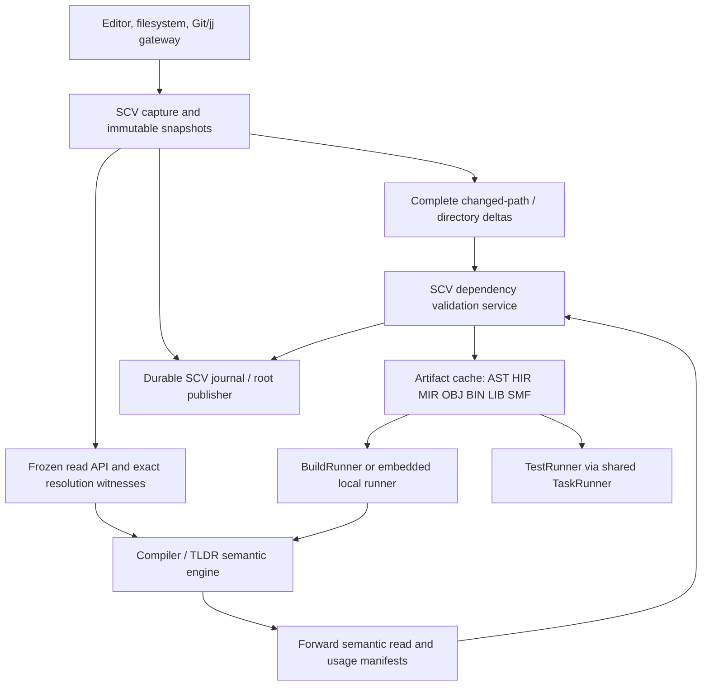
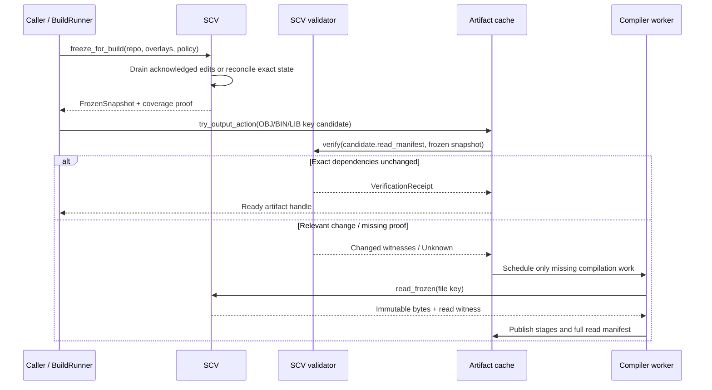
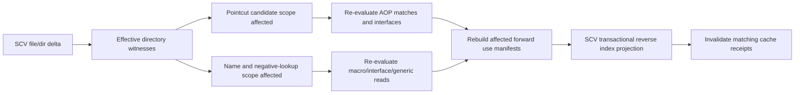

# Simple SCV implementation plan for compiler, TLDR and build cache

**Date:** 2026-10-27  
**Status:** Proposed SCV-specific engineering design, not a verified implementation audit  
**Companion:** `simple_cache_with_scv_implementation_plan_2026-10-27.md` and `simple_cache_async_build_final_design_2026-10-26.md`  
**Objective:** Specify what SCV itself must implement so the embedded Simple compiler, BuildRunner and TestRunner can correctly reuse pseudo-immutable AST/HIR/MIR/OBJ/BIN/LIB/SMF artifacts across source edits, commits, branches, worktrees and machines.

> **Contract:** SCV owns versioned source truth, change evidence, path identity, and source snapshot admission. Compiler owns semantic dependency discovery and compilation. Cache owns artifact bytes, action-result lookup and retention. The shared runner owns scheduling. **An unchanged commit, timestamp, Bloom result or watcher stream alone never proves a cache hit.**

## 1. Scope and non-goals

### SCV must deliver

1. Frozen, immutable **source snapshot views** including committed tree, uncommitted worktree, unsaved editor buffers, generated inputs, external checked-out dependencies and relevant configuration.
2. A **complete change feed** and fast cross-snapshot exact comparison for files, directories, renames, additions, deletions, symlinks and negative path/name lookups.
3. Stable path/file identities and content digests; 16/32-bit IDs remain **snapshot/container-local** and do not become global hashes.
4. **Dependency validation receipts** proving an existing artifact's *recorded reads* remain equivalent under a requested snapshot.
5. A **directory-scope invalidation feed** for TLDR, AOP pointcut introductions, macro resolution and generic discovery; compilers report actual semantic reads and regenerated outgoing-use manifests.
6. Durable and idempotent publication of source snapshot roots, exact dependency manifests, graph projections and validation receipts.
7. A change subscription / admission barrier API that both embedded compilation and BuildRunner can use **without requiring a daemon**.
8. Retention roots for branch, release, worktree and pinned snapshots, plus integrity verification and bounded metadata indexes.

### SCV must not take ownership of

- AST/HIR/MIR lowering, language semantics, pointcut evaluation, generic instantiation, code generation, link correctness, or binary cache encoding.
- CPU-fiber scheduling, worker/process lifecycle, test verdicts, or peak-memory admission. These stay in shared TaskRunner and its build/test clients.
- GC/eviction of sole authoritative version-control history. Derived compiler cache may be evicted; source history must follow SCV's separate retention policy.

## 2. Boundary diagram



**Critical rule:** The cache may return an existing artifact key from an older branch/snapshot, but must obtain an SCV verification receipt for the *requested* frozen snapshot before declaring it reusable.

## 3. Existing contracts and implementation approach

Prior integrated plan identifies `CompileSnapshotV1`, SCV capture/WAL and gateway, root journal, frontend cache, `PublicSummaryV1`, `package_module_index.spl` generations V1–V4, and `src/lib/common/task_runner/`. Treat these as **integration candidates**, not proof that the native end-to-end path already exists. Inspect the working checkout for actual signatures and tests before implementation.

| Owner | Extend / verify | Do not duplicate |
|---|---|---|
| `src/lib/scv/` | Frozen snapshots, exact deltas, identity, move/rename, overlay capture, journal/reconciliation, SCV APIs below | New competing VCS or second capture authority |
| `src/compiler/10.frontend/` | Source read witnesses, TLDR parse dependency manifests, stage cache binding | Independent filesystem watcher or separate snapshot truth |
| TLDR / semantic cache | Module/dir read witnesses, pointcut candidate reads, macro/generic forward manifests | SCV guessing what a macro or pointcut means |
| `package_module_index.spl` | Versioned semantic action key, receipt mapping and graph generations | Redefinition of legacy V1–V4 key semantics |
| `src/lib/common/task_runner/` | Subscription, scheduling and producer deduplication interfaces | SCV-specific fiber scheduler |
| BuildRunner and TestRunner | SCV admission/receipt consumers, same scheduler | Separate freshness engines |

**First implementation task:** inventory code, feature flags, admitted providers, native tests, and serial formats. Label each capability `implemented`, `partial`, `planned`, or `unverified` from actual source and executable tests.

## 4. Versioned SCV data model

All pseudocode is a proposed logical API, not confirmed Simple syntax.

```text
ScvSnapshotV2 {
    namespace: RepoId
    checkpoint: ScvCheckpointId?        // provenance, not semantic hash
    committed_tree_root: Digest
    worktree_overlay_root: Digest
    editor_overlay_root: Digest
    generated_input_root: Digest
    external_input_roots: [Digest]
    source_inventory_root: Digest
    directory_inventory_root: Digest
    path_policy_key: Digest             // case, Unicode, symlinks, mount rules
    configuration_root: Digest
    capture_epoch: u64
    coverage: Complete | Unknown(reason)
}

ScvFileRecord {
    stable_file_uid: FileUid
    path_key: CanonicalPathKey
    kind: Regular | Symlink | Directory | Generated | Submodule
    content_id: TaggedDigest?
    mode_and_executable: u32
    source_generation: u64
    provenance: Committed | Worktree | Editor | Generated
}

ScvChangeBatch {
    from: SnapshotId
    to: SnapshotId
    coverage: Complete | Unknown(reason)
    affected_old_paths: [PathKey]
    affected_new_paths: [PathKey]
    changed_directory_roots: [DirectoryKey]
    renames: [(old_path,new_path,file_uid)]
    file_changes: [Create | Delete | Modify | Mode | Symlink | Rename]
}
```

### Stable identity and ID packing

- `FileUid` represents an SCV-tracked logical file through a witnessed move, not just a filename hash. Separate *content identity* from *path/scope identity*.
- In-memory path and node tables use 16-bit local indices when the verified arena fits, otherwise 32-bit indices or promoted wider handles. Never use truncated IDs for global equality.
- XXH3-128 (or XXH3-64 for a lookup fingerprint) is an accelerator for **trusted** local indexes. A second digest alias (BLAKE3-256 or SHA-256 according to policy) verifies persisted/external/untrusted bytes. Hash-algorithm identifiers and canonical input domain are part of the key.
- Multiple digests can coexist for the same SCV blob; avoid eagerly hashing all aliases if none requests them. Ensure digest aliases map to identical verified bytes; collision probing compares exact canonical path and content identity.
- Snapshot-scoped index ID reuse must not outlive generations referenced by outstanding cache handles. Keep generation tags or never reuse IDs in a pinned snapshot.

## 5. SCV capture barrier and no-change fast path



1. If output file already matches a valid committed artifact and its input/read witnesses verify, do **nothing** (no file rewrite, no compiler startup).
2. If existing OBJ/BIN/LIB cached bytes verify but requested destination differs/missing, safely materialize without compilation/linking.
3. If output action misses, validate highest useful cached stage, then build only missing work. **Default build target is SRC → OBJ** in embedded and BuildRunner modes; BIN/LIB/SMF are explicit downstream action requests.
4. `freeze_for_build` must include changes acknowledged before its barrier. Post-barrier edits must belong to a later source generation.
5. SCV supplies frozen blob reads, not live file reopening from parser fibers. Early prefetch can be speculative but never authorize stale admission.
6. Embedded-only mode uses local SCV adapter/in-process data structures; BuildRunner uses shared SCV service with the exact same snapshot/receipt semantics.

### Unknown watcher coverage

Watchers can lose events or restart; SCV must expose `Unknown` and reconcile exact affected inventories or fail closed. Git's changed-path Bloom filters accelerate path queries but do not prove arbitrary merge/overlay equality. A directory witness must capture additions that could satisfy a previous negative lookup.

## 6. Changed-path query API

```text
scv.freeze_for_build(repo, overlays, policy) -> FrozenSnapshot
scv.open_frozen(snapshot, file_key) -> BlobHandle + FileReadWitness
scv.resolve_path(snapshot, directory, name, rules) -> PositiveOrNegativeWitness
scv.diff_exact(snapshot_a, snapshot_b, scopes?) -> ScvChangeBatch
scv.changed_since(checkpoint, scopes?) -> CompleteDelta | UnknownCoverage
scv.subscribe_changes(repo, cursor) -> ChangeStream
scv.verify_read_set(snapshot, ReadManifest) -> Verified | Changed | Unknown
scv.publish_validation_receipt(snapshot, action, witness_proof) -> ReceiptId
scv.pin_snapshot(id, reason) / scv.unpin_snapshot(id, reason)
```

**Fast path:** compare matching file and directory subtree roots, then exact changed leaves. If roots match in a validated canonical domain, skip traversal. Cache changed-path indexes per snapshot pair/scope and merge range, not just first-parent history. Use Bloom only to reject *possible* unaffected paths when its no-false-negative construction/coverage is proven; a positive result requires exact confirmation.

### Negative witnesses must cover

- Import search results where no candidate existed previously.
- `@when` target/config candidate changes and new feature variants.
- Symbol resolution, overload and trait-implementation candidate sets.
- Directory TLDR/AOP pointcut candidate universes, including negated selectors and new files.
- Macro discovery and generated declarations; file creation in ancestor/sibling scopes where allowed.
- Symlink targets, case folding and Unicode normalization policy, rename and move.

## 7. Semantic read manifest: the key SCV/compiler handshake

The compiler records **what it actually observed**; SCV verifies that observation against later snapshots.

```text
ReadManifestV2 {
    input_file_reads: [(FileUid, VersionDigest, PathContext)]
    directory_membership_reads: [(ScopeKey, InventoryRoot)]
    positive_resolutions: [(QueryKey, ResultUid, SemanticFacetDigest)]
    negative_resolutions: [(QueryKey, SearchDomainRoot)]
    tldr_facets: [(ModuleOrDirUid, FacetKind, Digest)]
    macro_expansion_reads: [(MacroUid, ExpansionOrInterfaceDigest)]
    generic_instantiation_reads: [(InstanceKey, ContractDigest)]
    aspect_match_scope_reads: [(PointcutUid, ScopeOrMatchSetRoot)]
    compiler_schema_and_policy: Digest
    effective_target_constraints: Digest?
}
```

SCV need not parse semantic IR: it verifies a manifest using registered facet providers. A changed file need not invalidate a consumer if the **consumed semantic facet** is proven unchanged. Unknown provider/schema/mandatory facet => revalidate or rebuild, never silently reuse.

### Split three identities

1. `ArtifactSemanticKey`: canonical effective source, read facets, compiler/config/target inputs, NOT arbitrary checkpoint ID.
2. `SnapshotValidationReceipt`: exact requested snapshot, coverage proof, relevant directory/negative evidence, validated semantic key.
3. `SCVProvenance`: commit, branch, worktree, author/edit lineage, audit data. It is not automatically part of artifact bytes.

Older action keys containing SCV revision/commit/tree continue to work unchanged. Introduce `SemanticActionV2` and shadow-validate before enabling cross-commit reuse.

## 8. Directory TLDR, AOP, macro and generic propagation

SCV should maintain **a versioned directory-change index and reverse-use index**, but semantics come from TLDR compiler outputs.



### AOP

- Behavior-only advice must not change public signatures or type/member layout.
- Interface-creating advice must explicitly declare introduced functions/types/members in its pointcut contract and effective directory TLDR.
- A changed pointcut/selector requires **old + new match universe**, including formerly nonmatching and negative matches. SCV updates every affected effective directory witness; compiler re-evaluates actual semantic matches.
- Per-pointcut canonical LF line records may use XXH3 fast screening, with exact bytes and policy verification; human CRLF input is accepted but the normalized cache projection is canonical. Do not normalize stored SCV source history.
- Directory TLDR updates invalidate receipts for affected files; do not blindly recompile files whose consumed interface/body facets verify equal.

### Macro

- TLDR records declared interface additions and expansion/body facets separately.
- Each successful source/TLDR consumer publishes its complete **outgoing macro-use manifest**. SCV derives exact reverse users transactionally.
- Adding/removing a macro candidate must invalidate negative-resolution witnesses even when no previous user edge existed.
- A changed macro interface requires re-expanding actual users, updating their generated TLDRs and effective directory witnesses.
- Do not mutate provider semantic digest because its user list changed.

### Generics

- Generic specialization identity uses tagged structured type/const/effect arguments, not string concatenation or a grammar-depth heuristic.
- Each consumer publishes complete required instance keys. SCV derives demand/users from a snapshot-scoped set of unique use identities; do **not** concurrently increment/decrement counters as authority.
- Zero active users removes the *demand projection*, not necessarily the cached artifact: releases, branches, libraries, active tasks and pins may still require it.
- A library may advertise HIR/MIR-based delayed object generation. BuildRunner requests the missing concrete OBJ before linking and publishes its own action result.

### Publication transaction

```text
publish_consumer_generation(snapshot, consumer_uid, compiler_result):
    assert frozen source and all semantic dependencies match snapshot
    validate all generated module/dir TLDR facets and output references
    atomically replace the consumer's complete outgoing-use manifest
    derive updated reverse-use projections and demand counts
    record affected directory roots and invalidated verification receipts
    journal and atomically publish one new admitted root
```

A cancelled, failed or stale producer cannot remove the last admitted manifest. Replay is idempotent by `(snapshot, consumer, source_generation, producer_attempt)`.

## 9. AST-set / HIR-set / MIR-set / OBJ-set support

SCV does **not** serialize compiler IR. It supplies exact source/import graph witnesses and immutable set roots. Compiler/cache decide binary pack layouts and references.

```text
ScvSetIndexEntry {
    root_import_or_tldr_uid
    member_scope_root
    leaf_to_root_dependency_order
    member_file_uid_table
    including_file_bloom?       // accelerator, never proof
    candidate_path_hashes?      // path-equality verified
    last_verified_receipt?      // not part of semantic set identity
    artifact_set_key
}
```

- The import graph includes real cycles. Condense strongly connected components; deterministic path/depth ordering chooses layout/order only, never deletes a dependency.
- Immutable sets rebuild from leaf SCCs upward. An updated leaf may permit upper-level set reuse only after relevant semantic witnesses verify unchanged.
- A Bloom filter of file IDs can reject an impossible membership query, but a newly added file also requires matching directory/search-domain evidence.
- A set may be reused across branch commits when its source/semantic closure is unchanged. Updating `last_verified_receipt` must not rewrite the semantic set.
- Portable binary AST/HIR are canonical little-endian; target-specific HIR overlays use optional OS/CPU/ABI/layout constraints. SCV tracks relevant configuration; target-independent keys should not vary just because the host changes.

## 10. Persistent packed references: SCV responsibility

SCV owns the **identity translation** needed to reconnect persisted array/hash/container references; cache-format owners encode compiler nodes.

```text
PersistentExternalRef {
    content_or_container_key: TaggedDigest
    member_table_id: u32
    object_index: u32
    expected_kind: u16
    generation_or_schema: u16
}
```

- Save *container identity + member ID*, never process pointer, hash-table bucket address, mutex, fiber ID or page address.
- 16/32-bit local IDs are interpreted with their owning container context. Compiler `attr array` uses dense indices/offset tables; compiler `attr hash` uses stable hashed-entry IDs and sorted canonical key/value records, not volatile bucket indices.
- After mmap/loading a binary pack, resolve external container IDs via an SCV/cache gateway that validates snapshot permission and digest identity. Build process-local pointer side caches only while container generation pins remain valid; drop/reconstruct these caches after load or eviction.
- Empty/late-init pseudo-immutable fields remain runtime sidecar slots and are not serialized as writable pointers. Publish full immutable pack generations atomically.
- Supporting both container-ID-less *contextual local refs* and container-qualified refs in the Simple standard library requires generation-aware lookup and explicit promotion on width overflow.

## 11. SCV indexes, space bounds, and eviction

### Required indexes

| Index | Key | Value | Mutation policy |
|---|---|---|---|
| Snapshot tree / overlays | repo + snapshot | immutable roots | append and publish |
| Stable path and file registry | scoped path / file UID | current and historical identities | versioned |
| Complete changed-path index | snapshot interval / pair | exact file/dir deltas, coverage | derivable |
| Negative resolution | query + scope root | absence witness | versioned query result |
| Semantic read manifest | consumer action key | exact forward reads | immutable |
| Reverse-use projection | macro/generic/pointcut UID + scope | users | recomputed transactionally |
| Validation receipt | action + snapshot | validated read-set proof | append/replace receipt pointer |
| Ref/branch roots | main, releases, worktrees | pinned snapshots | retention protected |
| Digest alias registry | algorithm + digest | verified blob identity | append verified alias |

### Bounded storage

- Policy limits for retained branch/ref count, snapshots per branch, revisions/variants per path, memory-resident metadata, disk CAS/packs and journal space.
- Protect `main`, explicitly selected `release/*`, working overlay roots, active compiler/test tasks and user pins; configure finite limits rather than unlimited release globs.
- Evict rebuildable metadata, unpinned derived packs or stale validation receipts before relevant source history. Source history is **not** build-cache garbage.
- Use read leases/pins to prevent freeing a mapped pack or container behind an active fiber/process.
- Keep access frequencies/hotness as nonsemantic heuristics. If the cache is over budget with only protected roots, report and throttle/spill according to policy, not corrupt the graph.

## 12. SCV / BuildRunner / TestRunner integration

```text
build_or_test(request):
    snapshot = scv.freeze_for_build(...)
    requested_action = action_resolver.resolve(request, snapshot)
    candidate = cache.lookup(requested_action)
    if candidate and scv.verify_read_set(snapshot, candidate.manifest).verified:
        return ready_handle(candidate)        # no worker scheduled
    return shared_task_runner.schedule(single_flight_key, resources, task)
```

- The shared **TaskRunner** schedules CPU fibers, async I/O, optional compiler/test processes, memory admission and cancellation. SCV provides fast read/diff/verification operations and subscriptions; it is not another scheduler.
- BuildRunner consumes the snapshot for normal SRC → OBJ and optional BIN/LIB/SMF actions. TestRunner uses the **same snapshot/cached build artifacts** but test results require their *own* runtime environment/test binary/test-data witnesses; don't cache a passing test merely because OBJ is unchanged.
- On file read/cache miss, issue async SCV frozen-blob read early and suspend only the blocked fiber; another ready fiber runs. SCV must deduplicate identical frozen reads but need not allocate one future per cache field.
- Shared-process workers can hold immutable arena handles. Cross-process workers must use verified pack IDs/offsets or shared memory with lifetime leases, not pointers.
- Artifact output `mmap` versus buffered I/O is a compiler/cache writer decision; SCV must ensure atomic blob publication, durable ownership, crash recovery and digest verification.

## 13. Versioning, policy and security

- Write SCV policy in SDN. Existing admitted policy validates candidate changes; a candidate may not waive its own required checks.
- Explicit schemas for `ScvSnapshotV2`, `ScvChangeBatchV1`, `ReadManifestV2`, `VerificationReceiptV1`, `SemanticActionV2`, `DigestAliasV1` and `DirectoryWitnessV1`.
- Use tagged hash algorithm and canonical-domain version in every persisted identity. Preserve legacy SHA-256/history compatibility and V1–V4 package-action readers; no silent key reinterpretation.
- Trusted local XXH3 is a lookup optimization; remote, untrusted or shared caches require verified cryptographic content identity, authorization on blob fetch, isolation across namespaces, limits against malicious pack offsets and symlink/path escapes.
- Source snapshots and semantic read manifests must record relevant environment variables, generated-file producers, compiler/toolchain versions, dependency policies and nonhermetic inputs. Mark actions uncacheable when complete inputs cannot be bounded.
- SCV gateway to Git/jj should preserve rename lineage and exact file bytes; conflicts and working-tree drafts are representable, never silently treated as successful compiler inputs.

## 14. Native APIs and proposed module split

```text
src/lib/scv/
  snapshot/       # freeze, overlay inventory, snapshot receipts
  identity/       # FileUid, path policy, digest aliases, path mapping
  changes/        # complete deltas, watcher reconciliation, comparison
  witness/        # file/dir/negative lookup, read-set verification
  graph/          # exact forward manifest, derived reverse projections
  publish/        # durable journal, validation receipts, atomic roots
  gateway/        # frozen bytes, cache and Git/jj source interface
  retention/      # pins, branch/ref roots, derivable-index eviction
  policy/         # SDN parsing and validation
  tests/          # SSpec native acceptance fixtures and oracles
```

Preserve existing file/module organization where already present; these are responsibility boundaries, **not** an instruction to reorganize the repository unnecessarily.

### Performance requirements

- Warm verified output: zero compiler tasks and ideally no BuildRunner RPC when snapshot receipt is locally valid.
- Unchanged subtree: constant-time-ish root comparison, without enumerating every descendant. Validate overlay and policy roots first.
- Reverse-use updates: delta-driven from complete replacement manifests; never scan the whole repository for every macro edit.
- Parallel requests: dedupe identical snapshot/read-set verification and artifact admission, but avoid a single global lock. Shard indexes by namespace/root, keep immutable table snapshots and publish via atomic root swap.
- Large repositories: bound diff memory through streaming page iterators; cache changed-path partitions and complete scope proofs.
- Measure cold and warm latency, retained bytes/path, peak RSS, changed-file verification time, branch-switch cost, watcher-reconciliation cost, snapshot-barrier latency and exact rebuild counts.

## 15. Execution plan and dependencies

| Phase | SCV work package | Must be completed before | Native evidence |
|---|---|---|---|
| P0 | Audit existing snapshot, gateway, journal, package index, SDN, SSpec and tests | Any incompatible schema change | source-to-contract inventory |
| P1 | Frozen snapshot V2 / overlays / capture barrier / file identities | Correct cache admission | dirty editor/worktree build |
| P2 | Exact cross-snapshot file+directory delta and Unknown coverage reconciliation | Cross-commit reuse | branch/merge/delete/overflow cases |
| P3 | File, directory, positive/negative resolution witnesses | TLDR correctness | previously absent import and new member |
| P4 | Versioned read-manifest verification and snapshot receipts | Reuse across commits | unchanged artifact hash + new receipt |
| P5 | Directory/AOP scope index, pointcut-old/new affected-domain notifications | AOP incremental | add/remove/move/negated selector |
| P6 | Atomic macro/generic forward-use replacement and derived reverse projections | selective invalidation | failed/replayed/stale worker |
| P7 | AST-set import graph, SCC roots, verified Bloom screening, path hash | fast PCH-like reuse | cold/warm equivalence |
| P8 | Tagged digest aliases, cross-process container resolver, pinning | remote/shared cache | cross-process load and collisions |
| P9 | SCV/BuildRunner/TestRunner shared admission adapters | CI gate | embedded/runner/test equivalence |
| P10 | Bounded retention, crash replay, compatibility/shadow migration | production rollout | fault injection + downgrade reads |

**MVP order:** P0→P1→P2→P3→P4→P9 for correct SRC→OBJ reuse; P5–P8 for TLDR/AOP/macro/generic scale; P10 hardens production readiness. Cross-commit reuse is gated on P4, not merely on P2 Bloom indexes.

## 16. Acceptance tests and SSpec policy

Use **modern SSpec typed-evidence tests** against the real SCV capture owner, compiler and admitted scheduler. Assertions must inspect actual compile outputs, emitted symbols/behavior, dependency manifests and scheduler task counts. Fixtures are allowed as inputs, not as fabricated proof. Every regression should reproduce cold uncached output and compare with warm result using independent expected semantics.

| ID | Test | Pass oracle |
|---|---|---|
| SCV-CACHE-01 | Repeat build, same snapshot and output | no-op; zero parser/codegen/link work; no output rewrite |
| SCV-CACHE-02 | Same inputs, deleted output destination | materialize cached OBJ/BIN/LIB; zero compiler/link tasks |
| SCV-CACHE-03 | Unrelated commit / other branch | semantic artifact reused, new exact snapshot receipt |
| SCV-CACHE-04 | Dirty worktree/unsaved editor while commit unchanged | captured new bytes; stale cache rejected |
| SCV-CACHE-05 | Build concurrent with edit/coalescing | capture barrier includes acknowledged edit; build matches frozen snapshot |
| SCV-CACHE-06 | Event overflow/restart/journal hole | coverage unknown, reconcile or fail; never false hit |
| SCV-CACHE-07 | Merge / non-ancestor branch switch | exact changed-path closure; no first-parent blind spot |
| SCV-CACHE-08 | Rename/move across AOP directory scope | old/new paths and effective directory facts correct |
| SCV-CACHE-09 | Previously missing import created | negative witness breaks; new declaration observed |
| SCV-CACHE-10 | Pointcut changes match set and adds type/member | all old/new affected scopes revalidated; generated interface matches oracle |
| SCV-CACHE-11 | Behavior-only advice changes public layout | rejected; no admitted invalid TLDR/OBJ |
| SCV-CACHE-12 | Macro interface/body changes, nested users | only relevant consumers regenerated; reverse index exact |
| SCV-CACHE-13 | Generic use added, removed, repeated or concurrently published | unique demand counts correct; zero demand does not delete pinned artifact |
| SCV-CACHE-14 | Failed/cancelled/stale compile manifest replacement | old admitted manifest retained; no stale publisher wins |
| SCV-CACHE-15 | AST-set with legal import cycle and new file | SCC correct; no edge lost by sort/Bloom |
| SCV-CACHE-16 | xxh3/truncated path ID forced collision | exact canonical equality check; no false alias |
| SCV-CACHE-17 | Multiple digest alias and corrupt remote content | mismatch rejected; SHA/BLAKE identity verified per policy |
| SCV-CACHE-18 | Big-endian host simulation, x86/ARM/RISC-V targets | canonical portable AST/HIR reuse; target HIR/OBJ valid |
| SCV-CACHE-19 | Load binary cache pack in new process | container-ID and stable-entry refs reconstruct, stale pointers never used |
| SCV-CACHE-20 | Crash during manifest/index/receipt publication | replay yields old or complete new root, not half state |
| SCV-CACHE-21 | Embedded vs BuildRunner SRC→OBJ | matching semantic output and dependency read-set; no runner requirement standalone |
| SCV-CACHE-22 | TestRunner reuses OBJ but changes test env/input | build artifact reused; test verdict appropriately re-executed |
| SCV-CACHE-23 | Aggressive cache eviction under pinned main/release/worktree | pinned history and active packs safe; budget reported if infeasible |
| SCV-CACHE-24 | Version migration V1–V4 action keys / new semantic key | old readers valid; cross-commit hit only after complete witness verification |
| SCV-CACHE-25 | Concurrent 100 consumers of one changed TLDR | single admitted producer; no lost wakeups; reverse manifest exact |
| SCV-CACHE-26 | New generated source modifies directory inventory | one admitted new generation, no self-triggering infinite rebuild |
| SCV-CACHE-27 | Symlink/case/Unicode/path-policy change | exact path and search-domain witnesses, sandbox constraints enforced |
| SCV-CACHE-28 | Clean build oracle after partial facet invalidation | same symbol/layout/runtime semantics; only necessary stages executed |

### Evidence contract for each acceptance scenario

```text
SSpecEvidence {
    test_id
    actual_scv_snapshot_root
    event_coverage_and_capture_barrier
    actual_input_and_directory_witnesses
    semantic_action_key_and_validation_receipt
    cold_and_warm_output_digests
    independently_expected_symbols_or_runtime_results
    observed_parse/hir/mir/obj/link/test task counts
    actual_process_exit_and_diagnostics
    injected_faults_or_controlled_source_changes
}
```

Negative controls: deliberately corrupt a dependency witness, drop an event, collide a short ID, modify an overlay, and change a pointcut search domain; each must cause an exact failure/reconciliation and then pass on corrected input. Avoid testing only binary round-trip identity: decoded AST/HIR/MIR must be consumed by the real compiler pipeline.

## 17. Sources and design references

- Existing integrated local plan: `simple_cache_with_scv_implementation_plan_2026-10-27.md` — particularly §§5–13, 20, 25–27, including prior codebase findings and planned acceptance tests.
- Existing local plan: `simple_cache_async_build_final_design_2026-10-26.md` — embedded SRC→OBJ default and shared build/test task execution.
- Git commit-graph changed-path Bloom docs: https://git-scm.com/docs/git-commit-graph — accelerate changed-path queries but are not full snapshot/overlay authority.
- Watchman recrawl/event loss: https://facebook.github.io/watchman/docs/troubleshooting.html — filesystem event overflow demands reconciliation.
- Bazel remote cache overview: https://bazel.googlesource.com/bazel/+/master/site/en/remote/caching.md — separates action-result cache from content-addressed blobs.
- Remote Execution API: https://github.com/bazelbuild/remote-apis/blob/main/build/bazel/remote/execution/v2/remote_execution.proto — action identity, declared inputs and cacheable results.

## 18. Final SCV acceptance gate

SCV is ready to serve the Simple compilation cache only when: **(a)** exact frozen source including overlays is provable, **(b)** complete relevant file/directory and positive/negative resolution changes are verifiable, **(c)** consumed semantic read-set validation produces a receipt bound to the requested snapshot, **(d)** macro/generic/AOP outgoing-use projections publish transactionally, and **(e)** embedded SRC→OBJ and BuildRunner SRC→OBJ produce equivalent results with no-op cache hits and crash-safe replay.

The first performance milestone is **zero compilation on an unchanged verified OBJ request**. The first correctness milestone is **no stale hit after a relevant previously-absent name/file becomes present**. Both must pass before introducing speculative Bloom/PCH-set shortcuts or cross-repository remote cache sharing.
