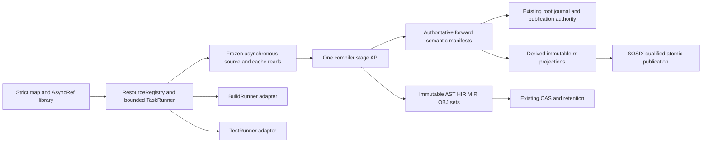

# SCV cache implementation: lockless resources, asynchronous stages and immutable storage

**Date:** 2026-10-27

**Revision:** 2.0, consolidated execution plan; not a deployed schema

**Target:** `ormastes/simple`, `release/1.0.0`

**Planning source:** `7fc439be05f2dbe1617fd199c94ac837749f681d`

**Historical source pins:** `75c50fe2366a4cd85865d284e57c6560abafe057` for the supplied revision 1.1 observations; `bf9c7fd3e10f100da5223b5db6cfe2b34663db28` for retained revision 1.0 observations. Neither is relabeled as current execution evidence.

**Companion:** [Standard concurrency and resource implementation](../../lib/concurrent_resources_runner_plan_2026-10-27.md)

**Status:** Planned. This revision consolidates the supplied cache plan, revisions 1.2/1.3, and the final SOSIX amendment. No native cache, concurrency or performance qualification is claimed by this document.

## 1. Binding delivery decision

**Implement the lockless map library and `AsyncRef` first, using TDD.** The first code delivery is the companion's S1-L0 library slice with real atomic operations, stable shared result storage and executable race tests. SourceReader, compiler nodes, `.rr`, BuildRunner and TestRunner consume those primitives afterward. A rewritten document, owner-local simulation or renamed synchronous Future is not completion of this first delivery.

The structural order remains **S1 asynchronous resources, stages and I/O → S2 one compiler API and shared fiber/process invocation → S3 pseudo-immutable storage**. Correctness and no-change fixes may land independently. Do not make packed IR, an embedded database, or phase-4 whole-library builds a prerequisite for the first map/AsyncRef slice.

The requested removal of “mono” is implemented here as removal of mandatory whole-program scheduling, global phase barriers and duplicate orchestration. **Generic semantic specialization remains required** in its existing compiler owner. Removing `40.mono`, generic substitution or addressable specialization output is not authorized by replacing its scheduler. Any later language-level removal requires an explicit semantic decision and compatibility tests.

Strict compile lookup, claim, waiter registration, maker scheduling and ready access acquire no mutex, spinlock, filesystem lock or process lease. Nonexclusive retained ownership and safe reclamation remain mandatory. Existing journal/root authority still orders accepted durable commits; that narrow authority must not become a giant dispatcher for ready reads or independent makers. Locked general-purpose map backends remain explicit alternatives, never a strict-profile fallback.

True per-file execution remains opt-in until its native gates pass. `SIMPLE_FILE_WORKERS=1` is not enabled by a plan or a library test. The default requested compiler result remains source → OBJ, through the same embedded engine in local and runner modes.

## 2. Source audit and evidence boundaries

The following observations were checked in the planning source or supplied by the coordinated scoped inventory. They are not whole-repository certification.

| Existing owner | Observed boundary | Required closure |
|---|---|---|
| `src/lib/nogc_async_mut/concurrent.spl` | `ConcurrentMap` stores an array and scans entries; shard argument is compatibility behavior | New explicitly qualified strict map; preserve old API until callers migrate |
| `src/compiler/80.driver/cache/source_reader_v1.spl` | Async defaults return `Future.from_value` after synchronous work; `await_now` allows one million polls | Frozen-source provider, actual pending I/O and executor wake |
| `cache/daemon/cache_single_flight_v1.spl` | Owner-local Dict/list coordination and detached pending Future | Stable library slots; migrate real daemon/TLDR callers, then remove redundant owner |
| `src/lib/nogc_async_mut/async_ring/simple_ring.spl` | Fixed-capacity single-owner reference ring | Canonical poll/wake adapter; qualified multicore ingress, not concurrent mutation of one ring |
| `cache/reference/reverse_reference_atomic_generation_v2.spl` | Explicitly says live publisher adapter unavailable; production gate closed | Real authority adapter, SOSIX publication and mandatory complete-scope recovery |
| `src/lib/nogc_async_mut/sosix/host_facade.spl` | Reexports `file_atomic_write` | Atomic replacement alone is not expected-generation CAS or crash durability |
| Existing pseudo-immutable implementation plan | Still says design sections 1–23 are pending; detailed design contains them | Correct status and link this consolidated order when that owner is updated |
| Existing per-file/current-truth index | Opt-in native execution and historical receipts | Preserve distinction between intended API and enabled execution path |

Retain the supplied scoped findings about daemon wake code, one active workspace request, full reply blobs per waiter, scheduler array scans, BuildRunner's 100 ms observation loop, TestRunner's 128-case aggregate bound, and the restricted compiled-result route. Reconfirm each production call path before its migration; source presence is not native qualification. Do not resurrect the older claim that daemon wake code is entirely absent.

The diagnostic `.rr` patch using persistent `PUBLISH.lock` and consumer-delta retry is **not the target implementation**. It must not land as strict-profile completion. Preserve any useful failure evidence separately. Removing its lock without a replacement authority protocol would also be incorrect.

## 3. Ownership and dependency graph



| Concern | Canonical owner | Boundary |
|---|---|---|
| Frozen source truth, overlays, path lineage, capture barrier | `src/lib/scv/` and existing snapshot contracts | Compiler never silently reopens mutable live paths |
| Parse and summary binding | `src/compiler/10.frontend/`, common cache contracts | Source generation must match TLDR producer binding |
| Macro/AOP semantics | `src/compiler/35.semantics/` | Declared generated surface is independently checked |
| Generic substitution and demand closure | `src/compiler/40.mono/` and current generic contracts | Scheduler replacement does not replace the semantic engine |
| Read admission, manifests, publication and reverse projection | `src/compiler/80.driver/cache/` | One root/journal authority; no generic library grants writer rights |
| Directory, shared outcome and ownership primitives | Companion standard-library owners | No compiler types imported into dependency-free resource core |
| Execution, budgets and completion | `src/lib/common/task_runner/` | One task runtime; build/test are adapters with separate validators |
| Filesystem atomic visibility and durability | Existing SOSIX host provider | No caller-local POSIX, Windows or SFFI bypass |

Keep semantic references, CAS references, task prerequisites, runtime wait-for edges and retention edges distinct. Legal semantic cycles become SCC bundles/local indices; schedule their condensation DAG. Illegal self-waits and unresolved producer cycles return diagnostics. OBJ points back to its HIR/MIR/provenance; frozen AST/HIR is never mutated to append derived OBJ children.

## 4. Exact cache identity and SCV freshness

Separate stable entity identity, semantic definition facets, consumer-use root, finalized action key, requested-snapshot validation receipt, storage digest and retention root. Branch names, transient slot IDs, access time and incoming users do not become semantic definition inputs.

At a build capture barrier, include committed tree, dirty/untracked/deleted/renamed files, editor overlays, generated inputs, path/symlink policy, effective configuration and relevant external dependencies. Watcher overflow or incomplete change coverage is Unknown and triggers exact reconciliation. A commit match, timestamp, unchanged stale `.tld`, Bloom miss or successful process exit cannot admit reuse.

The read manifest records positive and negative resolution, directory membership queries, source/TLDR generation, actual semantic facets, target/provider/configuration reads and generated-source provenance. New files may satisfy previous negative queries even when absent from the old file Bloom. Across merges or unrelated checkpoints compare exact relevant snapshot trees; a first-parent path accelerator is insufficient.

Cross-commit reuse uses a new versioned semantic action key plus receipt. Preserve existing V1–V4 provenance-bearing keys and readers unchanged. Finalize keys after discovered dependency closure; the initial request key only deduplicates an exact frozen request and recipe. A shared in-flight request cannot join solely by pathname or short hash.

XXH3-128 remains a trusted lookup accelerator with exact equality; persisted/untrusted integrity retains admitted cryptographic digests. Current key records allow one to three active tagged aliases. Register extensibility separately from wire-format capacity. Sixteen/32-bit indices and fingerprints are never persistent identity proofs. Bloom/index negative results require complete construction, compatible parameters, exact membership binding and complete change coverage.

No-change order: validate already placed output and return without rewrite → materialize exact cached output → reuse objects and relink only when required → selectively compile missing stages. Multi-output manifests must be complete. Destination timestamps alone do not establish equality; placement must not let a writable hardlink corrupt CAS bytes.

## 5. TLDR, AOP, macros and generic demand

| Subject | Required semantic rule | Reverse/index rule |
|---|---|---|
| Module TLDR | Own declarations, body/interface facets and outgoing semantic reads | Incoming users never enter provider semantic bytes |
| Directory `__init__.tld` | Membership, inherited/local aspect scope, names/guards/coherence and effective introductions | Incoming count churn does not rewrite it |
| `.tldr` / virtual `_tldr.spl` | Preserve distinct existing projections and producer bindings | Neither silently becomes import authority |
| Advice | Preserve existing declaration interface by default; effects and order explicit | Body-only changes invalidate composed-body consumers |
| Structural AOP | Explicit introduced names/signatures/layout contract before admission; exact generated-surface equality | Recompute complete old/new scope candidate union including previous negatives |
| Macro | Definition contract, hygiene/effects, concrete generated surface and nested use/read manifests | Exact outgoing uses authoritative; `.rr` selects candidate users |
| Generic | Canonical resolved type/const/effect arguments, nominal identity, coherence and guards | Unique committed use identity determines counts, not requests |

Canonical pointcut projection uses UTF-8/LF, final LF, stable PointcutId, escaped embedded newlines and deterministic typed ordering. Physical line numbers and display edits do not grant semantic authority. Weave from immutable base bodies and an explicit ordered plan, never reweave a prior woven result.

Generic demands distinguish Interface, ConstEvaluation, InlineBody, AddressableCode and Export. Type-only demand need not emit OBJ; address taking/out-of-line/export may. Discover nested demands to bounded deterministic closure before sealing link inputs. Budget or recursion exhaustion is an error, never permission to omit symbols. Template signature-only packages cannot generate unavailable bodies.

Replace one consumer's complete committed use manifest atomically. Failed, cancelled or incomplete compilation does not erase prior committed contributions. Replays are idempotent. A scoped zero demand removes that scope's demand row but does not reclaim artifacts held by other roots, targets, exports, active tasks or history pins. Counts are not lifetime reference counts.

## 6. `.rr`: one derived projection, full reconstruction on failure

`ReverseRefV1` is a logical versioned schema proposal, to be reconciled with existing shard/manifest schema owners before assigning a wire tag. It binds provider identity/semantic generation, exact snapshot scope, committed forward-manifest root, completeness, canonical sorted unique use records, use-site/distinct-consumer counts, per-instance counts/demand-kind union and integrity digest.

A use identity includes consumer UID, stable use ID, kind, target/instance key and activation context. Preserve demanded variant and demand kind where relevant. Macro reference, invocation/expansion and generic demand are distinct kinds. Counts are recomputed from records and checked on decode. Provider `.tld`, template and OBJ semantic keys exclude incoming `.rr` roots.

The authoritative transaction commits the complete consumer forward-manifest root through the existing expected-old-root and attempt-fenced publisher. `.rr` may be asynchronously projected only with an explicit matching forward root and completeness state. Missing, corrupt, Partial, Unknown or stale `.rr` means reconcile authoritative manifests or return an explicit error; never zero users.

### 6.1 SOSIX publication contract

Proposed operation:

```text
sosix.atomic_publish_file(path, expected_generation, complete_bytes,
                         durability_policy, admitted_authority)
    -> Result<AtomicPublishReceipt, HostError>
```

This is not a claim that ordinary `rename` or `MoveFileEx` performs compare-and-swap. Generation comparison and publication must be indivisible **within the existing single admitted writer authority**. Qualify how that authority is established and fenced across processes/crash recovery. The authority checks expected generation and source root while holding its bounded publication turn, then invokes SOSIX staging/replacement. Makers and ready readers remain independent of that turn. Never implement CAS as unrelated read-generation then unconditional replace by multiple writers.

SOSIX owns same-filesystem staging, no-follow/path containment, complete-byte validation, atomic old-or-new visibility, and the requested file/directory durability acknowledgement for each host. File fsync alone is not automatically directory-entry durability. Unsupported capabilities return typed errors; no raw filesystem fallback. Immutable generation files are admitted before the discoverable root; readers discover a complete generation through the root, not partially updated sidecars. The journal/root remains recovery authority.

If the existing cross-process authority still relies on a compatibility manager lock, record that limitation explicitly. It cannot be claimed as a new lockless authority or moved into compile lookup/claim/await. The strict publication profile remains unavailable until the required ownership/fencing mechanism is qualified. Do not create a second authority merely to obtain a convenient file CAS.

### 6.2 Mandatory failure state machine

```text
Complete(root, generation)
  -- ANY generation/validation/staging/write/replace/CAS/durability/readback/
     recovery failure --> NeedsFullRecheck(scope) / Unknown
  --> pin latest admitted forward root
  --> enumerate EVERY committed consumer/use manifest in the affected scope
  --> validate coverage; rebuild complete edges and all counts
  --> compare cardinality/digest with an independent exact oracle
  --> verify root still current; SOSIX expected-generation publication
  --> Complete(root, new generation)
```

If the root changes during reconstruction or publication, discard the candidate and restart the **entire** scope recheck against the new pinned root. Do not replay only the failed delta, retry a partial consumer set or reuse an unverified old count. Deleted, renamed and previously absent consumers must be accounted for. Repeated churn/failure is bounded by retry/resource policy and remains incomplete with exact-forward fallback or explicit failure; it never becomes empty success. Record Unknown in the authority/reader admission path even if writing a failure marker itself fails. Old pinned data remains valid for its old snapshot, not for the failed current projection.

Normal healthy projection may batch complete committed deltas with exact old-root evidence. The first failed operation revokes that fast path for the affected scope until full reconstruction succeeds. A physical shard does not redefine the declared logical scope to evade the recheck. Unrelated scopes continue independently.

`ReverseRefProjectionFactory` produces full immutable images. `ReverseRefResourcePool` is a compatibility name for shared keyed `ResourceRegistry`/`ResourceCache`, not an exclusive mutable checkout pool. Key it by `(scope, admitted_forward_root, schema, policy)` and use library `AsyncRef`. One cancelled interest cannot cancel shared production needed by others.

## 7. Immutable stages, references and packing

S3 follows the useful S1/S2 path; it does not block async library integration. Preserve these supplied requirements:

| Area | Implementation contract |
|---|---|
| Stage sets | Demand-loaded immutable AST/HIR/MIR/OBJ manifests, complete exact membership, SCC bundles and backward provenance; manifest-ready does not mean every optional page is resident |
| Logical/resident state | A set-once accepted result identity survives eviction; Unresolved differs from None, absent and present-empty; retries get new logical generations |
| References | Owner-qualified local indices, pack/container-qualified indices, runtime table/pin; hash references identify canonical entries, never buckets |
| Lifetime | Protect before dereference; generation comparison alone cannot prevent unmap; no short borrow, map/hazard/epoch guard across await; budget any retained owning pin |
| Canonical packing | Versioned schema, explicit little-endian numeric fields, opaque digest bytes, bounded checked offsets/counts/codecs, deterministic ordinals and zero padding |
| Proposed format | `SIRPK001` 64-byte header and 48-byte section entries remain proposals pending schema review; never reinterpret existing FileAst/HIR/MIR format tags |
| Array attributes | Dense, presence bitmap, bitmap/rank, sparse sorted, CSR or sparse CSR chosen by density; validate monotonic offsets/cardinality and absent-versus-empty |
| Hash attributes | Sorted canonical keys and values; optional fully verified lookup accelerator; malformed index cannot authorize absence; runtime insertion order remapped at save |
| Persistence | Serialize values/query recipes, never raw pointers, process IDs, runtime generations, waiters, atomic state or live pins; saving omits pointer cache without mutating live views |
| Load/extract | Lazy verified chunks; thin extract retains exact external references; self-contained extract includes required closure/SCC; remap all changed ordinals |
| Portability | Endian/alignment-aware access; compressed data needs bounded decode; mmap/page faults are not intrinsically async; 32-bit hosts use bounded windows |
| Native parity | Cold decoded and warm resident consumers must agree on semantics, diagnostics, layouts, symbols and execution; round-trip equality alone is insufficient |

HIR carries optional OS/CPU/ABI/layout/runtime constraints and actual target-read witnesses. None means no constraint under a proved capability, not unfinished initialization. Preserve interim target-sensitive keys while preprocessing removes target arms. A portable base receives a new constrained overlay, never in-place target mutation. Portable AST/HIR does not imply portable native ABI/OBJ.

### 7.1 Container-qualified indices and lazy attributes (2026-10-30 clarification)

These are required storage/design changes, not claims about implemented codecs. Packed AST/HIR store container identity/version (or a qualified pack ordinal) plus object/entry index; they do not store pointers. A hash-entry reference also identifies its owning container and canonical entry, with exact key/hash validation as appropriate; a hash value, bucket or local index alone is insufficient. Repacking remaps every changed index/ordinal. Loading begins uncached. Runtime views may cache an owning container reference after verifying identity and retaining lifetime, but serialization omits that cache, raw scope addresses, AsyncRef slots and all process pointers. A cached reference or generation check does not itself prevent unmapping.

Choose existing attribute containers by frequency: common optional values use set-once scalar fields; dense indexed values use arrays with presence bitmaps; rare/keyed values use sparse hash sidecars. Keep unresolved, absent and present-empty distinct. Published core bytes remain immutable; lazy memoization belongs in runtime sidecars. Use AsyncRef for expensive shared production with waiting consumers, not for every node attribute.

HIR must preserve all host/target conditional alternatives; select explicit host/target configuration at MIR lowering. Current preprocessing can discard alternatives, so this remains a required migration: retain target-sensitive cache keys until preservation and MIR selection have executable evidence. Do not call current HIR portable merely because target constraints are recorded.

### 7.2 Deepest valid stage and backward provenance (2026-10-30 clarification)

The requested cache-return contract is: admitted OBJ -> writer; admitted HIR -> remaining HIR-to-OBJ work; admitted AST -> AST-to-HIR-to-OBJ; no admitted stage -> parse. Select the deepest valid stage under exact source/dependency/configuration evidence, and do not repeat earlier parsing, replay or save/reload. Mandatory remaining semantic checks still belong to their existing owners. For a verified immutable content-addressed destination, an existing matching filename is no-overwrite; arbitrary output names require exact admitted identity/content checks before skipping. Verified no-change preserves destination identity and timestamp. Atomic replacement for changed mutable destinations is a separate SOSIX publication profile.

OBJ -> HIR -> AST are backward logical container identities/indices with lazy retained resolution, not raw pointers embedded in packed bytes. Existing FrozenNativeModuleCapsuleV1 retains MIR/storage/OBJ, not a HIR/AST owning chain; FileAstV1 and MirHirExpressionArtifactV1 provide reusable identity records, but no universal retained stage-reference ABI is qualified. Reuse existing compiler/cache owners and verify their admission/resume seams before adding an adapter; the CompileNode name below remains proposed.

The current bounded TLDR patch extends the existing table with canonical map/AsyncRef and SourceReader fill/wake capability only. Its scope+entry reference is a runtime live-owner identity, never a persisted container ID. Default file-fiber/worker-surface consumers remain on legacy APIs pending adoption; runtime tests are UNRUN. See [TLDR async owner design](tldr_async_owner_integration_2026-10-30.md), including the mandatory terminal source-failure followup. It does not implement the storage/stage/MIR requirements in this section.


## 8. Compiler, runner and retention integration

The proposed `compile(request, options, provider)` returns `AsyncRef<ImmutableArtifact<CompileNode>>`, default OBJ. `request_stage` may return an admitted AST/TLDR earlier. `CompileNode` describes one completed stage and exact capabilities; external stage slots hold optional derived work. Confirm the public owner/name before adding it; never create a second compiler graph.

The source→OBJ chain is fused in one selected process; optional persistence cannot impose save/reload barriers. `ResidentReady`, `CommittedReachable`, `Durable` and `Qualified` are different outcomes. Restricted three-payload compilation remains Unavailable until a real producer satisfies that capability; a generic resolver cannot open a fourth undeclared input.

BuildRunner and TestRunner use common queues, resource budgets, completion, cancellation and fencing. Maintain prerequisite counters and reverse dependents instead of whole-DAG rescans. Replace compulsory timer observation with process events while retaining confirmed process-tree closure and parent output validation. Local fiber completion uses a versioned execution kind, not invented PID/reap evidence. TestRunner retains exact per-case inventory and 128-case group limit; 3,000 cases form 23 full groups plus 56, admitted within process budgets.

Replace broad workspace exclusivity with independently retained immutable request contexts and a drain protocol after compiler reentrancy is qualified. Same-process ready views are direct; cross-process fanout transports identity plus receiver-owned view rather than one full payload per waiter. A stalled maker or journal publisher must not block unrelated ready reads and allowed computation.

Budget request descriptors, waiters, active producers, frames, arenas, decoded/pinned/shared bytes, I/O, transport, dirty output and retirement independently. Existing profile ceilings of 64 live attempts, 1,024 bodies, 65,536 edges and 128 MiB do not become 3,000 automatically. Queue lightweight descriptors before arena admission. Reserve completion/dependency/cancellation capacity inside hard caps; nested emergency overcommit is not progress proof.

Retain repository/ref/worktree catalogs over shared CAS with bounded roots/revisions/variants and count+byte budgets. Branch names select retention, not semantics. GC marks complete roots, external dependencies and active owners, removes discoverability, waits for protected readers, then reclaims. Compact with temporary headroom and crash-safe catalog replacement. Never evict sole durable SCV history or protected roots to satisfy a cache budget silently.

## 9. Work packages and explicit prerequisites

All rows start **PLANNED/UNRUN** here. IDs preserve the supplied backlog; existing implementation evidence may close a row only after exact caller/source review and required execution.

| Phase | Packages | Concrete deliverable and dependency |
|---|---|---|
| First S1-L0 | SRH-W01–06, CVC-W21 foundation | Strict atomic map, stable result slots, AsyncRef and adversarial library tests before compiler adoption |
| S1 capture | CVC-W01–04 | Baseline/contracts, facets, frozen capture barrier, versioned semantic key and receipt |
| S1 semantic projection | CVC-W05–11 | Full forward manifests/`.rr`, TLDR facets, AOP contracts/scopes, macro uses, generic demands, exact propagation; `.rr` publication requires SOSIX and full-recheck gate |
| S1 stages | CVC-W12–13, W21, W22(a), W31 | SCC/set manifests, exact Bloom acceleration, real async reads and library-slot migration; no packed-format prerequisite |
| S2 compiler/execution | CVC-W20, W22(a), W23–25, W32 | Target-read correctness, common compiler facade, demand/link/output planning, event/budget core and TestRunner adapter |
| S3 storage | CVC-W14–19, W22(b), W26 | Array/hash references, lifetime, versioned pack headers/columns, actual decode/extract consumers, residency/retention |
| Every phase | CVC-W27–28, W34 | TDD, live evidence/adversarial controls, reconcile exact status and legacy compatibility |
| Qualification/rollout | CVC-W29–30, W33 | Equivalent-work performance, 3,000-scale native matrix, versioned rollout and rollback; default change last |

W22(a) means the usable fused async pipeline; W22(b) adds packed-stage adapters later. W05 owns `.rr` format/count/reconstruction; W06 excludes incoming users from TLDR semantic bytes; W09/W10 produce authoritative macro/generic forward records. W31–34 are closure slices over the original packages, not competing owners.

Retain release A-1/C1 target-sensitive interim keys, A-2/C2 integrity equality, A-3/C3 short-identity enforcement; B-1…B-3/N3,N1,N2 receipts/precheck/materialization; S1-1…6 stage/I/O/wake/overlap; S2-1…7 API/invoker/budgets/test adapter/hash/IDs; S3-1…7 storage/lifetime/layout/invalidation; P-1 portable HIR and P-2 default enable. Correct “at least three hashes” to the current one-to-three record limit and stale “design pending” wording in their owning documents. Preserve historical receipts rather than replacing them with these plan statuses.

## 10. TDD and acceptance inventory

For each delivery: first add executable SSpec with an independent expected result and a controlled race/fault schedule; run it against the current owner and retain the meaningful RED failure; implement the smallest production slice; run GREEN at the exact source/provider; refactor with affected regressions. A syntax/compiler failure is a blocked test execution, not the intended behavioral RED. A model PASS remains model evidence. Native multicore, filesystem, compiler and process behavior need live provider evidence. Stub assertions, zero selectors, aggregate exit-zero and constructed success counters cannot qualify a row.

Required receipts bind requirement/test inventory, implementation/provider build, source snapshot, target, schema/policy, oracle, actual discovered/executed/pass/fail/skip/unresolved counts and raw evidence digest. Keep PASS, FAIL, UNRUN, UNSUPPORTED, INCOMPLETE and QUARANTINED distinct. Sabotage one claim/wake/fence/pin/admission invariant and require its mapped test to fail, then restore and retain separate receipts. Re-run previously green cases only after relevant changes; obey the repository six-cycle cap and avoid unchanged retries.

| Retained inventory | Required coverage; no IDs removed or reassigned |
|---|---|
| CVC-SCV-01…10 | Frozen source, overlays, coverage, cross-commit receipts and exact context |
| CVC-AOP-01…08; CVC-MAC-01…07 | Interface/introduction/selector/effect semantics, generated surface, nested and negative macro reads |
| CVC-GEN-01…09 | Canonical typed demand, idempotent use counts, target/body variants, closure and symbol ownership |
| CVC-SET-01…08; CVC-REF-01…08 | SCC/set reuse, exact membership, owner/entry indices, widths, collision and lifetime |
| CVC-BIN-01…10 | Packed schema, array/hash codecs, malformed inputs, extraction, portability and real native consumers |
| CVC-RUN-01…08 | Embedded/managed source→OBJ, async overlap, budgets, output/no-change and test admission |
| CVC-RET-01…06; CVC-POL-01…08; CVC-NFR-01…05 | Bounded protected retention, policy/evidence/security and measured equivalent work |
| CVC-RES-01…20 | Stable shared result; wake/claim races; cancellation/retry; pins/collision/strict call graph/epoch; snapshot/stage/I/O; process/test separation; hard-cap progress; independent makers; real imports |
| CVC-SCALE-01…12 | Same/distinct/warm/skew/shared-dependency workloads; capacity boundaries; fairness; cold residency; process fanout; 3,000 tests; churn; collision and hard-cap exhaustion |
| CVC-RR-01…14 | Exact concurrent/replayed macro/generic users; zero scoped demand with retained history; body invalidation; corrupt/stale recovery; stale producer fencing; negative resolution; AOP semantic directory changes |
| T-K1, T-SF1, T-HA1, T-ID1, T-EV1, T-EC1, T-NC1, T-OV1, T-R01, T-MEM1, T-INV1…12 | Existing release tests retain their original subjects and receipts |

These are inventory crosswalks, not substitute assertions. Preserve the individual supplied scenario meanings when implementing each executable case; do not pass a family by executing one representative test.

| New mandatory host case | Live independent oracle |
|---|---|
| RR-SOSIX-01 | Readers see exactly old or new full image on every supported host |
| RR-SOSIX-02 | Short write, full disk and permission faults enter Unknown |
| RR-SOSIX-03 | CAS conflict/changing forward root rejects stale image and restarts whole scope |
| RR-SOSIX-04 | Crash before/after replace; visibility and requested durability distinguished |
| RR-SOSIX-05 | Corrupt/truncated/count-mismatched projection cannot yield a count |
| RR-SOSIX-06 | Complete reconstruction includes deleted/renamed/previously absent consumers |
| RR-SOSIX-07 | 3,000 same-key interests, one normal producer, exact terminal observations |
| RR-SOSIX-08 | 3,000 independent scopes progress within budgets without global maker serialization |
| RR-SOSIX-09 | BuildRunner/TestRunner/embedded callers share actual resource owner |
| RR-SOSIX-10 | Unsupported host capability fails explicitly; no raw fallback |
| RR-SOSIX-11 | Repeated failure never reports a fabricated zero-user result |
| RR-SOSIX-12 | Recovery/user churn preserves provider TLDR semantic bytes/digest |

## 11. Native qualification, bootstrap and measurements

Let K=distinct keys, R=logical requests, P=admitted producers, W=retained waiters and T=OS workers. Test K=1/R=3,000, K=3,000/R=3,000, and 3,000 resident hits separately. None implies 3,000 threads, compilers, processes or 9,000,000 waiters. Same-key replay does not add semantic users. Sweep 2,999/3,000/3,001 keys, 63/64/65 ready entries, full queues, skew, forced collisions and repeated epoch churn.

Record handle latency separately from usable result; first result, p50/p95/p99/max, makespan, unique accepted artifacts/s versus requester completions/s, CPU, actual parse/lower/emit counts, queue/wake/IPC bytes, private/RSS/shared/pinned/decoded/retired memory and cleanup. Include startup, admission, canonical equality, validation and durability requirements. Compare locked/sharded/atomic/owner-local/frozen profiles at equivalent work; no preselected performance winner or imported benchmark speedup.

The illustrative 4,096-cell/3,000-entry/3,000-waiter/3,000-handle arithmetic remains 563,072 bytes (549.875 KiB) at assumed 32/64/64/16-byte layouts, not an ABI or measured footprint. Payloads, queues, keys, allocator metadata, frames and retired epochs are extra. Three thousand distinct 1 MiB resident payloads already require 2.9296875 GiB.

Bootstrap/compiler repairs are evidence prerequisites, not cache features magically satisfied by library tests. Preserve active producer source, runtime capsules, per-run caches and exact lineage. The [phase-4 whole-library/shared-build plan](../bootstrap/phase4_whole_libraries_cli_shared_build_2026-10-27.md) remains separate: reuse libraries once only under compatible producer/target/runtime/schema identity. Phase-1/2/3 interpreter and BuildRunner capabilities remain separately labeled. Do not use the Rust seed as normal native library qualification or change phase defaults to hide unsupported cases.

## 12. Execution ownership and completion

The user supplied the requirements and chose the strict profile, TDD and library-first sequence; no additional option-selection pause is necessary. The Astra planning/review lane owns these two documents; the library design/review lane owns exact API/progress contracts; the implementation lane owns source/specs in a separate `work/*` checkout. The coordinator owns integration, exact-head review and landing. Existing bootstrap/RTI/shared-link/`.rr` diagnostic lanes remain isolated, and unrelated dirty files are never folded into these changes.

Each package is complete only when its real production caller, required evidence, compatible schema/rollback and documentation are reviewed and its PR is merged. The entire initiative remains incomplete while any mandatory package or acceptance gate is unqualified. Plans do not enable per-file, strict-multicore or portable-HIR defaults. Release tags/publication remain separate authorization.

Relevant retained documents: [pseudo-immutable implementation plan](pseudo_immutable_cache_impl_plan.md), [per-file truth index](cache_perfile_plan_index_2026-10-25.md), [23-section design](../../../05_design/compiler/cache/pseudo_immutable_cache_async_build_design.md), [SCV-specific plan](../../app/tools/simple_scv_compiler_tldr_build_cache_implementation_plan_2026-10-27.md). This revision adds an execution crosswalk; it does not overwrite another session's research or historical receipts.
