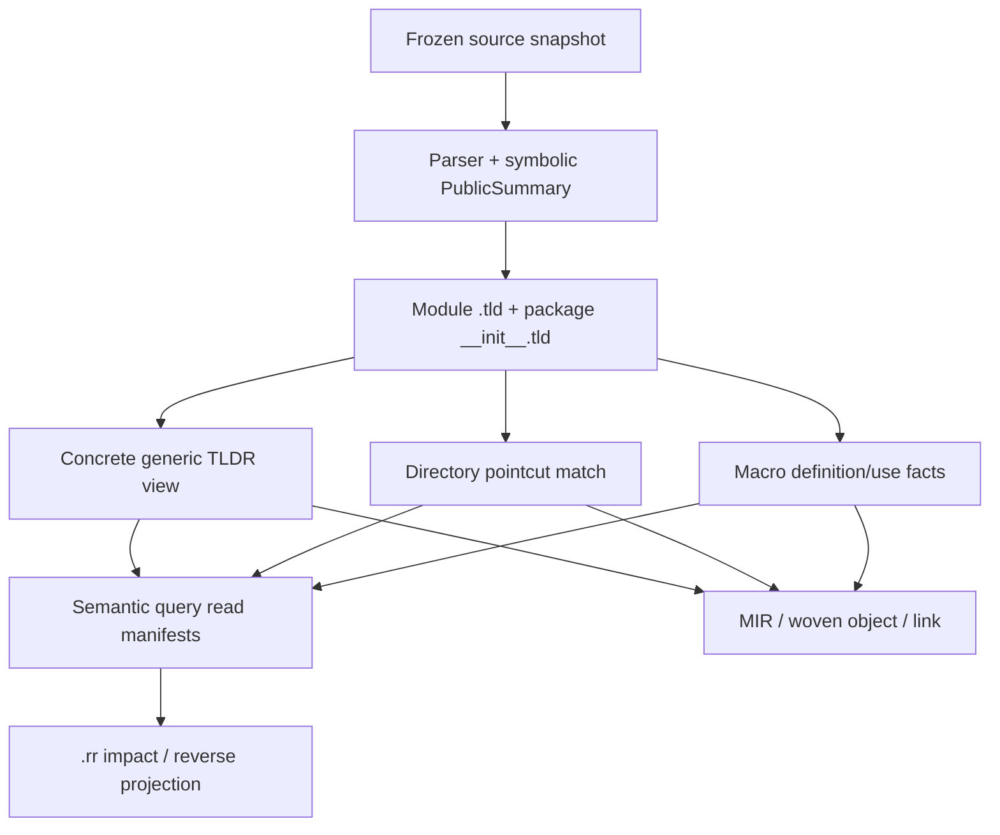
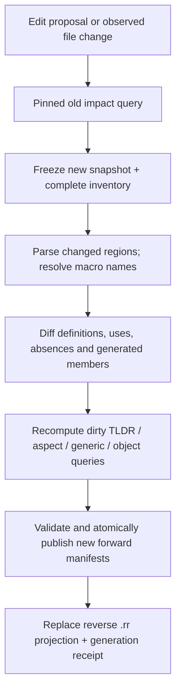

# Simple compiler: concrete generic TLDR, directory AOP cache, macro reference cache

**Design and implementation plan — 2026-10-24**
**Repository reviewed:** `ormastes/simple`, `main` at `684af83fa9818aa5bfde83e065372bf204c9e651`
**Status:** proposal grounded in the checked-out repository; **not implemented or verified** by this report.
**Rechecked 2026-10-24 against `release/1.0.0` @ `b4051cdeb1c`** — see the final section; this plan is an additive work package under
[`src_based_tldr_build_v1.md`](../../../05_design/compiler/incremental_build/src_based_tldr_build_v1.md), whose rules (per-file jobs, no locks, fully async, temp+rename, single-flight, in-memory xxh3 ids, TLDR as forward declaration with set-once async pointers, cache limits) override any wording here.
**Scope:** `.tld`, `__init__.tld`, indexed semantic TLDR AST, generic instantiation, static AOP pointcut/advice, macro definition/use, `.rr` reverse references, BuildRunner, standalone compiler, IDE/SPipe/SCV change previews.

## 1. Executive decision

Implement **one verified incremental semantic-query/cache graph**, not three independent generic/AOP/macro caches.

1. A generic declaration has one **symbolic template TLDR**, while `acquire_concrete_tldr(template, [i64, f64], snapshot)` returns a **concrete, type-checked TLDR AST** using exact positional type/const/effect parameters. Downstream consumers get the existing ordinary typed-AST interface; they do not repeatedly branch on generic parameters. A lightweight overlay shares all unaffected immutable AST nodes. Only reachable instantiations are materialized or emitted.
2. A static aspect's **pointcut selector/match facts** are cached by complete directory/scope inventories independently of **advice signature/effect/body**. An advice-body edit reuses an admitted match set and invalidates only matched woven/linked artifacts. Selector or candidate-membership edits recompute the relevant match partitions, including previously **nonmatching** candidates.
3. A macro has a **per-definition/per-name semantic TLDR** and exact *outgoing* expansion dependencies; macro invocations have **per-source/per-region forward references**. The `.rr` index supplies the reverse lookup `macro → impacted source regions/files/objects`, available **before a source edit**, and is updated transactionally when a new TLDR changes macro definitions, references, or absence/candidate facts.
4. Keep `PublicSummaryV1`, existing `.tld` / `__init__.tld` semantics, `PackageTldrHeaderV1`, `SemanticQueryReadManifestV1`, `ActionRootJournalV1`, shared CAS, and `.rr` ownership. Version extensions/additional indexed sections; no new parallel compiler, source-of-truth DB, cache daemon, or source import scheme.
5. Start with **conservative correctness**, then enable fine-grained reuse behind reference-oracle, race, and performance gates. A cache cannot turn invalid source into valid source or suppress errors. Missing/unknown dependency coverage widens invalidation or rejects a hit.

### Design answer to the proposed API

```simple
# Illustrative API only; not current Simple grammar/API.
val t = acquire_concrete_tldr(
    symbol = "pkg.Pair",
    type_args = [Type.i64, Type.f64],
    snapshot = frozen_snapshot,
)
# Public typed-AST view is now exactly Pair<i64, f64>.
# t.fields[0].type == i64; t.fields[1].type == f64.
# Existing semantic consumers use ordinary concrete typed-AST operations.
```

**Critical distinction:** concrete *TLDR AST* is not necessarily a concrete native object. A type-correct summary can be created early and cached portably, while MIR specialization, code generation, ABI/layout, AOP weaving, and object publication remain separately keyed when required. This prevents a target-specific `Pair<i64,f64>` object from being misused on another CPU/ABI.

## 2. Current repository audit and compatibility

The review used the pinned `main` tree above. Documentation status is **not** treated as verified runtime behavior; different source lanes are at different completion stages.

| Existing owner/plan | What exists or is specified | This proposal's delta |
|---|---|---|
| `doc/03_plan/compiler/phase3_incremental_build_completion_2026-10-13.md` | **ACTIVE** replacement plan; TLDR imported-header consumer, source generations, shared AST, complete invalidation, and actual native qualification are still acceptance gaps. Imported factory generic inference also has an open native qualification item. | This feature is an additive work package under that active plan, not evidence it is complete. Preserve that plan's gate and outstanding bugs. |
| `doc/04_architecture/compiler_semantic_cache_manager.md` | Metadata-first CAS; `PublicSummaryV1` → `.tld`; `__init__.tld` owns scope/membership; `.rr` reverse query projection; selective exceptional bodies; exact `three_payload_compile_v2` claim. | Add generic template/concrete-view, directory-match, and macro facets/query keys to these contracts. Preserve 3-payload fast path only when sealed payload closure is actually complete. |
| `src/compiler/80.driver/cache/package_tldr_metadata.spl` | `PackageTldrHeaderV1` includes source, variant, ABI, exported interface, initializer, generated source, direct/reverse module links, SCC and archive digests. | Add versioned semantic section manifests/receipts, **not** an incompatible replacement for this admitted metadata. |
| `src/compiler/00.common/cache_contract/physical_tld_v1.spl` | TLD1 canonical indexed container, TLD2 optional extension wrapper. | Introduce new optional indexed semantic sections under explicit schema negotiation; unknown mandatory kinds fail closed. |
| `src/compiler/00.common/cache_contract/semantic_query_read_manifest_v1.spl` | Producer/consumer query keys, parameter digest, facet, witness, partition and `Complete/Conservative/Unknown` coverage. | New typed query/facet names and exact read witnesses. Distinguish semantic reads from effects in `SemanticReadSetV1`. |
| `src/compiler/80.driver/cache/reverse_reference_receipt.spl` | Generation-bound reverse receipts; family list includes `generic-specialization` and `aop-consumer`, **not** an explicit macro-definition family. | Evolve family schema additively; `macro-definition-consumer`, `macro-name-resolution/absence`, `aop-match-membership`, and directory-scope paths. Preserve all mandatory old families in a versioned migration. |
| `src/compiler/40.mono/model/generic_subst_model.spl` | Bounded-exhaustive substitution/matching/key model with closedness, soundness and determinism laws; production/differential references. | Reuse one canonical substitution/key model; extend it to TLDR AST and const/effect constraints. Avoid a second monomorphizer. |
| `src/compiler/40.mono/monomorphize/cache.spl` | A local MonoCache with text keys and timestamp-oriented configuration also exists. | Do not let this become independent semantic truth. Wrap/bridge to verified content-addressed keys; mtime is a hint only. |
| `src/compiler/10.frontend/parser/macro_registry.spl`, `src/compiler/35.semantics/macro_contracts.spl` | Parser macro names and contract-declared introduced symbols/injection points. | Produce stable `MacroDefId`, contract/effect/body facets, invocation read manifests and negative lookups; avoid reparsing whole modules for a one-invocation dependency change. |
| `src/compiler/35.semantics/aspect_weave.spl` | Existing forward weaving rechecks live bodies and prevents duplicate advice insertion. Other join points have qualified limitations. | Cache matches with typed coverage; still revalidate body-sensitive weave preconditions against current generation. Cache never asserts that unsupported AOP modes are safe. |
| `doc/02_requirements/language/aop/aop_pointcut.md` | `execution`, `within`, `attr`, `!`, `&`, `|` and wildcard pointcuts; some scenarios incomplete. | Cache admitted static-selector semantics first; unsupported around/structural/dynamic cases retain existing fail-closed/fallback handling. |
| Earlier plans (2026-10-06/08/12/20) | Typed `@when`/GuardId pruning; frozen snapshots, SCV/IDE edit metadata, standalone BuildRunner-independent mode, async singleflight; portable/target-specific cache separation. | Retained intact; all proposed queries include guard/snapshot/profile identities and can run in-process without a daemon. |

**Current-state conclusion:** the repository has the relevant foundation and partial code, but **there is no evidence from this inspection that the requested concrete-generic-TLDR API, per-directory pointcut match reuse, or macro-definition reverse-index workflow has been qualified end-to-end**. Do not label them implemented.

## 3. Unified semantic graph: ownership and identities



### 3.1 Stable query node kinds

| Query kind | Input dependencies | Result/consumer |
|---|---|---|
| `tldr.symbolic` | Source AST, declaration dependency closure, imports, trait/coherence, relevant macro/CTFE/guard facts | Immutable generic or nongeneric `PublicSummaryV1` subtree |
| `tldr.concrete` | Symbolic digest, canonical arguments, generic bounds/constraints, inference/visibility/coherence roots, language semantics | Concrete **typed TLDR AST view** and signature/layout-independent facts |
| `generic.body` | Concrete view, selected source body digest, substitutions, effects and target-independent MIR inputs | Specialized body/MIR; only if body required |
| `aop.directory_facts` | Complete directory membership, static guards, exported join-point signatures, attributes, lexical/visibility scope | Directory-local candidate index, fingerprint + negative witnesses |
| `aop.match` | Pointcut selector digest, directory facts/root, selector's imported scope, static activation/guard roots | Sorted matched `JoinPointId`s, admitted match coverage |
| `aop.weave` | Matched join-point body/forwarder facts, ordered advice *signature/effects/body* identity, weaving mode | Validated, woven portable object/body |
| `macro.def` | Macro definition AST, contract/export/body, hygiene, direct macro/CTFE/import inputs | Named macro TLDR and stable `MacroDefId` |
| `macro.resolve` | Name/scope/namespace, complete candidate set and absence evidence, `@when` | Positive `MacroDefId` or **negative resolution witness** |
| `macro.expand` | Invocation AST/arguments, exact macro definition/body, nested macro reads, CTFE capabilities, hygiene context | Immutable expansion AST plus generated-member and effect facts |
| `obj.emit`/`link` | Concrete generic/code/MIR, AOP weave, generated macro symbols, target ABI/config/backend | Object and link action roots |

Do **not** use `.rr` as an identity input to the forward query whose edges it indexes. The reverse projection is rebuilt from sealed forward read manifests and is absent on ordinary warm-compile hit paths.

### 3.2 Content keys and collision policy

Define canonical, domain-separated serialization (stable length framing, sorted sets, exact ordered parameters, normalized identifiers, schema/algorithm version):

```text
TemplateId = H("tldr-template/v1", SymbolId, SymbolicSummaryDigest,
               VisibilityRoot, ActiveGuardRoot, LanguageSchema)

ArgsId     = H("generic-args/v1", [TypeId_0, TypeId_1, ...],
               [ConstValueId], [Effect/RegionArgumentId])

ConcreteTldrKey = H("tldr-concrete/v1", TemplateId, ArgsId,
                    Constraint/CandidateRoot, SemanticProfileDigest)

DirFactsKey = H("aop-dir-facts/v1", ScopeId, CompleteMemberRoot,
                JoinPointFactDigest, ActiveGuardRoot, ResolutionPolicy)

PointcutMatchKey = H("aop-match/v1", PointcutSelectorDigest,
                     DirFactsKey, ImportedScopeRoot, StaticActivationRoot)

AdviceApplyKey = H("aop-apply/v1", PointcutMatchDigest,
                   OrderedAdviceSignatureEffectBodyDigest,
                   JoinPointBodyDigest, WeaveMode, SemanticProfileDigest)

MacroDefKey = H("macro-def/v1", ScopedMacroSymbolId, DefinitionDigest,
                ContractDigest, NestedReadRoot, HygieneSchema)

MacroExpandKey = H("macro-expand/v1", ResolvedMacroDefKey, InvocationASTDigest,
                   BoundArgsDigest, CaptureScopeId, CTFEReadRoot,
                   ActiveGuardRoot, ExpansionSchema)
```

- `H` is a **versioned existing canonical cache hash**, not a literal instruction to replace SHA-256 fields in `PackageTldrHeaderV1`. For trusted local transient indexes, an optional XXH3-128 fast fingerprint/32-bit table index is fine **only with full canonical key verification**. For persistent cross-host/remote/security-sensitive CAS use an admitted collision-resistant digest (current SHA-256 or a separately versioned BLAKE3 migration). Bloom filters and truncated IDs are rejection accelerators, **never proof of equality**.
- A key must encode *semantic type identity* (module/nominal identity, normalized alias rules, qualifiers, integer width, const values), not display strings such as `"int,float"`. `Box<T>` shadowed in a second module must not collide.
- Keep target **out** of a portable semantic view if the result truly is target-neutral; attach target/ABI/layout to layout queries and object keys. Conditional semantic differences (`@when`, target-specific type aliases, platform-specific traits) enter `SemanticProfileDigest` and active resolution roots.
- Distinguish *positive* reads, **absence** (unresolved name), membership/candidate universe, and order-sensitive overload/advice selection. New files may invalidate a negative query even though no old producer edge exists.
- Worktree path/branch/mtime/edit-log position are *hints*; a valid hit must check frozen input bytes, complete source membership, generated inputs, compiler/schema/grammar, and semantic dependencies. Cross-host persistent AST may not contain raw pointers/process-local IDs.

### 3.3 Cache ownership and lifecycle

`00.common/cache_contract`: key/AST-view/read-manifest types and codecs, no filesystem owner.
`10.frontend`: single source/symbolic-summary and macro/reference fact producer.
`30.types` / `40.mono`: canonical type substitution/constraint checks and specialization.
`35.semantics` / `50.mir`: pointcut validation, selection and static weaving.
`80.driver/cache`: generation pins (immutable), single-flight futures, CAS, `.rr`, publication, object scheduler.
BuildRunner schedules and shares immutable results; **standalone `simple compile`** uses the same in-process contracts without starting BuildRunner/SCV/Git/daemon. IDE and SPipe call the same query facade, not private cache files.

Use memory residency tiers: hot interned IDs + small views, LRU concrete views and directory match vectors, cold CAS sections; pin all immutable graph nodes needed by a compile or impact-preview snapshot. Deduplicate identical in-flight keys. The coordinator bounds traversal and expansion depth/number of instantiations; limit/eviction never changes semantics.

## 4. Generic parameters in TLDR: template → ordinary concrete AST

### 4.1 Symbolic declaration contract

A template TLDR must contain:

- `TemplateId`, definition/source owner, formal parameter **count, kind, order, name, default, variance if applicable**, named binder IDs rather than ambiguous text names;
- typed public declaration AST, signature/field declarations, public visibility, body digest references (body bytes only when selected), required generic constraints/trait bounds, impl and overload lookup roots;
- const/compile-time values and guard conditions, layout dependence markers, default parameter evaluation dependencies, macro/CTFE and origin span metadata;
- exact source and semantic read/absence witnesses needed to validate the template without loading a dependency's full `.spl`.

Example (illustrative presentation, not new mandatory language syntax):

```simple
struct Pair<First, Second>:
    first: First
    second: Second

# Stored symbolic fields: first=Param(0), second=Param(1)
# Read as Pair<i64,f64>: first=i64, second=f64
```

The **template remains single-copy**, even if 100 concrete call sites exist. `Pair<i64,f64>` and `Pair<f64,i64>` get distinct `ArgsId`s; repeated `Pair<i64,f64>` references share one concrete AST view.

### 4.2 Lookup and instantiate

```text
acquire_concrete_tldr(reference, args, frozen_snapshot):
  1. Resolve reference against admitted package __init__.tld (imports,
     visibility, reexports, @when, positive/negative lookup witnesses).
  2. Read indexed symbolic declaration from .tld or verified CAS; acquire
     generation pin and verify producer/schema/snapshot identity.
  3. Normalize explicit/positional/named/default/inferred args using the
     existing generic_subst_model and exact TypeId hierarchy.
  4. Check arity, kind, closedness, bounds/coherence, const constraints and
     cycles; resolve all concrete nested field/signature type variables.
  5. Singleflight on ConcreteTldrKey. If cache hit, verify and return an
     immutable ConcreteTldrAstView (set-once). Otherwise build overlay and store it.
  6. Record precise ordered semantic reads and publish only if generation
     remains pinned; return ordinary typed AST to downstream caller.
```

Downstream typed-AST access should expose `type`, `fields`, `methods`, `parameters`, `attributes`, `visibility`, `effects`, `origin`, etc. exactly like non-generic TLDR. *Do not* force every consumer to apply an `if is_generic` branch. Internally a view can have `(template_node_id, SubstitutionEnvId)` until a node is first dereferenced; then cache the concrete node in a dense arena. This hides generic handling at the **one acquisition boundary** while preserving memory.

Avoid one expensive eager deep-clone per instantiation:

```text
ConcreteTldrAstView {
  semantic_key, snapshot_pin, shared_template_ast,
  interned_substitution_env, concrete_root_id,
  lazy_sparse_overrides, reachable_node_budget,
  exact_read_manifest, closure_status=Concrete
}
```

If `Concrete` is advertised, **every externally reachable typed field must have no free generic variables**. Only lazily allocated *representation* is allowed; lazily postponed *semantic correctness* is not. Validate the full reachable public contract at admission, or return a different `Template/Partial` result that codegen cannot mistake for concrete. Retain binder-aware alpha-equivalence, nested generic scopes, shadowing, type aliases, recursive types, trait associated types, defaults and const generics. Infinite specialization recursively growing `Box<Box<...>>` must fail a documented instantiation-depth/complexity guard, not OOM.

In some paths the compiler needs an unspecialized template (generic declaration authoring, IDE hover, lint, trait inference). Provide explicit `acquire_symbolic_tldr` and `acquire_concrete_tldr`; don't silently materialize arbitrary defaults for missing type evidence. No evidence means a typed `Unresolved` result as in the existing generic substitution model.

### 4.3 Reuse and object emission

Separate four levels:

| Artifact | Shared among which cases? | Rebuilt when |
|---|---|---|
| Symbolic template TLDR | All `Pair<A,B>` usages | Template's actual semantic interface or needed exception facets change |
| Concrete TLDR AST `Pair<i64,f64>` | All equal normalized argument tuples under the same semantic profile | Template/arguments/constraints/resolution roots change |
| Specialized body/portable MIR | Only reachable uses requiring implementation | Selected body, specialization logic, type/effect inputs change |
| Layout/native `.o` | Same target, ABI, compiler/backend options, relevant weave/effects | Target/layout/toolchain/body/AOP/macro/codegen input changes |

No Cartesian pre-generation of generic combinations; a call/reference creates an on-demand query. Compile-time generic item reachability and `@when` guards prune candidates **before** opening exceptional body payloads. Memoize specialized method/member resolutions under the same concrete owner. If only one field's type differs, share unrelated AST nodes; do not promise object sharing unless the ABI and code are provably identical.

**Formal/model hooks:** extend existing `S1–S3`, `U1–U2`, `I1`, `K1–K2` substitution/key tests; add `T1: concrete AST has zero free vars`, `T2: direct specialization ≡ cached view`, `T3: mixed generic/nongeneric TLDR consumer equivalence`, `T4: alpha-renaming does not change semantic content`, `T5: key distinguishes reversed positional arguments`.

## 5. Aspects: directory-cached pointcuts and independently changing advice

### 5.1 Split stable selection from mutable implementation

```text
AspectDefinition
  PointcutSelectorId      # execution / within / attr + !/&/| / wildcard
  PointcutScopeId         # complete named directories/packages/visibility
  AdviceId               # before/after/around + order/priority
  AdviceSignatureEffect  # ABI, return, thrown errors, noalloc/bounded etc.
  AdviceBodyDigest       # actual implementation bytes/MIR/object
  ActivationMode         # static-fixed vs dynamic registry
```

`PointcutSelectorDigest` excludes advice implementation bytes **if selector matching genuinely does not inspect those bytes**. `AdviceApplyKey` includes the body and callable ABI/effects plus ordering and join-point body. Thus changing `log_before()` body may leave the directory's match-set cache green, but the woven object and any linked result using the advice must be considered dirty. Signature/effect changes additionally rerun validation and ABI-dependent consumers.

When the pointcut changes, an `oldMatches ∪ newMatches` union is the minimum invalidation set: old-only join points must be **unwoven**, newly matched join points woven, intersection potentially reused if advice/action keys remain unchanged. Never only add new matches.

### 5.2 Per-directory indexes and completeness

Store one immutable `DirectoryJoinPointFacts` per logical directory or configured scope, with:

- direct file/member inventory, normalized paths and case/symlink policy, child-directory Merkle roots (for recursive `within`), export/visibility/module identities;
- sorted compact join-point IDs with typed signature, attributes, owner, static guards, generic template/concrete-variant identity when relevant, plus selectivity indexes (`name`, `attr`, `kind`);
- **negative/candidate-completeness witness**, coverage schema, and consulted provider/extension manifests;
- immutable generation and digest; no unbounded directory scan or global state on the hot path.

Store `PointcutMatchShardV1(selector_id, directory_facts_key, scope_root, sorted_matching_ids, completeness, match_digest)`. Use a parent/subtree aggregation root for a recursive wildcard; directory caches are an *indexing partition*, **not** a claim that a pointcut can never cross directories. A selector matching `services.*`, all packages, inherited/generated methods, or `!attr(test)` requires the full proven universe and its **negative** candidates. Missing scope completeness means recompute a broader shard or fail closed.

Cheap local invalidation:

| Change | Matching work | Object/link work |
|---|---|---|
| Advice body only; same signature/effects | Reuse every qualified directory match shard | Rebuild matched woven functions/objects and downstream links if emitted bytes change |
| Advice signature/effects/order change | Matches may remain, rerun compatibility/order checks | Reweave affected matched joins; revalidate ABI/effects/ordering |
| Pointcut text/selector AST change | Re-match old and new candidate scopes; negative witnesses included | Unweave old-only, weave new-only, verify intersection |
| Function rename/add/delete, annotation/signature change | Recompute owning directory fact shard; ancestor/root only as scope requires | Dirty joins whose match/body/ABI changed; propagate to objects |
| Function body-only edit that cannot affect selector | Keep match shard; validate any body-sensitive eligibility at weave stage | Rebuild changed function and any composed advice artifact |
| Directory move/import/reexport, `@when` flip | Re-evaluate scope membership/candidate and absence roots | Dirty matched or removed join-point consumers |
| Dynamic aspect replacement | Never rewrite admitted static match key as if fixed | Use existing guarded registry generation, leases and revocation |

**Current restriction:** ship cached reuse only for selectors/join kinds and `before`/`after` modes that the current compiler can enumerate and validate completely. Around, structural transformations, unmeasured forwarder kinds, runtime interception and aspect dynload must use their existing typed fallback/registry path until independently proven. `aspect_weave.spl` checks live forwarder shape: a match cache **must not bypass** that precondition. Weaving is idempotent, and the old body must not be cumulatively woven on each incremental pass; always weave from an immutable **base** body and a deterministic ordered advice plan.

### 5.3 Reverse lookup for affected objects

At publication, record exact edges:

```text
pointcut selector → directory match shard → JoinPointId
JoinPointId + ordered advice facets + base-body digest → ComposedBodyId
ComposedBodyId → SpecializedMIR/portable object → target object → link action
```

The coordinator queries `.rr` for a selector/advice/dir change. It obtains precise function and object owners, even when an aspect lives outside their source directory. On incomplete reverse shards, scan the bounded affected scope from forward manifests; only widen to the whole compilation domain when required by missing completeness. Aspect match coverage and advice version must be part of the final object action proof.

## 6. Macros: named definition TLDR, reference graph and pre-edit impact

### 6.1 Definition TLDR is per macro, not just per containing file

One module `.tld` can contain an indexed `MacroDefinitionTableV1` of entries keyed by stable **scoped** `MacroDefId` (`package/module/namespace/binder`, not bare spelling). Each entry carries:

| Field | Meaning |
|---|---|
| `macro_name` / `MacroDefId` / generation | Human name, canonical identity, producer generation |
| `declaration` / `contract_digest` | Parameters, defaults, quote/unquote, return contract, introduced exported symbols and injection anchors |
| `body_digest` / `portable_body_ref` | Executable expansion/CTFE body, embedded in the admitted TLDR payload when needed; lazy verified CAS read if explicit fallback |
| `hygiene_schema` / `capture_scope_contract` | Def-site/use-site binding, gensym discipline, deterministic generated IDs |
| `declared_effects` / `exact_read_set_root` | Source/CTFE/plugin/environment inputs; undeclared ambient input means uncacheable |
| `dependent_macros` / `imports` / `guards` | Outgoing direct and nested dependencies; typed `GuardId` and negative candidate roots |
| `exported_surface_digest` / `generated_member_root` | Which signatures/new symbols can affect another file's TLDR |

The corresponding public `__init__.tld` carries **all exported macro names/visibility and candidate/membership roots** for the sealed package scope. This matters when a **new macro name** appears: there may be no old positive reference edge to it, but unresolved-name/overload consumers must still be invalidated.

### 6.2 Reference entries, including missing macros

Every parsed macro invocation (direct, imported, expanded/nested, guarded, and generated when allowed) emits a `MacroUseV1` forward record:

```text
MacroUseV1 {
  invoking_source_id, RegionId, stable_invocation_id,
  requested_scoped_name, resolved_macro_def_id?,
  invocation_ast_digest, argument_digest, hygiene_scope_id,
  active_guard_id, generated_symbols_digest,
  resolution_candidate_root, absence_witness?,
  expansion_digest?, status, coverage
}
```

`RegionId` should reuse the parser's stable file+node/region IDs (with edit-log relocation witness), not raw byte offsets as identity. Store byte/span coordinates as replaceable projections for navigation. Local hashed IDs may be compact, but full canonical identity must verify collisions. `macro.resolve` records *negative* results too; ordinary identifier references must not become macro references accidentally.

One invocation may depend on multiple macro definitions through nested expansion; the read graph includes **transitive actual reads** and cycle errors. Conditional inactive `@when` references are retained symbolically but pruned from the active source build; changing the guard can activate them without a full workspace scan.

### 6.3 Where the references live (avoid a digest cycle)

The desired `macro TLDR → each macro name and its references` is best exposed as a **joined inspection view**:

```text
module .tld: MacroDefinitionTable + module's outgoing MacroUse records
package __init__.tld: scoped macro-name candidate/membership table
query read manifests: exact invocation → macro-definition/negative roots
.rr: authoritative rebuilt reverse projection for impact lookup
`simple tld show --macro NAME --references`: join the above at one pinned generation
```

Never put an ever-changing list of *all external referring files* into the **semantic digest** of the defining macro's TLDR. Otherwise adding a user invokes a change to the macro definition digest, which invalidates every existing user — a self-amplifying cycle. A physical `.tld` may expose an optional non-authoritative **presentation pointer** to a matching reverse-index generation if the compatibility wrapper allows it, but the `.rr` generation remains the coordinator's owner. References must not influence definition identity merely because someone started/stopped using it.

### 6.4 Before-modification API

An IDE/SPipe/SCV client asks **before writing a source file**:

```text
preview_semantic_change(
  base_snapshot, proposed_edit_or_macro_definition,
  scope = project_or_package
) -> ChangeImpactPreview {
  old_generation, candidate_new_fingerprint,
  changed_macro_ids, changed_name_membership_roots,
  direct_source_regions, transitive_generated_users,
  affected_tldr_modules, affected_generic_views,
  affected_pointcut_directories, affected_object_actions,
  complete_or_conservative, fallback_reason
}
```

Fast path for editing `macro double(x)`: use the old reverse `.rr` shard and old/new definition facet diff to list all referencing files **before the editor alters bytes**. If only a comment changed and semantic fingerprints remain equal, keep unaffected callers. If expansion or generated exports change, invalidate macro consumers and any downstream TLDR/trait/pointcut/object owners they influence. If a macro is renamed/added/deleted, union old positive references **and** new/old candidate/absence scopes.

**Pre-edit impact is advisory**, not an authority to compile against future bytes. It cannot guarantee the exact new dependency set when the proposed edit invokes unknown macros, changes imports, or uses effectful CTFE; mark it conservative. A source rewrite is **not automatic**: changing a definition normally triggers recompilation/expansion, not literal edits to consumers' `.spl` files. If the user explicitly requests a refactor that rewrites usages, prepare concrete patches against pinned file versions and apply them only after conflict/rebase and source-ownership checks.

### 6.5 TLDR regeneration and reference add/remove lifecycle



Required transactional behavior:

1. Retain **old outgoing read edges** for every failed/cancelled rebuild until a new complete consumer result is admitted. Do not drop reverse edges merely because a changed source temporarily fails to parse.
2. When an invocation is **added**, insert its forward read after successful resolve/expand and update the new `.rr`. When **removed**, delete only that consumer's old read from the new generation; never erase another source's references.
3. When a macro **definition is added/removed/renamed**, update `__init__.tld` membership, name-candidate and negative roots, even if there are no old positive references.
4. When a macro generates public types/functions, refresh the containing module's public TLDR, generic specialization candidates, AOP join-point directory facts, trait/impl resolution and affected object roots. When a macro generates nothing public and only a private expression changes, use green cutoff at the unchanged exported-surface digest.
5. Commit the *forward* query/TLDR/scope/action manifest for one immutable generation, then materialize its `.rr` reverse projection and publication receipt in an owner-coordinated transaction. Readers never observe a mixed old/new generation; old valid generations remain readable until pins expire.
6. Failure to write `.rr` is recoverable by replaying sealed forward manifests. A missing `.rr` cannot pretend there are no dependents; it triggers conservative impact behavior until rebuilt.

## 7. Cross-feature invalidation matrix

| Change | Symbolic TLDR | Concrete TLDR | Pointcut match | Macro expansion | Object/linked output |
|---|---|---|---|---|---|
| `Pair<A,B>` field type/signature change | New template digest | Invalidate used `Pair<T,U>` views | Only if matching signature/attr/visibility changes | Only consumers reading changed type | Affected layouts/body/codegen |
| New `Pair<i64,f64>` *reference*, no code change | Reuse | Create/lookup one view | Maybe if new concrete join point is in scope | No unless expression uses macro | Emit only if needed |
| Generic method implementation body edit | Often preserve public template | Preserve view if semantic interface same | Keep match if candidate facts same | Only if read by CTFE/macro | Specialized method objects dirty |
| Advice implementation edit | Preserve unrelated summaries | Preserve | Reuse static match | Preserve unless macro consumes advice facts | Dirty only matched weave/object/link path |
| Pointcut selector edit | Scope root may change | Preserve unless semantic owner consumes it | Recompute old/new scope, including negatives | Preserve unless expansion depends on aspect | Unweave/reweave union |
| Add function with matching `attr` | Module TLDR/member root changes | Relevant symbols only | Owning directory/ancestor affected | Only if macro-generated/used | New matched object |
| Macro body edit, identical public surface | Macro body facet changes | Only views whose macro/CTFE reads matter | Only if emitted member facts or signatures change | Exact invocations and nested users | Affected consumers' objects |
| Macro changes generated public declaration | Relevant summaries change | All dependent concrete views | Directory facts change if new join points | Exact and candidate consumers | Propagate through ABI/objects |
| Add/delete/rename macro or import | Name/membership roots change | Only if resolution/CTFE changes | Possibly via generated symbols | Positive **and negative** name-query consumers | Affected compiled sources |
| Change `@when` platform/feature | Selected scope/active guards | Profile-specific views | Active candidates change | Activated invocations change | Only active configuration artifacts |
| Source comment/edit with same semantic roots | May publish unchanged digest | Reuse | Reuse | Reuse | Reuse if diagnostics/debug/source mapping policy permits |

**Important:** diagnostics, debug location tables, reflection, coverage, source embedding and source-sensitive macros may legitimately depend on positions/text even if executable ABI does not. Each relevant facet gets its own read witness. "Same public signature" alone is not proof every diagnostic or object can be reused.

## 8. Physical storage, memory, performance and safety

### 8.1 Suggested indexed sections (illustrative names)

| Physical projection | Canonical sections/facets | Access rule |
|---|---|---|
| `module.tld` | `public-summary`, `generic-template-table`, `macro-definition-table`, `macro-outgoing-use-table`, optional exceptional `macro-body`, body digest refs | Verify envelope, section bounds/digest and active scope before return |
| `__init__.tld` | package membership, macro-name candidate/absence index, aspect directory-scope root, trait/impl/overload roots, reexports, active guard roots | Catalog admission before import/specialization lookups |
| CAS semantic objects | concrete AST overlays, qualified directory facts and pointcut match shards, macro expansion trees, manifests | Immutable, content-keyed, snapshot pinned |
| `.rr` | generic specialization, macro definition/name, AOP selector/advice/join-point/object reverse shards | Coordinator/impact tool only; not used to authorize normal forward read |
| `.smf/` development / packed `.smf` release | object/action manifest and code blobs | Target/ABI/backend sealed; retain existing hybrid/packed policy |

Preserve optional TLD2 extensions and strict unknown-mandatory rejection; do not retrofit old readers to interpret an unknown semantic section as an empty list. Format/schema transitions need a compatibility reader and migration/golden vectors. Avoid a separate `macro.tld` authority for each entry unless measured lookup/read amplification proves it necessary: index the entries inside the existing module `.tld` and CAS larger individual bodies.

### 8.2 Memory strategy

- Use the recently planned immutable AST with **four fixed core fields** and dense arrays for hot common attributes, sparse side tables for rare facts; generic substitution overlays and macro expansion nodes share unaffected slabs. Follow the parser's actual stable file+node-ID/arena contract once qualified; never persist session-local handles.
- Intern canonical `TypeId`, `MacroDefId`, `PointcutId`, `GuardId` and `DirectoryScopeId`; use generational indices and full-content validation rather than broad string-keyed maps on the hot path.
- Compact directory match vectors sorted by stable join-point ID (delta/varint encoding on disk where measured worthwhile). `attr` and function-prefix indexes should be lazily constructed for directories that have repeated selectors.
- Coalesce simultaneous identical requests (singleflight); return immutable generation pins (no leases, no locks). Share bodies across multiple concrete generic TLDRs where semantic substitution does not touch them.
- Use explicit per-query fanout/depth budgets, LRU eviction and optional compression **for cost control**; evictions must only cause recomputation. Do not compromise completeness for cache size.
- Treat read count thresholds correctly: a fully sealed warm edit can qualify the existing `three_payload_compile_v2` profile only if concrete TLDR/macro/AOP inputs are already indexed within admitted payloads. An extra CAS/body read is a **typed multi-payload fallback**, not a hidden three-payload hit.

### 8.3 Performance hypotheses to benchmark, not promised outcomes

| Benchmark | Measure/goal (after correctness) |
|---|---|
| Repeated `Pair<i64,f64>` across 1/100/1000 imports | one template decode and one admitted concrete view per identical key/generation; extra import lookup cheap; peak RSS grows sublinearly with repeats |
| 100 concrete pairs with 1 field change | unchanged template AST sections and unaffected field nodes share; report view bytes/node count and specialized object count |
| Advice body edit in large tree | selector-match recompute count **zero** if selector/scope/signature unaffected; enumerate only actually matched object actions |
| Pointcut text edit | directory scopes visited, old/new match union, negative candidates examined, unweave correctness |
| Macro body edit with K users in N files | touched definitions, exact invocation regions, affected TLDRs and objects; avoid parsing N unrelated files |
| Macro added when name was previously unresolved | negative lookup invalidation correct; no stale green build |
| Fresh daemon vs standalone compiler | same bytes/errors/graph hashes; startup/RSS and IPC overhead independently measured |
| Cold, warm, multiworker | p50/p95 wall, CPU, peak RSS, opens, decoded bytes, cache hits/misses, query edges traversed, future wait, CAS bytes and invalidation reason distribution |

No unconditional numerical speedup claim. The existing active Phase 3 plan's `<=100 ms` entry-compilation aspiration includes startup/admission/emission and must be **measured** on a pinned workload; macro/AOP-heavy builds are reported separately.

## 9. Failure handling and concurrency

1. **Snapshot/generation:** immutable anchored source bytes; source inventory includes newly created/deleted files, overlays, generated inputs, symlinks, imports, negative queries, static guard/config. At most one active writer for an exact action key; readers pin old/new generation rather than mixing.
2. **Read coverage:** unknown/incomplete macro expansion, pointcut candidate universe, generic coherence or external CTFE effects reject a fine-grained hit. If guard evaluation is unsupported, fall back to conservative source compile; never assume false.
3. **Cyclic dependencies:** generic instantiation recursion, macro recursion, trait/impl/initializer SCCs and AOP cycles use bounded deterministic worklists, visit states and fixed-point handling where admissible; otherwise precise diagnostics. No deadlocks from recursive singleflight on the same key.
4. **Security:** untrusted remote cache bytes verify envelope, digest, schema, dependency/read set, bounds and publisher provenance; no executable macro/CTFE body from unverified cache. Provider/network/clock/randomness reads either declared/replayable or uncacheable.
5. **Cancellation/crash:** retain old complete read manifests, roll back uncommitted reverse edges, abandoned single-flight futures are re-driven by the next requester (no lease to release) and CAS/journal recover. No mixed generation is published; no false "zero affected files" on receipt corruption.
6. **Nondeterminism:** same exact key producing different serialized result quarantines producer, records reason and forces reference compilation; do not use newest-wins or silently retimestamp TLDR files.
7. **Source-edit plans:** preview uses old pinned snapshot and is invalidated if any target file changed before patch application. BuildRunner and IDE must coordinate through one owner; a watcher is merely a hint, not source truth.

## 10. Implementation packages and code ownership

This is a **sequenced plan**. Keep current `phase3_incremental_build_completion_2026-10-13.md` as the execution authority. Each slice can be landed independently after the active baseline permits it.

| Slice | Concrete work | Owner/admission gate |
|---|---|---|
| **P0. Capture baseline** | Pin native/seed capability matrix, current APIs, TLDR producer/consumer, AOP/macro read coverage, direct and negative facts; add failure tests before changes. | No new green status without actual native consumer/object evidence. |
| **P1. Extend contract/facets** | Add versioned generic template + macro definition/use + directory facts/match DTOs and query kinds; canonical keys/limits/codecs, reference family migration. | `00.common/cache_contract`, schema golden vectors, roundtrip/bounds/corruption. |
| **P2. Forward reads + `.rr`** | Record precise producer/consumer facets and absence/membership roots; build reversible old/new generation projection, impact preview API. | `10.frontend`, `80.driver/cache/reference`, SCV/IDE adapters; missing shard fallback. |
| **P3. Concrete generic TLDR** | Symbolic template indexed section, binder-aware substitution, normalized positional/const/default args, AST overlay view, compiler consumers use ordinary typed AST. | `10.frontend` + `30.types` + `40.mono`; field/type/direct-vs-cached equivalence. |
| **P4. AOP directory cache** | Complete scoped join-point indexes, selector match shard, stable selection vs advice/body digest split, deterministic weave/removal action edges. | `35.semantics` + `50.mir` + driver; static complete modes only. |
| **P5. Macro definition/uses** | Per-name TLDR records, invocation/negative refs, region-stable expansion cache, generated public-surface propagation, pre-edit impact preview. | Parser macro registry, macro contract/expander, SCV/IDE/SPipe; reference add/remove/rename tests. |
| **P6. Integration/recovery** | Single-flight futures, generation pins, journal/CAS publication, standalone path, `.tld` / `__init__.tld` / `.rr` rebuild, 3-payload fallback classification. | BuildRunner + compiler, crossworker/crash/corrupt test matrix. |
| **P7. Perf/rollout** | Shadow cached vs uncached differential results first; then opt-in and default behind fail-closed feature flag. | p50/p95/RSS and exact invalidation metrics; no regressions accepted as green. |

**Recommended additions** (do not duplicate existing providers):

```text
src/compiler/00.common/cache_contract/
    generic_tldr_view_v1.spl              # new DTO/key + codec
    aspect_match_shard_v1.spl              # new DTO/key + codec
    macro_reference_manifest_v1.spl       # new DTO/key + codec
src/compiler/10.frontend/cache_artifact/
    generic_tldr_projector.spl            # producer/read-boundary adapter
    macro_reference_projector.spl         # definition/use section producer
src/compiler/40.mono/
    [extend existing generic substitution/model; no second engine]
src/compiler/35.semantics/
    [extend aspect validation/weave and macro contracts]
src/compiler/80.driver/cache/reference/
    [extend current reverse-reference coordinator, not second index]
```

For each addition define exact import DAG, interface owner, provider effect contract and phase2/phase3 bootstrap usability. Avoid enabling broad cache paths before all consumers use the same semantic key semantics.

## 11. Acceptance and regression matrix

| ID | Scenario | Required oracle |
|---|---|---|
| G-01 | `Pair<i64,f64>`, reversed order, repeated identical import, name shadowing | Exact concrete fields, distinct keys where needed, same AST/diagnostics as clean full compile |
| G-02 | Nested `Dict<text,Array<Option<i64>>>`, default const, trait bounds, alias, recursive generic | Closed concrete type or precise error; no unspecialized type reaches target lowering |
| G-03 | Generic TLDR from file, in-process cache, daemon cache, remote CAS, source fallback | Bit/semantic-identical projection with equal error coverage; no process ID leaks |
| G-04 | Edit generic body only, then signature only, change only one instantiation | Correct green cutoff and exact specialized object invalidation |
| A-01 | Change advice body only | Match shard hit and matched objects updated; unrelated objects unchanged |
| A-02 | Change selector `execution(foo*)` → `execution(bar*)` | Old-only woven code removed; new-only woven code inserted; order and diagnostics correct |
| A-03 | Add/delete/rename function, `attr`, recursive directory, reexport, inactive/active `@when` | Candidate and negative roots invalidated; no stale matches |
| A-04 | `!attr`, cross-directory wildcard, structural/dynamic/unimplemented mode | Complete universe or typed conservative fallback; never silently drop advice |
| M-01 | Change macro with direct and nested users | Pre-edit preview lists exact old users; new output matches clean rebuild |
| M-02 | Add/remove invocation, definition rename, new macro satisfying previously missing name | New `.rr` has inserted/removed edges; negative candidate invalidation works |
| M-03 | Macro introduces type/class/function/annotation matched by generic/AOP | TLDR → generic view → pointcut → object propagation is complete |
| M-04 | Hygiene collisions, cyclic macro, CTFE undeclared effect, parallel expansion | Correct diagnostic/fallback, deterministic names, no invalid cache hit |
| X-01 | Source edit during lookups, stale worktree, forged digest, torn journal, daemon crash | No mixed generations/stale greens; recover or fail closed |
| X-02 | Two workers request same concrete key/match/expansion; cancellation/retry | One authoritative publication, no deadlock, equivalent outputs |
| X-03 | Source syntactically invalid but `.tld` mtime newer; add/delete file without watcher notification | Error remains visible; content/inventory proof forces miss |
| X-04 | Competing native ABI layouts / CPUs / backends / target versions | Portable result reused only if target-neutral; native object never misapplied |
| X-05 | Verification and performance | Runtime interpreter vs phase3 native vs uncached oracle; report counters, p50/p95/RSS and source-open traces |

Execute unit/property tests first, then integration+system tests, then observed native end-to-end builds; generated SSpec manuals belong under `doc/06_spec` **after** executable tests pass. Each work package should carry its own intentionally-failing baseline/acceptance test, documented invalidation reason and rollback switch. Native capability gaps are recorded as **UNRUN/UNSUPPORTED**, not interpreted as PASS. Formal bounded-model checks are valuable but do not prove the real semantic read set complete.

## 12. Externally researched design lessons

This is **inspiration, not proof of compatibility**:

- Salsa's memoized query algorithm (https://salsa-rs.github.io/salsa/reference/algorithm.html) motivates precise tracked inputs plus different change frequencies (pointcut selector high durability, advice body lower durability). Its parser tutorial emphasizes re-evaluating a query based on actually read inputs and changed results. Simple must implement this within its own owner/lease/CAS contracts.
- Rust compiler query infrastructure and incremental dependency graph (https://doc.rust-lang.org/stable/nightly-rustc/rustc_incremental/index.html) support demand-driven specialization/output caching as a reference pattern. They do not imply that Simple's current monomorphization is complete.
- Clang modules (https://clang.llvm.org/docs/Modules.html) demonstrates why macro/configuration visibility is a cache input, and why order/ambient macro definitions must not be ignored.
- Bazel Skyframe (https://bazel.build/versions/8.5.0/reference/skyframe) illustrates graph invalidation and clean-build reproducibility tradeoffs; it cautions against an unproven incrementally-mutated result that differs from a clean rebuild.
- Gradle compile avoidance (https://docs.gradle.org/current/userguide/performance.html) illustrates differentiating stable public ABI from body changes; Simple adds macro, trait, AOP, and generic semantic facets beyond a simple ABI hash.

## 13. Explicit non-goals and open decisions

**Non-goals for this plan:** automatic rewriting of user source during an ordinary macro edit; an always-running cache daemon; exhaustive eager generic monomorphization; change of language grammar to require concrete type arguments; treating directory path locality as complete aspect scope; enabling unsupported around/structural advice; invalidating every source merely because advice implementation changed; replacing `PackageTldrHeaderV1`, SMF, CAS, `.rr`, or SCV identity.

**Decisions for implementation review:**

1. Choose the stable public `acquire_concrete_tldr`/`ConcreteTldrAstView` API boundary and how `Partial`/`Unresolved` is exposed to IDE-only callers. The **compiler-facing** admitted variant must guarantee closed typed fields.
2. Determine exactly which existing AST IDs and dense/sparse fields can be serialized across processes. If the latest 4-field immutable-AST plan has not landed, implement a narrow compatible overlay without assuming it exists.
3. Define the initial supported subset of generic parameter kinds and AOP join kinds from **native evidence**, rather than claiming full language support based on a parser type or spec text.
4. Decide whether per-macro physical indexed entries suffice; begin with sections within existing module `.tld`, move large bodies to CAS, and benchmark before introducing finer disk files.
5. Keep a versioned identity/format migration plan for both persistent digest algorithms and reverse-reference family enums; old cache objects must be rejected or migrated explicitly, never reinterpreted by accident.

### Recommended immediate first vertical slice

1. One `Pair<First,Second>` exported in package A, imported by package B; request `Pair<i64,f64>` twice from a verified `.tld`; get the **same concrete public AST identity** under one generation, matching a no-cache compiler.
2. One static `attr(logged)` pointcut with one `before` advice across two directories; change only the advice body and demonstrate a reused match shard but rebuilt exactly affected woven objects.
3. One `macro double(x)` invoked in two source regions; query `.rr` **before edit**, change macro body, rebuild, then delete one invocation and verify the reverse set shrinks in the **new** generation without altering macro definition semantic identity merely due to usage count.
4. Flip a generated annotation that changes AOP matching for a generic-instantiated function, proving the complete macro → TLDR → generic → pointcut → object dependency chain.

Only then enable the fine-grained cache by default. These slices make the intended abstraction measurable and protect against the two highest-risk regressions: **stale reuse** and **unnecessary global invalidation**.

## Recheck 2026-10-24 (release/1.0.0 @ `b4051cdeb1c`)

The plan was written against `main@684af83f`. Rechecked path by path and
symbol by symbol on `release/1.0.0`; edits applied in place are listed last.

### Cited paths and symbols

| Item | On release/1.0.0 |
|---|---|
| All 12 cited files (`phase3_incremental_build_completion_2026-10-13.md`, `compiler_semantic_cache_manager.md`, `package_tldr_metadata.spl`, `physical_tld_v1.spl`, `semantic_query_read_manifest_v1.spl`, `reverse_reference_receipt.spl`, `generic_subst_model.spl`, `monomorphize/cache.spl`, `parser/macro_registry.spl`, `macro_contracts.spl`, `aspect_weave.spl`, `aop_pointcut.md`) | **confirmed** |
| `PublicSummaryV1`, `PackageTldrHeaderV1`, `three_payload_compile_v2`, `SemanticReadSetV1`, `MonoCache`, `generic-specialization` / `aop-consumer` families, `TLD2`, `src/compiler/80.driver/cache/reference/` (2 files) | **confirmed** |
| `GuardId` | **missing** — no such type in `src/`; typed `@when` pruning is plan-only (`doc/00_llm_process/feature_expert/static_when_tldr_build_pruning/`). Treat as a proposed name. |
| `acquire_concrete_tldr`, `acquire_symbolic_tldr`, `ConcreteTldrAstView`, `TemplateId`, `ArgsId`, `MacroDefId`, `MacroUseV1`, `MacroDefinitionTableV1`, `PointcutId`, `DirectoryScopeId`, `JoinPointId`, `RegionId`, `SemanticProfileDigest` | **proposed** (correctly absent) |
| Landed since the plan was written: #4352 #4354 #4355 (`.tldr` v4 companion from the parsed AST), #4360 (`SourceReader` trait, `cache/source_reader_v1.spl`), #4362 (`module_public_summary_facts_v1.spl` → `PublicSummaryV1` projector), #4364 (atomic MIR/incremental writes), #4366 (cache root / `.tldr` ownership decisions), #4368 (parse shard workers), #4371 (struct spans, `inline` attribute) | §2 audit row "`doc/04_architecture/compiler_semantic_cache_manager.md`" now also carries items 10-12; the producer the plan's P3/P5 projectors must extend is `module_artifacts_v1.spl` + `module_public_summary_facts_v1.spl`, not a new one |

### Conflicts with the architecture rules and their resolution

| # | Plan text (before) | Rule | Edit applied |
|---|---|---|---|
| 1 | §3.3 "generation/lease, singleflight"; §8.2 "immutable generation leases"; §9.5 "release leases under owner-confirmed death"; §10 P3 "AST overlay lease", P6 "generation leases"; `ConcreteTldrAstLease` | no locks / no leases; coordination via single-flight futures over immutable data | reworded to generation **pins**, **views** and single-flight futures; an abandoned future is re-driven by the next requester |
| 2 | §8.3 benchmark column "lock wait" | no locks | "future wait" |
| 3 | §3.2 "XXH3-128 fast fingerprint/32-bit table index is fine only with full canonical key verification" | in-memory xxh3_128 ids truncated to 32/16 bits with a bloom filter + 128-bit fallback, never persisted | consistent; the verification step is the bloom-positive → 128-bit check of the design doc §9. No edit beyond the header pointer |
| 4 | §9.6 "do not use newest-wins" vs `module_artifacts_v1.spl:21-31` "last rename winning is harmless" | temp+rename | consistent once qualified: identical bytes → last rename harmless; different bytes for one key → quarantine. Stated in design doc §5 |
| 5 | §4.2 step 2 "Read indexed symbolic declaration … acquire generation pin" | TLDR is a forward declaration; referenced TLDRs load lazily through set-once async pointers | consistent (per-reference resolve, no eager closure load); P3 must implement the pointer fill through the single-flight table, not a direct file read |
| 6 | §9.1 "At most one active writer for an exact action key" | single-flight | consistent; the writer is the future's owner, not a lock holder |
| 7 | §8.2 LRU/"limit/evict" with no named limits | cache limits = memory max, storage max, max main branches, per-branch versions per source file; over-limit **rejects** | add these four limits to P6 acceptance (`cache/metadata/cache_limits.spl` has only `SIMPLE_CACHE_MAX_BYTES`) |
| 8 | §10 "`80.driver/cache`: … object scheduler" | per-file src→obj jobs, no stage barrier | the object scheduler is the per-file job graph of the design doc §2; P4's weave actions and P3's instantiations are tasks inside a file's job, never a global pass |
| 9 | §2 "Earlier plans … async singleflight" cites 2026-10-06/12/20 docs | — | only the 10-08 and 10-10/10-13 docs exist on `release/1.0.0`; the others are `main`-only. Cite the design doc instead |

### Required edits summary

Applied: header pointer; lease → pin/view/future wording (items 1-2);
`ConcreteTldrAstLease` → `ConcreteTldrAstView`. Still to do by the P1/P3/P4/P5
owners: name `GuardId` as proposed; thread the four cache limits into P6; implement
the P3 pointer fill through single-flight; extend `module_public_summary_facts_v1.spl`
rather than adding a parallel producer.
