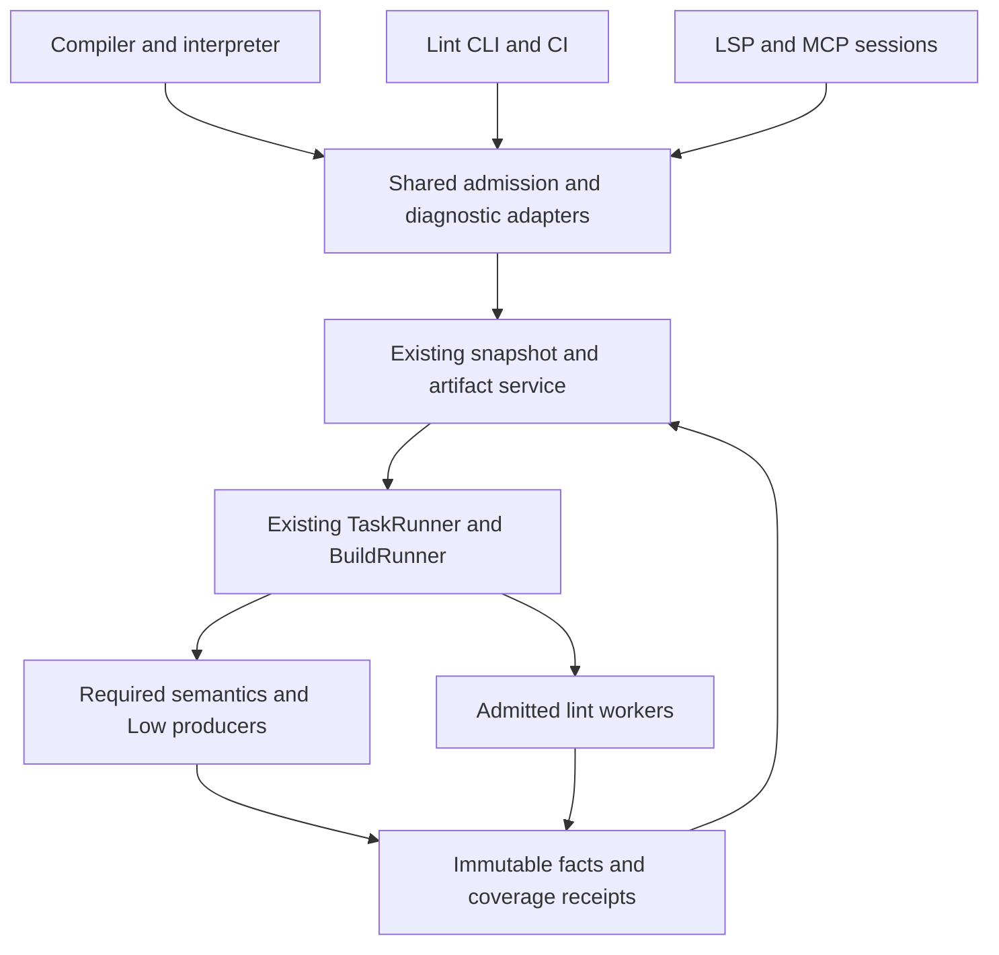

# Simple Early Defect Detection

## Low-cost compilation, full lint, shared build cache, and agent-ready diagnostics

**Date:** 2026-11-18  
**Status:** Final design and staged implementation plan; not an implementation or test-completion report.  
**Source baseline:** `ormastes/simple`, `release/1.0.0`, commit `11b8b8fe591a0f6aaef4abb8c6f0d1d5120df8a6`.  
**Scope:** Compiler, interpreter, bootstrap, build runner, shared artifact cache, SFFI, backend/module loading, lint, LSP, and the LSP/MCP interfaces used by LLM agents.

> Normal compilation retains required language correctness checks and measured low-cost incremental checks. Medium- and high-cost supplemental analyses are enabled by default in lint, not silently run by the compiler or interactive LSP. All consumers reuse the same authoritative snapshots, cached facts, diagnostic model, and build-runner execution contracts.

## Contents

1. Decisions and scope
2. Source-audit findings
3. Cost, severity, applicability, and completion policy
4. Defect-detection catalog
5. Shared architecture and ownership
6. Early reference and code-emission verification
7. SFFI and dynamic-library verification
8. Build-runner and cache integration
9. Diagnostics, migration policy, and safe fixes
10. LSP and LLM-agent integration
11. Step-by-step implementation
12. Acceptance tests and performance qualification
13. Documentation and traceability updates
14. Research and language precedents
15. Source evidence index
16. Final acceptance checklist

## 1. Decisions and scope

### 1.1 Required decisions

| ID | Decision |
|---|---|
| ED-01 | Catch a defect at the earliest point where sufficient evidence exists; do not declare an unfinished dependency missing. |
| ED-02 | Low-cost supplemental checks belong in normal compilation. Medium/high analyses belong in lint and diagnostic/CI execution. |
| ED-03 | Ordinary full lint enables all applicable analyses in its declared scope, including medium/high analyses. Budgets bound execution, not the truthfulness of its completion report. |
| ED-04 | Preserve mandatory parsing, typing, ABI consistency, artifact integrity, and loader safety. An expensive optional audit and an essential validity check are different things. |
| ED-05 | Reuse Simple's existing rule registry, diagnostics, task runner, artifact service, HIR/MIR ledgers, and cache admission. Do not create parallel owners. |
| ED-06 | Compiler, lint, LSP, and MCP share immutable analysis facts when their effective inputs match. Each editor/agent retains its own document overlay. |
| ED-07 | A result is usable only with identity, scope, target, freshness, and completion evidence. Empty findings alone never mean success. |
| ED-08 | Keep a passing host Phase 3 independent of heavy lint and optional backends. Introduce changes in small, independently testable increments. |
| ED-09 | Warning-to-error schedules affect the presentation/enforcement of completed findings; they do not secretly change analyzer cost admission. |
| ED-10 | Expose structured diagnostics and ranked, preconditioned fixes to LLM agents. Do not require agents to parse terminal error strings. |

### 1.2 Non-goals

- No whole-program prelinker that duplicates the real linker.
- No mandatory whole-HIR or whole-MIR barrier added to the per-file build lane.
- No wholesale compiler rewrite into a new query engine.
- No new language keywords, blanket primitive-type migration, or unrelated library refactoring.
- No automatic enabling of the per-file Stage 3 route merely because its compiler default is enabled.
- No claim that lint proves the absence of every runtime defect.
- No claim that a cache hash proves all dependencies were recorded.
- No source changes, bootstrap executions, benchmarks, or tests were performed to produce this document.

### 1.3 Important corrections to the earlier discussion

1. **The policy infrastructure is not missing.** The branch already has cost tiers, incomplete statuses, shared diagnostics, warning schedules, and task admission. Execution wiring and coverage are the immediate issues.
2. **Go export data is richer than exported names/signatures.** It can include inline/generic bodies and escape information. A type-only fingerprint is insufficient for all consumers.
3. **Current per-file Simple generics are documented as erased.** Rust-style monomorphization obligations are relevant only to a specialization path that actually exists or is later introduced.
4. **Declared symbols need not all survive code generation.** Inlining, elimination, aliases, internalization, and LTO must be accounted for.
5. **Interface-only invalidation is not immediately safe in the current HIR cache.** Current lowering can inspect sibling/non-imported surfaces; sharded placeholder surfaces complicate semantic digests.
6. **A cached high-cost result can be cheap to consume, but its producer remains high-cost.** A cache miss must not trigger that producer inside a normal compile or hover request.
7. **Early SFFI checking is not ABI proof.** A matching export name does not establish parameter layout, lifetime, or runtime-library identity.

## 2. Source-audit findings

The following is a targeted, read-only review at the pinned commit. It distinguishes observed code from proposed behavior. Historical bug descriptions are not treated as evidence that every historical bug remains unfixed.

### 2.1 Reuse versus repair

| Area | Observed source | Required plan response |
|---|---|---|
| Cost policy | `rule_cost_tier.spl` defines Low/Medium/High, low-only NormalBuild, all-tier DefaultLint, and unknown-cost-as-High. | Reuse it; move only the minimal immutable descriptor/admission policy to a downward-shared owner. [C01] |
| Fast lint | `lint_apply_fast_profile` sets non-Low rules to Allow. Entry processing can subsequently re-enable levels. | Separate execution admission from severity and apply the final admission decision before invoking producers. [C01–C03] |
| Producer dispatch | Several producers, including shared fix producers, run before the results are filtered. | Suppressed diagnostics are not evidence of suppressed work. Add pre-execution admission and invocation counters. [C03] |
| Normal compiler | The inspected HIR pipeline has separately gated and unconditional analysis passes, without the lint cost selector at those call sites. | Classify and measure each pass. Do not infer that all unconditional passes are expensive, or disable required semantics. [C04] |
| Lint completion | CLI infers executed rule count from the catalog; `budget_exhausted` is explicitly hardcoded false. | Record actual per-rule execution/coverage receipts and propagate real resource outcomes. [C05] |
| Diagnostic model | `DiagnosticV1`, ranked fixes, lifecycle data, and `DiagnosticBatchV1` already exist. Batch status is separate from severity. | Extend these types compatibly; do not invent a competing early-error model. [C06–C07] |
| Severity schedule | A deterministic SDN policy resolver exists, including edition/date gates and policy digest. Lint's inspected adapter consumes only a limited baseline projection. | Finish canonical rule mapping and resolver adoption; avoid another scheduling-policy implementation. [C08–C09] |
| LSP | A local thin `LspCheckBatchV1` discards canonical completeness; malformed JSON can become an empty batch. | Carry the canonical batch through the adapter. Failure must not clear valid evidence or certify clean code. [C10] |
| Safe actions | Version checks, expected-text checks, and overlay/disk mismatch rejection already exist. | Preserve them; add dependency/target context and multi-file transaction preconditions. [C11] |
| LSP/MCP | Diagnostics remain guarded by `SIMPLE_LSP_ENABLE_DIAGNOSTICS`; source comments describe a nested-check deadlock. | Reuse resident/shared analysis receipts first. Do not remove the guard until the new path is qualified. [C12] |
| Build runner | The app runner delegates to `std.common.task_runner.scheduler`; it already verifies current attempts, dependencies, and fresh output digests. | Schedule lint through these contracts, not a second LSP-owned job system. [C13–C14] |
| Artifact service | Lease owner, generation, snapshot, cancellation, and artifact digests are checked. | Reuse fencing and admission. In-memory APIs alone do not demonstrate global cross-process single-flight. [C15] |
| Per-file compiler | HIR/MIR ledgers, claim/terminal/seal records, closure checks, receipts, and object sidecars exist. | Add reference/emission evidence to existing manifests and completion events. [C16] |
| Stage 3 | `config/bootstrap.sdn` still selects `stage3_file_workers: 0`. | Preserve this configuration until the candidate per-file lane passes its own qualification. [C17] |
| HIR cache | Content-based closure digests remain the default; interface digests are opt-in with documented placeholder limitations. | Keep conservative invalidation until complete semantic-read witnesses and authoritative surfaces exist. [C18] |
| Lookup performance | ModuleSurface retains scalar arrays and uses linear lookup in places to avoid documented seed-runtime dictionary problems. | Do not assume existing lookups are constant-time. Qualify any index replacement separately. [C19] |

### 2.2 Immediate defects or integration risks to reproduce

These are source-supported issues to turn into executable regressions:

1. **Post-execution filtering:** a fast profile must prevent a deep producer from running, not only hide its findings.
2. **Flag precedence:** combinations such as fast plus warn-all must not re-enable medium/high execution accidentally.
3. **Incomplete coverage:** a timeout or unsupported producer must not be counted as a completed clean rule.
4. **Empty-on-failure LSP results:** malformed, failed, or stale analyzer output needs an explicit status.
5. **Nested process waits:** diagnostic queries must not synchronously invoke a child that waits on a resource held by the caller.
6. **Policy divergence:** compiler, lint, LSP, and agent views must agree on the same canonical finding and pinned policy.
7. **Cache narrowing hazards:** do not replace all-surface dependencies with import-only dependencies before checking actual reads.
8. **Concurrent publication:** test the persisted graph pointer update under concurrent writers; read-then-rename is not automatically compare-and-swap. This is a review risk, not a reproduced failure. [C22]

The source currently contains some guards for historical ownership defects. Therefore, the right status is **source guard present; end-to-end lane qualification not established here**, not “all old layers are still broken.”

## 3. Cost, severity, applicability, and completion policy

### 3.1 Five independent axes

A rule descriptor must keep these dimensions distinct:

| Axis | Question |
|---|---|
| Applicability | Does this rule apply to this language, module, target, backend, feature, and requested scope? |
| Cost admission | May this execution profile invoke this producer, with these inputs and budgets? |
| Enablement | Has the project explicitly selected or exempted this applicable analysis? |
| Severity | How should a completed finding be reported under the pinned policy? |
| Coverage | Did the requested analysis actually finish on the required snapshot and scope? |

An Allow severity is not a universal execution control. A warning can require an expensive analysis, and an error can come from a cheap check.

For normal full lint, every applicable analysis is enabled by default. Existing opt-in or default-Allow rules need explicit migration review: distinguish “not applicable to this profile” from “applicable but disabled.” Exemptions must be recorded in the coverage report rather than counted as analyzed.

### 3.2 Required validity versus supplemental analysis

Existing mandatory language and artifact validity stays mandatory:

- Syntax and type checking needed to compile the selected language semantics.
- Correct target data layout, calling convention, and representation checks needed by lowering.
- Cache header/version/checksum validation before accepting bytes.
- Current-owner publication and output admission.
- Dynamic-plugin ABI/version checks needed to load safely.
- Final linker and runtime checks on which correctness depends.

The new low/medium/high policy governs **supplemental early analysis**. It must not turn invalid code or corrupted compiler state into accepted output.

If a required new guarantee would need an expensive proof, choose a bounded contract, verified cached evidence, a runtime guard where appropriate, or an explicit unsupported result. Do not silently bypass the guarantee and still advertise it.

The core-validity exemption is not a way to relabel every expensive analyzer as mandatory. Maintain a reviewed inventory linking each core check to a required language/artifact invariant. Cost tests must count all producers and separately identify the approved core checks.

### 3.3 Execution profiles

| Entry point | Work it may execute | Medium/high cache hits | Meaning of success |
|---|---|---|---|
| Normal build / check | Required semantics plus admitted Low checks | May display/reuse compatible completed evidence without invoking its producer | Valid compilation for selected target, not full-lint certification |
| Bootstrap Phase 3 | Same; host toolchain/backend scope | Optional compatible evidence only | Host bootstrap gate passed; no implicit all-target claim |
| Full lint | All applicable Low/Medium/High analyses in declared scope | Reuse before scheduling | Required coverage complete and findings meet policy |
| Fast lint | Required parsing plus Low supplemental checks | May show separately labeled cached deeper findings | Complete for fast scope only |
| Interactive LSP | Bounded low-latency checks on the current overlay | Serve exact-key completed results | Current document facts with explicit coverage |
| Explicit LSP/MCP lint request | Submit the full lint profile to shared workers | Reuse/deduplicate | A job receipt, followed by a scoped completed result |
| CI assurance | Full lint plus selected integration/target contracts | Reuse only admitted evidence | Complete required matrix and policy gates |
| Phase 4 | Debug/release and configured backend matrix qualification | Target-specific reuse | Only tested/supported matrix entries qualify |

“Full” means full coverage for the declared project/rule/target scope. It does not silently mean every platform, arbitrary depth of symbolic execution, every possible plugin, or an unbounded proof.

**Compilation acceptance must not depend on cache warmth.** A normal build may display compatible cached supplemental lint findings, but their presence must not by itself change whether compilation succeeds. Projects requiring full lint use a separate explicit assurance gate. Missing or stale required lint evidence makes that gate incomplete, never implicitly passed.

### 3.4 Enforce the policy before execution

Admission must happen before:

- Loading a heavy checker plugin.
- Constructing its transitive import graph.
- Decoding whole-program IR for that checker.
- Launching a subprocess or scanning external libraries.
- Running shared fix producers that also perform analysis.

The order is:

1. Resolve snapshot, requested scope, target, and immutable policy.
2. Determine applicability and explicit exemptions.
3. Enforce cost admission.
4. Reuse an exact compatible completed result if available.
5. Schedule an admitted producer if needed.
6. Record its actual completion receipt.
7. Apply severity and render findings.

For a cache-only medium/high request during a normal build, step 5 is forbidden. A miss reports “not analyzed in this profile”; it does not trigger hidden fallback computation.

Precompute dense rule slots and admission masks once per immutable session profile. Do not rebuild string lists or scan the rule catalog for every AST node. Shared producers such as the EasyFix registry must accept the admitted selection before doing work; filtering their results afterward is insufficient. Group compatible low checks into existing traversals rather than reparse a file for each rule.

### 3.5 Cost classification and measurement

| Tier | Typical work | Placement |
|---|---|---|
| Low | Bounded per-node checks during existing traversal, already-available identity comparisons, local constructor/finalizer invariants | Normal build and lint |
| Medium | Additional function/module passes, complete header processing, cold library indexing, additional dependency or serialization sweeps | Lint |
| High | Interprocedural dataflow, alias/resource analysis, whole-graph audits, model checking, translation validation, broad matrix analysis | Lint/diagnostic workers |

Record cold CPU time, warm lookup time, peak memory, input cardinality, edge visits, and extra artifact decoding separately. A producer with a cheap cache hit is not reclassified as Low.

Unknown supplemental analysis cost remains High until measured. Cost estimates are per producer and input domain; they are not inferred from a friendly rule name or a short implementation.

Use existing safety pass invariants as the baseline. If moving a supplemental pass to lint removes a previously promised mode guarantee, document and test the replacement; do not silently reduce assurance.

### 3.6 Budgets and honest status

Reuse `LintCompleteness` and `DiagnosticBatchV1`. Add compatible coverage/receipt fields rather than replacing their ownership.

Separate:

- **Execution:** completed, failed, timed out, cancelled, unavailable.
- **Coverage:** requested units/rules, completed units/rules, pending, exempted, unsupported.
- **Findings:** errors/warnings/advisories.
- **Freshness:** current, superseded, or source/dependency mismatch.

Rules:

- A completed analyzer can successfully produce a finding that fails policy.
- A crashed analyzer with no findings is not clean.
- A fast run can be complete for fast scope but cannot satisfy full-lint scope.
- A nonapplicable rule needs a reason and is not silently “passed.”
- A timeout does not become a cached negative finding.
- Empty-scope full lint must report its scope explicitly; it cannot accidentally certify an unvisited workspace.

Keep existing external exit-code compatibility where possible. The new structured result must still cause the requested full-lint/CI command to fail its completion gate when required coverage is incomplete. Define and test any new exit codes before exposing them.

## 4. Defect-detection catalog

The following divides cheap observations from deeper proofs of the same property. These are implementation targets, not claims that every listed analyzer already exists.

| Defect family | Cheap normal-path check | Medium/high lint work | Important limit |
|---|---|---|---|
| Missing names/imports | Use authoritative published declarations during ordinary resolution | Audit undeclared semantic dependencies and unused/dead dependencies | Pending provider is not missing |
| Visibility and re-exports | Validate selected declaration and allowed route | Whole-layer/feature boundary audit | Preserve legal re-exports; no blanket import-only assumption |
| Duplicate/ambiguous definitions | Detect incompatible strong definitions in the known selection scope | Cross-artifact/archive/plugin collision analysis | Aliases, weak linkage, and COMDAT need their own semantics |
| Missing generated code | Validate explicit exports and surviving materialization obligations at finalization | Independent object/relocation audit and backend differential tests | Do not require eliminated/inlined declarations to remain symbols |
| Generic/runtime helpers | Check actual erased-body and helper obligations in current lane | Specialized-instance audit only for applicable backend modes | Current erased generics do not require a Rust monomorphization collector |
| Build input closure | Refuse consuming unadmitted required inputs | Trace real reads and compare against declared inputs | A manifest is not proof of complete observation |
| Dependency cycles | Detect an invalid ready-state/closed dependency group | Full SCC/wait-for/initialization graph analysis | Legal mutual declarations differ from illegal initialization waits |
| Worker ownership | Validate lease, owner, generation, attempt, and terminal publication | Failure-injection and concurrency-state exploration | Time elapsed alone cannot establish owner death |
| Partial artifacts | Atomic publication and parent output admission | Crash-recovery and concurrent-writer audit | Rename gives atomic replacement, not arbitrary multiwriter CAS |
| Cache corruption | Existing schema/identity/checksum/length checks | Full encode/decode round trips and clean-vs-cached comparison | Never move mandatory integrity checks exclusively to lint |
| Cache staleness | Compare recorded dependency/context identities | Audit missing and negative dependencies | Public signatures alone are insufficient |
| HIR/MIR malformed state | Required IDs, local operand types, owner/revision, required fields | Complete dominance/use-def/control-flow verification | Full verifier is structural, not semantic equivalence proof |
| Async initialization | Refuse publishing/reading a required unfinished field | Cross-task ordering and escape analysis | Handle existence is not initialization completion |
| Mutation through immutable view | Enforce the published snapshot/view contract | Alias and cross-revision mutation analysis | Ordinary mutable builders remain permitted before publication |
| Backend capability mismatch | Check known target/layout/feature/IR-ABI capability data | All-target capability/operation coverage | Advertised support is not a substitute for execution tests |
| SFFI declarations | Normal call type checking and known representation checks | Header/wrapper/layout/calling-convention comparison | Export name alone does not prove the signature |
| SFFI symbol/library mismatch | Consult validated cached target library metadata | Cold indexing, probe links, archive/extraction checks | Optional/dynamic providers can remain explicitly deferred |
| Unsafe numeric/text/bool boundaries | Existing cheap syntax/declaration policy checks | Flow-sensitive late casts, trust propagation, ownership and representation audits | No blanket unsafe cast is an automatic repair |
| Ignored results or error codes | Existing must-use/return-contract checks at a typed call site | Trace forwarding, swallowed errors, and interprocedural propagation | Use existing contracts where available; do not infer meaning from a name alone |
| Nonexhaustive decisions | Existing mandatory match rules and bounded finite-case checks | Complex guards, nested patterns, and cross-state coverage | Do not move a required language guarantee to lint or blindly reclassify the existing High rule |
| Constant/range/unit mistakes | Required constant-evaluation errors and known typed unit/range mismatches | Symbolic ranges, cross-procedure bounds, overflow and conversion proofs | Compile-time rejection and runtime guards have different responsibilities |
| Effect violations | Compare already-known direct effects with the active contract | Infer indirect effects and paths through callbacks/plugins | Unknown effect is not proof of purity or no-allocation behavior |
| Initialization ordering | Validate known required initialization dependencies | Whole-program initialization analysis | Runtime callback behavior is not generally statically known |
| Resource lifetime/nullability | Required type/state checks already available locally | Summary-based leak/use-after-free/alias reasoning | Analysis assumptions and unsupported operations must be disclosed |
| Locks/races/deadlocks | Enforce local lock/await protocol and worker state contracts | Interprocedural lock order, wait-for graphs, schedule exploration | A watchdog reports a stall, not proof of deadlock |
| Performance defects | Cheap local shape warnings with bounded evidence | Nested-scan, collection/SoA-AoS, allocation/CPU/GPU analyses | Do not claim an asymptotic bug solely from syntax |
| Documentation/traceability | Check required identifiers at already-read boundaries | Link/orphan/requirement/test/bug consistency across repositories | Missing evidence is distinct from absent functionality |
| Compiler miscompilation | Basic output contracts and smoke gates | Differential testing, bounded translation validation, cross-stage comparison | Matching symbols or binary hashes is not full semantic proof |

### 4.1 Early means “when evidence is available”

Avoid three common false positives:

1. A source provider has not published its surface yet.
2. A backend intentionally eliminates a nonrequired definition.
3. A runtime plugin is explicitly selected later.

Conversely, do not defer a known-invalid declaration until link just because the backend could emit an external-looking call. Name resolution and emission verification are different obligations.

### 4.2 Reuse existing AST/HIR/MIR contracts

Use mutable builders for local construction and immutable revision-bound views for published artifacts. Supplement existing required-initialization checks with:

- A generation/version on published views.
- A finalization check that required attributes are initialized or explicitly classified as not applicable.
- No shared-reader access to a partially published view.
- No synchronization lock held across an await of a dependent artifact.
- Explicit error propagation when an initializer or producer fails.

Heavy alias and cross-task lifetime analysis belongs in lint. Local publication validity remains in the shared runtime/compiler contract.

## 5. Shared architecture and ownership

### 5.1 One fact model, multiple adapters



The diagram describes ownership, not a requirement to route every tiny compiler check through an IPC service. Low local checks remain local when that is cheaper; they publish compatible facts at existing boundaries.

### 5.2 Preserve MDSOC dependency direction

The inspected driver explicitly avoids importing `compiler.tools.lint.main`. Keep that direction. [C04]

| Owner | Responsibility |
|---|---|
| Common diagnostic/assurance layer | Small immutable descriptors, rule IDs, cost admission, severity projection, canonical diagnostics and receipt schema |
| Frontend/HIR/MIR owners | Semantic facts, mandatory validity, cheap checks, immutable summary publication |
| Backend owner | Capabilities, required-emission decisions, artifact/output evidence |
| TaskRunner/BuildRunner | Resource admission, process lifetime, ownership, retries, output verification, recovery |
| Compiler artifact service | Action compatibility, fenced publication, content-addressed artifacts, cache admission |
| Lint implementation packages | Medium/high producers and analysis-specific summaries |
| LSP/MCP adapters | Per-client overlays, queries, negotiated protocol rendering, action preconditions |

Extract only the common descriptor needed for admission. Preserve compatibility facades and existing rule names. Do not make the compiler load a full lint implementation to learn its cost.

### 5.3 Minimum rule descriptor

The following is a conceptual contract, not new language syntax or an already-available API:

```text
AnalysisDescriptor
    canonical_rule_id
    implementation_version
    schema_version
    requirement_kind          # core_validity / supplemental_analysis
    cost_tier                 # low / medium / high
    supported_surfaces
    applicability_predicate
    required_fact_projections
    target_dependence
    budget_class
    cacheability_and_assumptions
    diagnostic_and_fix_capabilities
```

Predicate evaluation must itself be cheap. A rule cannot run its expensive analysis merely to decide whether it applies.

### 5.4 Do not create new global barriers

Continue per-file work whenever the file's actual semantic inputs are ready. Publish each artifact and its validation receipt at existing completion points.

Where legal cyclic declarations require a declaration-group seal, use that local group boundary. Do not confuse it with a mandatory whole-program HIR barrier.

## 6. Early reference and code-emission verification

### 6.1 ModuleSurface-based semantic checks

Reuse the existing surface resolver and its states:

- Missing.
- Pending.
- Selected.
- Ambiguous.
- Unavailable.

Preserve origin, generation, visibility, and lookup-scope evidence. A Selected declaration proves semantic selection, not machine-code emission. [C19]

At ordinary HIR resolution, report an error when a required lookup is definitively invalid in an authoritative closed scope. If input publication failed, report the underlying build/input failure rather than manufacturing an unrelated undefined-name error.

### 6.2 Reference facts, not a second scheduler ledger

Attach compact reference evidence to existing per-module artifacts:

```text
ReferenceFact
    consumer_node_and_source_identity
    selected_symbol_identity
    provider_origin_and_surface_generation
    signature_or_contract_projection
    lookup_scope_witness
    dependency_kind
    target_and_abi_context_if_relevant
```

Deduplicate repeated references to the same provider projection. Preserve source-use locations in a compact secondary table for diagnostics.

No all-graph walk is required for each reference. In the present seed-sensitive lane, retain qualified lookup structures rather than replacing scalar arrays with an unproven dictionary optimization.

### 6.3 Emission obligations

Derive obligations from actual lowering/export requirements, then reconcile them with the backend's decisions:

| Outcome | Required evidence |
|---|---|
| Materialized | Emitted definition/section identity or accepted backend output evidence |
| Alias/provider redirect | Explicit valid alias and target identity |
| Eliminated or fully inlined | Optimization disposition showing no surviving requirement for an out-of-line definition |
| External | Bound foreign/runtime provider contract |
| Deferred to LTO | Bitcode/intermediate artifact and final-link responsibility |
| Dynamic | Explicit late-provider/plugin contract |
| Missing | Surviving strong obligation has no valid disposition after its provider is terminal |

Do not implement `declared_symbols - emitted_symbols = errors`. It is wrong for ordinary optimized programs.

Object output can introduce helper calls not evident in HIR, such as runtime arithmetic or memory helpers. Include their actual object references when the writer makes those available. A sidecar generated by the same backend is useful evidence, but independent binary parsing in lint/CI is stronger protection against a lying or buggy writer.

### 6.4 Preserve final-link authority

Let the real linker decide archive member extraction, ordering/group semantics, weak/COMDAT resolution, relocation compatibility, linker-script effects, and final LTO results.

Known selected-provider failures can be detected early. Unproven speculative failures must remain pending/deferred with a reason; do not reject valid programs based on a simplified shadow linker.

### 6.5 Current generics and bootstrap generations

For the current erased lane, validate the erased function body, representation contract, dispatch helpers, and runtime support actually required. Only introduce specialization-instance manifests for backends that materialize such instances. [C16]

Cross-stage checking in lint/CI should compare normalized supported interfaces, selected fixture behavior, and relevant emission contracts. Stage 2 and Stage 3 may legitimately have different private symbols. Neither symbol equality nor byte-for-byte binary equality alone proves compiler correctness.

## 7. SFFI and dynamic-library verification

### 7.1 Shared verifier, foreign provider adapter

SFFI uses the same reference/fact/diagnostic system. Add a foreign-provider adapter, not a separate error engine.

The proposed SFFI surface contains:

- Foreign declaration identity and source span.
- Generated-wrapper identity, if used.
- Target triple, C ABI, data layout, calling convention, and relevant CRT choice.
- Header closure and preprocessing/compiler options.
- Resolved library/import-library identity and link mode.
- Required export names, versions/ordinals where applicable, and weak/optional policy.
- Validation level, assumptions, and runtime-load responsibilities.

Do not write a bare Simple `text` parameter as if it were automatically a C `char *`. Conversion requires the correct representation, encoding, termination, ownership, and lifetime wrapper.

### 7.2 What runs where

| Work | Normal build/load | Lint |
|---|---|---|
| Type-check Simple calls against SFFI declarations | Required | Reuse |
| Reject known incompatible ABI/layout/target metadata | Required | Reuse |
| Consult exact cached foreign export index | Low if already admitted | Reuse |
| Read a bounded binary header for architecture/version | Low when applicable | Reuse |
| Scan a large archive or all dynamic exports from cold storage | Do not hide as a low-cost cache miss | Medium; publish reusable index |
| Parse/preprocess complete C/C++ headers | Not repeated as incidental early checking | Medium/high; cache by full target/header context |
| Compare layouts, calling conventions, wrapper types | Required local known checks; deeper proof not assumed | Full comparison/probe compilation |
| Probe-link a wrapper set or inspect archive extraction | Final normal link remains authoritative | Targeted lint action |
| Check ownership, callbacks, resources, trust flow | Existing mandatory contracts | Medium/high analysis |
| Validate dynamic-plugin entry contract before use | Required | Extended compatibility matrix |

A normal build may continue to its ordinary final link if optional preflight metadata is unavailable. It must report that early SFFI verification was not performed, not claim the exports were validated. A known incompatibility is still an error.

### 7.3 SFFI identity and invalidation

Use resolved artifacts rather than only a library name such as `sqlite3`. Include the effective:

- Architecture, pointer width, endian, platform ABI, and calling convention.
- Header/transitive-include content and relevant macro configuration.
- Wrapper generator/compiler identity.
- Compile/link flags, sysroot, library-search order, and chosen linkage mode.
- Library bytes or admitted immutable artifact digest.
- Import-library/DLL pairing, symbol versions, or target slice where applicable.

The exact same symbol name may exist in an incompatible library. Header verification also does not prove that the runtime loader will choose the same binary; runtime plugin compatibility checks remain necessary.

Prefer already admitted immutable artifact identities. If checking the current bytes of a large mutable external SDK/library would exceed the supplemental normal-path budget, do not reuse old preflight evidence as current. Report that early verification is unavailable and leave the ordinary final link authoritative. Timestamps alone are not proof of byte identity; neither a hover nor a cheap preflight cache miss may secretly hash/index an entire SDK.

### 7.4 Special cases

| Case | Correct treatment |
|---|---|
| C macro or static inline function | Validate/generate its wrapper; absence of a standalone export may be normal |
| C++ function | Honor mangling and ABI, or use an explicitly generated C ABI wrapper |
| Static archive | Record candidate member/export data; final extraction still belongs to linker |
| Windows import library | Bind the import contract and intended DLL; do not confuse import-library presence with deployed DLL proof |
| Universal/multi-architecture library | Select and validate the intended slice |
| Weak/optional import | Record the optionality and required fallback |
| Dynamic lookup by computed name | Usually runtime responsibility; bounded lint can check known cases only |
| Generated foreign library | Pending until its producing task is admitted and complete |

Preflight inspection must not load arbitrary libraries and execute their constructors. Use bounded metadata readers or supervised probe compilation/linking. Do not download SDKs, install packages, or execute target binaries merely because an LSP diagnostic was requested.

## 8. Build-runner and cache integration

### 8.1 Reuse existing authority

Register analysis as another task/artifact kind on the existing infrastructure:

- `std.common.task_runner` for execution and admission.
- BuildRunner context V2 or equivalent explicit target/configuration identity.
- Existing compiler artifact service for compatible lookup and fenced publication.
- Existing parse/HIR/MIR stores and immutable source authority.
- Existing diagnostic serialization and result rendering.

The parent must continue to validate declared outputs and their digests. Worker exit zero is not sufficient. A cached result must pass the same readmission logic as any other artifact. [C13–C15]

### 8.2 Separate three identities

| Identity | Purpose |
|---|---|
| Snapshot identity | Names the workspace/worktree/overlay view and source mappings seen by the client |
| Stable analysis key | Identifies reusable computation from relevant content, dependencies, target, and analyzer inputs |
| Attempt/lease identity | Fences one execution/publisher and prevents stale completion after retry |

Do not put a whole-workspace snapshot digest into every fine-grained analysis key unless that analysis truly reads the whole workspace. That would destroy reuse after unrelated edits.

Conversely, a reusable fact is not automatically a current UI report. Bind or remap its source positions against the receiving snapshot before publishing diagnostics or fixes.

### 8.3 Proposed analysis key

```text
AnalysisKey = digest(
    artifact_schema,
    rule_id_and_implementation_version,
    semantic_input_artifact_keys,
    complete_dependency_witnesses,
    analysis_parameters_and_assumptions,
    relevant_target_abi_backend_context,
    relevant_configuration_and_environment
)
```

Include profile/policy fields only to the extent they affect analysis semantics or enabled scope. Keep pure severity formatting in a separate presentation key so a warning-to-error promotion can reuse the same completed facts.

Build context V2 already has target-layout and configuration digests. Preserve existing environment normalization rules; do not ignore all environment variables or strip arbitrary absolute paths from keys. [C20]

### 8.4 Projection-specific reuse

| Consumer reads | Required dependency projection |
|---|---|
| Type/name resolver | Exported declarations, type structure, visibility, applicable candidate sets |
| Constant evaluation | Constant values and evaluation dependencies |
| Inline optimizer | Relevant bodies and optimization assumptions |
| Generic specialization, if applicable | Generic bodies, constraints, selected implementations |
| Current erased generic lowering | Erased-body/representation/runtime-helper contract |
| Macro expansion | Macro definitions, imports, generated outputs, grammar/tool identity |
| Effect/resource analysis | Relevant summaries, assumptions, call/dependency selections |
| Source-position renderer | Current source mapping, not only a span-free semantic digest |
| Backend/object emitter | Target, ABI/data layout, CPU/GPU features, backend/IR version |

Do not assume HIR is always target-independent. The inspected cache explicitly handles preprocessing that removes target-dependent arms. [C18]

### 8.5 Conservative invalidation first

Current HIR lowering observes more than direct imports. It can inspect a frozen inventory of surfaces and sibling re-exports. Sharded workers can contain placeholder surfaces with different semantic digests.

Therefore:

1. Keep the current conservative content/surface dependency mode for Phase 3.
2. Establish an authoritative immutable surface generation independent of worker placeholder slices.
3. Record semantic-read witnesses, including sibling resolution and lookup candidate sets.
4. Validate fresh-versus-cached equivalence under changed bodies, names, exports, constants, defaults, macros, and target conditions.
5. Only then narrow invalidation for qualified consumers.

Do not turn on interface-only closure keys globally as part of diagnostic integration.

### 8.6 Negative dependencies

Cache a failed lookup only with the scope in which absence was established:

- Provider-set generation and export membership.
- Import/search-path order.
- Relevant directory or generated-file inventory.
- Missing overload/implementation candidate set.
- Absent optional package/library and the target/feature selection.

Adding a formerly missing file, export, overload, or library invalidates the earlier absence result.

An unknown or unfinished provider is Pending/Unavailable, not a negative fact.

### 8.7 Single-flight and cancellation

For identical compatible analysis keys, share one producer and attach multiple consumers.

Required protocol:

1. Claim work through the retained authoritative owner.
2. Attach waiters without holding a global lock during computation.
3. A cancelling LSP/agent request detaches that waiter.
4. The producer continues while another authorized waiter still needs it.
5. Producer failure resolves every waiter with a terminal failure/incomplete reason.
6. Publish only with the original current lease/generation.
7. Admit result bytes and metadata atomically before exposing a completed result.

Single-flight must be implemented at the scope actually claimed: in-process, cross-process, or distributed. The existing in-memory state APIs do not alone establish cross-process deduplication.

Use a small well-defined ownership critical section or an existing coordinator before attempting a new lock-free design. Never steal a lease merely because a timeout elapsed. Confirm producer termination/recovery authority and advance the fencing generation.

### 8.8 Resource policy

Lint reuses the build runner's CPU/memory/process accounting. The compiler and interactive queries get priority over background deep lint.

- Bound concurrency using measured peak memory for the selected runtime, not CPU count alone.
- Explicit job-count requests do not bypass hard safety/resource limits.
- Use portable process supervision rather than depending only on a host `timeout` executable.
- Avoid nested waits that hold all pool slots while awaiting work queued to the same pool.
- Bound captured output and serialized diagnostic/fix sizes.
- Budget expiry marks incomplete coverage and terminates/reaps work through existing lifecycle rules.
- Record enough unfinished work to resume where analysis semantics permit; do not resume an arbitrary solver state as if it were a verified checkpoint.

### 8.9 Cached findings and failures

A successful analysis task can yield failing diagnostics; its immutable facts are cacheable under an exact key.

Transport errors, crashes, cancellation, unsupported rules, and timeout records may be retained for observability, but are not cacheable “no-defect” results.

For complete deterministic negative findings, retain all absence witnesses. For partial reports, allow reuse only of individually completed scoped results; never promote an aggregate partial report to a full certificate.

### 8.10 Trust and scope

- Do not share private unsaved overlays across users/workspaces by accident.
- Remote/shared caches require integrity and authorization in addition to a fast hash.
- Hash collisions cannot be permitted to impersonate a semantic identity; preserve the current stronger validation where used.
- Cache readers enforce schema/size/depth limits.
- Avoid rendering secrets from environment digests, foreign arguments, or source payloads into diagnostics.

## 9. Diagnostics, migration policy, and safe fixes

### 9.1 Extend the canonical types

Reuse `std.common.diagnostics.DiagnosticV1`, `DiagnosticBatchV1`, `DiagnosticActionIndex`, and existing fix preconditions. Add compatible receipt/context fields or a versioned adjacent envelope.

Needed context:

- Analysis key and implementation/schema version.
- Workspace/worktree/overlay snapshot.
- Selected target/backend/ABI context.
- Requested and completed rule/scope coverage.
- Provenance and cache-reuse status.
- Complete/incomplete reason and pending task identity.
- Dependency evidence sufficient to explain or invalidate the result.

Keep source spans, related locations, macro traces, ranked fixes, and stable diagnostic IDs. Do not create a new numeric diagnostic namespace without allocation through the canonical registry.

Publication must require an explicit terminal receipt. In particular, the existing batch constructor's default Complete status must not cause an unfinished or failed computation to look complete: use a producer-side builder/finalization gate or a compatible envelope, without breaking old seed-readable formats.

### 9.2 Root cause before cascades

If an imported surface failed to publish, report the root publication/identity problem and mark dependent analysis blocked. Do not emit hundreds of speculative missing-symbol errors.

A useful diagnostic answers:

1. What failed?
2. Where did the requirement originate?
3. Which provider/artifact was expected?
4. Was it missing, pending, incompatible, or unvalidated?
5. What evidence established that classification?
6. Which repairs are available and which require review?

Example output shape, with illustrative identifiers:

```text
Required code-generation output is absent
  consumer: compiler/lowering.spl, call-site identity 42
  provider: compiler/runtime_helpers.spl
  context: snapshot S17, host target T3, backend ABI B2
  state: provider completed; surviving export obligation unresolved
  evidence: object receipt O91 and emission contract E91
  related: provider declaration and generated-object location
  fixes: inspect emission guard; select correct provider; repair import if proven
  coverage: complete for this obligation; full workspace lint not requested
```

### 9.3 Warning-to-error rollout

Reuse the existing deterministic SDN policy resolver. It already supports creation, warning, error/removal edition/date, profile, replacement, and exception metadata. [C08]

Finish adoption so all consumers resolve the same canonical rule under:

- Pinned language edition.
- Toolchain release date or explicit policy-as-of.
- Policy digest.
- Active profile and permitted scoped exceptions.

Do not consult the wall clock to silently change reproducible build outcomes.

Critical corruption, required type invalidity, and forbidden security/ABI violations remain immediate errors where required. New style/robustness migration rules can warn first and later become errors.

A severity promotion for a high-cost lint rule still occurs in lint. It does not authorize running that analyzer during every normal compilation. CI can require a separate current lint receipt.

### 9.4 Safe fixes for people and agents

Automatic fixes require:

- An exact source/document revision or content precondition.
- Matching dependency, target, and semantic assumptions when relevant.
- Nonoverlapping edits, correct encoding, and expected old text.
- Preserved imports/visibility/evaluation behavior.
- An explicit applicability classification.

Default to review for:

- Public signature or ABI changes.
- Unit/text/bool domain changes with multiple plausible meanings.
- Ownership/lifetime repairs.
- Dependency additions or changed library selection.
- Broad rewrites or behavior-changing casts.

Never automatically repair a failure by inserting a stub, returning a default value, adding unsafe, suppressing a warning, or weakening a contract.

For multi-file changes, validate all preconditions before any edit. If the client cannot apply the edit atomically, use a controlled transaction/staging workflow or require manual review. Do not imply the LSP transport itself guarantees universal cross-file transactions.

After editing, invalidate affected facts and run the relevant low checks, tests, and requested lint scope again.

### 9.5 Severity and completeness remain independent

Examples:

- Complete + warnings: analysis completed; policy decides acceptability.
- Complete + errors: defects detected; fail the gate for that analysis domain. Supplemental lint evidence does not make ordinary compilation depend on cache presence.
- Timed out + zero diagnostics: incomplete; cannot certify clean.
- Unsupported + no findings: unsupported, not not-applicable.
- Stale + errors: useful historical evidence, not a current fix target.
- Full lint requested + only fast scope completed: incomplete full request.

## 10. LSP and LLM-agent integration

### 10.1 Shared computation, isolated overlays

One shared analysis/artifact service can serve many frontends. Each editor or agent session maintains its own:

- Worktree and permissions.
- Open-document versions and unsaved contents.
- Overlay snapshot.
- Target/profile selections.
- Cancellation and subscriptions.

Two agents editing the same URI differently must not overwrite each other's semantic view. Share immutable content/facts only when the effective analysis keys match within the authorized scope.

The LSP is an adapter, not a global mutable compiler state store. Capability negotiation and session isolation remain required. [R07]

### 10.2 Interactive behavior

- On edit: run bounded cheap recovery/semantic checks; reuse current artifacts.
- On hover/navigation: query existing indexes; do not start workspace-wide lint.
- On explicit lint request: submit work to the shared task runner and return progress/job identity.
- On a completed cached result: publish only after freshness checks.
- On a stale/failed result: retain last valid evidence as stale if useful, disable its fixes, and expose current incompleteness.
- On close/disconnect: detach subscriptions and overlay resources without cancelling work needed by other consumers.

Cross-file invalidation must include semantic dependencies, not just edits to the currently open file.

Stale evidence belongs in internal history or a negotiated status view. LSP has no universal stale-diagnostic flag: do not send old ranges as current full/unchanged diagnostics unless source mappings and dependencies have been validly rebound to the current snapshot. Report present incompleteness separately.

### 10.3 Pull diagnostics and result reuse

Where clients negotiate support, use LSP pull-diagnostic result IDs and unchanged responses to avoid resending identical findings. Support progress and cancellation using the negotiated protocol.

The result identity must incorporate the rendered snapshot/source mapping, scope, analysis completion, target, and severity policy—not merely the number of diagnostics.

Existing clients without those capabilities continue through a compatible push/presentation path.

Do not advertise inter-file/workspace diagnostic support until the implementation actually tracks and invalidates those dependencies. Do not put nonstandard fields into standard LSP objects without an appropriate data field or negotiated extension.

### 10.4 Replace the source-mode diagnostic subprocess loop

The MCP source-mode diagnostics path currently has a documented guard against nested check-spawn deadlock. Keep it until a replacement is tested. [C12]

Preferred order:

1. Read an admitted current diagnostic batch from the shared service.
2. Query an in-process engine only if it is reentrant and does not hold a conflicting resource.
3. Submit a separate analysis task if needed.
4. Return pending/unavailable status immediately instead of blocking the language-server event loop.
5. Use a bounded isolated fallback only when it is safe and independently supervised.

Do not make the adapter hold a compiler/artifact lease while waiting for a child that needs that same lease.

### 10.5 Structured agent contract

The following logical operations are proposals to extend existing MCP/LSP commands. They are not claims that new command names already exist:

| Logical operation | Purpose |
|---|---|
| Snapshot/status query | Obtain source/overlay/target identity and available capabilities |
| Diagnostic query | Return current findings with status, coverage, and cache provenance |
| Analysis request | Schedule a declared lint scope; return a task handle |
| Analysis status/result | Return pending/completed receipt without rescheduling |
| Explain finding | Fetch bounded evidence, related symbols, and dependency chain |
| List/resolve fixes | Return ranked candidates with exact preconditions |
| Apply authorized fix | Apply through the existing client/edit authority, then invalidate |
| Validation receipt | Report checks/tests completed for the post-edit snapshot |

Example response envelope, illustrative rather than a current wire schema:

```json
{
  "snapshot": "S17",
  "scope": {"kind": "changed_modules", "modules": ["compiler.lowering"]},
  "profile": "full_lint",
  "target": "host-T3",
  "status": "incomplete",
  "coverage": {
    "applicable": 8,
    "complete": 6,
    "pending": 1,
    "timed_out": 1
  },
  "findings": {"error": 0, "warning": 0},
  "analysis_receipt": "R91",
  "reason": "One required analysis exceeded its budget",
  "next_actions": ["await_pending", "retry_timed_out_with_explicit_budget"]
}
```

This result must never be summarized to the agent as “no issues.”

### 10.6 LLM-agent workflow

1. Bind to the intended worktree/overlay and target.
2. Query current facts and capability/coverage status.
3. Run or retrieve the fast check for the intended change.
4. Submit the needed full-lint scope once; attach to an existing identical task if present.
5. Inspect root-cause findings before dependent cascades.
6. Select a safe/reviewed fix; validate every edit precondition.
7. Apply only within the authorized change scope.
8. Recheck the resulting snapshot and affected dependencies.
9. Run appropriate executable tests; a type/lint pass does not replace behavior tests.
10. Report the exact completed scope and any pending/unsupported work.

Give agents a compact first-use capability summary, then smaller reminders only when relevant. Persist task IDs and result IDs so polling does not create new jobs.

### 10.7 Token, latency, and safety controls

- Return summaries first, then paginated findings and on-demand evidence.
- Deduplicate findings by stable identity; keep cause/blocked relationships.
- Avoid dumping entire IR, source files, or build logs by default.
- Treat source comments and diagnostics as data, not agent instructions.
- Never execute shell text taken from a diagnostic suggestion.
- Bound fix sizes, path scope, output sizes, concurrent jobs, and requested budgets.
- Do not label a zero-work response as a successful validation.

## 11. Step-by-step implementation

### 11.1 Bootstrap-first rollout

| Step | Change | Exit gate | What stays unchanged |
|---|---|---|---|
| ED-P0: Baseline | Pin current host bootstrap, collect known late failures and timing/counter baselines | Reproduction fixtures and source evidence recorded | Stage 3 routing, language semantics, cache invalidation |
| ED-P1: Honest status | Repair lint coverage receipts and LSP/MCP failure/status propagation | Crash/timeout/malformed/stale cases cannot report clean | Analyzer algorithms and host backend |
| ED-P2: Cost admission | Add one shared pre-dispatch admission boundary; keep heavy implementations in lint | Normal build/fast scope invokes zero medium/high supplemental producers | Required compiler correctness checks |
| ED-P3: Cheap early checks | Attach local reference, emission, target, input/publication diagnostics to existing boundaries | Selected late failures are caught earlier without new false errors | No global HIR/MIR barrier, no all-target work |
| ED-P4: Shared execution/cache | Run lint actions through TaskRunner/artifact service; bind snapshots and analysis keys | Identical requests reuse one admitted result; cancellation/retry are safe | Existing cache admission/integrity |
| ED-P5: Full lint | Enable all applicable medium/high analyses in requested scope; enforce budgets and receipts | Full-lint coverage and strict completion gates are truthful | Normal compile stays low-cost |
| ED-P6: Agent adapters | Serve shared results/fixes through LSP/MCP, then qualify source-mode replacement | No nested-spawn deadlock; stale fixes rejected; cross-file invalidation tested | Per-client document isolation |
| ED-P7: Optimization | Improve indexing/invalidation after equivalence and performance tests | Fine-grained reuse agrees with fresh builds | Conservative fallback remains available |
| ED-P8: Phase 4 | Extend backend/SFFI/debug/release matrix | Every claimed target has explicit evidence | Phase 3 host pass is not blocked by optional SDKs |

ED-P1 through ED-P3 can be developed as separate small changes. Do not bundle a scheduler rewrite, generic representation change, or complete lint migration into the first Phase 3 patch.

### 11.2 Concrete integration work packages

| Work package | Primary surfaces | Deliverable |
|---|---|---|
| WP-01 Rule admission | Cost-tier registry; driver assurance projection; lint entry/dispatch | Small common descriptor, unambiguous flag precedence, pre-call gate |
| WP-02 Coverage | CLI lint aggregator; canonical diagnostic batches | Actual per-rule receipts and budget propagation |
| WP-03 LSP correctness | LSP diagnostic parser/collector/pull handler | Canonical batches, no empty-on-failure, current-snapshot checks |
| WP-04 Policy parity | DiagnosticRulePolicy; lint rule-code map; LSP projection | One deterministic resolver and policy stamp |
| WP-05 Existing early gates | ModuleSurface resolver; per-file worker receipts; backend finalization | Local evidence and root-cause diagnostics |
| WP-06 Shared analysis jobs | TaskRunner contracts/scheduler; BuildRunner context; artifact bridge | Lint task adapter and admitted result artifacts |
| WP-07 Foreign provider facts | Existing SFFI owners resolved during implementation | Cached header/export contracts without a separate diagnostics engine |
| WP-08 Agent integration | simple_lsp_mcp tools; action store; virtual-source registry | Scoped structured queries, task handles, safe fixes |
| WP-09 Deep analyses | Existing lint packages and optional diagnostic workers | IR/ABI/dependency/resource/concurrency analyses |
| WP-10 Qualification | Sspec, integration fixtures, performance suite | Source-to-agent and cold/warm/concurrent execution evidence |

Before adding new SFFI or backend modules, locate and extend their existing owners. The targeted audit for this report did not establish every SFFI implementation path.

### 11.3 Compatibility and rollback

- Keep current command names and compatibility facades.
- Version new receipt/artifact formats; unknown versions become explicit unsupported/miss.
- Prefer adding optional adjacent metadata before changing seed-readable core formats.
- Namespace new cache entries; rollback must not require deleting broad user caches.
- Retain the established Phase 3 route until the candidate route qualifies.
- Feature switches may disable new supplemental production, but must not suppress mandatory integrity or lie about completeness.
- A disabled analyzer reports its state; it does not create a clean receipt.

### 11.4 What not to do in Phase 3

- Globally enable interface-only HIR keys while placeholder/sibling dependencies remain unresolved.
- Import lint-main into the driver to reuse a table.
- Build every GPU/cross-CPU backend for a host compiler smoke gate.
- Introduce a global all-reference map guarded by a lock held across compilation.
- Rescan all foreign libraries on every source file.
- Rerun whole-program lint for each LSP hover or agent poll.
- Assume a new dictionary index is safe in a seed lane with known container lifetime problems.
- Declare a lane fixed because a source-text test finds a helper name.

## 12. Acceptance tests and performance qualification

### 12.1 Required behavioral tests

| Test ID | Scenario | Expected evidence |
|---|---|---|
| ED-T01 | Normal build with a medium/high producer instrumented to count or fail on entry | Zero invocations and no heavy plugin import |
| ED-T02 | Fast lint combined with warn-all and feature flags | Cost admission remains Low; severity cannot bypass it |
| ED-T03 | Full lint with an applicable medium/high rule | Producer scheduled or exact completed cache result reused |
| ED-T04 | Unsupported applicable rule/toolchain | Explicit Unsupported coverage; not Pass |
| ED-T05 | Analyzer crash, malformed output, or timeout with no findings | Incomplete/internal failure and correct command gate |
| ED-T06 | Parser recovery returns useful partial diagnostics | Partial status retained; no full semantic certificate |
| ED-T07 | LSP stale result arrives after a new edit | Result not installed as current; fixes disabled/recomputed |
| ED-T08 | Two clients have different unsaved text at the same URI | Separate overlays; no cross-client contamination |
| ED-T09 | CLI, LSP, and MCP request identical analysis | One producer at the claimed coordination scope, shared admitted result |
| ED-T10 | One of several waiters cancels | Other waiters still receive completion |
| ED-T11 | Producer dies or old attempt completes after retry | Every waiter resolves; old generation cannot publish or poison new work |
| ED-T12 | Missing import/export later appears | Negative dependency invalidates; stale missing result not reused |
| ED-T13 | Unrelated body edit versus constant/default/inline-body change | Reuse only under the appropriate qualified projection |
| ED-T14 | Non-imported sibling export changes | Current conservative cache invalidates correctly |
| ED-T15 | Different shard placeholder sets | No false semantic-digest equivalence; authoritative mode or fallback |
| ED-T16 | Source mapping shifts while semantics stay unchanged | Diagnostic coordinates remapped/recomputed; stale edits rejected |
| ED-T17 | Cache body/header/source identity corruption | Miss or explicit corruption failure before unsafe use |
| ED-T18 | Declared export omitted by backend | Error at provider/object finalization where sufficient evidence exists |
| ED-T19 | Inlining/DCE/alias/LTO legally removes a symbol | No false missing-symbol error; disposition retained |
| ED-T20 | Backend adds a runtime helper reference | Helper is represented in emission/link obligations |
| ED-T21 | SFFI name exists but ABI/target differs | Known mismatch rejected; export existence never certifies ABI |
| ED-T22 | C macro/static-inline wrapper and weak/dynamic import | Correct wrapper/deferred/optional classification |
| ED-T23 | Cold foreign index is expensive | Normal build does not invoke hidden deep scan; lint can produce reusable metadata |
| ED-T24 | Required artifact missing/duplicate/wrong digest | Existing parent admission rejects before consumers use it |
| ED-T25 | Simultaneous graph/current-pointer publishers | No lost authoritative update or explicit single-writer restriction |
| ED-T26 | Same finding via compiler/lint/LSP/MCP | Same canonical code/evidence and deterministic severity |
| ED-T27 | Policy date/edition changes with identical fact inputs | Severity changes only as specified; no unnecessary deep recomputation |
| ED-T28 | Multi-file fix with one stale precondition | No partial unsafe application |
| ED-T29 | Nested diagnostic request under a saturated pool | No deadlock; explicit pending/rejection or independently runnable work |
| ED-T30 | Changed-file lint requested instead of workspace lint | Receipt declares changed-file scope and cannot satisfy workspace gate |
| ED-T31 | Optional SDK/backend absent | Unsupported matrix entry, not a claimed Phase 4 pass |
| ED-T32 | Host Phase 3 with lint service unavailable | Required compile path remains functional; independent assurance status is explicit |
| ED-T33 | Same normal build with and without cached high-cost lint findings | Identical compilation acceptance; a separate explicit lint gate remains truthful about missing evidence |
| ED-T34 | External library/header changes while preflight index is cached | No stale contract reuse and no hidden expensive rehash/reindex from hover or normal supplemental preflight |

Use executable end-to-end fixtures, not only text scans of implementation names. Add unit tests for the pure admission/reduction logic, integration tests for real invocation/resource accounting, and Sspec acceptance tests for observable outcomes.

### 12.2 Benchmark matrix

Measure before and after each rollout step on the same pinned source/toolchain:

- Clean host bootstrap with no caches.
- Warm identical-tree bootstrap.
- Single leaf-body edit.
- Public surface/constant/trait-default edit.
- Missing-file/export addition after a cached absence.
- Target/configuration/ABI change.
- One versus several compiler workers.
- One versus several agents sharing the same analysis request.
- Large file and large import-surface cases.
- Seed/interpreted tool path versus native tool path.
- Full lint, fast lint, and cache-only LSP queries.

Record:

- Total wall time, CPU time, peak RSS, and bytes read.
- Time to first actionable defect.
- Compilation work avoided after an early failure.
- Extra parse/decode/closure walks and library scans.
- Per-rule invocations, completions, timeouts, and cache hits.
- Cache misses by precise reason.
- Waiter counts, duplicate work, queue delay, and stale result rejection.
- LSP query latency and response payload size.
- False-positive rate on previously valid fixtures.

Do not hide expensive work in background threads and call it free. Measure total resource use as well as interactive latency.

### 12.3 Provisional performance gates

The following are starting acceptance targets, not measured results:

- No medium/high supplemental producer invocation in normal builds.
- No new whole-program barrier.
- No additional full closure scan per reference or LSP request.
- Identical compatible requests share one computation at the implemented coordination scope.
- Low-check changes target at most 2% median clean host-build wall-time increase and at most 5% peak-RSS increase, after accounting for noise.
- Warm-build and interactive gates also use absolute latency budgets; percentage alone is misleading for very short operations.
- If a nominal Low rule repeatedly exceeds its budget or scales poorly, redesign it or move the supplemental part to lint.

Calibrate repetitions, hardware, runtime mode, workload size, and thresholds in the benchmark manifest. Report distributions and outliers; never advertise these targets as achieved without measurements.

### 12.4 Soundness and failure-injection gates

For caching and scheduling, compare:

- Fresh versus reused results.
- Serial versus parallel results.
- Different worktree roots with equivalent logical inputs.
- Worker kill/retry/restart.
- Cancelled waiter versus cancelled producer.
- Corrupted or truncated artifact.
- Mutated external library/header/configuration.
- Out-of-order transport completion.

These tests increase confidence but do not constitute a general formal proof. Historical verification reports and Lean files must retain their actual checked/unchecked status.

## 13. Documentation and traceability updates

Update existing owners rather than introducing contradictory guides.

| Document or owner | Required update |
|---|---|
| Language/compiler guide | State required semantics versus supplemental early checks; explain lint profiles and honest completion |
| Existing lint help/configuration | Cost admission, full/fast scope, flag precedence, exemptions, budgets, and real coverage |
| Diagnostic policy guide/SDN | Canonical mapping, deterministic dates/editions, replacement/fix metadata, consumer parity |
| `doc/05_design/compiler/incremental_build/true_per_file_pipeline_v1.md` | Reuse existing completion receipts; no new whole-program barrier |
| BuildRunner/TaskRunner contracts | Analysis task kind, coverage sidecar, shared cancellation and result admission |
| Artifact/cache design | Projection keys, negative dependencies, conservative fallback, overlay versus action identity |
| SFFI guide | Declaration/export/ABI/runtime-load evidence distinctions and cached lint workflow |
| LSP/MCP guide | Capability/status discovery, task/result handles, per-session overlays, stale-fix protection |
| Bootstrap runbook | Host Phase 3 gate, preserved route selection, independent lint qualification, Phase 4 matrix |
| Bug/requirement/test database | Link each regression to requirement, producer/adapter, test, repair, and qualified build |

Suggested requirement families:

- `ED-COST-*`: dispatch and cost evidence.
- `ED-COVERAGE-*`: completion and scope.
- `ED-CACHE-*`: dependency/identity/reuse.
- `ED-REF-*`: semantic and emission obligations.
- `ED-SFFI-*`: foreign contract evidence.
- `ED-AGENT-*`: LSP/MCP correctness and safe fixes.
- `ED-BOOT-*`: nonintrusive bootstrap qualification.

These are proposed requirement identifiers, not preallocated compiler diagnostic codes.

Do not close a repaired integration bug without an executable reproducer, a regression test, and evidence from the actual path. Where a temporary workaround is retained, record its removal condition and verification scope.

## 14. Research and language precedents

These sources motivate the design. They do not prove this implementation correct or establish its overhead.

| Ref | Source | Supported lesson | Boundary of the lesson |
|---|---|---|---|
| R01 | Mokhov, Mitchell, Peyton Jones, **Build Systems à la Carte: Theory and Practice**, JFP 2020 | Separate scheduling from rebuilding; use explicit dependency/reuse semantics | Does not supply Simple's symbol or ABI verifier |
| R02 | Spall, Mitchell, Tobin-Hochstadt, **Forward Build Systems, Formally**, CPP 2022 | Reason about parallel/memoized build correctness relative to sequential execution | Its assumptions about tracing/determinism must not be assumed for Simple |
| R03 | Calcagno, Distefano, O'Hearn, Yang, **Compositional Shape Analysis by Means of Bi-Abduction**, POPL 2009 | Procedure summaries can support compositional heap/resource analysis | Compositional does not mean negligible cost; use lint |
| R04 | Go compiler export-data documentation | Lazy indexed summaries reduce repeated dependency work; consumers require different information | Types alone do not cover inline/generic-body dependencies |
| R05 | Go cgo documentation | Foreign declarations and build/link settings belong in a target-specific boundary process | Headers do not prove runtime binary identity or ownership safety |
| R06 | LLVM verifier documentation | Validate IR structure near production boundaries | Structural validity is not semantic equivalence or full security |
| R07 | LSP specification | Reuse protocol diagnostics/actions with explicit synchronized document state and negotiated capabilities | Multi-agent shared computation needs service-level coordination |
| R08 | GHC separate-compilation documentation | Interface information and dependency fingerprints support reuse | Completeness of the recorded dependency projection remains essential |
| R09 | Rust compiler query/incremental documentation | Dependency-aware result reuse and early cutoff | Do not transplant an entire query engine or assume Rust's generic strategy |
| R10 | Bazel dependency and hermeticity documentation | Declared/observed inputs and isolated actions improve reproducibility | Declared dependencies alone do not establish hermeticity |
| R11 | Lopes et al., **Alive2: Bounded Translation Validation for LLVM**, PLDI 2021 | Translation validation can detect compiler transformation mistakes | Bounded solver-based validation is high-cost, scoped lint/CI work, not a normal compile prerequisite |

### 14.1 Go-inspired, but adapted to Simple

Reuse semantic summaries while compiling consumers, rather than reparsing dependency bodies unnecessarily. The Go compiler's export format can contain types, bodies needed for inlining/generics, and escape summaries; its indexed design enables selective loading. Its documentation also distinguishes compiler export-data needs from gopls workspace indexing. [R04]

For Simple, use one fact model with projections appropriate to the compiler, lint, and LSP. Do not force every LSP query to load a distributed-build-sized export bundle, or let a shallow editor summary qualify a compiler action that needs deeper facts.

### 14.2 Where the papers change this plan

- R01/R02 motivate explicit dependencies, truthful reuse, and publication/ownership discipline.
- R03 motivates per-function summaries for expensive lint, avoiding an unnecessary whole-project rerun.
- R11 motivates optional translation checks for optimizer/backend changes, not running an SMT solver for every edit.
- None of these sources justifies reporting a budget-truncated analysis as success.

### 14.3 Research links

- **R01:** [Publication record and DOI](https://www.microsoft.com/en-us/research/publication/build-systems-a-la-carte/), [author PDF](https://ndmitchell.com/downloads/paper-build_systems_a_la_carte_theory_and_practice-21_apr_2020.pdf).
- **R02:** [Author preprint](https://arxiv.org/abs/2202.05328), DOI [10.1145/3497775.3503687](https://doi.org/10.1145/3497775.3503687).
- **R03:** [Author-hosted paper](https://www.cs.ox.ac.uk/people/hongseok.yang/paper/popl09.pdf), DOI [10.1145/1480881.1480917](https://doi.org/10.1145/1480881.1480917).
- **R04:** [Go compiler introduction, export section](https://go.dev/src/cmd/compile/README).
- **R05:** [Go cgo documentation](https://pkg.go.dev/cmd/cgo).
- **R06:** [LLVM module verifier](https://llvm.org/docs/Passes.html#verify-module-verifier).
- **R07:** [LSP 3.17 specification](https://microsoft.github.io/language-server-protocol/specifications/lsp/3.17/specification/), [official specification source](https://raw.githubusercontent.com/microsoft/language-server-protocol/gh-pages/_specifications/lsp/3.17/specification.md).
- **R08:** [GHC separate compilation and recompilation checker](https://ghc.gitlab.haskell.org/ghc/doc/users_guide/separate_compilation.html).
- **R09:** [Rust compiler incremental compilation](https://rustc-dev-guide.rust-lang.org/queries/incremental-compilation.html).
- **R10:** [Bazel dependencies](https://bazel.build/concepts/dependencies), [hermeticity](https://bazel.build/basics/hermeticity).
- **R11:** [Alive2 paper and publication details](https://web.tecnico.ulisboa.pt/nuno.lopes/pubs.php?id=alive2-pldi21).

## 15. Source evidence index

All source links below are pinned to the reviewed commit. Source presence does not establish passing tests or full production wiring.

| Ref | Pinned source |
|---|---|
| C01 | [Lint cost-tier registry](https://github.com/ormastes/simple/blob/11b8b8fe591a0f6aaef4abb8c6f0d1d5120df8a6/src/compiler/90.tools/lint/_LintMain/rule_cost_tier.spl) |
| C02 | [Lint entry and fix handling](https://github.com/ormastes/simple/blob/11b8b8fe591a0f6aaef4abb8c6f0d1d5120df8a6/src/compiler/90.tools/lint/_LintMain/entry_and_fixes.spl) |
| C03 | [Lint producer dispatch and filtering](https://github.com/ormastes/simple/blob/11b8b8fe591a0f6aaef4abb8c6f0d1d5120df8a6/src/compiler/90.tools/lint/_LintMain/lint_checks.spl) |
| C04 | [HIR pipeline dispatch](https://github.com/ormastes/simple/blob/11b8b8fe591a0f6aaef4abb8c6f0d1d5120df8a6/src/compiler/80.driver/driver_hir_pipeline_lowering.spl), [driver safety projection and layering](https://github.com/ormastes/simple/blob/11b8b8fe591a0f6aaef4abb8c6f0d1d5120df8a6/src/compiler/80.driver/driver_safety_severity.spl) |
| C05 | [CLI lint execution/completeness](https://github.com/ormastes/simple/blob/11b8b8fe591a0f6aaef4abb8c6f0d1d5120df8a6/src/app/io/cli_lint_commands.spl) |
| C06 | [Canonical diagnostics and fixes](https://github.com/ormastes/simple/blob/11b8b8fe591a0f6aaef4abb8c6f0d1d5120df8a6/src/lib/common/diagnostics/diagnostic_v1.spl) |
| C07 | [Canonical batches, freshness, and action index](https://github.com/ormastes/simple/blob/11b8b8fe591a0f6aaef4abb8c6f0d1d5120df8a6/src/lib/common/diagnostics/diagnostic_batch.spl) |
| C08 | [Diagnostic rule policy and deterministic schedules](https://github.com/ormastes/simple/blob/11b8b8fe591a0f6aaef4abb8c6f0d1d5120df8a6/src/compiler/00.common/diagnostics/diagnostic_rule_policy.spl) |
| C09 | [Lint configuration and policy projection](https://github.com/ormastes/simple/blob/11b8b8fe591a0f6aaef4abb8c6f0d1d5120df8a6/src/compiler/90.tools/lint/_LintMain/config_and_model.spl) |
| C10 | [LSP diagnostics and document handling](https://github.com/ormastes/simple/blob/11b8b8fe591a0f6aaef4abb8c6f0d1d5120df8a6/src/lib/nogc_sync_mut/lsp/lsp_handlers.spl) |
| C11 | [LSP action store](https://github.com/ormastes/simple/blob/11b8b8fe591a0f6aaef4abb8c6f0d1d5120df8a6/src/lib/nogc_sync_mut/lsp/lsp_diag_action_store.spl), [code-action handler](https://github.com/ormastes/simple/blob/11b8b8fe591a0f6aaef4abb8c6f0d1d5120df8a6/src/lib/nogc_sync_mut/lsp/lsp_code_action_handler.spl) |
| C12 | [Simple LSP MCP tools](https://github.com/ormastes/simple/blob/11b8b8fe591a0f6aaef4abb8c6f0d1d5120df8a6/src/app/simple_lsp_mcp/tools.spl) |
| C13 | [BuildRunner facade](https://github.com/ormastes/simple/blob/11b8b8fe591a0f6aaef4abb8c6f0d1d5120df8a6/src/app/buildrunner/runner.spl) |
| C14 | [Shared task scheduler and output admission](https://github.com/ormastes/simple/blob/11b8b8fe591a0f6aaef4abb8c6f0d1d5120df8a6/src/lib/common/task_runner/scheduler.spl), [task identity contracts](https://github.com/ormastes/simple/blob/11b8b8fe591a0f6aaef4abb8c6f0d1d5120df8a6/src/lib/common/task_runner/contracts.spl) |
| C15 | [Compiler artifact service](https://github.com/ormastes/simple/blob/11b8b8fe591a0f6aaef4abb8c6f0d1d5120df8a6/src/lib/compiler_artifact_service/service.spl), [driver artifact bridge](https://github.com/ormastes/simple/blob/11b8b8fe591a0f6aaef4abb8c6f0d1d5120df8a6/src/compiler/80.driver/action_graph/artifact_service_bridge.spl) |
| C16 | [Per-file worker and receipt contracts](https://github.com/ormastes/simple/blob/11b8b8fe591a0f6aaef4abb8c6f0d1d5120df8a6/src/compiler/80.driver/driver_build/native_file_worker_v1.spl) |
| C17 | [Bootstrap configuration](https://github.com/ormastes/simple/blob/11b8b8fe591a0f6aaef4abb8c6f0d1d5120df8a6/config/bootstrap.sdn), [historical per-file ownership/closure issue](https://github.com/ormastes/simple/blob/11b8b8fe591a0f6aaef4abb8c6f0d1d5120df8a6/doc/08_tracking/bug/per_file_lane_unit_mir_physical_ownership_missing_hir_2026-11-12.md) |
| C18 | [HIR cache identities, closure policy, and self-checks](https://github.com/ormastes/simple/blob/11b8b8fe591a0f6aaef4abb8c6f0d1d5120df8a6/src/compiler/80.driver/driver_hir_cache.spl) |
| C19 | [ModuleSurface identity, retained arrays, and resolution states](https://github.com/ormastes/simple/blob/11b8b8fe591a0f6aaef4abb8c6f0d1d5120df8a6/src/compiler/20.hir/hir_lowering/module_surface_types.spl) |
| C20 | [BuildRunner context and environment identity](https://github.com/ormastes/simple/blob/11b8b8fe591a0f6aaef4abb8c6f0d1d5120df8a6/src/app/buildrunner/task_context.spl) |
| C21 | [Shared parse CAS](https://github.com/ormastes/simple/blob/11b8b8fe591a0f6aaef4abb8c6f0d1d5120df8a6/src/compiler/10.frontend/frontend_shared_parse_cas_v1.spl) |
| C22 | [Persisted action graph publication](https://github.com/ormastes/simple/blob/11b8b8fe591a0f6aaef4abb8c6f0d1d5120df8a6/src/compiler/80.driver/action_graph/persisted_graph.spl) |

## 16. Final acceptance checklist

- [ ] Normal compilation invokes only required semantics and measured Low supplemental producers.
- [ ] Full lint admits every applicable medium/high producer in its requested scope.
- [ ] Cost admission is enforced before computation/import/plugin loading, not only before printing.
- [ ] Every report carries actual coverage, freshness, target, and implementation identity.
- [ ] Timeout, failure, stale output, disabled diagnostics, and unsupported analysis cannot appear as clean.
- [ ] Existing build/cache/diagnostic owners are reused; no parallel authoritative ledgers are introduced.
- [ ] Missing references are distinguished from pending providers and failed input publication.
- [ ] Emission verification accounts for optimization, aliases, externs, and LTO.
- [ ] SFFI symbol checks do not pretend to establish ABI/lifetime safety.
- [ ] Current conservative HIR cache validity remains until narrower keys are qualified.
- [ ] LSP and agents share compatible immutable facts while isolating overlays.
- [ ] Code fixes require current exact preconditions and post-edit verification.
- [ ] Phase 3 remains host-first and independently passable.
- [ ] Medium/high analysis availability and coverage are explicit before Phase 4/CI claims.
- [ ] Executable regression, concurrency, cold/warm, and performance evidence supports every completed work package.

**Final decision:** Make existing contracts authoritative end to end. Detect cheap failures locally and early, run deeper analyses in lint, and reuse their completed evidence through the build cache and agent-facing tools. The first implementation work is dispatch and status correctness—not a new compiler architecture.

<!-- antigravity-early-defect-detection-2026-11-18 -->

## 17. Active Wave-E Implementation Slice Map (2026-11-18)

| Wave-E Slice | Decisions | Acceptance Tests | Owned Implementation & Documentation Surfaces |
|---|---|---|---|
| `WP-01 + WP-04` | `ED-02, ED-05, ED-09` | `ED-T01..ED-T03, ED-T26, ED-T27` | `src/compiler/90.tools/lint/_LintMain/rule_cost_tier.spl`, `src/compiler/90.tools/lint/_LintMain/config_and_model.spl`, `src/compiler/90.tools/lint/_LintMain/lint_checks.spl`, `src/compiler/90.tools/lint/_LintMain/entry_and_fixes.spl`, `src/compiler/90.tools/lint/static_rules.spl`, `src/compiler/90.tools/fix/rules/registry.spl`, `src/compiler/00.common/diagnostics/diagnostic_rule_policy.spl`, `src/compiler/80.driver/driver_safety_severity.spl` |
| `WP-02` | `ED-03, ED-07` | `ED-T04..ED-T06, ED-T30, ED-T33` | `src/app/io/cli_lint_commands.spl`, `src/compiler/90.tools/lint/_LintMain/legacy_adapter.spl`, `src/lib/common/lint_kernel/model.spl`, `src/lib/common/diagnostics/diagnostic_v1.spl`, `src/lib/common/diagnostics/diagnostic_batch.spl`, `src/lib/common/diagnostics/diagnostic_batch_v1_schema.sdn`, `src/lib/common/diagnostics/__init__.spl` |
| `WP-03` | `ED-06, ED-07, ED-10` | `ED-T07, ED-T08, ED-T16, ED-T28` | `src/lib/nogc_sync_mut/lsp/lsp_handlers.spl`, `src/lib/nogc_sync_mut/lsp/lsp_diag_action_store.spl`, `src/lib/nogc_sync_mut/lsp/lsp_diag_code_action.spl`, `src/lib/nogc_sync_mut/lsp/lsp_code_action_handler.spl`, `src/lib/nogc_sync_mut/lsp/lsp_document_sync.spl`, `src/lib/common/diagnostics/fix_transaction.spl` |
| `WP-06` | `ED-05, ED-06, ED-07` | `ED-T09..ED-T12, ED-T24, ED-T25` | `src/lib/common/task_runner/contracts.spl`, `src/lib/common/task_runner/analysis_single_flight.spl`, `src/lib/common/task_runner/scheduler.spl`, `src/lib/common/task_runner/__init__.spl`, `src/app/buildrunner/task_context.spl`, `src/app/buildrunner/runner.spl`, `src/lib/compiler_artifact_service/service.spl`, `src/compiler/80.driver/action_graph/coordinator.spl`, `src/compiler/80.driver/action_graph/artifact_service_bridge.spl`, `src/compiler/80.driver/action_graph/persisted_graph.spl` |
| `WP-07 + WP-08` | `ED-01, ED-04, ED-10` | `ED-T29` | `src/app/simple_lsp_mcp/lsp_diagnostics_structured_v1.spl`, `src/app/simple_lsp_mcp/tools.spl`, `src/app/simple_lsp_mcp/protocol.spl`, `src/compiler/35.semantics/lint/sffi_preflight_facts_v1.spl`, `src/compiler/35.semantics/lint/sffi_abi_mismatch.spl`, `src/compiler/90.tools/lint/rules/sffi_abi_mismatch_rule.spl`, `src/compiler/90.tools/lint/rules/raw_sffi_rule.spl`, `src/compiler/90.tools/lint/rules/unwrapped_foreign_resource_rule.spl`, `src/lib/nogc_sync_mut/sffi/sffi_signature.spl` |
| `ED-Docs (§13)` | `ED-01..ED-10` | `ED-T01..ED-T34` | `doc/03_plan/compiler/early_defect_detection_2026-11-18.md`, `doc/07_guide/app/lint.md`, `doc/05_design/compiler/lint_suppression_profile.md`, `doc/07_guide/language/error_handling.md`, `doc/04_architecture/task_runner_buildrunner.md`, `doc/05_design/build_artifact_service_owner_recovery.md`, `doc/07_guide/platform/ffi/sffi.md`, `doc/07_guide/app/lsp_dap/lsp_dap.md`, `doc/07_guide/tooling/lsp_revision_bound_code_actions.md`, `doc/07_guide/tooling/mcp_diagnostic_truth.md` |
