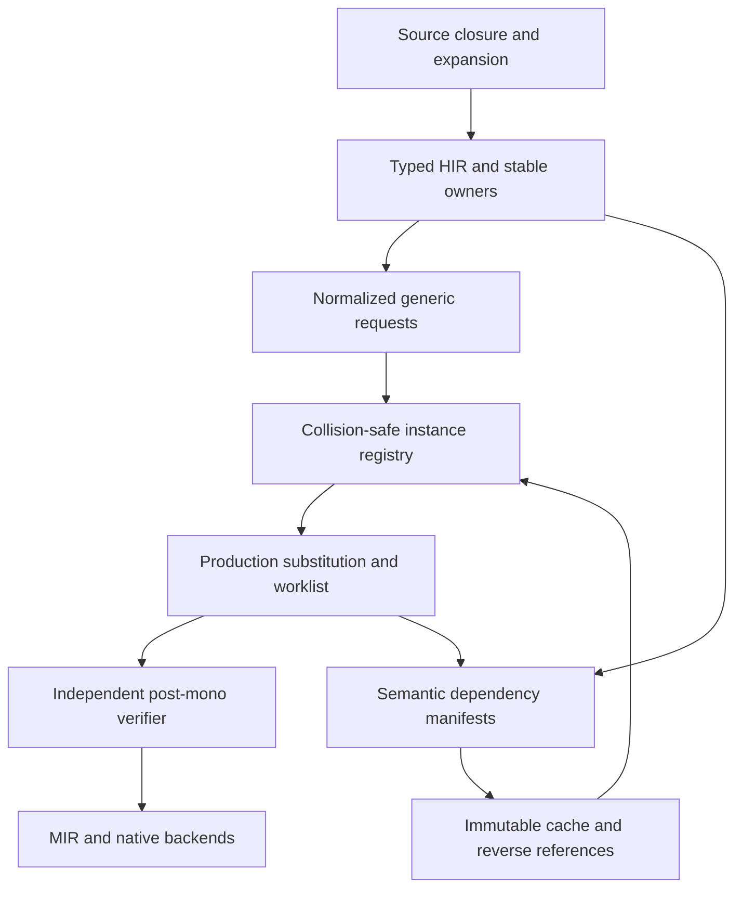
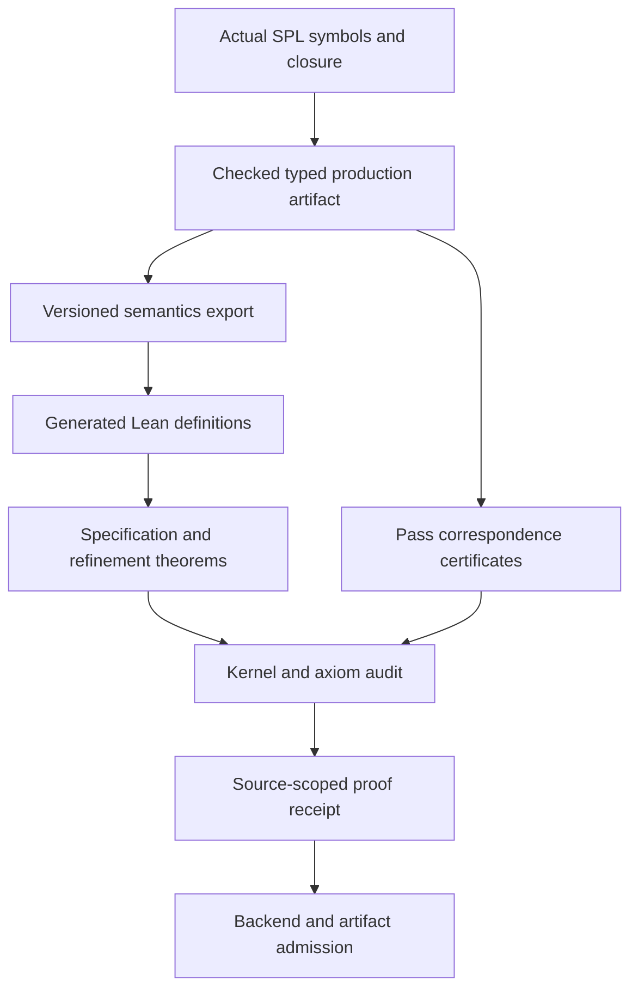

# Simple generics: full refactoring, hardening, and production-linked formal verification

<!-- codex-research -->
<!-- codex-design -->

**Date:** 2026-10-31 (Asia/Seoul)  
**Document revision:** 1.2 (2026-11-01) — revision 1.2 adds §1A.0 current status and §1A.6 items merged from older hardening plans, and records packet E1 as done; proposed implementation roadmap, not an implementation or proof-completion report. Revision 1.1 re-verified every cited line range, symbol, path, and test against source by reading, added the release-branch delta, and added the Execution plan. Revision 1.0 was written from read-only inspection of `main` only.  
**Repository:** [ormastes/simple](https://github.com/ormastes/simple)  
**Inspected baseline (sections 2–19 cite this):** `main` at [`97700b29e10675867891503f1e634b50a192356d`](https://github.com/ormastes/simple/commit/97700b29e10675867891503f1e634b50a192356d), commit dated 2026-10-30  
**Implementation target (Execution plan):** `origin/release/1.0.0` at `f2b768ab017ef743de849a2a3bcae194df90f31e` (merge of PR #5688, 2026-10-31 21:42 +0900). Merge-base with `main` is `65e3a69e6760`; release is 4376 commits ahead of and 9 behind `main`. **The two branches are not equivalent for this plan** — see "Branch delta" in the Execution plan.  
**Requested deliverable:** one Markdown plan; no source changes, remote writes, PRs, builds, or releases are part of this drafting task  
**Evidence status:** read-only source inspection, now verified by reading both `main@97700b29` (worktree) and `release/1.0.0@f2b768ab` (`git show`/`git grep`, no checkout). Compiler execution, SSpec, Lean/Lake, native/backend qualification, replay, and performance measurements were **NOT RUN**. Whether `release/1.0.0` HEAD compiles was **not verified** (its monomorphization-deletion commit `200a05f5bc8` states the tree was temporarily broken pending follow-ups).

This plan updates the direction of the existing `doc/03_plan/generic_formal_verification_hardening_plan.md`, preserves its G1–G7 and C1–C7 obligations as stated for `main`, and adds a concrete source-owned migration. It does not overwrite historical proof receipts or treat prior branch-specific PASS reports as verification of the inspected revision. The repository's `release/1.0.0` branch has **deleted** `src/compiler/40.mono` and the Rust `monomorphize` module (commit `200a05f5bc8`, "refactor(compiler)!: delete monomorphization", owner direction: one erased body per generic function). On that branch findings F01–F03, F06, F07 and most of sections 4–8 and 10–11 describe code that no longer exists; the Execution plan states per finding what applies, moved, or is not applicable. Sections 2–19 are retained as the `main` baseline record and as the specification of what the deleted machinery had to satisfy; they are not re-stated as current on release.

## Contents

1. Decision and current diagnosis
1A. Execution plan (targets `release/1.0.0`; branch delta; SPipe mapping)
2. Source evidence and existing owners
3. Requirements and non-negotiable safety rules
4. Target architecture and module refactoring
5. Stable identity, canonical encoding, and XXH3-128
6. Type semantics, inference, constraints, and substitution
7. Specialization worklist, recursion, concurrency, and publication
8. TLDR, reverse references, SCV, and incremental reuse
9. Formal verification of the actual production SPL
10. Theorem-to-production-symbol matrix
11. Two real generic library proof pilots
12. Assurance receipts, trust, and source/proof invalidation
13. SSpec and negative-control acceptance matrix
14. Phased implementation and review ownership
15. CI, build modes, and platform qualification
16. Performance, memory, and observability
17. Compatibility, rollout, rollback, and documentation
18. Risks, decisions, and completion checklist
19. Source and external references

---

## 1. Decision and current diagnosis

### 1.1 Recommended approach

**Refactor and converge the existing generic machinery; do not restart it as a text-macro generator, and do not require a full clean rebuild for every instantiation.**

The main structural risks observed are divergent semantic representations, incomplete or inconsistent traversal of type-bearing fields, lossy specialization keys, and a missing proof connection from reduced models to the production compiler. Simple already has extensive generic processing, archive and cache contracts, post-monomorphization checking, and formal-assurance infrastructure.

Implement in this order:

1. Establish source-pinned regression and semantic coverage inventories.
2. Repair identity information loss and type-traversal inconsistencies.
3. Make every active generic consumer use the same versioned semantic key contract.
4. Extract small **production-used** semantic kernels and verify their relationship to the existing models.
5. Strengthen incremental reuse, transaction boundaries, and concurrent instance publication.
6. Close source, backend, replay, and artifact evidence separately.
7. Optimize after correctness gates and baseline measurements exist.

The chosen direction is a **proposal for implementation approval**, not permission to weaken a gate or change a published ABI. Numerical performance targets and ABI/schema migrations remain explicit review decisions.

### 1.2 Important corrections to the earlier discussion

- `MonoSemanticKey` and `MonoArtifactKey` already exist. Adding yet another key type without migrating active callers would leave the problem intact.
- The active pass already distinguishes structural identity from non-injective display mangling. Its display-collision suffix is useful, but not a durable cross-build identity.
- The active owner-qualified encoder and the separate `mono_key.spl` encoder do **not** currently encode the same semantic information.
- XXH3-128 is a good fast fingerprint, **not a mathematical unique identifier**. Full canonical-key equality must decide identity.
- Input/action identity and output-content identity are separate. An artifact lookup key includes compiler/target/dependencies; a content digest hashes the actual bytes.
- Body edits should invalidate specialization results through dependency fingerprints without necessarily changing the logical specialization identity.
- Existing proof and reverse-reference V1 receipts use SHA-256. Do not silently replace those digests with XXH3 or BLAKE3.
- Current model proofs are useful but explicitly do not establish production HIR refinement. The goal is to connect them to actual SPL definitions, not rename a model theorem.
- The post-mono publisher already refuses violations under Robust and Critical. Preserve that behavior.
- “Source-generated Lean,” “Lean accepted,” “source refined,” and “native artifact verified” are different claims.

### 1.3 What this review establishes—and does not

Static inspection establishes the concrete implementation differences listed below. It does not establish a total generic bug count, the frequency of miscompilations, an end-to-end exploit, or that every omitted field causes a miscompile in a supported source program.

A current omission may represent intended code sharing. If so, it needs an explicit sharing equivalence and justification; it must not silently redefine semantic type equality. Where source syntax is not admitted, use direct production-HIR tests and keep source-language support marked unsupported.

### 1.4 Preserve the existing seven generic gates

| Gate | Required invariant |
|---|---|
| G1 — typed templates | Retain full typed template meaning and owner authority; never substitute Any for missing generic information. |
| G2 — substitution | Apply the correct substitution to signatures, bodies, defaults, effects, and every admitted type-bearing field. |
| G3 — collection | Discover reachable instantiations to a fixed point; deduplicate by full semantic identity. |
| G4 — insertion | Insert the actual specialized body, signature, and symbol under validated ownership. |
| G5 — rewrite | Every rewritten call/reference targets the correct inserted specialization with matching signature and effects. |
| G6 — emission | Uninstantiated templates are not emitted as executable implementations; unsupported reachable instances fail explicitly. |
| G7 — independent boundary | Completed post-mono output passes an exhaustive, independent validator before downstream publication. |

These are gates, not seven independently completed proofs.

**Revision 1.1 note on sections 1.1–1.4 and `release/1.0.0`:** the recommendation "refactor and converge the existing generic machinery" and gates G1–G7 were written against `main`, where `MonomorphizationPass` exists. On `release/1.0.0` the owner decision recorded in `work/generics-erased-body-20261031` commit `1cdf17b80a3` ("a generic fn has ONE erased body. No monomorphization, no substitution/instantiation"; `TypeParam -> i64` tagged runtime word) supersedes that recommendation. G1's "never substitute Any for missing generic information" is directly inverted by that model (type parameters erase to a tagged word; `Any` boundary arms now also match `TypeParam`); G2–G6 have no subject because nothing is substituted, collected, inserted, rewritten, or specialized; G7's independent post-mono boundary (`PostMonoVerifier`) is deleted. The Execution plan (section 1A) therefore does not schedule G1–G7 work on release. They remain the record of what the `main` machinery had to satisfy.

---

## 1A. Execution plan

This section is the only part of the document that targets `origin/release/1.0.0@f2b768ab017e`. Everything below was established by reading; nothing was built, run, or proved. "Lands" means a verified fix merged as its own PR after Fable review, per the repository's one-fix-one-PR rule; no packet below is claimed landed.

### 1A.0 Current status (2026-11-01, `origin/release/1.0.0@7c7444b8682`)

This table supersedes the "no packet is claimed landed" baseline of 1A for the rows below. Each fact was checked with `git cat-file -e`/`git grep`/`gh pr view` at the stated tip; nothing was built or run for this update.

| Packet / item | State on release | Evidence |
|---|---|---|
| E0 `generics-erased-body-land` | **Not landed** (another agent is landing it). `origin/work/generics-erased-body-20261031` is 18 commits ahead of release. The `E-GEN-001` refusal is still present. | `refuse_generic_template_call` at `src/compiler/50.mir/_MirLoweringExpr/switch_operators_calls.spl:230` (call site `:8627`); `test/01_unit/compiler/generic_erased_body_boundary_spec.spl` absent on release. |
| E0 overlap: free-generic closure gate | PR #5713 (`work/retire-free-generic-gate`) **merged** (merge `df3794ea999`). It touched `scripts/check/check-no-free-generic-fn-in-bootstrap-closure.shs` and `scripts/check/free_generic_fn_bootstrap_closure_baseline.txt`, both in E0's owner list, so E0 must rebase over it. | `gh pr view 5713 --json files`. |
| PR #5714 (`work/fix-composite-field-spec`) | **Merged** (merge `b9d58a1c8b2`); touches only `test/01_unit/compiler/50.mir/generic_struct_composite_field_spec.spl`. No packet owner file. | `gh pr view 5714 --json files`. |
| E1 `generics-release-doc-truth` | **Done by this PR** (docs only). Both OPEN bug docs closed with residue evidence; superseded headers added; README link and FormalStatus list fixed. | see 1A.4 E1 row and the docs it names. |
| E2 `hm-traversal-coverage` | **Spec exists, tagged `@tag:in-development`** (commit `e91ac104adf`, 2026-11-01); kernel repair not landed. Exit gate (self-hosted PASS, no `case _: ty` wildcard) not met. | `test/01_unit/compiler/type_infer/generic_traversal_coverage_spec.spl:17`. |
| E3 `generic-tldr-identity-controls` | **Spec written, UNRUN** (2026-11-01). Controls (a) module-distinct TemplateId and (b) constant-bucket collision + full-key reject added as REQ-GENERIC-TLDR-E3-001..003; (c) referenced, not duplicated. No acquisition table/bucket seam exists on release, so (b) uses a spec-local constant-hash bucket over the real `concrete_tldr_key_v1` keys (gap filed). Exit gate not met: no self-hosted `bin/release/<triple>/simple` on the Windows host; the seed run (attributed to seed) stopped at a parse error in unrelated `src/lib/nogc_sync_mut/io/windows_redirected_process.spl` before any test ran. Manual not regenerated for the same reason. | `test/01_unit/compiler/cache/generic_tldr_view_v1_spec.spl`; `doc/08_tracking/bug/generic_tldr_acquisition_table_missing.md`. |
| E4–E8 | Not started on release. | no matching spec/owner change found. |
| Coverage lane `generics-coverage-mcdc` | **Planned, not measured** (2026-11-01). Target: >= 90% CD and >= 90% MC/DC per Tier 1 generics file on the self-hosted binary. Module-level MC/DC tooling is being built in sub-lane `work/mcdc-compiler-module-tool-20261101` (design `doc/05_design/generics_coverage_mcdc.md`); the existing `scripts/check/cert/mcdc_instrument.spl` cannot measure compiler modules. Baseline blocked: no self-hosted binary on the Windows host. New specs go in new files only. | `doc/03_plan/compiler/generics/generics_coverage_mcdc_plan_2026-11-01.md` (432-file grep list). |
| Older hardening plans | Marked superseded/partly superseded with a header pointing here: `doc/03_plan/generic_formal_verification_hardening_plan.md` (+ `_tldr.md`), `doc/03_plan/compiler/generics/native_monomorphization_plan_2026-07-17.md`, `doc/03_plan/compiler/cache/standalone_mono_removal_2026-10-30.md`, `doc/03_plan/compiler/hardening/critical_hardening_plan_2026-08-21.md` (Phase 3 / wave 2C only), `doc/05_design/compiler/generics/generic_instantiation_model.md` (H-NAMED/H-ANNOT). Still-valid items merged in 1A.6. | headers in those files. |

### 1A.1 Branch delta (release/1.0.0 versus the plan's main baseline)

| Fact on `release/1.0.0@f2b768ab` | Evidence (read) |
|---|---|
| `src/compiler/40.mono/` does not exist; `MonomorphizationPass`, `nominal_type_identity.spl`, `mono_key.spl`, `monomorphize/type_subst.spl`, `hir_subst/body_subst.spl`, `engine.spl`, `cache.spl`, `note_sdn.spl`, `verify/post_mono_verify.spl`, `model/generic_subst_model.spl`, `80.driver/driver_post_mono_publication_v1.spl`, `10.frontend/core/monomorphize.spl`, `90.tools/verify/source_calls_monomorphization_v1.spl` are all absent. | `git cat-file -e` per path; deletion commit `200a05f5bc8` (74 files, −32 487 lines, also removes `src/compiler_rust/compiler/src/monomorphize/`). |
| No source under `src/compiler` references `MonomorphizationPass`, `compiler.mono.`, `run_monomorphization`, or `MONO_SYMBOL_BASE`. | `git grep` over `src/compiler`, `src/lib`, `src/plugins` (only hit: a deprecation rule in `90.tools/fix/rules/impl_/deprecation.spl`). Consequently `doc/08_tracking/bug/monomorphization_deleted_2026-10-31.md` ("stage2 still references `run_monomorphization`") and `doc/08_tracking/bug/mono_symbol_base_left_after_monomorphization_removal_2026_10_31.md` (`MONO_SYMBOL_BASE` at `switch_operators_calls.spl:59, 8666, 8760–8778`) describe a state that is no longer in the tree; both are still marked OPEN. |
| Generics are declared **type-erased**, but at release HEAD the pure-Simple MIR lowering still **refuses** every direct call to a generic template with fatal `E-GEN-001` (`50.mir/_MirLoweringExpr/switch_operators_calls.spl`, `refuse_generic_template_call`) and skips emitting templates (`50.mir/_MirLowering/module_lowering.spl:3059–3066`, `if fn_.is_generic_template: ()`). `HirTypeKind.TypeParam` reaching `lower_type` is fatal `E-MIR-TYPE-TypeParam` (`function_lowering.spl`). | Read on release. `90.tools/verify/source_calls_v1.spl:63–64` and `80.driver/driver_build/native_file_worker_v1.spl:22–23` repeat the same contract. |
| The Rust seed already lowers generics erased (single-letter type params resolve to `ANY`). | `doc/08_tracking/bug/monomorphization_deleted_2026-10-31.md`, "2026-10-31 seed follow-up". |
| The pure-Simple erased execution model is **unlanded**: local branch `work/generics-erased-body-20261031` (3 commits ahead of release, contains the deletion commit) removes the `E-GEN-001` refusal and the template-emission skips, lowers `TypeParam` to a tagged `i64`, adds box/decode at `T` boundaries (`local_needs_erased_decode`, `decode_erased_binop_operands`), and adds `test/01_unit/compiler/generic_erased_body_boundary_spec.spl` + `test/fixtures/jit_differential/generic_erased_body_boundary.spl`. Its own commit message states the spec is UNEXECUTED on the self-hosted compiler (ground truth checked only through the Rust seed). | `git log/diff origin/release/1.0.0..work/generics-erased-body-20261031` (20 files, +470/−139). |
| Identity owner that survives on release: `00.common/cache_contract/generic_tldr_view_v1.spl` (`TemplateId`/`ArgsId`/`ConcreteTldrKey`: length-framed, algorithm-tagged SHA-256; XXH3 only as an in-memory bucket index with full-key verification; binder-indexed parameters, alpha-invariant) and `hash_algorithm_registry_v1.digest_admits_identity_v1` (rejects XXH3 as identity). Its header states concrete views serve IDE/TLDR reads and are "never codegen input". | Read on release; specs `test/01_unit/compiler/cache/generic_tldr_view_v1_spec.spl` (5 scenarios: round-trip, corrupt section, alpha-invariance T4, one section per generic struct, guard root), `test/01_unit/compiler/driver/cache_xxh3_identity_gate_spec.spl`, `test/01_unit/compiler/driver/xxh3_local_keys_spec.spl`. |
| HM inference files (`30.types/type_infer_types.spl`, `type_infer/core.spl`, `type_infer/generalization.spl`), `20.hir/hir_types.spl`, `50.mir/verification_semantic_coverage.spl`, `90.tools/verify/source_model_v1.spl`, `source_calls_v1.spl`, `replay_runner.spl`, `00.common/assurance/formal_status.spl`, the Lean packages, both List pilot files, and the C1–C7 owners all exist on release. `type_infer_types.spl`, `core.spl`, `generalization.spl`, `verification_semantic_coverage.spl`, `source_model_v1.spl`, `formal_status.spl`, `GenericSubstModel.lean`, `lean_verification_contract.md`, `README.md`, `list.spl`, `collections.spl` are byte-identical to `main`; `hir_types.spl` (+20 lines), `generic_calls.spl` (3), `replay_runner.spl` (160), `source_calls_v1.spl` (31), `xxh3.spl` (178), `reverse_reference_coordinator_v1.spl` (111), `driver_hir_pipeline_passes.spl` (177) differ. | `git diff --stat origin/main origin/release/1.0.0 -- <paths>`. |
| On release the public XXH3 functions are kernel-prefixed `_k_xxh3_128`, `_k_xxh3_128_seeded`, `_k_xxh3_128_with_secret`, `_k_xxh3_128_hex` in `src/lib/common/crypto/xxh3.spl` (still `[lo, hi]`, hex = high then low); the in-process helper used by the cache specs is `std.nogc_sync_mut.sffi.runtime.xxh3_128_text`. | Read on release. Section 5.6's `xxh3_128` names are `main`-only. |
| The eight `test/01_unit/compiler/mono/*_spec.spl` files in section 13.1 do not exist on release (PRs #5685/#5688 removed stale mono specs and `test/fixtures/compiler/hir_mono_archive/`). | `git cat-file -e` per path. |
| Docs on release that still describe monomorphization as present: `doc/03_plan/compiler/cache/standalone_mono_removal_2026-10-30.md` ("The standalone monomorphization engine is NOT removed"), `doc/03_plan/generic_formal_verification_hardening_plan.md` (10 references to `40.mono`), `doc/05_design/compiler/generics/generic_instantiation_model.md` (H-NAMED/H-ANNOT "repair candidates" that cite `E-MONO-041` and `_k<n>`). | `git show`/`git grep` on release. |

### 1A.2 Finding applicability on release/1.0.0

| Finding (section 2.1) | On `release/1.0.0@f2b768ab` |
|---|---|
| F01 active key omits sizes/effects/dims | **Not applicable** — `nominal_type_identity.spl` deleted. The surviving identity owner (`generic_tldr_view_v1`) stores structural key text; whether its `ConcreteTldrKey` carries array sizes, tensor dims, or effects was not verified and, per its header, does not feed codegen. |
| F02 two key contracts disagree | **Not applicable** — `mono_key.spl` deleted. |
| F03 textual readiness checks | **Not applicable** — `mono_semantic_key_is_generic` deleted. |
| F04 local IDs restart at zero | **Applies unchanged** — `SymbolTable.next_symbol_id` reset to 0 in `reset_module` (`hir_types.spl:295, 352–365` on release). `generic_tldr_view_v1`'s binder-indexed `TemplateId` is the existing stable-identity precedent. |
| F05 HM walkers diverge | **Applies unchanged** (files byte-identical). New stake to check, not asserted: in `work/generics-erased-body-20261031`, `local_needs_erased_decode` "fires on the HIR type alone", so a `TypeParam` hidden under `Union`/`Isolated`/`Projection`/`Throws` that `Substitution.apply` does not traverse may affect box/decode decisions. |
| F06 two body substitutions | **Not applicable** — both deleted. `10.frontend/core/type_subst.spl` (name-based AST substitution with module-global `subst_param_names`/`subst_type_tags`) still exists; its callers were not traced. |
| F07 metadata-only MonoCache | **Not applicable** — `cache.spl` deleted. |
| F08 model/production correspondence open | **Applies, now orphaned** — `GenericSubstModel.lean:1–5` still says it models `40.mono/model/generic_subst_model.spl`, which no longer exists on release. The only surviving production substitution kernels are `Substitution.apply` and `HmInferContext.occurs`; section 9.12's first proof subject must be retargeted to them on release. |
| F09 VIR coverage all Unsupported | **Applies unchanged** (file byte-identical). |
| F10 source export restricted | **Applies** — `source_model_v1.spl` identical; `source_calls_transform_error_v1` (`source_calls_v1.spl:45–49`) still refuses imports and AOP/DI. |
| F11 replay authority missing | **Applies, moved** — refusal now at `replay_runner.spl:96–103` with a `(text, text)` return and reason text "canonical policy candidate unavailable". |
| F12 docs older than code | **Partly applies** — the publisher half (`driver_post_mono_publication_v1.spl`) is deleted; the six-state `lean_verification_contract.md:51` and the `README.md:48` link to the non-existent `doc/04_architecture/lean_verification_contract.md` persist; new staleness listed in 1A.1 (two OPEN bug docs and three design/plan docs describe deleted code). |

### 1A.3 Concurrent unlanded generics work (read-only survey, 2026-10-31)

| Branch | State relative to `origin/release/1.0.0` | Overlap with this plan |
|---|---|---|
| `work/generics-erased-body-20261031` (local) | 3 commits ahead; implements the erased execution model (above). | **Prerequisite for every native generics packet.** Not duplicated here. |
| `origin/work/erased-arg-scalar-param-20261031` | 2 ahead; Rust-seed fix: untag erased `T` values bound to scalar call parameters (`coerce_args_for_param_slots`), adds `test/01_unit/compiler/jit_erased_arg_scalar_param_spec.spl` (authored, unexecuted) and a `jit_differential` fixture; commit says verified on aarch64-apple-darwin with a seed built from the change. | Seed-side boundary contract; the self-hosted counterpart is in the erased-body branch. |
| `work/phase3-generic-enum-untyped-subject-20261031` (local; remote copy is 0 ahead) | 1 ahead; HIR admits qualified generic-enum patterns over untyped subjects (`pattern_enum_substitution.spl`), extends `test/01_unit/compiler/hir/generic_enum_pattern_owner_substitution_spec.spl`. | Independent of the plan; sequence after E0. |
| `work/generics-enumpat-20261031`, `work/generics-result-20261031`, `work/generics-native-fixture-lane-20261031`, `work/phase3-generic-enum-discard-binding-20261031`, `origin/work/fix-generic-callback-abi-20261030`, `origin/work/generic-runtime-call-evidence-20261030`, `origin/work/delete-mono-20261031` | 0 commits ahead of release — already merged. | No overlap; nothing to sequence. |
| Open PRs | `gh pr list --state open` at the pinned revision showed one PR (#5689, runtime void-sentinel), none generics-related. #5689–#5691 have since merged (release tip `3802afa34c07` at landing); none touches a file this plan cites by owner. | — |

### 1A.4 Packets (ordered; each is one PR)

Model routing for every packet: **Opus** writes the SSpec test guide (SPipe Phase 4 — failing `it` blocks, `step("...")` sentences, `@req` ids, `# @cover` markers); **Fable** reviews every PR before merge and owns hard compiler fixes (Phase 5 for compiler/MIR/HM code); **Haiku** runs builds and tests (Phase 7) and reports the `Results:` summary line verbatim. The SPipe artifact is `.spipe/<feature>/state.md` (per `.claude/agents/spipe/dev.md`); each packet is one feature slug. Commands below are the ones documented in `.claude/skills/spipe.md`: `bin/simple test <spec>` and `bin/simple spipe-docgen <spec> --output doc/06_spec --no-index`. Per that skill, evidence must come from the self-hosted `bin/release/<triple>/simple`; a Rust-seed run is attributed to the seed, never reported as self-hosted PASS. No other commands or flags are assumed to exist. `spipe.md` additionally requires that compiler-cache and formal-verification changes add semantic-invalidation specs kept next to the cache owner and mirrored into `doc/06_spec`; E3–E6 inherit that requirement. (`spipe.md` was read in full only for its first 857 lines; the remainder was grepped for routing-relevant rules, which surfaced only this one.)

| # | Packet (feature slug) | Owner files | Depends on | Exact test to add/extend | Exit gate | SPipe phases / routing |
|---|---|---|---|---|---|---|
| E0 | `generics-erased-body-land` — review and land the existing `work/generics-erased-body-20261031` branch unchanged in scope | the 20 files in `git diff origin/release/1.0.0...work/generics-erased-body-20261031`: `scripts/check/check-no-free-generic-fn-in-bootstrap-closure.shs`, `scripts/check/free_generic_fn_bootstrap_closure_baseline.txt`, `20.hir/hir_lowering/_Items/{class_declaration,declaration,trait_impl}_lowering.spl`, `50.mir/_MirLowering/{archive_borrowed_module_v1,function_lowering,module_lowering}.spl`, `50.mir/_MirLoweringExpr/{builtin_method_extras,expr_dispatch,lambda_abi,method_calls_literals,switch_operators_calls}.spl`, `50.mir/{mir_lowering_stmts,mir_lowering_types,mir_verify}.spl`, `80.driver/driver_build/native_file_worker_v1.spl`, `90.tools/verify/source_calls_v1.spl`, plus the new spec and fixture | none (it already contains the deletion commit) | run, do not rewrite: `test/01_unit/compiler/generic_erased_body_boundary_spec.spl`, `test/01_unit/compiler/generics/erased_generic_behavior_spec.spl`, `test/01_unit/compiler/generics/erased_generic_fixture_spec.spl` | all three specs PASS on the self-hosted binary; Fable review posts zero P0/P1; the erased-body spec stops being "UNEXECUTED" | 7-verify (Haiku runs), Fable review, 8-ship via PR + `gh pr review --comment` self-review + admission check |
| E1 | `generics-release-doc-truth` — **DONE 2026-11-01 (see 1A.0)** — docs-only: close or correct the two OPEN bug docs whose cited residue no longer exists; mark `standalone_mono_removal_2026-10-30.md` and the H-NAMED/H-ANNOT sections of `generic_instantiation_model.md` as superseded by the deletion; fix `README.md:48` to `doc/04_architecture/infra/misc/lean_verification_contract.md`; replace the six-state list in that contract with the actual `FormalStatus` enum (`formal_status.spl:7–17`) | the five docs named | none | none (documentation packet; the repository doc-freshness gate in `spipe.md` applies) | Fable review confirms every statement cites a release path that exists | 6-refactor doc pass, 8-ship |
| E2 | `hm-traversal-coverage` — repair F05 on the surviving HM kernels: extend `Substitution.apply` (`type_infer_types.spl:106–160`), `HmInferContext.occurs` (`core.spl:35–71`), `collect_free_vars` (`generalization.spl:63–88`) to `Union`, `Isolated`, `Projection`, and `EffectKind.Throws` payloads, matching `instantiate_type` (`generalization.spl:157–236`), which already handles them; `collect_free_vars` additionally needs the `Tensor` element, which it drops to `case _` although `apply`, `occurs`, and `instantiate_type` all walk it | the three files above | E0 (so the tests run on a compiling release tree) | **new** `test/01_unit/compiler/type_infer/generic_traversal_coverage_spec.spl` (directory confirmed real on release: `generalization_membership_index_spec.spl` and `option_pattern_scrutinee_spec.spl` live there). Direct-API scenarios: self-reference through each omitted carrier must be an occurs-check failure, never a successful bind; `apply` resolves an `Infer` nested under each carrier; a constructor-coverage table enumerating every `HirTypeKind` arm with its rule | spec PASS self-hosted; Fable review confirms no `case _: ty` wildcard remains for a type-bearing constructor | 4-spec Opus, 5-implement Fable (compiler fix), 7-verify Haiku |
| E3 | `generic-tldr-identity-controls` — add the section 5.7 negative controls to the surviving identity owner instead of creating `generic_identity_v2.spl` | `00.common/cache_contract/generic_tldr_view_v1.spl` (only if a test exposes a defect) | none | extend `test/01_unit/compiler/cache/generic_tldr_view_v1_spec.spl` with: same display name, different declaring module → different `TemplateId`; two `ConcreteTldrKey`s that collide under a deliberately constant bucket hash stay distinct and the full-key verify rejects the wrong bucket entry; `digest_admits_identity_v1(HASH_ALGO_XXH3_128_V1)` is false (already asserted in `cache_xxh3_identity_gate_spec.spl` — reference, do not duplicate) | spec PASS; if a scenario is RED, the fix is a separate packet with its own PR | 4-spec Opus, 7-verify Haiku, Fable review |
| E4 | `hm-kernel-proof-retarget` — retarget section 9.12 from the deleted `substitute_type` to `Substitution.apply`/`occurs`: pin their closure, factor the pure transition the production method calls, and relate it to `Generics.lean`/`GenericSubstModel.lean`; record in `GenericSubstModel.lean`'s header that its SPL subject is deleted on release | `30.types/type_infer_types.spl`, `src/verification/type_inference_compile/src/*.lean` | E2 | extend `test/03_system/compiler/formal_verification_2_0_spec.spl` (`REQ-FV2-007`/`REQ-FV2-008` groups exist at lines 551/577) with the T20 sabotage: make the exported kernel a no-op and require the source-refinement gate to fail or mark Stale | Lean package builds under the pinned 4.30.0 toolchain; status recorded as at most `ModelProven` until the source edge exists | 4-spec Opus, 5 Fable, 7 Haiku |
| E5 | `vir-semantics-slice-1` — F09: first versioned instruction-semantics slice (constants, copies, width-correct scalar ops, returns) in `50.mir/verification_semantic_coverage.spl` | that file plus a new owner under `50.mir/` named at implementation time | none (independent of generics) | extend `test/01_unit/compiler/mir/verification_ir_spec.spl` ("fails closed for machine semantics that v1 has not implemented", line 52, becomes the negative control; add positive rows for the slice) | rows for the slice are `Supported` with a checked transition; every other row stays `Unsupported` | 4 Opus, 5 Fable, 7 Haiku |
| E6 | `source-closure-imports` — F10: admit real import closures in `source_calls_v1.spl`/`source_model_v1.spl` instead of refusing at `source_calls_transform_error_v1` | `90.tools/verify/source_calls_v1.spl`, `source_model_v1.spl` | E5 | extend `formal_verification_2_0_spec.spl` `REQ-FV2-011` (line 763) with an imported-helper closure positive and a missing-import negative | AOP/DI remain refused; imports resolved through the module owner; output still `NOT_CHECKED` until E4's edge | 4 Opus, 5 Fable, 7 Haiku |
| E7 | `pure-list-pilot` — section 11.1 under the erased model: export `src/lib/common/pure/list.spl` (`list_empty/cons/len/is_empty/head/tail/to_array/from_array`, `list_head -> Option<T>`) through E6's closure and prove constructors/head/tail/is_empty; the proof subject is the single erased body plus the box/decode contract from E0, not a post-mono instance | `src/lib/common/pure/list.spl` (read-only subject), generated Lean under the existing package | E0, E4, E6 | **new** `test/02_integration/compiler/generic_source_refinement_spec.spl` (T25) | universal theorem checked; status `SourceRefined` only with the E4 edge, else `ModelProven` | 4 Opus, 5 Fable, 7 Haiku |
| E8 | `replay-authority-provision` — F11 | `90.tools/verify/replay_runner.spl:96–103` plus the trust-anchored resolver owner (to be named; none exists) | none | extend `formal_verification_2_0_spec.spl` `REQ-FV2-009` (line 663): false replay metadata → explicit authority failure (T24) | `FV2-E-REPLAY-AUTHORITY` is never removed; fresh/independent receipts issue only with a resolved authority | 4 Opus, 5 Fable, 7 Haiku |

Packets E0–E3 are PR-sized now. E4–E8 are sized as the first PR of each lane; their later slices follow section 9.6's order. Sections 7 (worklist/registry), 8 (mono cache admission) and 11.2/11.3 (mutable `List` class static template, joint ABI regression) have **no packet on release** because their subject is deleted; they are retained as `main`-baseline specification only.

### 1A.5 Section 18.2 decisions adopted as defaults

- Identity authority: full canonical key + fast fingerprint as index — adopted. On release the `generic_tldr_view_v1` file header *states* this contract and `digest_admits_identity_v1` rejects XXH3 as identity; the acquisition-table bucket/verify code was not read, so this is a stated contract, not a verified property. E3's controls are what would verify it.
- Persisted trust hashes: retain SHA-256 V1 — adopted (release already tags algorithms via `hash_algorithm_registry_v1`).
- Initial proof scope: pure production kernels first — adopted, retargeted to `Substitution.apply`/`occurs` (E4).
- Initial generic client: pure `List` enum first — adopted (E7); the mutable `List` class pilot is deferred with no packet.
- Rebuild policy: incremental default with clean reference — adopted as stated; no packet changes it.
- Code sharing: "distinct semantic instances first" — **superseded on release** by the owner's one-erased-body decision; not adopted.

### 1A.6 Items carried forward from older hardening plans (still valid, non-conflicting)

Conflicts resolved in favor of this plan: anything that names a `40.mono` owner, G1–G7 as release gates, M1–M9, `MonoSemanticKey`/`MonoArtifactKey`, `MonoBoundaryModel` E-MONO-033/041 obligations (O-12.1–O-12.3), and `check-post-mono-invariants.shs` (absent on release) are **not** carried forward; the deletion commit `200a05f5bc8` removed their subject. The items below do not depend on deleted code; every cited owner exists on release.

| # | Item | Source | Release owner (exists) | Attach to |
|---|---|---|---|---|
| H1 | Trust/failure policy: reject `sorry`/`admit`/`sorryAx`/`Lean.trustCompiler`/undeclared axioms; solver unknown/timeout/malformed output/missing root/tool failure are non-success; no seed/interpreter fallback or retry may manufacture PASS; preserve failed attempts. | `doc/03_plan/generic_formal_verification_hardening_plan.md` §8 | `src/compiler/00.common/assurance/trust_audit.spl`, `src/compiler/90.tools/verify/replay_runner.spl` | §12.4, E4, E8 |
| H2 | Artifact identity must also bind collection policy/profile/tag representation where it changes semantics or layout, via the existing routing and reuse owners. | `doc/03_plan/generic_formal_verification_hardening_plan.md` §6 | `src/app/cli/collection_planner_options.spl`, `src/app/io/_CliCompile/native_collection_profile.spl`, `src/compiler/80.driver/driver_collection_planner.spl`, `src/app/cli/native_build_warm_receipt.spl`, `src/compiler/80.driver/cache/compile_options_hash.spl` | §5.3, E3 (negative controls) |
| H3 | Dynload and aspect identity: source manifest, load generation, ordered weave plan and lifecycle leases invalidate on change; reuse existing gates, no new global registry. | `doc/03_plan/generic_formal_verification_hardening_plan.md` §6–7 | `src/compiler/99.loader/completeness_seal/source_manifest.spl`, `src/compiler/99.loader/module_loader_compat.spl`, `src/compiler/99.loader/aspect_lifecycle_gate.spl` | §8.3, §12 |
| H4 | Negative controls must independently mutate owner, effect/Throws, array size, tensor/device, bound witness, schema, profile/tag/backend/ABI, generation, weave order; and corrupt generated Lean, theorem root, certificate edge and tool hash — each must fail at its owning boundary. The runner must be shown to execute a deliberately failing body. | `doc/03_plan/generic_formal_verification_hardening_plan.md` §9 | `test/03_system/compiler/formal_verification_2_0_spec.spl`, `test/01_unit/compiler/mir/verification_ir_spec.spl` | §13, E3–E8 |
| H5 | Proof-cache memory/lifetime: eviction must not invalidate an active checked receipt; bound recursion/queues; measure cold/warm time and peak RSS before setting budgets. | `doc/03_plan/generic_formal_verification_hardening_plan.md` §7 | `src/compiler/00.common/assurance/` (receipt owners) | §16 |
| H6 | Critical-release counters that apply to erased generics: unresolved generic/`TypeParam` in MIR 0, `Any` outside unsafe 0, silent fallback 0, interpreter/JIT/native diff 0, stale evidence 0. Proposed id `REQ-MC-ANY-001` retained; `REQ-MC-MONO-001` is superseded by E0/E2. | `doc/03_plan/compiler/hardening/critical_hardening_plan_2026-08-21.md` Phase 9 and "New requirement ids" | guard pattern of `scripts/check/check-coverage-not-silent-noop.shs` | E0 exit gate, §15 |
| H7 | Acceptance matrix per clause (source-coded, source-reviewed, executed, kernel-replayed, artifact-linked, platform-qualified, landed); no aggregate percentage. | `doc/03_plan/generic_formal_verification_hardening_plan.md` §10 | — (process rule) | §14, §18 |

---

## 2. Source evidence and existing owners

All source paths in this section refer to the pinned baseline. Abbreviated compiler paths are relative to `src/compiler/`; formal-model files under `src/verification/` are identified separately. Existing symbols are distinguished from proposed symbols throughout the plan.

### 2.1 Confirmed implementation findings

Revision 1.1: every row below was re-read at `main@97700b29`. Confirmed as cited: F01 (`nominal_type_identity.spl:33–68`, docstring at 35 states the omission; `Tensor` encodes `dims.len()` at 63; `Layer` and all unlisted kinds fall through to `mangle_type` at 68), F02 (`mono_key.spl:141–212`; `Named` → `sym#{id}` at 180–185; `Union` members sorted at 187–189 whereas the active key preserves order at `nominal_type_identity.spl:56`; `Tensor`/`Layer` lossy at 209–212), F03 (`mono_key.spl:316–338`; the fragment list at 336 has no `&param:`/`*mut param:` case, so a `Ref`/`Ptr` to a type parameter is misclassified as concrete), F04, F05, F06, F08, F09, F10, F11, F12. Corrected: F07's range (the `value: nil` restore is at `cache.spl:299` inside `load_from_disk`, 250–314; `save_to_disk` is 222–249) and the `mangled_name` range (1094–1118). The "driver comment" in F12 is `driver_hir_pipeline_passes.spl:158–161` ("Under `critical` ANY non-zero counter is fatal; every other profile warns"), while `driver_post_mono_publication_v1.spl:15–17` enforces from `Robust`. For `release/1.0.0` applicability see section 1A.2.

| Finding | Actual source evidence | Refactoring consequence |
|---|---|---|
| F01: the active key omits information | `40.mono/nominal_type_identity.spl:33–68`: array sizes and function effects explicitly omitted; tensor key records rank, not dimension values/device. | Repair or separate semantic identity from a proved code-sharing key. A stronger hash cannot recover discarded inputs. |
| F02: key contracts disagree | `40.mono/monomorphize/mono_key.spl:141–212` includes sizes/effects but uses raw symbol IDs for nominal types; Tensor/Layer remain lossy; Union ordering differs from the active key. | Define one semantic schema and migrate both paths. |
| F03: some key checks are textual | `mono_key.spl:316–338` builds delimiter-separated fields and detects generics through string fragments. A reference wrapping a type parameter is not reliably classified by such fragments. | Typed key constructors, framed encoding, structural readiness checks, and independent equality. |
| F04: local IDs are not persistent identities | `20.hir/hir_types.spl`: `SymbolTable` starts/restarts its counter at zero and allocates incrementally. | Preserve fast local handles; introduce stable declaration identities and explicit remapping at persistence/provider boundaries. |
| F05: inference walkers diverge | `30.types/type_infer_types.spl:106–160`, `type_infer/core.spl:35–71`, and `generalization.spl` differ in coverage of Union, Isolated, Projection, and typed effects. | Constructor coverage and production-owned pure kernels; do not assume one visitor proves another. |
| F06: two body-substitution implementations exist | `monomorphize/type_subst.spl` and `monomorphize/hir_subst/body_subst.spl`. | Trace live callers, establish parity, converge behind existing APIs, then retire redundant traversal. |
| F07: disk MonoCache is metadata-only | `monomorphize/cache.spl:250–314` (`load_from_disk`) restores rows with `value: nil` at line 299; `lookup` (129–136) is keyed by text and is not an expected-input-fingerprint admission API. (Rev 1.0 cited 222–314, which also covered `save_to_disk`.) | Distinguish metadata presence from reusable typed body; do not report metadata as an executable cache hit. |
| F08: production/model correspondence remains open | `src/verification/type_inference_compile/src/GenericSubstModel.lean:1–5` explicitly calls itself a manual model with separate production refinement obligations. | Source-export actual functions and prove correspondence; retain reduced models as specifications. |
| F09: body semantics are not universally admitted | `50.mir/verification_semantic_coverage.spl:66–218` marks every instruction and terminator Unsupported in this VIR coverage producer. | Add a versioned execution-semantics slice before promoting coverage or BackendRefined claims. |
| F10: source export is restricted | `90.tools/verify/source_model_v1.spl` emits NOT_CHECKED and calls a boundary checker that refuses imports/AOP/DI. | Add real dependency-closure support; do not strip imports or copy functions into an artificial proof-only file. |
| F11: replay authority is not provisioned | Public fresh/independent receipt paths in `90.tools/verify/replay_runner.spl` refuse with `FV2-E-REPLAY-AUTHORITY`. | Provision and qualify the trust-anchored resolver; do not remove the refusal. |
| F12: some documentation is older than the code | `doc/04_architecture/infra/misc/lean_verification_contract.md:51–75` defines six states with `verified`; actual `FormalStatus` (`00.common/assurance/formal_status.spl:7–17`) has eleven: NotChecked, Specified, ModelProven, SourceRefined, BackendRefined, ArtifactVerified, TrustedBoundary, AdmittedDevelopment, Unsupported, Failed, Stale. `driver_hir_pipeline_passes.spl:158–161` says critical-only, while `driver_post_mono_publication_v1.spl:15–17` enforces from Robust. `README.md:48` links `doc/04_architecture/lean_verification_contract.md`, which does not exist (the file is under `infra/misc/`). | Reconcile docs and comments with actual authority. |

**Do not misdiagnose preserved behavior:** `MonomorphizationPass.mangled_name` at lines 1094–1118 already prevents display-name collisions from immediately sharing a body. `mono_semantic_key_equals` compares its canonical text, not only its FNV digest. The observed problems are information loss, encoding adequacy, scope, and consumer consistency—not proof that every hash collision is currently accepted.

### 2.2 Compiler source ownership map

Paths below are relative to `src/compiler/`.

| Existing file | Existing types/functions | Planned treatment |
|---|---|---|
| `20.hir/hir_types.spl` | `SymbolId`, `SymbolTable`, `HirType`, `HirTypeKind`, `DimExprKind`, `DeviceType` | Keep local IDs; establish stable-owner mapping and schema-derived traversal coverage. |
| `30.types/type_infer_types.spl` | `TypeScheme`, `Substitution`, `Substitution.apply`, `HmInferContext` | Verify actual inference state, complete constructor handling, isolate path compression from semantic resolution. |
| `30.types/type_infer/core.spl` | `apply_subst`, `resolve`, `occurs`, `unify` | Shared semantic coverage; occurs soundness and explicit failure behavior. |
| `30.types/type_infer/generalization.spl` | `collect_free_vars`, `generalize`, `instantiate`, `instantiate_type` | Scoped freshness/generalization; no name-only binder identity. |
| `30.types/type_infer/generic_calls.spl` | `instantiate_declared_call`, `bound_argument_is_concrete`, `finish_direct_function_bounds` | Preserve direct-call work; extend resolved methods/indirect/imported cases with actual evidence. |
| `40.mono/monomorphize/type_subst.spl` | `TypeSubstitution`, `substitute_type`, `substitute_effects`, `substitute_function`, `canonicalize_template` | Primary production specialization proof subjects. |
| `40.mono/monomorphize/hir_subst/body_subst.spl` | `HirSubstReport`, `HirSubstCtx`, `subst_hir_body_with_report`, `subst_hir_expr` | Preserve reporting; reconcile with the active visitor before deprecation. |
| `40.mono/monomorphize_integration.spl` | `MonomorphizationPass`, `request_specialization`, `drain_worklist`, `collect_class_static_templates_v1`, call-inference helpers | Retain facade; split identity, resolution, worklist, generation, and publication responsibilities. |
| `40.mono/nominal_type_identity.spl` | `mono_nominal_type_key`, `mono_owned_type_key`, `mono_owned_type_keys` | Migrate the **active** semantic encoding to the new shared contract. |
| `40.mono/monomorphize/mono_key.spl` | `MonoSemanticKey`, `MonoArtifactKey`, canonical/equality/hash helpers | Evolve through explicit V2 adapters; no parallel unused identity stack. |
| `40.mono/monomorphize/engine.spl` | `Monomorphizer`, `specialize_function_with_types`, `mangle_type` | Keep live helper; audit and retire incomplete legacy paths only after caller migration. |
| `40.mono/monomorphize/cache.spl` | `MonoCacheConfig`, `MonoCacheValue`, `CacheEntry`, `MonoCache` | Explicit readiness/validation, bounded resource policy, safe metadata persistence. |
| `40.mono/monomorphize/note_sdn.spl` | `note_sdn_publish_generic_specialization_v1`, `NoteSdnMetadata.add_instantiation` | Reuse generic reference-fact publication; migrate identity domain explicitly. |
| `40.mono/verify/post_mono_verify.spl` | `PostMonoReport`, `PostMonoVerifier`, `walk_type_kind`, `walk_expr`, `verify_module`, `post_mono_verify_modules` | Extend and prove the actual independent boundary, not a substitute checker. |
| `80.driver/driver_hir_pipeline_passes.spl` | `monomorphize_with_policy` | Preserve production pass order and report ownership. |
| `80.driver/driver_post_mono_publication_v1.spl` | `driver_publish_post_mono_report_v1` | Keep Robust+ rejection; make policy and provenance explicit. |
| `10.frontend/core/monomorphize.spl` | `mono_specialize`, module-global cache/substitution path | Replace silent clone-failure fallback with an explicit result; isolate per-invocation context. |
| `90.tools/verify/source_calls_monomorphization_v1.spl` | `SourceCallsMonoOutputV1`, `source_calls_monomorphize_v1` | Reuse isolated, budgeted, real-pass verification bridge. |

### 2.3 Shared contracts to reuse

- `src/compiler/00.common/cache/canonical_identity.spl`: `canon_str`, `canon_nat`, `canon_field`, `canon_seq`; existing framing and linear construction.
- `src/compiler/00.common/cache_contract/semantic_query_read_manifest_v1.spl`: `SemanticQueryKeyV1`, `SemanticQueryReadV1`, `SemanticQueryReadManifestV1`, and Complete/Conservative/Unknown coverage.
- `src/compiler/00.common/cache_contract/reverse_reference_shard_v1.spl`: `ReverseReferenceEdgeV1`, `ReverseReferenceShardV1`, `ReverseReferenceDeltaV1`.
- `src/compiler/00.common/cache/reverse_reference_key.spl`: generation-bound, SHA-256 `ReverseReferenceKeyV1`.
- `src/compiler/80.driver/cache/reference/reverse_reference_coordinator_v1.spl`: old/new forward-manifest reconciliation, genesis-only seeding, verified-CAS shard persistence (`stage_reverse_delta_v1` at 866, `stage_reverse_shards_v1` at 1096). `reverse_reference_publish_generation_v1` lives in `src/compiler/80.driver/cache/reverse_reference_receipt.spl:198`, not in the coordinator (rev 1.1 correction, also applied in section 8.5).
- `src/compiler/00.common/assurance/`: `FormalStatus` (`formal_status.spl`), `ProofObligationV1`/`CompilerCertificateV1`/`VerificationCacheKeyV1`/`ProofReceiptV1` (`formal_interfaces.spl`, `formal_receipt.spl`), trust/replay/DAG contracts (`trust_audit.spl`, `replay_receipt.spl`, `proof_dag.spl`).
- `src/lib/common/crypto/xxh3.spl`: existing XXH3 implementation (`xxh3_128`, `xxh3_128_seeded`, `xxh3_128_with_secret` → `[lo, hi]`; `xxh3_128_hex` at 453–455 emits high then low). On `release/1.0.0` these are renamed `_k_xxh3_128*` and the cache layer uses `std.nogc_sync_mut.sffi.runtime.xxh3_128_text`; do not write a new unrelated hasher.
- `release/1.0.0` only: `src/compiler/00.common/cache_contract/generic_tldr_view_v1.spl` (`TemplateId`/`ArgsId`/`ConcreteTldrKey`) and `hash_algorithm_registry_v1.spl` (`digest_admits_identity_v1`) are the surviving generic-identity contract; see section 1A.

### 2.4 Prior work to retain, amend, or explicitly supersede

The current generic hardening plan, active-bound inference design, archive-effect repair report, incremental TLDR/SCV plan, and Formal Verification 2.0 architecture remain inputs. Preserve their receipts and annotate changed conclusions.

In particular, the older generic plan calls declaration-effect transport a pending defect, while the later archive-effect report and current source describe a repair. Do not re-open it as wholly absent; add regression coverage and keep the broader key/effect/refinement obligations open.

The knowledge registry selects the compiler-pipeline layer for `src/compiler/`; no exact generic-hardening feature route was present in the inspected registry. Implementation must add or resolve that route and retain its selection receipt. The project-local SPipe environment was not available for execution in this drafting environment; no repository workflow gate is represented as completed.

---

## 3. Requirements and non-negotiable safety rules

| Requirement | Acceptance statement |
|---|---|
| REQ-GEN-01 — stable owner identity | Equal display names in different modules/packages or incompatible declarations never share semantic identity. |
| REQ-GEN-02 — exact canonical encoding | Every supported semantically relevant field participates; decoding is unambiguous; equality is independent of display strings and hash collisions. |
| REQ-GEN-03 — scoped binders | Type/const/effect binders are declaration-scoped and alpha-stable; substitution cannot capture an unrelated binder. |
| REQ-GEN-04 — complete traversals | Every type-bearing constructor/field has a supported or explicit-rejection rule in every relevant pass. |
| REQ-GEN-05 — justified inference | Explicit, inferred, expected-result, and default arguments obey declared precedence, scope, constraints, and diagnostic rules. |
| REQ-GEN-06 — sound specialization | Actual signature/body/default/effect/call information is consistently specialized; immutable inputs remain unchanged. |
| REQ-GEN-07 — bounded fixed point | Reachable instances terminate under a finite work closure or produce a specific cycle/resource/unsupported failure. |
| REQ-GEN-08 — single publication | One producer per full key and build generation; cancellation, retries, collisions, or races cannot publish partial/stale artifacts. |
| REQ-GEN-09 — correct reuse | A hit requires current complete input evidence, compatible schema/target/toolchain, and a validated complete artifact. |
| REQ-GEN-10 — reverse-reference recovery | .rr is a derived index; failed/unknown updates invalidate coverage and require full affected-root revalidation. |
| REQ-GEN-11 — source-bound proof | Proof units name and bind actual production SPL definitions and their semantic dependency closure. |
| REQ-GEN-12 — semantic correspondence | SourceRefined requires a checked source/model relation, not merely equal hashes or matching samples. |
| REQ-GEN-13 — truthful assurance | ModelProven, SourceRefined, BackendRefined, and ArtifactVerified remain distinct; unsupported/stale/tool failure cannot pass. |
| REQ-GEN-14 — real generic clients | Verify the actual pure and mutable List declarations, with scoped assumptions and actual compiled-instance tests. |
| REQ-GEN-15 — engine/platform parity | Same supported semantics across fresh/cached, sequential/parallel, interpreter/native, and selected backend/target paths. |
| REQ-GEN-16 — resource limits | Bounded work/cache lifetimes and measured latency/RSS at 3,000-key/concurrent-request workloads. |
| REQ-GEN-17 — safe migration | V1 receipt formats stay frozen; schema/ABI transitions are explicit and old insufficient evidence becomes a miss/stale result. |
| REQ-GEN-18 — traceability | Every acceptance claim maps requirement → actual source symbol → test/proof obligation → retained execution evidence. |

No warning-first policy may permit a known-wrong specialization, malformed cache artifact, or unsupported proof to be published as correct. Compatibility notices may begin as warnings; correctness admission is fail-closed. Preserve existing Robust/Critical behavior and define stricter profiles without silently downgrading other gates.

---

## 4. Target architecture and module refactoring

### 4.1 Data flow



The diagram expresses responsibilities, not permission for lower compiler layers to import higher-layer implementation code. Common schemas remain in `00.common`; HIR-aware operations live in HIR or above; mono does not reach into private HM internals.

### 4.2 Keep facades; change one authority at a time

Retain `MonomorphizationPass`, checked processing entry points, archive receipt contracts, and driver entry points during migration. Split its implementation behind these facades into:

1. Template declaration ownership and body-free signatures.
2. Call resolution and constraint evidence.
3. Semantic instance identity and collision-safe registry.
4. Demand worklist and resource ledger.
5. Typed substitution and specialized-function construction.
6. Cross-module nominal relocation and symbol materialization.
7. Publication, receipts, and diagnostics.

Existing archive modules already divide responsibilities. Reuse them; do not move all code into a new monolith.

### 4.3 Proposed additions—not existing files

Exact final names should be checked against the implementation branch before creation.

| Proposed owner-local addition | Responsibility | Existing production callers to migrate |
|---|---|---|
| `src/compiler/00.common/cache/generic_identity_v2.spl` | Typed wire/key records, algorithm/domain tags, equality contracts; no HIR imports. | Existing key/cache/receipt adapters. |
| `src/compiler/20.hir/stable_def_identity_v2.spl` | Stable declaration and binder authority, local↔stable remapping. | Symbol tables, nominal transport, specialization registration. |
| `src/compiler/20.hir/type_semantics_v2.spl` | Admitted normalized type graph and semantic field classification. | HM, mono identity, codec validation, independent checking. |
| `src/compiler/30.types/type_infer/substitution_kernel_v2.spl` | Pure inference resolution/occurs/free-variable kernels with explicit state relation. | `Substitution.apply`, `HmInferContext.occurs`, generalization. |
| `src/compiler/40.mono/monomorphize/instance_registry_v2.spl` | Full-key interning, per-generation ownership, ready/error state. | `MonomorphizationPass` request/worklist path and cache adapter. |
| `src/compiler/40.mono/monomorphize/substitution_kernel_v2.spl` | Pure specialization substitution with scoped binders and full typed-field coverage. | Existing `TypeSubstitution`/body-substitution facades. |
| `src/compiler/90.tools/verify/generic_source_closure_v2.spl` | Exact production-symbol selection, dependency/export/refinement manifests. | Existing source-model/source-calls/checker pipeline. |
| `src/compiler/50.mir/verification_execution_semantics_v2.spl` | First admitted MIR state-transition subset and its coverage evidence. | Existing VIR, contract, obligation and backend adapters. |

These are proposed boundaries, not a mandate to create all files simultaneously. If an existing public owner can host the contract cleanly, extend it instead.

### 4.4 Avoid misleading “one substitution implementation” simplification

Share constructor metadata, representations, and verified traversal primitives. Do **not** equate different algorithms:

- HM substitution follows inference-variable bindings transitively and may path-compress mutable state.
- Generic specialization performs scoped parameter replacement; its one-step substitution/composition laws have different preconditions.
- Scheme instantiation freshens quantified variables.
- Nominal relocation remaps owner-qualified declaration references across module-local symbol tables.

Each needs its own relation to the common semantic type representation.

---

## 5. Stable identity, canonical encoding, and XXH3-128

### 5.1 Four identity levels, plus a local handle

The following names describe the proposed V2 contract.

| Concept | Meaning | Mutation behavior |
|---|---|---|
| `StableDefKey` | Package instance + logical module + declaration scope + declaration kind/disambiguator. | Unrelated edits and allocation order do not change it; a genuine declaration/owner change may. |
| `InstanceKey` | Exact generic definition + normalized ordered arguments + semantic instantiation context. | Body-only edits usually keep the key; different normalized arguments or semantic instantiation contexts do not. |
| `BuildInputKey` | Instance key + consumed definition/body/facet fingerprints + compiler/pass/target/config/dependency context. | Relevant input edits invalidate reuse. |
| `ArtifactContentDigest` | Digest of actual emitted immutable artifact bytes. | Changes iff bytes change, subject to the chosen digest's collision assumptions. |
| `LocalInstanceId` | Dense session/arena handle, preferably u32 where capacity permits. | May differ between processes; never persisted as semantic identity. |

XXH3-128 is the fast fingerprint of the canonical definition/instance key. The canonical record remains the identity authority. Keep small handles in hot HIR/MIR nodes and store stable keys once in intern tables.

For long-lived process-local handles that can be recycled, add generation protection or prohibit reuse during a session. Do not create ABA bugs by recycling a bare integer while work is in flight.

### 5.2 Stable definition and binder rules

A `StableDefKey` must distinguish:

- Package source/namespace and simultaneously resolved package instances, including distinct versions/providers.
- Logical module identity, not machine-specific absolute checkout paths.
- Nested declaration owner path, kind, and legitimate overload disambiguator.
- Macro-generated declarations through stable expansion ownership and declared generated-member identity.
- Generic parameter kind and declaration position.

Do not put the whole repository commit, mtime, byte offset, pointer address, process ID, allocation sequence, or pretty-printed declaration body into the logical definition ID.

Declaration renames/moves may invalidate keys safely. Stable SCV rename identity is optional; only reuse it with an authenticated, unambiguous declaration mapping. “Always same ID after any move” is not a correctness requirement.

Binders should be identified by declaring definition and position/depth, not the spelling `T`. Outer `T`, method `T`, and a nested closure/type binder named `T` must remain distinct. Retain user names for diagnostics.

### 5.3 Required InstanceKey fields

1. Domain and schema version.
2. Stable generic definition key.
3. Ordered type arguments.
4. Ordered, typed constant arguments.
5. Effect/capability arguments under their declared set-or-sequence semantics.
6. Required selected implementation/witness identities when they affect this instantiation's meaning.
7. Semantic profile or target properties only where they affect language meaning.
8. Explicit unresolved/unsupported handling: no ready key may contain an unresolved inference variable or an error placeholder.

If implementation selection is uniquely determined by coherence and the key's arguments, keep the selection as a validated dependency instead of redundant identity data. If contextual selection can legitimately differ, the selection context must distinguish the instances.

### 5.4 Exact semantic fields

| Type or carrier | Preserve in semantic identity and validation |
|---|---|
| Integer/float | Width, signedness or exact numeric kind; target-sized types must retain their resolved target semantics. |
| Nominal struct/class/enum/trait | Stable declaration owner, ordered type/const arguments, relevant associated selections. |
| Type parameter | Scoped binder reference in template keys; forbidden unresolved binder in a concrete-ready instance. |
| Inference variable / Error | Legal only in explicitly pending/failed analysis state; not an executable cache identity. |
| Array / slice | Distinct constructor, element type, fixed/dynamic size distinction and normalized length when semantically relevant. |
| Tuple | Arity and ordered elements. |
| Function | Ordered parameters, return, typed effects, calling semantics, and generic binder information where supported. |
| Ref / Ptr / ownership wrapper | Mutability, ownership/capability, address-space/nullability information where represented by the language contract. Do not invent absent fields. |
| Optional / Result | Exact payload types and constructor identity. |
| Union | Preserve order conservatively until the language defines order-free equality and a separate layout/tag mapping is verified. |
| Projection | Stable trait/associated-member owner and base; normalized result plus resolution dependency when available. |
| Tensor / Layer | Full normalized dimension expressions/values, element where applicable, device information if part of static type semantics. Rank alone is insufficient. |
| Effects | Typed payloads, including the existing internal `EffectKind.Throws` carrier; only normalize order/deduplicate when the effect semantics permit it. |
| Const arguments | Kind, type, width/signedness, normalized value, and any required environment; `3+1` can equal `4` only under the same evaluation semantics. |

Internal `Throws` metadata is **not** a proposal for source exceptions. Simple fallible source continues to use `Result<T, E>` and `?`.

Recursive nominal types are encoded using stable declaration references and argument graphs, not by infinitely expanding their bodies. Non-normalized associated projections or dimension constraints must resolve, remain explicitly pending, or fail unsupported; they must not be guessed.

### 5.5 Canonical encoding

Reuse the existing canonical framing and wire owners, with a versioned typed adapter. Do not maintain unrelated text and binary notions of equality.

The encoding must have:

- Constructor/field tags, length/count framing, fixed ordering, an explicit version/domain.
- UTF-8 **byte** lengths, with multilingual and embedded-delimiter tests.
- A frozen identifier-normalization policy matching the language; do not silently Unicode-normalize identifiers differently from name resolution.
- Defined widths and endian for integers, limits, and overflow rejection.
- No spans, session-local IDs, dictionary iteration order, source formatting, or debug strings.
- Exactly one canonical representation for each admitted normalized semantic record.

The existing `canon_seq` already avoids repeated growing-string concatenation. Retain linear construction or stream the canonical bytes into the hasher; do not serialize large nested keys on every lookup.

For binary V2 payloads, use the existing little-endian wire convention consistently after confirming its owner contract. Digest serialization is separate: xxHash's standard 128-bit canonical output is big-endian high-half then low-half. An explicitly versioned alternative is possible, but never dump the native `XXH128_hash_t` memory layout.

### 5.6 XXH3 integration

Recommended:

- `XXH3_128bits` with a frozen default seed/secret configuration for deterministic local fingerprints.
- A fixed-width digest wrapper, not two heap array elements or hex text in hot loops.
- `src/lib/common/crypto/xxh3.spl` as the existing implementation owner.
- Adapt its `xxh3_128` result ordering `[lo, hi]` explicitly; `xxh3_128_hex` emits high then low.
- Qualify pure-Simple, runtime-accelerated, and available host/ISA implementations against upstream known-answer vectors.
- Keep algorithm identity/version in persistent keys. A configurable algorithm must create a distinct namespace.

The current key helper uses a 64-bit FNV-family digest, but equality already compares canonical text. Migrate semantic encoding first; swapping FNV for XXH3 without changing the encoded information is insufficient.

### 5.7 Collision safety, including persistent storage

Conceptually, an index maps a fingerprint to a bucket of entries; each bucket lookup compares the **full canonical key** or equivalent collision-safe interned structure.

Required properties:

- Same hash + unequal keys → distinct entries and artifacts.
- Nested stable/type references are also collision-safe. Comparing only nested digest fields would merely move the collision bug inward.
- Pending/ready synchronization is per full key and build generation, not just per digest.
- Persistent records retain canonical key evidence; opening a hash-named record validates its full identity.
- Existing immutable paths are never overwritten because another record has the same short hash.
- Collision disambiguation must survive process restarts and independent readers.
- Link symbols cannot use an unchecked digest as a globally unique authority. Use canonical mangling or a checked deterministic naming manifest; report irreconcilable collisions rather than merge definitions.

Test with a deliberately constant hasher, not by trying to find a natural 128-bit collision. The correctness theorem quantifies over an **arbitrary** hash function.

A cryptographic secondary digest can make persistent disambiguation practical, but is not a mathematical uniqueness proof. Preserve collision refusal/full-record comparison even there.

### 5.8 Compatibility with existing digest contracts

| Use | Recommended policy |
|---|---|
| In-memory instance/type lookup | XXH3-128 + exact key equality + compact local handles. |
| Existing proof receipt and verification cache V1 | Keep required lowercase SHA-256 exactly. |
| Existing .rr V1 digest fields | Keep SHA-256/64-hex contract; translate new instance descriptors through a versioned adapter. |
| New distributed content-address namespace | SHA-256 may be reused; BLAKE3-256 is an optional separately versioned policy, not required for this refactor. |
| Transport authenticity / remote producer trust | Authenticated transport, trust policy, and checked receipts. A content hash alone is not authorization or proof of correctness. |

Do not pad a 128-bit XXH3 value to 64 hex characters and call it SHA-256. Do not rehash an old lossy key and call it a migrated full semantic key.

### 5.9 Identity versus invalidation example

A logical `f<i32>` specialization keeps its InstanceKey when only the implementation body changes. Its consumed-body fingerprint and BuildInputKey change, so reuse must be revalidated and affected computation rerun; the resulting artifact may remain unchanged. Existing .rr edges to the logical instance remain stable; dependent facet results are revalidated.

A target change may leave a target-independent semantic instance the same but always changes an affected layout/codegen action key. If target properties affect constant evaluation or type meaning, the semantic profile changes too.

---

## 6. Type semantics, inference, constraints, and substitution

### 6.1 Build a constructor-and-field coverage manifest

Derive a manifest from the actual `HirTypeKind`, expression, statement, pattern, effect, dimension, and relevant declaration schemas. For every constructor and **each type-bearing field**, record how these operations handle it:

- Identity and structural equality.
- Occurs check and free-variable collection.
- HM substitution/resolution and scheme instantiation.
- Generic specialization substitution and body/default traversal.
- Nominal relocation.
- Serialization/deserialization.
- Post-mono validation.
- Formal export and refinement.

Each cell is supported-with-rule, atomic/no-children-with-justification, or explicit unsupported rejection. A wildcard “return original” is not evidence of completeness. Adding a constructor or a typed field invalidates the relevant manifest/proofs/tests.

This manifest is a coverage obligation, not a reason to force every operation to have identical semantics.

### 6.2 Repair actual HM traversal first

Extend `Substitution.apply`, `HmInferContext.occurs`, and `collect_free_vars` consistently for admitted Union, Isolated, Projection, and typed-effect payloads. Compare with the already more complete declaration-instantiation and specialization walkers.

Required direct-API tests include attempted self-reference through each omitted carrier. The result must be an occurs-check failure or explicit unsupported diagnostic—not successful binding followed by recursive resolution failure.

For path compression, prove:

- An acyclic valid substitution graph resolves to the same semantic type before and after compression.
- Compression changes only justified bindings.
- A cycle is rejected/detected and cannot cause unbounded recursion.
- Resource exhaustion returns an explicit non-success without a reusable incomplete result.

Do not rely on string occurrence tests to detect unresolved type variables.

### 6.3 Binder normalization and template canonicalization

Today generic parameters can appear as `Named(SymbolId, [])` as well as `TypeParam`. `typesubstitution_canonical`/`canonicalize_template` already address this representation difference.

Refactor that boundary to produce a single scoped parameter representation, preserving declaration owner, binder position, bounds, and source provenance. Dual representations must not persist invisibly after normalization.

Field declarations retain the generic scope of their declaring class/struct, not the enclosing function's coincidentally named parameters. Method-owned and class-owned generic parameters are separate vectors with explicit ordering.

### 6.4 Inference and constraints

Extend the existing direct-function bound path rather than reimplementing a solver inside mono.

The call-resolution result must contain:

- Resolved definition/receiver owner.
- Explicit argument prefix and inferred remainder.
- Justification for each resolved type/const/effect argument.
- Declared defaults evaluated in declaration scope after applicable constraints.
- Selected implementations/witnesses and associated-type normalization evidence.
- Unresolved, conflicting, ambiguous, or unsupported obligations as typed errors.
- Complete dependency reads, including negative lookups.

Method/static/trait/indirect calls and imported generic definitions need their own resolved-owner evidence. A method name and argument count are not sufficient. Preserve precise refusal for unsupported higher-order/parameterized traits or associated-type features until implemented.

The actual `infer_call_bindings_signature_v1`, `complete_declared_type_args_v1`, and `resolve_call_type_args_signature_v1` in `MonomorphizationPass` are migration subjects, not proof oracles merely because they produce a result.

### 6.5 Production specialization

Keep template HIR immutable. A successful specialization must consistently transform:

- Parameters, receiver, result and typed effects.
- Local declarations, assignments, returns, closures and captures.
- Call/reference targets and associated signatures.
- Aggregate construction, field/element access, pattern bindings and enum payloads.
- Default arguments and retained-template metadata when those are semantically consumed.
- String interpolation's typed children.
- Trait witnesses, relevant layout/drop metadata, and cross-module nominal references.

A checked result carries produced output, dependencies, diagnostics, and completion state. Nil, an untouched template, or a partial body after budget failure must not count as a successful specialization.

Idempotence is not unconditional: it requires a substitution with closed/normalized range or another precisely stated condition. Keep the existing model's open-range counterexample as a regression specification.

### 6.6 Legacy and interpreter paths

Audit callers before deleting legacy `Monomorphizer`/`ModuleRewriter` APIs. Some inadequate legacy methods are not used by the active driver; their existence is not proof of active-driver failure.

For `10.frontend/core/monomorphize.spl`, eliminate “failed clone → original generic declaration” as a success path. Replace module-global temporary substitution state with invocation-owned context. Preserve interpreter semantics through differential tests; do not claim a wholesale HIR migration without implementation evidence.

## 7. Specialization worklist, recursion, concurrency, and publication

### 7.1 Demand-driven fixed point

Reuse `request_specialization` and `drain_worklist`. Roots include executable entrypoints and supported indirect roots: exported concrete functions, function values, methods, trait/witness/vtable entries, drop glue, callbacks, retained/archive requests, and woven calls where relevant.

For each request:

1. Resolve owner and generic arguments through the checked semantic boundary.
2. Record the full semantic key and dependency context.
3. Intern the request by full-key equality.
4. Produce a placeholder declaration only where needed for recursive references; it is not executable-ready.
5. Instantiate the body/signature and discover secondary requests.
6. Complete recursive components and run independent validation.
7. Publish only after all required components and dependencies are complete.

The invariant is a finite reachable closure **or a diagnosed failure**, not a guarantee that arbitrary polymorphic recursion always terminates. Repeatedly instantiating an increasingly nested type requires an explicit limit or language restriction.

### 7.2 Recursive calls versus cyclic producer waits

Distinguish:

- Same-key recursive calls: refer to a declared instance; do not recursively await the current producer.
- Mutually recursive groups: use an SCC/component mechanism and validate the completed group.
- Expanding polymorphic recursion: diagnose repeated growth, resource exhaustion, or unsupported semantics.
- Task dependency cycles: diagnose rather than deadlock.
- Cache loading recursion: do not publish cached placeholders before validation.

Separate declaration-ready from executable-ready when necessary. Declaration-ready permits signature binding, not code emission or successful artifact reuse.

### 7.3 Proposed lifecycle

| State | Meaning | Allowed transition |
|---|---|---|
| Absent | No admitted entry for the full key and generation. | Reserve a producer token. |
| Reserved | One owner/token elected; consumers may attach. | Validated inputs → Computing; invalid → Failed. |
| Computing | Building an immutable candidate, not publicly executable. | Complete → Validating; failure/cancel → terminal result. |
| Validating | Dependencies, output and independent invariants checked. | Publish Ready only if generation still matches. |
| Ready | Complete admitted artifact with matching input manifest. | Reuse, lease, invalidate, or evict after readers release. |
| Failed / Cancelled / Stale | Explicit terminal result for this attempt/generation. | New attempt requires a new token and valid inputs. |

Reuse the asynchronous cache/resource infrastructure. A lock-free map alone does not establish producer ownership. The producer-election key is exactly `(artifact stage, full BuildInputKey)`, including the applicable source generation, target and pass configuration. A logical InstanceKey may therefore have different HIR/MIR/object producers without cross-context sharing.

Required rules:

- At most one producer per exact producer-election key and active attempt.
- Completion checks producer token and expected generation.
- An old completion cannot overwrite newer Ready state.
- Under the declared fair-scheduling, finite-work/budget and producer-liveness assumptions, every waiter receives a terminal result or explicitly detaches. A waiter's cancellation does not cancel work needed by other waiters.
- Producer death is detected by the owning scheduler/coordinator. Fence the old attempt before takeover; a replacement receives a new token and revalidates inputs. No timer alone proves that the old writer has stopped.
- Failed-result caching has a declared policy and full input identity.
- Side effects remain staged until one immutable publication point.
- Leases and generation-aware handles prevent use-after-free/ABA.
- Heavy work occurs outside global registry critical sections.
- Timeout or cancellation never creates a fabricated specialization.

### 7.4 Independent post-mono checks

Extend the existing `PostMonoVerifier`, retaining independent traversal:

- No forbidden unresolved/inference/error nodes in emitted code.
- Every specialized call/reference resolves to an owned definition.
- Arity, parameters, return, effects, owner, witness and supported ABI metadata agree.
- No template is emitted as an executable concrete function.
- Nominal relocation is complete.
- All supported expressions/patterns/statements, including interpolation and nested optional children, are inspected.
- Completed reports come from the actual verifier; a caller-created empty report is not admission evidence.

A clean report establishes only its stated invariant set, not full behavior preservation. Preserve Robust+ refusal and archive/report authority.

### 7.5 Reproducibility and naming

Compare semantic owner/type/call relationships modulo fresh local IDs. Deterministic symbols should derive from canonical identity and a collision-safe naming manifest, not arrival order.

Do not change exported ABI symbols incidentally. Retain compatibility or explicitly version the ABI and invalidate dependents. Keep current `_k<n>` display suffix behavior until a reviewed deterministic replacement and linkage tests are ready.

---

## 8. TLDR, reverse references, SCV, and incremental reuse

### 8.1 Reuse current contracts

“TLDR” is the concept; the inspected implementation plan uses `.tld` and `__init__.tld`. Do not introduce a new extension because earlier discussions said “tldr.”

Responsibilities:

- Declaration TLD: public generic interface, bounds, shape and declaration identity.
- Forward semantic read manifest: actual consumed facets, fingerprints, witnesses, order, completeness and partitions.
- Reverse references `.rr`: derived reverse index and reference accounting.
- SCV: immutable source/artifact generations and snapshot mapping.
- Instance registry: process-local lifecycle and collision-safe reuse.
- Artifact store: complete immutable bytes and validated metadata.

Reference-count churn belongs in reference side data; it should not rewrite an unchanged public interface.

### 8.2 Cache admission is not map presence

A reusable artifact requires:

1. Full canonical key equality.
2. Sufficiently complete input evidence.
3. Valid consumed dependencies/facets and negative-lookup witnesses.
4. Compatible source/schema/compiler/pass/profile/target/ABI/backend context.
5. A complete present artifact—not metadata-only.
6. Successful decode, integrity and required owner/type checks.
7. No hidden failure, stale producer, unknown required coverage, or missing/unsupported evidence required by the requested assurance policy. Ordinary non-verified builds do not require a completed formal proof merely to reuse a correctly validated compiler artifact.

Separate metrics: metadata found, semantic candidate, validated artifact hit, revalidation, stale miss, unsupported miss, decode/integrity failure.

Evolve `MonoCache.lookup` to a typed admission result with expected inputs, or wrap it in one authoritative admission owner. An unrelated earlier lookup does not prove these inputs were validated.

### 8.3 Dependency facets and negative dependencies

Record actual reads of generic interface/body/defaults/bounds, concrete definitions/layouts, selected implementations/associated types, macro expansions, aspects, compile-time OS/CPU/config, imported ownership/provider generation, semantic pass versions, and proof context where reused.

A newly added trait implementation may change resolution even if the old implementation is unchanged. A new aspect match may affect a previously empty match result. Record candidate-set/completeness/zero-match witnesses; positive edges alone are insufficient.

Preserve ordered advice/weave semantics. Do not sort an ordered transformation plan just because some capability/effect fields are sets.

### 8.4 .rr updates and counts

Use `stage_reverse_delta_v1`/`stage_reverse_shards_v1` with complete old and new forward manifests:

- Genesis is distinct from updating an existing consumer.
- Missing history is not a valid empty manifest.
- Counts derive from live validated edges/contributions, not retry-sensitive increments.
- Distinguish distinct consumers from use-site multiplicity.
- Zero reverse references permits reclamation only after leases/snapshots release and no entrypoint, export, archive, provider or declared open-world retention pin still demands the instance.
- Unknown coverage cannot justify “no dependents.”
- Transaction replay is idempotent.

Prove reverse transitions against forward-manifest meaning. .rr accelerates lookup; it is not the sole reuse authority.

### 8.5 SOSIX atomic publication

The existing `reverse_reference_publish_generation_v1` (`80.driver/cache/reverse_reference_receipt.spl:198`) uses exclusive immutable content creation plus temporary pointer write/rename. Route this boundary through the shared host atomic-write/CAS abstraction rather than new leaf `rt_*` calls.

The host contract must specify:

- Unique per-attempt temporaries, not PID alone.
- Complete validated immutable content before pointer publication.
- Expected-generation comparison and fencing/serializable update.
- Atomic same-filesystem replacement or an explicit supported alternative.
- File/directory durability barriers where durable commit is promised.
- Committed / not committed / uncertain outcomes; uncertain is never silently success.
- Recovery to the last valid committed generation.
- Explicit limitations for weaker hosts/network filesystems.

Rename alone is neither a multi-file transaction nor stale-writer protection.

### 8.6 Full affected-root recheck on failure

If reverse-reference publication is known not to have committed, or its staged content is corrupt/incomplete:

1. Preserve the last valid immutable generation; do not publish the candidate.
2. Mark affected coverage unknown.
3. Re-read **all dependency manifests and affected .rr shards for the complete affected root/snapshot**, not only the failed edge. If forward manifests are missing/corrupt, rerun the affected semantic queries from the frozen source snapshot; reverse edges alone cannot reconstruct authoritative dependency evidence.
4. Recompute and validate a replacement generation.
5. Publish only after full affected-root validation and expected-generation checks.

For an **uncertain commit**, retain both old and candidate generations. Reconcile the authoritative pointer/journal under publication authority using the attempt identity and expected generation before retrying. The candidate may already have committed; never assume the old root is still current or roll back a newer valid generation. Continue idempotently from the reconciled result and perform the same complete affected-root validation.

If the affected boundary cannot be established safely, revalidate the whole compilation root. Successful incremental operation still avoids repeated repository-wide scanning.

Clean compilation is an explicit recovery/diagnostic mode, not permission to bypass source validation and reuse an invalid old artifact.

### 8.7 Action identity versus content identity

A build action key identifies “compile this instance under these inputs.” Its validated manifest references the digest of “these exact emitted bytes.”

Different actions may produce identical bytes; changed inputs may preserve output. Content deduplication must not discard provenance or dependency validation.

---

## 9. Formal verification of actual production SPL

### 9.1 Required proof ownership

The objective is:

> A checked theorem names an actual production SPL symbol and applies to its current body, semantic dependency closure, and admitted input domain.

`GenericSubstModel.lean` and `MonoBoundaryModel.lean` remain useful specifications. Adding a file path/hash beside them does not turn model theorems into production theorems.

The reduced `Generics.lean` simplifies scheme instantiation/inference. Preserve that declared scope; do not use its names to certify the full `HmInferContext`.

### 9.2 Two separate products

**Compiler-algorithm verification:** actual `Substitution.apply`, `substitute_type`, equality, worklist transitions, and post-mono checking.

**Generic-program verification:** actual library definitions and their concrete instantiations. Compiler proofs support this connection but do not automatically prove an arbitrary program's contracts.

Both need explicit source/backend boundaries.

### 9.3 Production-used pure kernels

For classes such as `TypeSubstitution` and `MonoCache`:

1. Separate semantic value/state transitions from logging, scheduling, I/O and resource policy.
2. Move each transition into a small SPL function **called by production**.
3. Export that exact definition, not a copied “equivalent” function.
4. Define the relation between production records/containers and formal state.
5. Prove the exported transition refines the abstract specification.
6. Prove the class wrapper preserves this relation and handles error/resource/publication effects.

A pure-kernel proof plus an unverified wrapper is not a whole-class proof. Keep separate statuses.

Presenting mutation as an explicit state function does not erase aliasing or effects. Include receiver state, frame conditions, return value, diagnostics, budget and publication state as applicable.

### 9.4 Source-to-proof chain



A self-hosted compiler might generate the same wrong meaning in both Lean and native output. Running it twice is not independence; correspondence checks need an independently justified semantic boundary.

### 9.5 Extend the existing export route

Current `source_model_from_source_v1` parses target-receipted source, lowers HIR, normalizes its admitted union subset, lowers enum-aware MIR, calls `plugins.backend_lean.LeanBackend.full()`, and marks the output NOT_CHECKED. It does not run Lean, issue checked receipts, or establish native correctness. Its boundary checker refuses imports/AOP/DI.

Required V2 work:

- Select production symbols through actual module/declaration authority.
- Collect real import/helper/primitive closures with pinned snapshots/read manifests.
- Preserve compile-time decisions and source/expansion/weave provenance.
- Invoke the real checked generic pass where concrete calls require specialization.
- Represent generic binders and constraints explicitly for universal template proofs.
- Reject unresolved imports, unsupported transformations and unmodeled primitives.
- Generate exact source-definition mappings and transformation-edge obligations.
- Never strip imports, replace helpers with axioms, or copy bodies into proof-only fixtures and claim production correspondence.

The plugin backend is the active source-model caller. Similar code under `70.backend` must not accidentally be proved instead of the implementation actually used.

### 9.6 Implement semantics before promoting coverage

The inspected VIR coverage producer has no instruction-state transformer and marks all instruction/terminator rows Unsupported. Existing backend translation support does not close that gap.

Add versioned semantics in slices:

1. Pure constants, copies, width-correct scalar operators and returns.
2. Exact record/enum construction and projection.
3. Pattern/enum elimination and structured conditional control flow.
4. Calls with exact callee contracts/dependency closure.
5. Finite structural or verified decreasing recursion.
6. Arrays, mutation, ownership, allocation failure and frame conditions.
7. Loops/CFG, termination/resource behavior and broader constructs.

For each slice: define state/step semantics, implement the producer, prove/check export correspondence, add positives and sabotage tests, **then** change coverage rows.

Unsupported floats, pointers, casts, heaps, branches or intrinsics stay refused until their semantics exist. Exact type coverage does not imply exact body behavior.

### 9.7 Precise correspondence obligations

Let A be the proposed representation map with explicitly stated structural invariants, and D the declared admitted domain. Semantic preservation is the obligation to prove, not an assumption built into A. The desired local relation is:

```text
D(type, substitution, context)
and production_substitute(type, substitution, context) = Ok(result)
implies
A(result) = model_substitute(A(type), A(substitution)).
```

Also establish:

- Supported well-formed inputs with sufficient declared resources do not spuriously become unsupported.
- Production cannot publish cases excluded from the claimed domain without disclosing that boundary.
- Failure preserves immutable inputs and previously admitted state.
- A does not silently discard effects, dimensions, extra function parameters, ownership or other claimed semantics.
- Containers, enums, integer arithmetic and text operations used by the actual implementation are covered.

Progress from local relations to expression/body typing preservation, call consistency and program behavior. Closed result types alone do not establish global type soundness.

### 9.8 Non-vacuity and common-mode failures

Reject proofs that:

- Assume the desired conclusion instead of discharging it.
- Exclude every real case through an empty supported domain.
- Derive the expected result from the same faulty implementation.
- Check an unchanged model while production changes unchecked.
- Reuse a defective visitor as an “independent” oracle without justification.
- Replace missing behavior with arbitrary axioms.
- Treat successful export or digest equality as semantic preservation.

Require real positive witnesses, independently specified expected values, mutation controls, and coverage against actual schemas.

### 9.9 Identity proofs, not collision-freedom proofs

Prove canonical encoding adequacy/injectivity on the **admitted normalized key domain**, for example through decoder/encoder round-trip and structural equality.

Then prove registry correctness for any total deterministic hash function H. For successful lookups in the same registry namespace and exact producer/build context, while the canonical entry remains live:

```text
lookup_or_insert(K1) and lookup_or_insert(K2) share an instance
if and only if semantic_key_equal(K1, K2).
```

This must remain true for constant H. Prove no false aliasing of unequal keys separately from deduplication of equal simultaneously live requests. Equal logical keys may receive new local handles after eviction or in a different process/build context; lifetime-wide handle identity is not required. Never claim finite XXH3 output is injective over arbitrary inputs.

### 9.10 Source versus native correctness

SourceRefined additionally needs a checked source/model correspondence; native claims require HIR→MIR/optimization/codegen edges, target ABI/layout, runtime primitives/allocator/FFI assumptions, exact linked providers/artifact and required replay.

A proof of an algorithm's SPL source does not certify the self-hosted binary executing it. Missing edges stay visible.

### 9.11 Preserve and close the full C1–C7 scope

This table updates the existing formal scope with actual source ownership. “Present” means source infrastructure exists, not that the full obligation is discharged.

| Clause | Existing source owner | Required next closure |
|---|---|---|
| C1 — typed verification IR | `src/compiler/50.mir/verification_ir.spl`, `verification_call_identity.spl` | Bind actual typed/woven artifacts, stable call identities, source provenance, and versioned execution semantics. |
| C2 — declarations and semantic export | `src/plugins/backend_lean/lean_type_declarations.spl`, `lean_nominal_body.spl` | Qualify actual generated declarations/bodies; extend recursive/union/aggregate and generic-binder semantics in explicit slices. |
| C3 — contracts and obligation closure | `src/compiler/50.mir/verification_contract_bridge.spl`, `verification_obligation_closure.spl`, `verification_obligation_module.spl` | Non-vacuous obligations derived from the real canonical module with complete dependencies and exact root propositions. |
| C4 — control flow and termination | `src/plugins/backend_lean/lean_mir_translate.spl` | Exact branch/loop/CFG transitions, invariants and decreasing measures; no dropped blocks. |
| C5 — memory and arrays | Translator plus `src/compiler/50.mir/verification_region_effects.spl` | Heap, aliasing, frame, bounds, fixed-width arithmetic, allocation failure and relevant cancellation semantics. |
| C6 — trust and replay | `src/compiler/90.tools/verify/checker.spl`, `replay_runner.spl`, `formal_gate_collectors.spl` | Provision trusted resolvers, audit every transitive root/axiom and obtain the required fresh/independent evidence class. |
| C7 — translation validation | `src/compiler/60.mir_opt/mir_opt/dce_translation_validation.spl`, `result_abi_translation_validation.spl` | Validate actual before/after artifacts, define supported relations, and reject deliberately corrupted transformations. |

C1–C7 compose with the generic O-G obligations; they are not replaced by them. Keep unsupported operators/graphs/heap primitives explicit even when another narrow backend path supports a similar-looking construct.

### 9.12 First implementation proof packet

On `main` the first load-bearing packet should target **the actual `substitute_type` / `TypeSubstitution` production path**, not a new standalone toy algorithm. **On `release/1.0.0` that path is deleted; the first subject is `Substitution.apply` / `HmInferContext.occurs` (packet E4 in section 1A.4), and `GenericSubstModel.lean:1–5` must be re-headed because its named SPL subject no longer exists there.** The steps below apply to either subject:

1. Pin its real definition and helper/type closure at the implementation commit.
2. List every admitted HirTypeKind/effect field and the exact input invariant.
3. Factor only the necessary pure transition; make the existing production facade call it.
4. Add actual source/export support for its admitted records/enums/recursive traversal and imports.
5. Generate the implementation definition into the designated generated area of the existing verification build; keep manual model/specification files separate.
6. Prove its representation/refinement relation to the existing substitution specification.
7. Prove closedness and identity/composition laws under their precise hypotheses.
8. Prove the wrapper propagates budget/unsupported errors without publication.
9. Execute production-path positives plus the no-op/omitted-carrier mutations.
10. Emit at most the evidence status actually earned. SourceRefined requires the source edge; backend/artifact claims wait for C1–C7 as applicable.

For each step retain an exact source-symbol → generated-definition → theorem-root → checked-receipt row. Generated file placement must not overwrite manually maintained `GenericSubstModel.lean` or treat a development stub as a finished proof.


---

## 10. Theorem-to-production-symbol matrix

These identifiers are **proposed obligations**, not existing successful proofs. Every new obligation is NOT CHECKED at this baseline.

| ID | Actual production subject | Required theorem / preconditions | Negative control |
|---|---|---|---|
| O-G01 | `SymbolTable` and stable-owner adapter | Local↔stable resolution preserves declaration owner/kind; independent tables may reuse numbers without aliasing. | Same raw symbol ID, different module/type. |
| O-G02 | `mono_owned_type_key`; `MonoSemanticKey` adapter | Encoding equality iff admitted semantic-key equality; relevant fields included. | Change length, shape/device, effect or owner without changing rank/name. |
| O-G03 | Canonical codec and registry used by `MonomorphizationPass` | Decode(encode(K)) = K; interning correct for arbitrary colliding hash. | Constant hasher; delimiter/UTF-8/length/nested-key collision. |
| O-G04 | `Substitution.apply` | Pure resolution and compressed state agree under finite acyclic valid bindings. | Cycle, omitted carrier, unjustified compression. |
| O-G05 | `HmInferContext.occurs` | Complete free-inference-variable detection; accepted binding cannot introduce a cycle. | Self-reference only under Union/Isolated/Projection/typed effect. |
| O-G06 | `collect_free_vars`, `generalize`, `instantiate_type` | Correct free vars, level/scope restrictions, fresh binders, alpha invariance. | Shadowed T, reused ID, missed effect variable. |
| O-G07 | `TypeSubstitution`, `substitute_type_node_v1` | Capture-avoiding substitution; identity/composition/closedness under explicit hypotheses. | Production becomes a no-op while model remains unchanged. |
| O-G08 | `substitute_effects` | Typed payload replacement and correct preservation of other effect/provenance/order fields. | Drop Throws payload or reorder ordered semantics. |
| O-G09 | `substitute_function`, `canonicalize_template`, actual body visitor | Signature/body/default/capture agreement, immutable inputs, complete traversal. | Drop interpolation, stale return type, mutate retained default. |
| O-G10 | `instantiate_declared_call`, `finish_direct_function_bounds`, mono call helpers | All arguments/defaults/bounds justified; ambiguity/missing evidence cannot become concrete success. | Incompatible arguments, foreign bound owner, absent witness. |
| O-G11 | `collect_class_static_templates_v1` | Actual owner/signature dependency rule for static template creation. | Generic static constructor and shadowed method binder. |
| O-G12 | `request_specialization`, `drain_worklist` | Finite reachable fixed point and full-key uniqueness, or explicit limit/cycle failure. | Missed secondary root, duplicate request, expanding recursion. |
| O-G13 | Production registry/publication transitions | Single publication, no partial state, stale-token refusal, no ABA under stated memory model. | Cancel/retry race and old completion. |
| O-G14 | Active nominal transport and call rewrite | Stable owner, concrete signature, witness and inserted target agree after remapping. | Caller/provider raw-ID collision, wrong return owner. |
| O-G15 | `PostMonoVerifier`, `post_mono_verify_modules` | Clean complete report implies exactly its forbidden-node/call/owner invariants on emitted HIR. | Hidden generic interpolation call or fabricated empty report. |
| O-G16 | `source_calls_monomorphize_v1` | Input ownership, budgets, actual mono, G7 and signature validation compose. | Warning/unsupported result, budget failure, signature mismatch. |
| O-G17 | `MonoCache` production-used state kernel | Ready requires complete matching artifact; count/capacity and lease-safe eviction. | Metadata-only row, stale input, replacement at capacity, active reader. |
| O-G18 | `stage_reverse_shards_v1`, shard/delta codecs | Success matches full new forward reads; rejection preserves old; genesis/history distinct. | Nil history, lost edge, duplicate replay, zero-match drift. |
| O-G19 | `reverse_reference_publish_generation_v1` host adapter | Under explicit SOSIX guarantees, readers see one committed valid generation; failures recover safely. | Crash at every commit step and stale writer. |
| O-G20 | `ProofChecker`, receipt/trust/publication owners | Requested status requires exact roots and complete checked correspondence/trust closure. | Wrong source/root/tool, native axiom, missing replay authority. |

### 10.1 Close existing open obligations

- **O-12.1 diagnostic completeness:** O-G09/O-G15/O-G16 relate actual HIR/G7 behavior to `DiagComplete`.
- **O-12.2 symbol-table refinement:** O-G01/O-G14 include real binding/import/variant behavior, not only a reduced association list.
- **O-12.3 specialization identity:** O-G02/O-G03/O-G12/O-G14 bind owner+arguments+actual callee, replacing template-name abstraction.
- **Unmodeled class statics:** O-G11 and the mutable List pilot cover actual template creation and owner scope.

### 10.2 Keep useful model specifications

Retain `apply_empty`, `apply_closed`, `apply_compose`, `apply_idempotent` under ClosedRange, and `apply_supported_closed` as specifications.

Keep open-range non-idempotence and undiagnosed-call counterexamples. Bounded sweeps in `generic_subst_universe.spl` remain finite tests, not universal proofs.

---

## 11. Two real generic library proof pilots

These actual declarations test generic-program verification separately from compiler-algorithm verification.

### 11.1 Pilot A — immutable recursive List

**File:** `src/lib/common/pure/list.spl`  
**Declaration:** `enum List<T>` with Nil and Cons(head: T, tail: List<T>).

| Actual function | Property to prove from its body | Prerequisites / limitations |
|---|---|---|
| `list_empty<T>` | Returns owned List<T>.Nil. | Generic result, binder, enum constructor semantics. |
| `list_cons<T>` | Preserves supplied head and tail exactly. | Constructor/layout and payload semantics. |
| `list_is_empty<T>` | True for Nil, false for Cons. | Exact discriminant/pattern behavior. |
| `list_head<T>` | Head(cons(x,xs)) = Some(x); head(Nil) = None. | Resolve actual Option representation; helper files are not proof of its definition. |
| `list_tail<T>` | Tail(cons(x,xs)) = xs; tail(Nil) = Nil. | Recursive declaration and elimination semantics. |
| `list_len<T>` | Zero for Nil, one plus tail length for Cons. | Finite acyclic value; termination; i64 range/overflow contract. |
| `list_to_array<T>`, `list_from_array<T>` | Order preservation and applicable round-trip laws. | Later loop/array/heap/overflow slice. |

Sequence: export actual datatype and bodies; admit recursive types/pattern matching; prove constructors/head/tail/is_empty; add decreasing recursion and exact integer semantics; then array conversions.

Lean Nat cannot silently replace potentially overflowing i64. A universal theorem over admitted T is a template proof; executing i64/bool/nominal instances is complementary evidence.

**Required parametric route (main):** add a binder-preserving typed-HIR-to-Lean export, or an exact generic semantic interpreter with checked source correspondence, for this universal theorem. The current post-monomorphized MIR route yields concrete-instance models and cannot alone prove the template for arbitrary T. Connect the parametric theorem to concrete MIR through a separate specialization-correctness theorem; do not add imaginary runtime type parameters to already concrete MIR.

**On `release/1.0.0` (rev 1.1):** there is no post-monomorphized MIR route. The subject is the single erased body (`TypeParam` lowered to a tagged `i64` word, box/decode at `T` boundaries per `work/generics-erased-body-20261031`), so the proof must model the tagged-slot box/decode contract explicitly; the universal theorem over admitted T then follows from one body, not from a specialization-correctness theorem. Packet E7 in section 1A.4. The declarations and functions in the table above were verified byte-identical on both branches (`list_head` returns `Option<T>`; `list_to_array` uses a `while true` loop with `out.push`).

### 11.2 Pilot B — mutable List class

**File:** `src/lib/common/core/collections.spl`  
**Declaration:** `pub class List<T>`, field `items: [T]`.

| Actual method | Property to prove from its body | Assumptions to close |
|---|---|---|
| `static fn new() -> List<T>` | Constructs the correct owned class with empty items. | Owner T/static template rule and array allocation. |
| `me push(item: T)` | Successful append yields old(items) followed by item; prefix unchanged. | Actual push primitive, allocation failure, receiver/frame semantics. |
| `me append(item: T)` | Same admitted postcondition. | Its actual body/primitive call, not assumed delegation to push. |
| `fn len() -> i64` | Returns represented sequence length. | Array length and representability. |
| `fn get(i: i64) -> T` | Under 0 ≤ i < len, returns the corresponding T. | Bounds/indexing, ownership/copy and runtime semantics. |
| `me clear()` | Receiver sequence becomes empty. | Assignment, old buffer lifetime, aliases/drop. |
| `fn is_empty() -> bool` | Equivalent to represented length = 0. | Actual length/equality semantics. |

Lower methods to explicit receiver-state functions for proof, then prove correspondence to the class bodies. Unclosed array/runtime assumptions remain conditional/TrustedBoundary; do not claim ArtifactVerified.

The new() return type contains owner T. It is a concrete test that a generic class static method is not erased merely because it has no value parameters.

Verified (rev 1.1): `collections.spl` is byte-identical on `main` and `release/1.0.0`; both `push` and `append` call `self.items.push(item)` directly (`append` does not delegate to `push`), `get` has no bounds check of its own, and `clear` assigns `self.items = []`. On `release/1.0.0` the "static template rule" row is moot — generic classes are erased templates (`hir_lowering/_Items/class_declaration_lowering.spl:209`, "#158 Phase B") and nothing instantiates them; this pilot has no packet in section 1A.4.

### 11.3 Joint identity and ABI regression

These types share display name List<T> but have different declaring modules and incompatible representations.

Require different StableDefKeys/InstanceKeys for equal T; import-alias invariance; correct layout/call/constructor distinction; and stable separation across cold/warm builds, module-order permutations and independent local SymbolId allocation.

Proofs must bind the exact declaration and cannot be reused for the other List. This real-source pair is a stronger pilot than two invented test-only types.

---

## 12. Assurance receipts, trust, and proof invalidation

### 12.1 Preserve actual FormalStatus

| Existing status | Interpretation |
|---|---|
| NotChecked / Specified | Source/spec/artifacts exist; no qualifying checked proof yet. |
| ModelProven | Exact formal model/root checked under audited logical assumptions. |
| SourceRefined | Checked correspondence connects property to selected actual SPL semantics. |
| BackendRefined | Required source/IR/backend transformation edges connected for the scope. |
| ArtifactVerified | Exact final artifact and required trust/replay closure admitted. |
| TrustedBoundary | Explicit external assumption or approved boundary remains. |
| AdmittedDevelopment | Proof holes/development admissions; not verified release. |
| Unsupported / Failed / Stale | Non-success; no promotion via test count or old evidence. |

Only ArtifactVerified permits verified release in the existing contract. Preserve this. Do not compress coverage/evidence into a misleading “percent verified.”

### 12.2 Production proof manifest

Use SDN for new human-readable manifests and existing wire owners for persistence. Extend through a versioned envelope/sidecar; do not change V1 digest meanings.

Bind:

- Exact source snapshot/closure, file, definition owner, class/receiver and symbol.
- Binder schema and template-level versus instance-level scope.
- Arguments, selected implementation/effect/capability context.
- Source/normalized HIR/specialized HIR/MIR/VIR and pass/schema identities.
- Exporter/compiler/backend, target/layout.
- Generated Lean definitions, theorem roots and proposition digests.
- Imported Lean/helper/primitive closure.
- Refinement relation and checked receipt for every required edge.
- Coverage ledger and unsupported/external constructs.
- Lean/Lake/library/tactic/trust versions and hashes.
- Axiom audit, replay class, outcome, diagnostics, timing/RSS and artifact if claimed.

Human paths/line numbers aid navigation; they are not proof authority.

### 12.3 Identity binding is not correspondence

A source hash binds bytes under hash/trust assumptions; it does not prove the theorem describes their behavior.

A self-consistent certificate, `independently_checked` boolean, adjacent editable manifest or matching filename cannot authorize status promotion. Use the resolver-bound evidence contracts.

### 12.4 Toolchain and axioms

Both inspected generic proof packages (`src/verification/type_inference_compile/lean-toolchain`, `src/verification/generic_impl_index/lean-toolchain`) pin **`leanprover/lean4:v4.30.0`** on both `main` and `release/1.0.0` (verified rev 1.1). Note that three sibling packages already pin `v4.33.0` (`mir_region_frame`, `result_tagged_abi`, `memory_capabilities`), so the repository is not uniformly on 4.30; keep the generic packages' pin until explicit migration qualification.

- Audit every claimed root and transitive axioms.
- Reject sorry/admit/sorryAx, unapproved project axioms, unapproved native computation assumptions and missing roots.
- Disclose approved foundational assumptions such as propext, Quot.sound and Classical.choice when present.
- Since Lean 4.29, native computation can use per-computation axioms. A denylist containing only Lean.trustCompiler is insufficient.
- Retain reject-unapproved policy; add actual version-specific native_decide/native-evaluation negative fixtures.
- Do not assume Lean 4.35's lake check --paranoid command exists in the pinned 4.30 environment.
- Missing tools, timeout, solver unknown, malformed output or incompatible checker remain non-success.

### 12.5 Replay authority

Provision and qualify the missing trust-anchored tool resolver before enabling public fresh/independent receipts. Bind actual tool/checker bytes, capabilities, permitted environment and input closure.

A second process using the same implementation is not automatically independent-kernel evidence. Do not remove FV2-E-REPLAY-AUTHORITY or trust caller-supplied hashes/booleans as a workaround.

### 12.6 Invalidation

Invalidate affected proof units/dependents on relevant production body/signature/binder/helper/default/bound/witness changes; representation/schema/serializer/traversal changes; macro/AOP/config choices; exporter/compiler/runtime/backend/target/layout; Lean/root/import/tool/tactic/trust changes; replay authority; or artifact/provider generation.

Use facets to avoid unrelated work, but a changed shared representation invariant or traversal schema invalidates every dependent proof.

A formatting-only edit may reuse a semantically equivalent proof after refreshing provenance. It cannot retain a receipt falsely binding old source bytes.

## 13. SSpec and negative-control acceptance matrix

### 13.1 Reuse actual tests

These files exist at `main@97700b29` (all twelve verified rev 1.1); their existence is not a claim that they passed in this review. **On `release/1.0.0` the eight `test/01_unit/compiler/mono/` files are absent** (removed with the monomorphizer; PRs #5685 and #5688); the last four rows exist on both branches. Release-only owners that the Execution plan uses instead: `test/01_unit/compiler/generics/{erased_generic_behavior,erased_generic_fixture,generic_class_impl_template_lowering}_spec.spl`, `test/01_unit/compiler/cache/generic_tldr_view_v1_spec.spl`, `test/01_unit/compiler/hir/generic_enum_pattern_owner_substitution_spec.spl`, `test/01_unit/compiler/driver/{cache_xxh3_identity_gate,xxh3_local_keys}_spec.spl`, `test/01_unit/compiler/type_infer/generalization_membership_index_spec.spl`, and (unlanded) `test/01_unit/compiler/generic_erased_body_boundary_spec.spl`.

| Existing test (main) | Extend with |
|---|---|
| `test/01_unit/compiler/mono/mono_key_spec.spl` | V2 canonical round-trip, forced collisions, owner/binder distinction, complete type/effect fields, versioned goldens. |
| `test/01_unit/compiler/mono/mono_cache_efficiency_spec.spl` | Metadata-versus-Ready, expected-input validation, replacement/eviction/leases, crash and concurrent attempts. |
| `test/01_unit/compiler/mono/cached_interpolation_rewrite_spec.spl` | Fresh/decoded typed-child parity, nil versus present-empty, every optional typed-child carrier. |
| `test/01_unit/compiler/mono/hir_subst_body_spec.spl` | Whole semantic output equality, capture avoidance, effects, dimensions, projection and schema changes. |
| `test/01_unit/compiler/mono/generic_nominal_transport_spec.spl` | Independent allocator order, process restart, same spelling/different package or module, transitive aliases. |
| `test/01_unit/compiler/mono/generic_specialization_symbol_identity_llvm_spec.spl` | Actual executable ABI/result oracles in addition to textual LLVM signature checks. |
| `test/01_unit/compiler/mono/free_generic_fn_two_module_native_spec.spl` | Many-file order permutations, indirect roots, exports/methods and clean/incremental equivalence. |
| `test/01_unit/compiler/mono/retained_template_demand_spec.spl` | Complete signature/effect/bound metadata and unchanged retained body/default inputs. |
| `test/02_integration/compiler/cache/reverse_reference_coordinator_p5_spec.spl` | Failed/uncertain publication, generation fencing, complete affected-root recheck. |
| `test/01_unit/compiler/mir/verification_ir_spec.spl` | Actual execution-semantics coverage and deliberate omitted-instruction rejection. |
| `test/03_system/compiler/formal_verification_2_0_spec.spl` | Production-symbol manifests, source/refinement/replay admission failures and status truthfulness. |
| `test/01_unit/lib/common/crypto/xxh3_kat_spec.spl` | Requalify existing vectors on pure-Simple and native acceleration routes; canonical digest-byte agreement. |

### 13.2 Planned additions and requirement traceability

Names marked **new** are proposed, not current implementation.

| Test ID | Requirements | Production action and independent oracle |
|---|---|---|
| T01 | 01,02,17 | Load both real List declarations, allocate local symbols in opposite orders, assert distinct stable definitions/instances and exact owner resolution. |
| T02 | 02 | Feed keys with commas, delimiters, NUL where admitted, Korean/Japanese/Chinese identifiers and malformed UTF-8/lengths; round-trip or exact rejection. |
| T03 | 02,08,09 | Force constant top-level and nested hash functions; unequal keys stay separate across pending/Ready/persistence/restart. |
| T04 | 02,03 | Alpha-rename generic parameters; equivalent binding structure stays equal, outer/method shadowing stays distinct. |
| T05 | 02,04 | Mutate array size, tensor dimension value/device, function effect payload, ownership qualifier and target-dependent constant independently; correct key/admission changes. |
| T06 | 03,04 | Exercise occurs-check cycles under every admitted composite/effect; verify precise refusal and finite resource behavior. |
| T07 | 04,06 | Compare both existing substitution paths on actual parsed/lowered HIR; independent structural oracle detects missing fields. |
| T08 | 05 | Explicit/inferred/expected/default argument agreement and conflicts; no invented fallback types. |
| T09 | 05 | Add/remove/change bound implementation and zero-match witnesses; re-resolve ambiguity and invalidate affected instances only. |
| T10 | 05,14 | Generic class static constructor plus instance/method generic scope using the real mutable List. |
| T11 | 06,15 | Fresh and cached interpolation produce equivalent typed children, signatures and runtime observable result. |
| T12 | 06,07 | Nested/recursive generic calls and every supported indirect root reach the required instance closure. |
| T13 | 07,08 | Same-key recursion does not await itself; mutually recursive group completes; expanding polymorphic recursion diagnoses/limits. |
| T14 | 08,16 | 3,000 distinct keys and 3,000 waiters on one key, skewed mixtures, cancellation/retry and delayed old completions. |
| T15 | 08,09 | Inject interruption before/after each publication step; no Ready entry before complete validation. |
| T16 | 09 | Corrupt or restore metadata-only MonoCache row; count it as non-ready/miss, not an executable hit. |
| T17 | 09,10 | Body-only/interface-only/default-only/macro-only/aspect-only/config-only changes invalidate exact consumed facets. |
| T18 | 10 | Missing old forward history, corrupt .rr shard, uncertain root pointer: old generation preserved and full affected-root recheck occurs. |
| T19 | 10 | Retry identical .rr update and remove last consumer; counts remain correct; live leases stop reclamation. |
| T20 | 11,12 | Mutate actual `substitute_type` to a no-op while leaving the model proof unchanged; source-refinement gate must fail or mark stale. |
| T21 | 11,12 | Delete/alter an imported helper, binder mapping or generated Lean definition; exact closure/proposition binding detects it. |
| T22 | 12,13 | Insert unsupported HIR/MIR constructor/typed field; coverage/export/admission rejects instead of dropping it. |
| T23 | 13 | Inject sorry, hidden unapproved axiom, native computation assumption, missing root and malformed audit output; no promotion. |
| T24 | 13 | Missing/wrong Lean/checker/trust resolver or false replay metadata; explicit tool/authority failure. |
| T25 | 14 | Actual pure List constructors/head/tail/is_empty and selected instances; universal theorem separately checked. |
| T26 | 14 | Actual mutable List new/push/get/clear with array/alias/bounds assumptions tracked; no automatic native claim. |
| T27 | 15,17 | Clean/warm/incremental, sequential/parallel, module-order, parser/cache representation and selected backend/target comparisons. |
| T28 | 16 | Bound work/queue/cache/code size, test capacity/replacement/eviction and record p50/p95 latency plus peak RSS. |
| T29 | 17 | V1 digest/golden bytes remain valid in V1; V2 rejected by old readers; old lossy keys cannot be promoted without reconstruction. |
| T30 | 18 | Every requested proof/test root appears in the execution ledger; deliberately failing body proves the runner executed the scenario. |

Suggested **new** owners:

- `test/01_unit/compiler/mono/generic_identity_v2_spec.spl`
- `test/01_unit/compiler/type_infer/generic_traversal_coverage_spec.spl` — directory confirmed on `release/1.0.0` (rev 1.1); packet E2.
- `test/02_integration/compiler/generic_source_refinement_spec.spl`
- `test/03_system/compiler/generic_hardening_spec.spl`

Prefer extending a well-matched existing owner over fragmenting a scenario across many new files.

### 13.3 Modern SSpec rules

Follow the existing typed-evidence design:

- Actual production parser/HIR/mono/cache/backend APIs provide observed data.
- The oracle is independently specified; do not derive expected values from the result under test.
- Assert complete semantic structures, returned values, dependency sets or exact diagnostics—not just “some function exists.”
- Built-in matchers only; no placeholder pass, empty body or assertion of a constant truth.
- Use typed evidence selectors, exact cardinality, artifact manifests and requirement IDs.
- Fault injection belongs in unit/controlled host-boundary fixtures. System scenarios use real application/compiler paths, not application mocks masquerading as production evidence.
- Deliberately failing scenarios must be observed as failures.
- Executable specs stay under `test/`; generated manuals/evidence under `doc/06_spec/`.
- Retain source/input/tool/target/outcome/time/RSS identities. Authored tests without execution remain UNRUN.

### 13.4 Comparison policy

Require semantic equality, not indiscriminate object-byte equality. Normalize only specified nondeterministic data: fresh local IDs, nonsemantic timestamps or debug paths. Preserve constants, resolved owners, effects, witnesses, layout, diagnostics and runtime observable behavior.

For deterministic artifact modes, additionally compare exact canonical bytes/content digests. An “ignore” list must name each excluded field and why it is nonsemantic.

---

## 14. Phased implementation and review ownership

**Rev 1.1:** this section and 14.1 are the `main`-baseline phase record. Phases P1, P3, P4 and packets 2–7 of 14.1 are bound to the deleted monomorphizer and have no counterpart on `release/1.0.0`; the release-target ordering is section 1A.4 (E0–E8), which supersedes this list for implementation.

Effort sizes below are planning estimates, not measured schedules or commitments. Source/refinement/backend work may be substantially larger than the key refactor.

| Phase | Scope / owners | Dependencies | Required exit gate | Estimate |
|---|---|---|---|---|
| P0 — baseline and authority | Compiler + formal leads; record actual caller graph, branch delta, source symbols, schema/coverage and known regressions. | None | Exact baseline/evidence ledger; failures reproducible or explicitly unrun; no unsupported success claims. | M |
| P1 — identity contract | HIR/common + mono owners; StableDefKey/binders, typed canonical key, XXH3 adapter and collision-safe registry API. | P0 | T01–T05/T29; no semantic information loss; existing V1 formats unchanged. | L |
| P2 — HM traversal | Type-system owner; repair occurs/apply/free-vars, pure kernels and bound/default evidence. | P0, relevant P1 representations | Constructor matrix complete for admitted subset; T06/T08/T09; precise unsupported outcomes. | L |
| P3 — active mono convergence | Mono owner; migrate active and legacy callers, full-body substitution, static methods, nominal transport, fixed-point roots. | P1/P2 | G1–G7 actual API tests; T07/T10–T13; no gate relaxation. | XL |
| P4 — cache and concurrency | Build/cache/SOSIX owners; input manifests, producer tokens, transactional publication, .rr recovery and accounting. | P1 and stable P3 boundaries | T14–T19; clean/incremental parity; durable contracts explicitly qualified. | L–XL |
| P5 — source-bound proof kernels | Formal + compiler owners; actual production closure/export, O-G01–O-G10, source refinement and mutation controls. | P1/P2; supported semantics slices | T20–T22; exact production roots connected; model-only outputs stay ModelProven. | XL |
| P6 — proof composition and clients | Formal/HIR/mono/library owners; O-G11–O-G19, both real List pilots, class/memory/recursion slices. | P3/P4/P5 | Stated theorem domains and wrapper assumptions closed or explicitly limited; T25/T26. | XL |
| P7 — trust/backend/artifact edges | MIR/backend/assurance/replay owners; C1–C7 closure and trusted resolver provisioning. | P5/P6 as appropriate | T23/T24; exact source/backend/artifact evidence status; no shortcut over Unsupported or replay refusal. | XL |
| P8 — qualification and performance | Runtime/test/CI owners; self-hosted execution and selected target/engine matrix. | Each promoted phase | T27/T28/T30; measured budgets, semantic parity and native ABI checks. | L |
| P9 — compatibility and release | Merge owner + independent reviewer; staged migration, docs/receipts, reviewed release policy. | Required prior gates | Exact reviewed artifacts/branch/tests/receipts match; explicit approval for publication. | M |

### 14.1 Suggested bounded change packets

Do not bundle every phase into one unreviewable rewrite.

1. Baseline docs/caller/schema census and targeted reproductions.
2. Canonical V2 key plus pure tests, without switching production reuse.
3. Active-key migration with dual-comparison diagnostics.
4. HM walker completion with scoped proofs/tests.
5. Body-substitution convergence with fresh/cache parity.
6. Worklist/registry lifecycle and recursion handling.
7. Expected-input cache admission and .rr transaction recovery.
8. Production source-closure exporter and first kernel refinement.
9. Actual List enum and class proof slices.
10. Trust/replay/backend edges and final qualification.

Each packet has one source owner, explicit dependencies, real tests and an independent reviewer. Shared schemas are reviewed before dependent implementation lanes start.

### 14.2 Parallel work boundaries

Parallelizable after the root establishes shared contracts:

- Identity/encoding.
- HM traversal and constraint evidence.
- Mono body/worklist.
- Cache/.rr/SOSIX.
- Formal export/refinement and client proof pilots.
- Tests/evidence/qualification.

The root serializes shared-contract changes and final composition. No lane may assume a concurrent unlanded schema is authoritative. This drafting review used parallel read-only audits; no implementation lane or merge was executed.

The project-specific research/design guidance influenced this plan's source ownership, requirement-to-test mapping, and preservation of existing numbered-layer/SSpec contracts. Deployment gates and multi-file repository outputs are planned work, not claimed completed by producing this one document.

---

## 15. CI, build modes, and platform qualification

### 15.1 Build modes

| Mode | Purpose | Required behavior |
|---|---|---|
| Clean, cache-disabled | Independent baseline and recovery | No previous intermediate identity or reuse may affect results; source checking still mandatory. |
| Incremental | Normal development | Recompute only affected queries/instances with validated dependencies. |
| Shadow identity comparison | Transition | Compare V1/V2 and report disagreements; V1 cannot authorize reuse where V2 rejects. |
| Verification | Proof/semantic audits | Actual selected production symbols, complete coverage/receipts and explicit tool status. |
| Recovery revalidation | Damaged/uncertain metadata | Full affected-root manifest/.rr reconstruction with immutable prior generation retained. |

Do not reparse source for every generic instance. Parse/name/type-check once per semantic input snapshot and derive concrete typed artifacts. Full rebuilds remain a reference and recovery path, not the default generic implementation.

### 15.2 Per-change and broader lanes

**Every relevant PR:**

- Changed-source schema/visitor/identity tests and targeted existing regressions.
- Forced-collision and owner/binder controls when identity code changes.
- Changed proof units and all affected theorem dependency edges.
- Source-body mutation test for the proof bridge when exporter/refinement changes.
- At least one qualified self-hosted native route for affected production paths.
- Explicit result ledger, including blocked/unrun lanes.

**Merge/qualification lane:**

- Clean-versus-incremental edits across body/interface/default/macro/aspect/config.
- Sequential/parallel and fresh/restored HIR comparisons.
- Native result/ABI checks plus interpreter parity for supported behavior.
- Cache interruption, stale producer and full affected-root recovery.
- Required compiler/core/lib/MCP smoke checks from repository policy.

**Scheduled or release candidate lane:**

- Larger randomized/metamorphic corpus.
- 3,000-key/concurrent workloads and prolonged lease/cancellation stress.
- Cross-platform/toolchain/ISA key-vector parity and selected native targets.
- Fresh/independent proof replay only when its required authority is provisioned.

Scheduling such jobs is implementation work; this plan does not create automation.

### 15.3 Current tool policy and command shapes

Resolve the exact qualified pure-Simple binary from the implementation checkout. The repository documents `bin/release/<triple>/simple` as the normal tooling path and the Rust seed as bootstrap-only. Missing/unstable qualified tooling is a blocker or bug, not permission to manufacture PASS using a different runtime.

Examples of **existing command shapes**, not executed here:

- `<qualified-runtime> check src/compiler`
- `<qualified-runtime> check src/lib`
- `<qualified-runtime> check src/app/mcp`
- `<qualified-runtime> check src/app/simple_lsp_mcp`
- `<qualified-runtime> test <actual-spec-path>`
- `<qualified-runtime> spipe-docgen <actual-spec-path> --output doc/06_spec --no-index`

Before documenting a new per-symbol verification switch, implement it in the actual CLI and test it. Do not present a proposed `verify --generic-source`-style flag as current functionality.

For Lean use the pinned package and its documented targets/runner; record exact commands and tool hashes. Do not use a successful hand-written reference project as evidence that generated production output was checked.

### 15.4 Platform scope

Initially qualify the current primary self-hosted host/backend, then expand through the repository's existing platform lanes:

- x86-64 and ARM64 native execution where available.
- 32-bit and RISC-V compile/layout/hash-vector coverage; execution only with an actually supported host/emulator.
- Windows/macOS/Linux/BSD/SimpleOS host atomic-publication semantics through explicit backend contracts.

A successful cross-compile is not a runtime test. Target-independent IDs should remain identical only when semantic inputs truly match; target-sensitive meaning/layout is intentionally distinguished.

No silent bootstrap-skip escape may satisfy a generic or verified-release gate. Explicit mono-skip modes remain visibly nonqualifying.

---

## 16. Performance, memory, and observability

### 16.1 Workloads

At minimum measure:

1. 3,000 distinct instance keys, one request each.
2. 3,000 concurrent requests for the same key.
3. Mixed hot/cold skew, nested generic types and large signatures.
4. Warm unchanged rebuild.
5. Single generic-body/interface/default/constraint change.
6. Macro/aspect effect on a subset of consumers.
7. Cached-versus-fresh HIR and metadata-only restore.
8. Collision-forced path, canceled producer, stale generation and eviction.
9. Both real List<T> families with multiple concrete types and module orderings.

“3,000 concurrent” describes request pressure, not 3,000 OS threads. Use the existing scheduler/fiber/worker budget.

### 16.2 Measurements and proposed budgets

Record p50/p95 request and build latency, peak RSS, retained key/type/body bytes, duplicate producers, instance count, queue depth, code size, cache validation/hit/miss counts and proof reuse.

Set numeric acceptance thresholds from a pinned baseline before implementation acceptance. Suggested initial review targets—not measured guarantees:

- No duplicate successful producers for one full key/generation.
- No full source-tree scan or per-lookup subprocess on unchanged warm lookup.
- Canonicalize/hash each unique immutable key once per necessary semantic generation.
- Near-linear retained key metadata with unique key size, not consumer-reference count.
- No unbounded worklist, recursion, diagnostic list or proof subprocess fanout.
- Proposed nonregression budget of at most 5% median and 10% p95 latency/peak-RSS increase for unchanged representative builds, subject to measured noise and approved correctness tradeoffs.
- No performance PASS without repeated controlled measurements and reported variance.

These are proposal thresholds; review them against actual hardware, corpus and existing NFRs.

### 16.3 Hot-path implementation choices

- Intern canonical type/key structures and cache child fingerprints.
- Use fixed-width digest values and dense local handles; avoid allocating hex strings for every lookup.
- Exact equality is mandatory on hash candidates; interned child identities can accelerate it only after collision-safe creation.
- Use streaming/framed encoding or one linear buffer construction, not repeated growing string concatenation.
- Avoid storing a whole generic body in every reference record.
- Separate pure semantic data from diagnostics/spans/provenance.
- Use bounded caches with explicit replacement policy; do not call the current scan/rebuild eviction O(1) without evidence.
- Delay loading body artifacts until demanded; keep body-free signature registration where already supported.
- Under hostile key pressure, apply bucket/work limits or an ordered fallback with exact equality. XXH3 is not an adversarial hash-table security boundary.

Optimizations such as shape-based code sharing are later work. They require a separate sharing equivalence and layout/behavior proof; they must not weaken InstanceKey.

### 16.4 Diagnostics and tracing

Use structured SDN diagnostics and the existing logging/trace infrastructure.

Capture: stable definition/instance descriptor, fingerprint algorithm/domain, local handle, normalized argument summary, input/dependency digest, selected implementation, template/body generation, producer token, state transition, cache decision, verifier outcome and proof status.

Make expensive dumps opt-in, bounded and redacted where source contents are sensitive. Diagnostic display names remain nonauthoritative. On failure, report the owning source span and instantiation chain, not only a hash.

---

## 17. Compatibility, rollout, rollback, and documentation

### 17.1 Safe key rollout

1. Freeze V1 schemas and record active consumers.
2. Add typed V2 encode/decode/equality with its own namespace.
3. Run shadow comparison, classifying disagreements as intended semantic distinctions, unsupported legacy cases, or defects.
4. Switch actual lookup/registration/rewrite/admission callers together behind a compatibility facade.
5. Keep old caches read-only. Reconstruct full keys from authoritative declarations/arguments if possible; otherwise miss and rebuild.
6. Never convert a lossy old key by hashing it with XXH3.
7. Do not dual-write formats whose meaning differs under one version label.
8. Deprecate old callable APIs only after reference audit and parity tests.
9. Remove redundant visitors/encoders only after no production or supported tool path depends on them.

During rollback, either the older compiler uses only its own compatible namespace or recompiles cleanly. It must not read new artifacts under old assumptions. Disable an unsafe reuse path rather than restoring known-wrong semantic sharing.

### 17.2 Proof and ABI migration

- Preserve historical SHA-256 receipts verbatim.
- Version new source/symbol/refinement bindings and coverage schemas.
- Old proof evidence lacking a required edge is ModelProven/Stale/Unsupported as appropriate, not retroactively upgraded.
- Generic symbol naming changes require linkage/export compatibility review.
- Update loaders/providers/archives and invalidate dependent artifacts when ABI/layout assumptions change.
- Compile consumers of changed records together; do not assume a trailing source field automatically preserves binary/wire compatibility.
- Any generated codec change needs actual schema/golden/reader migration tests.

### 17.3 Documentation update list

| Existing owner | Required update |
|---|---|
| `doc/03_plan/generic_formal_verification_hardening_plan.md` | Integrate this roadmap; retain historical evidence, close items only with new source-pinned receipts. |
| `doc/05_design/compiler/generic_active_bound_inference.md` | Update traversal/method/default/imported-bound scope only after qualification. |
| `doc/05_design/compiler/generics/generic_instantiation_model.md` | Separate reference model laws, finite tests, production refinement and actual subset. |
| `doc/05_design/compiler/generics/generic_effect_correspondence.md` | Preserve full function/effect scope; do not broaden reduced projections silently. |
| `doc/04_architecture/simple_formal_verification_2_0.md` and corresponding design | Actual source closure, VIR semantics, trust/replay and status rules. |
| `doc/04_architecture/infra/misc/lean_verification_contract.md` | Replace legacy unqualified “verified” and proof-stub language with current assurance stages/limits. |
| `doc/03_plan/compiler/incremental_build_tldr_scv_implementation_2026-10-10.md` | New identity adapters, .rr generation/failure policy, cache readiness and source-proof facets. |
| README and driver comments | Fix moved contract link and stale critical-only enforcement claim. |
| Generated SSpec manuals and workflow guidance | Actual scenario evidence and current claim boundaries; no executable specs under doc/06_spec. |
| Knowledge registry / selection receipt | Explicit generic-hardening feature route and current layer-owned responsibilities. |

Any future skill/workflow file changes are separate implementation artifacts subject to repository policy; this drafting task changes none.

---

## 18. Risks, decisions, and completion checklist

### 18.1 Main risks and mitigations

| Risk | Mitigation |
|---|---|
| New key exists but active caller still uses old encoder | Reference audit, source-pinned call map, active-path integration tests and shadow comparison. |
| One normalization collapses semantically distinct fields | Conservative identity; explicit field classification; mutation tests; code-sharing relation separate. |
| All substitution algorithms merged incorrectly | Share representation/coverage, preserve HM/mono/instantiation/relocation semantics separately. |
| Reduced model remains the only proof subject | Actual source closure plus checked correspondence, production no-op sabotage test. |
| Self-hosted common-mode compiler bug | Independently justified semantic checker/certificate and disclosed TCB. |
| Proof extraction accepts unsupported effects/loops/imports | Fail-closed admitted subset and explicit refusal; semantics implemented before coverage promotion. |
| Hash equality trusted anywhere in a nested/persistent path | Constant-hasher and nested-collision tests; exact-key comparison and safe persistent collision handling. |
| .rr “repair” loses dependents | Full old/new forward evidence and affected-root revalidation on any uncertainty. |
| Multi-producer, stale completion or recursion deadlock | Generation/token state machine; SCC recursion handling; deterministic concurrency tests. |
| Native/IR layout mismatch despite good type keys | Actual ABI/runtime oracles and backend/target evidence. |
| Accurate refactor causes unacceptable memory/build cost | Baseline and bounded work; intern once; demand-load bodies; optimize only with semantic gates intact. |
| Documentation claims completion early | Per-symbol evidence ledger; distinct statuses; UNRUN/blocked results visible. |

### 18.2 Decisions to confirm before implementation

The plan recommends incremental owner-local refactoring over a full rewrite.

| Decision | Recommended default | Alternative / tradeoff |
|---|---|---|
| Identity authority | Full canonical typed key + XXH3 fast fingerprint | Digest-only authority is not acceptable. |
| Persisted trust hashes | Retain SHA-256 V1 | New BLAKE3 namespace later; requires schema/tooling qualification. |
| Initial proof scope | Pure production kernels and exact source bridges, then wrappers | Whole mutable compiler proof first is much larger and delays useful closure. |
| Initial generic client | Actual pure List constructor/elimination subset | Mutable List first directly tests classes but needs heap/array/frame semantics earlier. |
| Rebuild policy | Incremental default, independent clean reference and recovery | Always-clean builds simplify diagnosis but do not fix semantic bugs. |
| Code sharing | Distinct semantic instances first | Shape sharing later with explicit representation/behavior justification. |

No new authority to push, merge, release, or provision trusted tools is inferred from this plan.

### 18.3 Definition of done

- [ ] Implementation branch/commit and exact source/dependency scope recorded.
- [ ] Active generic key path and all consumers use one admitted semantic schema.
- [ ] Local/stable IDs, scoped binders and collision handling are tested across restart and module order.
- [ ] Every relevant constructor/typed field has supported or explicit-refusal coverage.
- [ ] HM/substitution/owner/default/bound behavior passes actual production tests.
- [ ] G1–G7 hold on real parsed/lowered/archived inputs and actual backend outputs.
- [ ] Single-producer, recursion, cancellation, leases and stale completion rules are qualified.
- [ ] Warm reuse validates inputs and complete artifacts; metadata-only presence is not a hit.
- [ ] .rr updates are idempotent and failure triggers full affected-root validation through SOSIX contracts.
- [ ] Production proof units identify actual SPL functions/classes and exact dependencies.
- [ ] Model-to-production/source correspondence is checked, not inferred from names/hashes.
- [ ] Each promoted VIR/backend slice has actual execution semantics and corruption tests.
- [ ] Both real List types have scoped contracts/proofs/tests with runtime assumptions visible.
- [ ] Lean 4.30 toolchain/root/axiom evidence retained, or a separate toolchain migration qualified.
- [ ] Missing replay authority remains non-success until its resolver is provisioned.
- [ ] V1 SHA-256/ABI/schema compatibility preserved or explicitly migrated.
- [ ] Cross-engine/target claims match actual execution/compile-only evidence.
- [ ] Performance/RSS/code-size budgets are measured against pinned baselines.
- [ ] Docs, generated manuals and proof coverage ledger match implementation.
- [ ] Final independent review sees the exact source/artifacts/receipts being proposed for landing.

**This document completes the requested plan, not the checklist above. No compiler correctness or formal completion is claimed by saving it.**

---

## 19. Source and external references

### 19.1 Primary repository evidence

Every repository link below is pinned to the inspected commit. Line ranges cited earlier refer to that snapshot. Proposed filenames are not linked as existing files.

**Plans and scope**

- [doc/03_plan/generic_formal_verification_hardening_plan.md](https://github.com/ormastes/simple/blob/97700b29e10675867891503f1e634b50a192356d/doc/03_plan/generic_formal_verification_hardening_plan.md)
- [doc/05_design/compiler/generic_active_bound_inference.md](https://github.com/ormastes/simple/blob/97700b29e10675867891503f1e634b50a192356d/doc/05_design/compiler/generic_active_bound_inference.md)
- [doc/08_tracking/bug/mono_archive_signature_effect_omission_20261020.md](https://github.com/ormastes/simple/blob/97700b29e10675867891503f1e634b50a192356d/doc/08_tracking/bug/mono_archive_signature_effect_omission_20261020.md)
- [doc/03_plan/compiler/incremental_build_tldr_scv_implementation_2026-10-10.md](https://github.com/ormastes/simple/blob/97700b29e10675867891503f1e634b50a192356d/doc/03_plan/compiler/incremental_build_tldr_scv_implementation_2026-10-10.md)
- [doc/04_architecture/infra/misc/lean_verification_contract.md](https://github.com/ormastes/simple/blob/97700b29e10675867891503f1e634b50a192356d/doc/04_architecture/infra/misc/lean_verification_contract.md)
- [doc/05_design/infra/sspec/modern_sspec_typed_evidence_design.md](https://github.com/ormastes/simple/blob/97700b29e10675867891503f1e634b50a192356d/doc/05_design/infra/sspec/modern_sspec_typed_evidence_design.md)

**Actual generic and type-system implementation**

- [src/compiler/20.hir/hir_types.spl](https://github.com/ormastes/simple/blob/97700b29e10675867891503f1e634b50a192356d/src/compiler/20.hir/hir_types.spl)
- [src/compiler/30.types/type_infer_types.spl](https://github.com/ormastes/simple/blob/97700b29e10675867891503f1e634b50a192356d/src/compiler/30.types/type_infer_types.spl)
- [src/compiler/30.types/type_infer/core.spl](https://github.com/ormastes/simple/blob/97700b29e10675867891503f1e634b50a192356d/src/compiler/30.types/type_infer/core.spl)
- [src/compiler/30.types/type_infer/generalization.spl](https://github.com/ormastes/simple/blob/97700b29e10675867891503f1e634b50a192356d/src/compiler/30.types/type_infer/generalization.spl)
- [src/compiler/30.types/type_infer/generic_calls.spl](https://github.com/ormastes/simple/blob/97700b29e10675867891503f1e634b50a192356d/src/compiler/30.types/type_infer/generic_calls.spl)
- [src/compiler/40.mono/monomorphize_integration.spl](https://github.com/ormastes/simple/blob/97700b29e10675867891503f1e634b50a192356d/src/compiler/40.mono/monomorphize_integration.spl)
- [src/compiler/40.mono/nominal_type_identity.spl](https://github.com/ormastes/simple/blob/97700b29e10675867891503f1e634b50a192356d/src/compiler/40.mono/nominal_type_identity.spl)
- [src/compiler/40.mono/monomorphize/mono_key.spl](https://github.com/ormastes/simple/blob/97700b29e10675867891503f1e634b50a192356d/src/compiler/40.mono/monomorphize/mono_key.spl)
- [src/compiler/40.mono/monomorphize/type_subst.spl](https://github.com/ormastes/simple/blob/97700b29e10675867891503f1e634b50a192356d/src/compiler/40.mono/monomorphize/type_subst.spl)
- [src/compiler/40.mono/monomorphize/hir_subst/body_subst.spl](https://github.com/ormastes/simple/blob/97700b29e10675867891503f1e634b50a192356d/src/compiler/40.mono/monomorphize/hir_subst/body_subst.spl)
- [src/compiler/40.mono/monomorphize/engine.spl](https://github.com/ormastes/simple/blob/97700b29e10675867891503f1e634b50a192356d/src/compiler/40.mono/monomorphize/engine.spl)
- [src/compiler/40.mono/verify/post_mono_verify.spl](https://github.com/ormastes/simple/blob/97700b29e10675867891503f1e634b50a192356d/src/compiler/40.mono/verify/post_mono_verify.spl)
- [src/compiler/80.driver/driver_hir_pipeline_passes.spl](https://github.com/ormastes/simple/blob/97700b29e10675867891503f1e634b50a192356d/src/compiler/80.driver/driver_hir_pipeline_passes.spl)
- [src/compiler/80.driver/driver_post_mono_publication_v1.spl](https://github.com/ormastes/simple/blob/97700b29e10675867891503f1e634b50a192356d/src/compiler/80.driver/driver_post_mono_publication_v1.spl)
- [src/compiler/10.frontend/core/monomorphize.spl](https://github.com/ormastes/simple/blob/97700b29e10675867891503f1e634b50a192356d/src/compiler/10.frontend/core/monomorphize.spl)

**Cache, reference, and hash owners**

- [src/compiler/00.common/cache/canonical_identity.spl](https://github.com/ormastes/simple/blob/97700b29e10675867891503f1e634b50a192356d/src/compiler/00.common/cache/canonical_identity.spl)
- [src/compiler/00.common/cache_contract/semantic_query_read_manifest_v1.spl](https://github.com/ormastes/simple/blob/97700b29e10675867891503f1e634b50a192356d/src/compiler/00.common/cache_contract/semantic_query_read_manifest_v1.spl)
- [src/compiler/00.common/cache_contract/reverse_reference_shard_v1.spl](https://github.com/ormastes/simple/blob/97700b29e10675867891503f1e634b50a192356d/src/compiler/00.common/cache_contract/reverse_reference_shard_v1.spl)
- [src/compiler/00.common/cache/reverse_reference_key.spl](https://github.com/ormastes/simple/blob/97700b29e10675867891503f1e634b50a192356d/src/compiler/00.common/cache/reverse_reference_key.spl)
- [src/compiler/80.driver/cache/reference/reverse_reference_coordinator_v1.spl](https://github.com/ormastes/simple/blob/97700b29e10675867891503f1e634b50a192356d/src/compiler/80.driver/cache/reference/reverse_reference_coordinator_v1.spl)
- [src/compiler/80.driver/cache/reverse_reference_receipt.spl](https://github.com/ormastes/simple/blob/97700b29e10675867891503f1e634b50a192356d/src/compiler/80.driver/cache/reverse_reference_receipt.spl)
- [src/compiler/40.mono/monomorphize/cache.spl](https://github.com/ormastes/simple/blob/97700b29e10675867891503f1e634b50a192356d/src/compiler/40.mono/monomorphize/cache.spl)
- [src/compiler/40.mono/monomorphize/note_sdn.spl](https://github.com/ormastes/simple/blob/97700b29e10675867891503f1e634b50a192356d/src/compiler/40.mono/monomorphize/note_sdn.spl)
- [src/lib/common/crypto/xxh3.spl](https://github.com/ormastes/simple/blob/97700b29e10675867891503f1e634b50a192356d/src/lib/common/crypto/xxh3.spl)
- [test/01_unit/lib/common/crypto/xxh3_kat_spec.spl](https://github.com/ormastes/simple/blob/97700b29e10675867891503f1e634b50a192356d/test/01_unit/lib/common/crypto/xxh3_kat_spec.spl)

**Actual proof/export/assurance owners**

- [src/compiler/40.mono/model/generic_subst_model.spl](https://github.com/ormastes/simple/blob/97700b29e10675867891503f1e634b50a192356d/src/compiler/40.mono/model/generic_subst_model.spl)
- [src/compiler/40.mono/model/generic_subst_universe.spl](https://github.com/ormastes/simple/blob/97700b29e10675867891503f1e634b50a192356d/src/compiler/40.mono/model/generic_subst_universe.spl)
- [src/verification/type_inference_compile/src/GenericSubstModel.lean](https://github.com/ormastes/simple/blob/97700b29e10675867891503f1e634b50a192356d/src/verification/type_inference_compile/src/GenericSubstModel.lean)
- [src/verification/type_inference_compile/src/Generics.lean](https://github.com/ormastes/simple/blob/97700b29e10675867891503f1e634b50a192356d/src/verification/type_inference_compile/src/Generics.lean)
- [src/verification/type_inference_compile/src/MonoBoundaryModel.lean](https://github.com/ormastes/simple/blob/97700b29e10675867891503f1e634b50a192356d/src/verification/type_inference_compile/src/MonoBoundaryModel.lean)
- [src/verification/generic_impl_index/README.md](https://github.com/ormastes/simple/blob/97700b29e10675867891503f1e634b50a192356d/src/verification/generic_impl_index/README.md)
- [src/compiler/90.tools/verify/source_model_v1.spl](https://github.com/ormastes/simple/blob/97700b29e10675867891503f1e634b50a192356d/src/compiler/90.tools/verify/source_model_v1.spl)
- [src/compiler/90.tools/verify/source_calls_v1.spl](https://github.com/ormastes/simple/blob/97700b29e10675867891503f1e634b50a192356d/src/compiler/90.tools/verify/source_calls_v1.spl)
- [src/compiler/90.tools/verify/source_calls_monomorphization_v1.spl](https://github.com/ormastes/simple/blob/97700b29e10675867891503f1e634b50a192356d/src/compiler/90.tools/verify/source_calls_monomorphization_v1.spl)
- [src/plugins/backend_lean/lean_backend.spl](https://github.com/ormastes/simple/blob/97700b29e10675867891503f1e634b50a192356d/src/plugins/backend_lean/lean_backend.spl)
- [src/plugins/backend_lean/lean_mir_translate.spl](https://github.com/ormastes/simple/blob/97700b29e10675867891503f1e634b50a192356d/src/plugins/backend_lean/lean_mir_translate.spl)
- [src/compiler/50.mir/verification_semantic_coverage.spl](https://github.com/ormastes/simple/blob/97700b29e10675867891503f1e634b50a192356d/src/compiler/50.mir/verification_semantic_coverage.spl)
- [src/compiler/00.common/assurance/formal_status.spl](https://github.com/ormastes/simple/blob/97700b29e10675867891503f1e634b50a192356d/src/compiler/00.common/assurance/formal_status.spl)
- [src/compiler/00.common/assurance/formal_receipt.spl](https://github.com/ormastes/simple/blob/97700b29e10675867891503f1e634b50a192356d/src/compiler/00.common/assurance/formal_receipt.spl)
- [src/compiler/00.common/assurance/trust_audit.spl](https://github.com/ormastes/simple/blob/97700b29e10675867891503f1e634b50a192356d/src/compiler/00.common/assurance/trust_audit.spl)
- [src/compiler/90.tools/verify/checker.spl](https://github.com/ormastes/simple/blob/97700b29e10675867891503f1e634b50a192356d/src/compiler/90.tools/verify/checker.spl)
- [src/compiler/90.tools/verify/replay_runner.spl](https://github.com/ormastes/simple/blob/97700b29e10675867891503f1e634b50a192356d/src/compiler/90.tools/verify/replay_runner.spl)

**Actual generic library pilot definitions**

- [src/lib/common/pure/list.spl](https://github.com/ormastes/simple/blob/97700b29e10675867891503f1e634b50a192356d/src/lib/common/pure/list.spl)
- [src/lib/common/core/collections.spl](https://github.com/ormastes/simple/blob/97700b29e10675867891503f1e634b50a192356d/src/lib/common/core/collections.spl)

### 19.2 External primary references

- [Rust Compiler Development Guide — stable IDs and incremental compilation](https://rustc-dev-guide.rust-lang.org/queries/incremental-compilation-in-detail.html): precedent for separating session-local IDs from stable definition paths and dependency-aware reuse. Simple's design remains its own source-owned contract.
- [xxHash official XXH3 API](https://xxhash.com/doc/v0.8.4/group___x_x_h3__family.html) and [algorithm specification](https://github.com/Cyan4973/xxHash/blob/dev/doc/xxhash_spec.md): non-cryptographic hashing, deterministic portable outputs, and 128-bit canonical serialization. Correctness still requires exact-key handling.
- [Lean — Validating a Lean Proof](https://lean-lang.org/doc/reference/latest/ValidatingProofs/) and [axioms](https://lean-lang.org/doc/reference/latest/Axioms): kernel/root validation, transitive assumptions and native-evaluation trust. Apply the documented behavior for the repository's pinned version rather than assuming latest-tool compatibility.
- [CompCert research objectives](https://compcert.org/research.html) and [compiler proof organization](https://compcert.org/doc/): precedent for semantic preservation by compiler stage and verified validation of otherwise untrusted transformations. This is architectural guidance, not evidence that Simple has achieved those guarantees.

External references were consulted on 2026-10-31. Repository claims in this plan are grounded in the pinned source, not in general compiler literature.

### 19.3 Evidence ledger for this drafting task

| Activity | Status |
|---|---|
| Read current generic/type/cache/formal sources and existing plans | Completed, read-only, pinned revision |
| Parallel source audits and independent draft review | Completed for generic semantics, cache/identity, and formal-proof boundaries |
| Write proposed source-owned plan and theorem/test mappings | Completed in this document |
| Rev 1.1: re-verify F01–F12 line ranges, sections 2.2/2.3/9.11/10/11/13.1/19.1 symbols and paths, Lean pins, against `main@97700b29` by reading | Completed; corrections recorded in 2.1, 2.3, 8.5, 11, 12.4, 13.1 |
| Rev 1.1: survey `release/1.0.0@f2b768ab` (read-only `git show`/`git grep`) and classify each finding/packet | Completed; section 1A.1–1A.2 |
| Rev 1.1: survey concurrent generics branches and open PRs (read-only) | Completed; section 1A.3. No branch was modified or pushed |
| Rev 1.1: not verified | Whether `release/1.0.0` HEAD compiles; callers of `10.frontend/core/type_subst.spl`; whether `ConcreteTldrKey` carries array sizes/dims/effects; whether the `generic_erased_body_boundary_spec` passes on the self-hosted binary |
| Modify Simple implementation or repository documentation | Not performed |
| Run SSpec/compiler/native/backend/performance qualification | Not performed |
| Run Lean/Lake, checker or independent replay | Not performed |
| Prove any new obligation | Not performed |
| Push/merge/release or provision trusted tool authority | Not performed |

**Bottom line:** correct the information represented by generic identities and traversals, converge active callers, and bind proofs to the actual SPL implementations. XXH3 accelerates lookup; typed semantics, exact equality, checked correspondence and fail-closed publication provide correctness.


