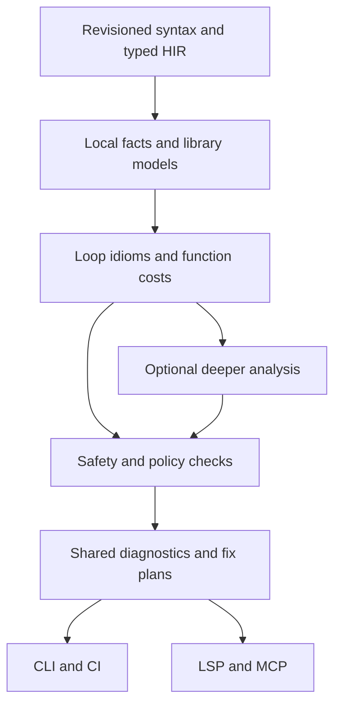

# Simple Performance Analysis and Collection Refactoring

## Consolidated design and phased implementation plan

- **Date:** 2026-11-18
- **Status:** Proposed design, not an implementation audit.
- **Scope:** Algorithmic-complexity detection; propagation through callers; loop-to-collection recognition; collection execution; lint/LSP integration; shared diagnostics and safe autofixes.
- **Primary policy:** Run nontrivial analysis in lint/LSP/CI. Admit work to the normal compiler only after its incremental cost is measured and accepted.
- **Compatibility policy:** Keep imperative loops valid. Add advisory tooling first; do not silently rewrite source or change collection evaluation semantics.

> This document consolidates the decisions from this conversation and corrects several overly broad claims in the earlier discussion. It does not claim that the named Simple APIs, commands, annotations, rules, or modules already exist. All Simple code and configuration examples are illustrative proposals to adapt to the actual grammar and repository. No repository implementation, benchmark, or bootstrap verification was performed for this document.

## Contents

1. [Decisions and requirements](#1-decisions-and-requirements)
2. [Research and existing implementations](#2-research-and-existing-implementations)
3. [Cost model and evidence](#3-cost-model-and-evidence)
4. [Caller propagation and aggregate explanations](#4-caller-propagation-and-aggregate-explanations)
5. [Collection-oriented programming without banning loops](#5-collection-oriented-programming-without-banning-loops)
6. [Lightweight loop-idiom recognition](#6-lightweight-loop-idiom-recognition)
7. [Semantic safety and profitability](#7-semantic-safety-and-profitability)
8. [Shared architecture and execution tiers](#8-shared-architecture-and-execution-tiers)
9. [Diagnostics, severity, and contracts](#9-diagnostics-severity-and-contracts)
10. [Autofix infrastructure](#10-autofix-infrastructure)
11. [LSP, CLI, and LLM-agent interfaces](#11-lsp-cli-and-llm-agent-interfaces)
12. [Incremental analysis and dynamic modules](#12-incremental-analysis-and-dynamic-modules)
13. [Compiler, backend, and bootstrap integration](#13-compiler-backend-and-bootstrap-integration)
14. [Runtime validation and performance measurements](#14-runtime-validation-and-performance-measurements)
15. [Acceptance tests and sspec coverage](#15-acceptance-tests-and-sspec-coverage)
16. [Phased delivery and documentation updates](#16-phased-delivery-and-documentation-updates)
17. [Completion checklist](#17-completion-checklist)
18. [References](#18-references)

## 1. Decisions and requirements

### 1.1 Final design decisions

| ID | Decision |
|---|---|
| D01 | Analyze ordinary `for`/`while` loops, callbacks, iterators, and collection operations; do not depend on an LLM choosing a functional style. |
| D02 | Use symbolic, parameterized function summaries. Propagate callee costs into caller iteration counts and retain the explanation. |
| D03 | Keep multiple size parameters, aggregate sizes, output cardinality, and callback costs. Do not replace everything with a generic `n`. |
| D04 | Distinguish an upper bound, a tight bound, an empirical estimate, and an unknown result. |
| D05 | Prefer collection operations for transformations, searches, and aggregations when clear and appropriate; keep loops first-class. |
| D06 | Separate candidate recognition, semantic legality, and profitability. A cheap pattern match does not prove a safe or faster rewrite. |
| D07 | Make lint the default owner of the analysis. LSP, CLI, CI, and MCP consume the same results rather than implementing competing analyzers. |
| D08 | Reuse the intended common diagnostic/fix infrastructure across compiler, interpreter, and language tools after auditing existing interfaces. |
| D09 | Treat loop-to-collection conversions as assists or hints, not errors. Treat actionable performance risks as warnings; reserve errors for explicit policies/contracts or real correctness failures. |
| D10 | Only verified, current-revision transformations qualify for automatic safe fixing. Tests and type-checking alone are not equivalence proofs. |
| D11 | Keep runtime instrumentation opt-in. Merely running lint must not change generated program behavior. |
| D12 | Protect bootstrap simplicity: no mandatory solver, new backend, whole-program analysis, or collection rewrite in the normal build path. |

### 1.2 What this prevents or detects

The first practical targets are:

- A linear callee newly invoked inside a linear traversal.
- Repeated list membership, scanning, copying, sorting, or index construction inside another traversal.
- A fold whose accumulator grows and is copied on every iteration.
- Repeated enumeration of a lazy view that recomputes expensive work.
- Nested equijoins and repeated key lookups that may benefit from indexing.
- Collection pipelines with expensive predicates, transforms, hashing, or equality.
- Unnecessary intermediate materialization where a legal fused traversal is available.
- Violations of an explicit resource policy, and loss of the ability to verify that policy.

The analyzer is not intended to reject every quadratic algorithm. Pairwise output, dynamic programming, small bounded loops, and some exact algorithms legitimately require substantial work.

### 1.3 Important corrections to the earlier discussion

1. **An inferred `O(n²)` upper bound is not proof of genuinely quadratic work.** A linear function also satisfies that upper bound.
2. **Failure to establish `O(n)` is not proof that an `O(n)` contract is false.** Verification has verified, refuted, and unproved outcomes.
3. **Loop-to-map conversion normally preserves the algorithm.** It does not itself turn quadratic work into linear work.
4. **A single-pass append loop already avoids intermediate collections.** A fused rewrite must not claim allocation savings without evidence.
5. **An accumulator is an ordered fold before it is a parallel reduction.** Associativity and numeric semantics require separate treatment.
6. **Lazy operations need a terminal consumer to replace eager work.** Writing only `items.map(f)` may postpone or eliminate execution.
7. **“Under 1% compiler overhead” and “under 5% analysis overhead” were tentative targets, not measurements.** No such overhead guarantee is established for Simple.
8. **A small initial implementation should cover a small safe subset.** Join planning, general alias proofs, and semantic synthesis are later features, not part of a tiny matcher.

## 2. Research and existing implementations

The following are design precedents, not claims that their implementations can be dropped directly into Simple.

| Reference | Verified contribution | Relevance and limitation |
|---|---|---|
| Infer Cost checker [R01] | Symbolic execution-cost bounds, caller-cost composition, differential complexity reports. | Closest reference for caller aggregation. Its documented analysis has limitations, including recursion and unknown calls; costs are not calibrated elapsed time. |
| Çiçek, Bouaziz, Cho, Distefano, **Static Resource Analysis at Scale**, SAS 2020 extended abstract [R02] | Compositional, incremental cost analysis used in code review at scale. | Supports the lint/CI architecture. The paper acknowledges that bound-increase warnings need not correspond to actual regressions. |
| Sinn, Zuleger, Veith, **Complexity and Resource Bound Analysis of Imperative Programs Using Difference Constraints**, 2017 [R03] | Loopus-style counter/reset and amortized bound analysis. | Useful for nontrivial loops. The described implementation is intraprocedural and does not handle recursion; caller propagation is a separate layer. |
| Hoffmann, Das, Weng, **Towards Automatic Resource Bound Analysis for OCaml**, POPL 2017; RaML [R04], [R05] | Automatic amortized analysis with multivariate polynomial bounds and higher-order functions. | Reference for callback and container costs; solver-backed inference belongs outside the tiny compiler pass. It cannot solve arbitrary programs. |
| COSTA/PUBS research [R06] | Cost equations, recurrence reasoning, and symbolic resource bounds. | Reference for recursive and deeper analysis, not a prerequisite for the first milestone. |
| Gyori, Franklin, Dig, Lahoda, **Crossing the Gap from Imperative to Functional Programming through Refactoring**, FSE 2013 [R07] | LambdaFicator converts supported collection loops using preconditions and operation chaining. | Main research reference for local recognition and conservative refactoring. Java-specific restrictions do not transfer directly to Simple. |
| David, Kesseli, Kroening, **Kayak: Safe Semantic Refactoring to Java Streams**, 2017 preprint [R08] | Semantic refactoring using automated synthesis and verification. | Optional deep-refactoring reference; not suitable evidence for negligible compiler or keystroke cost. |
| JetBrains **Convert2streamapi** inspection [R09] | Production loop-to-stream recognition and code actions. | Practical UX precedent. The documentation promises neither universal speedups nor a measured overhead budget. |
| Rust iterators, Scala views, Java streams, GHC rewrite rules [R10]–[R14] | Different approaches to lazy composition, materialization, folds, and fusion. | Borrow precise semantics rather than combining language defaults indiscriminately. |
| Microsoft LSP and rust-analyzer architecture [R15]–[R17] | Code actions, deferred edit resolution, versioned edits, and separated analysis/editor layers. | Integration precedents for a shared analyzer and source-preserving edits. |
| Riley and Fedyukovich, **Exact Loop Bound Analysis**, PLDI 2025 [R18] | Exact bounds through precondition synthesis and verification for a supported class of loops. | Advanced research; the paper targets single-loop programs under linear integer arithmetic, not arbitrary source programs. |
| da Mata, Pereira, Ferreira, **Automatic Parallelization of Canonical Loops**, 2009 / expanded 2013 [R19] | Parallel execution of canonical map/reduce computations. | Future execution/backend reference. The work assumes associative MR operations; it is not a general cheap proof that any loop is parallelizable. |

### 2.1 What the evidence supports

Infer's documentation demonstrates the motivating scenario: adding a linear-cost call to a loop can change the inferred caller bound from linear to quadratic [R01]. The SAS paper reports thousands of warnings and hundreds of pre-commit fixes in its deployment, while emphasizing context and false-positive handling [R02].

LambdaFicator is a credible starting point for conservative local transformations. Kayak is a different cost class: its historical evaluation used 50 selected integer-collection examples, with successful syntheses averaging 8.5 seconds and a 300-second per-example timeout [R07], [R08]. Those numbers are not Simple estimates or comparisons with current IDE releases.

### 2.2 Recommended adoption order

1. Borrow compositional summaries and differential reporting from Infer.
2. Borrow preconditioned local recognition from LambdaFicator and contextual actions from IntelliJ.
3. Borrow explicit lazy iteration/materialization and ordered-fold semantics from collection libraries.
4. Add Loopus/AARA/recurrence techniques only where measurements justify them.
5. Keep semantic synthesis and automatic parallelization optional.

No paper establishes the cost or implementation size of these features in the current Simple compiler. Measure the integration, not just the matcher.

## 3. Cost model and evidence

### 3.1 Resources are separate dimensions

| Resource | Meaning | Composition caution |
|---|---|---|
| `work` | Abstract operations or modeled instruction work. | Does not directly measure milliseconds. |
| `alloc_count` | Number of allocation events. | Separate from allocated byte volume. |
| `alloc_bytes_total` | Cumulative bytes allocated over execution. | Repeated allocate/free can be large despite low peak memory. |
| `aux_peak_bytes` | Peak live auxiliary memory. | Requires lifetime overlap reasoning; do not simply sum callee peaks. |
| `output_bytes` | Memory required by the result. | Separate unavoidable output from removable temporary storage. |
| `io_calls` / `io_bytes` | Modeled I/O operations and transfer volume. | Latency depends on external behavior. |
| `lock_ops` / `gpu_transfer_bytes` | Synchronization events or transfer volume. | Lock waiting and GPU latency require additional models or measurements. |

Hard real-time WCET requires target, cache, scheduler, and hardware assumptions. An abstract work bound is not a firmware deadline proof.

### 3.2 Keep evidence categories orthogonal

A result must carry:

```text
BoundEvidence
    expression
    relation: UpperBound | LowerBound | Exact | TightBound | Estimate
    regime: WorstCase | Expected | Amortized | ExpectedAmortized
    model_id
    assumptions[]
    status: Complete | Partial | Unknown | Cancelled
    origin: Inferred | ImportedContract | Measured | Heuristic
    provenance_id
```

“Verified” means the rule's obligations hold under the recorded model and trusted assumptions. It does not mean that the analyzer implementation has itself been formally verified.

Do not flatten these fields into a numerical confidence score. A high-confidence guess cannot authorize a safe fix.

### 3.3 Symbolic expression domain

Start with a deliberately small bounded domain:

```text
Const
Size(parameter, measure)
Add
Multiply
Maximum
LogBound
AggregateSize
KnownCalleeCost
UnknownTerm(reason)
```

Use a richer summation or recurrence representation only in the appropriate analysis tier. Bound expression size, term count, degree expansion, and solver work. Preserve a sound coarse upper bound when available; otherwise return partial/unknown.

Examples of measures:

- `length(users)` and `length(orders)` are different variables.
- `bytes(text)` is not automatically the same as character count.
- A tree may need node count and depth.
- A graph may need vertices, edges, and output size.
- A group collection needs both the number of groups and total elements.

Fixed-width arithmetic, user-defined equality, string comparison, and hashing require representation-aware models.

### 3.4 Basic composition rules

For sequential work and supported finite traversals:

```text
sequence(A, B)      = cost(A) + cost(B)
branch(c, A, B)     <= cost(c) + max(cost(A), cost(B))
call(f, actuals)    = modeled_call_dispatch_cost
                      + substitute(f.summary, actual size relations)
loop(iterations)   = sum(cost(body at iteration i), i in iterations)
```

Multiply a loop bound by a body bound only when that bound holds for every iteration. A product of maxima may be sound but loose; do not label it tight.

The body includes iterator advancement, conditions, callbacks, key extraction, equality, and any implicit copying.

### 3.5 Essential examples

| Code shape | Appropriate result under stated constant-cost assumptions |
|---|---|
| Two consecutive traversals of length `n` | `O(n)`, not `O(n²)`. |
| Traversal of `n` elements, inner loop of exactly 8 iterations | `O(n)`. |
| Full traversal of `m` elements inside a traversal of `n` elements | `O(nm)`; quadratic only when the relevant sizes scale together. |
| Inner bound increases from 0 to `i` | Sum the dependent bound; quadratic for the standard triangular loop. |
| Two-pointer loop whose inner pointer advances at most `n` times total | Linear total work when the invariant is established. |
| Traversal of groups containing a total of `N` elements | `O(group_count + N)`, not automatically `O(group_count × largest_group)` as a tight bound. |
| Repeated binary search | `O(n log m)` with an appropriate search/representation model. |
| Dynamic-array append over `n` elements | Amortized `O(n)` total under the growth policy, not `n` times a worst-case resize charged independently. |
| Hash lookup for each input | Expected bounds only with modeled hashing/equality and collision assumptions. |
| A fold copying an accumulator of lengths 1, 2, ..., `n` | Potentially quadratic work and total allocated bytes despite using a functional API. |

An unsupported loop or unknown function call is **unknown**, not zero cost, constant cost, or proven nontermination.

## 4. Caller propagation and aggregate explanations

### 4.1 Motivating example

Illustrative Simple-style pseudocode:

```simple
fn count_matches(records, key)
    count = 0
    for record in records
        if record.key == key
            count += 1
    return count

fn count_for_all(keys, records)
    result = []
    for key in keys
        result.append(count_matches(records, key))
    return result
```

Let `n = length(keys)` and `m = length(records)`. The exact comparison counts below assume normal completion over finite, stable, replayable inputs, with fixed-cost key equality and successful iterator, counter, and builder operations. If early failure is possible, use an appropriate upper bound rather than an unconditional exact count:

```text
count_matches(records, key):
    comparisons = m
    work upper bound = a*m + b

count_for_all(keys, records):
    comparisons = n*m
    work upper bound = c*n + n*(a*m + b) + d
    output elements = n
```

If the caller supplies equally growing inputs, the comparison count is quadratic in that shared size. Without that relationship, display `n*m`.

Refactoring only the outer loop to `map` does not change this cost. Building a key-to-count index once can produce expected `O(m+n)` work for this counting task, subject to hash, equality, memory, and semantic conditions.

### 4.2 Proposed function summary

```text
FunctionCostSummary
    function_id
    semantic_revision
    size_parameters[]
    size_relations[]
    resource_bounds[]
    output_cardinality
    callback_cost_parameters[]
    effects_summary_id
    assumptions[]
    unresolved_terms[]
    dependency_summary_hashes[]
    provenance_root
    analyzer_version
    model_version
    configuration_fingerprint
```

Keep formulas rather than only labels such as “linear.” At a call site, substitute actual argument measures, callback summaries, captured collections, and established relations.

For example, mapping a callback that scans a captured collection has a cost depending on both the mapped input and that capture.

### 4.3 Incremental aggregation algorithm

1. Derive local facts for a changed function from its existing typed representation.
2. Retrieve summaries for resolved callees and library operations.
3. Substitute argument-size relations at each call.
4. Compose loop and control-flow costs under the selected analysis budget.
5. Normalize the bounded expression and attach provenance.
6. Publish a new summary for that semantic revision.
7. Revisit reverse dependencies only when the relevant exported cost/effect summary changes.
8. Stop or widen within a bounded procedure for recursive strongly connected components.

The first version may report unsupported recursion as unknown. It must not attempt unrestricted inlining or recursive reanalysis.

### 4.4 Aggregate hint shown at the caller

```text
PERF-COST-001: Repeated full scan inside a traversal

Function: count_for_all
Sizes: n = keys.length, m = records.length
Modeled comparisons: n * m
Work bound: O(n*m)
Evidence: each call scans all m records

Contribution:
  outer traversal: n calls
  count_matches: m comparisons per call
  equality: modeled constant-time for this key representation

Possible redesign:
  Build key counts once.
  Expected work: O(m+n)
  Extra auxiliary memory: O(number of distinct keys)
  Auto-apply: unavailable until semantic preconditions are verified
```

Use related source locations for the traversal, call, callee loop, and assumption definitions. A compact provenance DAG should support “expand cause” without copying the full call trace into every caller summary.

Suppress cascades of duplicate warnings: report the root change and important affected callers, then provide an expandable impact list.


## 5. Collection-oriented programming without banning loops

### 5.1 API direction

Prefer semantic operations for ordinary transformations and queries. Keep explicit loops for state machines, hardware interaction, irregular control flow, and cases where they are clearer or measurably better.

A compatibility-first API should expose laziness explicitly, for example through `iter()` or `view()`. Do not silently change existing eager `Collection.map` behavior. Rust iterator documentation, Scala's strict-versus-view distinction, and Java stream contracts provide useful contrasting precedents [R10], [R12], [R13].

| Operation family | Information exposed to analysis | Caveat |
|---|---|---|
| `map` | Input cardinality and one transform per consumed item. | Transform and iterator advancement may be expensive. |
| `filter` | Predicate application and output cardinality bounded by input. | Selectivity is not known exactly without additional facts. |
| `fold` | Ordered recurrence over accumulator state. | A growing accumulator can make the operation superlinear. |
| `any` / `all` / `find` | Short-circuit search. | Worst-case full traversal; preserve empty/fallback behavior. |
| `flat_map` / `flatten` | Sum of emitted/traversed subcollection sizes. | Output growth may dominate. |
| `count_by` / `group_by` / `index_by` | Key extraction and lookup/build strategy. | Define duplicate-key handling, ordering, and hashing assumptions. |
| `join` / `group_join` | Match relation and output cardinality. | A flat join and grouped join have different result shapes. |
| `sort_by` / `min_by` | Ordering/comparator cost and required output. | Stable ordering, ties, exceptions, and key evaluation matter. |
| `collect` / `collect_into` | Materialization point and result storage. | Allocation, identity, ownership, and failure behavior are observable where specified. |

Do not add every operation at once. Inventory current collection and iterator APIs before extending them.

### 5.2 Fusion and materialization

Illustrative pipeline:

```simple
total = items.iter()
    .filter(x -> x.active)
    .map(x -> x.value)
    .fold(0, (acc, value) -> acc + value)
```

The intended sequential implementation is one traversal with an ordered accumulator. For a scalar accumulator, constant-size adapter state, and callbacks with no additional allocation, it needs constant auxiliary working memory.

Fusion can avoid temporary collections between stages. GHC documents rewrite-based fusion mechanisms, while also explicitly placing semantic responsibility on rewrite authors [R14]. Simple should not treat arbitrary rewrite annotations as equivalence proofs.

Important limitations:

- Fusion is an optimization opportunity, not a guarantee for every build/backend.
- Inlining, representation, dynamic dispatch, debug mode, and closure allocation can affect generated code.
- A lazy pipeline enumerated repeatedly may repeat all of its work.
- A pipeline ending in `collect` still needs output storage.
- Rewriting an already single-pass filter/append loop usually offers clarity, not a demonstrated performance improvement.
- Rust's loop/iterator performance example is evidence for its particular optimized implementation, not a universal zero-overhead promise for Simple [R11].

### 5.3 Functional syntax does not prevent quadratic work

```simple
matches_per_user = users.iter()
    .map(user -> orders.iter()
        .filter(order -> order.user_id == user.id)
        .collect())
    .collect()
```

On normal completion over finite, stable, replayable inputs, with `n` users and `m` orders, this still performs `n*m` predicate evaluations. Early failure can shorten execution without making the nested-scan algorithm generally linear.

An indexed grouping followed by lookup, or a grouped join, can preserve the per-user collection shape. A flat `join` alone is not automatically equivalent. A suitable hash-based grouped operation can have expected work `O(n+m+k)`, where `k` is the number of emitted matches, under the relevant key assumptions.

If duplicate keys produce every pair, `k` itself can be `n*m`. No planner can materialize quadratic output in linear total work.

### 5.4 Legal optimization versus speculative suggestion

| Candidate transformation | Required reasoning |
|---|---|
| Lazy `filter` followed by `map` into one traversal | Preserve element order, callbacks, exceptions, and consumption. |
| Materialized intermediates replaced by a fused pipeline | Intermediate identity and contents must not be observed; evaluation order must remain valid. |
| `filter(...).count()` without a result collection | Preserve predicate behavior and numeric counter semantics. |
| Full sort followed by first element replaced with minimum selection | Preserve empty behavior, tie choice, comparator/key effects, failures, and ordering requirements. |
| Repeated lookup replaced with a prebuilt index | Preserve source snapshot, equality, duplicates, mutation behavior, and memory constraints. |
| Nested matching replaced with hash join | Preserve result shape/order, duplicates, hash/equality laws, and failure semantics. |
| Sequential map/fold moved to parallel CPU/GPU execution | Require additional independence, numeric, scheduling, and backend guarantees. |

A performance-related code action must state whether it is merely a style refactor, a verified algorithm replacement, or an advisory redesign.

## 6. Lightweight loop-idiom recognition

### 6.1 Keep the first implementation small

Implement a reusable `LoopIdiomAnalyzer` with six initial families:

| Family | Recognized imperative shape | Candidate |
|---|---|---|
| Map | One append of a transformed item into a fresh local builder. | `iter().map(...).collect()` |
| Filter | Conditional append of the original item. | `iter().filter(...).collect()` |
| Filter-map | Conditional append of a transformed item. | `iter().filter(...).map(...).collect()` |
| Ordered fold/count | One supported accumulator recurrence or conditional increment. | Ordered `fold`; named aggregation only when equivalent. |
| Any/all | Restricted Boolean early-return pattern. | Matching short-circuit terminal. |
| Find | Restricted first-match selection. | Matching search terminal with preserved fallback. |

Defer arbitrary `while` conversion, intertwined accumulators, escaping builders, unknown effects, nested mutable traversals, grouping, indexing, and joins.

Recognize resolved operation identities, not spellings. A user-defined method named `append` or `sum` has no built-in semantics unless a checked model establishes them.

### 6.2 Minimal local facts

Reuse available facts:

- Resolved iterator/collection and operation identities.
- Variable binding and capture identities.
- Reads, writes, and loop-carried dependencies.
- Builder freshness, escape information, and known aliases.
- Exit/continue/return structure.
- Known callback effects and numeric policies.
- Source-to-HIR mapping and document revision.

Do not start a new whole-program alias/effect analysis merely because the matcher asks for a fact. If that fact is unavailable at the current tier, return an obligation or decline the fix.

### 6.3 Candidate descriptor

```text
LoopIdiomCandidate
    rule_id
    function_id
    semantic_revision
    source_range
    iterator_source
    kind
    predicate
    transform
    accumulator_seed
    accumulator_step
    output_builder
    captured_values[]
    outstanding_obligations[]
    source_anchor
```

The descriptor records a candidate, not a proof. Store it in an immutable analysis side table rather than mutating shared AST/HIR nodes.

### 6.4 Bounded recognition algorithm

```text
for each changed function snapshot:
    obtain existing typed local facts
    walk the function once and summarize loop regions bottom-up
    classify supported exits and writes
    match the fixed set of idiom families
    reject definite mismatches
    record candidates plus unresolved safety obligations

when an action is requested:
    revalidate revision and dependencies
    discharge permitted obligations within the selected budget
    generate a source-preserving edit only if policy permits
```

A single bounded structural traversal can be linear in the function's node count, excluding the cost of producing prerequisite facts. Avoid rescanning every nested loop subtree separately: deeply nested code can otherwise make the analyzer itself quadratic.

This is a design complexity bound, not a measured end-to-end latency or an estimate of implementation lines.

### 6.5 Eager loop replacement example

```simple
result = []
for item in items
    if valid(item)
        result.append(transform(item))
```

Candidate, assuming the collection semantics and safety obligations match:

```simple
result = items.iter()
    .filter(valid)
    .map(transform)
    .collect()
```

The terminal `collect()` preserves the intended eager execution point. Do not advertise this as fewer allocations than the original single-builder loop.

Expected diagnostic text:

```text
Equivalent collection refactor available.
Modeled traversal cost: unchanged.
Result materialization: still required.
Runtime improvement: not established.
Safe fix: available only after listed preconditions pass.
```


## 7. Semantic safety and profitability

### 7.1 Three separate questions

1. **Recognition:** Does this loop resemble a supported idiom?
2. **Legality:** Does the replacement preserve behavior under the language's semantics?
3. **Profitability:** Does it improve the relevant resource use on the selected execution configuration?

Only the first is generally a small syntax/data-flow problem. A legal rewrite need not be faster, and a potentially faster rewrite need not be legal.

### 7.2 Safe-fix proof obligations

| Area | Required condition for an automatic safe rewrite |
|---|---|
| Collection identity | Replacing the builder must not change an identity or partial result observable elsewhere. |
| Aliasing | Output, input, captured objects, and iterator state cannot interfere in a way that changes behavior. |
| Mutation | Callbacks must not invalidate iteration or change subsequent reads differently after conversion. |
| Evaluation | Preserve order and number of observable callback/iterator operations, including short-circuit behavior. |
| Timing | Preserve eager versus deferred execution and the point at which work starts. |
| Failure | Preserve relevant exceptions/errors, prefix state, cleanup, and evaluation of fallbacks. |
| Control flow | Preserve all modeled early exits, labels, cleanup scopes, and returned values. |
| Capture | Preserve bindings, reference/value capture, ownership, borrowing, and callback lifetime. |
| Numeric behavior | Preserve overflow, checked arithmetic, rounding, NaNs, signed zero, and intermediate traps. |
| Output | Preserve result type, order, duplicate handling, and empty-input behavior. |
| Runtime effects | Do not reorder or remove I/O, volatile/MMIO operations, synchronization, random/time reads, suspension, or cancellation points. |
| Resource restrictions | Respect `nogc`/no-allocation rules and explicitly declared resource limits. |
| Revision | The source, callee facts, models, and policy used by the proof still match the current project snapshot. |

For the initial safe subset, require fresh nonescaping builders, known standard iterator semantics, and locally established compatible effects. Unknown facts disable the automatic fix.

Purity alone is insufficient: a pure computation can diverge or raise an error. Likewise, an immutable reference does not automatically imply exclusive access or an immutable backing object.

The language must specify whether allocation failure, allocation hooks, finalizers, and destruction timing are observable. Until a relevant case is modeled, it must not receive an unconditional safe-fix label.

### 7.3 Ordered fold before parallel reduction

For:

```simple
acc = seed
for item in items
    acc = step(acc, item)
```

The semantic candidate is:

```simple
acc = items.iter().fold(seed, step)
```

Preserve the seed and left-to-right recurrence. A nonidentity seed can invalidate a blind replacement with a named aggregation, and nonassociative operations cannot be reassociated freely. Even a semantically correct fold can be superlinear when each step copies a growing accumulator.

API names vary: a library may call a sequential operation `reduce`. This design uses **ordered fold** for preserved sequential evaluation and **parallel reduction** for reassociated evaluation.

Parallel/reassociated execution additionally needs:

- Associativity for the actual representation and permitted failure behavior.
- An identity when the implementation requires one.
- Compatible effects and ownership.
- Explicit ordering/numeric permissions.
- A backend capable of honoring the contract.

Ordinary floating-point addition is not generally associative. Checked integer arithmetic can also change failure behavior under reassociation. LLVM documents these constraints and limited target-specific ordered reductions [R20]. Do not infer parallel permission from a recognized accumulator alone.

### 7.4 Why `extend(map(...))` is not a universal fix

If `output` is externally visible, replacing it with a fresh collection may change identity. Extending it in place can preserve identity, but may still change:

- When elements become visible.
- When storage is reserved or allocation fails.
- Which callbacks observe a partially built prefix.
- Iterator invalidation and exception handling.

Use a modeled `collect_into`/`extend` only when its execution contract matches. Otherwise retain the loop.

### 7.5 Algorithm replacements need stronger conditions

For a scan-to-index or nested-loop-to-join suggestion, also verify or disclose:

- Whether input can change during processing.
- Whether equality is consistent with hashing.
- Whether key extraction and comparisons have effects.
- Required stable output order and duplicate semantics.
- Cost of hashing and variable-size keys.
- New auxiliary memory and allocation requirements.
- Whether small inputs favor the original algorithm.
- Whether expected complexity is acceptable or a worst-case bound is required.

In embedded code, a bounded scan can be preferable to a hash table with uncertain memory and collision behavior. Offer alternatives such as a sorted index or fixed-capacity lookup structure; do not force an expected-cost algorithm into a hard real-time path.

### 7.6 Source editing requirements

Recognition may use HIR, but edits must use source-preserving syntax information.

Preserve comments, names, indentation, imports, capture scope, and meaningful source locations. If macro expansion or generated code cannot be mapped safely to an editable origin, explain the limitation and withhold the edit.

Reparse and type-check the candidate before presenting an applicable fix where practical. Run appropriate tests afterward. Neither type-checking nor passing tests substitutes for the transformation's semantic preconditions.

## 8. Shared architecture and execution tiers

### 8.1 Proposed logical components

| Component | Responsibility | Must not own |
|---|---|---|
| Semantic facts adapter | Read typed HIR, effect, size, and source-map facts from a revision. | A second parser/type checker. |
| Library cost/model registry | Known operations, callbacks, sizes, effects, and materialization behavior. | Unchecked claims masquerading as proofs. |
| Local cost summarizer | Compose cheap structural/known-library costs. | Unbounded theorem proving. |
| Interprocedural aggregator | Substitute summaries and produce provenance. | Source mutation. |
| Loop idiom recognizer | Produce constrained refactoring candidates. | Arbitrary alias/equivalence solving. |
| Safety checker | Discharge rewrite preconditions and record evidence. | Automatic relaxation of safety requirements. |
| Diagnostic/fix core | Stable codes, severity policy, explanations, suppression, and edit plans. | Editor-specific state or backend execution. |
| Optional deep analyzer | Bounded solvers, recurrence reasoning, complex equivalence. | Normal compiler dependencies. |
| Presentation adapters | CLI, CI, LSP, and MCP views of the same result. | Duplicate rule implementations. |

These are responsibilities, not a demand for nine new libraries. Fit them into existing Simple abstractions and keep the initial implementation compact.

### 8.2 Data flow



The shared analysis layer does not depend on LSP transport. The source model does not store mutable editor diagnostics.

### 8.3 Execution policy

| Tier | Work | Default location | Normal compiler policy |
|---|---|---|---|
| T0: existing facts | Parsing, resolution, ordinary safety facts, existing loop metadata. | Compiler/front-end. | Reuse without introducing a new analysis dependency. |
| T1: fast local | Bounded idiom recognition and simple known-cost composition. | Default lint; incremental LSP. | Optional only after measurements justify admission. |
| T2: compositional | Caller propagation, size relationships, bounded effects/alias queries, regression comparison. | Default full-project lint; background/save/CI. | Not on the normal build critical path. |
| T3: deep | Difficult loop bounds, recurrence solving, synthesis/equivalence. | Explicit diagnostic profile; scheduled CI when configured. | Disabled by default. |
| T4: empirical | Counters, benchmarks, allocation and scaling observations. | Explicit test/profile jobs. | No instrumentation unless requested. |

A full lint profile may enable expensive rule families with finite budgets. That does not mean executing every solver on every keystroke. Interactive scheduling and batch coverage are different policies.

### 8.4 Compiler admission gate

A rule is not “cheap” merely because its matcher is short.

Before making it normal-compiler work:

1. Measure added wall time, CPU time, allocations, and peak RSS.
2. Include prerequisite query costs and cold-cache behavior.
3. Test small and large functions, deep nesting, large call graphs, and incomplete code.
4. Confirm it does not trigger whole-program effects/alias solving.
5. Verify disabled analysis does not allocate side tables or initialize plugins.
6. Confirm repeated builds and bootstrap outputs remain stable.
7. Keep a feature switch and a straightforward rollback.

Do not promise a particular percentage in advance. Establish an explicit project budget from representative measurements and reject compiler integration that exceeds it.

### 8.5 Scheduling and cancellation

- Analyze changed functions incrementally.
- Debounce/coalesce obsolete requests.
- Cancel work associated with superseded revisions.
- Bound parallel workers and memory.
- Prioritize active-file diagnostics over deep background analysis.
- Return partial results with reasons when budgets expire.
- Resolve expensive fixes only after an explicit code-action request.
- Never block compilation on a solver invoked only for editor assistance.

A timeout means incomplete analysis, not a defect in the user's program and not permission to guess a safe rewrite.


## 9. Diagnostics, severity, and contracts

### 9.1 Reuse one diagnostic core

Audit the existing Simple compiler/interpreter/lint/LSP diagnostics before implementation. Extend or adapt the common representation instead of adding a separate performance-error subsystem.

The common infrastructure may also serve Markdown and CMM/T32 tooling, but those languages do not acquire Simple-specific loop rules unless their own semantic models support them. Share reporting and edit machinery, not incorrect language assumptions.

Proposed conceptual schema:

```text
Diagnostic
    stable_rule_id
    occurrence_id
    category
    severity
    message
    primary_location
    related_locations[]
    explanation_id
    evidence
    assumptions[]
    analysis_tier
    model_revision
    project_revision
    provenance_id
    fix_candidates[]
    suppression_info

FixCandidate
    stable_action_id
    title
    kind: Refactor | CorrectnessFix | AlgorithmChange
    applicability: VerifiedSafe | ReviewRequired | Unavailable
    obligations[]
    semantic_fingerprint
    expected_document_versions[]
    lazy_edit_plan
    resource_tradeoffs
    validation_plan
```

Names are proposals; map them to the actual shared types.

### 9.2 Default severity policy

| Proposed code | Finding | Default | Escalation / autofix policy |
|---|---|---|---|
| `PERF-STYLE-001` | Equivalent map/filter/fold expression available. | Contextual assist or Hint. | Never a correctness error merely because a loop was used. |
| `PERF-COST-001` | Repeated scan or another superlinear-risk pattern. | Warning when sufficiently grounded and actionable. | Explain cost assumptions; a safe fix may not exist. |
| `PERF-COST-002` | Inferred complexity bound increased versus baseline. | Warning. | Do not call it a confirmed runtime regression without stronger evidence. |
| `PERF-ALLOC-001` | Avoidable repeated materialization/copying. | Info or Warning based on impact and evidence. | Only offer safe rewrite if intermediate behavior is unobservable. |
| `PERF-ALG-001` | Index/join/aggregation redesign opportunity. | Info or review action. | Requires explicit choice unless a supported equivalence rule discharges every obligation. |
| `PERF-CONTRACT-001` | Resource contract refuted. | Error in the declared contract's enforcement profile. | Require a valid witness or proof appropriate to the contract. |
| `PERF-CONTRACT-002` | Required contract could not be verified. | Warning normally; Error in explicit strict-verification profile. | Message must say “unproved,” not “violated.” |
| `PERF-ANALYSIS-001` | Unknown call, exhausted budget, or unsupported analysis. | Coverage note / Info. | Warning where verification is required; no fabricated cost. |
| `PERF-FIX-001` | Candidate blocked by semantic or revision preconditions. | Disabled action with reason. | Do not warn that the original valid loop is erroneous. |
| Existing safety code | Actual mutation, ownership, type, or effect violation. | Existing language severity. | Do not duplicate the same correctness rule under a performance code. |

Rule identifiers must be reconciled with the repository's current registry before adoption.

Severity is a policy. Evidence and applicability are semantic facts. An Error can have no safe fix; a Hint can have a verified one.

### 9.3 Contracts have three outcomes

Illustrative annotation, not an approved grammar change:

```simple
@cost(work <= linear(size(items)), mode = worst_case)
fn process(items)
    ...
```

Internally represent a structured contract rather than requiring a free-form string such as `"O(n)"`.

| Outcome | Meaning |
|---|---|
| Verified | The available bound and assumptions establish the declared requirement. |
| Refuted | A suitable counterexample, lower-bound argument, or other valid evidence establishes failure. |
| Unproved | The analyzer cannot decide with the available models/budget. |

A loose quadratic upper bound does not refute a linear asymptotic contract. A finite timing sample also cannot refute an asymptotic class by itself. A concrete operation-budget contract, however, can be refuted by a valid execution that exceeds that concrete limit.

Strict profiles may require proof and reject unproved obligations. This is a verification-policy failure, not proof of poor runtime performance.

Do not automatically promote all style hints or quadratic-risk warnings to errors in robust mode. Use selective, explicit policy.

### 9.4 Diagnostic wording

Use:

- “Inferred work upper bound increased from `O(n)` to `O(n*m)`.”
- “Modeled comparison count is `n*m` under the listed assumptions.”
- “Cannot verify the required linear work bound.”
- “Expected lookup cost assumes the configured hashing and equality model.”
- “Equivalent refactor available; runtime improvement has not been established.”

Avoid:

- “Two loops mean quadratic.”
- “Map is faster.”
- “Unknown means infinite runtime.”
- “Tests passed, therefore the rewrite is proven equivalent.”
- “The compiler guarantees negligible overhead.”

### 9.5 Warning control and traceability

Support scoped suppression with a reason and stable rule ID. For policy-critical suppressions, record an owner/review reference according to project practice.

Baseline existing findings and emphasize new or materially changed results. Do not hide them permanently: allow complete inspection and periodic review.

Each rule should connect its requirement, design rationale, accepted/rejected examples, implementation tests, and diagnostic explanation. Use the intended shared traceability facilities rather than a new performance-only database.

## 10. Autofix infrastructure

### 10.1 Fix classes

| Class | Examples | Application rule |
|---|---|---|
| Verified local refactor | Fresh-builder map/filter; preserved ordered fold. | Eligible for one-click and explicit `--fix-safe`. |
| Verified algorithm replacement | A narrowly modeled replacement with all ordering, key, memory, and effect conditions established. | Initially require explicit selection; relax only under an intentional project policy. |
| Review-required redesign | Hash index, grouped join, allocation tradeoff, changed evaluation plan. | Show diff and rationale; never include in bulk safe fixing. |
| Experimental/generated proposal | LLM-generated rewrite or solver candidate lacking a complete proof. | Manual review and validation; not automatically applicable. |
| Unavailable | Unknown alias, stale dependencies, unsupported semantics. | Explain why; keep original source. |

An LLM can propose candidates and explanations. It must not grant itself a `VerifiedSafe` classification.

### 10.2 Safe edit lifecycle

1. **Discover:** Emit a candidate without modifying source.
2. **Resolve:** Load the exact source/semantic snapshot and lazily construct a plan.
3. **Validate:** Check every applicable legality condition and dependency fingerprint.
4. **Preview:** Show a minimal source diff, unchanged/changed cost claims, and tradeoffs.
5. **Apply:** Apply only to matching revisions, with overlap/conflict checks.
6. **Check:** Reparse/type-check and run the selected verification/tests.
7. **Record:** Store rule ID, before/after revisions, assumptions, and validation result.
8. **Recover:** Offer undo/revert through the normal edit workflow if validation fails; never overwrite unrelated user edits.

The simplest v1 safe-fix implementation can be single-file. Multi-file algorithm rewrites should wait until the shared edit transaction behavior is robust.

### 10.3 Batch fixing

- `--fix-safe` is an explicit write request, not a default side effect of lint.
- Order independent edits deterministically.
- Detect overlapping edits.
- Recompute affected facts between dependent transformations.
- Do not apply a stale candidate after another edit invalidates it.
- Avoid unbounded rewrite/fix cycles.
- Skip review-required changes with an explanation.
- Do not silently insert suppression annotations to make lint pass.

Formatting changes should remain scoped. If the chosen replacement would introduce unsupported syntax or require a new collection operation, show a design suggestion rather than an applicable code action.

### 10.4 Preservation of resource restrictions

Even a functional-equivalence proof may be insufficient for a project with resource constraints. A replacement that allocates a new index can violate a no-allocation or fixed-memory policy.

Safe applicability must account for active language/resource requirements. If the transformation preserves values but requires a resource-policy change, present it as a review-required alternative.


## 11. LSP, CLI, and LLM-agent interfaces

### 11.1 One analyzer, several adapters

Expose the same diagnostic identities, cost summaries, provenance, and fix applicability through every consumer. Do not let CLI and LSP disagree because they contain separate implementations of the rule.

LSP supports diagnostics-associated code actions, deferred action resolution, and capability-dependent versioned workspace edits [R15], [R16]. rust-analyzer provides a useful precedent for keeping semantic analysis, editor-facing operations, and transport separate [R17].

| User need | Proposed presentation |
|---|---|
| See total function cost | Hover or optional inlay hint with explicit input-size variables and evidence. |
| Understand an expensive caller | Navigable related locations and expandable cost contributions. |
| Convert a simple loop | Contextual refactor action; optional nonintrusive hint. |
| Inspect an unsafe candidate | Disabled action with the unmet condition. |
| Investigate changed complexity | Baseline comparison with analyzer/model versions. |
| Inspect coverage | List unknown terms, missing library models, and exhausted budgets. |
| Fix from an agent | Same action resolver and revision checks used by the editor. |

Inlay hints should be sparse and configurable. Do not annotate every expression or put a warning on every loop.

### 11.2 Suggested LSP mapping

- Put stable rule IDs in diagnostic codes.
- Use related locations for caller/callee causes.
- Offer style-only changes as refactors even without a diagnostic.
- Use `textDocument/codeAction` for discovery and `codeAction/resolve` where supported for deferred edits.
- Use versioned `WorkspaceEdit.documentChanges` when the client supports them.
- Revalidate semantic dependency fingerprints server-side; document versions alone do not capture callee changes.
- Negotiate optional protocol capabilities and provide a safe fallback.
- If safe revision enforcement is unavailable, require a refreshed preview/application path rather than assuming edits are current.

Do not perform writes during diagnostic, hover, or code-action discovery requests.

### 11.3 Proposed CLI surface

These are proposed commands, not assertions about the current CLI:

```sh
simple lint --profile perf-fast
simple lint --profile perf --changed
simple lint --profile perf --format json
simple lint --profile perf --explain PERF-COST-001
simple lint --profile perf --fix-safe
simple lint --profile perf-deep
simple perf compare --baseline <baseline> --current <report>
```

Reuse existing commands/options when equivalents exist. Avoid creating a parallel lint command family solely for this feature.

A report should contain the source revision, analyzer/model revisions, configuration, input-size definitions, evidence, and unknown coverage. CI adapters may emit the existing structured report format or SARIF if supported.

### 11.4 LLM/MCP interaction

Proposed logical operations:

```text
list_diagnostics(scope, profile)
explain_diagnostic(diagnostic_id)
get_cost_summary(symbol, revision)
get_cost_contributions(symbol, revision)
list_fix_candidates(diagnostic_or_range)
resolve_fix(action_id, expected_revision)
preview_fix(action_id)
apply_fix(action_id, expected_revision)
validate_fix(change_id)
```

Route these through the common analysis and edit services. Scope writes according to the user's request.

Return machine-readable obligations, not only natural-language advice. An agent should know that an index improves expected work but adds memory, or that unknown aliasing blocks automatic conversion.

For complicated proposals, an LLM may generate a patch and relevant tests, but the patch remains review-required until the established verification mechanism qualifies it.

### 11.5 Example structured diagnostic

Illustrative payload; not an LSP wire schema:

```json
{
  "rule": "PERF-COST-001",
  "severity": "warning",
  "category": "repeated_scan",
  "cost": {
    "expression": "n*m",
    "resource": "key_comparisons",
    "relation": "Exact",
    "regime": "WorstCase",
    "model": "full_scan_example_v1"
  },
  "sizes": {
    "n": "length(keys)",
    "m": "length(records)"
  },
  "assumptions": [
    "Each helper invocation scans every record",
    "Input lengths remain stable",
    "Execution completes normally and modeled operations succeed"
  ],
  "fix": {
    "kind": "AlgorithmChange",
    "applicability": "ReviewRequired",
    "proposal": "Build key counts once",
    "tradeoff": "Additional storage and hash/equality assumptions"
  }
}
```

Exactness here concerns the number of comparisons in the example, not exact instruction count or elapsed time.

## 12. Incremental analysis and dynamic modules

### 12.1 Cache identity

Key cached results by all facts that can change their meaning:

```text
CacheKey
    function_semantic_revision
    type_and_representation_instantiation
    relevant_callee_summary_hashes
    library_implementation_identity
    analyzer_and_model_versions
    language_effect_numeric_policy
    target_configuration_if_relevant
    analysis_profile_and_precision
```

Use existing stable IDs/content hashes if appropriate. Hash equality is a cache mechanism, not a semantic proof. Do not assume a function name, file timestamp, or ABI version is sufficient.

### 12.2 Invalidation and publication

- Keep analysis results attached to immutable revisions/snapshots.
- Invalidate dependents when a relevant cost, effect, size, or implementation fact changes.
- Propagate semantic summary changes rather than every insignificant textual edit.
- Keep source presentation anchors separate from semantic facts where possible.
- Never publish a background result as current after its revision is superseded.
- Bound cached expression/provenance sizes and eviction behavior.
- Include failure/unknown states without permanently poisoning later higher-budget analysis.
- Recompute baselines or classify changes separately after analyzer/model upgrades.

The same invalidation rules apply to safe-fix proofs, not only performance labels.

### 12.3 Pseudo-immutable AST/HIR/MIR

The analyzer should read the revisioned tree interfaces from the intended pseudo-immutable design, not acquire mutable node references or introduce back-pointers that compromise snapshot ownership.

Use side tables keyed by stable IDs and revisions. Retain snapshots safely while workers run; cancel obsolete work without corrupting other readers.

No global mutable “current analysis” field should be attached to shared AST/HIR nodes. Avoid a new global lock or whole-tree clone for each editor request.

### 12.4 Static linking, dynamic linking, and SFFI

A library summary must identify the analyzed implementation or a declared interface contract.

- **Known static target:** Substitute that target's summary.
- **Closed finite target set:** Conservatively combine all feasible targets, retaining assumptions.
- **Open dynamic dispatch:** Use a valid enforced interface contract or an unknown term.
- **Unknown SFFI/native call:** Keep cost/effects unknown unless a trusted model exists.
- **Imported handwritten contract:** Mark as assumed/trusted, not independently inferred.
- **Dynamic replacement:** Revalidate implementation-specific summaries even if ABI compatibility is unchanged.

A same-signature plugin can change a call from constant to linear work. The loader need not change ordinary behavior merely because a hint exists. Only an explicitly enabled verified-resource profile should enforce cost-contract admission at load time.

Metadata parsing must itself be bounded and versioned. Reject malformed summaries and downgrade missing/incompatible data to unknown rather than crashing compilation or trusting it.

### 12.5 Baselines and performance regressions

Compare source versions only under compatible models, numeric policies, input-size meanings, and target assumptions.

Store:

- Previous and current cost expressions.
- Changes in evidence strength or analysis coverage.
- Root dependency changes.
- Relevant entry points and observed hot-path context, if available.
- Whether a change is source-related, model-related, or uncertain.

An increase caused by a model upgrade or lost precision should not be reported as a proven code-performance regression.

## 13. Compiler, backend, and bootstrap integration

### 13.1 Minimal structural impact first

Begin with read-only analysis over existing typed HIR and source maps. Do not require a new collection IR or a large compiler refactor before delivering lint value.

Cheap metadata may be attached through existing revision-aware query/side-table mechanisms. Keep normal compilation independent of deep-analysis plugins and solver libraries.

Only after measurement and demonstrated optimizer needs should Simple add richer semantic collection operations above backend-specific MIR.

### 13.2 Backend boundary

Logical operation semantics and work/cardinality summaries should be portable. Backend-specific models may refine:

- Vector width and instruction cost.
- Memory access and transfer costs.
- Parallel work versus span.
- Numeric/reduction behavior.
- Launch overhead and supported operations.

Do not change the language-level meaning merely because a CPU, SIMD, CUDA, ROCm, Vulkan, or other backend is available.

A backend may lower a supported operation or fall back to sequential execution. It must not silently relax order, error, ownership, or floating-point guarantees.

### 13.3 Bootstrap staging

Respect the stated direction of keeping the early bootstrap focused on the local CPU. This is an integration constraint, not confirmation of the current branch's implementation.

| Stage | Proposed treatment |
|---|---|
| Early / phase-3 bootstrap | No mandatory performance analyzer or pipeline source rewrite. Reuse existing facts only; ensure feature-off builds work unchanged. |
| Later / phase-4 validation | Build and test analyzer variants alongside ordinary debug/release compiler builds; run differential checks. |
| Optional analyzer distribution | Support static linking or dynamic loading only through the established plugin boundary, after its audit. |
| Advanced backends | Consume proven semantics/metadata without owning diagnostic policy or requiring changes to core language behavior. |

File-based build caching should remain the scheduling boundary. Reuse per-function semantic summaries within it rather than introducing a mandatory whole-project HIR/MIR phase barrier.

### 13.4 Avoid duplicated infrastructure

Before creating modules, locate and document the current owners of:

- Diagnostic codes, messages, severities, and suppression.
- CLI/LSP/MCP edit plans.
- Source spans and syntax-preserving rewriting.
- Effect/ownership/alias facts.
- Build-runner cache and dependency invalidation.
- Model/library metadata and dynamic loading.
- sspec fixtures and performance tests.

Produce a repository mapping with statuses such as existing, reusable, incomplete, or absent. Do not invent paths based on this design document.


## 14. Runtime validation and performance measurements

### 14.1 Static analysis and measurements complement each other

Static bounds explain how modeled work grows. Benchmarks establish behavior for selected workloads and environments. Neither replaces the other.

For suspicious functions, generate or recommend cases across:

- Multiple input sizes and shapes.
- Favorable and adverse branch behavior.
- Duplicate-heavy and collision-sensitive keys.
- Small fixed-size embedded workloads.
- Variable key lengths.
- Empty and singleton inputs.
- Cold/warm caches and debug/release builds.

Use operation counters when practical to reduce timing noise, while recording what each counter measures.

Doubling input size can suggest growth: a linear counter often roughly doubles and a quadratic counter roughly quadruples. These are empirical signals, not mathematical proofs; cache effects, startup costs, input distributions, and output growth can distort them.

### 14.2 Measure the analyzer itself

Record separately:

| Measurement | Purpose |
|---|---|
| Cold and warm analysis time | Distinguish initial cost from cached interaction. |
| Incremental edit-to-result latency | Evaluate developer experience. |
| Tail latency, not only average | Find large-function and dependency-fanout stalls. |
| CPU time and peak RSS | Avoid background analysis consuming excessive resources. |
| Cache hits and invalidated nodes | Verify incremental behavior. |
| Unknown/time-out rate | Measure coverage honestly. |
| Verified fix coverage | Track how much can be safely automated. |
| False-positive and suppression rate | Assess practical signal quality. |
| Generated-code work/allocations/code size | Detect regressions introduced by refactoring/optimization. |

Test the disabled configuration as well as every enabled tier. Optional analysis must not accidentally become a required runtime or bootstrap dependency.

### 14.3 Feature-off and diagnostic-mode guarantees

- Lint-only execution does not rewrite source.
- Hint-only analysis introduces no runtime instrumentation.
- Deep mode cannot silently relax compilation safety.
- Runtime counters are explicitly enabled and identified in results.
- Debug tracing, profiling, and any future spy/instrumentation integration should reuse existing facilities; no independent telemetry subsystem is required.
- A missing analyzer plugin affects optional analysis coverage, not the correctness of normal compilation.

## 15. Acceptance tests and sspec coverage

### 15.1 Complexity and aggregation tests

| ID | Fixture | Required result |
|---|---|---|
| C01 | Two sequential full scans. | Add costs; report linear total. |
| C02 | Outer scan with constant inner bound 8. | Linear in the outer size. |
| C03 | Full scans of independent `n` and `m` inputs. | Preserve `n*m`. |
| C04 | Triangular loop with bound `i`. | Correct summation; quadratic under the model. |
| C05 | Two-pointer nested loop with monotone inner progress. | Prove linear if supported; otherwise a qualified loose bound, not a confirmed quadratic defect. |
| C06 | Groups with total size `N`. | Preserve group count and aggregate size. |
| C07 | Linear helper called per outer item. | Propagate cost and show the cause chain at the caller. |
| C08 | Unknown callback inside a known traversal. | Retain traversal plus unknown callback term. |
| C09 | Callback scans a captured collection. | Include capture size and callback cost. |
| C10 | Fold copies a growing accumulator. | Detect superlinear work/allocation risk. |
| C11 | Repeated lazy view enumeration. | Charge repeated computation. |
| C12 | All-pairs duplicate-key join. | Include output size `k`; do not promise linear total output work. |
| C13 | Expensive hashing or equality. | Include key operation cost. |
| C14 | Recursive strongly connected component. | Bounded supported result or explicit unknown. |
| C15 | Loose quadratic upper bound for a linear implementation. | Do not refute a linear contract merely from the loose bound. |
| C16 | Analyzer/model changes with unchanged source. | Separate model change from code regression. |

### 15.2 Refactoring safety tests

| ID | Fixture | Required result |
|---|---|---|
| S01 | Fresh local map/filter/filter-map builder. | Verified fix only when all local obligations hold. |
| S02 | Eager loop converted to lazy operations. | Terminal consumption remains at the original point. |
| S03 | Input aliases output. | Refuse unsupported automatic conversion. |
| S04 | Callback observes partially built output. | Preserve behavior or refuse the fix. |
| S05 | Callback fails on the third item. | Preserve relevant prefix state, error order, and cleanup. |
| S06 | Another reference observes collection identity. | No replacement by a fresh object without proof. |
| S07 | Empty input and a nonidentity seed. | Preserve seed/fallback behavior. |
| S08 | Subtraction recurrence. | Ordered fold allowed if supported; no reassociation. |
| S09 | Floating-point cancellation-sensitive values. | Preserve numeric order unless an explicit policy permits change. |
| S10 | Checked intermediate integer overflow. | Preserve trap/error behavior. |
| S11 | Time, random, volatile, MMIO, lock, or async effects. | No unsupported reordering, skipping, or parallelization. |
| S12 | Observable short-circuit iterator. | Preserve consumption and cleanup semantics. |
| S13 | User-defined `append` lookalike. | Do not match by name alone. |
| S14 | Existing single-pass builder loop. | Do not claim allocation/performance gains without evidence. |
| S15 | Comments, captures, imports, macros. | Preserve editable source or decline unsupported edits. |
| S16 | Grouped results versus flat join. | Preserve result shape; no accidental flattening. |
| S17 | Duplicate keys and stable order. | Preserve duplicates and deterministic ordering where required. |
| S18 | Allocation failure or destructor-observable scope. | Model and preserve behavior or withhold safe-fix status. |

### 15.3 Infrastructure tests

| ID | Fixture | Required result |
|---|---|---|
| I01 | Source edit after action discovery. | Reject/recompute stale edit. |
| I02 | Callee effect change without caller text change. | Invalidate safety proof. |
| I03 | Plugin replaced with ABI-compatible slower implementation. | Invalidate implementation-specific cost summary. |
| I04 | Unrelated file edit. | Reuse unaffected summaries. |
| I05 | Incomplete parse or type failure. | Safe partial diagnostics; no false verified fix. |
| I06 | Deep-analysis timeout or cancellation. | No crash, source write, or false proof. |
| I07 | Overlapping batch edits. | Conflict detection and deterministic safe handling. |
| I08 | Unsupported library model version. | Explicit unknown; no silent trust. |
| I09 | LSP/CLI/MCP on the same snapshot/profile. | Consistent diagnostic IDs and applicability. |
| I10 | Feature-off bootstrap. | No mandatory dependency or behavior change. |
| I11 | Deeply nested large source. | No repeated subtree traversal explosion. |
| I12 | Static and dynamic analyzer packaging. | Same semantic results for matching versions/configuration. |

### 15.4 sspec organization and proof scope

Use the existing sspec conventions after auditing them. Each rule should have:

- Positive and negative recognition fixtures.
- Legality precondition tests.
- Expected diagnostic code, severity, evidence, and source range.
- Expected available/disabled actions.
- Golden minimal patches.
- Reparse/type-check checks.
- Before/after behavioral trace tests where effects matter.
- Property-based/differential tests for supported rewrites.
- Feature-off and incremental-cache tests.
- A performance fixture guarding analyzer overhead.

Behavioral traces should cover values, visible mutations, callback order, iterator consumption, errors, and cleanup. Tests are regression evidence for the rule implementation; they do not turn arbitrary generated patches into proven equivalents.

For algorithmic rewrites, separately check memory growth and output cardinality. Do not validate only final values on unique-key examples.

## 16. Phased delivery and documentation updates

### 16.1 Implementation roadmap

| Phase | Deliverable | Exit condition |
|---|---|---|
| P0: inventory and baseline | Map existing diagnostic, edit, HIR, effect, collection, cache, and test infrastructure; establish overhead baselines. | No duplicate subsystem; integration seams and missing facts documented. |
| P1: local recognition | Six conservative idiom families; contextual hints/actions; known library models. | Unsupported cases decline safely; no semantic source changes during analysis. |
| P2: safe edit service | Lazy fix resolution, version checks, source-preserving edits, scoped `--fix-safe`. | Safety and stale-edit tests pass; verified applicability has explicit obligations. |
| P3: caller summaries | Parameterized cost composition, callback/capture costs, aggregate sizes, provenance, cache invalidation. | Demonstrate a changed callee producing a useful caller explanation without whole-project recomputation. |
| P4: differential CI and contracts | Baselines, verified/refuted/unproved contracts, coverage reports and policy enforcement. | Model changes do not masquerade as source regressions; selected CI gates work. |
| P5: algorithm advice | Index, grouped join, repeated-copy, repeated-enumeration, and materialization suggestions. | Semantic shape/order and memory tradeoffs are visible; no unsafe bulk fixing. |
| P6: advanced analysis/optimization | Optional loop-bound/AARA/recurrence/equivalence modules; richer collection lowering where justified. | Measured benefit, bounded resource use, backend legality, and bootstrap isolation. |

Phases are feature milestones, not replacements for the compiler's numbered bootstrap phases. Work may overlap after interfaces stabilize.

The first end-to-end milestone should combine a few local refactors with one compelling cost example: a newly linear helper inside a linear traversal, reported at the caller with an actionable explanation.

### 16.2 Documents to update after repository mapping

| Documentation area | Required update |
|---|---|
| Language principles | Low overhead in normal compilation; deeper checks in lint/diagnostic profiles; loops remain valid. |
| Collection/iterator guide | Explicit eagerness/laziness, fold order, materialization, callback costs, and duplicate/order contracts. |
| Compiler architecture | Read-only analysis facts, side tables, target-neutral semantics, optional analyzer boundary. |
| Diagnostics guide | Codes, severity policy, evidence categories, assumptions, and suppression. |
| Autofix guide | Verified applicability, revision checks, preview behavior, conflicts, and recovery. |
| LSP/MCP guide | Cost explanations, action resolution, agent-readable obligations, and write authorization. |
| Build/cache/loader guide | Summary keys, versioning, invalidation, dynamic implementation changes, and unknown handling. |
| sspec/testing guide | Positive/negative fixtures, trace comparisons, property tests, performance tests. |
| CI policy | Baselines, resource contracts, coverage, strict-verification behavior, and model migrations. |

Update the existing canonical documents and link them to this plan. Do not create a competing description of the same diagnostics or collection semantics.

### 16.3 Adoption policy

1. Ship behind configuration with explanations and coverage reporting.
2. Start with assists/hints and baseline existing warnings.
3. Tune noisy patterns using recorded good-catch/expected/incorrect feedback.
4. Enable selected risk warnings for changed code.
5. Add errors only for explicitly chosen verification/resource policies.
6. Admit compiler-path work only after measured approval.
7. Keep any source-semantic changes separately versioned and migration-tested.

## 17. Completion checklist

- [ ] Current repository interfaces and statuses are mapped, not assumed.
- [ ] Shared diagnostics and edit plans are reused.
- [ ] All analyzed sizes remain explicit and correctly related.
- [ ] Callback/capture costs and unknown calls propagate.
- [ ] Upper bounds are not misrepresented as tight bounds or runtime proofs.
- [ ] Contract outcomes distinguish verified, refuted, and unproved.
- [ ] Style assists do not become correctness errors.
- [ ] Eager loops remain eager after lazy-pipeline refactoring.
- [ ] Ordered folds are not implicitly parallelized.
- [ ] Aliasing, effects, errors, numeric semantics, and object identity are checked.
- [ ] Safe fixes bind to document and semantic dependency revisions.
- [ ] Normal lint/hover/diagnostic operations never modify source.
- [ ] Join/index suggestions preserve output shape and disclose extra memory.
- [ ] Cost/effect summaries invalidate on dynamic implementation changes.
- [ ] Unknown/time-out cases are explicit and bounded.
- [ ] Compiler overhead is measured; no percentage is claimed without evidence.
- [ ] Disabled analysis leaves bootstrap and runtime behavior unchanged.
- [ ] Regression fixtures cover both valid and rejected transformations.
- [ ] LSP, CLI, CI, and MCP agree for the same snapshot/profile.
- [ ] Reference-derived capabilities are kept distinct from proposed Simple features.

**Final recommendation:** Build a conservative, shared, incremental lint analysis first. Expose useful explanations and safe local refactors through LSP/MCP. Propagate symbolic costs through callers independently of coding style. Keep expensive proof, algorithm replacement, and parallel lowering behind separate budgets and explicit policies.


## 18. References

Primary sources were checked while preparing this document on 2026-11-18. Bibliographic dates below are publication dates, not search-index crawl dates. Tool descriptions and examples are bounded by their documented scope.

### Complexity and resource analysis

- **[R01] Meta Infer — Cost: Complexity Analysis.** Official checker documentation. Covers symbolic resource bounds, differential reports, language coverage, and limitations.  
  https://fbinfer.com/docs/next/checker-cost/

- **[R02] Ezgi Çiçek, Mehdi Bouaziz, Sungkeun Cho, Dino Distefano. Static Resource Analysis at Scale (Extended Abstract). SAS 2020.** Compositional cost analysis and its code-review deployment.  
  https://mehdi.bouaziz.org/p/CicekBouazizChoDistefano-SAS20.pdf

- **[R03] Moritz Sinn, Florian Zuleger, Helmut Veith. Complexity and Resource Bound Analysis of Imperative Programs Using Difference Constraints. Journal of Automated Reasoning 59, 3–45, 2017.** Loopus-related bound and amortized analysis.  
  https://link.springer.com/article/10.1007/s10817-016-9402-4

- **[R04] Jan Hoffmann, Ankush Das, Shu-Chun Weng. Towards Automatic Resource Bound Analysis for OCaml. POPL 2017.** Higher-order and multivariate automatic amortized resource analysis.  
  https://www.cs.cmu.edu/~janh/papers/HoffmannW15.pdf

- **[R05] Resource Aware ML — About.** Project capabilities, resource metrics, solver approach, and limitations.  
  https://www.raml.co/about/

- **[R06] COSTA Group — Publications.** Primary project bibliography covering cost equations, recurrence solving, termination, and resource-bound verification. Use the specific linked paper appropriate to a later implementation choice.  
  https://costa.fdi.ucm.es/web/publications.php

### Loop recognition and semantic refactoring

- **[R07] Alex Gyori, Lyle Franklin, Danny Dig, Jan Lahoda. Crossing the Gap from Imperative to Functional Programming through Refactoring. ESEC/FSE 2013, 543–553.** LambdaFicator and preconditioned collection-loop transformations. DOI: 10.1145/2491411.2491461.  
  https://dig.cs.illinois.edu/papers/lambdaRefactoring.pdf

- **[R08] Cristina David, Pascal Kesseli, Daniel Kroening. Kayak: Safe Semantic Refactoring to Java Streams. 2017 preprint, arXiv:1712.07388.** Synthesis/verification-based refactoring with a restricted historical evaluation.  
  Author PDF: https://www.cprover.org/refactoring/kayak-paper.pdf  
  University record: https://www.cs.ox.ac.uk/publications/publication13798-abstract.html

- **[R09] JetBrains — Loop can be collapsed with Stream API, inspection Convert2streamapi.** Official production inspection documentation.  
  https://www.jetbrains.com/help/inspectopedia/Convert2streamapi.html  
  Related reverse inspection, including semantic cautions: https://www.jetbrains.com/help/inspectopedia/StreamToLoop.html

### Collections, fusion, and evaluation semantics

- **[R10] Rust standard library — Iterator.** Official contracts for adapters, terminal operations, folds, and searches. Rust's API naming is not a mandatory naming scheme for Simple.  
  https://doc.rust-lang.org/std/iter/trait.Iterator.html

- **[R11] The Rust Programming Language — Performance in Loops vs. Iterators.** An implementation-specific comparison, not a blanket Simple performance guarantee.  
  https://doc.rust-lang.org/book/ch13-04-performance.html

- **[R12] Scala documentation — Views, Collections 2.13.** Strict versus lazy collection transformation and performance tradeoffs.  
  https://docs.scala-lang.org/overviews/collections-2.13/views.html

- **[R13] Oracle Java SE — java.util.stream package specification.** Stream evaluation, state, effects, and aggregate-operation contracts.  
  https://docs.oracle.com/en/java/javase/26/docs/api/java.base/java/util/stream/package-summary.html

- **[R14] GHC User's Guide — Rewrite rules.** Fusion/rewrite mechanisms and the explicit limitations of semantic checking for user-provided rules.  
  https://downloads.haskell.org/ghc/latest/docs/users_guide/exts/rewrite_rules.html

### Diagnostics and editor architecture

- **[R15] Microsoft Language Server Protocol — Code Action specification.** Official protocol source describing actions and deferred resolution. Feature use must follow client/server capability negotiation, not an assumption that every client implements the newest specification.  
  https://github.com/microsoft/language-server-protocol/blob/gh-pages/_specifications/lsp/3.18/language/codeAction.md

- **[R16] Microsoft Language Server Protocol — WorkspaceEdit specification.** Versioned document edits and capability-dependent behavior.  
  https://github.com/microsoft/language-server-protocol/blob/gh-pages/_specifications/lsp/3.17/types/workspaceEdit.md

- **[R17] rust-analyzer — Architecture.** Incremental queries, syntax/semantic separation, snapshots, assists, and the LSP boundary.  
  https://rust-analyzer.github.io/book/contributing/architecture.html

### Optional advanced analysis and backend work

- **[R18] Daniel Riley, Grigory Fedyukovich. Exact Loop Bound Analysis. Proceedings of the ACM on Programming Languages 9, PLDI, Article 220, June 2025.** DOI: 10.1145/3729323.  
  https://danielmriley.github.io/papers/elba.pdf

- **[R19] Leonardo L. P. da Mata, Fernando Magno Quintão Pereira, Renato Ferreira. Automatic Parallelization of Canonical Loops. 2009 conference version; expanded Science of Computer Programming 78(8), 1193–1206, 2013.** Assumes associative map/reduce operations for its parallel decomposition; does not remove the need for legality analysis.  
  2009 author PDF: https://homepages.dcc.ufmg.br/~fernando/publications/papers/SBLP2009.pdf  
  Expanded version: https://www.sciencedirect.com/science/article/pii/S0167642312001712

- **[R20] LLVM — Auto-Vectorization in LLVM.** Official discussion of reductions, alias checks, legality, profitability, and floating-point restrictions.  
  https://llvm.org/docs/Vectorizers.html

[R01]: https://fbinfer.com/docs/next/checker-cost/
[R02]: https://mehdi.bouaziz.org/p/CicekBouazizChoDistefano-SAS20.pdf
[R03]: https://link.springer.com/article/10.1007/s10817-016-9402-4
[R04]: https://www.cs.cmu.edu/~janh/papers/HoffmannW15.pdf
[R05]: https://www.raml.co/about/
[R06]: https://costa.fdi.ucm.es/web/publications.php
[R07]: https://dig.cs.illinois.edu/papers/lambdaRefactoring.pdf
[R08]: https://www.cprover.org/refactoring/kayak-paper.pdf
[R09]: https://www.jetbrains.com/help/inspectopedia/Convert2streamapi.html
[R10]: https://doc.rust-lang.org/std/iter/trait.Iterator.html
[R11]: https://doc.rust-lang.org/book/ch13-04-performance.html
[R12]: https://docs.scala-lang.org/overviews/collections-2.13/views.html
[R13]: https://docs.oracle.com/en/java/javase/26/docs/api/java.base/java/util/stream/package-summary.html
[R14]: https://downloads.haskell.org/ghc/latest/docs/users_guide/exts/rewrite_rules.html
[R15]: https://github.com/microsoft/language-server-protocol/blob/gh-pages/_specifications/lsp/3.18/language/codeAction.md
[R16]: https://github.com/microsoft/language-server-protocol/blob/gh-pages/_specifications/lsp/3.17/types/workspaceEdit.md
[R17]: https://rust-analyzer.github.io/book/contributing/architecture.html
[R18]: https://danielmriley.github.io/papers/elba.pdf
[R19]: https://homepages.dcc.ufmg.br/~fernando/publications/papers/SBLP2009.pdf
[R20]: https://llvm.org/docs/Vectorizers.html

## 19. Repository Owner Mapping and Wave-F Implementation Traceability (2026-11-19)

This section records the concrete repository owner inventory (`P0`) and Wave-F implementation traceability against the canonical Simple codebase, reconciling every logical component (§8.1), `PERF-*` diagnostic code (§9.2), decision (`D01..D12`), phase (`P0..P6`), and acceptance fixture (`C01..C16`, `S01..S18`, `I01..I12`) without altering sections 1–18 above.

### 19.1 Repository Owner Inventory

| Logical area | Repository owner path(s) | Status | Responsibility and boundary |
|---|---|---|---|
| Shared V1 side-table contracts | `src/compiler/35.semantics/perf/perf_analysis_contracts_v1.spl` | `wave-f-owner` | Immutable side-table types (`PerfResourceDimension`, `BoundRelation`, `BoundRegime`, `AnalysisResultStatus`, `BoundOrigin`, `PerfAnalysisTier`, `SizeMeasureKind`, `CostExprV1`, `BoundEvidenceV1`, `FunctionCostSummaryV1`, `LoopIdiomFamily`, `SafetyObligationKind`, `LoopIdiomCandidateV1`, `ContractVerificationVerdict`, `ResourceContractCheckV1`, `PerfFindingRecordV1`). Zero normal-compile (`T0`) overhead when unrequested. |
| Typed HIR performance facts & library registry | `src/compiler/35.semantics/perf_facts/types.spl`, `collector.spl`, `registry.spl`, `registry_schema.spl`, `builtin_collection.spl`, `collection_contracts.spl` | `existing / reusable` | One-pass `collect_hir_perf_facts` / `collect_hir_function_perf_facts`, `CollectionOperationRegistry` versioned SDN admission, fixed-small literal suppression (`<= 16`), and `resolve_builtin_collection_operation` identity admission. |
| Logical collection plan & profile policy | `src/compiler/35.semantics/perf/collection_plan.spl`, `collection_plan_analysis.spl`, `collection_plan_explain.spl`, `collection_plan_extractor.spl`, `collection_plan_loop.spl`, `collection_plan_selection.spl`, `collection_policy_adapter.spl`, `collection_static_select_v1.spl`, `resolved_collection_policy.spl`, `resolved_data_policy.spl` | `existing / reusable` | Acyclic logical `CollectionPlan` representation between typed HIR and MIR, loop-origin structural checks, `.sprof` v2 profile-switchable policy resolution, and `--explain-collection-plan`. |
| Symbolic cost domain & normalization | `src/compiler/35.semantics/perf/cost_domain_v1.spl` | `wave-f-owner` | Bounded multivariate `CostExprV1` constructors, algebraic simplification, degree/term-count caps, `AggregateSize` / `TriangularSum` / `LogBound` / `CallbackTerm` / `UnknownTerm` composition, and deterministic rendering. |
| Intraprocedural cost summaries & cache keys | `src/compiler/35.semantics/perf/cost_summary_v1.spl`, `src/compiler/35.semantics/perf/perf_cache_key_v1.spl`, `src/compiler/35.semantics/perf/deep_analyzer_hook_v1.spl` | `wave-f-owner` | Derives `FunctionCostSummaryV1` and `PerfCacheKeyV1` from typed local facts and admitted `CollectionOperationRegistry` models without mutating AST/HIR nodes; isolates optional `T3` deep-analyzer plugin hooks. |
| Interprocedural caller propagation & provenance | `src/compiler/35.semantics/perf/caller_propagation_v1.spl` | `wave-f-owner` | Substitutes callee summaries, actual size relations, callback costs, and captured collection sizes across call edges; bounds recursive SCCs to explicit `UnknownTerm`; emits compact `ProvenanceEdgeV1` cause DAGs and suppresses duplicate caller cascades (`PERF-COST-001`). |
| Conservative loop-idiom recognition | `src/compiler/35.semantics/perf/loop_idiom_recognizer_v1.spl` | `wave-f-owner` | Single-pass bottom-up `LoopIdiomAnalyzer` recognizing the six initial families (`Map`, `Filter`, `FilterMap`, `OrderedFold`, `AnySearch`/`AllSearch`, `FindSearch`) by resolved operation identity (`PERF-STYLE-001`). |
| 13-point semantic refactor safety | `src/compiler/35.semantics/perf/loop_refactor_safety_v1.spl` | `wave-f-owner` | Evaluates all 13 `SafetyObligationKind` preconditions, preserves eager consumption (`collect()`) and sequential ordered `fold`, and downgrades blocked candidates to `PerfFixApplicability.Unavailable` (`PERF-FIX-001`). |
| Algorithm & materialization redesign advisor | `src/compiler/35.semantics/perf/algorithm_redesign_advisor_v1.spl` | `wave-f-owner` | Emits `ReviewRequired` redesign candidates (`PERF-ALG-001`, `PERF-ALLOC-001`) for repeated scans, prebuilt key indexes, `group_join` vs flat `join` (`O(n+m+k)`), growing fold accumulators, and repeated lazy-view enumeration. |
| Resource contract verification | `src/compiler/35.semantics/perf/resource_contract_verifier_v1.spl` | `wave-f-owner` | Structured `@cost` / resource-contract evaluator producing three distinct verdicts (`Verified`, `Refuted` -> `PERF-CONTRACT-001`, `Unproved` -> `PERF-CONTRACT-002`) plus `PERF-ANALYSIS-001` coverage notes without refuting linear contracts from loose upper bounds. |
| Differential baseline comparison | `src/compiler/35.semantics/perf/complexity_baseline_diff_v1.spl`, `src/app/perf/static_complexity_cli.spl`, `src/app/perf/main.spl` | `wave-f-owner` | Compares baseline and current `FunctionCostSummaryV1` snapshots (`PERF-COST-002`, `simple perf compare --baseline --current`), separating source-induced complexity increases from analyzer/model version migrations. |
| Shared diagnostics, batches, and revisioned transactions | `src/lib/common/diagnostics/span.spl`, `severity.spl`, `diagnostic_v1.spl`, `diagnostic_batch.spl`, `fix_transaction.spl`, `config/policy/diagnostic_policy.sdn` | `existing / reusable` | Canonical `Span`, `DiagnosticV1`, `DiagnosticBatchV1`, `CoverageReceiptV1`, `FixCandidate`, rule lifecycle policy, and all-or-nothing `EditTransaction` (`version` + `source_hash` + `expected_text`). |
| Safe perf autofix & batch `--fix-safe` service | `src/compiler/90.tools/fix/perf_safe_edit_service_v1.spl`, `src/compiler/90.tools/lint/rules/perf_analysis_rule.spl`, `src/compiler/90.tools/fix/source_edits.spl`, `src/compiler/90.tools/lint/main.spl` | `wave-f-owner` / `reusable` | 8-stage lazy fix resolution, dependency-fingerprint validation, deterministic non-overlapping `--fix-safe` batch application through `EditTransaction`, and refusal to synthesize `@allow` suppressions. |
| LSP presentation & deferred action resolution | `src/lib/nogc_sync_mut/lsp/lsp_perf_presentation_v1.spl`, `lsp_code_action_handler.spl`, `lsp_document_sync.spl` | `wave-f-owner` / `reusable` | Projects `PerfFindingRecordV1` into LSP diagnostics, sparse cost hovers/inlay hints, navigable `related_locations`, `textDocument/codeAction` discovery, and deferred `codeAction/resolve` with server-side semantic dependency revalidation. |
| MCP/LLM structured agent operations | `src/app/simple_lsp_mcp/lsp_perf_agent_ops_v1.spl`, `lsp_diagnostics_structured_v1.spl` | `wave-f-owner` / `reusable` | Exposes `list_diagnostics`, `explain_diagnostic`, `get_cost_summary`, `get_cost_contributions`, `list_fix_candidates`, `resolve_fix`, `preview_fix`, `apply_fix`, and `validate_fix` with machine-readable `SafetyObligationStatusV1` payloads. |
| System, behavioural-trace, and overhead specs | `test/03_system/app/compiler/feature/perf_analysis_collection_refactoring_spec.spl`, `doc/06_spec/03_system/app/compiler/feature/perf_analysis_collection_refactoring_spec.md`, `test/05_perf/compiler/perf_analyzer_overhead_guard_spec.spl` | `wave-f-owner` | End-to-end SPipe BDD scenarios, standalone scenario manual, behavioural trace equivalence checks, and feature-off / single-pass linear scaling guards. |

### 19.2 Canonical `PERF-*` Diagnostic Registry Reconciliation

`PERF-*` rules complement (and never silently overwrite) existing `COLL001`–`COLL019` rules in `collection_performance`:

| Code | Default severity | Analysis tier | Fix applicability | Coexistence with `COLL*` / safety rules | Primary owner |
|---|---|---|---|---|---|
| `PERF-STYLE-001` | Hint / Contextual assist | `T1` | `VerifiedSafe` only when all 13 obligations pass; otherwise `PERF-FIX-001` | Imperative loops remain valid; never promoted to Error under `--deny-all`. | `loop_idiom_recognizer_v1.spl` + `loop_refactor_safety_v1.spl` |
| `PERF-COST-001` | Warning | `T1` / `T2` | `ReviewRequired` or `Unavailable` | Generalizes `COLL002` local `Array.contains` checks to interprocedural caller/callee scan composition with explicit `n*m` provenance. | `caller_propagation_v1.spl` |
| `PERF-COST-002` | Warning | `T2` | `ReviewRequired` | Reports inferred bound increases against compatible baseline models; model upgrades are classified separately. | `complexity_baseline_diff_v1.spl` |
| `PERF-ALLOC-001` | Info / Warning | `T1` / `T2` | `VerifiedSafe` only when intermediate collection identity is unobservable; else `ReviewRequired` | Complements `COLL001`/`COLL006` loop-concat rules with growing fold accumulators and intermediate pipeline materializations. | `algorithm_redesign_advisor_v1.spl` |
| `PERF-ALG-001` | Info / Review action | `T2` | `ReviewRequired` | Discloses auxiliary memory (`O(distinct_keys)`), output cardinality (`O(n+m+k)`), key hash/equality laws, and `group_join` vs flat `join` shape. | `algorithm_redesign_advisor_v1.spl` |
| `PERF-CONTRACT-001` | Error (in contract enforcement profile) | `T2` / `T3` / `T4` | `Unavailable` / `ReviewRequired` | Requires a valid lower-bound argument or concrete operation-budget counterexample; loose upper bounds never trigger `PERF-CONTRACT-001`. | `resource_contract_verifier_v1.spl` |
| `PERF-CONTRACT-002` | Warning (Error only in strict-verification profile) | `T2` / `T3` | `Unavailable` | Wording explicitly states `"unproved"`, never `"violated"`. | `resource_contract_verifier_v1.spl` |
| `PERF-ANALYSIS-001` | Info / Coverage note (Warning when verification required) | `T1`..`T3` | `Unavailable` | Maps to `AnalysisResultStatus.Unknown` / `Partial` / `Cancelled` and `BatchStatus.TimedOut` / `BudgetExhausted` without fabricating zero or infinite cost. | `cost_summary_v1.spl` + `resource_contract_verifier_v1.spl` |
| `PERF-FIX-001` | Disabled code action (`isPreferred=false`) | `T1` / `T2` | `Unavailable` (`disabled_reason = Some(...)`) | Explains unmet semantic or revision preconditions without marking the original loop erroneous. | `loop_refactor_safety_v1.spl` + `perf_safe_edit_service_v1.spl` |

### 19.3 Traceability Matrices

#### Decisions (`D01..D12`)

| ID | Primary implementation owners | Canonical documentation | Verification coverage |
|---|---|---|---|
| `D01` | `perf_facts/collector.spl`, `cost_summary_v1.spl`, `caller_propagation_v1.spl` | `doc/02_requirements/language/principles.md`, `doc/07_guide/compiler/performance_diagnostics.md` | `perf_analysis_collection_refactoring_spec.spl` |
| `D02` | `cost_summary_v1.spl`, `caller_propagation_v1.spl` | `doc/07_guide/compiler/performance_diagnostics.md` | `C07`, `perf_analysis_collection_refactoring_spec.spl` |
| `D03` | `perf_analysis_contracts_v1.spl`, `cost_domain_v1.spl` | `doc/07_guide/compiler/performance_diagnostics.md` | `C03`, `C06`, `C09`, `C12` |
| `D04` | `perf_analysis_contracts_v1.spl` (`BoundRelation`, `BoundOrigin`, `AnalysisResultStatus`), `resource_contract_verifier_v1.spl` | `doc/07_guide/compiler/performance_diagnostics.md` | `C08`, `C15` |
| `D05` | `loop_idiom_recognizer_v1.spl`, `perf_facts/builtin_collection.spl` | `doc/02_requirements/language/principles.md`, `doc/07_guide/language/profile_switchable_container_feedback.md` | `S01`, `S02`, `S14` |
| `D06` | `loop_idiom_recognizer_v1.spl`, `loop_refactor_safety_v1.spl`, `algorithm_redesign_advisor_v1.spl` | `doc/05_design/compiler/lint_source_bound_autofix.md` | `S01..S18` |
| `D07` | `90.tools/lint/main.spl`, `lsp_perf_presentation_v1.spl`, `lsp_perf_agent_ops_v1.spl` | `doc/07_guide/app/lint.md`, `doc/07_guide/tooling/lsp_revision_bound_code_actions.md`, `doc/07_guide/tooling/mcp_diagnostic_truth.md` | `I09` |
| `D08` | `diagnostic_v1.spl`, `diagnostic_batch.spl`, `fix_transaction.spl` | `doc/05_design/compiler/lint_source_bound_autofix.md` | `I01`, `I07`, `perf_analysis_collection_refactoring_spec.spl` |
| `D09` | `loop_idiom_recognizer_v1.spl`, `resource_contract_verifier_v1.spl` | `doc/07_guide/app/lint.md`, `doc/07_guide/compiler/performance_diagnostics.md` | `C15`, `S01`, `S03` |
| `D10` | `loop_refactor_safety_v1.spl`, `perf_safe_edit_service_v1.spl`, `fix_transaction.spl` | `doc/05_design/compiler/lint_source_bound_autofix.md`, `doc/07_guide/tooling/lsp_revision_bound_code_actions.md` | `S01..S18`, `I01`, `I02` |
| `D11` | `perf_analysis_contracts_v1.spl`, `90.tools/lint/main.spl` | `doc/02_requirements/language/principles.md`, `doc/07_guide/infra/simple_build_test_abnormality_detection.md` | `perf_analyzer_overhead_guard_spec.spl` |
| `D12` | `00_compiler_architecture.md` boundary, `perf_analysis_contracts_v1.spl` | `doc/04_architecture/compiler/00_compiler_architecture.md`, `doc/07_guide/infra/toolchain/phase_ladder_ci.md` | `I10`, `perf_analyzer_overhead_guard_spec.spl` |

#### Phased Roadmap (`P0..P6`)

| Phase | Owner deliverables | Verification & gate |
|---|---|---|
| `P0` | §19.1 repository mapping; shared `perf_analysis_contracts_v1.spl`; overhead guard baseline (`perf_analyzer_overhead_guard_spec.spl`). | Zero duplicate diagnostic/edit stores; `T0` feature-off overhead verified. |
| `P1` | `loop_idiom_recognizer_v1.spl` (6 families) + `perf_facts/registry.spl` & `builtin_collection.spl` models (`PERF-STYLE-001`). | Single-pass bottom-up scan; lookalike user methods (`S13`) and unsupported loops decline safely. |
| `P2` | `loop_refactor_safety_v1.spl` (13 obligations) + `perf_safe_edit_service_v1.spl` + `EditTransaction` (`--fix-safe`, `PERF-FIX-001`). | `S01..S18`, `I01`, `I02`, `I07` stale-version/hash/callee-fingerprint and overlap rejection. |
| `P3` | `cost_domain_v1.spl`, `cost_summary_v1.spl`, `caller_propagation_v1.spl` (`PERF-COST-001`, `PerfCacheKeyV1`). | `count_matches` inside `count_for_all` -> `O(n*m)` caller explanation (`C01..C14`, `I03`, `I04`). |
| `P4` | `resource_contract_verifier_v1.spl` + `complexity_baseline_diff_v1.spl` (`PERF-COST-002`, `PERF-CONTRACT-001/002`, `PERF-ANALYSIS-001`). | `Verified \| Refuted \| Unproved` separation (`C15`) and model-upgrade vs source-regression split (`C16`). |
| `P5` | `algorithm_redesign_advisor_v1.spl` + `lsp_perf_presentation_v1.spl` + `lsp_perf_agent_ops_v1.spl` (`PERF-ALG-001`, `PERF-ALLOC-001`). | `ReviewRequired` index/group-join proposals with memory and `O(n+m+k)` output disclosures (`S16`, `S17`, `I09`). |
| `P6` | Optional `T3` deep bound/recurrence plugins and backend-neutral `CollectionPlan` lowering behind the §8.4 admission gate. | Disabled by default in normal builds and Phase 1–3 bootstrap (`D12`, `I06`, `I10`, `I12`). |

#### Acceptance Fixtures (`C01..C16`, `S01..S18`, `I01..I12`)

| IDs | Owner module(s) | Required invariant pinned by SSpec coverage |
|---|---|---|
| `C01..C04` | `cost_domain_v1.spl`, `cost_summary_v1.spl` | Sequential scans sum (`O(n)`); constant inner bound `8` stays `O(n)`; independent `n, m` stays `n*m`; triangular loop sums to quadratic. |
| `C05..C06` | `cost_domain_v1.spl`, `cost_summary_v1.spl` | Monotone two-pointer reports linear or qualified loose upper bound (never confirmed defect); grouped traversal preserves `AggregateSize(group_count, total_elements)`. |
| `C07..C09` | `caller_propagation_v1.spl` | Linear helper inside caller loop propagates `n*m` with cause chain (`PERF-COST-001`); unknown callback retains `CallbackTerm`/`UnknownTerm`; captured collection scan includes capture size. |
| `C10..C13` | `algorithm_redesign_advisor_v1.spl`, `cost_summary_v1.spl` | Growing fold accumulator (`PERF-ALLOC-001`), repeated lazy view enumeration, all-pairs join `O(n+m+k)` output size, and non-constant key hash/equality costs are modeled explicitly. |
| `C14..C16` | `caller_propagation_v1.spl`, `resource_contract_verifier_v1.spl`, `complexity_baseline_diff_v1.spl` | Recursive SCC widens/bounds to `UnknownTerm`; loose `O(n^2)` `UpperBound` yields `Unproved` (not `Refuted`) for linear contract; model version bump separates from source regression (`PERF-COST-002`). |
| `S01..S06` | `loop_idiom_recognizer_v1.spl`, `loop_refactor_safety_v1.spl` | Fresh local builder + discharged 13 obligations -> `VerifiedSafe` with terminal `collect()`; input/output aliasing, partial-prefix observation, mid-loop failure prefix state, and external identity observation -> `Unavailable` (`PERF-FIX-001`). |
| `S07..S12` | `loop_refactor_safety_v1.spl`, `perf_analysis_collection_refactoring_spec.spl` | Empty-input non-identity fold seed preserved; subtraction recurrence stays sequential `OrderedFold` (never reassociated); FP cancellation order, checked overflow traps, I/O/MMIO/lock/async effects, and short-circuit consumption preserved. |
| `S13..S18` | `loop_idiom_recognizer_v1.spl`, `algorithm_redesign_advisor_v1.spl`, `perf_safe_edit_service_v1.spl` | Resolved symbol IDs reject lookalike `append`; single-pass builder loops make no false allocation-saving claims; comments/captures/macros, `group_join` vs flat `join` shape, duplicate-key order, and `nogc`/destructor scopes preserved or withheld. |
| `I01..I04` | `fix_transaction.spl`, `perf_safe_edit_service_v1.spl`, `cost_summary_v1.spl` | Stale document version/hash rejected (`StaleVersion`/`StaleHash`); callee effect change invalidates `dependency_fingerprint`; ABI-compatible plugin `implementation_digest` change invalidates summary; unrelated edits reuse cached summaries. |
| `I05..I09` | `diagnostic_batch.spl`, `lsp_perf_presentation_v1.spl`, `lsp_perf_agent_ops_v1.spl` | Parse/type recovery and timeouts emit explicit non-complete `BatchStatus` with zero source writes or false `VerifiedSafe` fixes; overlapping batch edits reject deterministically (`OverlappingEdits`); unsupported registry versions fail closed; CLI/LSP/MCP share identical IDs and applicability. |
| `I10..I12` | `perf_facts/collector.spl`, `perf_analysis_contracts_v1.spl`, `perf_analyzer_overhead_guard_spec.spl` | Feature-off bootstrap allocates zero perf side tables (`D12`); iterative `HirPerfWorkStack` scans deeply nested HIR once (`O(nodes)`, zero quadratic subtree rescanning); static and dynamic packaging produce identical semantic results. |
