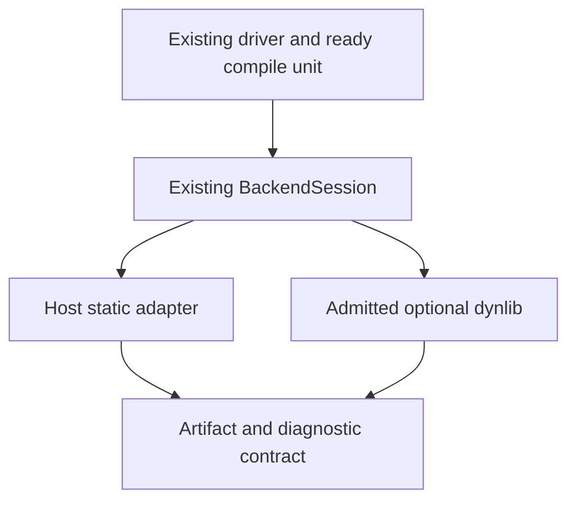

# Simple: Phase-3-First Dynlib, Architecture and Bootstrap Improvement Plan

<!-- codex-research -->
<!-- codex-design -->

**Date:** 2026-11-18 (Asia/Seoul)  
**Status:** Source-informed design and implementation plan originally pinned at `98c16637b3fbf391c570d55ff92d75f3a960521d`; active Wave-D source and unit-spec slices (`C1`, `C3–C7` on base `44e4f59b1823bf5b505eec16f67f446656c6a0d6`, §19) are `in-progress / unit-verified`, while native bootstrap and dynlib qualification gates remain pending execution (no native bootstrap PASS claimed).  
**Repository:** [ormastes/simple](https://github.com/ormastes/simple)  
**Reviewed snapshot:** Original design review pin [`98c16637b3fbf391c570d55ff92d75f3a960521d`](https://github.com/ormastes/simple/tree/98c16637b3fbf391c570d55ff92d75f3a960521d); active Wave-D implementation base `44e4f59b1823bf5b505eec16f67f446656c6a0d6` (§19).  
**Repository location:** `doc/03_plan/compiler/phase3_first_dynlib_architecture_bootstrap_2026-11-18.md` (landed alongside the §19 Wave-D implementation slices).  
**Priority:** Non-intrusive, step by step. First protect and pass the host Phase 3 bootstrap. Reuse the existing backend/session architecture, qualify one real debug dynlib, and only then expand targets and structural changes.

## 0. Executive decision

**Finish the existing design incrementally; do not redesign the compiler to obtain a Phase 3 pass.** The repository already has a versioned backend C ABI, static registry, shared static/dynamic `BackendSession`, a validating dynamic loader, per-file workers, AST snapshot/cache mechanisms, HIR freeze and TargetHIR. The problem is incomplete composition, qualification, ownership and rollout—not the absence of all those concepts.

The immediate outcome is deliberately small:

1. A pinned host-only debug compiler that passes the real Phase 3 gate, using the proven existing host backend and the currently necessary scoped lowering fallback.
2. A host composition root that does not import/link optional backend implementation closures.
3. One optional, explicitly selected debug backend dynlib that actually emits, links and runs a host test through the existing admitted session/ABI.
4. Separate, auditable results for host bootstrap and each optional provider. A skipped plugin is never reported as tested; an optional plugin failure must not masquerade as a host bootstrap failure or erase a valid host receipt.

After that baseline: repair per-file import/owner bugs; progressively apply revision-safe AST/HIR/MIR publication; admit alternate CPU features and GPU/HW providers; then build Phase 4 Debug and Release compiler variants plus the complete declared supported dynlib matrix.

**Not prerequisites for the first Phase 3 pass:** a new HIR/MIR schema, a global AST representation replacement, all GPU SDKs, all CPU variants, hot reload/unload, crash rollback/rr, a new compiler kernel, a new scheduler, a new cache system, and the previous whole-library `unit`/`text`/`bool` migrations. Those goals are not cancelled; they are kept off this recovery path.

## 1. Binding decisions and scope boundaries

| ID | Decision retained from the conversation | Non-intrusive interpretation |
|---|---|---|
| R01 | Phase 3 builds only the host/local CPU compiler in debug/development configuration | The required compiler and backend closure contains the selected host baseline only; optional targets are separate outputs, not mandatory imports |
| R02 | Other CPU versions and GPU backends are debug dynlibs | Build them progressively in a Phase-3 extension lane **after** the host pass; do not statically pull them into the minimal compiler |
| R03 | Phase 4 builds Debug and Release compiler variants and all dynlibs | Separate phase, optimization profile, host ABI, emitted target and link mode; create distinct output/cache/receipt namespaces |
| R04 | Backends can be dynamically loaded or statically linked | One provider implementation/contract; static/dynamic is composition, not two backend APIs |
| R05 | File-based source-to-object compilation is the default | Preserve the current general default; restore it specifically for Phase 3 after its tracked failures are repaired |
| R06 | Fix synchronization/lock bugs | Preserve single-owner/process isolation first, then prove parallel safety; do not enable threads merely by changing a flag |
| R07 | Fully apply pseudo-immutable AST and consistent HIR/MIR ownership | Private builders may mutate; published compiler inputs are stable revisions; live read-only views are not a concurrency guarantee |
| R08 | Multiple CPU/OS/ABI/SIMD/GPU/VHDL targets must not repeatedly reshape generic compiler architecture | Reuse semantic HIR, TargetHIR and portable MIR; target-specific legalization and specialized GPU/HWIR contracts carry genuine differences |
| R09 | Compilation must stay fast and memory-bounded | Cheap contract checks in normal builds; medium/high-cost scans, race stress and deep validation in diagnostic/lint/CI modes |
| R10 | One final Markdown design/plan | This document contains the decisions, source evidence, work packages, gates, risks and documentation-update checklist |

This plan supersedes **execution ordering** where an earlier plan would make broad IR/type-system migration a prerequisite for Phase 3. It does not erase the earlier semantic-unit, diagnostics, immutable-node or long-term kernel/provider plans. Incorporate their compatible contracts at existing interfaces, not by bundling all changes into the first patch.

## 2. Current source: what exists and what is still unproven

Source identifiers `[S01]` etc. link to the exact pinned files in §17. Source inspection is distinguished from executable qualification throughout.

| Area | Observed at the review pin | Planning consequence |
|---|---|---|
| Stage 3 pipeline override | `config/bootstrap.sdn` sets `stage3_file_workers: 0` for bug #8504, while `native_file_worker_v1.spl` declares `NATIVE_PER_FILE_PIPELINE_DEFAULT_V1 = "1"` [S01–S02] | Per-file is **already the general default**. Keep the Phase-3-only exception until its fix gate passes; never flip the global default to hide a failure |
| Actual blockers | Tracked bug records an owner-scope fix, then import paths differing between SCV snapshot and checkout, and a suspected completion publication by a worker that does not own the imported row [S03] | Reproduce the importing three-file case; repair canonical identity and authority. Do not describe every failure as a generic AOP race |
| Managed profiles | `bootstrap_focused_native_build_args.spl` derives Phase 3 → `dev`, Phase 4 → `prod` and rejects mismatches [S04] | Phase 4 Debug+Release needs an explicit phase/profile separation; changing one shell option cannot implement the matrix |
| Bootstrap composition | `bootstrap_backend_installer.spl` imports the full static registry; that registry contains HIP/OpenCL/Vulkan/VHDL/Wasm/etc. [S05–S06] | Host-only must be established at the composition/import boundary, not by a filter after all backends are linked |
| Existing host registry | Static registry already has K1 policies, including LLVM-only composition [S07] | Reuse the selected proven K1 host provider; do not first invent a generalized kernel registry |
| Shared backend interface | `BackendSession` dispatches builtin and dynamic implementations; typed `BackendPortV1` exists [S08] | Route through this seam and retain current implementation logic |
| Foreign ABI | `simple_backend_plugin_v1.h` already declares sizes/version, open/compile/finalize/diagnostics/close/release, opaque session IDs and bounded byte slices [S09] | The first real dynlib uses V1. Do not make an incompatible ABI redesign its prerequisite |
| Loader safety | Private staging, SHA-256 checks, entrypoint validation and retained provider lease exist [S10] | Extend and test this loader; do not create a second loading path |
| Feature acceptance | `session_authority_v2.spl` rejects nonempty CPU features because V1 cannot attest provider acceptance; dynamic descriptor projection is partly request-derived [S11] | A CPU name/feature in a request is not proof of acceptance. Add provider-confirmed metadata before advertising alternate ISA variants |
| AOT lifetime/configuration consistency | Ordinary dynamic adapter uses admitted handle; an AOT path still calls legacy path transport. Dynamic AOT wrappers do not consistently compare supplied optimization/CPU/storage arguments with the admitted request [S12] | Targeted lifetime and request/argument parity checks are needed; source inconsistency is not proof of exploitation or miscompilation |
| TargetHIR rollout | Existing modes `legacy`, `shadow`, `typed`; default `legacy`. Task-overlay source says key writer wiring/Stage-3 verification is pending [S13] | Keep legacy for rescue. Promote shadow/typed through independent gates; do not declare the overlay protocol fully integrated |
| HIR freeze | Encodes immutable bytes, hashes them and decodes a fresh private view on read [S14] | Useful safe boundary, **not zero-copy**; reuse first, optimize only after measurement |
| AST storage/cache | Packed `.spab` snapshots and cache exist; live resolver defaults to boxed `direct`; `column` selectable; cache still rebuilds pools [S15] | Disk snapshot support does not mean every live AST consumer is pseudo-immutable. Keep current defaults until parity is shown |
| MIR state | `mir_data.spl` explicitly describes lowering as process-global/serial and has `_mir_trace_scope_slot`; builders are mutable [S16] | Mutable task scratch is legitimate. Shared mutable globals must be scoped or isolated before threaded execution |
| Dynload qualification | A tracked bug states that the `dynload` mode name alone does not establish provider build/load execution [S17] | Require an actual plugin artifact and executable provider receipt |
| Existing streaming proof | `check-per-file-overlap-receipt.shs` checks object emission before another module's HIR starts and reports first-object latency [S18] | Reuse this proof after the ownership/path fix |
| Bootstrap metadata | `config/bootstrap.sdn` records `verified: true` with an **older source revision** | Do not treat it as evidence the reviewed commit currently passes; bind new pass claims to producer/source/runtime/profile hashes |

**Audit limits:** No compiler, interpreter, test runner, GPU, CI workflow or bootstrap was executed for this document. The remote source review and prior documents do not establish a current Phase 3/4 pass. Local SPipe/common tooling and retained local knowledge receipts were unavailable in this document-only workspace; the repository research/design instructions and compiler-layer route were reviewed remotely. The implementation owner must generate its normal scoped knowledge/setup receipts before editing. This is not permission to weaken an unavailable gate.

## 3. Keep the architecture; narrow its composition

### 3.1 Stable boundaries

| Boundary | Owns | Must not own |
|---|---|---|
| Existing driver/build orchestration | Source/dependency inventory, target selection, session acquisition, diagnostics, artifact receipts | CUDA/VHDL/AVX implementation details or direct backend-global mutation |
| Semantic HIR | Resolved language semantics, symbolic/validated target constraints and source identity | Concrete register assignments or a duplicate tree per backend |
| TargetHIR | Normalized target, layout/ABI resolution and target-sensitive views/obligations | Mutation of the shared semantic snapshot or arbitrary backend-owned global state |
| Portable MIR and private lowering | Typed portable operations, explicit legalization points, per-task scratch | A universal bag of CPU/GPU/hardware-specific untyped fields |
| Existing `BackendSession` / typed port | One admitted request/session/result interface for static and dynamic providers | Filesystem search and raw OS loader handles at arbitrary call sites |
| Provider implementation | Target lowering, object/kernel/RTL/text emission and provider-local state | Modifying host AST/HIR/MIR ownership or the global source/dependency graph |
| Loader/registry | Deterministic selection, ABI/capability checks, retained library lifetime | Guaranteeing that arbitrary native plugin code is sandboxed or crash-proof |



The diagram is a **composition boundary**, not a proposed new compiler. The host static adapter and optional dynlib call the same implementation contract. A fully static distribution may register the same providers later. The minimal host compiler need not dynamically load its own host backend to pass Phase 3.

### 3.2 The smallest host-only structural change

1. Retain `bootstrap_main` public entrypoints and installer signatures.
2. Select a **host-only installer/composition** using the current K1 policy/table. The existing full composition remains available outside the Phase-3 host lane.
3. Confirm the native build closure really excludes optional implementations and their SDK/FFI dependencies. Merely not calling them at runtime is insufficient.
4. Keep platform/runtime/core libraries needed to compile the host program. Host-only does not mean removing dependencies needed by the selected LLVM or existing host provider.
5. Capture selected backend, host triple, baseline CPU/features and static/dynamic linkage in a small receipt.
6. Keep old dispatch accessible only as an explicit compatibility test path during adapter parity testing; do not silently select it after a requested dynlib fails.

Prefer composition projection/adapter changes to mass file moves. A backend implementation edit should generally require rebuilding that provider and affected artifacts, not redesigning HIR/MIR or recompiling every provider. A language semantic or IR-contract change may legitimately require more; make that versioned impact explicit rather than promise that generic IR can never evolve.

## 4. Bootstrap phase, profile, host and target are independent axes

| Lane | Compiler executable | Mandatory linked backend | Optional provider outputs | Gate |
|---|---|---|---|---|
| Phase 3 host recovery | Host-native, `dev` / debug | Proven host K1 baseline only | None required | `G-P3-HOST` |
| Phase 3 dynlib pilot | Same admitted host compiler | Same static host baseline | One real host-loadable debug dynlib | `G-DYN-ONE` |
| Phase 3 extensions | Same admitted host compiler | Same baseline | Alternate CPU/ISA, GPU, HWIR/VHDL providers in debug, one supported family at a time | Per-provider build/admission/emit/test receipts |
| Phase 4 Debug | Host-native `dev` / debug compiler | Explicit selected core/static policy | Debug dynlibs for every declared supported provider | `G-P4-DEBUG` |
| Phase 4 Release | Host-native `prod` / release compiler | Explicit selected core/static policy | Release dynlibs for every declared supported provider | `G-P4-RELEASE` |
| Optional static distribution | Debug or Release as explicitly selected | Registered static provider set | No mandatory dynamic dependency | Static/dynamic behavior parity, separate packaging gate |

**Host ABI is not output target.** An x86-64 Linux compiler that emits AArch64 code needs an x86-64 Linux `.so` provider. It does not load an AArch64 `.so`. Every manifest distinguishes compiler host triple/ABI from emitted target triple/CPU/features. Windows MinGW and MSVC runtime/allocator/calling-convention differences must be admitted explicitly; a C-shaped ABI alone does not prove interchangeability.

`dev`/`prod` are the current profile labels. The future Debug/Release matrix must also verify actual optimization, debug-symbol, assertion and runtime build settings; a profile name alone does not establish those artifact properties.

**All dynlibs** means the complete, explicit supported provider catalog for each declared build host, not a claim that one machine can build or execute every OS/GPU target without SDKs or hardware. Keep status separate for `built`, `loaded`, `emitted`, `linked`, `executed` and `unavailable`. A required release provider missing its build prerequisites leaves the complete release gate unsatisfied; do not silently shrink the catalog to turn it green. An optional Phase-3 extension may be unavailable without invalidating an independent host pass.

CPU variants normally share a family provider with explicit configuration. Where a distinct binary is useful, publish it as an optional provider variant; do not create a compiler fork for each AVX/SVE/RVV combination. No non-baseline ISA requirement may leak into the host compiler by linking an optional variant. GPU code emission should be separable from device runtime execution; VHDL emission should be separable from synthesis or board access.

## 5. Ordered work packages and stop gates

### W0 — pin and reproduce the current host lane

**Scope:** diagnostics/evidence, no semantics rewrite.

- Pin exact source revision, admitted producer executable, runtime, host target, compiler profile, backend policy and existing cache mode. Record their digests and provenance.
- Resolve `compiler: auto` once to an explicit admitted producer. Do not let an unrelated newer Phase-4 binary silently change the producer mid-run. Rust seed remains a bootstrap-only producer, not a fallback default for regular tools.
- Follow the *active* bootstrap route. The reviewed `bootstrap-from-scratch.sh` delegates normal execution to `run-managed-from-admitted.shs`; later legacy inline sections must not be mistaken for active control flow [S19].
- Preserve `stage3_file_workers: 0` for the host recovery lane if its tracked bug remains reproducible. Record this exception in the receipt; it is not a permanent architecture choice.
- Capture the first real failure, a minimized reproducer, and a similar-prevention test. Repair one blocker at a time. No unchanged retry loops.

**Exit `G-BASELINE`:** active route and exact inputs known; concrete failure or reproducible pass documented. Metadata from an older revision does not count.

### W1 — host-only composition and static session parity

**Scope:** small composition/admission patch; no new IR format.

- Use existing K1/LLVM-only composition where compatible with the host; isolate the full installer from the Phase-3 source/import closure.
- Keep backend requests entering the existing `BackendSession`/typed port. If a direct host call remains, wrap it with a thin static adapter that invokes the same implementation.
- Test old host path versus static adapter on literals/control flow, imports, enums/Results, layout, errors and the small importing compiler fixture.
- Prove optional GPU/HW/alternate-CPU implementations are absent from the host link closure; no optional SDK lookup is needed at startup.

**Exit `G-STATIC-HOST`:** real host compile/link/run parity and a bounded backend closure. No claim that optional providers work yet.

### W2 — obtain and preserve the first Phase 3 host PASS

**Scope:** only active host blockers plus W1; keep legacy TargetHIR, boxed AST and current working lowering choices.

- Run the existing managed Phase-3 admission path with the pinned producer and host composition. Use `--stop-after-stage3` on the entrypoint that already supports it; it must not imply Phase-4 completion or deploy/promote a release [S19].
- Require valid producer/source/runtime provenance, a produced executable, native smoke including a multi-module import, and the repository's actual Phase-3 self-host/qualification checks. `--version`, file existence and a mode string are insufficient.
- Record cold-build behavior and one warm-cache equivalence run as **different acceptance scenarios**, not repeated unchanged verification. Retain successful artifacts by exact keys.
- If file-worker recovery is not complete, the scoped `0` exception remains visible. Never weaken MIR owner checks, skip failed modules or label incomplete ledgers complete to reach PASS.

**Exit `G-P3-HOST`:** this exact host lane passed with complete receipts. This is the first independently useful milestone. Stop expanding scope if it is not green.

### W3 — qualify one real debug dynlib

**Depends on:** `G-P3-HOST`. Keep host pass independently reproducible.

- Pick the smallest **already implemented host-executable provider**. Package it dynamically; do not combine this with writing a new GPU backend.
- Use the current V1 C byte/handle ABI, existing loader and `BackendSession`. Initial supported target is the known baseline, with no unprovable feature list.
- Perform an actual chain: build dynlib → admit exact artifact → open session → compile MIR → finalize object → link → execute → release buffers → close session.
- Repair the AOT admitted-handle/path discrepancy in a narrow patch when required for this path; test exact identity and retained lifetime before and after calls. Compare AOT release/optimization/CPU/storage arguments against the admitted request; reject mismatches instead of silently ignoring those arguments.
- Reject missing entrypoint, incompatible ABI/host/schema/build, truncated wire payload and explicit plugin selection failures. No silent static fallback.
- Initially retain the provider for the request/process lifetime; close sessions deterministically. Do not add hot-unload, live replacement or crash rollback.

**Exit `G-DYN-ONE`:** executable static/dynamic parity, negative admission tests, correct ownership cleanup, and unchanged host Phase-3 gate. A tiny no-op plugin or library that only loads does not qualify.

### W4 — complete provider-confirmed configuration before variants

- Preserve V1 compatibility for the proven baseline. Extend metadata/capability negotiation using size/version-aware fields or a separately negotiated extension, not an unannounced replacement entrypoint.
- Obtain **provider-confirmed** target, CPU, accepted features, ABI/layout, optimization contract and IR/schema identity. Keep requested and accepted values separate.
- Preserve the current refusal of nonempty CPU features until that evidence exists. Never delete a safety rejection just to enable an AVX/SVE/RVV row.
- Every effective feature change participates in target identity and object-cache keys. Unsupported intrinsic/layout/feature combinations fail explicitly.

**Exit `G-CONFIG`:** baseline remains compatible; feature requests are either proven accepted or rejected; no request-derived descriptor is represented as provider attestation.

### W5 — restore Phase-3 per-file execution, then concurrency

- Reuse the existing worker, HIR/MIR ledger, receipt and link admission implementation; do not create another scheduler.
- Fix the three-file import repro in §9: logical/physical source mapping, import ownership and terminal publication first.
- Prove a **single-worker per-file path** with bounded memory before parallel worker counts. A machine with one available worker must not need a whole-program fallback solely to compile a file.
- Run `{1, 2, bounded N}` as explicit different test scenarios; prove equivalent outputs, no lost/wrong-owner completion, no deadlock and correct cancellation.
- Use the existing overlap receipt test and first-object timing. Only after this gate remove the Stage-3-only override and let the already-existing general default apply.

**Exit `G-FILE`:** actual default restored for Phase 3, no mandatory whole-program HIR/MIR barrier, correct low-memory behavior and documented residual exceptions (if any). No global lowering/profile changes in the same patch.

### W6 — incremental snapshot/TargetHIR completion

- Preserve existing AST `direct` and TargetHIR `legacy` while introducing read-only revision boundaries to one consumer at a time.
- Compare equivalent immutable snapshots in shadow mode, then enable a typed/snapshot-backed path for a small fixture, then the host bootstrap.
- Apply private builder, stable published revision and task-private overlay contracts to AST, HIR and MIR; isolate globals before concurrency.
- Keep current safe serialization/copy behavior initially. A zero-copy redesign is a later measured optimization, not a Phase-3 rescue dependency.

**Exit `G-SNAPSHOT`:** no mutation of a published compiler revision; old readers remain valid; new revision invalidates only dependent artifacts; shadow/typed result parity. A full AST storage replacement is not required to enforce the publication contract.

### W7 — debug optional providers, one family at a time

After `G-DYN-ONE`, expand baseline CPU/cross-target providers. Feature-specific variants additionally require `G-CONFIG`; shared-memory execution requires the relevant ownership gates. GPU and HWIR providers retain their specialized contracts. For each provider record real build/admission/emission and separate runtime/synthesis results. Do not claim all debug providers are complete from a registry enumeration.

### W8 — Phase 4 Debug + Release and supported matrix

- Separate phase identity from `dev`/`prod` profile selection while preserving the old default `phase4 -> prod` for compatibility.
- Build Debug and Release outputs independently, using the same admitted Phase-3 producer lineage or an explicitly recorded derived lineage.
- Build the complete declared provider catalog for both profiles; match compiler/provider runtime and allocator configuration by default. Test mixed profiles only if explicitly supported.
- Qualify static/dynamic behavior, package manifest and relocation on the actual host platform. No implicit deployment or release publication from this plan.

**Exits `G-P4-DEBUG` and `G-P4-RELEASE`:** complete required host/compiler/provider receipts, tests and performance limits. Neither one stands in for the other. Missing mandatory provider evidence blocks complete Phase 4 status.

**Ordering rule:** W0–W3 are the immediate lane. W4–W7 may be separated into small independent changes with explicit dependencies; do not serialize unrelated research behind them or make broad snapshot completion a prerequisite for the first optional provider. Every default-mode change must retain `G-P3-HOST`.

## 6. Dynlib contract: reuse V1 now, extend only where necessary

### 6.1 One session API, two compositions

The internal typed `BackendPortV1` may accept compiler-owned MIR types. The **foreign C ABI must not** expose native Simple classes, trait objects, vectors, text objects, dictionaries or raw AST/HIR/MIR layout. The existing V1 wire transport already serializes MIR and uses an opaque session ID; keep that first. Its typed convenience wrapper is not the ABI.

| Contract dimension | First dynlib requirement | Later extension |
|---|---|---|
| Entry | Existing `simple_backend_plugin_v1` | Negotiate extension entry/table explicitly; preserve V1 baseline |
| Layout | Existing `abi_version`/`struct_size`, fixed-width fields and slice bounds | New sizes must be checked before reading appended fields |
| Session | Open → compile/batch → finalize → release buffers → close, explicit closed state | Generation/drain refinements through the current authority model |
| Identity | Host ABI, backend identity, artifact hash, same compatible build/IR digest | Broader version compatibility only after an actual compatibility matrix |
| Target | Known feature-free baseline; correct emitted object target | Provider-owned accepted-target/CPU/features receipt |
| Ownership | Borrowed request bytes only during call; provider buffers released exactly once | Zero-copy exchange only with explicit pinned ownership/lifetime proof |
| Diagnostics | Existing structured error/diagnostic adaptation | Additional fields through the shared Error infrastructure, not a separate logger |
| Load lifetime | Retain library through all sessions, buffers and callbacks; process-lifetime retention acceptable initially | Hot replacement/unload only in a separate, later lifecycle project |

The exported C ABI version, MIR/wire schema version, session-authority protocol version and provider implementation version are **different identities**. A V2 authority wrapper using the V1 ABI does not imply CPU-feature attestation is implemented. An ABI number alone does not guarantee compatibility of runtimes, allocators, target semantics or serialized MIR.

### 6.2 Minimal admitted request and receipt

Reuse the normalized target authority (including existing `MirTargetContext`) rather than define an inconsistent target parser in the plugin. The logical request needs:

- Compiler host triple/ABI, pointer width and runtime configuration.
- Emitted target triple/OS/ABI/endian, CPU model and normalized requested feature set.
- Backend/provider role and required capabilities; baseline explicit before allowing variants.
- Optimization/debug mode and pass-pipeline identity.
- MIR/wire schema digest and source/dependency/semantic contract identity.
- Session/source revision and cancellation/diagnostic ownership.

For the first **feature-free V1 baseline**, retain the existing request projection and explicitly record `feature_acceptance: unknown` where that is the current protocol result. Keep that distinct from actual artifact-format/target inspection and compile/link/run evidence. Do not pretend a successful smoke test or copied request string is a provider-confirmed configuration receipt. Nonempty feature requests remain rejected. Extended logical fields above may initially live in caller/manifest evidence; they are **not mandatory new V1 wire fields**.

W4 / `G-CONFIG` introduces the **provider-confirmed accepted values** and compares them with the request before enabling feature variants or broader target negotiation. Unknown does not become Accepted just because an authority wrapper is named V2. The first V1 dynlib therefore remains a small baseline qualification task, not an ABI/metadata redesign prerequisite.

Illustrative SDN manifest projection (new schema proposal, **not a claim of current parser support**):

```sdn
provider:
    id: native-host-baseline
    linkage: dynamic
    profile: dev
    exported_abi: simple_backend_plugin_v1
    host_triple: resolved-build-host
    host_runtime_digest: recorded-runtime-digest
    artifact: approved-absolute-plugin-path
    artifact_sha256: recorded-artifact-hash
    mir_schema: recorded-schema-digest
    compiler_compatibility: exact-admitted-build
    targets:
        - triple: resolved-emitted-target
          cpu: baseline
          features: []
    required_for:
        phase3_host: false
        phase4_declared_distribution: true
```

Values above are placeholders for generated, concrete records. Do not put unresolved `native`, ambient current-working-directory paths or mutable display labels into cache identity. Generate manifests from the build graph/catalog and actual outputs; a listed provider is not automatically present or tested.

### 6.3 Loader safety without making the project bigger

Reuse private staging, exact artifact hashing, bounded wire decoding and admitted handles. Treat the manifest/artifact source as trusted authorization, not merely a hash comparison: hashes do not make arbitrary native code safe. Use approved absolute paths and controlled dependency search; do not scan every plugin/source directory on compiler startup. Load only the selected provider. Windows dependency DLL search must be constrained as well as the top-level DLL path [E06].

No registry/cache lock may be held while calling provider code, loading a library, waiting for a task, or running a diagnostic callback. OS loader callbacks must do minimal work; initialize sessions outside `DllMain`/loader lock [E07]. Keep selection and lease creation deterministic. A provider crash can still crash its process; the first milestone does **not** promise sandboxing, crash containment or rollback. Existing process-worker isolation can bound such failures without introducing live hot-swap machinery.

For explicit dynamic selection, `missing/incompatible/failed` is a typed error. Static fallback is allowed only as a separately requested recovery run with a distinct receipt; it must not turn a failed dynamic qualification green. Keep old process/artifact generations valid until their recorded consumers drain; do not overwrite a loaded library in place.

## 7. HIR/MIR evolution without backend-driven redesign

### 7.1 Preserve the earlier semantic layering

1. **AST** describes syntax/source identity. Parse may use private mutable pools; consumers receive a coherent revision.
2. **Semantic HIR** retains resolved language meaning plus observed target dependencies/constraints. If `@when`, imports, constant evaluation or ABI-dependent public declarations change semantics, do not reuse an incompatible HIR just because its filename matches.
3. **TargetHIR** is a typed target-bound view/resolution overlay on the eligible HIR. Resolve layout, ABI and target-sensitive obligations through it; no per-node wrapper allocation or wholesale copied tree.
4. **Portable MIR** expresses typed operations and explicit lowering/legalization needs. Private builders remain mutable. Publish reusable results as stable validated artifacts.
5. **Target legalization/emission** maps supported operations to CPU/GPU/hardware output, refusing unsupported combinations with a precise diagnostic.

Target neutrality is a **validated property**, not absence of a target field. Missing/unknown target data must not silently mean host defaults. Reuse `MirTargetContext` normalization; record a resolved native host selection once. Alternate ABI (MinGW/MSVC), pointer width, endian or SIMD width is a target descriptor/legalization issue unless there is a genuine language-semantic difference.

### 7.2 CPU, GPU and hardware contracts

| Family | Shared inputs | Specialized contract | What stays outside generic HIR/MIR |
|---|---|---|---|
| CPU and CPU variants | Semantic HIR/TargetHIR, portable MIR | ISA features, calling convention, layout, legal operations, object format | Vendor instruction-selection implementation and register allocation |
| CUDA/HIP/ROCm/Vulkan/OpenCL | Shared language types/operations where semantically equivalent | Kernel entry, address spaces, barriers, subgroup/workgroup rules, atomics, launch metadata | Driver/device initialization in a generic compiler startup path |
| HWIR/VHDL | Shared typed source semantics plus hardware eligibility | Clock/reset, cycle/width/state/register semantics and hardware scheduling | Pretending RTL is a native object file or adding untyped clock fields to all CPU instructions |
| Wasm/C/text/proof emitters already present | Eligible shared representation plus capability contract | Output format and target-specific validity | Forcing every emitter through native linker assumptions |

The repository already has dedicated GPU codegen, hardware codegen and HWIR surfaces [S20]. Reuse them as provider roles. If a new provider truly needs a new semantic operation, version an explicit extension/IR schema and its tests; do not make arbitrary undocumented fields a compatibility escape hatch. MLIR's legal/illegal/dynamically-legal conversion targets are useful precedent for this validation boundary, not a requirement to replace Simple IR with MLIR [E04].

### 7.3 Safe TargetHIR promotion

Use the existing `legacy → shadow → typed` mechanism. In shadow mode compare semantic/layout results and retained owner/dependency identities, not just a textual dump. Retain old field order/constructors until seed and self-host compatibility is established. Preserve schema transition coverage and unsupported-case diagnostics.

Explicit CI mode selection must not silently downgrade a misspelled mode to legacy. The source also records a RISC-V Result/text lowering workaround in mode parsing [S13]; repair/prove the underlying behavior before blindly replacing that path with a strict parser. Record effective mode in the receipt so a typed-mode test cannot pass while secretly running legacy.

## 8. Pseudo-immutable AST/HIR/MIR: finish ownership, not a rewrite

Preserve the already agreed distinction:

| View/value | Can mutate through this view? | Can an independent mutable alias change what it observes? | Valid compiler worker/cache snapshot? |
|---|---|---|---|
| Mutable builder / task scratch | Yes | Only within its authorized owner/task | No, not until publication |
| `Immutable<T>` live read-only projection | No | Yes, with appropriate synchronization | **Not by itself** |
| `RevisionImmutable<T>` | No | Not within the pinned logical revision | Yes, if storage/revision lifetime is actually protected |
| `FrozenImmutable<T>` | No | No | Yes, after construction/async readiness validation |

A revision number attached to mutable backing storage does not create a snapshot. A frozen wrapper around a mutable Dict/list does not prevent aliases from writing it. Either consume unique ownership, detach a copy, or use persistent/COW/overlay storage that keeps old revisions stable. Read-only access is transitive through returned children and methods, but separate authorized writers may construct a newer revision.

### 8.1 Staged application

1. **Before first Phase 3 pass:** retain boxed `direct` AST and current cache/codec paths. Add only narrowly necessary ownership checks; no global storage default flip.
2. **First pilot after baseline:** one parse unit publishes a revision handle. Downstream consumer uses the existing snapshot/read interface; mutations remain in its private builder or a new revision.
3. **Shadow parity:** compare direct/materialized snapshot for node kinds, spans, imports, defaults, macro/aspect metadata and error locations. Verify a later edit cannot change a worker's pinned input.
4. **Consumer migration:** parser → HIR reader; HIR → TargetHIR; TargetHIR → MIR; MIR → provider. Move one boundary at a time, preserving APIs where possible.
5. **Publication completion:** seal all required semantic fields, resolve/record async producer results or explicit missing/error states, then publish once. Never cache partially initialized hash-relevant content.
6. **Storage optimization later:** select AoS/SoA/sparse columns via existing schema/accessor mechanisms after profile evidence. No per-node future, mutex, hashmap or virtual getter by default.

Existing `.spab` disk/memory snapshots and HIR freeze are assets, not proof the migration is complete. The reviewed HIR read path hashes and decodes a fresh private module; batch/reuse a validated view at a session/region boundary rather than adding that work for every field access. Do not remove admission hashes merely to claim zero-copy.

Async initialization and read-only live views remain supported in the wider language plan. For compiler outputs, mutable readiness bookkeeping lives outside the immutable payload. A cached artifact's canonical bytes cannot change when a pending cell completes; produce a newly identified artifact/revision instead. Immutable payloads do not make an unsynchronized cache map, owner counter or publication cell safe.

## 9. File-fused pipeline and synchronization repair

### 9.1 Fused scheduling does not require global stage barriers

For each eligible file/module (or dependency SCC where required), perform parse → semantic HIR → target view → MIR → object when that unit's dependencies and aspect/macro summaries are ready. Do not require all files to finish HIR before any file emits an object. Keep optional persisted intermediate artifacts separately reusable; file-based is a scheduling/admission model, not a demand to serialize every intermediate to disk.

Imports, mutual-recursion SCCs, generic signatures, macro expansion and AOP matching may require shared summaries. A correct per-file design admits those summaries explicitly; it does not pretend every source file is independent. Optional LTO can have a dedicated module-summary/link phase without changing the default ordinary compile pipeline [E05].

### 9.2 Repair the actual tracked failures

| Failure/risk | Minimal correction | Proof before promotion |
|---|---|---|
| Snapshot import path versus checkout path without `src/` [S03] | One canonical **logical source identity** and a separately recorded physical location mapping; use source-root/snapshot/config identity consistently for dependency edges and surfaces | Three-file leaf/leaf/importer under ordinary checkout and SCV snapshot; same logical import resolves, no false closure-incomplete |
| Unclaimed imported HIR attempts another owner's terminal receipt [S03] | Only the current claimed producer publishes terminal state; imported cached/read-only artifacts use admission/read paths, not producer completion | Exact owner/generation tests with two workers reaching the same import |
| Placeholder/alias row naming disagreement [S03] | Canonical module identity from one authority; deterministic inventory name, no ad hoc import-spelling substitution | Alias/re-export/case-sensitive fixtures and equal ledger inventory |
| Placeholder skip depends on active shard queue [S03] | Scope relaxed non-target placeholder handling to the matching active queue/role; unheld target still fails | Wrong queue, missing target, stale ownership cannot link |
| Low-memory pool requires two workers [S02–S03] | Support a bounded single-worker per-file lane; measured RSS caps remain authoritative | Memory-constrained worker=1 emits correct objects without unrelated whole-program fallback |
| Global MIR trace/session/parse memo state [S11, S15–S16] | Keep process-local owner first; move specific shared state into session/task context before threading | Two independent targets/sessions cannot mix flags, symbols, diagnostics or lifetime tokens |
| Cache/job cancellation or failure loses waiters | Exactly one terminal state and notification path per producer generation | Failure, cancellation, producer death/retry, shutdown and cyclic dependency tests |

The imported-HIR completion cause is described as **suspected** in the bug record; confirm it by a test/trace before editing that code. Do not weaken authority checks to fix a path/owner mismatch. Do not solve snapshot/checkout identity by indiscriminately deleting `src/` prefixes or realpath-normalizing away source-root distinctions.

### 9.3 State, locks and commit discipline

- Job/cache cell states are `Pending → Ready | Failed | Cancelled` for one producer generation. Retries use a new generation/claim, not an overwrite of another producer's completion.
- Waiters see fully constructed immutable payloads via acquire/release-safe publication or the existing process/filesystem admission protocol. Atomic rename of bytes is not alone proof that all manifest/receipt dependencies are complete.
- No await, child-process wait, backend call, callback or blocking filesystem work while holding a registry/cache map lock. Prefer claim → release lock → compute → validate → short commit.
- Define lock ordering centrally for the small set that remains; do not replace every lock with a custom lockless container in the rescue phase.
- Native provider/lowering state is initially single-owner. Process workers are compatible with this; shared-memory parallelism requires separate proof.
- Use distinct temporary object/cache names per claim and atomic final publication. Only sealed ledgers with every mandatory unit admitted may link. Keep valid independent outputs after another unit fails.
- Cap worker counts by available CPU and measured memory, including nested compiler/linker/provider threads; avoid multiplicative oversubscription.
- Deadlock watchdogs collect bounded owner/wait-edge information. They must report failure, not turn timeout into success or silently switch route.

**Separate promotions:** `G-FILE-SERIAL` proves correct per-file scheduling; `G-FILE-PARALLEL` proves concurrent worker safety; `G-FILE` removes the scoped Stage-3 override. Their evidence is distinct. The current `SIMPLE_FILE_WORKERS` selects a route; it is not itself proof of thread safety or an arbitrary thread-count control.

## 10. Cache identity, artifacts and diagnostics

### 10.1 Cache keys at the right boundary

| Artifact | Required semantic identity | Avoid invalidating for |
|---|---|---|
| Parse/AST snapshot | Source content/revision, grammar/parser/preprocess inputs and relevant target-dependent syntax | Unrelated backend implementation change |
| Semantic HIR | AST identity, resolved import/public surfaces, generic/macro/aspect dependencies, semantic settings and target-read constraints | Unrelated machine-code instruction selection |
| TargetHIR resolution | HIR snapshot + normalized target constraints/layout/ABI/features actually used | Another target's independent provider update |
| MIR | Input view/dependency identity, lowering schema/pipeline and applicable semantic/effect settings | Unrelated source files without semantic dependency |
| Object/kernel/RTL artifact | MIR/HWIR identity, provider implementation/build, request target/configuration, runtime ABI and optimization/profile; after G-CONFIG also provider-accepted target/features | Pure documentation edits |
| Plugin artifact | Compiler host ABI, provider source/build inputs, runtime/toolchain, debug/release mode, exported ABI/schema | Emitted-target naming mistaken for executable host format |
| Bootstrap receipt | Exact producer lineage, source/runtime/composition, effective route/modes, target/profile, output hashes and test evidence | Nothing required for qualification; never use stale receipts as current PASS |

Cache mismatch/corruption means a miss or an explicit failure, never a guessed match. Preserve current canonical endian and wire checks. Fingerprints must not omit CPU features to improve hit rate. Introduce narrower keys only when semantic dependency evidence exists; retain a conservative compatible key during migration.

Before G-CONFIG, constrain dynamic-object reuse to the exact admitted feature-free baseline, producer/provider build, complete request and verified output target. Preserve the unknown acceptance marker; do not share those artifacts across claimed CPU-feature/target variants. After G-CONFIG, requested and accepted configuration both participate in validation/keying as appropriate.

### 10.2 SDN evidence and error presentation

Use SDN as the default for new config/manifests/evidence; JSON remains an explicit interoperability export or required protocol. An illustrative aggregate record:

```sdn
bootstrap_evidence:
    source_revision: exact-commit
    producer_digest: exact-producer
    runtime_digest: exact-runtime
    host_triple: resolved-host
    phase: phase3
    profile: dev
    composition: host-k1
    lowering_route: two-pass-scoped-exception
    exception:
        issue: 8504
        removal_gate: G-FILE
    host_gate: not_run
    provider_results: []
    qualification:
        evidence_revision: exact-commit
        mandatory_failures: []
```

Real output uses concrete values and statuses, not these placeholders. Keep `not_run`, `unavailable`, `failed`, `passed` and `runtime_untested` distinguishable. A host-only receipt does not assert all-provider support. Phase 4 aggregates mandatory provider rows and refuses complete qualification if any required row lacks its declared evidence.

Reuse existing backend/driver error types and shared diagnostics adapters. Errors should identify the requested/selected provider, host versus emitted target, actual profile, mismatch reason, artifact location/hash and the correct recovery action. Retain existing codes; extend details additively. Do not make the large previous `DiagnosticV1`/unit/text/bool migration necessary just to report a dynlib error. Sensitive environment values and raw credentials never enter receipts.

## 11. Performance and memory policy

**Default builds do only low-cost checks needed for correctness and admission.** Medium/high-cost full graph scans, deep mutation audits, race perturbation, broad taint/robustness analyses and full cross-target matrices belong in explicit diagnostic, lint and CI workflows. Moving expensive checks out of normal builds does not authorize omitting mandatory ABI/schema/ownership checks.

| Path | Required low-cost behavior | Heavier validation / optimization |
|---|---|---|
| Host startup | No source-tree/plugin-tree scan; no loading optional GPU SDKs; one resolved composition | Trace startup and validate full provider catalog in packaging CI |
| Static adapter | Thin current implementation call; no ABI serialization inserted into every static call | Compare assembly/object behavior and compile timing in gate |
| First dynamic provider | Load once per process/session scope; bounded request; existing bytes transport | Measure serialization/copy cost; batch MIR or reuse admitted views later |
| Hash/admission | Verify immutable artifact at the appropriate load/cache boundary; retain validated lease | Deep rehash/mutation checks in debug/CI; never per-field hashing by accident |
| AST/HIR reader | One pinned revision/view per unit or region; no added node-local lock/future | Profile `direct` vs snapshot materialization before changing storage default |
| Compiler worker | Private bounded scratch, summary reuse, no whole-tree rebuild for unrelated body edit | XRay coarse phase/session timing, allocation/peak-RSS studies |
| Diagnostics | Stable code and bounded detail; lazy expensive suggestions | Full multi-file migration/architecture analysis in lint/inspection |
| Optional GPU/HW | Compiler emission independent of runtime hardware where possible | Device execution/synthesis on qualified hardware/toolchain lanes |

**Proposed budgets, not measured results:** unchanged host compilation after the adapter/composition patch should target ≤3% median cold-build time regression, ≤1% warm incremental regression and ≤5% peak-RSS regression on the same host/workload, with repeated benchmark samples in one planned benchmark scenario. A debug configuration may cost more than release; compare equivalent profiles. Normal startup must not load optional providers, regardless of time budget. The dynamic lane gets its own measured transport/batch budget; do not falsely promise zero-overhead dynamic calls or zero-copy HIR.

Record cold/warm wall time, first-object latency, object throughput, peak RSS, bytes serialized/copied, number of provider loads/sessions, cache hits/misses, worker count and lock-wait time. Default coarse counters should be bounded; expensive per-node traces are opt-in. Retain the existing low-memory objective and derive worker caps from measured resident cost; do not set memory estimates unrealistically low merely to admit more workers.

If a budget fails: keep the new behavior explicitly opt-in, identify its allocation/hash/decode/lock cause and fix or record the regression. Do not remove safety admission, drop tests or label a slow partially working path the new default.

## 12. Acceptance tests, SSPEC and current entrypoints

### 12.1 Requirement-to-test map

These are **tests to implement/extend**, not executed results. Prefer existing fixtures/specs and mirrored documentation; avoid duplicate test frameworks.

| Test | Requirements | Concrete acceptance | Gate |
|---|---|---|---|
| T01 Host closure | R01, R02 | Host Phase-3 composition excludes optional backend implementation/SDK symbols and imports, yet builds/links/runs host program | G-STATIC-HOST |
| T02 Phase-3 provenance | R01 | Correct source/producer/runtime/profile/route hashes; official self-host admission passes; stale prior metadata refused | G-P3-HOST |
| T03 Static adapter parity | R04, R08 | Same semantic outputs/errors through old host and static session paths on imports/layout/Result/enum/control-flow fixtures | G-STATIC-HOST |
| T04 Real dynamic provider | R02, R04 | Real shared library emits host object; link and execute expected result; provider hash, dynamic route and session lifetime proved | G-DYN-ONE |
| T05 Negative admission | R04 | Wrong ABI/struct size/build/host/MIR schema, missing entry, malformed bytes, explicit missing plugin all refuse clearly | G-DYN-ONE |
| T06 Lifetime/AOT parity | R04, R06 | Ordinary and AOT calls use same admitted identity; release/optimization/CPU/storage mismatch rejected; exactly-once buffer release; no call after close | G-DYN-ONE |
| T07 Feature attestation | R02, R08 | Requested/accepted target CPU/features compared; unsupported features rejected; feature change changes object key | G-CONFIG |
| T08 Import three-file repro | R05, R06 | Two leaf modules + importer succeed for checkout and SCV snapshot with valid owners, canonical IDs, aliases/re-exports | G-FILE-SERIAL |
| T09 Per-file progression | R05 | Existing receipt proof shows object A before unrelated file B HIR start; no all-HIR barrier; low-memory single-worker path works | G-FILE-SERIAL |
| T10 Parallel and failure | R06 | Worker 1/2/N equivalent; two claimants, producer crash, cancellation, timeout, cyclic waits terminate with no falsely sealed ledger | G-FILE-PARALLEL |
| T11 Revision stability | R07 | Mutable new revision cannot change pinned old AST/HIR/MIR; live Immutable does not falsely imply frozen; private builder allowed | G-SNAPSHOT |
| T12 Modes and cache | R07, R08 | Effective legacy/shadow/typed reported; typo not silently green; cold/warm/corrupt-cache equivalence; target-incompatible cache rejected | G-SNAPSHOT |
| T13 CPU/GPU/HW role | R02, R08 | Appropriate artifact per role; absent GPU hardware does not block compiler-only emission; unsupported semantics rejected | Each provider |
| T14 Phase-4 profiles | R03 | Both `dev` and `prod` accepted for Phase 4; separate producer/output/cache/profile receipts, full declared mandatory provider set | G-P4-DEBUG/RELEASE |
| T15 Incremental isolation | R08, R09 | Provider implementation-only edit does not rebuild unrelated semantic HIR; public semantic/target change invalidates actual consumers | Performance/correctness |
| T16 Perf/RSS | R09 | Matched benchmark and resource budgets in §11; no hidden optional startup dependency | Every promoted default |
| T17 Documentation/evidence | R10 | Each requirement maps to real tests and maintained guides; no placeholder/pass-todo or source-only PASS | Handoff/release |

Use existing SSPEC/SPipe built-in matchers and typed `exec`, `binary`, `artifact`, `log` captures. Example intended flow: `step("Build the pinned host compiler")`, `step("Load the selected debug provider")`, `step("Compile and run through the admitted session")`. Helpers must assert real output/hash/format/status and fail until implemented; do not use constant true assertions. Executable specs go under `test/...`; generated manual/spec Markdown mirrors them under `doc/06_spec/...`. No executable `_spec.spl` in `doc/06_spec`.

Byte-identical self-host output must follow the repository's actual qualification requirement. If comparison needs normalization for declared nondeterministic fields, use the existing documented normalization/evidence policy and retain original outputs; do not replace a failing required equality with a weaker smoke test. Static and dynamic output parity may be behavioral/normalized where linkage metadata legitimately differs, but each must independently compile and run.

### 12.2 Existing source/entrypoint inventory to reuse

| Existing item | Purpose in this plan | Caution |
|---|---|---|
| `scripts/bootstrap/bootstrap-from-scratch.sh` | Bootstrap orchestration; known `--stop-after-stage3` boundary | Follow actual delegated path; do not execute dead legacy sections |
| `scripts/bootstrap/run-managed-from-admitted.shs` | Managed handoff from admitted producer | Preserve exact producer/runtime/receipt validation |
| `scripts/bootstrap/resume-stage3-from-admitted.sh` | Resume Phase 3 with selected lowering route | Effective route is part of hashed args/evidence |
| `scripts/bootstrap/bootstrap-jobs.shs` | Worker/default precedence | Nonempty env → config → default; reject invalid selectors |
| `config/bootstrap.sdn` | Bootstrap policy and recorded history | `verified:true` with older revision is not present-commit PASS |
| `scripts/check/check-per-file-overlap-receipt.shs` | Existing fused-progress proof | Run after repairing import/owner bug; do not fabricate timestamps |
| `test/01_unit/compiler/driver/mir_physical_owners_spec.spl` | Recorded owner-scope regression fixture | Old seed evidence is not current self-host verification |
| `bin/release/<triple>/simple` | Existing admitted self-hosted normal tooling | Rust seed remains bootstrap-only, not an unannounced replacement |

These are known paths/options, **not new runnable command syntax invented for this document**. Implementation must inspect their current help/parameters at its exact working revision. Do not launch a long bootstrap or remote CI merely to create the plan. Actual commands and exit codes become part of implementation receipts.

### 12.3 Stop/retry discipline

- Each work package changes one logical boundary; each necessary verification scenario runs once per unchanged candidate. Re-run the retained host gate when a **new structural change** can affect it, not repeatedly on unchanged green artifacts.
- Stop at the first unresolved mandatory blocker and report the exact reproducer/receipt. Maximum six diagnosis/fix cycles per feature lane, each with new code or evidence; no unchanged retries.
- After `G-P3-HOST`, keep its exact known-good artifact and receipt. A subsequent change needs new qualification; the old receipt does not certify the new compiler.
- No CI bypass, approval bypass, owner-check relaxation or promotion of failed/stale artifacts. This report does not authorize commits, merges, releases, installation or default-policy flips by itself.

## 13. Small change sets and review ownership

| Change set | Expected scope | Must remain unchanged | Review focus |
|---|---|---|---|
| C0 Evidence/baseline | Active route receipt, reproducer, targeted bug record | AST/MIR layout, backend implementation, global defaults | Provenance and true failure |
| C1 Host composition | Bootstrap installer/projection and existing registry selection plus tests | Backend API, optional provider internals, lowering behavior | Import/link closure and host parity |
| C2 Phase-3 blocker fix | Only confirmed host blocker files + repro/prevention specs | Unrelated type-system/IR/scheduler changes | Self-host execution, not only source checks |
| C3 Dynlib pilot | Existing provider packaging and session/loader integration; AOT lease fix if needed | V1 baseline ABI, host static implementation | Real codegen, ownership and no fallback |
| C4 Accepted-target extension | Metadata negotiation/target identity, feature tests | Proven V1 baseline and existing reject behavior until supported | Provider attestation, keys, compatibility |
| C5 File-lane repair | Canonical identity/claim/receipt/low-memory path + three-file tests | Unrelated cache format and default before proof | Ownership, SCC/closure, progress |
| C6 Snapshot consumer slice | One reader/writer boundary, shadow parity, task state | Global AST storage default until gate | Stable backing storage and lifetime |
| C7 Phase/profile matrix | Managed phase/profile resolver, output paths, orchestration/manifest tests | Existing Phase-3 default and Phase-4 default unless explicitly selected | No Debug/Release cross-contamination |
| C8 Provider-family extension | One existing backend family + its tests/manifests | Generic language semantics unless genuinely required | Compile vs link vs runtime proof |

Names are work-package labels, not mandated branch names. Expected effort is bounded per slice but cannot be reliably estimated from source alone; failed self-host bugs may dominate. Use one integration owner for shared ABI/target/receipt names and separate read-only review for bootstrap, backend lifecycle and ownership. Parallel work is appropriate on independent provider/test slices after contracts are fixed—not simultaneous conflicting rewrites of `MirLowering`, registry or global config. Model-specific sidecar assignment is N/A for this document; the implementation team may use scoped reviewers without treating their summaries as pass evidence.

## 14. Documentation and earlier-plan reconciliation

### 14.1 Repository documentation updates to make with implementation

| Document/surface | Update | Timing |
|---|---|---|
| This plan's proposed repository location | Source pin, actual work-package status, gate receipts and unresolved blockers | C0 onward |
| `doc/04_architecture/compiler/bootstrap_build_modes.md` | Distinguish bootstrap phase, profile, composition/linkage, host and emitted target | C1/C7; confirm current path before edit |
| `doc/04_architecture/minimal_bootstrap_configuration_composed_dynamic_architecture.md` | Host K1 root, existing static/dynamic session reuse, optional provider packaging | C1/C3; extend, do not overwrite unrelated history |
| `doc/07_guide/compiler/build.md` | Phase-3 host stop/resume; per-file override scope; Debug/Release Phase-4 matrix and supported provider statuses | Each shipped behavior change |
| `doc/05_design/compiler/incremental_build/true_per_file_pipeline_v1.md` | Canonical logical IDs, import receipts/ownership, worker=1, no whole-HIR barrier | C5 |
| Existing backend plugin ABI/loader documentation | V1 baseline, accepted-feature extension, AOT handle path, lifetime, host/target distinction | C3/C4 |
| Existing TargetHIR/AST snapshot design | Live/read-only vs pinned/frozen; current copy cost; shadow/typed promotion; pending writer integration | C6 |
| Bug #8504 and dynload qualification bug records | Add reproducer, similar-prevention test, exact fixed commit and executable evidence; close only when verified | Respective gate |
| SSPEC generated manuals under `doc/06_spec/...` | Primary bootstrap/provider scenario with execution/artifact evidence; no stub or fake-pass manual | Alongside each spec |
| Applicable `.codex`, `.agents`, `.claude`, `.gemini` development guidance | New phase/profile/evidence defaults and no false PASS; no stale instruction to flip worker flags | When workflow actually ships |

Sections 1–14 capture the original `98c16637b3` path-level design baseline; active Wave-D repository updates on `44e4f59b182` are tracked in §19 below. Preserve earlier research/ADR ownership and append/reconcile changes instead of silently replacing them.

### 14.2 Prior decisions carried forward

- [Immutable HIR / TargetHIR / MIR plan](https://chatgpt.com/library?file_id=libfile_863aee3b44d88191825ea2163002ea79&account_id=personal): reusable semantic snapshot, target constraints, typed overlay, private mutable lowerers and no whole-program barrier. This plan **stages** its rollout after a protected host baseline.
- [Immutable, async, revision and node-attribute architecture](https://chatgpt.com/library?file_id=libfile_fde3_f-6d1b33a1d33481918c46d19081636a4b_d42b59d4f8f08191864ae013c9e4242e&account_id=personal): `Immutable` is live read-only, `RevisionImmutable` pins a revision, `FrozenImmutable` is fixed; storage choice and async readiness are separate concerns. Do not collapse them into one expensive universal wrapper.
- [Compiler kernel/provider/incremental bootstrap plan](https://chatgpt.com/library?file_id=libfile_7d1782909da881919d2ca9bd96f7b162&account_id=personal): stable provider boundaries, static before dynamic qualification, explicit artifact ownership and specialized hardware roles. The larger kernel/query-database extraction is **deferred**, not a Phase-3 prerequisite.
- The earlier consolidated numeric-unit/text/bool/diagnostics plan remains a distinct language/library migration. Reuse relevant stable diagnostic and typed-ID contracts at new boundaries, but **do not enable new public-primitive errors, remove `newunit`, rewrite all text/bool fields, or change unit grammar in this bootstrap recovery series**. Those changes require their own compatibility/SSPEC gates once the producer is stable.

## 15. Risks and explicit non-goals

| Risk | Why it matters | Control |
|---|---|---|
| Host-only is just a runtime filter | Full registry imports still pull optional code/SDKs and bootstrap bugs | Composition-root closure test and symbol/dependency evidence |
| `dynload` flag is mistaken for implementation | No real .so/.dll emission/selection executed | G-DYN-ONE object→link→run proof |
| Feature refusal removed prematurely | Wrong ISA or silently ignored requested CPU settings | Provider-confirmed accepted-target receipt before variants |
| Static/dynamic ABI drift | Native aggregates/runtime ownership cross boundaries incorrectly | Existing V1 fixed wire, size checks, explicit releases, compatible build pin |
| AOT opens a different library path | Breaks retained identity/lifetime assumptions | Same admitted-handle contract and tests |
| Phase 4 profile is inferred from phase | Cannot generate debug compiler or mixes caches | Orthogonal profile selector; distinct keys/artifacts/receipts |
| File default flip hides bug | Stale ownership or path mismatch still produces missing/invalid objects | Three-file regression and sealed-ledger gate before override removal |
| Immutable wrapper hides shared mutation | Non-deterministic compilation and invalid cache hashes | Actual revision/storage ownership; no live Immutable as snapshot |
| Parallel workers share serial globals | Cross-target contamination, races and deadlock | Process isolation/private task state first, explicit stress before threads |
| Broad refactor stalls Phase 3 | Many unrelated causes obscure the first failing compiler | W0–W3 narrow lane; no whole-IR/type/library rewrite |
| Old metadata looks green | Incorrect pass claim for different producer/source | Exact provenance-bound qualification, separate status levels |
| Heavy validation slows every build | Turns safety into unacceptable default cost | Cheap required checks only; deep lint/diag/CI analysis |

Not included now: runtime hot-swap of an in-use compiler backend, crash-safe native plugin sandboxing, rr/replay, a new language keyword, a wholesale AST storage format rewrite, a new lockless scheduler/cache, automatic removal of all legacy routes, all-platform CI execution in this document task, or release publication. No risk-free claim is made; each promotion is evidence-gated.

## 16. First handoff and definition of done

**The next implementation task should be W0–W2, not the whole document.** Pin the actual active producer/source lane, isolate host composition through existing interfaces, fix its current concrete blocker, and produce a genuine `G-P3-HOST` receipt. Keep the current scoped file-worker fallback and representation defaults until their separate gates pass.

Then implement W3 as its own small change: **one real debug dynlib using the existing V1/session path**, with admission, code generation and lifetime evidence. Freeze this working seam before expanding CPU features or GPU/HW families.

Immediate milestone checklist:

- [ ] Exact reviewed/working commit and admitted producer recorded.
- [ ] Minimal host import/link composition proven; optional backends not required.
- [ ] Existing host behavior preserved; real Phase 3 gate passed, with lowering exception recorded if still necessary.
- [ ] One real debug dynlib qualified through the shared session and current ABI; no silent fallback.
- [ ] Owner/feature/ABI/lifetime failures produce actionable diagnostics.
- [ ] Correctness/perf receipts and tests linked; no blanket claim that Phase 4 or all providers already pass.

Later completion checklist:

- [ ] Provider-confirmed target/feature acceptance implemented before variant support.
- [ ] Phase-3 per-file override removed only after serial and parallel/file-progress gates.
- [ ] AST/HIR/MIR published revisions stable; writer/task state isolated; typed TargetHIR promoted through parity.
- [ ] Phase 4 Debug **and** Release compiler/provider matrices qualified separately.
- [ ] Every declared mandatory provider has its required build/emission/execution evidence or the overall gate remains incomplete.
- [ ] Existing guides/specs/policies updated with the implementation, not with aspirational PASS labels.

## 17. Pinned source index

All source observations below refer to `98c16637b3fbf391c570d55ff92d75f3a960521d`. Links are engineering evidence, not claims of successful execution.

- **S01:** [config/bootstrap.sdn](https://github.com/ormastes/simple/blob/98c16637b3fbf391c570d55ff92d75f3a960521d/config/bootstrap.sdn) — Phase-3 route override and older verified metadata.
- **S02:** [native_file_worker_v1.spl](https://github.com/ormastes/simple/blob/98c16637b3fbf391c570d55ff92d75f3a960521d/src/compiler/80.driver/driver_build/native_file_worker_v1.spl) — existing per-file default, scoped worker roles and fail-closed receipt admission.
- **S03:** [Per-file physical ownership/import bug](https://github.com/ormastes/simple/blob/98c16637b3fbf391c570d55ff92d75f3a960521d/doc/08_tracking/bug/per_file_lane_unit_mir_physical_ownership_missing_hir_2026-11-12.md) — recorded layer-1 fix, layer-2 path mismatch, suspected layer-3 owner publication and low-memory follow-ups.
- **S04:** [bootstrap_focused_native_build_args.spl](https://github.com/ormastes/simple/blob/98c16637b3fbf391c570d55ff92d75f3a960521d/src/app/cli/bootstrap_focused_native_build_args.spl) — phase/profile coupling.
- **S05:** [bootstrap_backend_installer.spl](https://github.com/ormastes/simple/blob/98c16637b3fbf391c570d55ff92d75f3a960521d/src/app/cli/bootstrap_backend_installer.spl) — current full composition import.
- **S06:** [full_static_backend_registry.spl](https://github.com/ormastes/simple/blob/98c16637b3fbf391c570d55ff92d75f3a960521d/src/plugins/backend_registry/full_static_backend_registry.spl) — optional provider closure and CUDA/VHDL installation.
- **S07:** [static_backend_registry.spl](https://github.com/ormastes/simple/blob/98c16637b3fbf391c570d55ff92d75f3a960521d/src/compiler/70.backend/backend/static_backend_registry.spl) — K1/full tables and interface negotiation.
- **S08:** [BackendSession](https://github.com/ormastes/simple/blob/98c16637b3fbf391c570d55ff92d75f3a960521d/src/compiler/70.backend/backend_plugin/session.spl) and [BackendPortV1](https://github.com/ormastes/simple/blob/98c16637b3fbf391c570d55ff92d75f3a960521d/src/compiler/70.backend/backend_port.spl) — shared internal adapter surfaces.
- **S09:** [simple_backend_plugin_v1.h](https://github.com/ormastes/simple/blob/98c16637b3fbf391c570d55ff92d75f3a960521d/src/compiler/70.backend/backend_plugin/abi/simple_backend_plugin_v1.h) and [transport.spl](https://github.com/ormastes/simple/blob/98c16637b3fbf391c570d55ff92d75f3a960521d/src/compiler/70.backend/backend_plugin/transport.spl) — exported C ABI and MIR byte transport.
- **S10:** [dynamic_loader.spl](https://github.com/ormastes/simple/blob/98c16637b3fbf391c570d55ff92d75f3a960521d/src/compiler/70.backend/backend_plugin/dynamic_loader.spl) — staged exact-artifact loading and lease.
- **S11:** [session_authority_v2.spl](https://github.com/ormastes/simple/blob/98c16637b3fbf391c570d55ff92d75f3a960521d/src/compiler/70.backend/backend_plugin/session_authority_v2.spl), [target_context_v2.spl](https://github.com/ormastes/simple/blob/98c16637b3fbf391c570d55ff92d75f3a960521d/src/compiler/70.backend/backend_plugin/target_context_v2.spl), [loader.spl](https://github.com/ormastes/simple/blob/98c16637b3fbf391c570d55ff92d75f3a960521d/src/compiler/70.backend/backend_plugin/loader.spl) — session identity and feature/descriptor limitations.
- **S12:** [dynamic_adapter.spl](https://github.com/ormastes/simple/blob/98c16637b3fbf391c570d55ff92d75f3a960521d/src/compiler/70.backend/backend_plugin/dynamic_adapter.spl) — ordinary admitted handle versus AOT legacy path.
- **S13:** [target_hir_flags.spl](https://github.com/ormastes/simple/blob/98c16637b3fbf391c570d55ff92d75f3a960521d/src/compiler/20.hir/target_hir/target_hir_flags.spl) and [target_hir_task_overlay.spl](https://github.com/ormastes/simple/blob/98c16637b3fbf391c570d55ff92d75f3a960521d/src/compiler/20.hir/target_hir/target_hir_task_overlay.spl) — legacy/shadow/typed and pending writer integration.
- **S14:** [hir_freeze.spl](https://github.com/ormastes/simple/blob/98c16637b3fbf391c570d55ff92d75f3a960521d/src/compiler/20.hir/target_hir/hir_freeze.spl) — snapshot serialization, hash and private decoded views.
- **S15:** [ast_pool_snapshot_v1.spl](https://github.com/ormastes/simple/blob/98c16637b3fbf391c570d55ff92d75f3a960521d/src/compiler/10.frontend/snapshot/ast_pool_snapshot_v1.spl), [frontend_spab_cache_v1.spl](https://github.com/ormastes/simple/blob/98c16637b3fbf391c570d55ff92d75f3a960521d/src/compiler/10.frontend/frontend_spab_cache_v1.spl), [frontend_shared_parse_cas_v1.spl](https://github.com/ormastes/simple/blob/98c16637b3fbf391c570d55ff92d75f3a960521d/src/compiler/10.frontend/frontend_shared_parse_cas_v1.spl) — snapshot/cache exists but is not universal live-tree immutability or zero-copy.
- **S16:** [mir_data.spl](https://github.com/ormastes/simple/blob/98c16637b3fbf391c570d55ff92d75f3a960521d/src/compiler/50.mir/mir_data.spl) — process-global serial trace state and mutable builders.
- **S17:** [Dynload provider qualification gap](https://github.com/ormastes/simple/blob/98c16637b3fbf391c570d55ff92d75f3a960521d/doc/08_tracking/bug/bootstrap_dynload_provider_qualification_gap_2026-10-04.md) — mode name versus executable evidence.
- **S18:** [check-per-file-overlap-receipt.shs](https://github.com/ormastes/simple/blob/98c16637b3fbf391c570d55ff92d75f3a960521d/scripts/check/check-per-file-overlap-receipt.shs) — streaming progress evidence.
- **S19:** [bootstrap-from-scratch.sh](https://github.com/ormastes/simple/blob/98c16637b3fbf391c570d55ff92d75f3a960521d/scripts/bootstrap/bootstrap-from-scratch.sh), [resume-stage3-from-admitted.sh](https://github.com/ormastes/simple/blob/98c16637b3fbf391c570d55ff92d75f3a960521d/scripts/bootstrap/resume-stage3-from-admitted.sh), [bootstrap-jobs.shs](https://github.com/ormastes/simple/blob/98c16637b3fbf391c570d55ff92d75f3a960521d/scripts/bootstrap/bootstrap-jobs.shs) — managed route, stop boundary and route precedence.
- **S20:** [gpu_codegen_types.spl](https://github.com/ormastes/simple/blob/98c16637b3fbf391c570d55ff92d75f3a960521d/src/compiler/70.backend/backend/gpu_codegen_types.spl), [hardware_codegen_types.spl](https://github.com/ormastes/simple/blob/98c16637b3fbf391c570d55ff92d75f3a960521d/src/compiler/70.backend/backend/hardware_codegen_types.spl), [hwir_to_vhdl.spl](https://github.com/ormastes/simple/blob/98c16637b3fbf391c570d55ff92d75f3a960521d/src/compiler/70.backend/backend/hwir_to_vhdl.spl) — distinct GPU/hardware contracts.

## 18. Primary research and how it influenced this plan

- **E01 — [LLVM advanced builds](https://llvm.org/docs/AdvancedBuilds.html):** documented bootstrap stage chaining and a host-only initial compiler support separating a minimal host milestone from a later full distribution. This is precedent, not a claim that LLVM's stage numbers match Simple's.
- **E02 — [LLVM plugin registration](https://llvm.org/docs/WritingAnLLVMNewPMPass.html#registering-passes-as-plugins):** static and dynamic registration can share a plugin contract. This concerns LLVM pass plugins, not proof that Simple backend ABI compatibility is already solved.
- **E03 — [MLIR C API](https://mlir.llvm.org/docs/CAPI/):** opaque handles and explicit ownership are useful boundary patterns; the documentation also states there is no current stability guarantee. Therefore retain Simple-owned ABI/schema admission and do not assume external C APIs are permanently stable.
- **E04 — [MLIR dialect conversion](https://mlir.llvm.org/docs/DialectConversion/):** explicit target legality and type conversion support the plan's target-legalization boundary rather than untyped backend-dependent IR fields.
- **E05 — [Clang ThinLTO](https://clang.llvm.org/docs/ThinLTO.html):** module summaries with independent backend work illustrate separating an optional cross-module optimization phase from ordinary file compilation.
- **E06 — [Microsoft DLL security](https://learn.microsoft.com/en-us/windows/win32/dlls/dynamic-link-library-security):** qualified paths and constrained search reduce binary-planting risk; plugin dependencies also need controlled lookup.
- **E07 — [Microsoft DLL best practices](https://learn.microsoft.com/en-us/windows/win32/dlls/dynamic-link-library-best-practices):** loader-lock restrictions justify minimal initialization and no blocking/provider orchestration in `DllMain`.
- **E08 — [MLIR pass management](https://mlir.llvm.org/docs/PassManagement/):** isolated mutation and no global mutable pass state support private task/session scratch before parallel promotion.
- **E09 — [LLVM backend design](https://llvm.org/docs/WritingAnLLVMBackend.html) and [build configuration](https://llvm.org/docs/CMake.html):** target-independent code generation still requires target machines, layouts and explicit target selection. Host target, supported emitted targets and build profile must remain distinct.

**Final result:** a non-intrusive, evidence-gated plan to get host Phase 3 passing, finish the existing dynlib seam, and improve ownership, file-based compilation and Phase-4 packaging in small steps. Sections 0–18 preserve the `98c16637b3` design pin; §19 records the active `44e4f59b182` Wave-D implementation slices (`C1`, `C3–C7` unit-verified), while native bootstrap and dynlib execution gates remain pending execution.

## 19. Active Implementation Slice Map (2026-11-18)

**Design review pin:** `98c16637b3fbf391c570d55ff92d75f3a960521d` (§§0–18).  
**Active Wave-D implementation base:** `44e4f59b1823bf5b505eec16f67f446656c6a0d6`.  
**Current gate status:** Source slices (`C1`, `C3–C7`) and unit specifications below are `in-progress / unit-verified` (`--mode=interpreter`). **No native bootstrap or provider gate (`G-BASELINE`, `G-STATIC-HOST`, `G-P3-HOST`, `G-DYN-ONE`, `G-CONFIG`, `G-FILE-SERIAL`, `G-FILE-PARALLEL`, `G-FILE`, `G-SNAPSHOT`, `G-P4-DEBUG`, `G-P4-RELEASE`) is claimed PASS in this update.**

| Slice | Work Package & Gate | Concrete Owned Implementation Files | Executable Unit Specs (`test/01_unit/...`) | Honest Status (2026-11-18) |
|---|---|---|---|---|
| `C1` Host-only composition, `--backend-plugin` CLI plumbing & static `BackendSession` parity | `W1` (`G-STATIC-HOST`, `T01`, `T03`) | `src/compiler/70.backend/backend/static_backend_registry.spl`, `src/plugins/backend_registry/full_static_backend_registry.spl`, `src/compositions/backends_host_only/plugins/backend_registry/full_static_backend_registry.spl`, `src/app/cli/bootstrap_backend_installer.spl`, `src/app/cli/bootstrap_essential_backend_installer.spl`, `src/app/cli/bootstrap_essential_backend_request.spl`, `src/app/io/_CliCompile/compile_targets.spl`, `src/app/cli/bootstrap_focused_native_build.spl`, `src/compiler/80.driver/bootstrap_api_fixed.spl`, `src/compiler/70.backend/backend_port.spl`, `src/compiler/70.backend/backend_plugin/session.spl` | `test/01_unit/compiler/backend/host_only_composition_static_parity_spec.spl`, `test/01_unit/compiler/backend/backend_port_negotiate_spec.spl`, `test/01_unit/app/cli/bootstrap_focused_native_build_spec.spl` | `in-progress / unit-verified`; native `G-STATIC-HOST` & `G-P3-HOST` `not_run` |
| `C3` + `C4` Dynlib V1 `SBH1` AOT handle/request parity & capability attestation | `W3`, `W4` (`G-DYN-ONE`, `G-CONFIG`, `T04–T07`) | `src/compiler/70.backend/backend_plugin/dynamic_adapter.spl`, `src/compiler/70.backend/backend_plugin/dynamic_loader.spl`, `src/compiler/70.backend/backend_plugin/loader.spl`, `src/compiler/70.backend/backend_plugin/session_authority_v2.spl`, `src/compiler/70.backend/backend_plugin/target_context_v2.spl`, `src/compiler/70.backend/backend_plugin/transport.spl`, `src/compiler/00.common/backend_plugin/model.spl`, `src/compiler/00.common/backend_plugin/receipt.spl` | `test/01_unit/compiler/backend_plugin/dynamic_aot_admitted_parity_spec.spl`, `test/01_unit/compiler/backend_plugin/session_authority_v2_spec.spl`, `test/01_unit/compiler/backend_plugin/target_context_v2_spec.spl`, `test/01_unit/compiler/backend_plugin/loader_session_spec.spl` | `in-progress / unit-verified`; native dylib build/link/run `G-DYN-ONE` & `G-CONFIG` `not_run` |
| `C5` Per-file canonical logical source identity, owner terminal receipt & `worker=1` low-memory lane | `W5` (`G-FILE-SERIAL`, `G-FILE-PARALLEL`, `G-FILE`, `T08–T10`, Bug `#8504`) | `src/compiler/20.hir/hir_lowering/module_surface_source_identity.spl`, `src/compiler/80.driver/driver_unit_tldr_imports_v1.spl`, `src/compiler/80.driver/driver_source_parse_streaming.spl`, `src/compiler/80.driver/driver_hir_pipeline_lowering.spl`, `src/compiler/80.driver/driver_hir_cache.spl`, `src/compiler/80.driver/driver_build/native_file_worker_v1.spl`, `src/app/cli/bootstrap_main.spl` (`config/bootstrap.sdn` retains `stage3_file_workers: 0` until `G-FILE`) | `test/01_unit/compiler/driver/native_file_worker_v1_spec.spl`, `test/01_unit/compiler/80.driver/per_file_logical_identity_terminal_spec.spl`, `test/01_unit/compiler/driver/mir_physical_owners_spec.spl` | `in-progress / unit-verified`; `stage3_file_workers: 0` retained; native overlap `G-FILE` `not_run` |
| `C6` TargetHIR strict mode/storage validation, effective receipt & session-scoped HIR freeze reader | `W6` (`G-SNAPSHOT`, `T11`, `T12`) | `src/compiler/20.hir/target_hir/target_hir_flags.spl`, `src/compiler/20.hir/target_hir/target_hir_task_overlay.spl`, `src/compiler/20.hir/target_hir/hir_freeze.spl`, `src/compiler/50.mir/mir_data.spl` | `test/01_unit/compiler/hir/target_hir_flags_spec.spl`, `test/01_unit/compiler/hir/target_hir_task_overlay_spec.spl`, `test/01_unit/compiler/hir/hir_snapshot_freeze_spec.spl`, `test/01_unit/compiler/mir/mir_data_spec.spl` | `in-progress / unit-verified`; native shadow/typed bootstrap `G-SNAPSHOT` `not_run` |
| `C7` Orthogonal Phase-4 `dev`/`prod` profile separation & isolated cache/receipt namespaces | `W8` (`G-P4-DEBUG`, `G-P4-RELEASE`, `T14`) | `src/app/cli/bootstrap_focused_native_build_args.spl`, `src/app/cli/bootstrap_focused_native_build.spl`, `src/compiler/00.common/driver_compile_options.spl`, `src/compiler/80.driver/cache/native_full_index_variant_v1.spl`, `src/app/bootstrap_builder/native_group_index_variant.spl`, `src/app/bootstrap_builder/native_group_phase2_index_config.spl`, `src/app/bootstrap_builder/native_group_phase2_authority.spl`, `scripts/bootstrap/build-phase4-direct-product.shs`, `scripts/bootstrap/bootstrap-phase4-grouped.shs`, `scripts/bootstrap/bootstrap-managed-phases.shs`, `scripts/bootstrap/run-managed-from-admitted.shs`, `scripts/bootstrap/verify-managed-phase-completion.shs`, `scripts/bootstrap/lib/managed-phase-evidence.shs`, `scripts/bootstrap/lib/managed-smf-diagnostics.shs` | `test/01_unit/app/cli/bootstrap_focused_native_build_spec.spl`, `test/01_unit/compiler/driver/target_profile_native.spl`, `test/01_unit/compiler/driver/target_profile_spec.spl`, `test/01_unit/app/bootstrap_builder/native_group_index_variant_spec.spl` | `in-progress / unit-verified`; native `G-P4-DEBUG` & `G-P4-RELEASE` `not_run` |

### Reconciled §14.1 repository documentation (2026-11-18)

- Architecture: `doc/04_architecture/compiler/bootstrap_build_modes.md`, `doc/04_architecture/compiler/bootstrap_build_modes_tldr.md`, `doc/04_architecture/minimal_bootstrap_configuration_composed_dynamic_architecture.md`, `doc/04_architecture/versioned_codegen_backend_plugin.md`
- Detail design: `doc/05_design/versioned_codegen_backend_plugin.md`, `doc/05_design/compiler/backend_dynamic_plugin_build_groups.md`, `doc/05_design/compiler/incremental_build/true_per_file_pipeline_v1.md`, `doc/05_design/compiler/managed_bootstrap_target_profiles_v1_2026-11-14.md`
- Build guide & bug tracking: `doc/07_guide/compiler/build.md`, `doc/08_tracking/bug/per_file_lane_unit_mir_physical_ownership_missing_hir_2026-11-12.md`, `doc/08_tracking/bug/bootstrap_dynload_provider_qualification_gap_2026-10-04.md`
