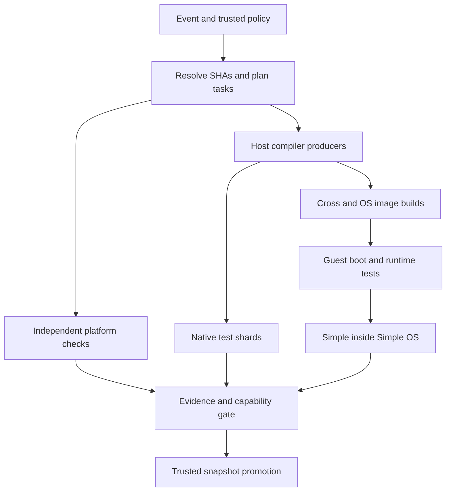

# Simple and Simple OS — Free GitHub Actions CI Setup Plan

**Date:** 2026-10-22, Asia/Seoul  
**Status:** Proposed implementation and migration plan; no repository settings or workflows were changed.  
**Account:** GitHub Free. Baseline: public `ormastes/simple`, standard GitHub-hosted runners only.  
**Capacity:** 20 concurrent hosted jobs across the owner's applicable account budget; 18 workload lanes plus 2 orchestration/headroom lanes.  
**Confirmed preference:** Linux x86-64 ×6; Windows x86-64 ×2.  
**Release selection:** Configurable independently for Simple and Simple OS; resolved once to immutable commits per run.
**Implementation status (2026-10-22):** first slice added: phase ladder (7 lanes to phase 4, RC publish) and scoped component builds with per-branch cache; see `doc/07_guide/infra/toolchain/phase_ladder_ci.md`. Everything else below remains proposed.  
**Manual operation:** Every lane supports selected manual execution and a bounded, private interactive debug mode; hosted VMs are temporary.

## Contents

1. [Decisions and scope](#1-decisions-and-scope)
2. [Current repository evidence and migration implications](#2-current-repository-evidence-and-migration-implications)
3. [Free-account constraints and cost guardrails](#3-free-account-constraints-and-cost-guardrails)
4. [Exact 20-lane allocation](#4-exact-20-lane-allocation)
5. [Configurable current release branch](#5-configurable-current-release-branch)
6. [Scheduling, concurrency, and latest-commit behavior](#6-scheduling-concurrency-and-latest-commit-behavior)
7. [Build topology and producer/consumer relationships](#7-build-topology-and-producerconsumer-relationships)
8. [Native platform responsibilities](#8-native-platform-responsibilities)
9. [Cross-compilation and target coverage](#9-cross-compilation-and-target-coverage)
10. [Simple OS and Simple running inside Simple OS](#10-simple-os-and-simple-running-inside-simple-os)
11. [Divisible core/library/plugin builds and released/phase-compiler bootstrap](#11-divisible-corelibraryplugin-builds-and-releasedphase-compiler-bootstrap)
12. [Shared cache architecture and correctness](#12-shared-cache-architecture-and-correctness)
13. [Cache storage, retention, and free-only operation](#13-cache-storage-retention-and-free-only-operation)
14. [Security, provenance, and release promotion](#14-security-provenance-and-release-promotion)
15. [Canonical configuration and proposed adapter interfaces](#15-canonical-configuration-and-proposed-adapter-interfaces)
16. [GitHub Actions workflow blueprints and manual access to every lane](#16-github-actions-workflow-blueprints-and-manual-access-to-every-lane)
17. [Resource, memory, and performance policy](#17-resource-memory-and-performance-policy)
18. [Required checks, evidence, and observability](#18-required-checks-evidence-and-observability)
19. [Implementation and rollout work packages](#19-implementation-and-rollout-work-packages)
20. [Acceptance tests and failure injection](#20-acceptance-tests-and-failure-injection)
21. [Operational runbooks](#21-operational-runbooks)
22. [Final setup checklist](#22-final-setup-checklist)
23. [Sources and evidence](#23-sources-and-evidence)

## 1. Decisions and scope

### 1.1 Recommended baseline

Use GitHub Actions as an event-driven execution service, not as twenty permanent machines. Each hosted job starts in a fresh environment. Cache and artifact reuse must therefore be explicit.

The default deployment is **GitHub-only and free-oriented**:

- Standard public-repository Linux, Windows, and macOS hosted runners.
- GitHub Actions cache for bounded, disposable acceleration.
- Short-lived workflow artifacts for exact-run handoffs and evidence.
- Normal immutable release assets for distributed, approved bootstrap/compiler/OS packages.
- No paid larger runners, paid cache expansion, mandatory S3 account, persistent controller, or self-hosted hardware requirement.
- No assumption that a CUDA device, AVX-512 CPU, nested virtualization, or a particular QEMU accelerator is available.

The two release branches are **configuration**, not hardcoded workflow names. A change to the active release selector must not rename `main`, change repository policy, move published tags, or silently reuse another branch's outputs.

### 1.2 What this plan means by a lane

A lane is a stable scheduling and reporting category, not a continuously running VM. It may contain several bounded tasks and sequential target tests. Idle lanes incur no job runtime and need not be kept occupied.

There are three distinct quantities:

1. **GitHub jobs:** count against hosted-job concurrency.
2. **Threads/processes/fibers inside one job:** share that job's CPU and RAM; they do not create additional hosted-job slots.
3. **Target configurations:** can greatly exceed twenty because targets are grouped and scheduled over time.

### 1.3 Scope and non-goals

This document specifies how to configure and migrate CI. It does not claim that every proposed target already compiles, boots, or self-hosts. Missing capability must be recorded explicitly and developed before it becomes a release requirement.

It does not authorize implementing repository changes, changing branch protections, enabling billing, deleting existing artifacts, or publishing a release. Those are follow-on implementation actions.

The implementation should reuse Simple's existing build runner, compiler entrypoints, bootstrap receipts, SDN policy, and test infrastructure. Do not create a parallel build system inside YAML.

## 2. Current repository evidence and migration implications

### 2.1 Read-only inspection baseline

The public repository was inspected at main commit:

```text
3f65319344174eed227f9a09c8872603d6d0ae23
```

The workflow directory listing contained 59 YAML workflows at inspection. Selected workflows and policy files were read; this was not an execution audit or a complete review of every job. Remote state can change after this snapshot. [R1]

| Observed file or policy | What was actually observed | Required treatment |
|---|---|---|
| `.github/workflows/cross-platform.yml` | Existing native/cross-platform jobs and several advisory paths | Reuse tests; consolidate scheduling and toolchain identities |
| `windows-build.yml` | Clang/LLVM 23.1.1 host policy, currently using `windows-latest` | Keep compiler authority; explicitly select and probe the runner image |
| `simpleos-build.yml` | An x86-64 QEMU smoke path, additional full/evidence jobs, and a host-bootstrap preparation script | Preserve working evidence; expand architecture coverage incrementally |
| `freebsd-build.yml` | An offline-media/runner contract check; comments explicitly say hosted CI is not claiming a full FreeBSD VM run | Do not label this as FreeBSD execution coverage; provision reviewed media first |
| `cache-main-writer.yml` | A main-only cache writer, secret-dependent preflight, bootstrap provisioning, and best-effort remote publishing | Preserve writer isolation; external gateway remains optional in the free baseline |
| `cache-promotion.yml` | Policy-validation gateway; remote write deliberately absent | Do not describe it as an already functioning remote cache promoter |
| `cache-branch-ci.yml` | An opt-in branch namespace separate from main | Preserve trust separation; keep disabled unless useful and explicitly configured |
| `required-gates.yml` | Required check named `Code Idiom & Structural Ratchet Gates`, on `[self-hosted, ARM64]` | Move the required fast check to a validated standard hosted runner if the goal is no hardware dependency; preserve the check name during migration |
| `release.yml` | Legacy bootstrap matrix; several target classes are advisory or blocked rather than release-qualified | Track capability tiers honestly; do not make all targets blocking at once |
| `candidate.yml` | Immutable candidate qualification and release-policy checks | Reuse immutable candidate/receipt semantics |
| `.spipe/policy/vcs.sdn` | Main remains the development trunk; release-first fixes and reviewed forward-porting; immutable promotion without rebuilding | Release-selector configurability must respect these policies |
| `release/version.sdn` | Version line `1.0`, compiler ABI, bootstrap protocol, package-format and other compatibility versions | Include these authorities in relevant cache and artifact identities |

Source links to the inspected files are in section 23. [R2], [R3], [R4], [R5], [R6], [R7], [R8], [R9], [R10], [R11]

### 2.2 Release branches observed, not automatically selected

These refs existed when queried:

| Branch ref | Observed commit |
|---|---|
| `refs/heads/release/1.0` | `06bb903e09043b4c248a4169163c26be6c168bfd` |
| `refs/heads/release/1.0.0` | `35db6bf53bfdd55fd06f63b35feccef2b3948058` |
| `refs/heads/release_phase3` | `c8dcb8f722e3d03c036b9bb6eb6f9b08df40c49c` |
| `refs/heads/release_windows` | `304c52201a972dfec28caf351ed5597bcc1eb43e` |

`release/1.0` is used as a **starter example**, not a claim that it is the user's chosen current release. Select any existing, policy-admitted branch through the configuration described below. [R12]

### 2.3 Migration rules

- Inventory all 59 workflows, triggers, runner labels, required check names, caches, and publication permissions before activation.
- Reuse tests and wrappers; avoid adding another automatically triggered copy of the same workload.
- Place every hosted job under the common budget or explicitly account for it as outside this project's budget.
- Preserve branch protection and existing required checks until equivalent replacements have produced evidence.
- Treat existing advisory/failing/unsupported states as technical debt with owners, not as implicit passing coverage.
- Keep `main` and selected release source identities separate even when their content happens to match.

## 3. Free-account constraints and cost guardrails

Current GitHub documentation lists a GitHub Free ceiling of **20 concurrent standard hosted jobs**, including a **five-job macOS sub-limit**. Standard hosted compute is free for public repositories. Private repositories instead consume the plan's included minutes; Free lists 2,000 minutes/month. Standard hosted jobs have a six-hour execution limit. The matrix maximum is 256 entries per workflow run. [G1], [G2], [G3]

These are service limits, not a guarantee of immediate runner availability. Other repositories under the same owner can consume capacity. An account upgrade must not silently change this project's chosen 20-job budget.

### 3.1 Free-only defaults

| Setting | Default |
|---|---|
| Hosted compute | Standard runners, public repository |
| Maximum active project workload lanes | 18 |
| Orchestration/headroom lanes | 2 |
| macOS project lanes | 3, below the documented five-job sub-limit |
| Paid larger/GPU runner labels | Rejected by configuration validation |
| Actions cache target | 7.5 GB occupied by this plan, leaving headroom below the default 10 GB |
| Paid cache expansion | Disabled |
| External cache gateway | Optional, disabled by default |
| Bulk artifacts | Short-lived and size-budgeted; never upload every build directory |
| Spend controls | Configure zero-spend/stop-usage controls where available and verify account billing settings |

GitHub distinguishes cache storage from artifact/package storage. Cache has a 10 GB per-repository included/default allowance; artifacts and packages have their own accounting. Free lists a 500 MB storage allowance in its plan tables. Do not infer unlimited artifact retention from free public compute; verify the repository's actual billing treatment and keep artifacts small regardless. [G3], [G4]

If the repository becomes private, stop the full automatic matrix until a private-minute budget is explicitly chosen. Do not promise a continuously busy twenty-runner private CI on the Free included quota.

### 3.2 Runner labels and resource-aware defaults

Use explicit OS-version labels rather than `*-latest` for baseline release qualification. Image contents still receive updates, so record actual image/tool versions in receipts. The following standard labels were documented when checked: [G2]

| Work | Label | Public-runner documented resources |
|---|---|---|
| Linux x64 | `ubuntu-24.04` | 4 vCPU, 16 GB RAM |
| Windows x64 | `windows-2025` | 4 vCPU, 16 GB RAM |
| Linux ARM64 | `ubuntu-24.04-arm` | 4 vCPU, 16 GB RAM |
| Windows ARM64 | `windows-11-arm` | 4 vCPU, 16 GB RAM |
| macOS ARM64 | `macos-26` | 3 CPU cores, 7 GB RAM |
| macOS Intel | `macos-26-intel` | 4 CPU cores, 14 GB RAM |

Probe actual resources at runtime. Do not treat these figures as reserved application memory. Start macOS ARM compilation conservatively because its memory budget is smaller. Keep ARM macOS out of the guest-VM testing plan; nested virtualization is not supported there. [G2]

## 4. Exact 20-lane allocation

### 4.1 Default workload lanes

| Slot | Lane ID | Host | Main responsibility |
|---:|---|---|---|
| 01 | `linux-bootstrap` | Ubuntu x64 | Current-source compiler core, bootstrap qualification, compatible Linux seed production |
| 02 | `linux-runtime` | Ubuntu x64 | Interpreter, runtime, NoGC ownership/short-borrow tests |
| 03 | `linux-parser` | Ubuntu x64 | Parsing, immutable AST, incremental invalidation, Markdown/LSP/link validation |
| 04 | `linux-build-cache` | Ubuntu x64 | Build runner, linker, dependency graph, cache corruption and concurrency tests |
| 05 | `linux-backends` | Ubuntu x64 | CPU/SIMD code generation, GPU compile/contract tests, software-rendering tests |
| 06 | `linux-integration` | Ubuntu x64 | Integration, regression, security, packaging, traceability |
| 07 | `windows-core` | Windows x64 | Native compiler/runtime, clang-cl/MSVC ABI, executable smoke tests |
| 08 | `windows-platform` | Windows x64 | Filesystem/process/ConPTY/smux, DLL/plugin loading, GUI/platform integration |
| 09 | `mac-arm-core` | macOS ARM64 | Native compiler/runtime and bootstrap |
| 10 | `mac-arm-platform` | macOS ARM64 | Platform/GUI/plugin tests; Metal compile and separately admitted device tests |
| 11 | `mac-intel` | macOS x64 | Native Intel ABI/runtime/build compatibility |
| 12 | `linux-arm` | Ubuntu ARM64 | Native AArch64 execution, atomics, runtime and platform behavior |
| 13 | `windows-arm` | Windows ARM64 | Native ARM64 PE execution, platform runtime and ABI |
| 14 | `freebsd` | Ubuntu x64 + FreeBSD guest | Reviewed guest media, native FreeBSD ABI/runtime tests |
| 15 | `cross-riscv` | Ubuntu x64 | Linux RV64; RV32 where a validated userspace/sysroot exists; related codegen |
| 16 | `cross-portability` | Ubuntu x64 | Linux x86-32/ARM32, cross-ABI compile contracts, controlled target variants |
| 17 | `simpleos` | Ubuntu x64 + QEMU | Simple OS kernel/boot/embedded matrix for x86, ARM, RISC-V, 32/64-bit |
| 18 | `simple-in-simpleos` | Ubuntu x64 + QEMU | Simple interpreter/compiler running inside Simple OS; guest bootstrap evidence |
| 19 | `control-plan` | Ubuntu x64 | Fast required checks, trusted planning, metadata maintenance |
| 20 | `control-finalize` | Ubuntu x64 | Result aggregation, validated cache publication, release promotion orchestration |

Slots 19 and 20 are **headroom by default**, replacing the earlier vague idea of two permanently busy overflow jobs. Their spare time can be borrowed only after scheduling/accounting is implemented and tested; the initial version keeps them short-lived and does not borrow them.

### 4.2 Arithmetic and interpretation

```text
6 Linux x64 native
+ 2 Windows x64
+ 2 macOS ARM64
+ 1 macOS Intel
+ 1 Linux ARM64
+ 1 Windows ARM64
+ 1 FreeBSD guest host
+ 2 Linux cross-compilation
+ 1 Simple OS host
+ 1 Simple-in-Simple-OS host
= 18 workload lanes
+ 2 orchestration/headroom lanes
= 20
```

The six Linux jobs are **six native Simple workloads**, not a limit of six Linux-hosted VMs. FreeBSD, cross-compilation, and both Simple OS groups also run on Linux hosts. At peak this layout uses eleven Ubuntu x64 workload hosts, one Ubuntu ARM64 host, three Windows hosts, and three macOS hosts, plus up to two control hosts.

Do not instantiate every lane for every documentation edit. Select affected workloads while preserving always-required fast checks and full-coverage verification.

## 5. Configurable current release branch

### 5.1 One canonical source of truth

Propose `config/ci/branches.sdn` on the trusted default branch as the active-selector authority. Keep it separate from `release/version.sdn`, which remains the product-version/ABI authority. Use the repository's existing SDN parser; the following is a proposed schema to validate, not a claim that these keys already exist.

```sdn
schema: "simple.ci.branches.v1"
configuration_epoch: 1

projects:
  simple:
    repository: "ormastes/simple"
    main_ref: "refs/heads/main"
    current_release_ref: "refs/heads/release/1.0"
    release_selection_epoch: 1
  simpleos:
    repository: "ormastes/simple"
    main_ref: "refs/heads/main"
    current_release_ref: "refs/heads/release/1.0"
    release_selection_epoch: 1

selection_policy:
  release_ref_kind: "branch"
  missing_ref: "fail_closed"
  unconfigured_release: "disable_release_only"
  policy_admission_required: true
  resolve_once_per_run: true
  revalidate_before_current_alias_promotion: true
  manual_ref_override_may_publish: false
```

Both components initially live in `ormastes/simple`; they are separate logical cache/build namespaces, not assumed separate repositories. They may select the same release branch or different branches. A future repository split changes the `repository` fields and requires an explicit cross-repository transfer/coordination design.

Valid examples include `refs/heads/release/1.0`, `refs/heads/release_phase3`, or a newly created reviewed release line. Existence is necessary but not sufficient: the branch must satisfy the release admission rules in `.spipe/policy/vcs.sdn`. Choosing `release_phase3` does not grant it protections that currently apply only to `release/*`.

If the current branch has not been chosen, set `current_release_ref` to an explicitly supported disabled value such as `none` and report release coverage as unconfigured. Main CI still runs. Do not guess from the newest branch timestamp or select a different branch silently.

### 5.2 Run manifest: moving refs become immutable inputs

At planning time, resolve the selected branch exactly once and write a small immutable SDN run manifest containing:

```text
repository identity
trusted workflow/control commit SHA
branch-policy/configuration commit SHA and digest
configuration epoch
event type, run ID, run attempt
channel: main | current-release | candidate | PR | manual
Simple source ref and resolved SHA
Simple OS source ref and resolved SHA
PR head SHA and tested merge SHA, when applicable
compiler/bootstrap package identity
target registry digest and selected task IDs
toolchain lock digest
release selection epochs
cache-read and cache-write permissions
```

Every job checks out the manifest SHA, not the mutable branch name. All producers and consumers use the same input set. A job must not fetch a newer branch tip halfway through compilation and keep reporting the old SHA.

For Simple OS + Simple integration, record both source SHAs and compiler/runtime ABI identities. The default monorepo pairing is the same commit. Different selected branches require an explicitly admitted compatibility pair.

### 5.3 Switching the release branch

1. Update the selected component's `current_release_ref` in the trusted configuration.
2. Increment its `release_selection_epoch` and the overall configuration epoch.
3. Review the change and verify branch existence, policy protection, supported bootstrap format, and source pairing.
4. Run a dry-run planner showing old selector, new selector, resolved SHAs, target changes, and cache namespaces.
5. Start a baseline run for the new selection; seed from compatible immutable assets, not a stale `current-release` directory.
6. Keep old in-flight jobs pinned to their old manifests. They may finish and retain exact-SHA results, but cannot update the new active-release pointer.
7. After all required new-selection checks pass, promote the new immutable snapshot to the active release alias with an epoch/configuration check.
8. Retain old published release assets. Prune only disposable CI caches under the defined retention policy.

**Rollback:** choose the previous ref in a new configuration revision and increment the epoch again. Never decrement epochs, mutate published tags, or overwrite an existing immutable snapshot.

### 5.4 Avoid hardcoded branch triggers

Do not attempt `on.push.branches: [${{ vars.CURRENT_RELEASE_BRANCH }}]`. Event branch filters are static matching configuration, not runtime expressions. Use broad branch triggers plus a trusted, cheap planner, or generate reviewed YAML projections from SDN. The first option permits a selector change without rewriting many workflows. [G7], [G8]

The required fast-check workflow must also accept PRs against the selected branch. An unsupported branch name must not produce a permanently pending required check because a hardcoded `release/**` filter excluded it.

Scheduled release-cache warmers run from the default branch's workflow context and resolve the selected release source explicitly. Ordinary branch CI still tests the event's exact SHA. These are distinct operations.

### 5.5 Selection is not publication authority

A selectable branch is not automatically safe to execute with release credentials. Use read-only build/test jobs and a separate protected publisher. Read policy from trusted configuration, not from an untrusted PR's modified configuration. No PR or manual diagnostic override may appoint itself the current release or enable cache/release writes.

## 6. Scheduling, concurrency, and latest-commit behavior

### 6.1 Start with a simple enforceable single-repository budget

For this repository, assign every hosted job one of twenty fixed repository-wide concurrency group names:

```text
simple-ci-slot-01 ... simple-ci-slot-20
```

All workflows use exactly the same slot names. Do not append branch, workflow name, SHA, or run ID to the slot mutex: that would create multiple independent locks and defeat the cap.

Each job holds only one slot. Dependencies must complete before a job is allocated; no runner sits idle waiting for another lane's artifact while holding a slot. Multi-stage use of a lane is sequential: for example, `linux-bootstrap` may produce the Linux compiler and later the same slot may run another bootstrap task.

With every hosted job assigned to one of twenty exclusive groups, at most twenty such jobs can run in this repository. The 18 workload groups and two control groups also prevent heavy jobs from consuming control capacity. This is an application convention enforced through generated workflows and a lint gate; it is not a special GitHub capacity-reservation feature.

GitHub's account cap still covers other repositories. Repository-local concurrency names do not coordinate across repositories. In a future split, either submit execution through a single coordinator repository or rely on the account cap with explicit queue coordination; do not claim that equal concurrency strings in separate repositories form a global semaphore. [G1], [G5]

### 6.2 Preserve queued work at the slot level

The current GitHub.com concurrency documentation supports `queue: max`, allowing a bounded pending queue rather than replacing all but one pending job. Use it with `cancel-in-progress: false` on slot locks. Verify feature support on the actual service and pinned workflow validator during rollout. If unavailable, use a single admitted batch/controller; do not silently downgrade shared slots to a one-pending-job queue. [G5]

```yaml
concurrency:
  group: simple-ci-slot-03
  queue: max
  cancel-in-progress: false
```

Do not use `cancel-in-progress: true` on a shared slot. A new PR should not cancel a release or another PR just because they need the same Linux lane.

The documented slot queue is bounded; monitor overflow/canceled jobs. Queue order is not a priority scheduler and not a reliable commit-order guarantee. Protect exact release candidates in the admission ledger and re-enqueue only genuinely unfinished required tasks.

### 6.3 Apply coalescing at the workflow/channel level

| Run class | Newer work behavior | Why |
|---|---|---|
| PR update | Cancel the older run for that PR; test the latest PR merge SHA | Fast feedback; no stale PR backlog |
| Main integration | Finish the current run; replace older pending main runs with the newest | Avoid cancellation starvation and preserve a usable cache producer |
| Current-release continuous validation | Finish current run; keep latest pending branch-tip validation | Follow active branch without rebuilding every intermediate tip |
| Exact candidate/tag qualification | Preserve each distinct admitted candidate; bounded explicit queue | Do not lose release evidence |
| Nightly full sweep | One finite sweep; skip duplicate successful inputs when policy allows | Complete coverage without indefinite runner loops |
| Manual diagnostic | Isolated read-only namespace, explicit immutable SHA | Reproducible debugging; no promotion |

For main and continuously tracked release branches, the default one-pending workflow queue is useful intentional coalescing. For candidate/tag work, use a queue or unique candidate identity and keep the slot queues loss-aware. `cancel-in-progress: false` alone does **not** preserve every pending run. [G5]

### 6.4 What “group and repeat to most recent” means

Within a run, related tasks use the same pinned source and toolchain. Complete the bounded group, publish its evidence, and exit. The next event or reconciliation run uses the newest selected source.

Do not run an infinite polling loop inside a hosted job to retain its VM/cache. Do not change a source SHA between subtests in one reported group. If a run is superseded, either finish its pinned work or cancel it at a defined boundary and report cancellation.

A bounded nightly reconciliation may resolve both main and current-release tips and identify missing lane receipts. The example schedule is **04:17 Asia/Seoul**, represented as `17 19 * * *` in UTC. It is a plan, not a schedule created by this document. Scheduled Actions may be delayed and use default-branch workflow definitions; do not use cron for real-time correctness guarantees. [G9]

### 6.5 Practical priority and fairness

Initial implementation uses fixed lanes and workflow coalescing, not a custom always-on controller. The desired admission order is:

1. Fast required checks and explicit release finalization.
2. Missing required candidate validations.
3. Current main/release baseline work.
4. Active PR affected-target tests.
5. Advisory diagnostics and performance experiments.

GitHub YAML alone does not provide arbitrary priority queues. If measured queue delay requires stronger priorities, implement a finite trusted admission step that dispatches only ready tasks. Do not advertise priority enforcement before it exists.

### 6.6 Matrix constraints

`strategy.max-parallel` only limits a particular matrix, not all workflows. Keep it as a local safety bound and use the slot policy for the repository-wide limit. Do not put a `matrix.*` reference in job-level `if`, because that condition is evaluated before matrix expansion; filter matrix rows in the planner or apply a step condition. [G6], [G8]

## 7. Build topology and producer/consumer relationships



### 7.1 Build once where reuse is valid

- Produce one qualified Linux x64 compiler/runtime bundle per compatible source/toolchain/profile identity and reuse it across the six Linux workloads and eligible cross-build tasks.
- Produce separate native Windows x64 and macOS ARM64 bundles for their paired workloads. Do not reuse the Linux executable as a Windows or macOS compiler.
- Reuse installed toolchain packages by their locked identity; building LLVM from source belongs in an explicit toolchain-refresh workflow, not every lane.
- Avoid global barriers: Windows/macOS/ARM native production may start alongside the Linux producer. Linux consumers depend on the Linux producer only when they require its new output.
- `simple-in-simpleos` consumes exact OS image/compiler artifacts produced for the same admitted run/source pairing, not an arbitrary “latest” OS image.

### 7.2 Artifacts are handoffs; caches are optional acceleration

Use an exact artifact ID/name and run/attempt identity for producer-to-consumer dependencies. A cache hit is not proof that the expected producer completed, and concurrent cache saves are not an artifact bus. [G10]

Proposed artifact naming:

```text
compiler-<host-profile>-<source-short-sha>-<run-id>-<attempt>
simpleos-image-<target-profile>-<os-short-sha>-<run-id>-<attempt>
evidence-<lane>-<source-short-sha>-<run-id>-<attempt>
```

The short SHA in a display name is not an identity check: the internal manifest carries full source SHA and cryptographic content digest. Every consumer verifies these before use.

Different jobs cannot share RAM, memory maps, or one writable filesystem directly. Shared immutable AST/IR files are downloaded and mapped independently within each runner. Within a single runner, Simple's build runner may share read-only memory/file caches among worker threads and processes.

## 8. Native platform responsibilities

### 8.1 Six Linux x64 workloads

| Lane | Required work once the capability is admitted | Important exclusions |
|---|---|---|
| Bootstrap | Build current compiler/core; execute its test suite; verify stage/producer receipts and minimal CLI | A seed that only prints `--help` or `--version` is not a qualified compiler |
| Runtime | Interpreter/native parity, unique ownership, short borrowing, allocator behavior, async/rings, process and file APIs | Sanitizer support must be established for the actual backend/runtime |
| Parser | Full/incremental equivalence, immutable-node sharing, file-ID remapping, grammar-version checks, Markdown parsing/link graph/LSP | Target-resolved data is not automatically portable merely because it originated in an AST |
| Build/cache | Concurrent requests, single-flight loading, dependency invalidation, link correctness, snapshot import/export, cold/warm parity | Cache presence must never bypass correctness checks |
| Backends | Baseline/SIMD code generation, ISA dispatch, GPU compile contracts, software-renderer conformance | No assumed CUDA/ROCm GPU or AVX-512 hardware |
| Integration | CLI/tooling, packaging, round trips, bug regressions, traceability, bounded fuzz/property checks | Long benchmarks belong to an explicit analysis profile |

Run test shards with measured duration balancing, not six copies of a full bootstrap. Share the exact built Linux bundle across compatible consumers. Use independent temporary/output directories for each shard.

### 8.2 Windows x64 ×2

`windows-core` owns clang-cl/LLVM host policy, PE/COFF linking, native compiler startup, dynamic libraries, SFFI ABI, and core runtime behavior.

`windows-platform` owns filesystem case/encoding/path tests, file locks and atomic replacement, process trees and termination, ConPTY/smux, asynchronous I/O, installer/package checks, and admitted GUI/DirectX tests.

Linux cross-compilation is supplemental. It cannot replace native Windows filesystem, synchronization, console, loader, or SDK integration tests. A MinGW build and an MSVC-ABI build are different target profiles and must not share object-cache keys.

### 8.3 macOS ARM64 ×2 and Intel ×1

- Keep the two Apple Silicon jobs requested by the user.
- One produces/tests the native compiler/runtime; the other handles platform, plugin, UI and admitted graphics functionality.
- Use the Intel runner for actual x86-64 execution, not Rosetta as the only evidence.
- Record deployment target, SDK, linker, binary architecture, and minimum supported OS.
- Do not label modern macOS jobs as x86-32 validation.
- Use ad-hoc signing only where appropriate for tests. Distribution signing/notarization is a separate optional credentialed process; it is not required for the free CI baseline.
- Test Metal compilation separately from real-device execution. Report absent devices/features as unavailable, not passing hardware coverage.

### 8.4 Linux ARM64 and Windows ARM64

Run native AArch64 compiler/runtime tests on each OS. Verify the executable's architecture and execution mode; installing an x64 tool that runs under translation does not prove a native ARM64 compiler build.

The default assigns one slot to each OS because native Linux and native Windows require different runner jobs. If “one ARM instance” is a strict combined concurrency requirement, serialize both jobs through one ARM slot and keep the other slot as reserve; do not claim a single hosted VM natively validates both kernels. The recommended twenty-slot table retains two independent ARM jobs for faster coverage.

Record OS-native architecture, tool executable architecture, produced binary architecture, pointer width, ABI and feature set. Include atomic/memory-order tests on native ARM, while recognizing that CI stress tests do not prove absence of all weak-memory bugs.

### 8.5 Hardware capability classifications

Use the same two-field vocabulary as section 18. A capability has a support state and this run has a separate execution result:

```text
support: required | supported-advisory | experimental | not-provisioned | unsupported
result: pass | fail | blocked | timeout | infra-error | canceled | not-selected
```

Only `pass` satisfies a required executed test. An unavailable CUDA device cannot become `pass` because compilation succeeded. A renderer's software path is useful evidence but is not equivalent to hardware Vulkan/Metal/DirectX validation.

Keep optional native RISC-V boards, GPU runners, FPGA/JTAG devices, and controlled performance machines outside the mandatory free-hosted baseline. They can be integrated later without changing target identity or result semantics.

## 9. Cross-compilation and target coverage

### 9.1 Separate build machine, compiler host, and emitted target

Record three roles explicitly:

| Role | Meaning | Example |
|---|---|---|
| Build machine | Where the current build command executes | Linux x86-64 hosted runner |
| Compiler host | Where the compiler executable being produced will run | Simple OS RV64 guest |
| Emitted target | Architecture/ABI of programs that compiler produces | RV64 Simple OS, or a configured cross target |

This prevents confusing a Linux compiler that emits RISC-V objects with a compiler that itself runs on RISC-V. A successful cross-link is not self-hosting evidence.

Clang cross-compilation requires an explicit target and compatible headers/libraries/sysroot. Pin these inputs; host headers and libraries must not leak into a target build. [T1]

### 9.2 Target registry

The following is the desired coverage set. Initial release-blocking status comes from the existing support policy and evidence, not from this table alone.

| Target family | Build location | Execution evidence | Lane |
|---|---|---|---|
| Linux x86-64 | Linux x64 | Native | 01–06 |
| Linux x86-32 | Linux x64, correct multilib/sysroot | Admitted native 32-bit loader or QEMU user mode | 16 |
| Linux AArch64 | Native ARM; optional Linux x64 cross comparison | Native ARM | 12 / 16 |
| Linux ARMv7 32-bit | Linux x64 with hard/soft-float ABI explicitly selected | QEMU user mode; guest kernel when needed | 16 |
| Linux RV64 | Linux x64 with RV64 sysroot | QEMU user mode; periodic full-system kernel/ABI tests | 15 |
| Linux RV32 | Linux x64 only when an admitted RV32 userspace/toolchain is available | Matching QEMU user/system environment | 15 |
| Windows x86-64 MSVC ABI | Windows native | Native Windows | 07–08 |
| Windows x86-32 | Native Windows toolchain cross target, if supported by product policy | Explicitly admitted 32-bit runtime on Windows | 07–08 |
| Windows ARM64 | Native Windows ARM64; optional cross comparison | Native ARM64 | 13 |
| macOS ARM64 / x86-64 | Appropriate native Mac | Native architecture | 09–11 |
| FreeBSD x86-64 | FreeBSD guest, or Linux with an admitted FreeBSD sysroot | Actual FreeBSD guest kernel and ABI | 14 |
| FreeBSD other architectures | Optional later target profile | Matching guest/hardware required | 14, sequential |
| Bare-metal RV32 / RV64 | Linux cross | Board-specific QEMU/hardware | 17 |
| Bare-metal ARM32 / ARM64 | Linux cross | Board-specific QEMU/hardware | 17 |
| Bare-metal x86-32 / x86-64 | Linux cross | Appropriate firmware/boot path in QEMU | 17 |

Do not assume a stock Linux distribution supplies a ready-to-use RV32 userspace. Keep RV32 bare-metal coverage independent from Linux RV32 coverage. Likewise, do not infer Windows ARM32 support from Windows ARM64 runner availability.

### 9.3 Grouping policy

Group targets that share expensive setup, not merely similar names:

- Lane 15: RISC-V toolchains/sysroots; separate Linux and freestanding profiles.
- Lane 16: x86 multilib and ARM Linux portability profiles; optional cross-format inspection for Windows/FreeBSD when SDK inputs are admitted.
- Lane 17: kernel/embedded build and boot coverage, with its own target registry and boot recipes.

Within a job, order a target's steps as compile → inspect format/ABI → link → run → collect result. Continue to the next target after a target-level failure when safe, but return an overall failure if any required target failed.

Use per-target timeouts and a job-wide deadline. Split a slow group into bounded sequential jobs using the same lane rather than raising it beyond the service limit.

### 9.4 QEMU and FreeBSD boundaries

QEMU user mode is useful for userspace ISA/ABI testing but relies on host OS behavior; kernel, driver, interrupt, filesystem, and boot coverage need full-system emulation or real hardware. A Linux binary under FreeBSD's Linux compatibility layer is not evidence of a native FreeBSD binary. [T2], [T3]

For FreeBSD, provision a reviewed guest image, checksum, version, package/toolchain manifest and network policy. Keep the base image read-only; use an ephemeral writable overlay. Reuse the existing media-admission scripts where possible. Until this is provisioned, report `not_provisioned` and keep the current contract-only test labeled accurately.

For Linux-hosted cross-ISA guests, use QEMU TCG. For same-ISA virtualization, probe KVM availability and permissions before selecting it. Hardware acceleration cannot be assumed and does not enable arbitrary cross-ISA execution. [T2]

## 10. Simple OS and Simple running inside Simple OS

### 10.1 Lane 17: Simple OS / embedded matrix

Maintain separate profiles for:

| Profile family | Width | Required identity fields |
|---|---:|---|
| x86 | 32 | Machine/chipset, boot protocol, interrupt model, pointer/physical-address widths |
| x86 | 64 | Machine/chipset, BIOS/UEFI choice, bootloader/firmware digest |
| ARM | 32 | ISA/CPU, machine/board, DTB, floating ABI, boot entry |
| ARM | 64 | ISA/CPU, machine/board, DTB, exception-level assumptions |
| RISC-V | 32 | ISA extensions, ILP32 variant, machine, SBI/no-SBI policy |
| RISC-V | 64 | ISA extensions, LP64 variant, machine, SBI/firmware digest |

Do not invent one generic boot command for all architectures. Keep one reviewed recipe per board/profile. For each admitted target:

1. Cross-build the kernel, runtime and appropriate image from pinned inputs.
2. Inspect architecture, relocation model, entrypoint and linked symbols.
3. Run stub/fabricated-runtime-symbol guards already used by the repository.
4. Boot a fresh guest and require a machine-readable readiness record.
5. Exercise memory allocation, scheduling, timer/interrupt, serial, filesystem and supported device paths.
6. Run corruption/recovery or power-loss simulations only in disposable guest disks.
7. Require final structured test completion and clean termination.
8. Store the per-target result, boot log and image/firmware identity.

Current evidence proves an existing x86-64 smoke workflow, not full six-family boot support. Expand one profile at a time and explicitly track missing boot/runtime support.

### 10.2 Lane 18: Simple inside Simple OS

This lane is distinct from “compiled a Simple OS image successfully.” It must execute the Simple toolchain in the guest.

| Level | Required proof |
|---|---|
| S0: boot | Simple OS reaches an authenticated/identified test transport |
| S1: program | A Simple-compiled guest program runs and produces the expected result |
| S2: interpreter | The guest interpreter executes a representative multi-module test corpus |
| S3: compiler | The guest compiler compiles source and the guest executes its output |
| S4: self-host | The guest rebuilds the applicable compiler/core and validates its output |
| S5: reproducibility | An independent rebuild or stage comparison satisfies the declared reproducibility policy |

These S-levels are **CI evidence levels**, not replacements for Simple's existing bootstrap phase names. Retain the repository's phase terminology and attach both fields to receipts when needed.

For every x86/ARM/RISC-V 32/64 profile, state the highest proven level. Do not require a full compiler self-host on a tiny embedded board profile that has no filesystem or sufficient memory; use an appropriately sized guest-machine profile for self-hosting and keep embedded execution tests separate.

### 10.3 Resource limits and guest transport

- Start with one CPU-intensive cross-ISA guest at a time in lanes 17 and 18.
- Allow two lightweight guests only after measuring RAM and CPU headroom.
- Boot timeout, test timeout, output-size cap and heartbeat timeout are separate settings.
- Use serial/QMP or a guest test agent; do not require a GitHub Actions runner binary inside Simple OS.
- Treat a boot banner as insufficient. Require target ID, run nonce, source identity, expected test count and final result.
- A lost guest connection, missing final record, or timeout is a failure/infrastructure error, never a successful skip.
- Prefer read-only test input plus an ephemeral output disk. Avoid dependency on host-shared filesystems until the guest driver is actually implemented.
- Always terminate child processes and collect bounded logs on cancellation.

### 10.4 Main/release pair testing

Define explicit pairs instead of an uncontrolled Cartesian product:

| Pair | Purpose | Frequency |
|---|---|---|
| Simple main + Simple OS main | Current integration | Affected main pushes / nightly |
| Selected Simple release + selected Simple OS release | Release compatibility | Release-tip changes / candidate gate |
| Simple main + selected Simple OS release | Forward compatibility | Nightly or relevant ABI changes |
| Selected Simple release + Simple OS main | Bootstrap/backward compatibility | Nightly or relevant ABI changes |

Only pair configurations declared compatible by the ABI policy. Incompatible pairs should produce an explicit policy refusal, not silently fall back to a different compiler.

## 11. Divisible core/library/plugin builds and released/phase-compiler bootstrap

### 11.1 Reuse the existing architecture and implementation owners

This section carries forward the October 14 core/plugin/bootstrap plan, especially its `only` versus dependency-closure semantics, released-Simple parent policy, and admitted Stage-3 → Stage-4 continuation. It is an integration update, not a replacement bootstrap design. The earlier plan's twelve development-agent lanes are unrelated to this document's twenty CI scheduling slots. [P1]

The following files were directly inspected at the section 2 main SHA. Source presence is not proof that a host or release has passed qualification.

| Existing owner | Observed implementation or contract | CI integration / missing work |
|---|---|---|
| `scripts/bootstrap/bootstrap-from-scratch.sh` | Stage stop/resume options, typed bootstrap receipt, `dynload`/`one-binary`, RAM-aware job policy, phase cache invalidation and explicit deployment/release modes | Extend this public owner for scoped builds and an admitted released parent; do not implement another bootstrap engine in CI |
| `scripts/bootstrap/resume-stage4-from-admitted.sh` | Verifies Stage-3 provenance, runtime, source/planner binding, output ownership, scheduler lineage and unchanged Stage-2/3 snapshots | Reuse these admission checks; imported phase packages need a supported verified import/rebinding path |
| `scripts/bootstrap/bootstrap-graph.sdn` | Typed build, qualification, speculative-parent, lineage and deployment nodes | Project scoped CI work onto the same graph; smoke-admitted descendants stay quarantined |
| `scripts/bootstrap/bootstrap-phase-toolchain.shs` | Clang authority on Unix; current Windows route explicitly requires MSVC ABI, x86-64 target and LLVM clang-cl 23.1.x | Native Windows ARM support needs a validated target-specific adapter; an ARM runner alone does not make this x86 path native ARM |
| `scripts/bootstrap/preserve-phase-binary.shs` | Read-only phase1/2/3 binary snapshots and lineage markers; parent selection currently chooses the newest matching snapshot directory | Preserve immutable snapshots, but replace implicit newest-parent discovery with explicit receipt/digest selection before using it as a CI parent authority |
| `doc/04_architecture/minimal_bootstrap_configuration_composed_dynamic_architecture.md` | Accepted incremental direction: stable core, immutable composition image, independently built providers, typed dependency edges and reason-based bootstrap escalation | Reuse SCI/provider/graph authorities; source-path changes alone must not trigger full bootstrap |
| `doc/05_design/next_beta_full_bootstrap_simpleos_multiarch.md` | Existing release design with frozen gate/job interfaces and x86-64/AArch64/RISC-V64 OS expectations | Preserve already-declared release gates; migrate parent acquisition deliberately rather than silently weakening full-bootstrap evidence |

Evidence: [B1], [B2], [B3], [B4], [B5], [B6], [B7]. Additional bootstrap scripts already exist, including managed-phase, cache-lineage and phase-verification owners; implement through those owners after their focused review.

**Important current-state corrections:** the inspected public wrapper still describes `--full-bootstrap` as rebuilding the Rust seed/runtime when needed; without it, the wrapper reuses the existing Rust seed. That is not yet the same as normal bootstrap from an arbitrary released Simple binary. Its current help defaults the stage backend to `llvm`; the previous plan's selectable K1 compositions remain a design direction, not evidence that every composition is currently accepted. The current admitted Stage-3 and Stage-4 resume routes also restrict the public jobs setting to one. Do not advertise proposed flags as existing or force unsupported concurrency. [B1], [B2], [P1]

### 11.2 Separate four independent selections

| Selection | Examples | Meaning |
|---|---|---|
| Product scope | Core, one library, one plugin, full selected product | Which outputs are requested |
| Dependency policy | `only`, `deps` (`+`) | Whether missing/stale dependencies may be built |
| Producer authority | Exact released compiler, exact admitted phase compiler, explicit Rust recovery | Which executable is permitted to perform compilation |
| Bootstrap/qualification action | Ordinary build, Stage-2 stop, Stage-3 continuation, Stage-4 continuation, full trust qualification | Which stage graph and evidence are requested |

Host/target, CPU/SIMD/GPU variants, link mode, diagnostics and memory policy are further independent fields. A compiler's version is not its bootstrap phase, and a release branch is not the identity of a binary.

### 11.3 Required divisible build scopes

| User-facing scope | Build contract | Must not happen implicitly |
|---|---|---|
| `core` | K0 + actually required CORE-lib closure + selected minimum K1 code-generation/runtime composition | Pull every optional library, CLI provider, cross backend or GPU toolkit into core |
| `lib-only` | Build selected library with an admitted compiler/SDK and already admitted dependencies | Rebuild stale/missing dependencies or bootstrap a new compiler |
| `lib+` | Build selected library and its permitted dependency closure | Silently escalate to rebuilding K0 or changing compiler authority |
| `plugin-only` | Build selected provider against an admitted core SDK/ABI and admitted dependencies | Rebuild the core/compiler or select unrelated providers |
| `plugin+` | Build provider plus its permitted plugin/library dependencies | Treat `+` as full product, a new ABI, or maximum optimization |
| `product-full` | Assemble the configured compiler/tools/libraries/plugins/variants with an admitted producer | Assume that full product requires rebuilding the seed or all bootstrap stages |
| `bootstrap-full` | Explicitly execute the admitted trust/qualification graph and requested product checks | Run on every library edit, or silently fall back to a different parent |

`only` may fetch an **already admitted exact dependency artifact** without compiling it. Missing, stale, unknown or incompatible dependencies return a typed error. `+` permits dependency builds but does not grant bootstrap authority; if the closure requires a core ABI change, show the reason and require an explicitly authorized larger build.

Core-only must still have a usable code-generation path. K0 alone is not automatically a self-hosting compiler. Stage 4 means the project's full-CLI stage, not “build every optional CPU/GPU provider.”

### 11.4 Exact released binary and exact phase compiler selection

Normal CI should consume a qualified host-specific release compiler once that route is implemented and admitted. Dependent jobs may consume the exact current-run producer instead when their test requires current-source compiler behavior.

| Producer mode | Allowed source | Admission rule |
|---|---|---|
| `release` | Exact release ID/tag commit/asset ID plus cryptographic digests | Verify origin, artifact members, host ABI/ISA, runtime/SDK, language floor and required command capabilities |
| `admitted` | Exact run artifact or immutable local phase package plus receipt | Verify producer, parent chain, source/request binding and phase-specific capabilities |
| `rust-recovery` | Explicitly selected pinned source/toolchain recovery graph | Separate authorized reason and namespace; never automatic after a failed release download |

Do not use `releases/latest`, “newest snapshot directory,” a mutable `bin/simple`, filename `phase3`, or `--version` alone as producer authority. A release can contain several phase/tool packages; select the member and its executable digest explicitly.

The project may have a released Stage-3 compiler that can compile the full CLI but cannot run every modern planner/test subcommand. The adapter must probe a versioned capability protocol after integrity admission. Use the supported canonical driver, or produce an admitted bridge release. Never pretend that a missing command succeeded.

The current-release **source branch selector** in section 5 and the **bootstrap producer lock** are intentionally independent. Changing the active release branch does not silently choose another compiler binary; changing the producer requires a reviewed lock update and source-language compatibility proof.

Proposed `config/bootstrap/released-simple.lock.sdn` and phase-package manifest record:

```text
schema and producer kind
repository, release ID, tag, immutable tag commit, asset ID
archive format/digest and bounded extraction policy
exact executable member/digest and phase ID
compiler source commit and admitted parent receipt digest
build triple, producer-host triple, output artifact role
required host ISA and minimum OS/runtime
runtime, SDK, CORE-lib interface and plugin ABI identities
source language/semantics floor and supported command capabilities
qualification, signer/workflow and policy epoch identities
```

All security-critical values are concrete at admission; example strings are not accepted locks. The small pre-Simple installer verifies bytes and package paths **before executing the compiler**. Downloading a checksum beside an untrusted archive does not independently establish authenticity.

### 11.5 Phase continuation and package import

Support these distinct operations without renaming the established phases:

1. Use an admitted released compiler to build a selected library/plugin/product directly.
2. Use a released compiler as parent for the selected canonical bootstrap stages.
3. Resume an exact admitted Stage 2 into Stage 3, or the existing managed continuation as supported.
4. Resume an exact admitted Stage 3 into Stage 4 **without rebuilding or modifying Stage 2/3**.
5. Run same-entry reproduction/clean trust checks only when explicitly selected; a Stage-3-to-full-CLI transition alone is not a fixed-point comparison.

Existing public syntax, requiring valid pre-existing admission and planner receipts:

```sh
sh scripts/bootstrap/bootstrap-from-scratch.sh \
  --resume-stage4-from-admitted=/absolute/admitted/bootstrap-output \
  --bootstrap-receipt=/absolute/admitted/stage4-planner.receipt \
  --jobs=1
```

This is a description of the existing entrypoint, **not a complete runnable example with fabricated receipts**. Current preflight/runtime/source/scheduler requirements still apply. Do not directly execute the sourced continuation helper, rewrite receipts by hand, or copy a phase binary into a plausible-looking folder to bypass admission. Use the existing quarantine path where qualified; CI does not request deployment by default. [B1], [B2]

An artifact restored on a different runner has different filesystem paths. Implement a verified import adapter that binds immutable package members to the new local root and creates an allowed import/continuation receipt. It must preserve original signed/digested provenance rather than editing it to make paths match. Current source-bound continuation may reject changed source; a new-source build needs a newly admitted build request, not reuse of an old continuation receipt.

Bundle enough of the exact parent/runtime/SDK and prerequisite receipts for the requested action. A bare preserved executable is insufficient. Keep successful parents read-only and write outputs to a separate run/attempt directory. Temporary phase packages are exact artifacts; qualified distributed parent packages are normal release assets. Ordinary cache snapshots remain optional accelerators.

### 11.6 Extend the earlier scoped adapter, not another CLI

Reuse the earlier proposed `scripts/build/build-scoped.shs` / `.ps1`, release-provisioning adapters and shared typed planner. Check whether their implementation has landed before creating them. The following remains a **proposed interface** until capability tests establish support; it is not a command to paste into the current wrapper:

```text
build-scoped
  --scope=core|lib|plugin|product
  --name=<registry target>               # for lib/plugin
  --closure=only|deps                   # + means deps
  --producer=release|admitted|rust
  --toolchain-lock=<reviewed lock>
  --admission=<exact parent receipt>
  --from-stage=<2|3> --to-stage=<3|4>    # only for continuation
  --bootstrap-receipt=<typed authority>
  --host=<producer/product host>
  --target=<declared emitted/output target>
  --mode=dynload|one-binary
  --resource-policy=fast|memory-efficient|analysis
  --jobs=<supported count/auto policy>
  --plan-only
  --output=<owned new output root>
```

Normalize to the existing stage/graph owners. Print `REUSE`, `FETCH`, `BUILD`, `RELINK`, `REVALIDATE` or `BLOCKED` for each action, with its dependency reason. Keep the existing meaning of `--full-bootstrap`; add the released-parent path through an explicit compatible protocol rather than silently changing what old callers mean.

### 11.7 Scope-aware caching and lane placement

| Change/request | Normal CI work | Reuse/invalidation requirement |
|---|---|---|
| Optional library private body | Owning Linux/platform tests, `lib-only` or `lib+` as selected | Reuse compatible core; rebuild real consumers of inline/generic bodies where required |
| Dynamic plugin private body | Provider and loader/contract tests | Reuse core objects; update provider/package/SCI binding |
| Static plugin private body | Provider plus containing link | Relink product without recompiling unchanged core sources |
| CORE-lib interface or compiler semantics | Core producer plus affected consumer lanes | Explicit typed dependency/ABI invalidation; no broad reuse by branch name |
| Core-only bootstrap | Slots 01/07/09 or corresponding native-host lane | One producer per host; share exact admitted package with consumers |
| Full product variants | Owning backend/platform lane, sequential selected variants | Avoid cross product of all OS × ISA × toolkit × instrumentation combinations |
| Phase-3 → phase-4 | Owning core lane with exact imported phase package | Zero seed, Stage-2 or Stage-3 build actions; preserve parent bytes |
| Explicit Rust recovery / clean trust | Scheduled/manual qualifying lane using the same slot | Independent cache/output namespace; no effect on current admitted deployment |

Do not key core artifacts on every optional library/plugin body. Include only the true CORE-lib/K1 closure and relevant interface/tool/configuration projections. Library/plugin caches include compiler/SDK identity, target/ABI/ISA, link mode, language policy and their exact dependencies. Record phase/provenance separately from ordinary object compatibility.

The six Linux workloads should not each rebuild the same compiler. They consume slot 01's exact compatible bundle, except a test explicitly exercising another parent or bootstrap path. ARM/Windows/macOS executables need their own admitted host bundles; a Linux ELF compiler is not a universal seed.

### 11.8 Locked external tools and provider choices

Propose `config/ci/toolchains.sdn` with, per host/target:

```text
tool name and exact version
download/source identity and cryptographic digest
compiler and linker executable identities
standard library and runtime/builtins identity
sysroot and SDK version/digest
host/target triple and ABI
minimum OS/deployment target
QEMU version and guest media/firmware identities
accepted licenses and redistribution constraints
bootstrap grammar/protocol compatibility
```

Preserve the observed LLVM/Clang 23.1.1 authority unless an explicit reviewed update changes it. Do not replace it with the runner's unrelated default compiler. Pin Rust by the project's admitted toolchain/date where it remains needed; an unconstrained nightly is not a reproducible bootstrap lock.

Explicit implementation-provider choices may be `pure`, a named admitted external provider, or policy-selected `auto`, following the earlier plan. Record actual dependencies; “built by Simple” does not imply no LLVM, linker, libc, SDK or vendor driver. An explicit pure-provider request fails when unavailable instead of silently selecting a native library. CPU/GPU provider and instrumentation changes must not leak into unrelated core keys. [P1]

### 11.9 Setup is bounded and measurable

Restore/install tools before allocating many test processes. Fail clearly if a required package is unavailable. Record setup, download, extraction, compilation and link time separately. A toolchain download cache is distinct from a compiled-object cache.

Use Linux containers pinned by digest where useful for cross-toolchains, but do not confuse container isolation with a target kernel. Windows/macOS native validation remains on its own hosts. A prebuilt toolchain may be mirrored only where licensing and integrity checks allow it.

Keep the existing RAM-aware bootstrap scheduler and single-worker continuation restrictions until their owners support a broader contract. Instrument peak process-tree memory, including linker and child compiler processes. Normal CI uses warm incremental paths; scheduled/manual cold and full-trust checks demonstrate that cache/release reuse has not hidden a broken bootstrap.

### 11.10 Completion gates for the bootstrap integration

- Core-only excludes unrelated optional provider/library work and still produces a usable compiler.
- `lib-only` and `plugin-only` launch no compiler/bootstrap rebuild; stale dependencies fail explicitly.
- `lib+` and `plugin+` build only their admitted dependency closure; a core escalation requires authority.
- A pinned released binary works on every advertised host; wrong host/ISA/grammar/runtime is rejected before work.
- An exact phase package can be imported on a fresh runner and continued with unchanged parent bytes and valid lineage.
- Stage-3 → Stage-4 starts zero Cargo, Stage-2 and Stage-3 build actions; unsupported parallel flags fail rather than being ignored.
- Tampered assets/receipts, implicit latest-parent selection, missing capabilities and expired source bindings cannot pass.
- The protected bootstrap closure builds under the actual minimum supported released compiler, not only a newer compiler's emulated language mode.
- A failed stage, interactive debug session, or speculative descendant cannot update a trusted cache pointer or release.

## 12. Shared cache architecture and correctness

### 12.1 Three purposes, not one giant cache

| Store | Purpose | Correctness contract |
|---|---|---|
| Per-job workspace/RAM | Hot source snapshots, immutable ASTs, module work, local object cache | Job-local ownership; atomic local writes |
| GitHub Actions cache | Reusable downloads and bounded incremental acceleration | Disposable; every restored entry revalidated |
| Exact workflow artifacts / normal release assets | Producer handoff, evidence, approved distributed toolchain/image | Pinned identity, digest and provenance; explicit consumer |

Do not upload RAM pointers, process-local handles, open file descriptors, writable database journals, credentials, or whole compiler heaps.

### 12.2 What can be shared

| Data | Allowed sharing | Required safeguards |
|---|---|---|
| Source archives, schemas, dependency downloads | Cross-lane/OS when content is identical | Digest and safe extraction |
| Target-independent tokens/structural AST | Cross-host only after format is proven portable | Grammar/schema, canonical encoding, stable content identity, file-ID remapping |
| Resolved AST/HIR | Only compatible semantic configuration | Imports, conditional compilation, dependency closure, target data model included |
| MIR/LLVM IR | Usually target/profile/toolchain specific | Data layout, ABI, compiler version, optimization/sanitizer options |
| Native objects/static libraries | Exact target/toolchain/profile class | Triple, ISA, ABI, sysroot, flags, dependency closure |
| Compiler executable | Compatible host OS/arch/runtime and qualified source | Full producer manifest and ABI/grammar validation |
| OS/guest image | Exact target/firmware/input set | Immutable base, ephemeral writable overlay |
| Test-result receipt | Exact tested input + test-set + environment contract | Never infer success for modified source from a restored receipt |

Enabling `enableCrossOsArchive` changes archive interoperability; it does not make native binaries or target-dependent IR portable. [G4], [G11]

### 12.3 Immutable parser/cache design integration

Reuse the planned immutable parsing infrastructure where implemented:

- Serialize pointer-free immutable records and shared content, not live addresses.
- Dense local node indices and sparse attributes remain scoped to a file/snapshot identity.
- On import, remap process-local file/node IDs and validate bounds before publishing views.
- Make byte order/encoding explicit; use the project's canonical little-endian/UTF-8 format for portable cache data.
- Cache schema and grammar version must reject incompatible snapshots before allocation or traversal.
- Rebuild derived target-dependent information if its compatibility domain changed.
- Use bounded reads and size limits for hostile/malformed archives, even in a cache path.

This is an integration target, not a claim that current HIR/MIR is already portable across hosts or targets.

### 12.4 Keys: compatibility versus content versus branch scope

Do not use a raw branch name or only `runner.os` as a compiled-output key. Define separate identities:

```text
compat_digest = hash(
  schema, grammar, compiler_seed_digest, toolchain_lock,
  compiler_host, emitted_target, ABI, ISA, sysroot,
  profile, flags, linker, plugin_ABI, dependency_resolver_version
)

action_digest = hash(
  operation_kind, compat_digest, normalized_command,
  complete_input_content_digests, generated_inputs, dependency_closure
)

snapshot_key = ci-v1-<trust>-<project>-<channel>-<ref_hash>
               -<compat_digest>-<source_sha>-<run_id>-<attempt>
```

The Actions cache archive is a bounded **snapshot of many content-addressed entries**. `source_sha` identifies that snapshot, but an individual object is keyed by its own inputs so unrelated commits do not invalidate all reusable objects.

Use a broad restore prefix only through `compat_digest`, never across incompatible triples, compiler versions or trust classes. A restored older snapshot is only a candidate source of entries: each action key must still match. Keys stay below GitHub's documented length limit. [G11]

### 12.5 Hash and collision policy

- XXH3-128 may serve fast, trusted local lookup where the implementation verifies identity correctly.
- Use a cryptographic digest such as BLAKE3-256 or SHA-256 for serialized/imported content integrity. Match existing tool manifests when they require SHA-256.
- Hash integrity is not authenticity; verify the producer, approved workflow/source and signatures/attestations where required.
- Compact 32/64-bit IDs are indexes/fingerprints only, not globally unique persistent identities.
- On a compact-ID collision, compare the full identity and disambiguate; never overwrite another entry.
- Persist the hash algorithm/version in the format; do not mix algorithms under one unnamed key.
- A cache miss, corruption, schema mismatch or collision path must preserve correctness by rebuilding or failing clearly.

No cache result is trusted merely because a noncryptographic hash matches.

### 12.6 Main and release cache visibility

GitHub cache scope is repository/branch based. Runs can generally read their current branch and the default branch; PRs can also read their base-branch cache. Sibling/release branches are not automatically mutually readable. Existing entries are immutable. Keys do not override these access boundaries. [G4], [G11]

Recommended policy:

| Namespace | Writer | Readers / use |
|---|---|---|
| `simple/main` | Trusted main-source build/publisher | Compatible consumers able to read default-branch scope |
| `simple/release/<ref-hash>` | Selected release validation; optional default-scope seeder | Exact selected release and compatible admitted consumers |
| `simpleos/main` | Trusted main-source OS build/publisher | Main integration and compatible consumers |
| `simpleos/release/<ref-hash>` | Selected release OS validation/seeder | Release pairing and compatible consumers |
| PR-local scratch | Untrusted/read-only worker by default | This run only; no trusted promotion |

The default free baseline avoids persistent PR cache writes to prevent cache churn. It restores approved main/release data read-only, then writes local scratch.

For sharing release data with branches that cannot read its native branch scope, choose one of two explicit paths:

1. **Exact artifact/asset transfer:** fetch an admitted seed by exact run/asset identity, validate it, and use it. This is the simplest initial path.
2. **Default-scope release seeding:** a trusted workflow running in the default branch's context builds/validates the selected release SHA and saves a namespaced release snapshot in default-branch cache scope. A ref in the key cannot do this alone.

Default-scope seeding must retain `channel=release`, source ref/SHA, component, epoch and trust class. It does not reclassify release-built objects as main-built objects.

### 12.7 Writer ownership and publication

- One designated writer per cache partition and compatibility group; consumers restore only.
- Do not let six Linux jobs race to save the same archive key. A first successful save does not merge the others' objects.
- Use immutable snapshot keys. Maintain the active pointer in a trusted receipt/index, not by overwriting an Actions cache entry.
- Optional merged snapshots are assembled in a fresh trusted finalizer from validated per-shard content; no arbitrary script from an archive is executed.
- Publish reusable snapshot metadata only after its declared checks succeed.
- Cancellation before commit leaves no valid published pointer. Partial local output is scratch, not a promoted snapshot.
- A canceled old-release run cannot update a newer selection epoch.

### 12.8 Cache access controls

Current GitHub.com documentation exposes workflow/job `cache-mode` controls and restricts default-scope writes from low-trust events. Use `cache-mode: read` on build consumers/PRs, and grant write capability only to trusted publishers. Verify service/validator compatibility before activation; restore-only action usage remains explicit. [G4]

Do not assume `contents: read` alone enforces read-only cache access: repository permissions and cache tokens are separate mechanisms. Do not use a privileged `workflow_run` chain as an automatic trust upgrade for PR-produced artifacts.

### 12.9 Build-runner integration

Within each runner, share one immutable source snapshot and coordinate duplicate file/module requests through a single-flight table. Prefer local mmap/read-only pages where supported and measure benefit. Bound memory and outstanding I/O; do not spin up a separate full compiler for every tiny test.

Persistent remote cache access should be coarse enough to amortize network/compression overhead. Benchmark restore + validation + extraction against rebuilding; disable remote caching for a partition when it is slower.

## 13. Cache storage, retention, and free-only operation

### 13.1 Starting cache budget

The following is an initial cap for this plan's cache occupancy, not measured project sizes:

| Category | Target maximum |
|---|---:|
| Simple main, across all retained host/target partitions | 2.0 GB |
| Selected Simple release, all retained partitions | 2.0 GB |
| Simple OS main, all retained partitions | 0.75 GB |
| Selected Simple OS release, all retained partitions | 0.75 GB |
| Tool/dependency download cache | 1.5 GB |
| Small portable metadata / reconciliation overhead | 0.5 GB |
| **Target occupied** | **7.5 GB** |
| **Headroom within the default 10 GB** | **2.5 GB** |

These cache-budget figures use decimal GB; memory ceilings elsewhere use GiB. The totals include old retained snapshots, not just one snapshot per category. Start with the most beneficial Linux partitions and small portable/tool caches; add Windows/Mac compiled-object caches only when measured hit rates justify space. Sharing one key does not avoid repeated network transfers to different runners.

Actions cache entries can expire after seven days without access and are subject to size eviction. They are not a durable release store. The design must succeed from a cold cache. [G4]

### 13.2 Retention rules

- Keep at most one or two useful snapshots per active compatibility partition, subject to the total budget.
- Keep the selected release seed reconstructible from approved distributable packages/source.
- A release-selector change retires the previous release cache namespace; it does not delete released products.
- Keep successful routine logs in normal workflow logs where sufficient; upload a small result manifest and only necessary diagnostic files.
- Start transient producer handoff artifacts at one-day retention; use a longer reviewed retention only for candidate/evidence requirements.
- Failure artifacts must be bounded: cap serial logs, core/dump size and screenshot count.
- Exclude complete source trees, Cargo/LLVM build directories, duplicate SDKs, and full writable VM disks from routine artifacts.
- Treat artifact storage separately from the 7.5 GB cache plan.

Use ordinary release assets for real distributed compiler/OS packages, not artificial releases created for every CI cache snapshot.

Measure actual compressed compiler/image handoff sizes before enabling the full fan-out. Under a conservative 500 MB artifact envelope, a 350 MB target occupancy leaves 150 MB headroom; this is a planning cap, not an assertion about the account's actual metering. Retention alone may not control a busy day's occupancy. After all exact consumers finish, a separately authorized cleanup step may delete only completed disposable handoffs under policy; retain candidate evidence as required. If the free envelope cannot fit the graph, reduce bundle contents, combine producer/consumer work within a job, or rebuild selected consumers. Never report the full topology as free-feasible without this size check.

### 13.3 Cleanup safety

A maintenance job runs only under trusted configuration and uses narrow `ci-v1-` namespace ownership. Dry-run the deletion list first; retain active candidates and exact artifacts needed by running consumers. Never delete another workflow's caches or published releases to meet this plan's quota.

Deleting old snapshots or artifacts should be idempotent, recoverable by rebuilding where applicable, and logged with target IDs. If cleanup fails, stop new cache publishing or lower cache size; do not fail correctness tests solely because caching is unavailable.

### 13.4 When zero-cost storage is insufficient

Prefer, in order:

1. Stop caching low-hit/high-size partitions.
2. Reduce retained snapshots and evidence size.
3. Keep build and its tests in one bounded job to avoid transferring a very large intermediate.
4. Rebuild from admitted sources/packages when necessary.
5. Present measured need for paid cache/object storage as an optional future choice.

Do not silently enable paid cache expansion or introduce an external account. The plan must work more slowly with no warm cache.

## 14. Security, provenance, and release promotion

### 14.1 Trust boundaries

| Context | Execute source? | Read approved caches? | Write trusted cache? | Publish/sign? |
|---|---|---|---|---|
| Fork PR | Yes, isolated hosted job | Public/read-only approved data | No | No |
| Same-repository PR | Yes, isolated read-only job | Yes | No by default | No |
| Main push | Yes, exact reviewed commit | Yes | Designated writer only | Separate admitted promotion only |
| Selected release build | Yes, exact policy-admitted SHA | Yes | Validated namespace publisher only | Separate admitted promotion only |
| Manual arbitrary ref | Yes, diagnostic/read-only | Compatible data only | No | No |
| Trusted finalizer | Do not execute submitted artifacts | Read metadata/validated archives | Yes, narrowly scoped | Only under release admission policy |

Use `permissions: contents: read` by default, `persist-credentials: false` on checkout, and short-lived narrowly scoped publication credentials only where required. Never run untrusted checkout code under `pull_request_target` with elevated credentials. Pin actions by reviewed full commit SHA and keep dependency updates reviewable. Pass event values as data/environment variables rather than interpolating arbitrary user text into shell source. [G12]

### 14.2 Provenance requirements

Each promoted artifact or cache snapshot carries:

- Source repository, full source SHA(s), trusted control/workflow SHA and workflow identity.
- Event type, run ID/attempt, candidate ID and source channel.
- Complete compatibility/target/toolchain digests.
- Producer binary identity and applicable bootstrap/ABI receipts.
- Test-set digest, required coverage list and result receipt digests.
- Full content hashes and archive inventory.
- Release-selection epoch and policy/configuration identity.
- Signature or trusted attestation where required by existing release policy.

A checksum in an untrusted artifact beside that artifact is not sufficient provenance. Verify expected digests/producer metadata from the trusted run and policy context.

### 14.3 Safe import

Before extracting an archive:

1. Validate archive size and decompressed-size budgets.
2. Reject absolute paths, `..` traversal, escaping symlinks, device nodes and unexpected permissions.
3. Extract into a new staging directory, never over the workflow/control checkout.
4. Validate file inventory and content digests.
5. Admit only files under known cache/artifact paths.
6. Atomically expose validated data to consumers.

Do not restore a build cache over `scripts/ci`, `.github`, release keys, or tool executables that have not been independently admitted.

### 14.4 Promotion conditions

For a main/current-release alias update, the publisher requires:

```text
all selected required lanes have a valid result receipt
all required executed tests passed
no required result is missing, canceled, unsupported, or unprovisioned
all producers match the planned source and toolchain identities
the active selector epoch/configuration still matches
the source commit is admitted by current repository policy
the publication would not overwrite an immutable existing identity
```

Candidate/tag qualification additionally requires the release capability manifest and existing review/approval gates. Promote the already qualified artifacts; do not rebuild during publication and assume equivalence.

Optional-target failures remain visible. They must not be converted into fabricated support claims in release notes or a generic “all platforms passed” summary.

### 14.5 No accidental privilege expansion from configuration

`current_release_ref` changes source selection only. It does not:

- Grant secrets to that branch.
- Modify branch/tag protection.
- Enable a cache gateway.
- Turn an experimental target into a blocking release target.
- Bypass main/release forward-port policy.
- Authorize protected integration or publication.

Keep these as separate reviewed policies and test that separation.

## 15. Canonical configuration and proposed adapter interfaces

### 15.1 Reuse existing layout; add narrow CI configuration

| Path | Status | Purpose |
|---|---|---|
| `.spipe/policy/vcs.sdn` | Existing | Protected-ref, review and release authority |
| `release/version.sdn` | Existing | Version/compatibility authority |
| `config/check/must_check_gates.sdn` | Existing | Required/advisory gate inventory |
| `config/ci/branches.sdn` | Proposed | Changeable main/current-release selectors and epochs |
| `config/ci/lanes.sdn` | Proposed | Twenty slots, runner allowlist, work categories |
| `config/ci/targets.sdn` | Proposed | OS/ABI/ISA/board profiles and capability tiers |
| `config/ci/toolchains.sdn` | Proposed | Locked tools, sysroots, SDKs and guest media |
| `config/ci/cache.sdn` | Proposed | Compatibility policy, writer partitions and byte budgets |
| `config/ci/suites.sdn` | Proposed | Affected-test mappings, required tests, timeouts |
| `config/ci/actions-lock.sdn` | Proposed | Reviewed full-SHA action pins |
| `config/ci/access.sdn` | Proposed | Maintainer identities, private debug transport, duration and publication restrictions |
| `config/bootstrap/released-simple.lock.sdn` | Earlier proposal; integrate | Exact host-specific released compiler/runtime/SDK authority |
| `scripts/build/build-scoped.shs` / `.ps1` | Earlier proposal; extend existing owner if present | Core, lib, plugin and product closure requests |
| `scripts/ci/plan.shs` / planner implementation | Proposed adapter | Resolve refs/policy, create immutable run manifest and GitHub outputs |
| `scripts/ci/run-lane.shs` / lane driver | Proposed adapter | Provision, restore, validate, build/test, collect result |
| `scripts/ci/collect-results.shs` | Proposed adapter | Verify expected results and enforce capability policy |
| `scripts/ci/reconcile-release.shs` | Proposed adapter | Compare selector epochs and report missing work |
| `scripts/ci/debug-session.shs` / `.ps1` | Proposed adapters | Private host terminal, guest console attachment, deadlines and cleanup |
| `.github/workflows/ci-manual.yml` / `ci-debug.yml` | Proposed wrappers | Select one lane/target using the same planner and execution recipes |
| Existing bootstrap/QEMU/cache scripts | Existing, reviewed individually | Reused execution mechanisms |

Prefer an admitted Simple executable for substantive planning/validation once available. Keep shell/PowerShell adapters thin and necessary to provision/run it. Do not require the unbuilt compiler to plan how to build itself; provide an admitted seed or minimal bootstrap-safe configuration reader.

Canonical data is SDN. GitHub workflows are YAML. A compact JSON matrix/output may be generated **only as a GitHub API/expression boundary**, not as a second canonical configuration database.

### 15.2 Lane policy example

```sdn
schema: "simple.ci.lanes.v1"
account_plan: "github_free"
repository_visibility_expected: "public"
maximum_hosted_jobs: 20
workload_slots: 18
control_slots: 2
maximum_project_macos_jobs: 3
slot_queue_policy: "max"
slot_cancel_in_progress: false
borrow_control_slots: false
paid_runner_labels_allowed: false

runner_labels:
  linux_x64: "ubuntu-24.04"
  windows_x64: "windows-2025"
  linux_arm64: "ubuntu-24.04-arm"
  windows_arm64: "windows-11-arm"
  macos_arm64: "macos-26"
  macos_x64: "macos-26-intel"

group_limits:
  linux_native: 6
  windows_native: 2
  macos_arm: 2
  macos_intel: 1
  linux_arm: 1
  windows_arm: 1
  freebsd_guest: 1
  cross_compile: 2
  simpleos: 1
  simple_in_simpleos: 1

timeouts_minutes:
  control: 10
  ordinary_lane: 90
  bootstrap: 150
  guest_group: 180
  hard_lane_ceiling: 300
```

Timeouts are initial design budgets, not measured completion promises. Reduce grouped targets or split sequential jobs if measured work does not fit; never extend beyond GitHub's execution limit.

### 15.3 Planner contract

Inputs:

- GitHub event data read as data, never shell-evaluated.
- Trusted selector/policy/configuration snapshot.
- Source ref/SHA and PR base/head/merge refs as appropriate.
- Existing exact result/seed manifests and target capability registry.

Outputs:

- `run.sdn` with all immutable identities.
- A bounded selected-task list and dependency DAG.
- Per-job slot, standard runner label, test profile and timeout.
- Exact artifact/cache compatibility identifiers.
- Explicit decision for no-work/docs-only runs, with justification.
- Small GitHub outputs, with no secrets or entire-source manifests embedded.

Reject unknown fields, invalid refs, missing source commits, forbidden runner labels, dependency cycles, duplicate task IDs, invalid slot numbers, unsupported capability promises, malformed SDN and excessive matrix sizes.

### 15.4 Lane-driver contract

`run-lane` must verify its lane/slot/runner/source against the immutable plan, then:

1. Probe host architecture, memory, disk and capabilities.
2. Provision locked tools and source snapshot.
3. Restore only compatible cache partitions into staging and validate them.
4. Obtain the exact admitted producer bundle when required.
5. Build/test with bounded parallelism and per-task timeouts.
6. Emit per-test/target result receipts and bounded diagnostics.
7. Produce cache deltas/artifacts without granting them trusted status.
8. Clean up guest/process children and return the correct exit code.

A missing setup script or unsupported target is an error/status to expose, not a `|| true` fallback.

## 16. GitHub Actions workflow blueprints and manual access to every lane

### 16.1 Blueprint status and checked action pins

The following examples are **implementation blueprints**, not deployed, end-to-end tested workflows. Proposed `scripts/ci/*` adapters must be implemented and wired to existing Simple commands. YAML parsing is only a syntax check; rollout also needs Actions validation and real hosted smoke runs.

Full action SHAs were resolved from official action refs during preparation. This is identity verification, not a security audit of those revisions:

| Action | Verified ref | Full commit pin |
|---|---|---|
| `actions/checkout` | `v6` | `d23441a48e516b6c34aea4fa41551a30e30af803` |
| `actions/cache` | `v6` | `55cc8345863c7cc4c66a329aec7e433d2d1c52a9` |
| `actions/upload-artifact` | `v4` | `ea165f8d65b6e75b540449e92b4886f43607fa02` |
| `actions/download-artifact` | `v5` | `634f93cb2916e3fdff6788551b99b062d0335ce0` |

The artifact revisions shown are a proposed matching upload/download generation, not a claim that they are the latest majors or that this pipeline has tested them. Re-validate runtime support and security status when implementation begins; pin any adopted update in `actions-lock.sdn`. [A1], [A2], [A3], [A4]

### 16.2 Broad event intake with trusted planning

Proposed `.github/workflows/ci-batch.yml`, **intake/plan portion only**:

```yaml
name: Simple CI Batch

on:
  push:
    branches: ['**']
  pull_request:
    types: [opened, synchronize, reopened, ready_for_review, labeled]
  workflow_dispatch:
    inputs:
      channel:
        description: Planned source channel
        type: choice
        default: auto
        options: [auto, main, current-release, full]
  schedule:
    - cron: '17 19 * * *' # 04:17 Asia/Seoul

permissions:
  contents: read
cache-mode: read

concurrency:
  group: simple-ci-batch-${{ github.event.pull_request.number || github.ref }}-${{ inputs.channel || 'auto' }}
  cancel-in-progress: ${{ github.event_name == 'pull_request' }}

jobs:
  plan:
    runs-on: ubuntu-24.04
    timeout-minutes: 10
    concurrency:
      group: simple-ci-slot-19
      queue: max
      cancel-in-progress: false
    outputs:
      has_work: ${{ steps.plan.outputs.has_work }}
      control_sha: ${{ steps.plan.outputs.control_sha }}
      source_sha: ${{ steps.plan.outputs.source_sha }}
      manifest_digest: ${{ steps.plan.outputs.manifest_digest }}
      plan_artifact_name: ${{ steps.plan.outputs.plan_artifact_name }}
    steps:
      - name: Read trusted control checkout
        uses: actions/checkout@d23441a48e516b6c34aea4fa41551a30e30af803
        with:
          ref: ${{ github.event.repository.default_branch }}
          path: control
          persist-credentials: false
          fetch-depth: 1
      - name: Plan pinned work
        id: plan
        env:
          CI_REQUESTED_CHANNEL: ${{ inputs.channel || 'auto' }}
          CI_EVENT_NAME: ${{ github.event_name }}
          CI_EVENT_SHA: ${{ github.sha }}
          CI_EVENT_REF: ${{ github.ref }}
        shell: bash
        run: sh control/scripts/ci/plan.shs
      - name: Store small immutable run manifest
        uses: actions/upload-artifact@ea165f8d65b6e75b540449e92b4886f43607fa02
        with:
          name: ci-plan-${{ github.run_id }}-${{ github.run_attempt }}
          path: build/ci/run.sdn
          if-no-files-found: error
          retention-days: 1
```

The planner records the actual control checkout SHA after checkout; it does not keep resolving the moving default-branch name. It reads the event file for full PR metadata. Unselected ordinary branch pushes receive a small no-work receipt; PR fast checks remain independently required.

This intake workflow deliberately contains no publication credentials. A branch's modified workflow cannot grant itself trusted release authority; the separate publisher verifies workflow/config/source provenance. A scheduled or dispatched current-release batch executes trusted default-branch control code while checking out selected release source by SHA.

### 16.3 Required job dependency map for a full batch

The workflow generator/static templates must produce the following dependencies. Use these stable job IDs when migrating; do not use shell polling to wait for producers.

| Job ID | Slot | Depends on |
|---|---:|---|
| `linux_seed` | 01 | `plan` |
| `linux_runtime` | 02 | `linux_seed` |
| `linux_parser` | 03 | `linux_seed` |
| `linux_build_cache` | 04 | `linux_seed` |
| `linux_backends` | 05 | `linux_seed` |
| `linux_integration` | 06 | `linux_seed` |
| `windows_core` | 07 | `plan` |
| `windows_platform` | 08 | `windows_core` |
| `mac_arm_core` | 09 | `plan` |
| `mac_arm_platform` | 10 | `mac_arm_core` |
| `mac_intel` | 11 | `plan` |
| `linux_arm` | 12 | `plan` |
| `windows_arm` | 13 | `plan` |
| `freebsd` | 14 | `plan`; add a producer dependency if its recipe consumes one |
| `cross_riscv` | 15 | `linux_seed` |
| `cross_portability` | 16 | `linux_seed` |
| `simpleos` | 17 | `linux_seed` plus its exact selected-source plan |
| `simple_in_simpleos` | 18 | `simpleos` and required guest-compiler artifact |
| `gate` | 20 | All selected producers/consumers, using `always()` |

The table is a dependency graph, not a promise that all eighteen lanes are busy simultaneously. Producer reuse intentionally introduces short dependencies to avoid rebuilding the same compiler six times.

For a different Simple/Simple OS release pairing, the manifest includes both source SHAs and the OS producer gets the OS-specific checkout. Do not pass the Simple SHA blindly to every component.

### 16.4 Reusable lane executor

Proposed `.github/workflows/ci-lane.yml`:

```yaml
name: Simple CI Lane

on:
  workflow_call:
    inputs:
      lane:
        type: string
        required: true
      slot:
        type: string
        required: true
      runner:
        type: string
        required: true
      source_sha:
        type: string
        required: true
      control_sha:
        type: string
        required: true
      manifest_digest:
        type: string
        required: true
      plan_artifact_name:
        type: string
        required: true

permissions:
  contents: read
cache-mode: read

jobs:
  execute:
    runs-on: ${{ inputs.runner }}
    timeout-minutes: 180
    concurrency:
      group: simple-ci-slot-${{ inputs.slot }}
      queue: max
      cancel-in-progress: false
    steps:
      - name: Checkout trusted control code
        uses: actions/checkout@d23441a48e516b6c34aea4fa41551a30e30af803
        with:
          ref: ${{ inputs.control_sha }}
          path: control
          persist-credentials: false
      - name: Checkout pinned source
        uses: actions/checkout@d23441a48e516b6c34aea4fa41551a30e30af803
        with:
          ref: ${{ inputs.source_sha }}
          path: source
          persist-credentials: false
      - name: Download exact run plan
        uses: actions/download-artifact@634f93cb2916e3fdff6788551b99b062d0335ce0
        with:
          name: ${{ inputs.plan_artifact_name }}
          path: build/ci/plan
      - name: Verify plan, provision, build and test
        env:
          CI_LANE: ${{ inputs.lane }}
          CI_SLOT: ${{ inputs.slot }}
          CI_EXPECTED_PLAN_DIGEST: ${{ inputs.manifest_digest }}
          CI_SOURCE_SHA: ${{ inputs.source_sha }}
          CI_CONTROL_SHA: ${{ inputs.control_sha }}
        shell: bash
        run: sh control/scripts/ci/run-lane.shs
      - name: Upload bounded evidence even after failure
        if: always()
        uses: actions/upload-artifact@ea165f8d65b6e75b540449e92b4886f43607fa02
        with:
          name: evidence-${{ inputs.lane }}-${{ github.run_id }}-${{ github.run_attempt }}
          path: build/ci/evidence/
          if-no-files-found: warn
          retention-days: 7
```

The planner/generator must validate `runner`, `slot`, and lane mappings **before dispatch**, because a validation step inside a job is too late to prevent assignment to a paid or incorrect runner. Callers must come from reviewed templates, not user-supplied arbitrary runner strings.

The executor owns the slot mutex. Do not place the same slot mutex around both the reusable-workflow call and its executing job; that can make the callee wait on its caller. The caller owns only workflow-level coalescing and `needs` dependencies.

This example uses Bash adapters. Verify the shell and native tool provisioning on each Windows architecture; a thin PowerShell adapter may call the same admitted Simple driver when appropriate. Evidence collection must still work when the main test step fails.

### 16.5 Read-only cache restore fragment

The following step fragment assumes a trusted setup step has produced `steps.cache_id.outputs.compat_prefix` and `.snapshot_key` and verified they are nonempty and namespaced. It restores to a staging location, not over source/control code.

```yaml
- name: Restore compatible cache snapshot
  id: restored_cache
  uses: actions/cache/restore@55cc8345863c7cc4c66a329aec7e433d2d1c52a9
  with:
    path: build/ci/cache-incoming
    key: ${{ steps.cache_id.outputs.snapshot_key }}
    restore-keys: |
      ${{ steps.cache_id.outputs.compat_prefix }}-
    enableCrossOsArchive: false

- name: Validate restored entries before use
  shell: bash
  run: sh control/scripts/ci/validate-cache.shs
```

Target-specific caches keep `enableCrossOsArchive: false` in the baseline. A separate portable-metadata partition may enable it after Windows archive tooling and format tests pass.

The lane-driver/executor integration must arrange restore **before** builds and validation **before** consumption. A cache failure falls back to rebuilding; a validation failure cannot be ignored while consuming its bytes.

### 16.6 Separate trusted cache publication

Publication is a separate read-only-source/fresh-job operation in slot 20. It must not be implemented by giving fork or branch workers secrets. A default-branch `schedule`, reviewed `workflow_dispatch`, or admitted main push may seed default-branch cache scope after validation.

Illustrative save step after validation:

```yaml
- name: Save validated immutable snapshot
  if: steps.admit.outputs.publish == 'true'
  uses: actions/cache/save@55cc8345863c7cc4c66a329aec7e433d2d1c52a9
  with:
    path: build/ci/cache-publish
    key: ${{ steps.admit.outputs.snapshot_key }}
```

The containing trusted job explicitly requests the appropriate cache write mode, and its caller permits that mode. Do not put it inside a reusable workflow whose caller caps cache access at `read`. No cache write occurs until admission verifies the current selector epoch, exact producer identity and target partition.

### 16.7 Release candidates: preserve exact work

For immutable candidate qualification, keep the existing candidate/release admission flow and add slot assignments. Do not replace it with the broad branch CI workflow.

```yaml
concurrency:
  group: simple-ci-candidate-qualification
  queue: max
  cancel-in-progress: false
```

This serializes candidate workflows unless the implementation chooses a more parallel admitted-candidate policy. All execution jobs still consume their fixed slots, so main/PR work can proceed in other slots when available.

For branch-tip validation, continue using latest-pending coalescing; for exact candidates, persist candidate identity and detect queue overflow or missing completion.

### 16.8 Required result aggregation

The final gate always runs after selected jobs resolve, including failed/skipped dependency outcomes. It does not rely solely on a matrix's aggregate success flag:

```yaml
gate:
  if: always()
  needs:
    - plan
    - linux_seed
    - linux_runtime
    - linux_parser
    - linux_build_cache
    - linux_backends
    - linux_integration
    - windows_core
    - windows_platform
    - mac_arm_core
    - mac_arm_platform
    - mac_intel
    - linux_arm
    - windows_arm
    - freebsd
    - cross_riscv
    - cross_portability
    - simpleos
    - simple_in_simpleos
  runs-on: ubuntu-24.04
  timeout-minutes: 10
  concurrency:
    group: simple-ci-slot-20
    queue: max
    cancel-in-progress: false
  steps:
    - name: Aggregate using trusted collector
      env:
        CI_JOB_RESULTS: ${{ toJSON(needs) }}
      shell: bash
      run: sh control/scripts/ci/collect-results.shs
```

This is a **job fragment**: the implementation must first check out the plan's trusted control SHA, download/verify the plan and exact evidence artifacts, and make them available to the collector. The collector fails closed if planning failed or required evidence is missing. A docs-only no-work plan is evaluated by a separate explicit policy, not by blindly accepting all skipped jobs.

Keep the existing required check name stable during migration; introduce a new aggregate check only with a coordinated branch-protection update after shadow validation.

### 16.9 Manual execution and interactive access for every lane

This is a required feature of the CI setup. Every slot in section 4, including control slots, must be selectable for manual reproduction. The access implementation must distinguish three operations:

| Operation | User experience | Runner/evidence behavior |
|---|---|---|
| Manual run | Actions → `Simple CI Manual` → choose lane, source channel/SHA, target and scope | Ordinary automated recipe and result; no terminal server needed |
| Retry exact work | Re-run a selected job or dispatch a reproduction from an exact run manifest | Fresh runner with original input identities; correct prior-attempt artifact lookup |
| Interactive debug | Actions → `Simple CI Debug` → choose lane and a bounded pause point | Private terminal on that lane's host; outputs marked diagnostic and excluded from trusted publication |

GitHub supports manual dispatch and job reruns, but diagnostic logging is not an interactive shell. A finished hosted VM cannot be recovered by requesting a rerun. A rerun gets a new execution environment; only deliberately retained inputs/evidence survive. To inspect the same live failure state, the job must have been dispatched in an authorized debug mode that keeps it alive for a bounded interval. [G2], [G9], [G13]

#### Access by host and guest

| Lane/host | Required manual access | Additional supported diagnostic target |
|---|---|---|
| Linux x64/ARM64, including cross-build hosts | Authenticated SSH terminal | Process tree, compiler, build runner, test executables and logs |
| Windows x64/ARM64 | OpenSSH terminal with PowerShell; validate both architectures | Optional private RDP only for an explicitly selected GUI reproduction and supported runner image |
| macOS ARM64/Intel | Authenticated OpenSSH terminal | Native compiler/runtime and LLDB; no GUI-session assumption |
| FreeBSD host/guest | SSH to Ubuntu host, then guest serial console or key-authenticated guest SSH via loopback forwarding | FreeBSD GDB/LLDB and guest process/filesystem state |
| RISC-V user-mode test | SSH to Linux host | Cross debugger / QEMU gdbstub when enabled by the recipe |
| Simple OS / Simple-in-Simple-OS | SSH to Linux host, then serial shell, QMP/monitor and target GDB endpoint | Optional guest SSH only after that guest implementation is qualified |
| Plan/finalizer slots | Unprivileged reproduction of planning/collection with sanitized exact manifests | No interactive access to signing/publishing credentials |

Implement a small `attach` adapter that locates the owned guest socket and target debugger from the run manifest. Serial/QMP sockets and gdbstub listeners remain local to the CI host. For an OS kernel without working networking/SSH, serial plus GDB is still usable manual access; do not block all debugging on a future guest SSH server.

#### Recommended transport: private network plus OpenSSH

Use one private ephemeral network transport for all host types, with OpenSSH as the common terminal protocol. The initial recipe is the official Tailscale GitHub Action plus a loopback-bound OpenSSH server. Tailscale's current action supports ephemeral membership and workload identity federation; pin the adopted action/client versions and verify its runtime requirements on each runner. A currently eligible free Personal network or an already-owned transport can keep the feature free of new service charges; GitHub Free does not itself grant a separate network-service subscription. Tailscale's Personal plan is for non-commercial use; confirm that this project and the selected authentication feature qualify before activation. Automated CI remains independent of this optional external service. [M1], [M2], [M7]

Prefer short-lived workload identity scoped to this repository, protected workflow/ref and debug-only tag. If the account lacks that feature, use a narrowly scoped ephemeral credential through the same private network policy. The debug tag grants **only maintainer-to-debug-host access**, not access from the runner into personal/company machines or other CI nodes.

The common recipe uses ordinary OpenSSH over the private network. Tailscale's own SSH server feature is not a Windows-server replacement; its documented server platforms differ. Windows must provision a supported OpenSSH Server and key ACLs. [M3], [M4]

For userspace networking, do not assume an inbound packet to a tailnet address automatically reaches an operating-system listener. Validate the actual route. Tailscale Serve provides a private TCP forwarder, so a qualified adapter can forward a private port to loopback SSH. Illustrative commands after client/server provisioning and authorization:

```sh
# On the CI host, using the action's selected client/socket and permissions:
tailscale serve --bg --tcp=2222 tcp://127.0.0.1:22

# On the maintainer's device in the authorized private network:
ssh -p 2222 <ci-user>@<exact-run-hostname>
```

These are transport examples, not a complete cross-platform installation script. The adapter handles the actual daemon socket, account, host key and executable paths. Enforce a local-only SSH listener, public-key authentication, a known host-key fingerprint and the private ACL. Never enable a public Funnel or expose a password/session-token URL in public Actions logs. Tailscale documents TCP forwarding for protocols including SSH/RDP. [M5]

The current `mxschmitt/action-tmate` README warns that the default public tmate servers were shut down. Therefore a default public-tmate snippet is not the baseline. A separately operated authenticated relay is an optional alternative, with its own availability/cost verification. [M6]

#### Manual dispatch contract

Proposed inputs, validated by trusted control code on the default branch:

```sdn
schema: "simple.ci.manual-request.v1"
lane: "linux-parser"
channel: "main"
source_sha: "resolve-once-or-explicit-commit"
target_profile: "lane-default"
build_scope: "lane-default"
producer_lock: "reviewed-default"
debug_mode: "off" # off | before-work | on-failure | after-work
debug_minutes: 30
reproduce_run_id: "optional-exact-run"
```

Values here illustrate the interface; placeholders are rejected when execution requires an exact identity. The UI offers allowlisted lane, target, scope and parent-lock choices. A text input cannot choose an arbitrary paid runner, shell command, public network listener, asset URL or alternate publication authority.

Use separate manual and debug workflows backed by the same lane driver. The debug workflow's **workflow-level** concurrency group is `simple-ci-debug`, with `queue: max` and `cancel-in-progress: false`; this initially permits one debug workflow at a time. Its actual executor still takes `simple-ci-slot-NN`. Do not give the debug workflow and its executor the same mutex. This adds no twenty-first lane.

Allow one active debug session by default, a 30-minute interactive window and a hard 60-minute debug window ceiling. Total setup/build/debug/cleanup must fit the lane/job timeout. These are configurable plan defaults. Start the interactive deadline when the endpoint is ready, but keep the whole-job deadline active. Stop promptly on explicit finish, cancellation or deadline; do not keep hosted machines idle indefinitely.

Access-control and publication requirements:

- Only authorized maintainers may request network credentials; validate both original and rerun initiator policy as relevant. A rerun is not a privilege upgrade.
- Dispatch the privileged setup workflow from the protected default branch. Treat source under test as data until selected execution; untrusted source never chooses the access workflow or trusted SSH keys.
- Install the maintainer public-key allowlist from trusted configuration. Keep private keys on the maintainer's device.
- Use a separate debug network identity; no release credentials, cache write grant, personal login profile or general tailnet route.
- Set `cache-mode: read`, restore into local scratch and stamp the entire run `interactive=true` / `publishable=false` before opening the session.
- Collect normal failure evidence before interactive mutation. Keep post-debug observations separately labeled and require a clean automated rerun for qualification.
- A manual reproduction of slot 20 must use a dry-run publisher/collector; never open a terminal inside a credential-bearing release publisher.
- Log actor, lane, source/producer IDs, session start/end, endpoint fingerprint and cleanup status. Do not upload shell histories, SSH private keys, daemon state or tokens.
- Always close listeners, terminate owned guests, clear temporary access material and log out/remove the ephemeral network node. Configure expiration so interrupted cleanup cannot leave a reusable identity.

The per-job summary shows lane, host/target, exact source and compiler, connection hostname/port/user, host-key fingerprint, session deadline, guest attach commands and finish instructions. The private network and public-key checks authenticate access; the hostname is not a bearer credential.

All twenty lane IDs require a passing manual smoke check before this feature is declared complete. Reuse one tested access adapter per OS/architecture and one guest attach adapter; do not maintain twenty separate SSH implementations.

### 16.10 Exact artifacts and job reruns

The planner emits `plan_artifact_name` equal to the artifact it actually uploaded. Callers pass that exact value into the reusable lane. The upload retains run/producer-attempt identity; the consumer must not reconstruct it from its own current attempt number.

On a failed-job-only rerun, a successful producer may remain from an earlier attempt. Resolve its exact artifact ID/name and manifest digest from the immutable original plan/results, including its producer attempt. Reject ambiguous matches, mismatched SHAs and expired/missing artifacts. If an input is gone, rerun the necessary producer or create a new explicit reproduction; do not download an unrelated newest artifact.

Initially support full-run reruns and exact-manifest manual reproduction. Enable selective-job reruns once the prior-attempt resolver is verified. Repeating a manual dispatch with `channel=main` means a new current-tip run; rerunning an old run means its old pinned source. Present these as different actions in the UI and receipts. GitHub reruns retain the original event SHA/ref, but workflow code must also avoid re-resolving mutable release selectors or external assets. [G13]

The section 16.2 intake example shows initial-run planning. Its rerun path must first recover the original immutable plan/control SHA and validate it under current admission policy. It must not check out today's default-branch control code and silently replace the old plan. If original plan evidence expired, return a reproduction-required status and create a new explicitly identified run.

## 17. Resource, memory, and performance policy

### 17.1 Per-host starting limits

These are conservative initial **design settings**, not measured Simple capacity or performance promises. Probe actual memory, CPU, disk and job limits before applying them; a smaller available resource envelope takes precedence.

| Host class | CPU policy | Initial application-memory ceiling | Heavy work policy |
|---|---|---:|---|
| Linux x64/ARM64, 16 GB class | Up to the actual 4 vCPUs, memory-clamped | 12 GiB | One large compiler/link family; independent small tests fit the same budget |
| Windows x64/ARM64, 16 GB class | Up to actual 4 vCPUs, memory-clamped | 12 GiB | One large link at a time initially; account for subprocess/runtime overhead |
| macOS ARM64, 7 GB class | Start at 1–2 compiler workers; allow 3 only after measurement | 5 GiB | One memory-heavy compiler/link action; avoid another full compiler in parallel |
| macOS Intel, 14 GB class | Up to actual 4 vCPUs, memory-clamped | 10 GiB | One large link initially |
| QEMU host | Host compiler and guest share the host budget | Within the Linux ceiling | One heavy cross-ISA guest at a time; release completed build scratch before guest tests |

Existing stricter bootstrap/resource gates always win. Read system/cgroup/job-object limits where available, and use the minimum applicable limit. Do not use a global `nproc` setting that allows a compiler, linker, Cargo/Ninja and test runner to each launch a full set of workers simultaneously.

Admission should reserve the measured or conservatively estimated **combined** peak of each ready action. Conceptually:

```text
available_budget = min(physical_available, container_or_job_limit) - safety_reserve
admit action only if active_reserved_peak + action_peak <= available_budget
cpu_bound_active_workers <= actual_available_cpus
```

A reservation is not proof that memory cannot exceed it. Keep actual RSS/commit monitoring, owned-process termination and failure receipts. Unknown peaks start with a conservative profile and become measured data; they are not treated as zero.

### 17.2 Compiler/build-runner coordination

Use the existing Simple build-runner scheduler for the intra-job graph. Have one owner of source reads and immutable local caches; coalesce duplicate work and release short-lived parse/codegen scratch promptly. Fibers can reduce blocking-worker overhead where implemented, but do not create CPU capacity. Keep one overall process/thread/memory budget across compiler, tests and linker.

Permit asynchronous file I/O through the shared SOSIX/host interface when available. Bound outstanding requests and buffer bytes; do not load the entire repository or every target sysroot simply because the storage is fast. Keep host-specific I/O adapters outside common build logic.

Default to warm incremental compilation and compatible exact producer reuse. Measure cold setup, warm setup, compile, link, tests, cache validation and upload separately. Cache transfer that costs more than rebuilding its partition should be disabled or made smaller.

### 17.3 Disk and artifact budgets

Probe free disk after tool setup, before build, before guest launch and before archive creation. Compression can temporarily require both source and archive bytes. Keep a per-lane minimum-free-space threshold and stop with a clear resource error instead of producing a truncated image/receipt.

Use immutable VM bases plus overlays, bounded compiler intermediates and narrowly selected artifact members. Remove owned temporary directories only after their dependent evidence has been collected. Do not remove runner-global tool directories or unrelated caches in an attempt to create space.

A free standard runner may be unable to fit a complete unoptimized LLVM/source-bootstrap tree or a full self-hosting guest. Split the graph, consume a qualified toolchain package, use memory-efficient mode, or record the capability as blocked. Do not quietly move to a paid runner.

### 17.4 Performance evidence

Record wall time, CPU time where meaningful, process-tree memory high-water mark, output size, cache hit/miss/bytes, and number of parse/codegen/link actions. Structural counts are more stable than timing on shared hosted hardware.

Use repeated same-profile comparisons for performance investigations; keep runner image, CPU information and toolchain identity. Treat ordinary hosted timing as noisy observational data. A hard release performance gate needs a qualified baseline/variance policy. For optimization changes, require semantic equivalence and memory bounds before accepting speed improvement.

Run memory/performance/collection instrumentation as selectable aspects. Plain builds and instrumented builds use different identities. Do not claim runtime-disabled instrumentation is identical to a build with no instrumentation. Keep long fuzzing/profiling in scheduled/manual analysis jobs sharing the same fixed slots.

## 18. Required checks, evidence, and observability

### 18.1 Preserve existing gates while changing scheduling

Inventory actual branch-protection/ruleset check contexts before activation. The workflow inventory alone does not reveal every protected check name. Keep existing required jobs and names working until the replacement has passed shadow runs and the protection configuration is migrated deliberately.

Preserve the existing required-gate intent of roughly one-minute PR checks and short local pre-push checks; the inspected workflow documents a local pre-push target below twenty seconds. Measure execution time separately from GitHub queue time. Do not move full bootstrap or guest sweeps into this fast gate. [R7]

Maintain two explicit products:

- A small **fast check** on every relevant PR/push: configuration/schema, formatting, required structural/idiom rules, changed-file traceability, and deterministic planning validation.
- A **coverage result** for the selected manifest: exact required lanes/targets and their evidence. Full candidate/release qualification additionally keeps the existing bootstrap/resource/OS gates.

A skipped workflow is not a successful required check. For intentionally unaffected work, the planner must emit an explained no-work decision; the aggregator verifies that decision against trusted policy. Unknown changes select a broader safe baseline rather than assume nothing is affected.

### 18.2 Capability and result states

Keep support state separate from this run's result:

| Support state | Meaning | Gate behavior |
|---|---|---|
| `required` | Current product/release contract promises this capability | Missing, failed, timed-out or unprovisioned work fails qualification |
| `supported-advisory` | Implemented path under observation, not yet a release promise | Run and report; promotion to required needs evidence |
| `experimental` | Active bring-up with limited evidence | Explicit result; no pass claim for missing pieces |
| `not-provisioned` | Required infrastructure/media/toolchain absent | Visible gap; cannot qualify a required target |
| `unsupported` | Deliberately absent capability | Clearly excluded from supported-product claims |

Per-task results are `pass`, `fail`, `blocked`, `timeout`, `infra-error`, `canceled`, or a policy-justified `not-selected`. Never encode a missing final record as pass. Infrastructure retries are bounded and retain the first failure; a deterministic compiler failure is not retried until it happens to pass.

### 18.3 Compact SDN evidence

Each target/task receipt includes:

```text
schema; task/lane/slot; repository and workflow identity
run ID, run attempt, producer run/attempt/artifact IDs
control/config digest; selection epochs
Simple source SHA; Simple OS source SHA; PR base/head/merge identity when relevant
producer executable/parent/runtime/SDK digests and bootstrap phase
build host, compiler host, emitted target, board and ISA
runner image, toolchain/sysroot/firmware/emulator identities
scope, dependency closure and instrumentation/resource profile
planned/started/completed test counts and exact suite identity
native/user-emulated/system-emulated/hardware execution kind
exit/signal/timeout status and first failure
cache actions and integrity-validation status
elapsed/peak-memory/disk/output-size measurements
interactive flag; provenance/admission state; publishable flag
bounded evidence references and content digests
```

JSON is permitted at GitHub API boundaries; SDN remains the internal configuration/report authority. The finalizer parses results as data with byte/count limits, not as shell fragments. Evidence file existence alone is insufficient: verify its expected task identity, content and terminal status.

### 18.4 User-facing summary

The Actions summary should show one row per selected target:

```text
lane | host | target | Simple/OS SHA | producer | coverage level
result | tests completed/planned | elapsed | peak memory | cache | evidence
```

List unsupported/unprovisioned requested coverage separately and show which required checks are missing. Include current release ref plus resolved SHA so changing a branch does not make old results look current. Manual debug summaries add the endpoint/deadline and mark results diagnostic.

Record failed known scenarios in the existing textual bug database with exact reproduction inputs and a stable failure signature. Reuse traceability links from requirement → feature/acceptance SSpec → tests → implementation. Avoid creating a second JSON dashboard database just for CI.

## 19. Implementation and rollout work packages

### 19.1 Ordered implementation

| Work package | Deliverable | Dependency / completion criterion |
|---|---|---|
| CI-01 Inventory and baseline | All 59 observed workflows classified by trigger, required context, credentials, host and actual work | Capture live rulesets/settings separately; no required path removed |
| CI-02 Canonical policy | SDN schemas for lanes, targets, selectors, tools, access and caches | Negative schema/ref/runner/epoch tests pass |
| CI-03 Trusted planner | Immutable run plan, affected-target closure, source/producer resolution, no-work receipts | Deterministic plan for identical input; no executing untrusted configuration |
| CI-04 Shared lane adapter | OS adapters around existing build/test/guest mechanisms | One Linux lane and exact result collection work cold and warm |
| CI-05 Scope and producer integration | Extend existing bootstrap/scoped-build owners; locked releases and explicit phase-package import | Core/lib/plugin closure tests and phase continuation gates from section 11 pass |
| CI-06 Concurrency and coalescing | Fixed slots across current workflows; latest-tip versus candidate policy | Overlap/cancellation tests prove capacity and no silent lost required work |
| CI-07 Native coverage | Six Linux, two Windows x64, two Mac ARM, Intel Mac, ARM Linux/Windows | True native architecture probes; unsupported paths remain explicit |
| CI-08 Cross/FreeBSD | Toolchain/sysroot registry, cross tests and reviewed FreeBSD image | Format/ABI and actual execution evidence, not contract-only masquerading as boot |
| CI-09 Simple OS | Six 32/64-bit target profiles with incremental bring-up | Current gates preserved; each claimed profile passes boot/runtime tests |
| CI-10 Simple in Simple OS | Per-profile S0–S5 evidence and exact image/compiler pairing | No self-host claim based only on host cross-compilation |
| CI-11 Cache and artifacts | Read-only consumers, controlled writers, exact handoffs and rerun resolver | Cold/warm equivalence, branch-scope correctness, bounded occupancy |
| CI-12 Manual access | One dispatch/debug UI and shared SSH/guest adapters | Every lane manually accessible; timeout/cleanup/no-publication tests pass |
| CI-13 Gate migration | Always-running aggregator and stable required check transition | Shadow comparison with old gates; protection update has no uncovered interval |
| CI-14 Operations | Runbooks, failure signatures, cost/storage reporting and documentation | A different maintainer can switch release, reproduce a failure and recover cold |

Development can parallelize independent native, guest and access adapters after CI-02/03 freeze their interfaces. Keep one owner for bootstrap authority, one for policy/schema, one for workflow scheduling, and one independent reviewer of release/cache admission. Do not equate implementation-agent count with runtime CI slots.

### 19.2 Migration order that protects working CI

1. Snapshot existing check contexts, workflow sources and admitted toolchain/media locks; collect current timing/storage data.
2. Add policy/schema/planning validation as read-only shadow work using a reserved control slot.
3. Pilot the Linux producer/consumer path with one cache partition and exact run artifacts; prove cold execution.
4. Add native Windows/macOS/ARM adapters; preserve existing required host gates until replacements qualify.
5. Integrate divisible scopes and released/phase-parent provisioning without changing the old wrapper's meaning or bypassing its receipts.
6. Assign every relevant legacy hosted job a slot, then enable the shared scheduling policy. Disable duplicate triggers only after their coverage has moved.
7. Expand cross, reviewed FreeBSD, OS and in-guest coverage incrementally. Existing promised release capabilities remain blocking.
8. Enable private manual access and pass one smoke scenario on each host/guest recipe; leave publication disabled for debug runs.
9. Turn on selected-release cache seeding and epoch-checked publication only after branch/trust tests pass.
10. Migrate required check settings after shadow agreement, retire obsolete workflows, then observe one full current-main/current-release sweep.

There is no requirement to enable every new target before improving the existing pipeline. There is a requirement to report incomplete requested coverage and not lower an existing release promise silently.

### 19.3 Review and rollback boundaries

Keep configuration/schema, workflow migration, build logic and physical file moves in reviewable changes. Preserve old execution paths until their replacements are validated. A rollback changes workflow/config revision and disables only the new route; it does not modify published artifacts, reset release tags or destroy admitted parent evidence.

Do not modify `.spipe` policy to make a failing stage admissible. Update its guides/skills/wiki with the real new commands, selection semantics, manual access, failure evidence and release-switch runbook after implementation. Link this plan to the existing bootstrap and Simple OS architecture documents instead of copying a second set of architecture rules into every workflow.

## 20. Acceptance tests and failure injection

These are implementation acceptance requirements. They have not been executed by preparation of this document. Keep deterministic policy/identity tests in fast CI; run actual hosted/VM/concurrency scenarios on controlled integration schedules rather than repeating expensive infrastructure tests for every edit.

### 20.1 Scheduling, source and release selection

| ID | Scenario | Required result |
|---|---|---|
| CI-S01 | Main, PR, release, maintenance and manual workflows overlap | No more than twenty project hosted jobs; every job has a validated slot; no paid label |
| CI-S02 | Several runs request the same lane | One active executor; required pending work retained or explicitly reconciled, never silently passed |
| CI-S03 | PR receives two newer commits during execution | Only that PR's obsolete work is canceled; other PR/release work survives |
| CI-S04 | Main changes A → B → C while A is running | A remains source-consistent; next coalesced batch selects C; B is explicitly superseded |
| CI-S05 | Continuous pushes occur | A main run can finish and publish valid evidence; no cancellation starvation |
| CI-S06 | Release selector changes while old work runs | New runs use the new epoch/SHA; old work cannot overwrite the new active selection |
| CI-S07 | Missing/renamed/deleted release branch | Typed refusal; no silent fallback to main or previous release |
| CI-S08 | Simple and Simple OS select different release refs | Both exact SHAs reach the correct producers/consumers and cache namespaces |
| CI-S09 | Two immutable candidates are queued | Both remain identifiable and receive terminal qualification; coalescing does not discard one |
| CI-S10 | Shared-slot queue limit or service delay is reached | Missing work is visible/reconciled; no ordering or immediate-start assumption |
| CI-S11 | Control slots are busy while workload lanes finish | No worker holds a slot while polling a dependent job; finalization eventually runs |
| CI-S12 | Full or selected-job rerun occurs after a producer succeeded | Original plan and exact producer attempt are used; expired input triggers explicit reproduction |

### 20.2 Cache, artifacts and trust

| ID | Scenario | Required result |
|---|---|---|
| CI-C01 | All caches absent/evicted | Correct build/test result from admitted tools/source; slower is acceptable |
| CI-C02 | Warm versus cold run with identical declared inputs | Same semantic/test result; reproducibility comparison follows declared policy |
| CI-C03 | Wrong OS/ABI/ISA/sysroot/compiler or instrumentation cache | Rejected before consumption; rebuild or typed failure |
| CI-C04 | Truncated/corrupt/oversized/path-traversing archive | Bounded refusal, no overwrite outside owned staging |
| CI-C05 | Compact node/hash IDs collide or file IDs differ after import | Full-identity disambiguation and remapping; no wrong AST/object reuse |
| CI-C06 | Two writers race for one partition | Immutable distinct snapshots or single authorized owner; no last-writer corruption |
| CI-C07 | PR modifies cache policy or workflow | Cannot gain trusted writer/publisher authority |
| CI-C08 | Current-release cache lives only in a sibling branch | Visibility limits respected; exact transfer/default-scope seeding works explicitly |
| CI-C09 | Producer is canceled mid-upload or publication | No admitted pointer to partial output; dependent required work fails/blocks |
| CI-C10 | Artifact name matches but internal SHA/producer differs | Consumer rejects it |
| CI-C11 | Cache/artifact storage approaches the free budget | Bounded eviction/owned cleanup or rebuild; no automatic paid expansion |
| CI-C12 | Repository becomes private or a paid runner label is requested | Full free-public policy stops/refuses until an explicit applicable budget exists |

### 20.3 Divisible bootstrap and target correctness

| ID | Scenario | Required result |
|---|---|---|
| CI-B01 | Core-only request with unused GPU/optional libraries present | Usable core; unrelated provider actions absent |
| CI-B02 | `lib-only` / `plugin-only` with compatible dependencies | Only selected product work; core compiler is reused |
| CI-B03 | `only` request with stale dependency | Explicit dependency error; no hidden dependency/full bootstrap |
| CI-B04 | `lib+` / `plugin+` needs several allowed dependencies | Exactly that closure builds; core escalation requires typed authority |
| CI-B05 | Private dynamic-plugin body changes | Core codegen objects unchanged; provider and binding updated |
| CI-B06 | Exact released compiler is wrong-host, tampered or lacks required grammar/commands | Admission fails before build; no silent Rust/older-release fallback |
| CI-B07 | Stage-3 package imported on a fresh runner and continued to Stage 4 | Valid imported lineage; parent bytes unchanged; zero seed/Stage-2/Stage-3 build actions |
| CI-B08 | Newer unrelated phase snapshot exists nearby | Explicit selected parent is still used; directory timestamp cannot change authority |
| CI-B09 | Continuation has stale source/runtime/planner or unsupported workers | Clear refusal; no receipt rewriting or ignored flag |
| CI-B10 | Bootstrap source uses syntax above the admitted language floor | Early diagnostic; actual minimum-parent test also detects it |
| CI-T01 | Cross-linked binary claims the wrong machine/ABI | Format/ABI probe rejects it before execution |
| CI-T02 | Windows ARM lane accidentally launches x86-64 compiler through emulation | Report actual producer architecture; do not call it native ARM qualification |
| CI-T03 | FreeBSD contract check succeeds without guest media | Remains contract-only / not-provisioned for execution |
| CI-T04 | QEMU prints boot text then hangs or loses completion output | Timeout/failure, never pass |
| CI-T05 | Host builds a Simple compiler for Simple OS but never runs it there | No S3/S4 evidence claim |
| CI-T06 | Optional target/hardware capability is absent | Explicit support/result state; required capabilities remain blocking |
| CI-T07 | Required suite enumerates N tests but executes fewer | Gate fails unless every intentional exclusion is admitted in the plan |

### 20.4 Manual access and resource behavior

| ID | Scenario | Required result |
|---|---|---|
| CI-D01 | Maintainer selects each of twenty lanes for manual reproduction | Correct standard host/target/recipe and fixed slot |
| CI-D02 | Linux, Windows x64/ARM64 and macOS x64/ARM64 debug smoke | Authenticated terminal works with correct shell and native architecture |
| CI-D03 | FreeBSD or Simple OS has no working guest SSH | Host terminal plus owned serial/debugger transport still works |
| CI-D04 | Unapproved actor, fork workflow or modified SSH key requests access | No network credential/session is issued |
| CI-D05 | Debug session modifies compiler, tests or cached files | Entire session remains diagnostic; no trusted cache/release publication |
| CI-D06 | Session deadline/cancellation occurs during guest execution | Owned processes/listeners stop; temporary identity expires/logs out; evidence retained within limits |
| CI-D07 | Selected slot is already occupied | Debug queues under the same slot; no extra executor bypass |
| CI-D08 | Old completed run is selected for debugging | New exact-input reproduction; no promise of the old VM's RAM/filesystem |
| CI-R01 | Compiler/linker/guest peak exceeds admission estimate | Detect and fail with resource evidence; no false successful output |
| CI-R02 | Disk fills or network/tool download fails | Clear infrastructure failure; no truncated artifact admission |
| CI-R03 | Cancellation during publication/cleanup | Preserve admitted immutable parents; clean only owned staging |
| CI-R04 | CPU/ISA/QEMU acceleration differs from expectation | Actual probe recorded; explicit compatible fallback or refusal |

### 20.5 Release-ready definition

A release candidate is ready only when its exact source, compiler, OS pairing and package artifacts satisfy the **existing promised release gates plus the adopted new policy**, with complete receipts and no interactive mutation. Ordinary advisory green statuses, restored test receipts, host-only cross-compiles and successful packaging are not substitutes.

## 21. Operational runbooks

### 21.1 Initial setup

1. Confirm repository visibility is public and the owner is on GitHub Free. Review actual Actions limits/billing settings; keep paid runners/cache expansion disabled.
2. Inventory rulesets and all existing workflows; map every active hosted job to a slot and every required check to its migration owner.
3. Add reviewed SDN configuration using section 4's allocation. Set current Simple and Simple OS release refs explicitly; the example `release/1.0` is not an automatic selection.
4. Pin toolchain, action, SDK and guest-media identities. Preserve LLVM/Clang and bootstrap policy authority.
5. Implement trusted plan/execute/collect adapters and exact artifact import before enabling fan-out.
6. Qualify a released Simple parent per host, or retain an explicitly selected existing/recovery route while clearly reporting that migration is incomplete.
7. Pilot cold/warm Linux producer and one consumer, then add remaining native/cross/guest lanes.
8. Configure private manual-access transport, maintainer keys and debug deadlines; test every host/guest adapter without publication credentials.
9. Enable bounded caches, retention, queue reconciliation and always-running result collection.
10. Migrate protections after shadow validation and retire duplicate triggers. Run a complete current-main/current-release coverage sweep.

These steps describe future setup. This document has not changed the account, installed a remote-access service, or activated workflows.

### 21.2 Change the current release branch

Edit `config/ci/branches.sdn` on the trusted default branch through normal review. Change the selected component's full ref and increment its selection epoch; increment the configuration epoch. Validate ref existence, release policy and compatibility, then resolve its commit once into a new run plan.

Run one selected-release baseline plus cache seeding in a fresh namespace. Promote the active pointer only after required results and a final epoch check. Repeat independently for the other component when desired. Leave `main`, historical release tags and unrelated release selectors unchanged. Roll back using a new epoch pointing to the previous ref, not by reverting the epoch counter.

If the source needs a different released parent, change/admit the compiler lock separately. A branch switch must not implicitly authorize a new executable download.

### 21.3 Run a single lane manually

After the proposed workflows/adapters are implemented, examples using the real GitHub CLI dispatch syntax are:

```sh
gh workflow run ci-manual.yml --repo ormastes/simple --ref main \
  -f lane=linux-parser -f channel=current-release

gh workflow run ci-manual.yml --repo ormastes/simple --ref main \
  -f lane=linux-bootstrap -f channel=main \
  -f build_scope=core -f producer_lock=reviewed-default

gh workflow run ci-debug.yml --repo ormastes/simple --ref main \
  -f lane=windows-core -f channel=main \
  -f debug_mode=on-failure -f debug_minutes=30
```

The workflow names and input contracts are proposed here; `gh workflow run` itself is an existing CLI operation. The planner resolves current-release/main once and prints exact source/producer identities. Supply an explicit admitted source SHA or reproduction run ID for historical debugging. [M8]

Open the debug job summary, verify its host-key fingerprint, connect through the private network, and use the printed guest attach command if applicable. Finish the session explicitly when done. Commit any desired source repair through normal review and run clean automated qualification; do not promote manually patched workspace outputs.

### 21.4 Retry a failure

GitHub CLI can list jobs and request an exact job rerun. Use the job's `databaseId` returned by the API/CLI rather than guessing from a browser URL. The `--debug` rerun flag enables diagnostic logging; it does not provide SSH. [M9]

```sh
gh run view RUN_ID --repo ormastes/simple --json jobs \
  --jq '.jobs[] | {name, databaseId}'

gh run rerun RUN_ID --repo ormastes/simple --debug

# Enable this operational path only after section 16.10's resolver is qualified:
gh run rerun RUN_ID --repo ormastes/simple --job JOB_DATABASE_ID
```

If exact producer artifacts have expired, rerun the producer chain or dispatch a new reproduction with pinned source/lock. Do not interpret an absent old artifact as permission to consume latest. Preserve initial failure evidence and distinguish retry result from the original attempt.

### 21.5 Recover from a bad cache or stalled lane

For a bad cache, quarantine the precise compatibility partition/snapshot and retry cold. Keep the admitted compiler lock; cache failure is not compiler-authority failure. Publish a new snapshot only after validation. Do not wipe all caches or delete released assets automatically.

For a stalled lane, inspect the task heartbeat, process tree, memory/disk evidence and guest serial record. If debug was pre-authorized, connect within its deadline. Otherwise collect bounded diagnostics, cancel the owned run and reproduce through `ci-debug`. Do not retain an idle hosted VM with an endless sleep/retry loop.

For a queue gap, compare expected task IDs with terminal results. Re-enqueue only missing required work using its exact plan identity; superseded branch-tip work and immutable release candidates have different rules.

### 21.6 Add or promote a target

Add one typed target/board/toolchain profile and its owning lane. Implement real format/ABI/execution checks, manual guest attachment and cold-cache provisioning. Begin at the honest capability level. Promote to required only after repeated complete evidence and an explicit supported-product policy update.

A native ARM lane, a Linux cross target, a FreeBSD VM and a Simple OS guest can share immutable inputs, but each needs its own execution evidence. Adding a target should not create another uncontrolled workflow or exceed the fixed slot allocation.

### 21.7 When permanent manual access is needed

Use a separately owned self-hosted machine/VM if persistent workspace, long-lived interactive login or real hardware debugging is required. It can consume the same manifests and recipes, but must be separately registered, secured and budgeted. Hardware/hosting is not supplied by GitHub Free. This is an optional future environment, not a requirement for the proposed hosted baseline.

## 22. Final setup checklist

### Configuration and capacity

- [ ] Public-repository/free-account assumptions and actual quotas verified.
- [ ] Linux x64 six; Windows x64 two; Mac ARM two; all twenty lane mappings validated.
- [ ] Three Mac lanes stay inside the applicable macOS sub-limit.
- [ ] All legacy/new/manual/maintenance hosted jobs use the fixed slot convention.
- [ ] Current Simple and Simple OS release selectors are independently changeable and epoch-bound.
- [ ] Workflow triggers and required checks work with the selected branch names.
- [ ] Latest-tip coalescing and immutable-candidate queuing are distinguished and tested.

### Build, bootstrap and cache

- [ ] Existing bootstrap/SCI/graph owners reused; no independent YAML bootstrap engine.
- [ ] Core, lib-only/lib+, plugin-only/plugin+, product-full and bootstrap-full semantics verified.
- [ ] Exact released and admitted phase compilers can be selected with host/runtime/grammar/provenance admission.
- [ ] Stage-3 → Stage-4 continuation preserves parent bytes and existing receipt restrictions.
- [ ] Normal builds do not silently rebuild Rust or select a different parent after failure.
- [ ] One compatible host producer is reused by consumers; exact artifacts are distinct from caches.
- [ ] Main/release and Simple/Simple OS cache namespaces, branch scope, writers and epochs are correct.
- [ ] Cold-cache builds work; cache/archive corruption and collision handling fail safely.
- [ ] Storage/retention measured within free budgets; no paid expansion/fallback.

### Coverage, manual access and operations

- [ ] Native host probes distinguish architecture/emulation and actual toolchain support.
- [ ] FreeBSD contract-only status is not mislabeled as guest execution.
- [ ] OS 32/64-bit architecture profiles have explicit board/boot evidence and honest gaps.
- [ ] Simple-in-Simple-OS evidence distinguishes boot, interpreter, compiler and self-hosting.
- [ ] Every lane has manual execution/reproduction and a working private host/guest access route.
- [ ] Interactive sessions have bounded lifetime, authenticated access, cleanup and no trusted publication.
- [ ] Required checks aggregate all expected results and fail on missing evidence.
- [ ] Actual required check names/protections are preserved through migration.
- [ ] Resource failures, reruns, release switching and cache recovery have been exercised.
- [ ] Existing architecture docs, SPipe guides/skills/wiki and bug/traceability records are updated.

## 23. Sources and evidence

Sources were checked during preparation on **2026-10-22**. Repository links are pinned to the inspected main commit except the explicitly mutable branch/ref API links. Service documentation and runner availability may change; recheck them before deployment. The read-only inspection did not execute a compiler, run a VM, test SSH access, inspect private account billing settings, or modify branch protections.

### 23.1 GitHub service and workflow documentation

| ID | Primary source |
|---|---|
| G1 | [GitHub Actions service limits](https://docs.github.com/en/actions/reference/limits) |
| G2 | [Standard GitHub-hosted runners, labels and resources](https://docs.github.com/en/actions/reference/runners/github-hosted-runners) |
| G3 | [GitHub Actions billing and included usage](https://docs.github.com/en/billing/concepts/product-billing/github-actions) |
| G4 | [Dependency caching, scope, limits and cache access controls](https://docs.github.com/en/actions/reference/workflows-and-actions/dependency-caching) |
| G5 | [Workflow concurrency and queue behavior](https://docs.github.com/en/actions/how-tos/write-workflows/choose-when-workflows-run/control-workflow-concurrency) |
| G6 | [Matrix job variations and max-parallel](https://docs.github.com/en/actions/how-tos/write-workflows/choose-what-workflows-do/run-job-variations) |
| G7 | [GitHub workflow syntax](https://docs.github.com/en/actions/reference/workflows-and-actions/workflow-syntax) |
| G8 | [Contexts and expression availability](https://docs.github.com/en/actions/reference/workflows-and-actions/contexts) |
| G9 | [Events, manual dispatch and schedule behavior](https://docs.github.com/en/actions/reference/workflows-and-actions/events-that-trigger-workflows) |
| G10 | [Workflow artifacts and producer handoffs](https://docs.github.com/en/actions/tutorials/store-and-share-data) |
| G11 | [Official actions/cache implementation and usage](https://github.com/actions/cache) |
| G12 | [GitHub Actions security hardening](https://docs.github.com/en/actions/security-for-github-actions/security-guides/security-hardening-for-github-actions) |
| G13 | [Rerunning workflows/jobs and original event identity](https://docs.github.com/en/actions/how-tos/manage-workflow-runs/re-run-workflows-and-jobs) |

### 23.2 Inspected repository sources

| ID | Primary source |
|---|---|
| R1 | [Inspected workflow directory](https://github.com/ormastes/simple/tree/3f65319344174eed227f9a09c8872603d6d0ae23/.github/workflows) |
| R2 | [Cross-platform workflow](https://github.com/ormastes/simple/blob/3f65319344174eed227f9a09c8872603d6d0ae23/.github/workflows/cross-platform.yml) |
| R3 | [Simple OS workflow](https://github.com/ormastes/simple/blob/3f65319344174eed227f9a09c8872603d6d0ae23/.github/workflows/simpleos-build.yml) |
| R4 | [FreeBSD contract workflow](https://github.com/ormastes/simple/blob/3f65319344174eed227f9a09c8872603d6d0ae23/.github/workflows/freebsd-build.yml) |
| R5 | [Main cache writer](https://github.com/ormastes/simple/blob/3f65319344174eed227f9a09c8872603d6d0ae23/.github/workflows/cache-main-writer.yml) |
| R6 | [Cache promotion gateway](https://github.com/ormastes/simple/blob/3f65319344174eed227f9a09c8872603d6d0ae23/.github/workflows/cache-promotion.yml) |
| R7 | [Required gates](https://github.com/ormastes/simple/blob/3f65319344174eed227f9a09c8872603d6d0ae23/.github/workflows/required-gates.yml) |
| R8 | [Legacy release workflow](https://github.com/ormastes/simple/blob/3f65319344174eed227f9a09c8872603d6d0ae23/.github/workflows/release.yml) |
| R9 | [Immutable candidate workflow](https://github.com/ormastes/simple/blob/3f65319344174eed227f9a09c8872603d6d0ae23/.github/workflows/candidate.yml) |
| R10 | [SPipe VCS/release authority](https://github.com/ormastes/simple/blob/3f65319344174eed227f9a09c8872603d6d0ae23/.spipe/policy/vcs.sdn) |
| R11 | [Release version/compatibility authority](https://github.com/ormastes/simple/blob/3f65319344174eed227f9a09c8872603d6d0ae23/release/version.sdn) |
| R12 | [Release branch reference discovery (mutable API response)](https://api.github.com/repos/ormastes/simple/git/matching-refs/heads/release) |

Also inspected: [Windows native build](https://github.com/ormastes/simple/blob/3f65319344174eed227f9a09c8872603d6d0ae23/.github/workflows/windows-build.yml), [branch cache workflow](https://github.com/ormastes/simple/blob/3f65319344174eed227f9a09c8872603d6d0ae23/.github/workflows/cache-branch-ci.yml), [fast PR check](https://github.com/ormastes/simple/blob/3f65319344174eed227f9a09c8872603d6d0ae23/.github/workflows/pr-fast-check.yml), [LLVM cross workflow](https://github.com/ormastes/simple/blob/3f65319344174eed227f9a09c8872603d6d0ae23/.github/workflows/simple-llvm-cross.yml), and [required/advisory gate manifest](https://github.com/ormastes/simple/blob/3f65319344174eed227f9a09c8872603d6d0ae23/config/check/must_check_gates.sdn). Selected file inspection does not establish that all 59 workflows passed or that every target is supported.

### 23.3 Existing bootstrap implementation and architecture

| ID | Primary source |
|---|---|
| B1 | [Public bootstrap wrapper](https://github.com/ormastes/simple/blob/3f65319344174eed227f9a09c8872603d6d0ae23/scripts/bootstrap/bootstrap-from-scratch.sh) |
| B2 | [Admitted Stage-4 continuation](https://github.com/ormastes/simple/blob/3f65319344174eed227f9a09c8872603d6d0ae23/scripts/bootstrap/resume-stage4-from-admitted.sh) |
| B3 | [Typed bootstrap graph](https://github.com/ormastes/simple/blob/3f65319344174eed227f9a09c8872603d6d0ae23/scripts/bootstrap/bootstrap-graph.sdn) |
| B4 | [Phase toolchain authority](https://github.com/ormastes/simple/blob/3f65319344174eed227f9a09c8872603d6d0ae23/scripts/bootstrap/bootstrap-phase-toolchain.shs) |
| B5 | [Phase binary preservation and current parent lookup](https://github.com/ormastes/simple/blob/3f65319344174eed227f9a09c8872603d6d0ae23/scripts/bootstrap/preserve-phase-binary.shs) |
| B6 | [Minimal core/composition/provider architecture](https://github.com/ormastes/simple/blob/3f65319344174eed227f9a09c8872603d6d0ae23/doc/04_architecture/minimal_bootstrap_configuration_composed_dynamic_architecture.md) |
| B7 | [Existing full-bootstrap / Simple OS multiarch release design](https://github.com/ormastes/simple/blob/3f65319344174eed227f9a09c8872603d6d0ae23/doc/05_design/next_beta_full_bootstrap_simpleos_multiarch.md) |

### 23.4 Toolchain, emulation and manual-access references

| ID | Primary source |
|---|---|
| T1 | [Clang cross-compilation requirements](https://clang.llvm.org/docs/CrossCompilation.html) |
| T2 | [QEMU full-system emulation](https://www.qemu.org/docs/master/system/introduction.html) |
| T3 | [QEMU user-mode emulation](https://www.qemu.org/docs/master/user/main.html) |
| M1 | [Official Tailscale GitHub Action](https://github.com/tailscale/github-action) |
| M2 | [Tailscale Actions integration, identity and ephemeral cleanup](https://tailscale.com/docs/integrations/github/github-action) |
| M3 | [Tailscale SSH server platform limits](https://tailscale.com/docs/features/tailscale-ssh) |
| M4 | [Microsoft OpenSSH Server for Windows](https://learn.microsoft.com/en-us/windows-server/administration/openssh/openssh_install_firstuse) |
| M5 | [Tailscale Serve TCP forwarding](https://tailscale.com/docs/reference/tailscale-cli/serve) |
| M6 | [tmate action and current hosted-service warning](https://github.com/mxschmitt/action-tmate) |
| M7 | [Tailscale plan eligibility and pricing](https://tailscale.com/pricing) |
| M8 | [GitHub CLI manual workflow dispatch](https://cli.github.com/manual/gh_workflow_run) |
| M9 | [GitHub CLI job reruns and databaseId](https://cli.github.com/manual/gh_run_rerun) |

### 23.5 Action pin resolution

| ID | Primary source |
|---|---|
| A1 | [Official checkout v6 ref used to resolve the pin](https://api.github.com/repos/actions/checkout/git/ref/tags/v6) |
| A2 | [Official cache v6 ref used to resolve the pin](https://api.github.com/repos/actions/cache/git/ref/tags/v6) |
| A3 | [Official upload-artifact v4 ref used to resolve the pin](https://api.github.com/repos/actions/upload-artifact/git/ref/tags/v4) |
| A4 | [Official download-artifact v5 ref used to resolve the pin](https://api.github.com/repos/actions/download-artifact/git/ref/tags/v5) |

### 23.6 Prior user-approved design context

**P1:** `simple_final_core_plugin_simd_bootstrap_ci_multi_agent_plan_2026-10-14.md` — earlier generated core/plugin/variant/bootstrap plan, especially its decisions, released-parent policy, Stage-3 → Stage-4 continuation, scoped adapter contract and cache invalidation sections. Relevant sections were read for this update. It supplies design intent, not proof of current implementation. This CI plan incorporates those decisions and identifies where the current inspected wrapper still needs extension.

Related earlier documents discovered by title were `simple_core_plugin_bootstrap_architecture_plan_2026-10-14.md` and `simple_spipe_release_vcs_bootstrap_hardening_plan.md`. Their complete contents were not re-audited here; current repository policy and the final October 14 plan take precedence in this document's concrete recommendations.

### 23.7 Verification of this deliverable

The document is intended for implementation review. Local preparation checks cover Markdown structure, workflow-example YAML parsing, unique lane mappings, capacity arithmetic, source-reference completeness and explicit separation of existing/proposed interfaces. These checks do not validate proposed adapters, GitHub-only schema extensions, hosted-runner behavior or release qualification. Those require section 20's implementation tests.

[G1]: https://docs.github.com/en/actions/reference/limits "GitHub Actions service limits"
[G2]: https://docs.github.com/en/actions/reference/runners/github-hosted-runners "Standard GitHub-hosted runners, labels and resources"
[G3]: https://docs.github.com/en/billing/concepts/product-billing/github-actions "GitHub Actions billing and included usage"
[G4]: https://docs.github.com/en/actions/reference/workflows-and-actions/dependency-caching "Dependency caching, scope, limits and cache access controls"
[G5]: https://docs.github.com/en/actions/how-tos/write-workflows/choose-when-workflows-run/control-workflow-concurrency "Workflow concurrency and queue behavior"
[G6]: https://docs.github.com/en/actions/how-tos/write-workflows/choose-what-workflows-do/run-job-variations "Matrix job variations and max-parallel"
[G7]: https://docs.github.com/en/actions/reference/workflows-and-actions/workflow-syntax "GitHub workflow syntax"
[G8]: https://docs.github.com/en/actions/reference/workflows-and-actions/contexts "Contexts and expression availability"
[G9]: https://docs.github.com/en/actions/reference/workflows-and-actions/events-that-trigger-workflows "Events, manual dispatch and schedule behavior"
[G10]: https://docs.github.com/en/actions/tutorials/store-and-share-data "Workflow artifacts and producer handoffs"
[G11]: https://github.com/actions/cache "Official actions/cache implementation and usage"
[G12]: https://docs.github.com/en/actions/security-for-github-actions/security-guides/security-hardening-for-github-actions "GitHub Actions security hardening"
[G13]: https://docs.github.com/en/actions/how-tos/manage-workflow-runs/re-run-workflows-and-jobs "Rerunning workflows/jobs and original event identity"
[R1]: https://github.com/ormastes/simple/tree/3f65319344174eed227f9a09c8872603d6d0ae23/.github/workflows "Inspected workflow directory"
[R2]: https://github.com/ormastes/simple/blob/3f65319344174eed227f9a09c8872603d6d0ae23/.github/workflows/cross-platform.yml "Cross-platform workflow"
[R3]: https://github.com/ormastes/simple/blob/3f65319344174eed227f9a09c8872603d6d0ae23/.github/workflows/simpleos-build.yml "Simple OS workflow"
[R4]: https://github.com/ormastes/simple/blob/3f65319344174eed227f9a09c8872603d6d0ae23/.github/workflows/freebsd-build.yml "FreeBSD contract workflow"
[R5]: https://github.com/ormastes/simple/blob/3f65319344174eed227f9a09c8872603d6d0ae23/.github/workflows/cache-main-writer.yml "Main cache writer"
[R6]: https://github.com/ormastes/simple/blob/3f65319344174eed227f9a09c8872603d6d0ae23/.github/workflows/cache-promotion.yml "Cache promotion gateway"
[R7]: https://github.com/ormastes/simple/blob/3f65319344174eed227f9a09c8872603d6d0ae23/.github/workflows/required-gates.yml "Required gates"
[R8]: https://github.com/ormastes/simple/blob/3f65319344174eed227f9a09c8872603d6d0ae23/.github/workflows/release.yml "Legacy release workflow"
[R9]: https://github.com/ormastes/simple/blob/3f65319344174eed227f9a09c8872603d6d0ae23/.github/workflows/candidate.yml "Immutable candidate workflow"
[R10]: https://github.com/ormastes/simple/blob/3f65319344174eed227f9a09c8872603d6d0ae23/.spipe/policy/vcs.sdn "SPipe VCS/release authority"
[R11]: https://github.com/ormastes/simple/blob/3f65319344174eed227f9a09c8872603d6d0ae23/release/version.sdn "Release version/compatibility authority"
[R12]: https://api.github.com/repos/ormastes/simple/git/matching-refs/heads/release "Release branch reference discovery (mutable API response)"
[B1]: https://github.com/ormastes/simple/blob/3f65319344174eed227f9a09c8872603d6d0ae23/scripts/bootstrap/bootstrap-from-scratch.sh "Public bootstrap wrapper"
[B2]: https://github.com/ormastes/simple/blob/3f65319344174eed227f9a09c8872603d6d0ae23/scripts/bootstrap/resume-stage4-from-admitted.sh "Admitted Stage-4 continuation"
[B3]: https://github.com/ormastes/simple/blob/3f65319344174eed227f9a09c8872603d6d0ae23/scripts/bootstrap/bootstrap-graph.sdn "Typed bootstrap graph"
[B4]: https://github.com/ormastes/simple/blob/3f65319344174eed227f9a09c8872603d6d0ae23/scripts/bootstrap/bootstrap-phase-toolchain.shs "Phase toolchain authority"
[B5]: https://github.com/ormastes/simple/blob/3f65319344174eed227f9a09c8872603d6d0ae23/scripts/bootstrap/preserve-phase-binary.shs "Phase binary preservation and current parent lookup"
[B6]: https://github.com/ormastes/simple/blob/3f65319344174eed227f9a09c8872603d6d0ae23/doc/04_architecture/minimal_bootstrap_configuration_composed_dynamic_architecture.md "Minimal core/composition/provider architecture"
[B7]: https://github.com/ormastes/simple/blob/3f65319344174eed227f9a09c8872603d6d0ae23/doc/05_design/next_beta_full_bootstrap_simpleos_multiarch.md "Existing full-bootstrap / Simple OS multiarch release design"
[T1]: https://clang.llvm.org/docs/CrossCompilation.html "Clang cross-compilation requirements"
[T2]: https://www.qemu.org/docs/master/system/introduction.html "QEMU full-system emulation"
[T3]: https://www.qemu.org/docs/master/user/main.html "QEMU user-mode emulation"
[M1]: https://github.com/tailscale/github-action "Official Tailscale GitHub Action"
[M2]: https://tailscale.com/docs/integrations/github/github-action "Tailscale Actions integration, identity and ephemeral cleanup"
[M3]: https://tailscale.com/docs/features/tailscale-ssh "Tailscale SSH server platform limits"
[M4]: https://learn.microsoft.com/en-us/windows-server/administration/openssh/openssh_install_firstuse "Microsoft OpenSSH Server for Windows"
[M5]: https://tailscale.com/docs/reference/tailscale-cli/serve "Tailscale Serve TCP forwarding"
[M6]: https://github.com/mxschmitt/action-tmate "tmate action and current hosted-service warning"
[M7]: https://tailscale.com/pricing "Tailscale plan eligibility and pricing"
[M8]: https://cli.github.com/manual/gh_workflow_run "GitHub CLI manual workflow dispatch"
[M9]: https://cli.github.com/manual/gh_run_rerun "GitHub CLI job reruns and databaseId"
[A1]: https://api.github.com/repos/actions/checkout/git/ref/tags/v6 "Official checkout v6 ref used to resolve the pin"
[A2]: https://api.github.com/repos/actions/cache/git/ref/tags/v6 "Official cache v6 ref used to resolve the pin"
[A3]: https://api.github.com/repos/actions/upload-artifact/git/ref/tags/v4 "Official upload-artifact v4 ref used to resolve the pin"
[A4]: https://api.github.com/repos/actions/download-artifact/git/ref/tags/v5 "Official download-artifact v5 ref used to resolve the pin"
[P1]: #236-prior-user-approved-design-context "Earlier final core/plugin/bootstrap design"
