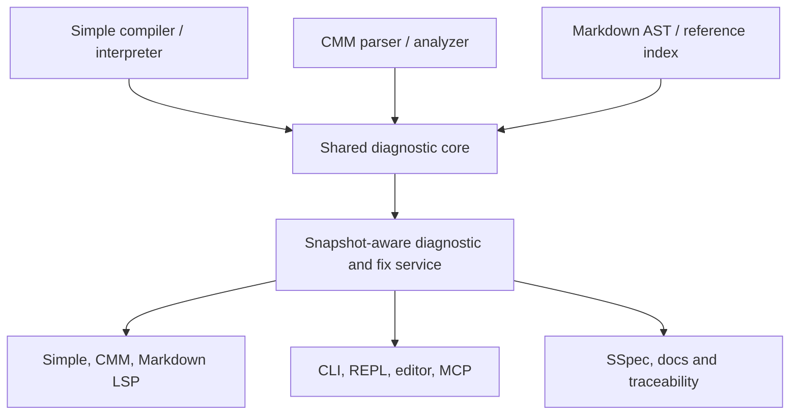

# Unified Diagnostics, Parser Recovery, and Fix Suggestions

## CMM/T32, Markdown, Simple LSP, Compiler, Interpreter, Editor, and MCP

Created: 2026-11-11; consolidated design and SSpec update: 2026-11-12

<!-- codex-design -->

**Document role:** single implementation and executable-SSpec update plan.
This document consolidates the original CMM/Simple diagnostic work with the
Markdown LSP and editor services. It describes proposed follow-up changes;
it does **not** claim those proposed changes have been implemented or tested.

**Owner decision (2026-11-12):** the CMM/T32 parser and the Simple parser use
the same parser infrastructure where possible (shared token/span/line-start
tables, recovery driver, `DiagnosticV1` emission); CMM keeps only its own
grammar tables. Implementation is parallel per phase; lanes are tracked in
`doc/03_plan/release/1.0.0/diagnostics_mcp_memory_lane_plan_2026-11-12.md`.

## Objective and scope

Share one diagnostic vocabulary, exact source locations, recovery status, and
reviewable fix suggestions between the Simple compiler/interpreter, CLI/REPL,
Simple LSP/MCP, CMM LSP/T32 MCP, Markdown LSP, and editor diagnostics panel.
Preserve existing client payloads, avoid repeated parsing, and never apply a
speculative edit without explicit approval and revision checks.

## Existing canonical contracts

- `compiler.common.diagnostics.diagnostic_v1.DiagnosticV1`: stable code,
  severity, source span, labeled spans, notes, help, and an optional machine
  replacement with confidence.
- `compiler.common.error_explanations.ErrorRegistry`: shared descriptions,
  causes, examples, and manual repair suggestions. The interpreter re-exports
  this same type through `compiler.interpreter.errors`.
- CMM's `CmmDiagnostic` is a legacy semantic-analyzer DTO; the adapter in
  `cmm_diagnostics.spl` maps it to `DiagnosticV1` at public boundaries.

## Implemented in this change

| Producer/consumer | Behavior |
| --- | --- |
| CMM parser | Preserve `CmmParseError.message`, original line/column, and a recovered AST `ErrorNode`. Report unmatched top-level `)` and missing block `)` instead of silently losing them. |
| CMM analyzer | Recursively collect `ErrorNode` syntax errors alongside semantic errors, including nested blocks and control-flow bodies. |
| Shared explanations | Add CMM1000–1004, CMM1101–1103, CMM1200, and generic CMM1999 in the compiler/interpreter registry. |
| CMM LSP | Publish diagnostic code, detailed explanation, first suggested manual fix, and selected source range; convert byte columns into LSP UTF-16 positions. |
| T32 MCP | Keep existing `diagnostics` array, add `diagnostics_v1` with canonical spans, help and available fixes. |
| CMM code action | Advertise and serve a reviewable quick fix for an unmatched `)` (`Likely` confidence). No automatic application. |
| Simple CLI query | Keep legacy JSON fields and add `description`, `help_first`, `help` from the same registry, one registry per batch. |
| Simple LSP | Expand all query-result `diagnostics` objects, instead of treating the response wrapper as one error; append explanation/help, and honor explicit end ranges. |

**Status of table above:** local, unmerged changes inherited from 2026-11-11;
real compiler/SSpec validation has not passed. These are a starting point,
not a confirmed production baseline.

### Markdown gaps found on 2026-11-12

| Source | Present behavior and integration gap |
| --- | --- |
| `src/app/md_lsp/md_lsp_handler.spl` | Completion, hover, definition, symbols, folding, `codeAction`; the reviewed handler has no diagnostic publisher. Its quick fix edits a whole line using `_md_lsp_quickfix_line`, without referencing diagnostic codes or document versions. |
| `src/app/md_lsp/md_lsp_workspace.spl` | Caches document text, parsed blocks and headings, but no diagnostic batch, fix index, graph revision or parse-recovery status. |
| `src/lib/editor/services/md_diagnostics.spl` | Markdown lint rules produce thin `EditorDiagnostic` records; `md_validate_local_links` is separate from `md_diagnose`, and rich codes/fixes are not carried through. |
| `src/lib/editor/services/md_wiki_index.spl` | Already extracts wiki links, embeds, backlinks and unresolved links from loaded documents. The index does not own live workspace discovery/invalidation. |
| `src/lib/editor/services/diagnostics.spl` | Editor view records path/range/severity/message/source and publish version, but loses canonical diagnostic code, related spans, help and fix confidence. |
| `src/app/md_lsp/md_lsp_main.spl` | Standalone stdio transport duplicates JSON parsing; its current input-parse path must be regression-tested against actual multibyte input, not a copied helper body. |
| `test/03_system/gui/editor_md_lsp_code_action_spec.spl` | Checks source text for function names and literals. Replace/supplement with actual LSP open/change/diagnostic/action/apply tests. |

## SSpec scenarios

- `test/01_unit/app/cmm_lsp/cmm_diagnostic_unification_spec.spl` exercises real
  parsing, top-level/nested recovery, retained multiple errors, unified codes,
  one reviewable edit, and the LSP label position.
- `test/01_unit/app/lsp/query_diagnostic_unification_spec.spl` checks multiple
  query errors, JSON escaping, explanation text, and preserved end position.
- `test/01_unit/compiler/interpreter/error_explanations_owner_spec.spl` checks
  that compiler/interpreter aliases resolve the CMM codes.

## Verification status and remaining work

Source edits and SSpec definitions are present. A runtime `STATUS: PASS` is
**not established** until the Simple bootstrap binary and the SPipe/SSpec
runner are available; no CI or code-review approval is claimed by this report.

Next implementation phases:

1. Move stable CMM diagnostic codes into typed producer fields (rather than
   classifying legacy text messages). Keep a generic fallback for unknown
   diagnostics; do not mislabel unrelated semantic diagnostics as syntax errors.
2. Emit `DiagnosticV1` directly from the Simple compiler/parser/interpreter
   instead of reconstructing spans from textual compiler output in the CLI.
   This will unlock exact multi-line ranges, related locations and multiple
   machine fix candidates in the Simple LSP.
3. Support unsaved `didChange` buffer overlays in the Simple LSP: today the
   heavy `check` query reads disk, and republishing it on every buffer edit
   would show stale diagnostics. The CMM LSP already reparses full sync text.
4. Make CMM syntax error tokens and lexer position mapping UTF-16 aware at the
   boundary; test combining marks, astral Unicode, CRLF, continuations, and
   EOF while retaining parser byte offsets internally.
5. Extend CMM code actions only when an exact replacement span and confidence
   can be derived. For undefined labels, suggest candidates with supporting
   symbol evidence before offering renames; never fabricate a target label.
6. Run all new/affected SSpec suites and actual JSON-RPC open/change/
   diagnostics/code-action sessions. Check latency, coverage, release artifacts,
   and documentation/spec mirrors using the repository's normal SPipe runner.

## Suggested verification commands (when runtime is available)

Run the repository-prescribed `spipe` build/SSpec check for the three suites
listed above, then exercise CMM LSP with `textDocument/didOpen`, `didChange`,
`textDocument/codeAction` on malformed CMM scripts. Confirm stable code,
line/column, help, zero errors after fixing, and that unchanged valid scripts
continue to parse.

---

## Consolidated design decisions (2026-11-12)

1. **One diagnostic semantic contract.** Reuse `DiagnosticV1`, `Span`,
   `DiagnosticFix`, `FixConfidence` and `ErrorRegistry`; do not create a
   separate incompatible CMM, Markdown, editor or LSP error taxonomy.
2. **One producer per fact.** The native compiler/interpreter emits structured
   Simple errors, the CMM parser/analyzer emits typed CMM errors, and the
   Markdown parser/link graph emits typed Markdown errors. Formatters and LSP
   handlers never rediscover the error by searching its prose message.
3. **Parse once, index once, project everywhere.** Parser AST and source
   snapshots feed diagnostics, links, navigation, rendering, SSpec and fixes.
   A document edit invalidates affected AST/index facts, not unrelated files.
4. **One view and edit policy.** CLI, REPL, editor, MCP, LSP and generated
   SSpec manuals display the same code/range/status; clients may present less
   detail but cannot reinterpret its meaning. Fixes carry revision guards.
5. **Explanations are not edits.** `help` is descriptive; only a candidate
   containing exact replacement spans and satisfied preconditions may become
   an LSP code action. `Likely` and `Uncertain` are review-only.
6. **Partial is not success.** Parse recovery, incomplete workspace indexes,
   stale snapshots, unsupported operations and internal failures must report
   explicit status. No empty-success substitution for a failed analyzer.
7. **One stable wire contract, two encodings.** Keep SDN for the repository's
   schemas, config and stored diagnostics. JSON is used at LSP/JSON-RPC and
   interoperability boundaries, with compatibility adapters for old clients.
8. **Strong API invariants.** New public diagnostic and fix APIs take required
   typed context instead of raw optional parameters; nullable legacy fields
   stay behind compatibility adapters during migration. Do not introduce
   unrestricted `nil`-driven safe-code control flow.
9. **Shared parser infrastructure (owner decision 2026-11-12).** The CMM/T32
   parser reuses the Simple frontend's token/span/line-start tables, recovery
   driver and `DiagnosticV1` emission instead of a private copy; only the CMM
   grammar tables are CMM-specific.

### Architecture and ownership



**Core ownership / dependency direction:**

- Short-term: retain the canonical implementation under
  `src/compiler/00.common/diagnostics/` and use app-level adapters; never
  introduce an editor-library-to-compiler import cycle to save a wrapper.
- Long-term: extract the language-neutral types and position-conversion logic
  into `src/lib/common/diagnostics/`. Keep the old `compiler.common.*`
  imports as re-exports until all callers migrate, with type-identity SSpec.
  Move error-registry *mechanisms* to common; keep per-language explanations
  in registered Simple/CMM/Markdown providers.
- Own workspace snapshot/revision, diagnostic aggregation, deduplication and
  fix preconditions in one service consumed by all three LSP adapters.
- `EditorDiagnostic` becomes a presentation/projection of that service,
  not an independent diagnostic source. Preserve legacy editor APIs while
  adding stable IDs/codes/help/related positions and fix references.

### Canonical record and batch contract

Preserve existing `DiagnosticV1` fields:

| Field | Contract |
| --- | --- |
| `severity`, `code`, `message` | Required, stable producer-owned identity and primary explanation. Use namespaces such as `SPL*`, `CMM*`, `MD*` without collisions; preserve established legacy codes. |
| `file`, `span`, `labels` | Source locations from parser/index, not guessed from emitted text. `Span` is byte-offset based with 1-based source line/column; labels can cross files. |
| `notes`, `help`, `children`, `macro_trace` | Causes, recovery/provenance, alternative repairs, nested diagnostics and macro expansion evidence. |
| `fix` | Current backward-compatible *single* fix with `Safe/Likely/Uncertain` confidence. |

Add an **adjacent** `DiagnosticBatchV1`/`DiagnosticActionIndex` contract rather
than incompatibly rewriting `DiagnosticV1` for snapshot data or multiple fixes.
The batch requires: `schema_version`, `producer`, `file_id`, `uri`,
`document_version`, `source_hash` (XXH3-128), `analysis_generation`,
`status`, `diagnostics`, `incomplete_reason`, and `related_files`. The action
index maps `diagnostic_id` to ordered alternative `DiagnosticFix` candidates,
their confidence, exact preconditions and disabled reasons. Keep the legacy
`.fix` as a compatibility projection of the first appropriate candidate.

Stable diagnostic IDs derive from rule code, canonical file ID, structural
node identity and an occurrence disambiguator. **Do not** use only line/column
or message text: both change under edits. Every published batch also carries
its document version so a stable ID is never mistaken for a fresh snapshot.
Use deterministic severity/position/code sorting and deduplicate overlapping
producer reports without suppressing distinct real errors.

Batch result status is separate from severity:

| Status | Required meaning |
| --- | --- |
| `complete` | Analysis finished; diagnostics may contain errors/warnings. |
| `partial_recovery` | Parsing/indexing recovered enough to return useful facts; mark unreliable regions. |
| `stale` | Input version/hash no longer matches the active document. |
| `cancelled` | Superseded/cancelled computation; do not publish a cleared list. |
| `unsupported` | The requested analysis is not implemented for this surface. |
| `internal_error` | Execution/transport/index failure; retain and mark last valid evidence without claiming a clean document. |

For source-backed diagnostics, a primary source range is required; a zero-width
range is valid only for a meaningful insertion point or empty source. For
fileless operational failures, use a typed non-source result instead of
pinning the error at `0:0`.

### Position conversion and navigation

- Parser/index records use immutable UTF-8 **byte** offsets and file IDs;
  build a line-start table once per snapshot and reuse it across all errors.
- LSP positions use negotiated encoding, default UTF-16, and 0-based
  line/character. Convert through a shared, tested byte-to-UTF-16 map;
  never assume one byte equals one code unit. Include emoji/surrogate pairs,
  Hangul, CJK, combining characters, tabs, CRLF and EOF tests.
- Highlight the actual identifier, token, path or link destination rather
  than an entire statement whenever that exact span is known. Preserve
  primary and secondary labels for declarations, references and macro traces.
- Navigation to a diagnostic opens the target file, selects the exact span and
  shows its enclosing AST context. Related-location navigation works across
  files. No fabricated positions, fake symbols or hidden source modifications.
- `textDocument/publishDiagnostics` and `textDocument/diagnostic` share the
  batch service and use proper version/result-ID semantics; code actions
  resolve against the same diagnostic ID and snapshot. Capability negotiation
  decides which standard LSP fields and methods are available.

### Human-facing error and suggestion format

Keep the editor gutter and CLI short; expand provenance, cause and repairs
on request. The example below illustrates the target *format*, not test output:

```text
error[CMM1001] file:///scripts/start.cmm:2:6-2:18
  GOTO missing_label
       ^^^^^^^^^^^^^ label not defined in this script
  Why: No matching label declaration was found.
  Related: 3 candidate labels in this document [show]
  Fixes: [1] Use existing label (Likely) [preview]
         [2] Declare a new target (Uncertain) [explain]
```

For Markdown, a broken `](missing.md)` link must point to `missing.md`,
show candidate destinations and backlink impact; for Simple, a type or
initialization error must identify the producing expression, expected type,
declaration site and valid repair alternatives. Every interface shares
the same explanation registry and fix IDs even if its UI differs.

## Language-specific implementation work

### Simple compiler, interpreter, CLI, and Simple LSP

| Owner | Required update |
| --- | --- |
| `src/compiler/00.common/diagnostics/*` | Maintain `DiagnosticV1` and SDN schema, introduce batch/action contracts and compatibility re-exports. |
| `src/compiler/00.common/error_explanations.spl` | Register stable producer-owned rules and structured explanation metadata. Stop deriving rule codes from message prose. |
| `src/compiler/80.driver/driver_parse_diagnostic.spl`, HIR/type/borrow/robustness checks | Emit positioned diagnostics directly from tokens, AST/HIR/MIR and checks. Include expected-vs-actual, declaration and recovery evidence; never map every error to a one-character fallback. |
| `src/compiler/95.interp/interpreter/errors.spl` and interpreter reporting callers | Use the same codes/ranges/explanations as compiler; add stack, value and runtime context as related frames without changing code identity. |
| `src/app/cli/query_diagnostics.spl` | Consume a typed batch through a compiler query API; stop reparsing stdout `file:line:col` or reconstructing one-char ranges in the normal path. Preserve legacy `check --format=json` fields during transition. |
| `src/lib/nogc_sync_mut/lsp/lsp_handlers.spl` and the actual enabled runtime variant | Remove the no-op `didChange`: validate the complete unsaved document snapshot, debounce/cancel stale checks, and publish results for the edited buffer rather than disk content. Maintain push/pull consistency. |
| `src/app/simple_lsp_mcp/*` and editor diagnostics service | Forward source batches, stable code, related data, traceability links, fix suggestions and failure status without changing semantics. |

**Compiler/interpreter invariants:** a parse failure must be a real nonzero
compile/check result, not a success with a warning; no binary/artifact or
up-to-date receipt may be recorded for invalid code. In the REPL/interpreter,
preserve the last valid module on invalid updates. Allow subsequent unrelated
nodes to be analyzed after bounded recovery, without hiding the primary
syntax error behind cascaded semantic errors. High-cost proofs and whole-MIR
verification stay behind debug/inspection/CI analysis modes; inexpensive
typed checks remain available in normal builds.

### CMM / TRACE32 PRACTICE and T32 MCP

| Owner | Required update |
| --- | --- |
| `examples/10_tooling/trace32_tools/cmm_lsp/cmm_parser_core.spl` and `cmm_parser*.spl` | Carry typed `CmmParseError` with code, exact token span and expected token set; make bounded panic-mode recovery advance or terminate, preserving `ErrorNode`s and following valid statements. Reuse the Simple frontend's token/span/line-start and recovery infrastructure (owner decision 9). |
| `cmm_analyzer.spl`, `cmm_diagnostics.spl` | Retain the earlier nested-error collection but remove `cmm_diagnostic_code()`'s message-string heuristics. All emitters assign stable CMM codes at creation; attach reference/definition spans and scope context. |
| `lsp_handlers.spl`, `lsp_server.spl`, `lsp_document.spl` | Publish versioned diagnostics after open/change/close, support related locations and multiple reviewable actions, handle stale/cancelled results and exact UTF-16 token spans. |
| `examples/10_tooling/trace32_tools/t32_lsp_mcp/tools.spl` | Keep the legacy `diagnostics` response; serve canonical `diagnostics_v1` plus explicit batch status/version and fix lookup. Never silently treat parse recovery as zero errors. |

**Critical parser SSpec:** `LOCAL` without names on line 2; `ELSE` without an
`IF`; `GOTO missing_label`; an unexpected `)`; nested malformed statements;
unterminated `(` with earlier recoverable errors; valid statements after
errors; missing body at EOF; no loop/hang on adversarial delimiters.
Check the precise token span and error count through parser, analyzer,
LSP and MCP. Do not turn an unknown CMM command into a false syntax error
because it is not in the current command database.

### Markdown LSP, editor lint, and wiki graph

| Owner | Required update |
| --- | --- |
| `src/app/md_lsp/md_lsp_workspace.spl` | Own document version, immutable parse snapshot, block/heading/link indexes and diagnostic-batch handle. Avoid a second independent parse after `didChange`. |
| `src/app/md_lsp/md_lsp_handler.spl` | Use canonical diagnostics from Markdown analyzers; publish/clear on open/change/close and support pull diagnostics. Replace `_md_lsp_quickfix_line` as the authority for edits with `DiagnosticActionIndex`. |
| `src/app/md_lsp/md_lsp_main.spl` | Split import-safe protocol parser/transport from the executable stdio loop. Unify JSON escaping and Content-Length framing with shared LSP protocol utilities. |
| `src/lib/editor/services/md_diagnostics.spl` | Convert lint results into typed `MD*` codes and byte spans. Integrate duplicate headings, anchor links, missing alt text, fences, heading jumps, intentional Markdown hard-line-break semantics, frontmatter and local file checks. |
| `src/lib/editor/services/md_wiki_index.spl` | Reuse existing link, embed, backlink, unresolved-link and orphan graph. Resolve relative paths/anchors once per workspace snapshot; invalidate affected reverse edges when a target changes, moves or disappears. |
| `src/lib/editor/services/diagnostics.spl` and `md_lsp_config.spl` | Project canonical diagnostics into editor rows/gutter and version-check actions. Surface stale/incomplete states instead of blank green panels. |

**Markdown diagnostic codes (proposed namespace):** `MD1001` broken local
link, `MD1002` unknown anchor, `MD1003` unresolved wiki-link/embed,
`MD1004` duplicate heading/anchor, `MD1005` unclosed fence, `MD1006`
invalid frontmatter property, `MD1101` missing image alt text, `MD1102`
orphan document, `MD1103` inconsistent heading/list structure, `MD1104`
unsafe/escaping path. Register descriptions and examples centrally; do not
reuse any already-assigned repository code without checking the registry.

**Link-resolution rules:** ignore links inside fenced code and examples;
resolve wiki aliases, relative Markdown links, fragments, case-sensitive
targets and renamed documents according to explicit workspace policy.
Distinguish intentionally external links, generated files, ignored folders,
unindexed documents and truly missing files. An orphan warning requires a
complete, appropriately scoped graph; incomplete indexing must produce
`partial_recovery`, not a false orphan. Never use a link target to read or
edit files outside the authorized workspace root without an explicit grant.

**Markdown parsing strategy:** reuse `std.common.markdown` AST and the
existing wiki index as the baseline. A Tree-sitter incremental adapter is
optional and must map into the same immutable nodes/ranges rather than create
parallel semantics. Maintain compact fixed fields for common AST data,
sparse maps for uncommon properties, lazy link/diagram expansion, and
XXH3-128 content identity. Tree-sitter `ERROR` and `MISSING` nodes are evidence
of recoverable syntax, not permission to discard downstream structure.

## Fix suggestion engine and safe application

### Candidate generation and ranking

`DiagnosticActionIndex` returns **multiple alternatives** for one diagnostic.
Each candidate has an ID, title, confidence, explanation, affected files,
minimal source replacement spans, required snapshot/version, expected old
content, a semantic guard, estimated side effects and a disabled reason.
Order by correctness/semantic preservation first, then scope, confidence,
edit size and expected execution cost. Do not rank solely by shortest edit.

| Rule/example | Candidate | Confidence and application policy |
| --- | --- | --- |
| Markdown extra space on an otherwise empty line | Remove unused whitespace outside fences | `Safe` only after verifying it is not an intentional hard line break |
| Markdown heading missing a separating space | Insert the required separator at the token boundary | `Safe` only when parser proves intended heading syntax |
| Markdown broken link | Change target to a uniquely evidenced file/anchor | `Likely`; show destination, backlinks and diff; user selects |
| Markdown missing alt / `[]()` placeholder | Suggest meaningful alt/label/URL alternatives | `Uncertain`; never synthesize fake descriptive text or auto-apply |
| CMM unexpected `)` | Remove unmatched delimiter or restore the matching `(` | Existing remove action is `Likely`; show both possibilities when evidence permits |
| CMM undefined label | Suggest matching real symbol declarations or cross-script reference | `Likely` if corroborated; do not invent a jump target |
| Simple missing delimiter / recognized deterministic typo | Minimal token insertion or replacement at parser-certified span | `Safe` only when recovery and reparse confirm unambiguous semantics |
| Simple type/optional/state mismatch | Offer convert/default/state-transition/guard alternatives | Usually `Likely` or `Uncertain`; never erase safety invariants just to compile |

No generic full-line rewrite is considered safe. A Markdown line with two
trailing spaces may encode a hard line break; a fix must not silently trim it.
No LLM-produced code is `Safe` solely because an LLM proposed it. Suggestions
can be synthesized for user review, but require the normal syntax, semantic,
security, style and SSpec gates before being offered as a machine fix.

### Revision-checked edit transaction

1. Snapshot the document URI/file ID, content hash, version, source map and
   linked-file versions. Analyze that immutable snapshot.
2. Attach exact candidate replacements to the diagnostic ID. Validate that
   replacements are ordered, in bounds, nonoverlapping and within permitted
   roots. Reject ambiguous bytes-to-UTF-16 conversions.
3. Expose a `textDocument/codeAction` for the requested diagnostic/range;
   include `disabled.reason` when the action cannot safely apply. Use
   `codeAction/resolve` for expensive generation only when supported.
4. Offer a preview containing old/new text, affected files and confidence.
   `Safe` means eligible for an explicit user-configured auto-apply policy;
   `Likely`/`Uncertain` always require user confirmation.
5. Before applying, recheck version, source hash and expected old text for
   **every** target file. Use versioned LSP `documentChanges` for client edits
   and one atomic multi-file edit transaction where available.
6. If any precondition fails, apply nothing, mark the candidate `stale`,
   request a new analysis and preserve all user changes. Do not silently
   recompute an action and apply it at a different location.
7. After a successful edit, reparse and run relevant checks once. Record
   successful diagnostic resolution, surviving warnings, and any newly
   introduced error. Revert or offer rollback when postconditions fail.

**Special cases:** insertion-point fixes may be zero-width; multiple edits
must not overlap; fixes spanning a rename must update backlinks and references;
cancelled/superseded edits must never use an old version; a quick fix is
disabled when the parser/index status does not contain sufficient evidence.
CodeAction titles must describe the proposed change, never the unhelpful
generic label `Apply quick fix`.

## Executable SSpec update matrix

The paths below are **required implementation work**, not files created by
this design-only update. Retain existing meaningful tests and replace
source-string-only checks with direct module calls or real JSON-RPC sessions.
All new tests must use real assertions and built-in SSpec matchers; no
`pass_todo`, tautological expectations, stub parser or hardcoded-success helper.

| Requirement | Acceptance behavior | Executable SSpec owner |
| --- | --- | --- |
| `REQ-DIAG-001` canonical model | Same stable code/severity/message/span/help/fix after Simple, CMM and Markdown adapter round trips; no lossy projection in canonical API | `test/01_unit/compiler_shared/diagnostics/diagnostic_v1_spec.spl` (extend); new `test/01_unit/lib/common/diagnostics/diagnostic_batch_spec.spl` after extraction |
| `REQ-DIAG-002` explanation ownership | Compiler and interpreter use the same registry type and rule metadata; MD/CMM providers cannot overwrite another namespace | `test/01_unit/compiler/interpreter/error_explanations_owner_spec.spl` (extend) |
| `REQ-DIAG-003` exact ranges | Bytes -> 0-based UTF-16 -> bytes round trip with CJK, emoji, combining marks, CRLF, EOF, tabs; multi-line/zero-width spans valid | new `test/01_unit/lib/common/diagnostics/source_position_spec.spl` |
| `REQ-DIAG-004` parser recovery | Original error, precise location, bounded progress and valid following statements; status `partial_recovery`, no fake success or artifact | `test/01_unit/app/cmm_lsp/cmm_diagnostic_unification_spec.spl` (extend); new compiler parser recovery spec |
| `REQ-DIAG-005` Simple typed emit | Parser/type/HIR and interpreter emit identical codes/primary span; runtime context appears as related frame; CLI return code remains nonzero on failure | new `test/02_integration/app/diagnostics/simple_compiler_interpreter_spec.spl` |
| `REQ-DIAG-006` Simple LSP sync | Three distinct errors survive one query, unsaved didChange uses latest text, obsolete version is discarded, push/pull return same batch | `test/01_unit/app/lsp/query_diagnostic_unification_spec.spl` (extend); new `test/03_system/tools/lsp/simple_diagnostic_snapshot_spec.spl` |
| `REQ-DIAG-007` CMM/T32 | Undefined label highlights target; bad nested block does not consume `)`; subsequent code analyzed; MCP legacy + `diagnostics_v1` agree | CMM SSpec above and `test/03_system/feature/app/t32_tools/t32_lsp_mcp_spec.spl` (upgrade actual tool call) |
| `REQ-DIAG-008` Markdown lint | Duplicate headings, invalid anchors, fences, alt, frontmatter and line-break rules yield MD codes on exact tokens; code fences do not produce false findings | new `test/01_unit/app/md_lsp/md_diagnostic_adapter_spec.spl` |
| `REQ-DIAG-009` Markdown graph | Broken relative/wikilink/embed, renamed target, backlinks and orphans invalidate only affected graph edges; incomplete workspace does not report false orphan | `test/01_unit/lib/editor/services/md_wiki_index_hardening_spec.spl` (extend); new `test/02_integration/app/md_lsp/md_workspace_graph_spec.spl` |
| `REQ-DIAG-010` code actions | Multiple alternative fixes with `Safe/Likely/Uncertain`, exact spans and honest disabled reasons; previews show real diffs | new `test/01_unit/lib/common/diagnostics/fix_candidates_spec.spl` |
| `REQ-DIAG-011` transaction safety | Version/hash mismatch, overlapping edits, denied path, changed dependency or declined preview applies **zero** edits; valid edit reparses and resolves finding | new `test/02_integration/app/lsp/diagnostic_fix_transaction_spec.spl` |
| `REQ-DIAG-012` end-to-end LSP | Real initialize/open/change/diagnostic/codeAction/apply/close for all three servers; no stdout protocol pollution; no stale or fabricated clean batch | new `test/03_system/tools/lsp/unified_diagnostics_e2e_spec.spl`; upgrade `test/03_system/gui/editor_md_lsp_code_action_spec.spl` |
| `REQ-DIAG-013` traceability | Requirement -> SSpec -> producer -> code/fix -> CLI/LSP/MCP/manual navigation works; generated spec uses true test evidence | new `test/03_system/feature/usage/diagnostic_traceability_spec.spl` |
| `REQ-DIAG-014` performance/resource | Warm edit and code-action latency meet measured budgets; no full workspace scan or heavy process per keypress; cache invalidation correct | new `test/05_perf/app/lsp/unified_diagnostics_perf_spec.spl` |
| `REQ-DIAG-015` failure hardening | Malformed JSON, malformed UTF-8, overlong tokens, truncated frame, cancelled request, handler crash and unsupported capability never become empty success | new `test/03_system/tools/lsp/unified_diagnostics_negative_spec.spl` |

### Required BDD/system journeys

**Journey A: Simple compiler/interpreter -> editor.** Open an invalid `.spl`
containing a parser error and a later independent type error; `didChange` before
saving; assert both diagnostics have exact current-version spans, matching
compiler/interpreter codes, useful alternatives, and navigable related
declarations. `simple check` must fail nonzero; build artifacts and the
up-to-date receipt must not be written. The REPL retains its last valid state.

**Journey B: CMM -> LSP -> T32 MCP.** Open a CMM script with an unresolved
`GOTO` on line 2, a malformed inner block and a later valid statement;
assert three independent positioned findings, CMM codes and correct
severity, no swallowed close delimiter, and equivalent rich MCP records.
Request all fixes; preview a delimiter correction; decline or apply and
assert the document changes exactly once. Navigating the unresolved label
must not invent a definition.

**Journey C: Markdown -> graph -> repair.** Open `index.md` referencing
`[[notes/missing]]`, `guide.md#wrong-anchor` and an image without alt text.
After indexing all documents, assert the exact link/alt spans, reference
provenance and distinct MD codes. Rename `guide.md` through the edit service;
assert only dependent diagnostics/backlinks update. Provide a reviewable
retarget action, apply with a matching version, and verify graph and LSP
recompute once. Broken links inside fenced code must remain undiagnosed.

**Journey D: snapshot race.** Publish diagnostics for version 7, edit to
version 8, then deliver a delayed version-7 reply. Assert version 8 remains
authoritative, the old action is disabled, and an attempted stale edit makes
no source mutation. Repeat with `cancelled` and `partial_recovery` statuses.

**Journey E: UTF-8 and transport.** Exercise real JSON-RPC framing with
Korean/Japanese/Chinese text, emoji before a token, escaped quotes, CRLF,
an empty final line, Unicode links and a multi-file replacement. Compare
decoded LSP positions to primary byte offsets and validate Content-Length
against UTF-8 byte length, not a codepoint count. Ensure no diagnostic or
telemetry message leaks onto protocol stdout.

**Journey F: multiple fixes and safety.** A Simple type mismatch or Markdown
broken link offers two or more distinct alternatives. Selecting `Safe` may
perform an explicitly authorized edit after preconditions; selecting
`Likely` requires review. Try overlapping fixes, stale expected text and a
path escaping the workspace. No partial write is allowed; report each
rejection with a clear disabled reason and unchanged content hash.

### SSpec writing and evidence rules

- Prefer direct imports of production parser/analyzer/transport modules.
  Refactor entrypoints with unconditional server loops so tests can import
  their parser/handler safely. **Do not** maintain copied production helpers
  as the only regression test (the current Markdown multibyte field spec is
  a documented example of this drift risk).
- Every scenario asserts observable output: exact error code, source range,
  severity, file/version, status, candidate confidence, file delta and
  post-fix reanalysis. Source contains-text tests may complement but never
  substitute for runtime behavior.
- Use `step("...")` for primary scenario actions and `@capture` with
  `protocol`, `text`, `artifact` or `tui` as appropriate. Primary generated
  manuals show user/operator flows; setup is folded/hidden, detailed matrices
  available on demand. No placeholder screenshots or synthetic PASS records.
- Generate mirrored Markdown SSpec manuals from executable files: for
  example, `test/03_system/tools/lsp/unified_diagnostics_e2e_spec.spl` maps
  to `doc/06_spec/03_system/tools/lsp/unified_diagnostics_e2e_spec.md`.
  Require `0 stubs` and keep all executable `.spl` out of `doc/06_spec`.
- Keep all new requirement IDs in SSpec annotations and propagate them to
  feature records, implementation symbols and the traceability index. When
  a runtime or toolchain is absent, report **NOT RUN** rather than PASS.

## Performance, cache, invalidation and observability

| Surface | Hot-path requirement | Cached artifact and invalidation |
| --- | --- | --- |
| Simple LSP | No disk-only recheck of unsaved text and no per-keystroke full compiler process by default | Immutable source snapshot, incremental AST/HIR and typed diagnostic batch; invalidate changed dependency closure |
| CMM LSP | No repeated whole-file scan per diagnostic and no repeated registry rebuild per cursor request | Line-start/UTF-16 maps, AST, symbols, diagnostic batch, precomputed action index; invalidate document revision |
| Markdown LSP | No vault-wide reindex for one edited link; lazy cross-file anchor/backlink updates | Immutable MD AST/link table, file-ID/XXH3-128 cache, forward/reverse graph; invalidate changed file and dependent edges |
| Editor/MCP/CLI | Render/query from published batch, not independent parse and guessed locations | Versioned diagnostic projection keyed by file ID + generation; discard stale results |

Measure and report `cold_start_ms`, `warm_start_ms`, `diagnostic_p50/p95_ms`,
`code_action_p95_ms`, `files_reparsed`, `edges_invalidated`, `cache_hit_rate`,
`bytes_scanned`, `peak_RSS`, `cancelled`, `stale_discarded`, and
`fix_precondition_rejected` by language and workload. Record counts and
durations without logging sensitive source excerpts by default.

**Candidate NFR targets pending baseline measurement and user selection:**

- No full-workspace scan on an ordinary single-file edit; only affected
  dependency closure may be revisited.
- Typical warm 100 KiB document diagnostics: p95 no more than 100 ms on a
  reference developer workstation; no process spawn in the hot path.
- Warm code-action lookup: p95 no more than 50 ms when candidates are cached.
- An indexed 3,000-document Markdown workspace should update a single-link
  change without rebuilding the whole graph; record p95 and RSS before
  finalizing numeric release thresholds.
- Correctness, no stale writes and no false PASS are hard gates even if
  latency targets are not yet achieved. Expensive verification stays in
  debugging, investigation and CI modes unless low-cost by construction.

## Implementation sequencing and file-change plan

| Phase | Scope / concrete change | Acceptance gate |
| --- | --- | --- |
| P0 — freeze baseline | Inventory current code and unmerged patches; capture failing actual CMM/MD/Simple JSON-RPC cases and canonical output. Preserve existing dirty files. | Existing SSpec results labeled PASS/FAIL/NOT RUN, no duplicate ownership |
| P1 — shared contract | Introduce batch/status/action schema with SDN and versioned adapters; eventual `src/lib/common/diagnostics/` extraction with old module aliases retained. | REQ-001/002/003, type identity, byte/UTF-16 round trips |
| P2 — Simple native emit | Emit `DiagnosticV1` at parser/HIR/type/interpreter sources; typed query API; Simple LSP unsaved overlay, cancel and push/pull consistency. | REQ-004/005/006 and real nonzero-check/no-artifact SSpec |
| P3 — CMM hardening | Typed error codes at producer, token ranges, bounded recovery, semantic deduplication, snapshot-aware CMM/T32 LSP and MCP. | REQ-004/007, CMM golden range and recovery scenarios |
| P4 — Markdown consolidation | Connect existing MD lint + wiki graph to shared batch; implement real diagnostic publication; remove line-rewrite fix authority; incremental invalidation. | REQ-008/009/012, MD graph and LSP journeys |
| P5 — fix service | Generate/rank multiple candidates; confidence/disabled reasons; versioned edit transaction and rollback/postcheck; common editor presentation. | REQ-010/011, no stale or partial writes |
| P6 — verify & land | Update guides and generated SSpec manuals, traceability, negative, performance, multi-platform checks, review and PR. | REQ-012–015, `STATUS: PASS` before merge |

Design choice to resolve before large code moves:

| Approach | Benefits | Costs / effort |
| --- | --- | --- |
| **A. Move diagnostic core to `std.common` immediately** | Strong final ownership, direct editor reuse | Higher ABI/dependency migration risk; XL, many runtime variants |
| **B. Adapter first, migrate canonical core behind compatible re-exports** (recommended, **selected 2026-11-12**) | Keeps previous CMM/Simple patches usable, incremental testability, avoids library cycles | Temporary adapters and dual import paths; L, cross-cutting |
| **C. Keep separate records forever** | Small short-term patch | Permanent drift, duplicate fixes, inconsistent positions; low initial effort, unacceptable long-term maintenance |

Approach B is selected (owner, 2026-11-12). Implement each phase only with
its relevant SSpec and ownership gates; do not force all variants into a
single risky change.

### Release/verification checklist

- [ ] Identify the actual runtime variant used by installed Simple LSP and
      test it (not only the `nogc_sync_mut` copy); inspect other variants for
      contract drift.
- [ ] Make CMM, Simple and Markdown server entrypoints import-safe and run
      real protocol framing tests; use typed JSON parsers with bounded input.
- [ ] Run `check` on compiler, lib, MCP, Simple LSP MCP, MD LSP and CMM/T32
      entry closures; run targeted SSpec and relevant integration tests once.
- [ ] Verify `git diff --check`, no unrelated dirty-file edits, and exact-head
      review; ensure no source text changes without an approved edit action.
- [ ] Record failing reproduction cases and passing fixed evidence; run
      security/privacy and realistic startup/latency/RSS checks.
- [ ] Generate/inspect all SSpec manuals with no stubs, broken links or
      orphaned REQ IDs; update `doc/07_guide` and relevant LSP/MCP/SSpec
      skills when behavior changes.
- [ ] Do not label the feature complete or publish/merge it without the
      repository's full `STATUS: PASS` verification and PR requirements.

## External primary references

- [Official Language Server Protocol 3.18 specification](https://microsoft.github.io/language-server-protocol/specifications/lsp/3.18/specification/) — diagnostic publication/pull, position encoding, code actions and workspace edits. Maintain 3.17 compatibility where negotiated.
- [Tree-sitter incremental editing](https://tree-sitter.github.io/tree-sitter/using-parsers/3-advanced-parsing.html) — edit old tree, parse with old tree, track changed ranges and independent node positions.
- [Tree-sitter `ERROR` and `MISSING` nodes](https://tree-sitter.github.io/tree-sitter/using-parsers/queries/1-syntax.html) — recoverable parse evidence for adapters, not silent failure.

This is the **single consolidated design/SSpec/implementation plan**. The
2026-11-11 code changes and their unverified status remain visible above;
the new Markdown and cross-language phases are not yet implemented.
