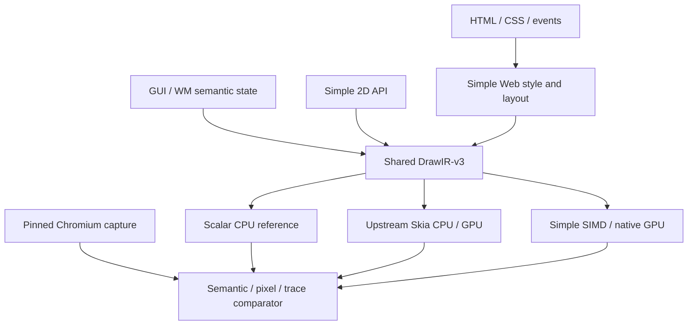

# Simple 2D / Web / GUI / WM: Unified Rendering Correctness, Performance, Memory, and Async Recovery Plan

**Status:** Revised implementation design and work plan with shared Vulkan toolchain setup, browser/Skia buffer capture interfaces, RenderDoc investigation lane, and observed local smoke results (not an implementation-complete report)  
**Date:** 2026-11-13  
**Scope:** Simple 2D, Engine2D, Web HTML/CSS, GUI, WM/compositor, CPU/SIMD/GPU backends, Skia reference, Chromium capture, SSpec/test runner, performance and memory diagnostics  
**Priority:** Correctness and evidence first; performance and memory measurement begin immediately; optimizations are admitted only without correctness regressions.

## 0. Executive decisions

Simple has substantial 2D, Web, GUI and WM code, but public API presence, compilable source, and passing semantic tests are **not** evidence of a correct displayed image. This plan turns the existing architecture into an evidence-driven pipeline with independent drawing, browser-layout, output, and execution oracles.

1. **Retain one shared packed DrawIR-v3 / `UiSceneColumnArenaV2`.** Web and GUI keep private semantic/layout data, but lower through the shared arena and `Engine2D`. Do not add a second public WebIR/GuiIR, direct per-widget GPU calls, or a replacement rendering engine.
2. **Keep native Simple 2D and native GPU renderers.** Integrate **upstream Skia** as an optional independent reference and renderer through a versioned native boundary; a Simple namespace called `skia` alone does not establish upstream parity.
3. **Add independent Chromium capture.** Compare Simple Web's own DOM/style/layout/paint/final pixels against Chromium. Separately translate Chromium paint operations into Simple DrawIR to test the raster backend without assuming Simple Web layout is correct.
4. **Every result carries proof:** backend identity; covered/unsupported/skipped operation counts; correct input and output generations; actual admitted/submitted/executed/retired/presented states; synchronized final buffer; test environment and reference version. `PASS` with missing pixels, unobserved GPU execution, stale frames, or hidden fallback is forbidden.
5. **Use SSpec as the uniform declaration and result interface.** Unit, integration, system, fuzz, differential, perf, memory, and async lanes call one rendering qualification engine. Do not create a parallel test framework that bypasses Simple's test runner.
6. **Instrument performance/memory from phase 0.** Measure source stage, frame stage, allocations, retained memory, GPU residency, copies, and queueing; defer aggressive optimization until a deterministic pixel oracle is green.
7. **Verify both sync and async execution.** A deterministic synchronous reference is a diagnostic path, not an alternative architecture; test `RenderRing` with real delayed completion, overlap, cancellation, generation changes, and device loss. Strict GPU-required mode must not silently fall back to CPU.
8. **Make bug fixes durable.** Every visual, performance, memory, lifecycle, and async bug produces a minimal SSpec reproducer with provenance and a regression gate.
9. **Vulkan is REQUIRED for the primary cross-platform comparison.** Every qualifying Simple, Skia, and Chromium sample must attest the actual native Vulkan device/backend, with macOS using a Vulkan portability implementation such as MoltenVK where possible. A CPU, Metal, D3D, SwiftShader or GL fallback may run as a **diagnostic** lane but never pass the Vulkan-qualified comparison. If Chromium cannot use Vulkan on a host, that host's Chromium/Vulkan cell is blocked, not silently marked passing.

### What 100% means

The enforceable target is **100% of the explicitly declared supported contract**, not 100% of the evolving Web platform or bit-for-bit equality across every GPU, font engine, and OS. Report separately (a) operation/API inventory coverage, (b) supported feature test coverage, (c) tested feature pass rate, (d) WPT compatibility, (e) website visual fidelity, and (f) platform/backend evidence. Unsupported features must be explicit failures or documented exclusions, never silently rendered as a different feature.

## 1. Prior evidence and required fresh audit

Earlier project audits identified these potential root causes. They are hypotheses to revalidate on the current commit, **not assertions that every issue still exists**:

| Earlier finding | Risk | First audit check |
|---|---|---|
| Some DrawIR executors recognized rect/text/image but skipped path/edge/group/port | Incomplete scenes with falsely passing API tests | Enumerate op kinds emitted, supported, executed and skipped in every backend |
| Skia-like wrapper skipped text/paths/points, truncated float coordinates, lost stroke and radius semantics | Geometry and AA mismatch | Compare upstream Skia native calls to Simple wrapper's serialized parameters |
| Prototype Vulkan path did not prove submission or nonempty readback | Empty/stale frames | Validate real submit, barrier, fence/timeline, readback and presented generation |
| WM `render_all()` and GUI/Web content-kind routing were not fully connected | GUI tree produces HTML/default rendering instead | Trace real GUI `any`/widget tree to actual frame input and hit-test ownership |
| SIMD paths produced corrupted pixels and had boxing/gather/scatter costs | Slower and wrong frames | Isolate scalar/SIMD per primitive, compare exact operation outputs |
| Scene writers copied temporary arrays; demos used full clears and readbacks | High CPU and memory bandwidth costs | Count allocations, copies, bytes, dirty tiles, GPU readbacks per frame |
| GUI/window events and async GPU queue sometimes used incomplete lifecycle paths | Wrong frame ownership, hangs, drops | Delayed completion, resize, input, focus and device-loss system tests |
| Test suites sometimes passed discovery/coverage prerequisites while actual rendering suites failed | False confidence | Reject `no tests`, skips, placeholders, and proxy-only passes |

At the start, record the current commit, compiler/runtime version, host/device, available backends, run commands, feature flags, test cases, and exact failures. Determine which of the above have already been fixed. Do **not** duplicate implemented infrastructure or rework a healthy subsystem.

### Repository discovery targets (verify before changing)

- `src/lib/skia/` and the actual upstream Skia C/SFFI boundary.
- Shared DrawIR, `DrawIrComposition`, `UiSceneColumnArenaV2`, `Engine2D`, and CPU scalar/SIMD/GPU executors.
- Web DOM/style/layout/paint and GUI/WM `WmContentFrame`, `RenderSurface`, content-kind and generation routing.
- `src/lib/common/ring/`, `src/lib/nogc_async_mut/ring/`, `src/os/abi/ring_v1.spl`, `src/runtime/platform/ring_*` and current `RenderRing`/fence implementation.
- Existing `test/01_unit`, `02_integration`, `03_system`, `04_smoke`, `05_perf`, SSpec runner, XRay, trace/profiling and error reporting.
- Existing Chromium oracle/WPT fixtures and previously added golden-image or Skia tests; reuse and repair them.

Do not assume that a particular historical path remains identical in the current repository. Produce an inventory report with real file/symbol references before coding.

## 2. Architectural boundaries and oracle matrix



There are **four logically separate experiments**:

| Experiment | Input | Execution | Finds defects in |
|---|---|---|---|
| A. 2D primitive parity | Shared deterministic draw test / DrawIR | upstream Skia CPU vs Simple scalar vs Simple SIMD/GPU | API mapping, geometry, text, paint, raster and GPU |
| B. Chrome paint replay | Chromium paint recording plus paint-property state | normalized adapter → Simple DrawIR → Simple 2D | Simple 2D and the recording adapter, independent of Simple HTML layout |
| C. Simple Web end to end | Identical frozen HTML/CSS/assets | Simple parser/style/layout → DrawIR → chosen backend | CSS, layout, stacking, paint emission and rendering |
| D. GUI/WM parity | One canonical widget tree, state and input sequence | native GUI vs generated HTML/CSS in Simple Web and Chromium | GUI generation, semantics, content routing, composition and input |

Experiment B is **not** evidence that Simple Web parses or lays out HTML correctly. Experiment C is not enough to localize a wrong pixel. For any mismatch, compare earliest available intermediate state: computed style, element/fragment rectangle, paint property, DrawIR operation, raster tile, composited surface, presented frame.

### Ownership and IR invariants

- Web owns DOM/CSS style, line breaking, stacking contexts and backdrop-root selection. Skia does not provide a browser layout engine.
- GUI owns widget semantics, focus/hit testing and state; `Engine2D` owns drawing, not widget behavior.
- DrawIR is immutable/sealed for each admitted frame. Later semantic mutations generate a new revision, not in-place changes to an in-flight frame.
- Use object/resource IDs plus generation numbers. A reused slot cannot be confused with an old GPU completion.
- Explicitly model group, port, clip, transform, opacity, effect, blend, mask, scroll and nested surface semantics in the **existing** DrawIR design, extending it minimally when the current schema cannot express the contract.
- Reference CPU must be deterministic and headless. Native GPU remains a first-class independent implementation. The optional Skia backend must not silently become the implementation of Simple's native renderer.

## 3. Upstream Skia wrapper and 2D correctness

### 3.1 Versioned adapter

Use a small C-compatible API around an exact pinned upstream Skia revision. Keep Skia C++ types out of the public Simple ABI. The adapter owns/refcounts `SkSurface`, `SkCanvas`, `SkPaint`, paths, shaders, filters, images, fonts and GPU contexts. Provide explicit `create/destroy`, typed resource handles and generation validation; fail on invalid resource use.

The host Vulkan provider and Skia's Vulkan context must have one documented queue, synchronization and image-ownership contract. Support a CPU raster Skia lane **first**; add Skia-GPU Vulkan only after same-operation CPU parity. Keep `native-vulkan`, `upstream-skia-cpu`, `upstream-skia-vulkan` and `simple-cpu-scalar` identities distinguishable.

### 3.2 API inventory

Build a generated inventory of upstream public APIs relevant to 2D rendering. Each line specifies `mapped`, `not-applicable`, `unsupported`, `implemented`, `unit-tested`, `pixel-tested`, `GPU-tested` and `bug ID`.

| Inventory family | Required edge cases |
|---|---|
| Canvas state | save/restore, saveLayer, nested clips, CTM state, empty/inverse clip |
| Geometry and paths | rect/rrect with independent radii, arcs, curves, path fill rules, fractional coordinates, nonuniform transforms |
| Paint | stroke joins/caps/miter, AA, blends, gradients, image shaders, alpha and color filters |
| Text | glyph placement, shaping, kerning, fallback, Hangul/CJK, Latin, Arabic/RTL, emoji, font substitutions |
| Images | decoded resource identity, alpha, crop, repeat, nearest/bilinear sampling, scale and orientation |
| Filters/effects | blur, drop shadow, color matrix, masks, group opacity, nested filters, backdrop behavior |
| Color | sRGB/linear conversion, alpha premultiplication, rounding, clipping, transparent pixels |
| Resource/lifetime | destruction during in-flight use, resizing, context loss, pool reuse, cross-frame reference |

For **each supported operation**: parameter round-trip test → upstream Skia CPU pixel oracle → Simple scalar pixel test → SIMD/GPU parity → explicit unsupported/skip assertion. Use fixed seeds plus boundary-value fuzzing. Never use only image hashes when a math invariant (e.g. bounding box or blend equation) provides a more independent oracle.

### 3.3 Strict rendering receipts

A successful render receipt must include `declared_ops`, `admitted_ops`, `executed_ops`, `unsupported_ops`, `skipped_ops`, `cpu_fallback_ops`, `nonzero_drawn_pixels`, `frame_revision`, `surface_revision`, `backend_identity` and `completion_state`.

Rules:

- In a strict supported test, `unsupported_ops=skipped_ops=0`.
- `executed_ops` must reconcile with submitted operations after legal batching/culled operations are accounted for individually.
- A blank image passes **only** if independently expected; an ordinary drawing case must prove changed pixels in the expected region.
- GPU-required mode forbids hidden CPU execution and requires actual GPU completion evidence.
- A backend failure cannot be converted into a uniform-color output or fabricated success.
- On incomplete output, record the specific rejected operation and avoid presenting a partially successful frame as full success.

## 4. Chromium capture and replay

### 4.1 Unmodified Chromium diagnostic lane

Use a pinned Chromium build and Chrome DevTools Protocol:

1. `Page.captureScreenshot` for the final reference.
2. DOM snapshot/layout information, computed styles and element rectangles for the layout oracle.
3. `LayerTree` snapshots and available command logs for **diagnostic** paint evidence, recognizing their experimental/incomplete scope.
4. Tracing/Perfetto for frame generation, paint, raster, compositing and GPU timing.

Freeze viewport, DPR, media emulation, browser flags, fonts, CSS state, assets, scroll, focus and animation time. Wait for load, fonts and actual paint completion; support a test-controlled readiness handshake for asynchronous content. Save exact Chromium version and machine configuration.

### 4.2 Instrumented Chromium lane

For comprehensive call/semantic capture, patch a pinned Chromium source revision at the **paint artifact / `cc::PaintOpBuffer`** boundary, not only `SkCanvas`. Capture:

- Paint operation and float arguments; paint order and identity.
- Transform, clip, effect and scroll property-tree ancestry.
- Layer composition, backdrop filter bounds, opacity, blend, mask and isolation.
- Image/shader/font/glyph resource metadata; do not assume external pointers survive serialization.
- Layout-object/DOM provenance where available; record unresolved provenance explicitly.
- Intermediate layer/tile readbacks and final output, with the capture's synchronization point.

Normalize to a versioned *capture format*, then translate the supported subset into shared DrawIR. Include a `not_replayable` error for operations and surfaces the translator cannot faithfully express. Keep upstream capture artifacts separate from Simple's canonical IR. Raw Chrome paint-op counts cannot be compared directly to Simple DrawIR counts because batching, culling and layerization differ.

### 4.3 Two separate pass criteria

- **Replay parity:** Chrome-originated paint + property state, drawn through Simple 2D, has the expected final raster within test-specific tolerance.
- **Browser parity:** Simple independently computes styles/layout/DrawIR for the same page and agrees with Chromium on semantics and final pixels.

Passing replay parity does not satisfy browser parity. Passing browser parity must not use the captured Chrome draw commands as a replacement for Simple Web's own output.

## 5. Common rendering test harness and SSpec

One `RenderCase` abstraction calls the existing SSpec/test runner. It is not a new language or test runner. Adapt syntax to the actual supported SSpec/SDN grammar after code audit.

Required case schema fields:

| Group | Fields |
|---|---|
| Identity | case ID, spec/source reference, feature IDs, HTML/CSS/widget/DrawIR input, expected capability |
| Environment | OS/arch, CPU ISA, GPU/driver, Chromium/Skia version, font manifest, DPI/DPR, color profile |
| Rendering | viewport/physical surface, content/inner/outer rect, scrollbars, backend, sync/async policy, fallback policy |
| Determinism | asset hashes, initial state, fixed time/animation frame, font-ready and paint-ready handshake |
| Expected | semantic assertions, bounding boxes, operation support, frame/revision receipt, image reference |
| Comparison | exact/fuzzy tolerances, color/shape/edge regions, ignore regions only with justification |
| Diagnostics | capture stages, CPU/GPU trace ID, xray site ID, allocation snapshot, async event log |
| Result | pass/fail/unsupported/not-run, first divergent stage, minimized repro ID, baseline ID |

### 5.1 Shared comparator

Compare **before** raster and **after** raster:

1. Computed style and cascade/inheritance.
2. Element and line-fragment geometry, intrinsic sizes, scroll state, stacking order and layout ownership.
3. DrawIR nodes, resource IDs, transforms, clip/effect hierarchy and actual executed operation receipts.
4. Tile/layer pixels and final composited/presented pixels.

Support exact RGBA comparison, maximum per-channel error, differing pixel count, error area, bounding boxes, edge/shape difference, SSIM-like *diagnostic* ranking, heatmaps and explicit semantic assertions. The pass threshold is per-case. Do not let perceptual similarity hide a missing element, shifted hit box, empty frame or wrong text. Do not automatically translate, resize or align screenshots to improve score.

Normalize byte order, row pitch, origin, alpha mode, color profile, scale, viewport, transparent background and font environment. Include comparator self-tests with injected one-pixel error, offset, missing glyph, wrong alpha, stale frame and blank output.

### 5.2 Failure reducer

For each mismatch, automatically minimize:

- HTML/CSS: DOM subtree, stylesheet, selector, declaration, font/image and viewport features.
- DrawIR: command, group, resource, transform, clip, layer and effect state.
- UI event trace: input, scroll, resize, async completion and frame interleavings.
- Perf/memory repro: draw-count, resource-count, frame-count, scene mutation sequence and cache size.

The reducer must preserve the **same failure signature** (e.g. first divergent stage, wrong pixel region, leak class or stale generation), not merely any crash. Store the minimized seed and failure signature as a permanent SSpec regression. Connect `pixel → tile/layer → DrawIR op → box/widget/DOM → CSS/source` through provenance where available. Integrate with existing Simple error reporting and XRay tooling; do not duplicate their trace/diagnostic infrastructure.

## 6. HTML/CSS coverage corpus

Use a six-level corpus, with a generated feature registry. Unsupported syntax is distinct from a parser accepting a declaration and ignoring its visual effects.

| Level | Examples | What must pass |
|---|---|---|
| L0 primitive | default HTML elements, background, width, margin, padding, border, text | independent style, bounds and pixels |
| L1 layout | inline/blocks, flex/grid, tables, floats, position, overflow, scroll, replaced elements | geometry and visual parity |
| L2 combinations | nested flex/grid, percentages, min/max sizing, inheritance, specificity, media queries | pairwise/higher-order interactions |
| L3 effects | gradients, shadows, transforms, opacity, masks, clip-path, filters, mix-blend, backdrop-filter | layer semantics and pixels |
| L4 components | forms, controls, menus, cards, dialogs, tabs, sidebars, long pages | interaction/state sequences |
| L5 sites | frozen representative docs, search, news, commerce, dashboard and glass-demo pages | end-to-end viewport/state snapshots |

Coverage obligations per supported HTML element: default styles, attributes, children, replaced/non-replaced behavior, text metrics, paint, overflow, focus/input when applicable, accessibility/hit testing, resize and removal. Coverage obligations per CSS property: supported value families, inheritance, cascade, invalid values, interaction with other relevant layout/effect state, and expected computed/style/paint behavior.

Use standards-derived WPT reftests and Chromium web tests as the main structured corpus; adapt expected skip/unsupported policies to Simple's published scope. Keep real websites as a separate frozen integration corpus because network state, ads, fonts, scripts and content are unstable. Observe licensing and avoid retaining sensitive live-page content. Favor reproducible local fixtures and assets.

### Glass, Aqua and other compositing effects

Specialize tests for:

- Multiple translucent overlapping cards and nested backdrop filters.
- Source backdrop selection and filter clipping/expansion bounds.
- Blur kernel precision/edge behavior, saturation and color matrices.
- Mixed blend modes, opacity, compositing isolation and nested masks.
- Highlight gradients, reflections, multi-layer shadows, rounded asymmetric corners.
- Scrolled and transformed backgrounds; changing content underneath a stationary translucent panel.
- HDR/linear/sRGB/premultiplication differences and GPU/CPU parity.
- Dynamic animation frames and reduced-transparency/reduced-motion states when claimed.

The conceptual order is backdrop acquisition → backdrop filter → clipping/mask → foreground tint/opacity/blend → border/shadow/highlight → descendant content, but implementation must honor CSS stacking/compositing semantics, not a rigid global order. Build each effect from a simple standalone fixture before combining effects.

## 7. GUI, WM and generated HTML/CSS qualification

For every supported widget (button, label, input, image, scroll panel, menu, dialog, layout, window) generate cases for default, hover, pressed, disabled, focused, selected, clipped, resized, nested and removed states as applicable. Compare:

1. Native Simple GUI → DrawIR → Simple 2D.
2. GUI-generated HTML/CSS → Simple Web → DrawIR → Simple 2D.
3. GUI-generated HTML/CSS → pinned Chromium screenshot and semantic geometry.

Compare semantic layout, interaction event receipts, focus traversal, text input, hit region, selection/caret, scrolling and surface ownership as well as pixels. Generated HTML/CSS parity cannot replace native event tests.

Also verify `WmContentFrame`, content-kind routing, embedded `RenderSurface`, portals/iframes and nested panels. Capture both content-only and actual hosted panel/window areas; record content/inner/outer coordinates, title bar and scrollbar conventions and device scale. Test host GLFW/SDL2/SDL3 as available, then actual QEMU SimpleOS framebuffer/input and embedded board lanes when operational. A boot marker or successful window creation is not a rendering pass.

## 8. Performance measurement, bug checks and fix plan

**Correctness is a prerequisite for adopting any optimization, but performance measurements start in P0.** Maintain dedicated performance profiles independent of correctness and sanitizer instrumentation, because profilers, tracing and sanitizers can substantially perturb timing.

### 8.1 Trace all stages and budgets

For each frame/revision and surface, correlate:

`parse → selector/cascade → style recalc → layout → paint/DrawIR emission → queue admission → CPU/GPU raster → composite → submit → retire → present`.

Record CPU wall/active time, task wait time, GPU execution time, frame latency, frame throughput, p50/p95/p99, draw ops, batching, dirty tiles, allocated bytes, allocation count, copies/bytes moved, readbacks, queue depth and context/device transitions. Associate XRay site IDs and async span IDs with DrawIR provenance and resource generations.

Use `perf`/sampling CPU profiles, flamegraphs, Skia `nanobench`/pprof where applicable, and GPU timestamp queries plus platform GPU profilers. Distinguish a real GPU fence wait from an idle CPU timer and warm-up/shader compilation from steady state.

### 8.2 Workload matrix

| Workload | Scale variation | Principal regression detection |
|---|---|---|
| One primitive | 1, 10, 1,000 calls | wrapper overhead and call mapping |
| Large DrawIR scene | 1K/10K/100K nodes | batching and superlinear scene traversal |
| Static frame | unchanged 60/600/6,000 frames | full clears, needless layout and readbacks |
| Local update | one tiny changed panel/tile | damage tracking and invalidation |
| Scrolling | short/long, image/text dense | reraster cost, clip and cached surfaces |
| Resizing | grow/shrink loop, DPI change | texture realloc, layout thrash and stalls |
| Effects | blur radius, layers, transparency | filter scratch size and bandwidth |
| Text | long lines, CJK, fallback, many glyphs | shaping/cache behavior and font allocations |
| Images | many sizes, decoded/cached/missing | decode, upload, sampling and cache pressure |
| GUI | many widgets and interaction sequences | state diff, hit testing, widget rebuilds |
| Multi-surface | nested panels, 10s of windows | compositing and queue contention |
| Async stress | CPU busy + GPU pending + input | dropped frames, responsiveness and backpressure |

Benchmark at 1x and high DPR, small/large viewports, software and each real GPU backend, single-thread and concurrent operation, cold and warm cache. Report exact host/driver/device, configuration, compiler mode and test commit. Rerun enough times for confidence; don't gate on one noisy frame.

### 8.3 Known anti-pattern checks and targeted fixes

| Anti-pattern / bug | How to detect | Intended fix |
|---|---|---|
| O(N²) traversal, repeated selector/layout scans | input-size scaling; CPU profile and operation counters | tree indexes and incremental invalidation; reuse existing cache/reverse dependencies |
| Repeated temporary array/scene copies | allocator trace, bandwidth/copy counters | packed count→reserve→emit into shared arena, reference/revision ownership, no redundant intermediates |
| Full framebuffer clear/rerender for local changes | dirty area vs rasterized area metric | damage/retained tiles and correct invalidation, guarded by full-frame oracle |
| Readback every GPU frame | GPU→CPU bytes/frame and synchronization waits | GPU-resident presentation; readback only for opt-in qualification/capture |
| SIMD slower/wrong | per-operation scalar vs SIMD latency/pixels | fix unaligned/boxed/gather/scatter path; select per-op ISA only when correct and faster |
| Frequent GPU resource creation/submission | create/destroy/submission counters | persistent device/context, staging/upload pools, batching and reuse |
| Excessive filter temporaries | effect scratch peak/live bytes | bounded scratch surfaces, reuse and tile-aware effect bounds |
| Text shaping/raster repeats | glyph cache hit/miss, shaping count | cache with font/style/scale/generation keys and explicit invalidation |
| Overly broad layout/style invalidation | recalc nodes / changed nodes ratio | dependency-aware invalidation and retained scene revisions |
| Lock contention or synchronous waits | per-lock wait, queue state, main-thread stalls | async admission and completion, bounded queue, avoid UI-thread waits |

Do not add a GPU-only optimized code path that bypasses shared semantics. Every optimized path must compare against scalar reference with the same input and correct generation.

### 8.4 Performance gates

1. First establish immutable per-hardware, per-backend baseline distributions from a correctness-green commit.
2. Flag statistically significant p95/p99 frame-time, latency, CPU time, GPU time, allocations/frame or memory-bandwidth regressions. A **suggested** initial alert is >5% steady-state regression after repeated paired runs; tune by measured noise before making it a hard release gate.
3. Define specific target FPS/latency budgets by application class and hardware tier; do not pretend one 16.7 ms target applies to headless embedded, desktop, and 8K workloads alike.
4. Reject optimization if any required visual or semantic oracle fails, even if performance improves.
5. Track improvement separately in render time, startup/cold frame, responsiveness during async load, and resident memory; throughput alone is insufficient.

## 9. Memory corruption, leaks, lifetime and capacity fixes

Track memory as separate compartments, not merely process RSS:

- Simple AST/style/layout/GUI nodes and DrawIR arenas.
- C/SFFI-owned Skia objects, fonts, decoded images and native handles.
- Temporary frame buffers, effect/filter scratch and staging buffers.
- GPU device/host-visible heaps, textures, descriptor pools, swapchain images and pending fences.
- Persistent glyph/image/tile/layout caches and per-window/surface resources.
- Async messages/closures, completion receipts and pending generations.
- Test-only capture/golden/trace artifacts (never confuse their memory with production baseline).

### 9.1 Required memory safety tests

| Test | Expected evidence |
|---|---|
| Create/destroy 10K surfaces/windows/contexts in loops | live resource count returns to zero; no growing residual slope |
| Resize / DPI / surface recreation 10K times | old textures, staging and swapchain generations retired |
| Open/close same page and many distinct pages | bounded caches; no orphan DOM/layout/font/image/Skia references |
| In-flight render while surface closes | no UAF; completion ignored or safely retired by generation |
| Font/image unload while GPU references pending | deferred release until actual backend retirement |
| Device loss/cancel mid-frame | all owned resources and waits settle without deadlock/leak |
| Nested blur/glass at large sizes | scratch memory bounded or explicit over-budget error |
| Repeated failed parses/unsupported ops | error paths release all partial allocations |
| Multi-window resource pressure | fair cache eviction and per-surface accounting |
| Debug/test sanitizer suite | zero unsuppressed use-after-free, double-free, OOB, data race |

Use AddressSanitizer/LeakSanitizer/UndefinedBehaviorSanitizer for native C/C++ boundary and supported compiler targets, ThreadSanitizer for host concurrency lanes (often a separate build/config), and Vulkan core/synchronization/GPU-assisted validation for GPU memory and resource hazards. Test both native and Simple-owned lifetime invariants; sanitizers alone do not prove GPU resource correctness.

### 9.2 Ownership/lifetime model

- Scene/DrawIR buffers are sealed per revision; in-flight renderers hold read-only generation-bound references.
- Distinguish frame/request generation, surface generation, GPU resource generation and process/device generation.
- Keep explicit refcount/epoch/fence-retirement or an equivalent existing resource-pool mechanism; do not free a resource at CPU `submit` merely because the function returned.
- Use RAII-like typed native handle wrappers at the Skia/SFFI boundary; `destroy` is idempotent **only if the public API contract requires it**, and invalid double release must be diagnosed.
- Node attributes newly introduced through existing Simple node-attribute mechanisms must not leak uninitialized optional state into public rendering contracts; validate required fields before admission.
- Do not retain DOM or GUI mutable pointers in GPU command closures beyond their revision. Hold stable serialized DrawIR/resource references instead.
- Bound cache memory by budget, pressure policy, eviction order and pin counts; an in-flight referenced asset cannot be evicted unsafely.
- Reuse buffers and pools only after consumers retire. Generation IDs prevent ABA-like stale reference reuse.

### 9.3 Memory gates

Create a warm-up, steady-state, teardown protocol. Report peak committed, peak resident, live bytes after cleanup, allocation rate, copies, GPU heap usage and fragmentation by owner. A zero-leak pass needs both no outstanding resources and no sustained growth across repeated lifecycle loops; account for allocator arenas and driver-retained memory separately. Fail on unsuppressed sanitizer findings, invalid handle use, resource generation mismatch, runaway caches and unbounded effect scratch. Do not fail solely because RSS does not return to OS immediately after legitimate free/pool reuse.

## 10. Synchronous, non-async and asynchronous bug qualification

Interpret "none async" as requiring explicit checks of **non-async/synchronous paths as well as async operation**, including accidental sync fallback, not-ready/uninitialized data and lost asynchronous completion. The two execution styles must produce the same logical scene state and intended pixels.

### 10.1 State machine and receipts

For each request, document actual transitions:

`created → sealed → admitted → submitted → executing → retired → presented`.

Exceptional terminal states: `unsupported`, `rejected`, `cancelled`, `device_lost`, `failed`, `superseded`. Terminal states must release ownership and notify waiters exactly once. A new revision may supersede an old one, but old completion must never overwrite a newer presented frame.

The render scheduler should expose `request_id`, `scene_revision`, `surface_generation`, `backend_generation`, `completion_id`, `queue_depth`, `fallback_used`, `fence/timeline_value` and a recorded state transition trace. Make `presented` distinct from CPU preparation and GPU submission.

### 10.2 Non-async/sync test lane

1. Run Simple scalar CPU rendering with deterministic synchronous completion, fixed resources and no background scheduling. This is the debugging oracle.
2. Run native GUI/Web operations that are **documented synchronous**; ensure they do not accidentally require an unresolved async token, sleep/poll loop or stale resource.
3. For a supported no-async/noalloc target profile, verify compile-time rejection or explicit unsupported diagnostics for operations requiring unavailable async/runtime allocation support; do not execute dummy success paths.
4. Test none/not-initialized state of required surface/frame/resource/attribute values. A missing value must yield a clear diagnostic before render admission, never a default blank scene or use-after-init.
5. Contrast exactly the same test using async `RenderRing`: same semantic state, same final image, and equivalent event sequence after normalizing scheduling.

### 10.3 Async race and lifecycle matrix

| Scenario | Injection | Required behavior |
|---|---|---|
| Late GPU completion | pause fence before frame N finishes; submit N+1 | N cannot overwrite N+1 |
| Resize during render | swap surface generation mid-flight | no wrong-size copy/present; old resources retire safely |
| Destroy during render | close window or component while GPU pending | no UAF; waiters settle and handles retire |
| Cancel and retry | cancel after admission, before/after submit | exactly one terminal receipt, no duplicate presentation |
| Device loss | inject loss before/after execution | explicit loss/fallback policy, no fabricated success |
| CPU busy | delay semantic worker while GPU queue active | unrelated UI input/timers progress |
| GPU slow | hold GPU for multiple frame budgets | bounded queue/backpressure; nonblocking UI |
| Out-of-order ready | finish frames in adversarial order | revision monotonicity and correct resource ownership |
| Font/image async load | resolve asset after initial frame | proper invalidation/repaint, stable old-resource lifetime |
| Multiple surfaces | interleave windows/panels and focus | no cross-surface event/frame ownership leakage |
| Fallback prohibited | disable GPU in `gpu_scene_required` | explicit error, not CPU output labelled GPU |
| Async error | provider failure or timeout | propagated diagnostic, resource cleanup, no hang |

Use deterministic fake providers with manually controlled completions **for state-machine unit tests**, then repeat representative cases on real GPU/fence and host window systems. Fake-provider success cannot count as GPU execution evidence. Run randomized scheduling with saved seeds and failure minimization. Use thread/race sanitizers where supported; measure lock contention and blocked UI intervals as additional performance signals.

### 10.4 Fix policy

- Separate queue admission, execution, retirement and presentation; each owns an explicit transition and resource release rule.
- No synchronous spin wait on UI thread. If unavoidable in an initialization path, it must be explicit, bounded, and measured.
- Use existing SOSIX/ring/fence infrastructure; do not invent a second host daemon/queue. Repair currently preferred dispatch behavior if it selects the wrong provider after fresh audit.
- Support async immutable/sealed scene snapshots and revision-aware cached resources; never pass mutable GUI/DOM fields as an unversioned pointer across asynchronous boundaries.
- Resource teardown is deferred until pending GPU/CPU consumers retire or are safely cancelled.
- Strict mode forbids hidden fallback, and best-effort mode records fallback identity and reason.
- Recovery must revalidate context, fonts, textures, and surface generation before presenting again.

## 11. Common root-cause localization and bug process

Every failure report contains:

1. Reproducer ID/seed, source commit and target platform.
2. Expected and actual semantics, DrawIR, pixels and backend receipt.
3. **First divergent stage** and source provenance (when available).
4. Timing and wait graph, allocations/copies, outstanding GPU/native handles, async state transitions.
5. Classification: `parse/style/layout/emit/raster/composite/present/event/perf/memory/async/capture/test_harness`.
6. Minimal SSpec test, proposed fix ownership, regression gate and pre-/post-fix evidence.

Triage order: verify harness and backend execution → semantic/layout comparison → DrawIR support/provenance → per-primitive raster → layer/effect compositing → presentation/async state → perf and memory causes. Correct root cause in the owning layer. Do not mask a mismatch by regenerating goldens, relaxing fuzzy limits, inserting default rectangles or rerouting all work to Skia.

Add mutation testing of the test infrastructure: deliberately remove an operation, swap two layers, change an alpha value, leak an image handle, delay completion, lie about backend identity or produce an empty frame. Each intentional defect must be caught by the appropriate qualification lane.

## 12. Coverage policy and acceptance metrics

| Metric | Desired acceptance |
|---|---|
| Declared supported 2D/Skia adapter operation inventory | 100% mapped and test-executed |
| Unsupported/partial/skipped operations | 100% explicitly observable; none silently pass |
| Supported HTML elements/CSS property-value families | 100% represented in basic tests |
| High-risk interactions | Defined pairwise and targeted three-way suite; explicit uncovered report |
| GUI supported widgets/states | 100% represented, including event and removal |
| Required rendering receipts | 100% present and reconciled |
| Supported strict visual fixtures | 100% pass at approved per-case tolerance |
| WPT corpus | Report eligible/run/pass/expected-unsupported/skip separately; increase progressively |
| Site corpus | Report region/viewport/state visual and functionality results, not only a single headline % |
| Async/sync safety suite | Zero stale presentation, hangs, double completion, invalid generation |
| Sanitizer/validation | Zero unsuppressed memory/race/invalid GPU resource findings |
| Memory lifecycle | No unbounded live-resource growth after warm-up/teardown |
| Performance | Defined hardware-tier budgets; no admitted statistically meaningful regression |

`PASS` cannot mean "test was skipped", "the backend compiled", "the window exists", "the draw call returned", "placeholder rendered", or "reference was automatically updated". Include tested/untested totals and denominator definitions.

## 13. CI / hardware matrix and cadence

| Cadence | Content | Evidence required |
|---|---|---|
| Every edit/fast check | wrapper compilation, scalar primitive math, SSpec schema, anti-skip checks, comparator self-test | deterministic operation/semantic receipts |
| Every PR | core 2D golden suite, selected WPT reftests, GUI component states, scalar vs SIMD, sync/async fake-scheduler cases | pixels + first-divergence report |
| Nightly | broad WPT/effect corpus, real GPU, 10K-resource lifetime, ASan/LSan/UBSan, random scheduler and fuzzer | real execution and memory/async evidence |
| Weekly | long soak, TSAN, GPU validation, full cross-OS, real-page snapshots, perf trend report | leak slopes, p50/p95/p99, GPU ownership and image comparisons |
| Release | host Linux/Windows/macOS, relevant CPU ISA/GPU provider, QEMU/embedded lanes that are actually available | supported-contract and cross-backend matrix with no hidden skips |

Use `linux` scalar CPU as a portable baseline. Qualify x86/Arm/RISC-V SIMD per operation, and Vulkan/Metal/D3D12 providers on actual supported hardware. For host apps, capture the correct content/panel/outer coordinates; for QEMU SimpleOS and board targets, inspect real framebuffer and input results. If a hardware lane cannot run, report `NOT_RUN` with reason, not success.

Separate performance runners from sanitizer/trace-heavy runners. Collect CPU/GPU clocks, power/thermal state where possible, warm-up and repeated trials. Version and retain known-good comparison images; golden rebaseline requires a human-visible diff and documented intent.

## 14. Phased implementation sequence with hard exits

### P0 — Fresh inventory, disable false positives (highest priority)

**Implement:** source/runtime map, real execution smoke cases, backend identity receipts, skipped operation counters, no-test/placeholder detection, capture geometry manifest. Audit historical failure reports against HEAD. Establish raw perf/memory snapshots without using them for optimization acceptance.

**Exit:** a visible rect, path, text, image and nested clip demonstrate actual changed pixels through the scalar lane. Unsupported or unexecuted cases fail correctly. Existing useful implementations and tests are identified and reused.

### P1 — Comparator and deterministic capture

**Implement:** common `RenderCase`, SSpec interface, normalization, semantic/pixel comparator, diagnostic artifacts and mutation/self-tests; pin fonts/assets/viewport/colorspace.

**Exit:** deliberate one-pixel, offset, missing glyph, wrong alpha, wrong layer, stale frame and blank-frame mutations are detected. Reports identify reference/version and first divergent stage.

### P2 — Upstream Skia CPU wrapper and Simple scalar parity

**Implement:** versioned C/SFFI adapter, full supported operation inventory, correct float/clip/path/text/paint/filter mappings and resource lifetimes. Import useful Skia GM/nanobench fixtures.

**Exit:** all declared supported primitive cases pass, no silent operation loss, native handles clean after teardown. Nonmapped public features are explicitly classified.

### P3 — Repair DrawIR/Engine2D CPU/SIMD and GPU backends

**Implement:** missing group/port/path/transform/effect executor semantics, packed resource metadata, scalar vs SIMD parity, real GPU submission/barrier/fence/readback/present receipts. Keep immutable per-revision arena. Trace copies and full clears for later optimization.

**Exit:** representative 2D cases pass across scalar and available real backends with correct generations. GPU-required mode cannot pass via CPU fallback. No unbounded resource leak in basic surface lifecycle.

### P4 — Chromium paint capture/replay and Web semantic qualification

**Implement:** CDP stable snapshots, instrumented Chromium paint/property capture where needed, versioned recording adapter, Chrome paint→Simple DrawIR replay; style/layout comparisons and high-priority WPT cases.

**Exit:** replay path and independent Web path are distinctly measured. A CSS layout error can be distinguished from a raster error without manually guessing from screenshot alone.

### P5 — Full supported CSS and high-end effect matrix

**Implement:** L0–L4 WPT-derived corpus, generated interaction tests, glass/Aqua/backdrop/blend/clip cases, frozen real-page L5 corpus.

**Exit:** supported-contract coverage target met, defined visual tolerances pass, and complex failures reduce to small persistent reproducers.

### P6 — GUI/WM end-to-end and event qualification

**Implement:** widget coverage generator, HTML/CSS export parity, actual native GUI/WM frame and input paths, hit tests, resize/focus/scroll and multi-window tests.

**Exit:** native GUI and generated-Web representations agree where specified, and real displayed pixels plus input/state receipts are verified on host/available QEMU targets.

### P7 — Async/lifetime hardening

**Implement:** deterministic scheduler fault injection, real delayed GPU completion, cancellation, teardown, generation checks, context loss, font/image loading, memory/race sanitizers, bounded queues and caches.

**Exit:** all high-risk interleavings settle exactly once; stale frames and invalid generations cannot present; no unsupported fallback masquerades as GPU execution; leak and validation gates pass.

### P8 — Targeted performance and memory optimization

**Implement:** attack demonstrated top bottlenecks (copies, O(N²), full rerender, readbacks, allocations, locking, text/effects caching), verify CPU/GPU profile and memory improvement per change.

**Exit:** agreed workload/per-hardware budgets pass, no meaningful p95/p99 latency, allocation or memory regressions, and entire correctness suite remains green. Keep perf regression tracking active thereafter.

**Sequencing note:** performance/memory *measurement* and async smoke tests begin in P0, while deep hardening/optimization are P7–P8. Critical safety or hang bugs discovered earlier block advancement immediately; do not leave them unresolved until later phases.

## 15. Work breakdown by subsystem (no duplicated implementations)

| Owner subsystem | Change or audit | Reuse first |
|---|---|---|
| Skia adapter | upstream build/link, versioned ABI, paint/clip/path/text/filter, recorder and resource cleanup | existing `src/lib/skia` plus SFFI framework |
| DrawIR / Engine2D | full operation receipts, scalar oracle, group/port/effect semantics, provenance, sealed generations | DrawIR-v3 and `UiSceneColumnArenaV2` |
| Simple Web | CSS/DOM/layout style snapshots, provenance and reference export, feature registry | existing Web scene/layout and CSS fixtures |
| GUI / WM | component generation, native/HTML parity, content kind, surface geometry, input and frame ownership | existing GUI/WM frame and RenderSurface contracts |
| RenderRing / SOSIX | state-machine receipts, queue policy, fence lifetime and fault injection | existing SOSIX async/ring APIs and platform provider |
| Test runner / SSpec | one RenderCase runner, corpus registry, visual comparator, minimizer and CI lanes | existing SSpec, test runner, traces, generated docs |
| Error/LSP/XRay | first-divergence diagnostic, source provenance and actionable repair suggestions | existing shared error reports, XRay and MCP/LSP |
| Build/CI | pinned Skia/Chromium assets, sanitizer/validation/perf profiles, real hardware gates | existing build/test runner and distributed infra |

Implement in small verified changes; avoid one large refactor touching all subprojects. For each task, record dependencies, current symbols, tests, expected artifacts and evidence before changing code. Review existing design/docs before adding a new interface.

## 16. Risk register

| Risk | Mitigation |
|---|---|
| 'Almost 100% Skia' grows without bound | supported public API inventory and milestone tiers; explicit exclusions and version pin |
| Chrome paint calls lack compositing context | capture paint property trees, layers and resources, not only calls |
| Simple layout remains wrong although replay matches | independent browser semantic oracle and end-to-end comparison |
| Different AA/font/color defaults cause noisy diffs | deterministic environment, explicit color/font manifest and per-case fuzzy bounds |
| GPU placeholders falsely pass | provenance, real fence/retirement/presentation receipts and strict fallback policy |
| Performance changes reintroduce rendering defects | scalar differential oracle and per-change regression gates |
| C++ Skia resources and GPU textures leak across async frames | typed generation handles, deferred retire, leak soak and sanitizer/validation lanes |
| Race only appears under load | controllable scheduler plus real GPU/system fault injection, saved seeds |
| Fuzz/reftest corpus becomes expensive | stratified fast/PR/nightly/release tiers, deduplication and failure reduction |
| Live sites change and invalidate reference | frozen local snapshots, pinned assets, controlled states, privacy/license review |
| Snapshot tests approve wrong visuals | independent math/semantic oracles, no automatic baseline approval |
| Implementation broadens architecture complexity | preserve shared DrawIR, existing test runner, SOSIX and tracing; thin adapters only |

## 17. Final definition of done

A Simple 2D/Web/GUI rendering feature is **done** only when:

1. Its supported/unsupported contract is declared and reflected in the inventory.
2. The actual Simple implementation executes the intended operation and provides truthful backend/frame receipts.
3. The scalar oracle and relevant Skia/Chromium independent reference agree on semantics and pixels within justified bounds.
4. Native SIMD/GPU and GUI/WM integration paths pass where claimed; hardware-dependent paths have actual device/frame evidence.
5. At least one unit/SSpec case covers the feature and its relevant boundary interactions; the applicable WPT/GUI/effect corpus result is recorded.
6. No skipped, blank, stale, placeholder, fake-success or forbidden-fallback behavior is hidden.
7. The feature has measured latency/CPU/GPU time, allocation rate, steady-state/peak memory and lifecycle tests; the optimization does not regress correctness.
8. Sync/async lifecycle invariants hold: completion exactly once, valid generation, no invalid resource lifetime, bounded queues, no UI deadlock.
9. Known failures have minimized reproducers, first-divergence reports, and permanent gates.
10. Reference/baseline updates are reviewed and all exceptions are explicit, dated, and traceable.

**Recommended first implementation ticket:** `render-evidence-p0`: five primitive cases × scalar/headless + actual native GPU smoke where available, including operation reconciliations, nonempty frame assertions, versioned surface capture, current memory counters, and a delayed-completion test. This is the fastest way to separate genuinely working paths from APIs that return success without rendering correctly.

## 18. Primary technical references

These references support the external testing/capture/diagnostic methods; they do not prove current Simple repository implementation status.

- Chromium `cc/paint`: https://chromium.googlesource.com/chromium/src/+/main/cc/paint/README.md
- Chromium Blink paint properties and paint artifacts: https://chromium.googlesource.com/chromium/src/+/main/third_party/blink/renderer/platform/graphics/paint/README.md
- Chrome DevTools Protocol (Page, DOMSnapshot, LayerTree, Tracing): https://chromedevtools.github.io/devtools-protocol/
- Web Platform Tests reftests and fuzzy matching: https://web-platform-tests.org/writing-tests/reftests.html
- WPT test-suite design: https://web-platform-tests.org/test-suite-design.html
- Skia correctness/performance test tools: https://skia.org/docs/dev/testing/
- Skia Perf: https://skia.org/docs/dev/testing/skiaperf/
- Skia profiling and heap metrics: https://skia.org/docs/dev/testing/profiling/
- Skia native GM and test infrastructure: https://skia.org/docs/dev/testing/testing/
- Chromium rendering benchmark methodology: https://chromium.googlesource.com/chromium/src/+/main/docs/speed/benchmark/harnesses/rendering.md
- Clang AddressSanitizer: https://clang.llvm.org/docs/AddressSanitizer.html
- Clang LeakSanitizer: https://clang.llvm.org/docs/LeakSanitizer.html
- Clang ThreadSanitizer: https://clang.llvm.org/docs/ThreadSanitizer.html
- Clang UndefinedBehaviorSanitizer: https://clang.llvm.org/docs/UndefinedBehaviorSanitizer.html
- Vulkan validation/development tools: https://docs.vulkan.org/guide/latest/development_tools.html
- Vulkan synchronization: https://docs.vulkan.org/guide/latest/synchronization.html
- Simple public repository: https://github.com/ormastes/simple

## 19. Exact local setup: share one downloader/build entrypoint across four platforms

**New shared implementation:** `scripts/setup/setup-vulkan-render-oracles.shs` (portable POSIX/Simple Shell style). The same source handles Linux, macOS, Windows via Git Bash/MSYS2, and FreeBSD. It reuses existing pinned Skia and CEF infrastructure instead of introducing redundant per-OS downloader logic.

> **Repo status 2026-11-13 (Windows host check):** this script does **not** exist in the checkout yet. It is a planned deliverable, not an implemented one.

### 19.1 Shared CLI

```sh
# Inspect host, source pin, browser and staged CEF; no downloads:
sh scripts/setup/setup-vulkan-render-oracles.shs --check

# Verify the shared script without downloading or claiming GPU execution:
sh scripts/setup/setup-vulkan-render-oracles.shs --selftest

# Download pinned Skia and its native dependencies:
sh scripts/setup/setup-vulkan-render-oracles.shs --download --engine skia

# Download pinned CEF for the platforms where a publisher distribution exists:
sh scripts/setup/setup-vulkan-render-oracles.shs --download --engine chrome

# Stage both where supported (FreeBSD explicitly reports no CEF distribution):
sh scripts/setup/setup-vulkan-render-oracles.shs --download --engine all

# Build the Skia Vulkan library/provider when the host's prerequisites exist:
sh scripts/setup/setup-vulkan-render-oracles.shs --build --engine skia

# Use an independently prepared exact-pinned Skia checkout:
sh scripts/setup/setup-vulkan-render-oracles.shs --check \
    --skia-root /absolute/path/to/skia
```

The script reads the existing authoritative `skia-pin.json` (revision `35d5edfa0d50984c22ff94f5438c31e0db12c6f8`) and delegates CEF download/hash admission to the existing `scripts/setup/setup-cef-dynlib.shs` and `config/cef/cef_pin.sdn` (currently version line `143.0.13`). It does **not** overwrite an existing checkout at another revision, select another browser version silently, or claim that a downloaded library produced a Vulkan frame.

The `--check` receipt also reports detected Chromium executable, `vulkaninfo`, RenderDoc, pinned Skia source, and (on Linux/FreeBSD) FreeType/Vulkan development packages. `--build` fails early if those required development packages are absent rather than launching a long compilation destined to fail. The setup script does not install host drivers or pretend that library-header presence proves a working ICD.

The common source/download/build logic is shared; only the native build/link/presentation adapters vary by platform. Windows native PowerShell can call the existing `setup-cef-dynlib.ps1` when MSYS is unavailable, but do not duplicate the pin/version/receipt rules.

### 19.2 Platform dependency matrix

| Host | Vulkan prerequisites | Skia build | Chromium/CEF path | Actual qualification |
|---|---|---|---|---|
| Linux x86/Arm | Vulkan loader/headers, real ICD/driver, compiler, GN/Ninja | Existing `build-linux.shs` (Ganesh Vulkan) after pinned-deps attestation | Native Chromium/CDP; optional pinned `libcef.so` | Real Vulkan submission/readback and GPU process evidence required |
| Windows x86/x64/Arm where tools support it | Vulkan SDK/loader+ICD, MSVC/clang-cl, Windows SDK, Git Bash/MSYS2 or native build shell | Upstream Skia `skia_use_vulkan=true`; Simple native-provider ABI port is still required | `chrome.exe`/CDP; pinned `libcef.dll` staged by existing setup | Must run on a real Windows host; no Linux cross-compile counted as GPU validation |
| macOS Arm/x86 | Vulkan loader, MoltenVK ICD, Xcode/Clang, GN/Ninja | Existing `build-macos.shs` with Vulkan loader/MoltenVK | Chromium/CDP or CEF `.dylib`/framework | Qualify only if Chromium **actually** uses Vulkan; Metal rendering is a separate nonqualifying diagnostic |
| FreeBSD x86/Arm supported by installed ports | `vulkan-loader`, Vulkan headers and real ICD, Clang/GN/Ninja | Experimental upstream Skia Vulkan GN build; Simple native-provider port pending | Native FreeBSD Chromium/CDP, **no official CEF distribution** | Must prove real device execution and bytes; report unsupported compiler/provider combinations |

Skia's upstream source supports Vulkan on Windows/Linux and documents its Vulkan backend; macOS and FreeBSD require additional platform qualification. Chromium can attempt Vulkan selection but flags do not prove that CSS raster/composition actually used Vulkan. On macOS, ANGLE may use MoltenVK portability enumeration, but the exact Chromium build and device must be tested. FreeBSD's CEF absence must never be disguised by a copied Linux binary.

For Windows users without Git Bash/MSYS2, keep the native CEF PowerShell setup as a thin launcher and use the officially supported Windows toolchain for upstream Skia. Never run an x64 toolchain and label it Arm-native evidence. Install Vulkan SDK/ICDs and OS development tools through platform-approved package/install mechanisms; the shared script must not silently mutate system drivers or downgrade security settings.

### 19.3 Important source-build correction found during local setup

The older Linux/macOS upstream-Skia provider build scripts invoked `tools/git-sync-deps` while the process working directory was the **Simple repository**, although the dependency tool resolves relative paths against its working directory. This can fetch/activate dependencies in the wrong tree and fail on the Emscripten activation path. The builders now change directory to `SKIA_ROOT` for this operation; the new shared downloader does the same. Keep this as a regression requirement: execute all pinned-deps syncs with a confirmed source-root `pwd`, verify the dependency checkout manifest, and never mark a syntax-only build probe as a successful provider build.

## 20. Callable framebuffer capture contract

**Reuse existing adapters first:**

- `tools/web-render-backend/chromium_render.js` already uses Electron `capturePage().toBitmap()` to return a BGRA framebuffer.
- `tools/chromium-primitive-oracle/` has a pinned Electron/Chrome broker and test-only Simple shared-library ABI.
- `scripts/check/check-chrome-catalog-pixel-diff.shs` already drives Chromium and the Simple software HTML renderer and performs a real pixel diff. Preserve its non-vacuity rules.
- `test/helpers/web_chromium_reference_oracle.spl` already handles structured Chromium trace/reference conversion.
- `tools/upstream-skia-ganesh-vulkan/` contains the optional authenticated provider and frame readback receipt, but its currently supported payload is much narrower than full Skia 2D.
- `src/runtime/browser/chrome_render_shim.c` exports the intended CEF ABI but currently returns `CHROME_RENDER_E_BACKEND_UNAVAILABLE` even with `SIMPLE_CHROME_CEF`. The genuine `cef_render_handler_t.on_paint` callback, message loop, browser lifecycle and valid `read_pixels_into` remain **unimplemented**. Merely staging `libcef` does not fix this.

Define a common **test-only** `RenderOracleCaptureV1` response; implement adapters that preserve the existing provider ABI/trace models, not a new runtime rendering IR:

| Field | Requirement |
|---|---|
| `engine` | `simple-2d`, `simple-web`, `skia-ganesh-vulkan`, `chromium-vulkan` |
| `frame_id`, `scene_revision`, `surface_generation` | No stale or mixed generations |
| `backend` | Must be confirmed `vulkan`, never inferred from launch arguments |
| `device` | API, vendor/device ID, driver, physical-device UUID where exposed, ICD identity |
| `pixel` | width, height, row bytes, top-left origin, RGBA/BGRA type, sRGB/linear, straight/premul alpha |
| `sync` | submitted/retired/presented, Vulkan timeline/fence info, readback-ready confirmation |
| `content` | pointer or temporary file with exact `height × rowBytes` bytes, plus digest |
| `source` | binary/source revision, asset/font hashes, viewport/DPR, Skia/Chrome pin and fixture ID |
| `fallback` | `none` or explicit rejected/diagnostic status |
| `error` | truthful unsupported, invalid resource, missing frame, timeout or device-loss code |

### 20.1 Native buffers

- **Skia:** create a GPU-backed `SkSurface`, draw with a Ganesh Vulkan `GrDirectContext`, flush/submit, synchronize, call `SkSurface::readPixels`, and normalize row pitch, alpha and color space. A raster SkSurface can be an independent diagnostic reference but cannot qualify the Vulkan lane.
- **CEF:** real windowless rendering invokes `CefRenderHandler::OnPaint` with full top-left BGRA `width × height × 4` bytes. It can supply a CPU-visible browser reference. CEF's documented off-screen path does **not** guarantee accelerated Vulkan compositing; it therefore cannot satisfy a Vulkan-only claim without separate actual GPU evidence. For a strict Vulkan browser reference, use Chromium's Vulkan-capable GPU process plus CDP screenshot/readback and independent GPU backend attestation.
- **Chromium CDP:** launch a pinned native Chromium binary with requested Vulkan settings, freeze viewport/DPR/fonts/assets/animation, wait for actual render completion, use `Page.captureScreenshot`, decode PNG to canonical RGBA, and collect GPU-process backend proof. A screenshot by itself proves pixels, not the GPU backend.
- **Simple 2D/Web:** expose an actual completed scene/surface framebuffer in the same canonical format, plus backend and revision receipts. Do not synthesize a reference from an expected array or from Chromium's previously captured bytes.

### 20.2 Comparison stages

1. Assert equal physical frame size and normalized metadata before examining colors.
2. Normalize BGRA/RGBA, stride, origin, premultiplication and color profile; reject unknown color transformations.
3. Check expected drawn pixels and operation counts (no blank/stale/placeholder passes).
4. Pixel exact/fuzzy diff; preserve max channel delta, mismatch count, localized region and edge diffs.
5. At failure, compare layout/computed style and DrawIR resources before Vulkan events.
6. Capture a RenderDoc replay only when an actual Vulkan issue remains; export the corresponding target texture/buffer and compare the *same named frame/revision*.

Existing Simple pixel-diff logic should own the primary comparison; Pixelmatch/OpenCV are optional diagnostic helpers, not an alternate release gate. The Python/JS/CDP consumer may use JSON at interoperability boundaries, while new Simple-side manifests/config/receipts remain SDN-first.

## 21. RenderDoc: why earlier use provided little help, and how to use it correctly

RenderDoc is a GPU debugger, not a browser layout oracle. A capture can be technically valid while failing to explain a missing DOM element, a skipped DrawIR op, an incorrect computed style or a backend that never submitted real Vulkan work. Earlier tests that only launched RenderDoc, counted events, or compared unnormalized screenshots therefore could not reliably localize the failure.

### 21.1 Supported hosts and scope

RenderDoc officially supports Vulkan capture on **Windows and Linux** (and Android). macOS and FreeBSD are not official RenderDoc Vulkan target platforms; keep Vulkan validation, debug-utils labels, in-engine readback, GPU timestamp/trace and any proven platform alternative on those hosts. Report `renderdoc=UNSUPPORTED_PLATFORM`, not a skipped pass. Never require RenderDoc in the normal perf benchmark; its capture mode perturbs execution and memory.

### 21.2 Instrument the actual Vulkan command stream

Use `VK_EXT_debug_utils` around the native Simple renderer and Skia provider:

- Label frame: `scene_revision`, `surface_generation`, `frame_id`, backend/ICD, fixture ID.
- Label command sequences: `DrawIR group/op`, layer/effect, resource generation, paint phase, tile/clip.
- Name Vulkan images, buffers, render passes/pipelines, descriptor sets and staging resources with bounded stable IDs.
- Put markers around uploads → raster/compute → filter passes → composition → copy/readback → present.
- Emit a correlate-able CPU/SOSIX submission receipt for the same ID, including queue and fence/timeline.

Use `vkCmdBeginDebugUtilsLabelEXT`, `vkCmdEndDebugUtilsLabelEXT`, `vkCmdInsertDebugUtilsLabelEXT`, and `vkSetDebugUtilsObjectNameEXT`; keep hot-path debug labels behind the existing development/XRay configuration (off in regular release). An `.rdc` without a captured qualifying frame, matching buffer/resource identity and actual draw/dispatch commands is **not evidence**.

### 21.3 Capture and diagnosis procedure

1. Reduce a failing HTML/CSS/DrawIR fixture to a deterministic scene with one wrong output region.
2. Run native Simple Vulkan and upstream-Skia Vulkan **in separate processes**, same pinned fixture/fonts/assets/device and explicit provider IDs. Record source hashes.
3. Launch owned test binaries through RenderDoc, or use the in-application capture API to trigger the **specific frame revision** after scene preparation and before GPU submission; ensure the capture includes the relevant queue submissions and completion.
4. Inspect event browser: verify render/compute pass, descriptor binds, push constants, vertex/instance or storage-buffer input, shaders, barriers, image transitions and actual writes.
5. Inspect named intermediate image/texture after the first wrong pass; for the wrong pixel `(x,y)`, inspect pixel history or compute storage-buffer inputs when supported by the captured API.
6. Export/replay the **final named render target** and any first-divergent intermediate texture as raw pixels, then compare with in-engine readback and the independent Skia buffer. Normalize color, stride and origin.
7. Preserve `.rdc` only for explicitly failing, reproducible cases; include capture version, device/driver, operation-to-event mapping and minimal repro in the test report. Do not treat capture/replay on a different GPU as bit-exact portable by default.

Avoid capturing random public websites or third-party software; restrict instrumented Chrome capture to locally owned/approved fixtures. Chromium is multiprocess and its GPU process can differ from the browser process, so a capture attached only to the main process can miss Vulkan work. Capture may also be incompatible with a hardened browser GPU sandbox; do not disable security restrictions silently to force a test pass.

### 21.4 Decision table

| First failing stage | Use RenderDoc? | Better first tool |
|---|---|---|
| HTML parser/computed style/box geometry | No | Chromium DOM/CSS/layout snapshots |
| DrawIR op is omitted or unsupported before submit | Not initially | DrawIR receipt and source provenance |
| Vulkan descriptor/barrier/shader/clip/compositing output wrong | **Yes** | RenderDoc event/resource/pixel history + Vulkan validation |
| GPU render correct but host screenshot wrong | Sometimes | Present/surface-generation, color and copy path comparison |
| Sporadic stale frame/resize/cancel | Targeted capture only | RenderRing state/fence timeline and deterministic scheduler |
| CPU/GPU frame-time regression | No for metric gate | Perfetto/XRay, GPU timestamps, allocation traces |

## 22. Modern SSpec acceptance test expansion for Vulkan oracles

Use real `use std.spec.*`, `describe`, `it`, `step`, `expect(...).to_equal(...)` assertions and repository `@req` links. Generate Markdown manual evidence under `doc/06_spec/`; executable `.spl` belongs in `test/`, not under `doc/06_spec/`.

Add/extend these specific suites rather than duplicating existing specs:

| Suite | Suggested location | Required concrete scenarios |
|---|---|---|
| Setup/source receipt | `test/02_integration/rendering/` | pin matches, deps attested, CEF unsupported path explicit, wrong platform/request rejected, dry-run no download |
| Chromium Vulkan capture | `test/03_system/rendering/oracles/` | actual subprocess, valid backend GPU proof, exact dimensions and color, opaque/premul, font-ready completion; reject software/Metal/GL fallback |
| Skia Vulkan capture | same | correct device/queue, path/text/clip/paint operation, readback bytes and versioned resource receipt |
| Simple 2D vs Skia | same | rect/rrect/path/text/image/shader/gradient/clip/filter; exact geometry or justified fuzzy pixels |
| Simple Web vs Chromium | same | HTML tags, CSS cascade/layout, flex/grid, text, backgrounds, scroll, glass/masks/backdrop; compare style/boxes and pixels |
| GUI-generated HTML/CSS | same | widgets, states, focus, input, scroll, nested panels, native↔Web↔Chromium geometry and screenshot |
| Sync/async Vulkan | same | out-of-order completion, cancellation, resize, device loss, surface/scene generation and forbidden fallback |
| RenderDoc integration | `test/03_system/rendering/renderdoc/` | two owned sample Vulkan frames with matching `.rdc` label/resource/frame IDs; absence/inapplicability reported explicitly |
| Performance and memory | `test/05_perf/rendering/` plus system long-soak | CPU/GPU latency, copies/readbacks, allocations, live heaps, 10K surface cycles and memory slope |

Minimum acceptance fixture set per platform: `solid_rgba`, `fractional_rrect`, `nested_clip`, `bezier_stroke`, `text_hangul_fallback`, `scaled_image`, `gradient_blend`, `glass_backdrop_scroll`, `flex_grid_text`, `gui_button_focus`, `resize_cancel_newer_frame`, `resource_teardown`. Add seeded pairwise CSS combinations after single-feature oracles pass. Each test declares the exact Vulkan backend identity and reports `PASS`, `FAIL`, `UNSUPPORTED` or `NOT_RUN` distinctly.

No sentinel fixtures that merely compare constant strings, fabricated draw-call counts, `expect(true).to_equal(true)`, or sample hashes copied from Simple's own output can qualify visual parity. Capture actual independent Chrome/Skia pixels and the actual Simple framebuffer in each admitted system case. Existing software tests remain useful but do not count toward Vulkan coverage.

**Example executable-style intent (API names are design placeholders until integrated with existing helper contracts):**

```spl
describe "Vulkan browser differential rendering":
    it "compares actual chrome, skia and simple buffers for a pinned fixture":
        # @req REQ-RENDER-ORACLE-001
        step("Capture one synchronized Vulkan frame from each real backend")
        val chrome = oracle_capture("chromium-vulkan", "glass_backdrop_scroll")
        val skia = oracle_capture("skia-ganesh-vulkan", "glass_backdrop_scroll")
        val simple = oracle_capture("simple-web-vulkan", "glass_backdrop_scroll")
        expect(chrome.executed_on_vulkan).to_equal(true)
        expect(skia.executed_on_vulkan).to_equal(true)
        expect(simple.executed_on_vulkan).to_equal(true)
        expect(chrome.frame_revision).to_equal(simple.frame_revision)
        expect(compare_pixels(chrome, simple).accepted).to_equal(true)
        expect(compare_pixels(skia, simple).accepted).to_equal(true)
```

Real tests must substitute the repository's existing callable methods and should not compare Skia's primitive-only scene against an arbitrary full-browser scene unless both represent the same normalized DrawIR/paint input.

## 23. Observed local setup status and honest blockers (2026-11-13)

### 23.1 Linux workspace (original observation)

| Check | Observed result | Meaning |
|---|---|---|
| Public `simple` checkout | Downloaded at `fd266fb3f` | Source available, not production-test qualification |
| Upstream Skia checkout | Downloaded at pinned `35d5edfa...` | Correct source pin; dependency attestation succeeded |
| Pinned Skia dependencies | Synced and dependency verifier returned manifest digest | Dependencies available; provider build/real Vulkan result separate |
| Shared `.shs` syntax/platform selftest | PASS on Linux | Download/build orchestration parser works on one host |
| Existing CEF setup selftest | PASS 9/9 | Setup logic selftest, not an offscreen browser capture |
| CEF staged runtime | Missing/unadmitted on Linux | Existing Chrome dynlib still lacks real `OnPaint` implementation |
| Chromium executable | Debian Chromium 156.0.8078.79 found | Installed browser exists, not a Vulkan frame attestation |
| Actual Playwright/Chromium headless smoke | BLOCKED: socket `Operation not permitted` | Workspace process restriction; do not bypass it or report pixels |
| Actual upstream-Skia Vulkan provider | BLOCKED: missing FreeType and Vulkan development packages on this Linux workspace | Source/deps valid, but build fails at missing `ft2build.h`; revised preflight stops this early; no provider/readback proof |
| Windows/macOS/FreeBSD live builds | NOT_RUN (Linux workspace) | Shared script exists; native hosts and GPU evidence still required |
| RenderDoc Vulkan capture | NOT_RUN | Add Linux/Windows failing-fixture capture only after working GPU frame |

### 23.2 Windows dev host (observed 2026-11-13)

| Check | Observed result | Meaning |
|---|---|---|
| GPU | NVIDIA GeForce GT 705 (Fermi), driver 23.21.13.9135 | **No Vulkan ICD exists for Fermi** (NVIDIA proprietary never shipped one; Mesa NVK is Turing+; nouveau has no Fermi Vulkan) |
| `vulkaninfo` before setup | loader 1.0.65, `VK_ERROR_INITIALIZATION_FAILED`, no ICD registered | Vulkan cells on this host are `BLOCKED: no Vulkan-capable device` |
| LunarG Vulkan SDK | Installed 1.4.363.0 via winget | Shader tools (`glslangValidator`, `spirv-as`, `dxc`), validation layers, loader available — prepared, not qualifying |
| RenderDoc | Installed 1.47 (`C:\Program Files\RenderDoc\renderdoccmd.exe`) | Prepared; no capture possible without a Vulkan device |
| Chrome | `C:\Program Files\Google\Chrome\Application\chrome.exe` | CPU/software Chromium diagnostic lane only (non-Vulkan) |
| CEF | `setup-cef-dynlib.shs --install`: 143.0.13 `build/cef/143.0.13/windows64/Release/libcef.dll`, sha256 `pinned`, status `present` | Staged and admitted only; `OnPaint` shim still unimplemented |
| Software ICD (lavapipe/SwiftShader) | Deliberately **not** installed (owner decision: skip Vulkan on this host) | Would only ever be a diagnostic lane per §0.9 |

**Owner decision for this host:** run the non-Vulkan lanes here (P0–P2 scalar/CPU, Skia CPU raster, Chromium CDP software reference, SSpec harness, comparator, Web/2D bug fixes). Vulkan-qualified cells run on a Kepler+/Turing+ Linux or Windows host.

The immediate engineering next steps are: (1) make a real Vulkan device/SDK available, (2) build and execute a pinned Skia Vulkan sample with readback, (3) implement and verify actual CEF rendering or use Chromium CDP with proven Vulkan GPU mode, (4) connect existing Simple pixel-diff helper to three **independent** captured buffers, and (5) admit each platform only when its real native Vulkan capture is verified. The shared downloader does not eliminate the need for physical host-specific compilation and device tests.

Additional primary references:

- CEF off-screen rendering and `OnPaint`: https://chromiumembedded.github.io/cef/general_usage
- CEF render callback BGRA contract: https://github.com/chromiumembedded/cef/blob/master/include/cef_render_handler.h
- Skia Vulkan backend: https://docs.skia.org/docs/user/special/vulkan/
- Skia build and download instructions: https://docs.skia.org/docs/user/build/
- Chromium platform source builds: https://chromium.googlesource.com/chromium/src/+/main/docs/linux/build_instructions.md
- RenderDoc supported platforms: https://github.com/baldurk/renderdoc
- RenderDoc Vulkan capture mechanics: https://github.com/baldurk/renderdoc/blob/v1.x/docs/behind_scenes/vulkan_support.rst
- RenderDoc markers: https://github.com/baldurk/renderdoc/blob/v1.x/docs/how/how_annotate_capture.rst
- Vulkan debug labels and RenderDoc: https://docs.vulkan.org/guide/latest/extensions/VK_EXT_debug_utils.html
