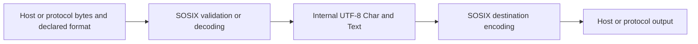

# UTF-8 internal values and SOSIX encoding boundaries

Status: selected implementation plan. This document does not certify implementation, runtime tests, Phase 3 compilation, or release readiness.

Target branch: `release_phase3`. Scope: internal/external character and text types, tool-facing SOSIX boundaries, and compatible migration of existing callers.

## Intended behavior

Ordinary tool code continues to consume internal UTF-8 `char` and `text`. SOSIX and its owned host adapters validate or convert external data before returning those values. Output crosses the symmetric encoding boundary before a host operation. Tools should not each implement decoding, encoding detection, or platform-specific conversions.

Raw bytes and explicitly encoded external values remain available for protocols, binary data, filenames that cannot be represented as UTF-8, and callers that need original encoding metadata. Arbitrary file or network contents are not assumed to use the host's character encoding.

## Type and conversion contract

| Type | Contract |
| --- | --- |
| `AbstractChar` | Trait for a fallible conversion to an internal character. |
| `AbstractText` | Trait for a fallible conversion to internal text. |
| `Char` / `char` | Internal character representing one Unicode scalar; UTF-8 storage changes require separate native ABI verification. |
| `Text` / `text` | Internal text containing valid UTF-8, with length-aware operations. |
| `ExternalChar` | Owned encoded bytes and explicit format; conversion must produce exactly one valid Unicode scalar. |
| `ExternalText` | Owned encoded bytes and explicit format; normalization is explicit and fallible. |
| `ExternalFormat` | Encoding, byte order, and BOM policy. It is supplied by a real provider or caller contract, not inferred from arbitrary bytes. |

The shared abstractions are traits; this plan does not introduce class inheritance or rename primitive language keywords. Existing internal names remain usable. External values implement the corresponding abstraction through checked conversion.

Initial explicit formats are UTF-8, UTF-16LE, and UTF-16BE. Unknown encodings and inconsistent encoding/byte-order combinations return typed errors. Conversion rejects malformed sequences, overlong UTF-8, invalid scalars, unpaired surrogates, truncated input, and violated BOM policies. No silent replacement or truncation is allowed.

## SOSIX ownership and API compatibility

| Boundary | Ordinary tool-facing behavior | Explicit external/raw behavior |
| --- | --- | --- |
| File text reads and writes | Validate UTF-8 input; write UTF-8 unless an explicit destination format is requested. | Raw byte operations and format-aware external text operations remain available. |
| Environment, current directory, directory names | Return internal UTF-8 only after checked admission or an authoritative host conversion. | Preserve an external/raw route when bytes cannot be represented internally. |
| Process command and arguments | Accept internal UTF-8 and encode for the provider before starting the child. Reject prohibited NUL before execution. | Explicit command-format APIs retain their documented authority and failure rules. |
| Process stdout and stderr | Normalize inside the owned process/SOSIX boundary before tools parse, trim, or inspect output. | Binary capture and explicitly declared stdout/stderr encodings remain distinct options. |
| Stdin, stdout, stderr, PTY | Use checked incremental decoding and length-aware encoding/writes where providers exist. | Unsupported providers remain explicit errors; no fabricated PTY support. |
| Network text | Require the protocol or caller to declare the format; UTF-8 is the ordinary API's explicit default contract. | Keep raw bytes and explicit external text APIs. |

Existing ordinary signatures should be preserved where their error type can express encoding failure. Where a legacy signature cannot distinguish absence, empty data, and failure, add a checked sibling and a documented compatibility adapter. Do not silently turn invalid bytes into an empty successful value. Change individual tools only where their existing API cannot carry the required failure information.

Executable resolution is part of this boundary: output from a `which`-style resolver must be normalized before trimming or path interpretation. Validating only the final process result is insufficient.

## Provider authority and platform limits

POSIX environment values, directory entries, paths, and process pipes may contain bytes without declared charset metadata. The ordinary SOSIX API therefore adopts a strict UTF-8 admission policy; this is not a claim that all OS data is UTF-8. Other encodings require explicit metadata or a provider contract. Do not guess a charset from locale or byte patterns.

Windows boundaries require an audited Unicode host-provider path. ANSI directory APIs or unspecified child-output capture do not establish UTF-16 or UTF-8 authority. Unsupported platform text adapters must fail explicitly until implemented and verified. Codec availability alone does not qualify a host adapter.

Host C-string boundaries reject embedded NUL where the host forbids it. Internal text, binary data, and length-aware text output must preserve embedded NUL. An existing lengthless print operation is not adequate evidence for lossless output.

## Reuse and implementation order

1. Reuse the shared encoding types and codecs under `src/lib/common/encoding/`, including `external_text.spl` and `host_text_boundary_v1.spl`. Keep codec logic in Simple; host-specific transport belongs in the existing provider boundary.
2. Reuse existing checked I/O helpers in `std.nogc_sync_mut.io.external_text_io`, `host_text`, `host_environment`, `host_console`, and the explicit bounded process API. Do not create another codec or test runner.
3. Audit actual tools and their SOSIX facades. Initial owner candidates are `src/lib/nogc_async_mut/sosix/environment.spl`, `stdio.spl`, `host_facade.spl`, and a shared `text_boundary.spl` leaf. Ordinary file reads already have a UTF-8 validation route in the current integration work; verify and reuse it.
4. Add normalization at those owners, including command resolution, before changing callers. Keep raw operations and explicit `ExternalFormat` APIs. Preserve syscall permissions, descriptor ownership, partial writes, and error behavior.
5. Migrate only callers that bypass the owner facade or cannot represent checked errors. Initial audited tools include MCP file/directory operations, LSP JSON output, Caret process launching, and native-build environment access.
6. Complete native tests and the Phase 3 compiler/test-runner qualification before admitting implementation changes. Land independently qualified changes on `release_phase3`; source review alone is insufficient.

The plan document may land independently of implementation. Its publication must not imply that the implementation or Phase 3 is already qualified.

## Memory and performance requirements

- Perform conversion once at the boundary. Do not re-encode internal text at every tool layer or copy an entire buffer solely to attach metadata.
- Bound reads before allocation and handle growth safely. Bound streaming carry by the encoding's incomplete-sequence requirements; retain no unbounded history.
- Preserve caller/provider ownership and allocation failures. Do not expose mutable aliases to supposedly immutable encoded storage.
- Keep per-operation decoder state separate. No shared mutable decoder state across independent streams or tasks.
- An output-character encoding cache is optional. Add it only with a hard entry/byte limit, a key covering format and character, deterministic invalidation, and measured benefit. No unbounded global cache.
- Measure representative ASCII and non-ASCII file/process/stdio workloads, allocation/RSS, repeated operations, and large or malformed input. Compare unchanged and migrated paths using the same qualified runtime and fixtures; record actual results rather than claiming a source-only performance pass.

## Required acceptance evidence

| ID | Required observable evidence |
| --- | --- |
| UTF8-SOSIX-01 | Existing ordinary tool APIs return valid internal UTF-8 for ASCII, multilingual text, and supplementary scalars. |
| UTF8-SOSIX-02 | Explicit UTF-16LE/BE ingress and egress round-trip with correct byte order and each BOM policy; unknown formats fail. |
| UTF8-SOSIX-03 | Invalid UTF-8/UTF-16 and truncated final sequences return the precise checked error and byte offset. |
| UTF8-SOSIX-04 | Incremental reads split every multibyte sequence position correctly; independent streams do not share carry state. |
| UTF8-SOSIX-05 | Internal/length-aware output preserves embedded NUL; forbidden path/argument/environment NUL is rejected before host side effects. |
| UTF8-SOSIX-06 | Empty values, missing values, invalid encoding, and genuine provider failures retain all distinctions the provider actually supplies. Missing provider information is documented, not invented. |
| UTF8-SOSIX-07 | Actual file, directory, environment, command-resolution, process capture, and console consumers use the normalized owner facade. Raw/binary behavior remains correct. |
| UTF8-SOSIX-08 | Partial writes, permissions, timeout/output limits, allocation failure, and unsupported host adapters preserve their contracts. |
| UTF8-SOSIX-09 | Memory/latency/allocation measurements establish the bounded-state requirements and detect regressions; any cache stays within its configured cap. |
| UTF8-SOSIX-10 | Changed source compiles with an admitted pure-Simple compiler; real SSpec bodies and native fixtures execute; Phase 3 builds and executes hello world and the actual test runner. |

Use the repository's existing SSpec/SPipe runner and native fixtures. A parser/source assertion, hand-authored reference target, stub, or source-review verdict is not native execution evidence. Mark every unrun or unsupported item explicitly and keep it open.

## Current status and handoff

The type/codec foundation and several I/O migrations are coded in an isolated integration tree, with source review and authored tests. They are not all runtime-qualified or landed. The SOSIX tool audit found remaining environment/directory/process/stdout normalization work and provider limitations. This document selects the boundary contract and migration sequence; it does not mark those tasks complete.

Related working artifacts include `doc/04_architecture/abstract_external_text.md`, `doc/04_architecture/sosix_external_text.md`, and their design/test-plan companions where present. Those artifacts may still be pending integration; this file is the canonical cross-lane plan to reference before dependent changes land.
