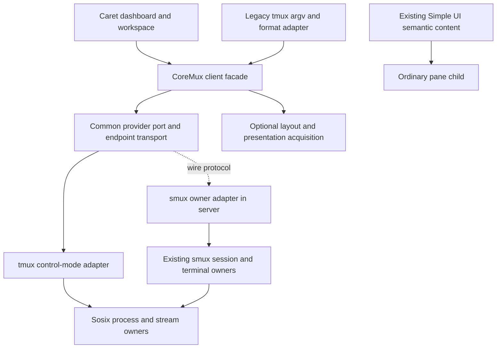

# Caret CoreMux and optional terminal capabilities

2026-10-25. Design for selected A/N2; interface shape accepted by root review.
Implementation and runtime qualification remain pending. Baseline
release/1.0.0 1e431722b40236eda5e80bd5f5bf06395b0d0d08 plus separately owned
unqualified fixes. This document describes intended implementation, not working
backend support. Genuine Phase3 and native qualification are currently missing.

## Inputs and boundary

Requirements: ../02_requirements/feature/caret_mux_tui.md and corresponding NFR.
Caller authority: ../09_report/caret_smux_compatibility_2026-10-25.md.
Knowledge receipt: ../../.spipe/caret_mux_tui/knowledge_selection.sdn selects
os_userland and app_editor_tooling layer routes; no exact feature route exists.
Apply those explicit layer routes, MDSOC capsules for OS userland, and app-owned
composition/protocol adapters. This is not a kernel/driver architecture change.

CoreMux must retain every audited Caret contract: background lifetimes, server
namespaces, exact identity/targets, launch argv/cwd/env, focus, split, resize,
zoom/restore, layouts/rebalance, title/border, hide/show, input distinctions,
notifications and capture/format semantics. An absent required feature is a
qualification failure. It never becomes optional by moving to a presentation
module. No executable rename, fake pane ID or in-memory command log is a backend.

## Composition and alternatives

Use one common value-contract capsule, owner-backed providers, one shared
legacy compatibility layer, and Caret composition. This extends current owners
instead of adding another service or renderer. A parser alone cannot close the
caller gap; its implementation lands with a live dispatcher path.

Accepted module boundaries (assign implementation ownership before creation):

| Path/capsule | Owns | Must not own |
|---|---|---|
| src/lib/common/contracts/mux/core_v1.spl | Traits, typed requests/results/errors, identities, immutable snapshots, capability descriptors | Host calls, session mutation, provider selection |
| same capsule/terminal_v1.spl | Optional layout/presentation requests and owner-bound lease contract | Widgets or duplicate UI protocol |
| src/lib/nogc_sync_mut/sosix/mux/ | Explicit connect/disconnect, selected provider transport, bounded client lease registry | Silent fallback, unowned raw process/Win32 declarations |
| src/os/apps/smux/core_mux_adapter.spl | Core command/query mapping to existing single-authority service state | Caret-private state or independent duplicate pane registry |
| src/lib/nogc_sync_mut/sosix/mux/tmux_control.spl | Real tmux process stream, framing, correlation and reconciliation through existing Sosix process/I/O owners | Shell interpolation or pretending missing tmux features work |
| src/app/hosted_apps/smux_tmux_compat.spl | Legacy argv, tmux format rendering and CLI exit/stdout/stderr projection | Independent lifecycle or state |
| src/app/llm_caret/mux_backend.spl | Caret selection and workflow adaptation | Terminal resource ownership |

Common descriptors carry data only and permit both providers without depending
on os or app. The common capability trait shape follows the existing library
guide, with mutating methods declared me. Do not use unproven trait-group sugar
or pair independently acquired mutable session classes. Optional acquisition
returns a lease into the same authority; no new renderer, task arena or transport
framework is required. Confirm module resolver/capsule admission on Phase3.

The diagram's remote edge is a protocol connection, not a source import.
The acyclic import graph is app composition -> Sosix mux facade -> common mux
contracts, and app composition -> smux server adapter -> existing smux API ->
Sosix platform owners. No lib/common or lib/Sosix module imports os/apps.
MuxProviderPortV1 is a common request/response port. Caret/hosted composition
registers an implementation into an owner-bound facade registry; registration
does not make copied controller objects authoritative. The default remote smux
port uses an authenticated endpoint and common versioned wire values; the server
registers its adapter on the app side. An in-process port may be injected only
by composition that already owns the service and cannot promise persistence.
The tmux port lives below composition and imports only common contracts and
Sosix process/stream owners. Do not extract or move the smux service core merely
to defeat an import cycle.

## Identity, ownership and lifetime

The service owns all mutable session/window/pane/client records. MuxHandleV1 is
an immutable authority reference (owner identity, generation, client lease ID).
MuxObjectRefV1 adds object kind and stable ID; it is not a PID or native handle.
Copies alias the same authority by lookup, never copy session state. Providers
validate every use against the live lease registry; callers cannot mint authority
by constructing a record. Server restart changes owner generation. tmux pane
IDs may be reused after restart, so %ID alone never validates a retained handle.

Backend selection is explicit Smux or Tmux at composition. A disconnected lease
becomes unavailable/stale; it cannot migrate to another backend. Server namespace
maps to an independently owned authenticated endpoint. Smux keeps its existing
server; tmux uses a private named socket. A client disconnect releases only its
lease. Closing a namespace requires explicit owner authority and does not touch
the user's default server. In-process legacy dashboard mode is not sufficient
for independent workspace persistence; the new Caret path connects to the
persistent owner. Existing old flags remain accepted during migration.

State revisions belong to the authority. Snapshots are immutable observations,
not mutable controller classes. Query after uncertain completion; never replay
launch/split/delete blindly. A lease generation and bounded request receipt
ledger distinguish stale objects, completed requests and unknown outcomes.
When receipt retention expires, report unknown rather than claim deduplication.
Metadata snapshots never drain PTY output. Capture may ingest pending output
through the existing owner before taking its immutable result; that can advance
content revision and counters without changing geometry. A read-only client
handle does not imply a side-effect-free remote capture. Compare unsupported
operation effects using metadata/configuration revisions and causal receipts,
with natural child output tracked separately.

## Support, errors and optional extension boundary

MuxCapabilityV1 reports operation, Native/Emulated/Unavailable level, backend
version, owner generation, limits, constraints and separate execution evidence.
Use the established CapLevel semantics; final common type placement must avoid
an unrelated debug implementation dependency. NotRun/Blocked/Qualified evidence
is independent of implemented support, and Qualified requires exact receipts.
No source-only descriptor may manufacture a successful backend evidence claim.

Core descriptors include every required operation even if unavailable today;
the provider returns typed Unsupported and fails required-feature admission.
Optional acquisition returns Unsupported before any mutation. TerminalLayoutV1
is only stronger revisioned complete-plan application, not individual zoom or
focus. TerminalPresentationV1 is only extra terminal-cell overlays and explicit
host input routing, not mandatory Caret messages/borders/titles. Per-operation
limits prevent a partial provider from advertising an entire enhanced trait.

Errors distinguish Unsupported, InvalidRequest, InvalidTarget, PermissionDenied,
Unavailable, StaleRevision, Busy, Timeout, PartialFailure. Commit state is NotApplied,
Applied, Partial or Unknown, with observable revision and cleanup state where
known. Rejected validation/unsupported operations do not mutate. Native failures
can be partial: expose what committed; never invent rollback or atomicity.

## tmux and legacy compatibility

The tmux provider runs a real control-mode connection on the explicitly selected
namespace. Parse framed responses and asynchronous notifications separately.
Serialize requests per connection initially: this bounds ordering/correlation
complexity without sacrificing distinct client connections. Bounded raw output,
decode carry and event queues preserve UTF8 bytes across reads and detect overflow.
Use existing process/pipe Sosix owners; if a platform owner cannot sustain the
required stream/lifecycle, return unavailable and block qualification.

The legacy adapter consumes argv without join-and-resplit. Keep command argv
distinct from an explicit shell command, literal keys, named keys and paste.
It maps -L namespaces and -t targets to authoritative objects, implements all
audited format tokens plus the nested zoom conditional, and renders exact tmux
stdout/status contracts. Diagnostic or capability text cannot contaminate output
consumed as IDs, numeric indexes or capture text. It must support existing Caret
and standard wrapper entry paths, not just a new API used by no caller.

tmux cannot promise a native arbitrary multi-command atomic transaction. Strong
complete-plan Atomic acquisition is Unsupported until a provider can prove it;
an explicitly ordered operation may report partial commit. No locking of our
adapter can exclude external tmux clients, so do not label such a sequence atomic.

## Existing UI, failure visibility and resource bounds

Caret content reuses ui/shared_ui_contract.md and the existing native TUI widget
and semantic-event adapters. Pane content remains a child application on either
backend. Required capability failures appear as blocking owner/operation errors;
only optional controls are disabled with an explanation. Typed UI snapshots and
TUI captures observe that state through the existing test access interface.
Terminal controls from notifications must be filtered according to the selected
literal/semantic notification operation; raw pane data retains terminal meaning.

Bounds are negotiated and enforced before allocation: command/input bytes,
capture bytes/lines, pending request count, event items/bytes and client leases.
No unbounded capture accumulation, retry sleep, per-event whole-tree scan or
infinite reconnect. Overflow returns explicit backpressure or reconciliation
required; lost lifecycle events are never silently presented as current state.

## Qualification and staged completion

All REQ-CMUX-001..011 and NFR-CMUX-001..009 remain required. Match actual Caret
commands, semantic API, optional refusals and live process effects separately.
Phase3 lineage/Hello plus matching full CLI/runner gate native and SSpec claims.
N2 requires real 24-hour runs on each backend, two isolated namespaces, two
sessions per namespace, at least four panes and two clients per namespace;
also exercise stated limits and one-over-limit. Record exact topology rather
than imply an unmeasured larger matrix. Metadata p95 <=100ms and settled layout
<=250ms require independent state/child observations and retained distributions.
Cold preparation is measured separately. No design completion implies runtime
PASS, soak completion, release readiness or permission to bypass the six-cycle cap.
