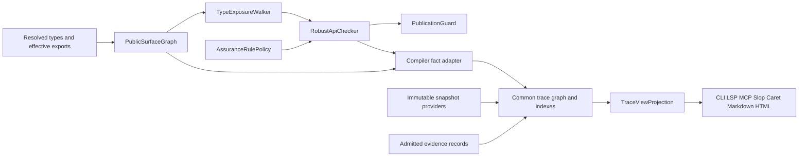

<!-- codex-architecture -->
# Extreme typing and traceability extension architecture

Status: conditional architecture, 2026-11-01, reviewed source base
`3273833de3dfe9ea8bc56d0cd877fa05bc1402db`. The
[selected extreme-typing constraints](../02_requirements/feature/extreme_typing_traceability.md)
are mandatory; remaining [options](../02_requirements/feature/extreme_typing_traceability_options.md)
block their dependent implementation. This extends the
[canonical roadmap](../09_report/simple_traceability_sdn_slop_final_2026-10-03.md)
and [existing architecture](simple_traceability_sdn_slop.md). Source foundations
are not proof of live dispatch, runtime admission or complete implementation.

## Authorities and layer boundaries

| Owner | Contract | Consumers |
|---|---|---|
| `src/compiler/00.common` | Shared semantic surface/policy records, extending existing API surface and assurance contracts | Semantics, mono, driver, interpreter, loader and tools |
| `src/compiler/30.types`, `35.semantics` | Canonical TypeIdentity, substitutions, effective visibility and exposure analysis | PublicationGuard through shared records; trace adapter reads facts |
| `src/compiler/80.driver`, `95.interp`, `99.loader` | Engine-specific admission before publish/execute | Native/REPL/JIT/dynload/SMF entrypoints |
| `src/lib/common/traceability` | Immutable graph, schema, resolution, indexes, query, qualification and pure TraceViewProjection | All presentation adapters |
| `src/app/traceability` | Filesystem/Git snapshots, compiler fact ingestion, effectful report writes and explicit PR refresh | CLI/MCP/LSP/Slop integrations |
| `src/app/slop` | Existing session/view/projection/native-frame composition | Standalone viewer and Caret-hosted viewer |
| `src/app/llm_caret` | Registered worktree/session lifecycle | Read-only overlay provider; lifecycle stays with Caret |

Common owns reusable contracts, never imports sibling-private implementation.
The compiler emits resolved facts; trace does not resolve language types or
reconstruct visibility from text. UI dependencies never enter compiler/CLI
hot startup. App adapters own effects through existing env/process facades.
No kernel/driver ECS or MDSOC+ routing is introduced.

The named components above are proposed contracts, not claims that matching
modules already exist. Extend existing records before adding new owners.

## Public surface and the fatal gate

`PublicSurfaceGraph` starts at effective external exports after namespace,
alias, module, filename/default visibility and reexport resolution. Traverse
all public callable signatures, fields/getters, constructors, enum payloads,
trait associated types/methods, constants/globals, aliases, generic defaults,
callback types and generated surface. Private bodies/locals are excluded.
Do not filter by the token `pub` or by uppercase type names.

`TypeExposureWalker` walks canonical type IDs plus substitution environments.
Transparent aliases expand. Containers/callbacks expose their reachable leaves.
Nominal/opaque boundaries hide private representation only; independently walk
their public constructors, getters, trait views and conversions. A generated
public `new(raw_builtin)` would violate the rule. The selected all-builtin
catalog and domain-safe generic bound apply without math/FFI/allowlist escapes.
`Safe`, `Violates(path, leaf)` and `Unknown(reason, frontier)` are distinct.
Cycles are analyzed through bounded SCC/fixpoint processing; a revisit alone
neither proves safety nor invents a violation. Incomplete external type data,
unknown bounds and exhausted budgets block robust+ admission.

`AssuranceRulePolicy` is a named-rule projection of the existing raise-only
policy, not a parallel profile resolver. Moderate is advisory; strict warns;
robust/critical/verified deny this rule. V1/V2 bridges cannot lower verified.
The historical global robust warning window and warning-phase downgrade do
not waive `extreme_public_api`. No blanket conversion of other warnings to
errors is implied.

`PublicationGuard` checks the resolved surface before artifact commitment and
before executing imported user initializers. Generated macro/AOP and postmono
exports invalidate the surface and require rechecking before publication.
Compilation and load stage results privately, then publish atomically after
admission. REPL denial preserves bindings, loaded modules and last-valid
session; code loading cannot run callbacks and later roll back only names.
JIT symbol registration, native artifact rename and SMF activation obey the
same gate. A gate that only runs in lint CLI is insufficient.

## Trace graph extension

Extend `model.spl`, `schema.spl`, the query contract and versioned codecs as one
change. Keep v1 read compatibility, unknown-field/version errors and historical
receipt identities. Migration records source schema/digest, old/new IDs, rule
version and attributable choices. Never reinterpret old run data as qualified.

Authored `FeatureGroup`/`RequirementGroup` IDs are stable across directory
moves; directory-derived grouping is a labeled view. `contains` accepts the
allowed group hierarchy/member kinds and rejects cycles and duplicate IDs.
Placement remains D1. Feature `specifies` Requirement; Requirement
`motivated_by` Research; Requirement `decomposes_to` AC; AC `accepted_by`
acceptance definitions; Requirement/AC `verified_by` nonacceptance definitions;
tests `targets` compiler symbols. There is no fabricated acceptance-to-unit
edge. Definitions, observations and qualified evidence are separate facets.

Bug `affects` a declared requirement/AC/symbol/component, `reproduced_by` a
test definition and `fixed_by` an explicitly attributable immutable changeset.
An observed successful reproduction/fix verification is separate evidence;
merging a PR or editing a touched file does not prove the bug is fixed.

CodeGraph is a facet of this graph, not a second lifecycle authority. Compiler
symbol identities qualify calls, references, imports, overrides and macro
expansion/source provenance. Each relation carries `exact`, `bounded_set`,
`heuristic` or `unknown`; dynamic target sets and missing indexes remain
visible. Static possible flow and runtime-observed flow use different edge
kinds and source evidence. A trace ID is a semantic record key, not a guessed
file-line identity across revisions.

API facets (`PublicApiSurface`, semantic type facts, `ApiViolation`) reference
compiler identities and digests. They can explain impact but cannot change a
type verdict. Public declaration visibility, trace artifact visibility and
viewer authorization are three separate policies. Current Slop's `public`
artifact label is not proof of authorization or compiler export status.

## Snapshots, queries and projection

Resolve `worktree`, `index` and `git:REV` into immutable captured subjects.
Capture worktree bytes and index identities consistently; a changed input
during capture retries within budget or produces explicit incomplete status.
Resolve Git refs once to repository+object-format+OID/tree; never reopen a
moving path when inspecting a historical fact.

Build node, typed forward/reverse adjacency and kind indexes once per immutable
generation. BFS work is bounded by depth 1..8, page limit 1..200 and separate
visited-edge/time/byte limits. Stable identity ordering breaks ties. `path`
returns a shortest path under selected edge/direction/precision filters;
`impact` is a conservative reachable set, not proof all callers will execute.
Expose frontier/truncation and invalid/missing roots explicitly.

Versioned cursors bind snapshot+generation, operation, roots, direction, edge
kinds, filters, precision, depth, limit, effective caller/scope/authorization
epoch, visibility policy and order version. Reject mismatches. Apply authorized
scope before roots, edges, path intermediates, counts, frontiers or diagnostics
can reveal material. Truncated path search returns incomplete/unknown, never a
definitive no-path result. Node-page exhaustion, edge-page exhaustion,
snapshot completeness and qualification are independent fields. Full graph
export enumerates edges independently of node pages so cross-page edges are
not lost; a bounded UI neighborhood is explicitly a projection.

One pure `TraceViewProjection` derives selection, rows, typed edges, reason
paths, hidden counts and provenance. CLI/LSP/MCP/Slop/Caret/Markdown/HTML apply
rendering only. Existing `slop/projection.spl` becomes a layout adapter over
that contract; it must not rederive qualification or relation meaning.

## MDSOC matrices, Git and Caret

The feature-by-layer matrix is sparse membership: each cell counts unique
canonical symbols in a feature and layer, with many-to-many membership and an
explicit unknown row/column. Totals are set unions, not sums of overlapping
cells. A separate layer-by-layer dependency matrix counts directed canonical
relations under declared precision filters. Membership does not imply a
dependency; dependency does not grant import permission. Drilldown preserves
the exact filter and snapshot used for the cell.

Git identity is immutable repository+OID. PR metadata is an optional cached
snapshot with host/repository/PR ID, head/merge OIDs, retrieval time and source;
stale/unavailable/unauthorized differs from empty. Explicit `implements` or
`fixes` claims carry author/provenance; inferred file/symbol touches remain
inference. No network refresh runs automatically during local navigation.

Caret contributes registered worktree snapshots per agent, including session
generation, base/head/index/dirty capture. Diffs compare graphs by canonical
semantic identity, recording added/removed/changed facts, signature/visibility
changes, evidence invalidations and unresolved matches. Show pairwise overlaps
and common base; never label them Git merge conflicts without an actual
conflict result. The graph neither creates/deletes worktrees nor controls
agent processes. Detached/missing worktrees remain unavailable overlays.

## Startup, cache, exports and rejected alternatives

Warm clients open a validated cached graph/index by subject/schema/compiler/
policy/extractor/visibility digest. Changed declarations, aliases, deleted or
new candidates, generated surface and negative lookups invalidate dependents.
Incremental results must equal full rebuilding on identical complete inputs.
No full-tree rescans or shell-outs per request. Lazy provider initialization,
bounded cancellation and proposed latency/RSS targets are in the
[NFR options](../02_requirements/nfr/extreme_typing_traceability_options.md).

Table is the proposed human CLI default; SDN is default structured output.
JSON is only an explicitly requested external-interoperability adapter, not a
native graph CLI/service/storage mode. This preserves the canonical roadmap's
SDN-only native interfaces. Existing
`traceability-check` remains SDN by default. Markdown/HTML reports require an
explicit destination; deterministic offline HTML contains no executable input
or automatic remote resources. Export filters private material before render,
normalizes safe relative paths, escapes content/URLs, excludes prompts,
credentials and absolute filesystem locations, and refuses symlink traversal.
Reports do not mutate tracked source or current worktree state.

Independent app graphs are rejected because they diverge. A text-name lint is
rejected as the authoritative type checker because aliases/generics/visibility
need semantic resolution. A graph claiming execution or merge safety from
static links is rejected because those are different facts. Hosted services,
new JSON-default stores and an immediate wholesale rewrite are unnecessary.

See the [detail design](../05_design/extreme_typing_traceability.md),
[UI sketches](../05_design/extreme_typing_traceability_gui.md),
[implementation plan](../03_plan/agent_tasks/extreme_typing_traceability.md) and
[acceptance plan](../03_plan/sys_test/extreme_typing_traceability.md).
