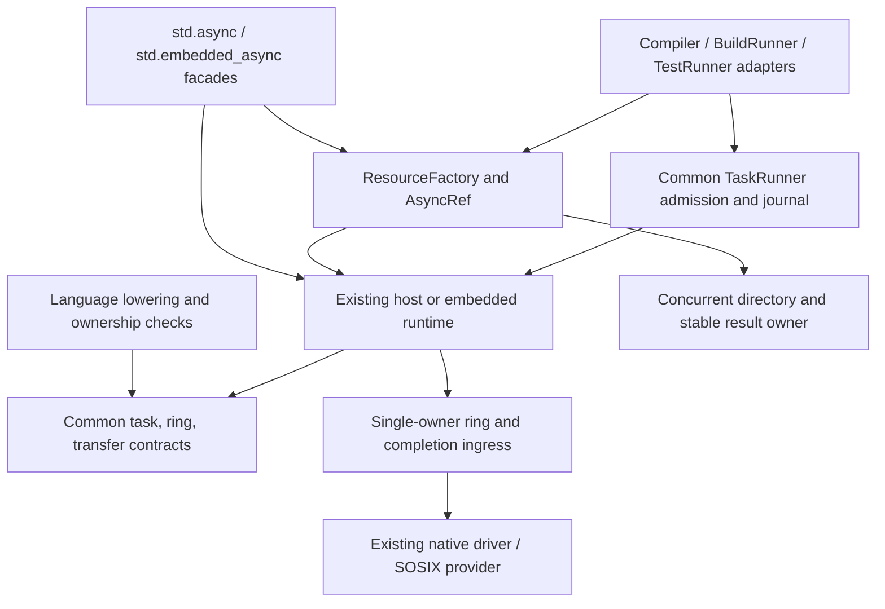

<!-- codex-architecture; Astra design review -->
# Async infrastructure: language, library, and execution owners

**Date:** 2026-10-27. **Status:** proposed integration contract; source audit at
`32b48baa7b473d7a86557edfc4c3efec81d1b3a6`. This document does not qualify a
native compiler, scheduler, shared-result implementation, or target. No build
or executable test was run for this documentation change.

This extends the [SimpleRing architecture](../simple_ring_async_base.md),
[parallel ownership](parallel_ownership_model.md), and selected
[resource plan](../../03_plan/lib/concurrent_resources_runner_plan_2026-10-27.md).
It uses the user's selected S1 → S2 → S3 scope and TDD requirement. It introduces
no new requirement-selection branch, runtime, persistent authority, or language
keyword. [Detail design](../../05_design/lib/runtime/async_infrastructure.md)
and [acceptance plan](../../03_plan/sys_test/async_infrastructure.md) distinguish
contracts from implemented exports and executed evidence.

## 1. Decision and actual starting point

Simple already has async services, futures, promises, task contexts, schedulers,
fibers, and a native I/O completion path. Reuse those owners. Shared async
resource creation is an integration layer over them; it must not recreate their
runtime. Conversely, a source file named Future, a multi-thread mode, or a
platform backend name does not prove live result sharing or cross-thread safety.

Paths in this audit are relative to the repository root. They identify source
observations, not test results. Historical test summaries are not new execution.

| Existing source owner | Observed behavior | Boundary to harden |
|---|---|---|
| `src/lib/nogc_async_mut/async_host/{runtime,scheduler}.spl` | Hosted runtime and scheduler; `HostTaskContext` checks owner thread and task lifetime; bounded task signals and cleanup registrations | Preserve task authority; qualify cross-thread ingress and result publication. `run_task`/`run_result_task` closures currently discard `f()`'s value and return `Poll.Ready(())`; completion is not proof that `T` was published |
| `async_host/{future,promise}.spl` under that owner | `HostPromise` completes/fails a `HostFuture`; terminal publication wakes stored Wakers | Plain state/arrays are not atomic shared storage. Pending `map`/`then` explicitly return detached snapshots |
| `async_host/handle.spl` | Task context, cancellation, `try_join_result`, `join` | Pending `join` creates a new pending future without a live source subscription in this inspected function; bind it to the accepted task result |
| `async_host/thread_safe_queue.spl` | Mutex/condition-variable task queue | Valid general hosted mechanism, not a strict lockless profile; queue naming is not capability evidence |
| `src/lib/nogc_async_mut/async/{future,promise,executor}.spl` | Existing portable compatibility APIs | Keep imports and behavior readable while migrating to common polling/result ownership |
| `src/lib/nogc_async_mut/async_embedded.spl` and `nogc_async_mut_noalloc/async/` | Existing embedded runtime and separate bounded mission primitives | Do not infer true static/no-allocation operation from an array capacity or reuse a 64-slot readiness set for 3,000 tasks |
| `src/lib/common/contracts/execution/simple_ring_async_v1.spl` | Canonical `TaskPollResult`, `RingToken`, generation/task/profile vocabulary | One task and ring ABI; adapter execution is a separate qualification |
| `src/lib/nogc_async_mut/async_ring/` | Single-owner fixed-capacity ring, software provider, Future compatibility adapter | Multi-subscriber result storage is separate; remote threads cannot mutate ring arrays directly |
| `src/lib/nogc_async_mut/io/{native_driver,platform_event}.spl` | Sanctioned native completion-driver facade | Record actual provider and fallback; network readiness and file completion are different capabilities |
| `src/lib/nogc_async_mut/fiber/io_reactor.spl` | Submits I/O, retains early completions, pumps events into common `FiberSchedV1` | Preserve early-completion semantics, replace unbounded/linear retained completion storage as needed; do not create another reactor |
| `src/compiler/80.driver/driver_build/file_fiber_v1.spl`, `cache/module_artifacts_v1.spl` | Actual users of the reactor read/write path | Route frozen source and asynchronous publication waits through it. Existing live-path reads and bounded blocking pump calls are not full frozen-source/managed-async qualification |
| `src/compiler/80.driver/cache/source_reader_v1.spl` | Sync-first Future defaults and million-poll wait bridge | Migrate this adapter to real pending native operations; its limitation does not mean all native async I/O is absent |
| `src/lib/nogc_async_mut/host_io/fileio.spl` | Thin eager-completing host wrapper | Keep compatibility facts explicit; do not relabel synchronous work asynchronous |

Existing `host_promise_terminal_spec.spl`, `async_host_handle_*_contract_spec.spl`,
`async_host/async_mutex_suspend_spec.spl`, and SimpleRing specifications are
valuable starting tests. Their existence does not establish that arbitrary
shared references, generic factories, native 3,000-way fanout, or every target
have passed. The scalar lockless-map/AsyncRef implementation is a separate
active lane and is not present as an accepted public API at this audit pin.

## 2. One public vocabulary, existing implementation owners

The intended shared user interface is **`std.async`**, normally composed with
the **`async_host` hosted implementation**. **`std.embedded_async`** supplies
the bounded embedded composition of the same interfaces. These names describe
a facade migration, not an immediate filesystem rename. `std.async` already
has legacy exports; `std.embedded_async` is a proposed facade at this pin.

| Public concept | Meaning | Physical owner / compatibility |
|---|---|---|
| `Future<T>` | Consumer view of one eventual result with live continuation semantics | Existing `async_host/future.spl`; existing `std.async.future.Future` remains legacy until versioned adapter qualification |
| `Promise<T>` | Single completion authority for that future, not a freely copied mutable result | Existing `async_host/promise.spl` hardened over the shared result owner |
| `TaskHandle<T>` | Join/cancel/status for one admitted execution, whose accepted `T` is separately stored | Existing `async_host/handle.spl` and scheduler task context |
| `AsyncRef<T>` | Independently retained, shareable observation of one result generation | `async_ring/async_ref.spl` proposed common runtime adapter; hosted adapter in `async_host/async_ref.spl` |
| `ResourceFactory<K,T>` | Library creation API: request a keyed recipe and obtain a shared ref | `async_host/resource.spl` proposed hosted composition; bounded adapter uses existing noalloc async owners |
| `ResourceRegistry<K,T>` | Key → stable result lookup, recipe conflict checks, producer ownership | Existing concurrent owners plus injected executor; no compiler import |
| `ResourceMaker<K,T>` | Recipe/effect/estimate protocol consumed by ResourceFactory | Dependency-light versioned value contracts under `common/contracts/execution`; executable maker lives in its owning family |
| `ResourceCache<K,T>` | Registry with retention/residency policy | Resource composition + existing cache/storage adapters |
| `IndexRefFactory<T>` | Creates owner-qualified local/container/entry references and protected views | Existing memory/container owners; resource factory may load a missing immutable container |
| `RecyclePool<T>` | Exclusive mutable reuse, each acquisition has one borrower | Separate pool facade; never return one mutable resource to all shared-result requesters |

`std.async_host`, `std.async_embedded`, `std.async_unified`, and family-qualified
imports remain compatibility aliases/adapters. Do not silently change `Future`
layout, `Poll` meaning, error behavior, public constructors, or symbol ownership.
Add explicit modules first (`std.async.async_ref`, `std.async.resource`), test
real resolver bindings, then make qualified reexports. Generic and scalar names
are not aliases: the initial `AsyncRefI64`/`LocklessMapI64` contract stays explicit
until generic payload ownership is implemented and tested. See detail design
for the dependency direction that avoids map/ring import cycles.

The standard-library family selector owns GC/noGC resolution. GC variants may
root shared payloads, while noGC variants retain explicit owners. Copying an
integer handle or tracing a wrapper must not accidentally duplicate a Promise's
publication authority or permit a borrowed arena to outlive its task.

Every library addition first searches for matching existing owners, exports,
callers and tests. Reuse/adapt them and record any semantic mismatch. A new API
needs a concrete missing contract, not merely a different preferred name.

### Native and pure-Simple implementations

The eventual pure-Simple container, async and scheduler implementations must
implement the same public semantics. Native providers are optional explicit
backend choices, not public interface definitions. Neither `RuntimeValue`, raw
arena addresses nor native map handles appear in common resource/ref contracts.
Backend-specific unsafe transfer/diagnostic hooks cannot become portable IDs.

Keep one conformance inventory for equality, publication, live chaining,
subscription, cancellation, lifetime, capacity and errors. Native OS/atomic
tests and compiler-generated pure-Simple atomic/frame tests add separate
provider qualification. A pure-Simple implementation still needs actual target
atomic ordering/progress and host wake/I/O capabilities; changing implementation
language does not prove lock freedom or permit a silent mutex fallback.

## 3. Language semantics and compatibility boundaries

These are target semantics. A syntax or lowering profile is available only
with compiler/interpreter evidence; the design does not assert implicit await
or stackless lowering is currently enabled everywhere.

1. `await` observes a future/shared result. Ready values return directly. Pending
   work registers the current generation-qualified continuation and suspends
   the managed task. It does not busy-poll or block its carrier thread.
2. A root synchronous `block_on` may drive an owned executor. Calling it from a
   managed task uses a qualified suspension adapter or returns a typed nested
   execution error. It cannot recursively run the same executor.
3. Task creation, admission, execution, result publication, and join are distinct.
   Creating a future need not start work. A ResourceFactory request may register
   work immediately, but expensive work starts only after admission. Document
   each constructor's lazy/eager behavior; no implicit unbounded thread spawn.
4. A Promise completes exactly once with success/failure/cancellation. All live
   future/ref observers read the same generation. `map`, `then`, and task `join`
   retain a subscription, propagate failure, and invoke continuation at most
   once. Pending snapshots cannot implement this contract.
5. A fiber is an execution placement/frame mechanism, not a result cell or an
   OS thread. Stackless compiler frames and any stackful provider must implement
   the same admitted task lifecycle without assuming identical stack ABI.
6. `spawn`/join are structured under a parent or explicit supervisor. Detachment
   requires its existing capability. Resource producers belong to registry/
   executor scope, not the first requester's stack; their independent consumer
   interests have separate cancellation.
7. Suspension is an ownership boundary. Move/frozen-share/copy/loan classes from
   the parallel ownership model apply to captured values and returned payloads.
   Borrow checking must reject a short mutable/table/epoch guard crossing await
   unless a separately qualified suspension-safe owner contract permits it.
8. Generic specialization remains a language/compiler responsibility. Removing
   monolithic stage barriers and legacy global owners does **not** remove
   generic semantic specialization or the required SCC/dependency joins.

The compiler retains parsing, effect and liveness analysis, frame metadata,
borrow validation, and lowering. The library owns scheduling/queues/result
storage. A library state machine cannot certify that compiler-generated frames
drop captures once on cancellation or preserve values across a real suspend.
Those are separate language acceptance cases.

## 4. MDSOC layers and composition

This is one capsule with execution, storage, host capability, and evidence
projections. Shared value protocols live upward in common; mutable state lives
in the selected runtime family. Common must not import hosted modules, perform
I/O, or declare a new scheduler. Compiler and application adapters do not reach
into private ring slots, raw map arenas, or another provider's handles.

The existing common TaskRunner controls build/test dependency admission and
process ownership. HostScheduler controls its admitted local task polls.
Composition assigns exactly one execution owner to each task and one dispatch
receipt; two schedulers must not independently admit/run the same producer.
`FiberSchedV1` is an existing compatibility execution adapter to converge, not
a reason to insert another scheduler between it and the native driver.

## 5. Ownership and lifetime

| Object | Mutable authority | Reader protection / retirement |
|---|---|---|
| Directory cell | Qualified atomic insert-once operation or declared single carrier | Initialized descriptor visible before release publication; acquire readers; epoch retention |
| Result slot | One admitted attempt's accepted terminal publication | Immutable outcome; AsyncRef retains owning scope and generation |
| Promise | Issued completion capability, fenced by result generation | Safe API cannot forge/copy authority through public raw fields |
| Subscription | Atomic interest state plus owning executor wake adapter | Exact task/ring identity; retired after acknowledgement or cancellation proof |
| Ring/task queue | One carrier/owner | Foreign completions enter bounded ingress; owner alone mutates queue/ring |
| Immutable container | Existing artifact/container owner | Owning handle plus residency pin before dereference; removal precedes reclamation |
| Mutable scratch/connection | One exclusive pool borrower | Reset/health validation and acknowledged return; no timeout-based revocation |
| Compiler snapshot/root | Existing SCV/cache authority | Frozen input identity, admitted root pin, existing journal publication |

No raw pointer or process-local slot crosses a process/device/remote boundary.
Use encoded immutable identity and receiver-owned mapping/handle. Generation
checks are not lifetime protection: the allocation must remain retained between
checking its generation and dereferencing. Raw scalar v1 quiescent destruction
is an unsafe caller obligation, not a safe generic reference-counted API.

An owning immutable handle may span suspension under budget. A short borrow,
ordinary hazard/epoch guard, table guard, or unprotected cached pointer may not.
One captured 1 MiB artifact shared by 3,000 refs remains one payload; 3,000
distinct artifacts do not. Account for producer arenas, retired epochs, waiter
nodes, frames, transport, and mappings in addition to map slots.

## 6. Progress, I/O, and target capabilities

| Profile | Permitted claim | Required limit |
|---|---|---|
| Owner-local embedded | Bounded local operations; no compile mutex | One carrier, explicit capacities; no multicore lock-free claim |
| Qualified atomic scalar core | Lock-free lookup/insert/publication only for proved operations | Actual atomic width/alignment support, bounded arenas, reclamation/overflow proof |
| General hosted runtime | Concurrent task operation using documented provider | Existing mutex/condition-variable queues allowed and reported |
| Strict compiler resource path | No mutex/spinlock/file lock/process lease in lookup/claim/await | Actual allocator, handle, subscription and wake call path qualifies; no hidden locked fallback |
| Frozen ready view | Direct exact lookup under lifetime protection | No maker, I/O, full decode, DB transaction or global LRU rebuild on the resident hit |

The merged atomic capability hook reports target support for an aligned i64
atomic address. It does not prove the whole map, generic boxing/Result wrappers,
allocator, hosted queue, or compiler is lock-free. Unsupported CPUs/profiles
return a typed capability refusal or select an explicitly requested owner-local
profile. LP64, ILP32, endian and ISA distinctions remain explicit; never cast an
i64 to a pointer without checked representability and ownership.

Reuse `io/native_driver` → `platform_event` and `fiber/io_reactor`. Backend
selection must distinguish native completion, readiness translation, bounded
blocking offload, and synchronous reference behavior. Report actual capability
per operation and OS; do not infer file-read support from epoll/kqueue naming.
Linux, Windows, BSD/macOS, other hosts and embedded require separate provider
receipts. Idle blocking belongs in the executor event wait, with an atomic
arm/recheck/notify protocol; poll callbacks and producer completion never wait
for another task while monopolizing its carrier.

## 7. Resource, cache, and runner integration

ResourceFactory is the common API for bytes, parsed containers, service
resources, and keyed derived indexes. Compiler-specific recipe keys, source
snapshot validation, semantic facets, and output acceptance stay in compiler
owners. A registry hit is not semantic admission. Same key with a conflicting
recipe/type/context returns a conflict before creation.

The [SCV/cache plan](../../03_plan/compiler/cache/cache_with_scv_implementation_plan_2026-10-27.md)
continues to own `.rr` and TLDR semantics. Incoming users never rewrite provider
TLDR semantic bytes. Any `.rr` generation/validation/publication/durability/
readback/recovery failure makes that scope Unknown and requires complete
reconstruction from all committed forward manifests at the latest pinned root.
Changing root restarts the entire recheck. Only existing publication authority
and qualified SOSIX expected-generation atomic publication may publish it;
plain rename is not an atomic generation-CAS implementation.

BuildRunner and TestRunner share factory/admission/invoker mechanisms and
machine budgets, but retain separate artifact and per-case evidence validators.
A compile hit does not prove a test ran. Keep bounded test groups (currently
128) and independent trial identities. Default source → OBJ remains fused,
with earlier stages independently usable. Eliminate global stage barriers and
unrelated maker serialization; preserve SCC/link/publication ordering.

## 8. Delivery and acceptance boundaries

S1 begins with TDD hardening of existing owners: scalar directory/ref, terminal
sharing, waiter races and actual executor wake; then live future/promise/join
semantics and genuine frozen-source pending I/O. S2 unifies compiler and
build/test adapters over the existing invoker. S3 adds generic immutable
containers, index references, persistence and bounded retention. Independent
library correctness fixes may land earlier.

The [test plan](../../03_plan/sys_test/async_infrastructure.md) maps each
requirement to concrete failure-first cases, model/native boundaries and
implementation owners. Each capability is UNRUN until its exact source,
provider, target and test/oracle receipts pass. No fabricated benchmark,
language-wide support claim, per-file default flip, or replacement of historical
receipts follows from writing these documents.
