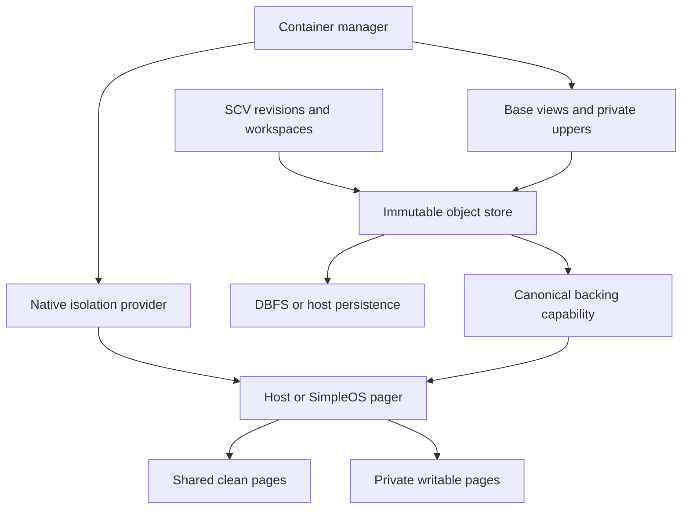

# Simple Container Improvement Design

## Native isolation, SCV storage reuse, shared files and memory

**Date:** 2026-11-25  
**Status:** Consolidated design proposal and implementation plan. This document does not claim that the proposed capabilities are already implemented or benchmarked.  
**Repository:** [ormastes/simple][R00]  
**Verified baseline:** `main` at `a214dc99348c8fdda0ac59d4b6fdb1765f0fecb2`, checked through the branch API on 2026-11-25.  
**Scope:** Consolidates the conversation about SimpleOS, NVFS/DBFS, SCV, native containers, memory limits, cleanup, selectable hashing, file/executable/cache sharing, fast save/load, and Google Agent Substrate.

---

## 1. Decisions and priorities

Build Simple Container around **one reusable immutable object store, private writable container state, native isolation providers, and an operating-system pager that can reuse immutable backing pages**.

SCV and containers should share storage primitives. SCV continues to own revisions and history; container providers own isolation and lifecycle; the kernel owns physical memory and enforcement. Sharing SCV code or content hashes alone does not establish shared physical RAM.

The priorities, in order, are:

1. **Enforced isolation and memory budgets.** Include every descendant process. Support live memory-limit changes when the selected provider can enforce them.
2. **Owned, recoverable cleanup.** Discard files created in ephemeral container state, preserve explicitly saved snapshots and persistent volumes, and recover safely after a crash.
3. **Start from recent main and SCV.** Reuse existing publication, snapshot, hashing, and retention work without changing legacy SCV identities.
4. **Share storage and memory efficiently.** Reuse immutable files, executables, libraries, and read-only caches; keep writable process state private.
5. **Fast save, load, and clone.** Transfer or write changed content and metadata; reuse already resident immutable data.
6. **Selectable hashing.** Support XXH3, GxHash, and BLAKE3 as explicit choices. BLAKE3 is optional. Preserve SHA-256 compatibility for existing SCV objects and formats.

### 1.1 Selected architectural direction

| Topic | Decision |
|---|---|
| Container model | Native execution on each host through separate providers |
| Linux | Existing rootless OCI adapter initially; replace its default only after the in-tree provider meets the same qualification requirements |
| Windows | HCS process-isolated Windows containers |
| BSD | FreeBSD jails first; other BSD systems require separate qualification |
| macOS | Signed native App Sandbox/helper provider with explicitly limited capabilities |
| SimpleOS | Native kernel/container/VFS/VMM path |
| Shared base | Published immutable generation |
| Per-container changes | Private writable upper or native equivalent |
| Persistent data | Explicit volumes or saved root manifests |
| Common storage | Extract/reuse SCV-level object publication and lookup logic |
| Default new-store hash policy | Proposed XXH3-128; explicit GxHash-128 or BLAKE3-256 selection |
| Memory sharing | Canonical file backing plus kernel-managed clean pages |
| Writable shared memory | Optional, permissioned, provider-specific capability |
| Snapshot semantics | Filesystem save/restart first; process checkpoint separately advertised |
| Performance claims | Measured against a pinned revision and defined workload |

The native routing and MDSOC ownership follow the repository's cross-host architecture. That architecture is itself a proposal and does not certify all providers as working. No VM is silently substituted for a native provider. [R10]

### 1.2 Required outcomes

A useful first release must demonstrate that a workload cannot exceed its admitted memory policy through child processes, cannot write outside its authorized filesystem view, and cannot leave unowned ephemeral state after normal exit or recovery.

Sharing and speed are then measured on that enforced system. A small in-memory model, a policy field, a successful provider probe, or identical file hashes is insufficient evidence for those outcomes.

---

## 2. Terms that must stay distinct

| Term | Meaning in this design |
|---|---|
| SCV revision | A version-control identity and retained history state |
| Immutable object | Published bytes that cannot change through any writable alias |
| Immutable filesystem generation | A fixed namespace, metadata, and content mapping |
| Read-only mount | A mount that rejects writes through that view; other writable aliases may still exist |
| Storage deduplication | Multiple references reuse stored bytes or extents |
| Reflink / storage clone | Distinct filesystem objects initially reuse storage extents |
| Overlay / union view | A merged namespace with a shared lower and private changes |
| File-page sharing | Multiple mappings reuse the same physical clean page through common backing |
| Writable shared memory | Processes intentionally observe each other's writes |
| Filesystem save | A recoverable root manifest and its referenced objects |
| Application checkpoint | Application-defined durable state used to restart work |
| Process checkpoint | Captured execution state, including memory and supported kernel resources |
| Memory limit | A limit with a named accounting domain and enforcement behavior |

A storage clone does not prove file-page sharing. An SCV snapshot is not automatically a filesystem CoW snapshot, and neither is automatically a running-process checkpoint.

---

## 3. What exists at the verified main revision

The audit reviewed source and selected architecture/tracking documents. It did not compile SimpleOS, run native containers, or collect performance measurements.

### 3.1 SCV and storage

| Area | Observed source | Consequence |
|---|---|---|
| SCV content IDs | `store.spl` emits `sha256_<hex>` identities. [R01] | Preserve legacy identity; introduce a versioned format for selectable hashes. |
| File ingestion | `ScvFileBuffer` already reads a file once and derives stored objects from those bytes. [R02] | Preserve this optimization; it is a whole-file user-space buffer, not shared RAM. |
| Snapshot reuse | Compile snapshots can reuse an exact published inventory. [R03] | Improve reuse authority and expose immutable views; do not reimplement the existing optimization. |
| Object publication | Compile snapshots verify staging, use no-replace publication, and verify a concurrent winner. [R03] | Reuse this stronger publication discipline. |
| Generic SCV writes | Some paths use existence checks plus writes; text publication can fall back to ordinary writes. [R01] | Define real concurrency and durability contracts before broad reuse. |
| Materialization | Compile snapshot paths still write or copy separate files. [R03] | Store dedup does not currently imply canonical host inode or VM-object reuse. |
| Snapshot schema | The v1 compile inventory explicitly requires `sha256_` and a 71-character ID. [R03] | Hash switching requires versioned readers and encodings. |
| SCV retention | GC defaults to dry-run; pruning requires verified conditions and moves objects to quarantine. [R04] | Container cleanup must not be implemented by blindly invoking SCV pruning. |
| NVFS root provider | Current NVFS POSIX image uses the DBFS-backed provider. [R06], [R07] | “NVFS on DBFS” is correct for this path, not a description of every native NVFS design. |
| NVFS dedup | Fold-XOR placeholder, flat in-memory table, linear lookup. [R08] | Replace before relying on it for durable, collision-safe deduplication. |
| NVFS checksums | `pmap` has algorithm tags, but the inspected verification/generation routines still use a byte-sum placeholder. [R09] | Do not interpret algorithm names as proof of implemented integrity algorithms. |

SCV currently stores a whole-file representation and CDC component chunks. Container integration should decide deliberately which representations remain canonical and which are derived caches, rather than adding another full copy accidentally. Existing SCV data remains readable during that change. [R01], [R05]

### 3.2 Container lifecycle and enforcement

The SimpleOS manager is a userland MDSOC+ capsule around ECS arrays. The runtime validates image/root policy, launches through the managed scheduler path, and consumes scheduler exit observations. These are useful integration seams to retain. [R11], [R12]

However:

- `container_storage.spl` explicitly describes itself as a **pure model without I/O, VFS integration, or live unpacking**. Its quota and rollback operations change metadata, not a real filesystem. [R13]
- A `ResourceDomain.mem` field is policy state, not evidence that allocations are charged and denied. [R11]
- The inspected namespace helper is also a pure model. Its path-string predicate does not by itself establish confinement through symlinks, open handles, mounts, and races. [R14]
- The runtime provider explicitly reports no durable recovery or logs. These must be added and qualified. [R15]
- macOS admission/protocol/bundle work exists, but independent service launch, peer identity, descendant ownership, and live isolation remain unqualified in the reviewed tracking documents. [R16], [R17]

### 3.3 Shared memory: source reconciliation is an early task

`vmm_shared.spl` has useful shared-object, page, mapping, and frame-reference models. It distinguishes a mapping from a materialized frame reference, which is essential for safe unmapping. It is explicitly pure data. [R18]

The inspected current product path needs reconciliation:

- `vmm_handle_file_fault` in `vmm_vma.spl` allocates a fresh physical page and copies bytes from a whole-file cache.
- The same file notes that `vmm_mmap` does not propagate the updated `VmaAddResult.space` to its caller.
- Targeted searches did not find the documented production shared-fault caller.
- The libc `mmap` wrapper ignores flags, descriptor, and offset in the inspected implementation; the kernel syscall handler does have a backing-offset argument. Old notes about the two paths cannot be treated as current integration proof. [R19], [R20], [R21]

Therefore, **shared executable/file pages are a proposed end-to-end capability**, with reusable models and allocator machinery already present. They are not a capability to mark complete based on the older integration notes.

The inspected DBFS pager uses 8 KiB transactional pages and an in-process simulated persistence array. It is not the kernel's executable page cache. [R22]

---

## 4. Native host capability contract

### 4.1 Platform direction

| Host | Isolation and filesystem direction | Memory-limit semantics | Sharing direction and qualification |
|---|---|---|---|
| Linux | Namespaces and security controls; OverlayFS where the filesystem and authority permit it | cgroup v2 charged-memory hard limit, pressure target, and live updates | Reuse shared lower files and host page cache; verify actual rootless delegation and provider behavior |
| Windows | HCS process isolation and Windows image/layer facilities | Job/container committed-memory cap; provider-specific live update | Reuse image storage and eligible clean pages; general cross-container shared-memory IPC is documented as unsupported by the current Windows container interface |
| FreeBSD | Jails; read-only NullFS bases plus writable jail state, or qualified ZFS clones | RACCT/RCTL jail RSS, address-space, and swap rules; qualify actual enforcement | Shared base files are useful; storage block reuse alone does not establish shared RAM |
| macOS | Signed App Sandbox/helper with owned work directories | No qualified aggregate hard-memory controller established for the selected provider | Native executable/text sharing is possible; transparent rootfs union semantics and per-attempt isolation remain separate work |
| SimpleOS | Kernel resource domain, VFS view, loader, and pager | Must enforce real charges and updates in allocation/fault paths | Canonical immutable backing plus shared physical frames is the proposed implementation |

Platform facts are grounded in Linux kernel, Microsoft, FreeBSD, and Apple documentation. The matrix describes implementation direction and accounting differences, not completed Simple Container support. [W01], [W02], [W03], [W04], [W05], [W06], [W07], [W08]

“BSD support” initially means **FreeBSD**. OpenBSD and NetBSD have different facilities and need separate provider work; they must not inherit a FreeBSD support claim.

Each provider executes programs for its own OS and ABI. A shared package format does not make one Linux ELF binary executable on Windows or macOS. Images should declare OS, architecture, ABI, and required CPU features. [R10]

### 4.2 Admission must use capabilities with evidence

A proposed capability report should include:

```text
host_os, host_arch, guest_abi
isolation_kind
client_authority: user | delegated | unavailable
launch_qualified
filesystem_confinement
root_view_kind
ephemeral_cleanup
durable_recovery
memory_accounting
memory_hard_limit
memory_limit_update
memory_reclaim
readonly_file_backing_reuse
explicit_shared_memory
filesystem_save_load
process_checkpoint
provider_version
evidence_revision
```

A request for a hard aggregate memory limit is admitted only by a provider that supports its requested accounting semantics. A monitored RSS threshold followed by a delayed kill must not be labeled an equivalent hard allocation limit.

When macOS cannot satisfy that requirement, return a precise unsupported-capability result. Its native sandbox can still serve workloads whose policy permits the available guarantees. A requirement must never be silently weakened.

Similarly, provider discovery, binary presence, version output, or parsed receipts cannot grant authority or certify a launch. Keep user authority, delegated service authority, and administrator provisioning distinct, following the existing cross-host contracts. [R10]

### 4.3 What “OverlayFS-like” means

Linux OverlayFS is a Linux implementation. The portable contract should specify **shared immutable base + private changes + merged lookup + discard/save**, and let each provider implement the supported semantics.

On Linux, the backing filesystem must satisfy OverlayFS requirements; a writable upper needs appropriate xattrs and directory entry type support, and its work directory must be on the same filesystem. There is no basis to claim the current NVFS/DBFS path already meets those requirements as a Linux mountable upper. [W09]

On FreeBSD, a read-only base with explicit writable subtrees is practical but is not automatically a complete arbitrary union filesystem. On macOS, an App Sandbox directory and APFS cloning alone do not provide Linux-style mount namespaces or transparent write redirection. Use a qualified native filesystem view or document the narrower workspace layout. Never present a library-level file API as confinement for arbitrary native programs.

---

## 5. Ownership and architecture

### 5.1 Reuse a small shared storage layer



The common store is a storage service/capsule boundary. The diagram does not imply that the kernel imports SCV's version-control implementation.

### 5.2 Responsibility boundaries

| Owner | Responsibilities | Fast-path constraint |
|---|---|---|
| SCV | Source revisions, operations, bookmarks, merges, history retention | No version-control parsing or history traversal on page faults |
| Common immutable store | Ingest, object lookup, publication, aliases, roots, retention | Bounded I/O and indexed lookup |
| Filesystem view provider | Path/inode metadata, lower/upper lookup, CoW, whiteouts | Preserve filesystem semantics |
| Container manager | Admission, desired lifecycle, saved state, cleanup ownership | Retain the existing MDSOC+/ECS owner |
| Native provider | Real process/container identity, launch, limits, observation, teardown | One owner serializes identity-changing operations |
| SimpleOS kernel/VMM | Access checks, mapping, physical frames, CoW, reclaim, charge accounting | No userland history code or whole-file hashing on faults |
| DBFS transaction layer | Metadata transactions, journal/checkpoint, durable root updates | Preserve WAL and recovery ordering |

Common contracts should be copied/frozen values or opaque capability handles. Platform adapters remain sibling leaves. Kernel/driver enforcement stays within the existing MDSOC constraints; this design does not require an ECS or ABI rewrite. [R05], [R10], [R11]

### 5.3 Three identities

Keep these separate even when they point to the same bytes:

1. **Storage object identity:** an authoritative immutable object reference, with one or more digest aliases.
2. **Filesystem identity:** inode/object identity, metadata, hard-link relationships, and generation.
3. **Pager identity:** backing-object identity, immutable generation, page index, and sharing domain.

A hash is an efficient lookup aid. It is not an access capability, a file descriptor, or a physical-page identifier.

Per-handle permissions also remain separate from canonical object identity. Two authorized opens can reference the same backing while granting different rights. Unifying those objects must not accidentally grant one reader another reader's authority.

---

## 6. Immutable storage, NVFS/DBFS, and filesystem views

### 6.1 Current NVFS versus the native design

The current image builder identifies its provider as `nvfs-dbfs-backed-v1` and its carrier as `nvfs-dbfs-raw-v1`. NVFS superblocks select the root; DBFS owns the persisted namespace and bytes in this path. The builder explicitly distinguishes it from a native NVFS storage-engine image. [R06], [R07]

The native NVFS arena design describes writable append activity followed by sealed arenas. That is compatible with immutable objects, but it does not make every live arena, metadata tree, or DBFS file immutable. [R23]

The existing DBFS root-mount “seal” is a generational attestation lease. Mutations invalidate it; it does not stop writes or pin the mount. Use a different contract name for the immutable store's publication boundary so the two meanings cannot be confused. [R24]

### 6.2 Make published generations immutable

Use three classes of data:

| Class | Mutation model | Typical contents |
|---|---|---|
| Published objects and roots | Immutable; replaced by new identity/generation | Base images, saved files, toolchains, executable backing |
| Active container upper | Mutable or privately CoW; owned by one container/session | Source edits, temporary files, build outputs |
| Store metadata and journal | Transactional mutable state | Object index, aliases, pins, active transactions, GC bookkeeping |

An object becomes publishable only after its bytes, length, required metadata, and identity are fixed. Publication must revoke or eliminate writable aliases, including outstanding writable mappings where applicable. Merely changing permissions on one pathname is insufficient.

A read-only base can be reused by many containers. A writer creates a private object or private extents, then optionally publishes a new immutable generation. Readers of the old generation continue seeing stable bytes.

### 6.3 Overlay semantics to implement explicitly

The common semantic contract should cover:

- Upper entries take precedence over lower entries.
- Deletion records a whiteout so a lower entry does not reappear.
- Opaque-directory state handles replacement of an entire lower directory.
- Creating, renaming, unlinking, and changing metadata preserve the required visibility and atomicity.
- Copy-up or extent CoW occurs before any write reaches a published lower object.
- Hard links share inode/data semantics within a view; a reflink is a distinct inode.
- Open handles remain attached to their original object/generation when names change.
- Symlinks, case behavior, ownership, permissions, xattrs, sparse ranges, and supported special files are encoded or rejected explicitly.

Linux's whiteout, opaque-directory, and copy-up behavior provides a useful reference, but native providers need their own qualification. [W09]

Do not implement hard links as “clone now and diverge on first write.” That is reflink-like behavior and violates hard-link semantics. If hard-link groups are supported, copy-up must preserve their identity relationships.

### 6.4 Hot writes need a writable representation

Immutability should apply to published content, not force every small write to rebuild a complete large file.

A proposed progression is:

1. Private writable upper files for correctness and straightforward host integration.
2. Reflink/copy-up where the native filesystem supports the required semantics.
3. Extent or page CoW for large mutable files on SimpleOS.
4. Background compaction and immutable publication after the write burst.

If a fallback rewrites a file of size `F` to change `w` bytes, its payload write amplification is roughly `F / w` before journal and metadata costs. For example, rewriting 64 MiB for a 4 KiB update is about 16,384 times the changed payload. This is an arithmetic illustration, not a measured NVFS result.

Keep databases, build scratch, logs, and other hot mutable data in explicit writable storage. Immutable bases are especially suitable for toolchains, dependencies, model files, and executable text.

### 6.5 Manifest metadata

A container root manifest needs more than the current compiler source inventory:

| Field group | Required information |
|---|---|
| Format | Schema version and canonical encoding |
| Platform | OS, architecture, ABI, required CPU features |
| Namespace | Paths, entry types, directory relationships |
| File data | Immutable object references, logical sizes, sparse/extents representation |
| Metadata | Modes, ownership mapping, supported ACL/xattr profile, timestamps policy |
| Links | Symlink targets and explicit hard-link groups |
| Overlay | Whiteouts, opaque directories, lower-root references |
| Lifecycle | Saved-root identity, creator/provenance, retention ownership |
| Compatibility | Required provider features and unsupported-entry behavior |

Normalize paths according to the manifest's declared rules, then validate against host behavior. Reject ambiguous case collisions or unsupported metadata when silently losing them would change program behavior or isolation.


## 7. SCV integration: share the storage logic first

### 7.1 Reuse the existing work

Use SCV as the first integration client and extraction point:

1. Preserve its existing source-freeze and revision semantics.
2. Retain `ScvFileBuffer` and exact-inventory reuse.
3. Generalize staged, verified, no-replace object publication.
4. Add a common immutable object reference and read-only backing interface.
5. Register SCV retention roots with the shared store.
6. Let container manifests reference the same verified objects.

This can begin behind an adapter around existing SCV storage. A wholesale rewrite of SCV, DBFS, or container lifecycle is unnecessary.

SCV already separates storage, working-copy operations, parser indexes, history, integrity, and maintenance. Keep that separation: share object-store logic, not the entire version-control subsystem. [R01], [R02], [R03], [R05]

### 7.2 Preserve legacy behavior

Existing `sha256_...` objects, tree formats, and v1 compile inventories remain valid. Introduce new readers before new writers. Retain old identity aliases when an object receives an additional digest.

The new container manifest can initially reference legacy SCV objects through an adapter. It does not require immediately rewriting all historical trees.

A container save should publish a saved root. It should create an SCV revision only when the requested operation explicitly has version-control meaning. Likewise, discarding a container's upper must not delete a user's SCV history.

### 7.3 Expose immutable views instead of repeated copies

The desired interface is an immutable namespace view backed by published objects. On a host that requires normal files for execution, materialize a canonical read-only projection once, then reuse it for containers that need the same compatible view.

A suitable projection key includes:

```text
(root manifest, OS/ABI, metadata profile, provider format, sharing domain)
```

For unchanged files in the same base, this makes canonical backing reuse practical. Sharing across different roots with different metadata may require additional provider work; identical bytes alone do not guarantee the same inode or page-cache identity.

Do not hard-link mutable source checkouts into the shared store. Do not let a “frozen” compile snapshot lazily read changing source paths. Reuse validation only while the immutable generation and its authority remain valid.

### 7.4 Avoid accidental multiple caches

Distinguish:

- SCV's persisted whole-file/chunk representations.
- The canonical native executable/file projection.
- DBFS metadata and transaction pages.
- The kernel's clean file-page cache.
- Private process buffers created by `read` or decompression.

These serve different purposes, but unnecessary copies should be eliminated. A canonical projection can be a regenerable cache with bounded retention. A compressed object may need a decompressed representation before native execution. Account for both while present.

The inspected DBFS pager's transactional cache must not simply become the executable cache: its pages, write ordering, identity, and lifetime are different. [R22]

---

## 8. Selectable XXH3, GxHash, and optional BLAKE3

### 8.1 Hash policy

| Selection | Proposed role | Availability rule |
|---|---|---|
| `xxh3-128` | Portable default for new local dedup/indexing | Use validated scalar implementation; enable compatible optimized paths when proven |
| `gxhash-128` with pinned algorithm profile | Explicit fast hash on supported hardware | Require the exact supported CPU features and a validated implementation |
| `blake3-256` | Optional cryptographic content digest | Select explicitly or through an integrity policy |
| Legacy `sha256` | Existing SCV identities and format compatibility | Continue reading/verifying existing data; do not treat it as a forced replacement for the three requested choices |

XXH3 and GxHash are noncryptographic. AES instructions used inside GxHash do not turn its output into a cryptographic authenticity guarantee. Upstream GxHash documents x86 AES/SSE and ARM AES/NEON requirements, no fallback on unsupported platforms, and output stability within a major version. Pin that algorithm profile in persisted metadata. [W10]

xxHash provides stable portable outputs and scalar implementations; current upstream work also includes RISC-V vector support. That upstream optimization is not proof that the existing Simple implementation already uses RVV. [W18] BLAKE3 has portable and optimized implementations, so it does not depend on AES hardware. [W11], [W12]

The repository already has pure-Simple XXH3 and BLAKE3 code. No GxHash provider was located in this audit. Reuse the existing libraries and add a qualified GxHash provider through the intended Simple/intrinsic boundaries. [R25], [R26]

### 8.2 RISC-V behavior

RISC-V can run XXH3 and BLAKE3 in software. Optional RISC-V cryptographic extensions include AES operations; “RISC-V has no AES” is not a valid general assumption. [W13]

However, optional AES support does not make upstream x86/ARM GxHash code work on RISC-V. A RISC-V GxHash implementation needs exact algorithm-equivalence tests and its own performance qualification.

Use these rules:

- Explicit `xxh3`: supported wherever the validated scalar path works.
- Explicit `blake3`: supported wherever the validated portable path works.
- Explicit `gxhash`: fail with an unsupported-capability result if the implementation or CPU features are unavailable.
- Explicit `auto`, if offered: choose among qualified providers and record the actual algorithm/profile. A fallback must be a documented user-selected policy.

Never emit one algorithm's bytes under another algorithm's tag.

### 8.3 Separate lookup from authoritative object identity

Use a versioned record conceptually like:

```text
ObjectRecord
  format_version
  immutable_object_key
  logical_length
  object_generation
  digest_aliases[]
    algorithm
    algorithm_profile
    output_width
    seed_or_domain_profile
    digest_bytes
  storage_locator
  publication_state
```

This is a design sketch, not the current wire format.

The digest index maps a candidate key to one or more object records. The authoritative object key and immutable generation identify the selected object. Kernel backing handles are issued from those validated records.

An opaque object key allows adding new digest aliases without changing every reference. Export/import must preserve or explicitly translate those keys, bind the translation to validated bytes, and retain source provenance. It must not overwrite a local object because an imported digest happens to match.

### 8.4 Collision-safe deduplication is required

For XXH3 or GxHash:

1. Compute the digest inside the trusted store ingestion path.
2. Look up candidates using algorithm profile, digest, and length.
3. Compare complete bytes before merging a new object with an existing candidate.
4. If bytes differ, retain a distinct object and collision record.
5. Publish the chosen immutable identity atomically.
6. Validate a concurrent winner before reusing it.

A digest match is only a candidate match, even for locally produced data. Keep bucket processing bounded so a pathological collision set cannot force unbounded scans. A safe fallback can store another distinct object instead of coalescing it.

Byte comparison protects dedup identity at insertion; it does not provide remote authenticity or strong detection of malicious persistent modification. Keep those concerns explicit:

- Local accidental-corruption detection can follow the selected checksum policy.
- Authenticated import can use an existing verified SHA-256/OCI/signature path or a selected cryptographic digest.
- BLAKE3 remains optional.
- An untrusted caller cannot publish arbitrary claimed hashes or modify an already published object.

### 8.5 Switching algorithms

Switching affects **new ingestion and optional alias creation**, not reinterpretation of existing bytes.

A migration should:

1. Add a versioned reader and mixed-algorithm index.
2. Keep legacy SHA-256 decoding.
3. Change the selected write policy for new objects.
4. Add aliases lazily or in a bounded background job.
5. Retain original references while consumers still require them.
6. Transfer objects with explicit algorithm/profile metadata.

A target unable to compute a source algorithm needs an explicit import path: a verified alternative digest/authenticated source plus local re-ingestion, or a compatible implementation. It must not silently claim to have verified GxHash on an unsupported machine.

Current NVFS checksum placeholders require their own versioned migration. Existing tags cannot be silently relabeled as real CRC32C, SHA-256, or BLAKE3 output. [R08], [R09]

---

## 9. Sharing storage, file pages, executables, and caches

### 9.1 What each sharing mechanism provides

| Mechanism | Stored-byte reuse | Physical RAM reuse | Use in this design |
|---|---|---|---|
| Copy identical files into each root | Generally no | Not guaranteed | Compatibility fallback only |
| Content dedup or reflink | Yes, depending on representation | Not guaranteed for distinct backing objects | Reduce storage and copy-up cost |
| Shared read-only base using canonical files | Yes | Eligible clean pages can be reused | Preferred native-host route |
| Canonical SimpleOS backing plus indexed pager | Yes | Explicit reuse of the same frames | Preferred SimpleOS implementation |
| Process `read` into private buffers | Kernel cache may be shared | Application buffers remain private | Avoid when mmap/streaming is better |
| Permissioned shared-memory object | Not inherently | Yes where supported | Explicit IPC capability, separate from base-image sharing |
| Reuse across different machines | Transfer/storage dedup | No shared local physical RAM | Portable manifests and delta transfer |

Linux OverlayFS can reuse page-cache entries for common lower files. Copy-up can introduce a new backing object. Windows and macOS also support clean executable/library page reuse through their virtual-memory systems. These mechanisms depend on backing and mapping behavior, not merely content equality. [W14], [W15], [W08]

### 9.2 SimpleOS page-cache key

Use a kernel-owned key such as:

```text
PageKey =
  (backing_object_id, immutable_generation, file_page_index, sharing_domain)
```

If a provider has multiple decoding representations, also distinguish the canonical representation or guarantee that every key resolves to identical logical page bytes.

Do not use a process-local descriptor as the global identity. Separate opens of the same object should converge on common backing; descriptor reuse must not alias a different file.

Use an indexed structure with bounded concurrency behavior. The current linear scans and whole-file byte arrays are suitable for models, not a scalable many-container pager. [R18], [R19]

### 9.3 Read-only fault path

The proposed fault path is:

1. Resolve an authorized mapping to immutable backing and a generation.
2. Check the page-cache key.
3. Reuse a resident frame, or reserve host cache capacity before allocating/loading a missing frame and load/decode the page once under a coordinated miss path.
4. Reserve the required container charges against the effective limit generation before exposing the mapping.
5. Map with per-process rights and retain the frame reference.
6. On unmap, drop that mapping's reference.
7. Reclaim clean cache frames only after no live PTE, I/O, or DMA reference remains, or after coordinated mapping invalidation and required TLB completion.

Concurrent faults for the same page should converge on one published cache entry. Failed I/O or cancelled faults must not leave a reachable partial page, leaked reservation, or charge.

Keep distinct:

- An object's durable retention pin.
- An open backing capability.
- A reserved VMA.
- A resident page-cache ownership reference.
- A materialized PTE/frame reference.
- A temporarily pinned I/O or DMA reference.

This avoids freeing a frame because one process unmaps while another still maps it, and avoids treating an unmaterialized VMA as an already mapped frame. Reuse the existing PMM reference machinery after validating saturation and concurrency behavior. [R18], [R27]

### 9.4 Executables, DLLs, shared libraries, and “logic sharing”

Executable code can be shared as **immutable file-backed machine-code pages** between compatible processes. Each process still owns its registers, stacks, writable globals, TLS, and private heap.

For SimpleOS, the loader must preserve file-backed text mappings instead of eagerly copying the entire image into anonymous memory. Map clean text read/execute, immutable data read-only, and writable segments privately or with private CoW. Relocations and JIT writes can create private pages; keep writable and executable permissions controlled.

Windows documents DLL/application CoW sharing and the effect of pages modified during relocation. Apple documents read-only Mach-O text sharing. These are architectural mechanisms, not a guarantee that every duplicated binary in different container images shares all pages. [W15], [W08]

There are three useful meanings of “logic sharing”:

| Meaning | Recommended implementation |
|---|---|
| Reuse implementation code | Common Simple modules/contracts used by SCV and container providers |
| Reuse runtime code pages | Canonical immutable executable/library backing |
| Reuse mutable computation/service state | An explicitly authorized service or shared-memory protocol |

The third requires its own ownership, synchronization, and fault isolation. It must not emerge accidentally from the first two.

### 9.5 Read-only caches and model assets

Good sharing candidates include compiler toolchains, package archives, parsed immutable indexes, compiled artifacts, tokenizer data, and model-weight files.

A derived cache key should include all semantic inputs: source/object identity, compiler or producer version, target architecture/ABI, options, dependency identities, and relevant environment policy. Publish completed cache entries immutably; keep partial builds private.

A process that reads shared model files into its own heap still duplicates those heap buffers. CPU mmap of eligible immutable data can avoid that copy. GPU allocations, CUDA contexts, device memory, and mutable KV caches require separate driver/runtime support and accounting; file-page sharing does not supply them.

Shared mutable caches default to separate ownership. A service may expose controlled results or publish immutable generations, but cross-container writable mappings require an explicit supported capability. In particular, Windows' documented process-container interface does not provide general shared-memory sharing between containers. [W03]

---

## 10. Hard memory limits and dynamic changes

### 10.1 Define the accounting domain

The request should name what is being limited:

```text
MemoryPolicy
  hard_limit_bytes
  accounting_kind
  pressure_target_bytes?
  swap_limit_bytes?
  locked_memory_limit_bytes?
  shared_working_set_limit_bytes?
  update_mode
  oom_scope
```

Possible accounting kinds include native Linux cgroup charges, Windows job commit, FreeBSD jail RSS accounting, and a proposed SimpleOS resource-domain charge model. The API should report which one is active.

A maximum virtual address-space size, a commit limit, a resident-memory limit, and a proportional share of shared pages are different controls. Reject an unsatisfied required semantic instead of mapping every request to whichever numeric knob is convenient.

Linux `memory.max` is a hard charged-memory mechanism with documented temporary overshoot and OOM behavior; `memory.high` is pressure/throttling, and proactive reclaim is best effort. Windows `JobMemoryLimit` limits committed virtual memory. FreeBSD documents jail `memoryuse` rules and live rule changes, with a warning about thrashing under RSS limits. [W01], [W04], [W05], [W06]

### 10.2 SimpleOS enforcement points

A proposed SimpleOS domain must account for the workload's real resource use, including:

- Anonymous resident pages and private CoW pages.
- Page tables, process/thread stacks, and other attributable kernel allocations.
- File-backed resident mappings under the selected shared-page policy.
- Locked/pinned pages and I/O buffers.
- Attributable shared-memory objects.
- All descendants, including processes created concurrently with limit updates.

Reserve host capacity before allocating missing storage for a frame, and reserve container charges before making an allocation visible. Allocation/fault charge reservation and limit updates use the same domain synchronization: an allocation commits against the effective limit generation or retries. Use checked arithmetic and release reservations on every failure path. On failure, return a defined allocation error, reclaim, or invoke the configured container-scoped OOM action.

The supervisor and recovery machinery need a bounded host reserve so a failing workload does not prevent its own teardown.

### 10.3 Shared pages require two views of usage

Track **physical host use** separately from **container accounting**.

For SimpleOS, a conservative proposed policy is:

- Count each physical clean frame once in the host/shared-cache budget.
- Count a container's distinct resident shared-page working set against its configured logical allowance.
- Charge private pages and CoW copies to their owner.
- Account for page tables and mappings separately.
- Avoid charging the same container twice merely because it maps the same immutable page at two virtual addresses, except for the extra mapping metadata.

This can duplicate a shared page in logical container accounting without duplicating physical RAM. Expose both metrics so operators can understand the difference.

Native hosts may use different policies. Linux ordinarily charges a shared memory area to the cgroup that instantiated it, rather than proportionally to every consumer. Do not claim the common API changes that kernel behavior. Bound the host cache and retain host-wide pressure/admission controls. [W01]

### 10.4 Dynamic limit changes

Use an identity- and generation-bound update:

```text
set_memory_limit(container_id, expected_generation, policy)
  -> effective_policy
   + native_observation
   + outcome
```

Suggested outcomes include `applied`, `reclaiming`, `would_violate`, `oom_action_started`, `unsupported`, and `failed`.

For an increase, verify native acceptance before publishing the new effective policy.

For a decrease:

1. Serialize against launch and competing updates, and synchronize the new limit generation with allocation/fault charge reservations.
2. Apply the selected admission/reclaim policy.
3. Reclaim eligible clean cache and other reclaimable memory.
4. Observe the remaining usage.
5. Enforce the requested failure/OOM policy if the provider supports it.
6. Report the effective result and generation.

Lowering a limit cannot promise instant reduction to that amount when memory is pinned, dirty, or otherwise unreclaimable. Offer clearly separate semantics for a non-destructive “try to lower” operation and an explicitly enforcing decrease.

Windows exposes job-limit update APIs, but the actual HCS/container update path still needs provider qualification. Do not infer full live-container support from the generic API alone. [W16]

### 10.5 Isolation and performance together

Sharing must not become a budget bypass. Test workloads that repeatedly touch new shared files, fork children, create private CoW copies, pin pages, and race a limit decrease.

Cache pressure also needs fairness: one workload should not evict every other workload's useful base pages indefinitely. Begin with bounded per-domain working sets and a global cache budget; add measured fairness policies without making proportional accounting part of the pager's hottest path.

---

## 11. Filesystem isolation, cleanup, and retention

### 11.1 Isolation must cover actual operations

A container's writable authority should be limited to its private upper, explicit temporary areas, and authorized volumes.

Enforcement must cover path resolution, symlinks, existing handles, rename/unlink operations, mount changes, IPC endpoints, inherited descriptors, and descendant processes. Apply it at the native kernel/provider boundary.

For SimpleOS, a string-prefix predicate can support a model but cannot replace handle- and object-based VFS checks. [R14]

### 11.2 Lifecycle ownership

Create a unique container/session identity and generation. Record exact ownership of:

- Native container/job/jail/process handles.
- Private upper and work directories.
- Temporary files, sockets, IPC objects, and provider-owned network resources.
- Base-view references and mapping leases.
- Saved roots and explicitly persistent volumes.
- In-flight publication and cleanup operations.

Never identify cleanup targets solely by a recycled PID, an untrusted path string, or a broad name prefix.

### 11.3 Normal teardown

A proposed teardown sequence is:

1. Close new workload admission and mark the attempt stopping.
2. Stop all owned descendants and confirm their authoritative exit.
3. Revoke/close owned access handles and IPC endpoints.
4. Detach the view and release backing/mapping references.
5. Remove the owned ephemeral upper, work area, and temporary resources.
6. Retain saved roots and explicit persistent volumes.
7. Persist completion and report any retryable residual resources.

A busy mount or lingering native process is a cleanup failure or retry state, not success. Clean shared pages may remain in a bounded reusable cache after teardown; that is different from an orphaned container allocation.

### 11.4 Crash recovery

Persist a small lifecycle journal containing stable identity, generation, provider identity, owned paths/objects, and phase.

Recovery should reconcile journal state with actual native state, then resume idempotent cleanup or reattach a valid running attempt. Use identity checks to avoid deleting a resource that has been replaced or reused.

Partial create, partial save, manager restart, host restart, and interrupted teardown are normal recovery cases. Stage files and unpublished objects become collectable only after their transaction ownership is resolved.

The current SimpleOS provider does not advertise durable recovery, so this is new work with explicit acceptance tests. [R15]

### 11.5 Shared-store GC

The retention root set is the union of:

- SCV retained revisions, workspaces, and existing retention policy.
- Saved container manifests.
- Active container views.
- Persistent storage roots where managed by the store.
- In-progress publication and import transactions.
- Open backing capabilities and live kernel mappings.
- Explicit retained cache objects or trusted pins.

A lease timeout alone cannot free storage still reachable through a live kernel mapping. Coordinate durable retention, session liveness, and native open-reference semantics.

Container cleanup releases its own roots. Shared-store GC decides what is unreachable. SCV history pruning remains governed by SCV's own policy and existing recovery/quarantine behavior. [R04]

Implement indexed reachability/reference structures with generation checks. Preserve the current model's useful semantics, but replace repeated whole-array scans and implicit depth assumptions before scaling. [R13]

---

## 12. Fast save, load, clone, and export

### 12.1 Save a filesystem generation

A filesystem save should establish a precise consistency boundary:

1. Acquire a view generation and pin all referenced base objects.
2. Establish a consistent namespace and file-content generation through a native snapshot, transactional snapshot, or write quiescence covering existing descriptors, writable mappings, and in-flight I/O.
3. Identify changed entries using an owned mutation log or verified scan.
4. Ingest only new/changed bytes, with selected hashing and collision-safe dedup.
5. Encode metadata, deletions, and root references.
6. Make objects durable according to the provider contract.
7. Atomically publish the root and durable retention pin.
8. Acknowledge save only after its promised durability level is reached.

If quiescence is used without a snapshot/CoW mechanism, retain it until every required byte is captured. Resume writers only after the capture boundary is secure; later changes belong to a later generation.

Application-consistent saves may additionally need application flush/checkpoint hooks. A filesystem-consistent root alone does not certify a database transaction or an external service operation.

Do not use only mtimes or sizes as proof that content is unchanged. Do not mix files from before and after the freeze boundary.

No-replace publication is a concurrency primitive; power-loss durability additionally needs the correct data, journal, directory, and device-flush ordering for the selected backend. [R03]

### 12.2 Load and clone

Loading a local saved root should:

- Validate its schema, platform requirements, and trusted object bindings.
- Pin the root before exposing it.
- Reuse available canonical backing and cached pages.
- Fetch/materialize only missing required content.
- Create a fresh private upper and native execution identity.
- Reapply isolation and resource policy before starting code.

A metadata-only clone is the target when the store supports persistent trees and reference-based roots. Do not promise constant-time behavior if the implementation still scans or materializes every file.

Restoring a saved root does not resume instruction pointers, heaps, file offsets, sockets, or external sessions unless a separate checkpoint capability supplies them.

### 12.3 Delta export and import

Export a manifest plus the objects missing at the destination. Negotiate object/hash capabilities, preserve metadata and provenance, and validate imported bindings before exposing them.

For fast repeated transfers:

- Batch small metadata records.
- Pack small immutable objects.
- Retain useful whole-file backing for executable/mmap workloads.
- Use bounded streaming and backpressure.
- Avoid recompressing unchanged content.
- Transfer only missing ranges/objects when the format supports it.

Content-defined chunks help reuse after insertions and shifted data; fixed-size extents simplify random-access paging and block updates. The store can support both representations while keeping a canonical object identity. Select chunking by measured workload rather than using one small chunk size for every model, executable, and database.

Cross-host storage reuse does not imply cross-host physical RAM sharing. Imported executables still need a compatible OS, ABI, architecture, and feature set.


## 13. Immutability, hot updates, and performance

### 13.1 Updating an immutable system

Immutability makes an update a publication operation:

1. Build and validate a new object/root generation privately.
2. Publish it without modifying the old generation.
3. Atomically select the new generation for new launches.
4. Keep existing processes and open mappings on their original backing.
5. Release old generations after their retention and runtime references end.

This supports rollback and stable shared pages. It also prevents a running executable from changing under the loader's feet.

Hot replacement of code inside an already running process is a separate feature. It may require ABI compatibility, state migration, safe points, and loader coordination. Do not implement it by rewriting shared executable pages or relabeling existing mappings.

### 13.2 Where the cost moves

| Operation | Expected advantage | Cost to control |
|---|---|---|
| Start another container from a warm base | Reuse root metadata and clean pages | Native isolation setup, private runtime state, page tables |
| Save a small change | Write changed objects and metadata | Dirty tracking, hashing, durability barrier |
| Clone a saved root | Reuse existing immutable references | Namespace/provider setup |
| Modify a large lower file | Preserve other readers | Initial copy-up or extent CoW |
| Change published toolchain | New generation can coexist | Temporary retention of old and new content |
| Read compressed content | Less storage/I/O | Decompression and decoded-page caching |
| Share many small objects | Reduce duplicate payload | Index, object-header, and filesystem metadata overhead |
| Share a large executable | Reuse clean text/data pages | Relocations, writable data, mapping metadata |

These are design expectations, not measured results.

### 13.3 First-order resource models

For a common base `B` and per-container changes `D_i`, the storage target is:

```text
stored bytes ≈ unique base bytes
             + unique changed bytes
             + retained generations
             + metadata/journal/packing overhead
```

The RAM target is:

```text
host resident bytes ≈ unique shared clean pages
                    + sum(private resident pages)
                    + sum(page tables and mapping metadata)
                    + bounded runtime/transaction caches
                    + kernel overhead
```

Avoid summing process RSS and treating it as unique physical RAM: it can count shared pages repeatedly. Report the native charge counters as well as the best available unique/proportional physical-memory evidence.

### 13.4 Optimization order

Start with costs that multiply per container:

1. Eliminate repeated full-tree copies and whole-file private buffers.
2. Reuse canonical backing for unchanged files.
3. Fix unbounded/linear lookup and repeated metadata validation.
4. Read pages on demand; prefetch only measured working sets.
5. Bound and coordinate compressed, decoded, transaction, and page caches.
6. Reduce repeated hashing through immutable-generation validation.
7. Select and tune the hash backend on real target hardware.
8. Add packing, asynchronous I/O, and compaction where measurements justify them.

A faster hash cannot compensate for copying an entire base tree for every launch.

### 13.5 Relative implementation difficulty

These are engineering judgments based on the inspected boundaries, not time estimates.

| Work | Relative difficulty | Main reason |
|---|---|---|
| Reuse SCV publication behind a store adapter | Moderate | Existing primitives help; legacy schemas and durability still need care |
| Immutable base plus private upper on a qualified Linux backend | Moderate | Native mechanisms exist; ownership, permissions, and recovery remain product work |
| Versioned hash switching and collision-safe dedup | Moderate | Algorithm code is only part of the work; identities and readers must remain compatible |
| Canonical SimpleOS pager and shared executable frames | High | Requires correct VFS identity, loader/mmap ABI, PMM references, accounting, and concurrent reclaim |
| Reliable dynamic hard-memory enforcement | High | Every allocation path and descendant must participate; native semantics differ |
| Transparent native macOS union/rootfs behavior | High or provider-dependent | The selected sandbox does not supply a Linux-style rootfs namespace |
| Full cross-platform execution checkpoint/resume | Very high | Execution state, kernel resources, devices, and ABI compatibility must be handled |

Publishing immutable generations is therefore a practical incremental step. Making every DBFS object permanently immutable or attempting a universal process checkpoint first would greatly broaden the work.

---

## 14. Google Agent Substrate and the Simple target

The Google project identified in the discussion is **Agent Substrate on GKE**. Its documented architecture separates durable actor identity/state from workers, uses warm worker pools, and suspends/restores memory and local files. Its sandbox options include gVisor and Cloud Hypervisor. Google also documents limits such as open network connections not being preserved and restrictions around GPU execution/checkpointing. [W17]

Those capabilities establish a useful comparison, but they are not all supplied by SCV or an immutable filesystem.

### 14.1 Three recovery levels

| Level | Saved state | Simple Container direction |
|---|---|---|
| Filesystem restart | Root manifest, files, volumes according to policy | Primary target of this design |
| Application restart | Filesystem state plus explicit application checkpoint | Portable extension through application hooks |
| Execution resume | Process memory, execution state, supported kernel resources | Optional provider capability with its own compatibility and testing |

Do not call level one “instant process resume.” Do not label a restarted application as a restored execution context.

### 14.2 Reuse the lifecycle concepts

A proposed actor layer can use:

- A stable actor/session identity.
- A saved root and optional application checkpoint.
- A container execution identity for each activation.
- A bounded pool of prepared native workers.
- Routing from requests to the active actor.
- Idle policy that saves state and releases the worker.
- Generation-bound credentials and resource limits.
- Explicit recovery after interrupted activation or save.

Workers must lose prior private state and authority before reuse. Shared immutable bases and caches may remain resident.

This layer should compose the existing container manager and store. It should not create a second competing lifecycle owner or place actor routing into the kernel.

### 14.3 What “better” should mean

Select measurable advantages for the intended workload:

| Dimension | Candidate Simple advantage | Required evidence |
|---|---|---|
| Repeated local coding tasks | SCV-native source snapshots and unchanged-view reuse | Lower bytes copied/hashed and measured launch latency |
| Many similar native containers | Shared executable/file backing | Reduced unique physical memory as fanout grows |
| Small saved edits | Delta object/manifest publication | Save time and new stored bytes scale with actual changes |
| Portability | One lifecycle/storage contract across native hosts | Independent provider qualification |
| Recovery | Owned journals and durable roots | Crash-injection results |
| Operability | Explicit resource accounting and unsupported features | Observed limits match declared capabilities |

Compare equivalent workloads and isolation guarantees. A native shared-kernel container and a microVM have different isolation boundaries; lower overhead alone does not establish stronger isolation.

Full cross-platform process checkpointing is not required to ship a useful first version. Reliable filesystem restart, application checkpoints, shared warm bases, and strict cleanup can already serve many agent/tool workflows.

---

## 15. Proposed interfaces and configuration

All names and examples in this section are **contract sketches**, not existing callable APIs or supported CLI flags.

### 15.1 Store and view ports

```text
ImmutableStore
  ingest(stream, hash_policy, bounds) -> ObjectRef
  open_readonly_backing(object, requested_rights) -> BackingCapability
  publish_root(manifest, durability) -> RootRef
  pin(root, owner, generation) -> Pin
  release(pin)
  recover() -> RecoveryReport
  collect_unreachable(budget) -> CollectionReport

ContainerView
  create(base_root, owner, quota) -> View
  snapshot(view, consistency_mode) -> RootRef
  discard(view, expected_generation) -> CleanupReport
  open_entry(view, path, rights) -> EntryCapability

NativeContainer
  probe(requirements) -> Capabilities
  create(spec, view) -> Identity
  start(identity) -> Observation
  set_memory(identity, expected_generation, policy) -> UpdateResult
  observe(identity) -> Observation
  stop(identity) -> Observation
  destroy(identity) -> CleanupReport
  recover(journal_record) -> RecoveryResult
```

Reuse the existing common container envelope and provider ownership. Extend versioned contracts where necessary; the current shared provider trait's limited surface must not be described as already implementing this entire sketch. [R10]

Mutable owner state and result values must be propagated correctly. In Simple's value-oriented paths, an outcome carrying updated state is useful only if the owner reassigns it. Reconcile current VMA propagation before extending it. [R19]

### 15.2 Example requested policy

```yaml
# Proposed configuration shape; not a current executable configuration.
container:
  execution: native
  image: toolchain-root
  cleanup: discard-ephemeral
  preserve:
    - saved-roots
    - explicit-persistent-volumes

storage:
  base: immutable
  upper: private
  hash:
    selection: xxh3-128
    # Alternatives: gxhash-128 with a pinned profile, blake3-256
    unsupported_selection: error
  dedup:
    candidate_match: algorithm-digest-length
    coalesce_after: exact-byte-equality
  save:
    mode: filesystem-generation
    durability: persistent

memory:
  hard_limit_bytes: 2147483648
  accounting: simpleos-domain
  require_enforcement: true
  dynamic_update: if-qualified
  shared_clean_cache: bounded

sharing:
  immutable_files: true
  executable_text: if-qualified
  writable_shared_memory: explicit-capability
  domain: project-owner
```

The 2 GiB value is an example request, not a recommended universal budget. A Windows provider would need a compatible requested accounting policy, such as job commit, or would reject the requirement.

---

## 16. Implementation plan from current main

Use parallel provider work only behind stable common contracts. Start with SCV/store integration; maintain Linux as a practical native reference and SimpleOS as the direct kernel-integration track.

### Phase 0 — Reconcile source and establish truthful capabilities

**Work**

- Pin the implementation branch to an observed current `main` revision.
- Reconcile VMM source, libc/syscall behavior, and old shared-mmap notes.
- Fix or explicitly reject unsupported mapping cases instead of accepting them with different semantics.
- Correct state propagation through VMA operations.
- Preserve the current manager/runtime owner and exact native identity checks.
- Label model-only storage, unqualified recovery, and unqualified memory enforcement accurately.

**Exit evidence**

A capability report matches real behavior. Unsupported operations fail explicitly. A native launch/exit path and its ownership are reproducible.

### Phase 1 — Extract the SCV-compatible immutable store

**Work**

- Add versioned object references and the hash-provider contract.
- Retain legacy SHA-256 objects and v1 inventories.
- Reuse one-read ingestion and verified no-replace publication.
- Implement collision-safe XXH3/GxHash insertion and optional BLAKE3 selection.
- Qualify GxHash on supported CPUs; keep unsupported targets explicit.
- Add durable root publication, pins, import validation, and recovery.
- Add a read-only backing/projection port.

**Exit evidence**

SCV can use the adapter without identity or history regressions. Two clients can reference the same published object. Forced hash collisions never merge different bytes. Acknowledged roots survive the promised crash model.

### Phase 2 — Real container storage, isolation, limits, and cleanup

**Work**

- Bind the container storage model to actual filesystem operations.
- Implement immutable base/private upper semantics and explicit volumes.
- Add filesystem save/load and reference-based clone.
- Enforce write quotas on actual allocation paths with checked arithmetic.
- Integrate native memory controls and descendant ownership.
- Add a lifecycle journal and idempotent recovery.
- Prove confinement and teardown on the initial native provider.

**Exit evidence**

A workload's unauthorized writes fail; created ephemeral files disappear after destroy/recovery; saved state and persistent volumes survive; memory-limit behavior matches its declared accounting.

### Phase 3 — Canonical backing and SimpleOS shared pages

**Work**

- Replace handle-only identity with canonical backing plus generation.
- Add an indexed demand-page cache.
- Integrate read-only shared faults, private CoW, PMM references, and eviction.
- Connect loader text/data mappings and mmap end to end.
- Remove unnecessary whole-file buffers from the fault path.
- Integrate memory charges and shared-cache budgets.

**Exit evidence**

Two independent processes demonstrably share eligible clean physical pages. A private write does not change another process or the immutable base. Unmap, exit, and eviction races preserve correct lifetimes.

### Phase 4 — Qualify the remaining native providers

**Work**

- Windows: process-isolated HCS lifecycle, job-commit semantics, image/view reuse, exact cleanup; validate live updates.
- FreeBSD: jail identity, NullFS/ZFS strategy, RCTL rules and accounting, native teardown.
- macOS: independent signed helper launch, audit-token peer validation, session ownership, per-attempt filesystem policy, real sandbox-denial tests.
- SimpleOS: native storage and boot/execution evidence for the admitted provider combination.

**Exit evidence**

Each host has a separate capability/evidence record. macOS does not advertise a strict aggregate memory cap until one is implemented and proven. Other BSD systems remain unqualified until separately implemented.

### Phase 5 — Measured optimization and agent lifecycle

**Work**

- Benchmark at increasing container counts and realistic file mixes.
- Optimize canonical projections, dirty tracking, packing, chunk sizes, and prefetch.
- Select hash defaults using target measurements.
- Add optional actor routing, warm workers, and application checkpoint hooks.
- Add process checkpoint only on providers with a demonstrated implementation.

**Exit evidence**

Performance improvements are reproducible against the same baseline and guarantees. There is no unmeasured “faster than Google” claim.

### 16.1 Suggested repository touchpoints

| Existing area | Intended change |
|---|---|
| `src/lib/scv/store.spl`, `file_buffer.spl` | Adapter/extraction; keep existing identity and one-read behavior |
| `src/lib/scv/compile_snapshot.spl` | Reuse publication and inventory validation; versioned format support and immutable views |
| `src/lib/scv/gc.spl` | Register retention roots without conflating container discard with history pruning |
| `src/lib/common/crypto/` | Reuse XXH3/BLAKE3; add qualified GxHash and dispatch contract |
| `src/lib/common/contracts/container/` | Extend versioned capabilities and operation results |
| Existing host provider leaves | Native storage, memory, lifecycle, and recovery adapters |
| `src/os/services/container/` | Bind model semantics to real ports; retain manager/runtime ownership |
| `src/os/kernel/loader/` and VFS boundary | Actual path/object authority and file-backed executable mapping |
| `src/os/kernel/memory/` | Canonical backing, shared frames, CoW, charges, reclaim |
| `src/os/libc/simpleos_libc.c` and syscall boundary | Reconcile existing mapping ABI behavior; follow repository implementation constraints |
| NVFS/DBFS storage paths | Durable backing/index integration and explicit checksum-format migration |

New common storage contracts should be introduced at the smallest shared boundary. Their exact filenames can follow repository ownership conventions when implementation begins.

---

## 17. Validation, benchmarks, and completion criteria

### 17.1 Correctness tests

| Area | Required evidence |
|---|---|
| Hash compatibility | Known-answer vectors, lengths around block boundaries, seed/profile behavior, same output across qualified CPU backends |
| Collision safety | Inject collisions; prove different bytes stay distinct across concurrent insert and restart |
| Legacy SCV | Read existing IDs/inventories and preserve revision/history behavior |
| Publication | Crash before/after staging, data flush, root publish, and pin commit; verify no acknowledged root points to missing bytes |
| Overlay/view semantics | Create, overwrite, delete, rename, opaque directories, symlinks, metadata, sparse files, and hard-link groups |
| Isolation | Attempt escape through paths, symlinks, inherited handles, mounts, descendants, and unauthorized IPC |
| Memory limits | Child allocations, concurrent faults, CoW growth, pinned pages, shared-cache pressure, and live limit decrease |
| Frame sharing | Verify common physical backing for eligible clean pages; use native metrics or kernel instrumentation |
| CoW | Writer receives private state; other readers and immutable object remain unchanged |
| Lifetime | A unmaps before B faults; concurrent exit; descriptor reuse; generation replacement; refcount saturation |
| Page contents | EOF tail zeroing, partial I/O, failed decoding, and no stale-page exposure |
| Cleanup | Kill manager at each lifecycle phase; retain exact saved/volume state and remove owned ephemeral state |
| GC | Retain live SCV roots, saved manifests, publication transactions, open objects, and mappings |
| macOS | Actual native sandbox-denial and per-attempt ownership evidence; successful signing alone is insufficient |
| Cross-host import | Compatible metadata/profile translation, explicit unsupported features, and executable ABI validation |

These are proposed product tests. No such execution results were produced while preparing this document.

### 17.2 Benchmark matrix

Measure at least `1`, `10`, and `100` containers where the machine can safely support them; report admission failures rather than overloading the host and treating the result as a scaling measurement.

| Scenario | What it isolates |
|---|---|
| Cold base, empty cache | Required I/O, verification, native setup |
| Warm base, new container | Reuse of root metadata and clean pages |
| All containers read/execute the same base | Storage and executable-page sharing |
| Small independent edits | Upper size, delta save, CoW cost |
| Random writes in a large file | Copy-up/extent strategy and amplification |
| Many tiny files | Metadata/index/packing overhead |
| Large model or toolchain | Streaming, mmap, decompression, cache budget |
| Save/load/clone loop | Durable publication and namespace reuse |
| Limit reduction under load | Enforcement and reclaim behavior |
| Forced exits and recovery | Cleanup latency and retained/orphaned bytes |
| CPU architecture variants | XXH3/GxHash/BLAKE3 correctness and measured cost |

Record:

- Revision, compiler/runtime version, host/kernel, filesystem, CPU features, storage device, and provider configuration.
- Cold and warm startup/save/load/clone/destroy latency, including p50/p95/p99 where the sample count supports them.
- Bytes read, copied, hashed, compressed, decompressed, written, and transferred.
- Logical and unique stored bytes; retained generations; metadata overhead.
- Native charged memory, private resident memory, shared-clean evidence, and unique/proportional memory where available.
- Minor/major faults, page-cache hit/miss, CoW faults, and reclaim activity.
- Memory-limit/OOM outcomes, cleanup retries, orphan counts, and recovery results.
- Hash throughput separately from end-to-end workload time.

Do not compare a cached filesystem restart to a cold full process restore, or compare systems with different isolation guarantees without stating the difference.

### 17.3 Completion criteria

The improvement is ready to claim for a particular provider only when:

1. Its real isolation and memory semantics are documented and demonstrated.
2. Ephemeral state is owned and recoverably removed.
3. Saved roots and explicit persistent volumes survive according to their durability contract.
4. Unchanged base content is reused without per-container payload copying.
5. RAM-sharing claims include actual backing/page evidence.
6. Writable state and CoW failures cannot mutate another container's base.
7. XXH3, qualified GxHash, and optional BLAKE3 selection work with explicit compatibility rules.
8. Legacy SCV data remains readable and its history policy is preserved.
9. Concurrent publication, crash recovery, and shared-store GC are safe.
10. Performance results identify workload, revision, hardware, provider, and measurement method.

The immediate implementation target is **SCV-compatible shared immutable storage plus real native container ownership and limits**. Canonical executable/file backing and the qualified pager then turn that storage reuse into memory reuse.

---

## 18. Evidence and references

### 18.1 Evidence policy

Repository links below are pinned to the verified revision. Observations describe the inspected files, not a claim that every alternative path in the repository was exhaustively audited. Code takes precedence over older progress notes where they disagree.

External references were checked on 2026-11-25. Platform behavior must still be qualified against the exact deployed versions. Apple references concerning Mach-O/VM internals include archived material; they establish the architectural sharing mechanism, not current deployment instructions or page-size assumptions.

This document contains proposals, source observations, and arithmetic examples. It contains no new measured runtime or performance result.

### 18.2 Repository sources

| Ref | Source |
|---|---|
| R00 | [Verified repository revision][R00] |
| R01 | [SCV store and current content identities][R01] |
| R02 | [SCV one-read file buffer][R02] |
| R03 | [Compile snapshots, publication, materialization, and inventory reader][R03] |
| R04 | [SCV garbage collection and quarantine behavior][R04] |
| R05 | [SCV architecture and capsule ownership][R05] |
| R06 | [NVFS DBFS-backed image builder][R06] |
| R07 | [NVFS formatting/provider entry][R07] |
| R08 | [NVFS dedup model and placeholder hash][R08] |
| R09 | [NVFS physical-map checksum tags and placeholder routines][R09] |
| R10 | [Simple Container native cross-host architecture][R10] |
| R11 | [SimpleOS container manager][R11] |
| R12 | [SimpleOS managed container runtime bridge][R12] |
| R13 | [Container storage model][R13] |
| R14 | [Container namespace model][R14] |
| R15 | [SimpleOS runtime provider capabilities][R15] |
| R16 | [Native macOS container architecture][R16] |
| R17 | [Native macOS qualification tracking][R17] |
| R18 | [Shared VMM object/page model][R18] |
| R19 | [VMA operations and current file-fault path][R19] |
| R20 | [SimpleOS libc mapping wrapper][R20] |
| R21 | [SPM syscall mapping path][R21] |
| R22 | [DBFS transaction pager][R22] |
| R23 | [Native NVFS POSIX wrapper design][R23] |
| R24 | [DBFS root-mount attestation seal][R24] |
| R25 | [Common pure-Simple XXH3][R25] |
| R26 | [Common pure-Simple BLAKE3][R26] |
| R27 | [Physical memory allocator and page references][R27] |

### 18.3 External primary sources

| Ref | Source |
|---|---|
| W01 | [Linux kernel: cgroup v2 memory controls and ownership][W01] |
| W02 | [Microsoft: Windows container resource controls][W02] |
| W03 | [Microsoft: process isolation and sharing restrictions][W03] |
| W04 | [Microsoft: job committed-memory limit][W04] |
| W05 | [FreeBSD rctl manual: resources, actions, live rules][W05] |
| W06 | [FreeBSD Handbook: jails, memory rules, NullFS and ZFS bases][W06] |
| W07 | [Apple: App Sandbox][W07] |
| W08 | [Apple: Mach-O executable text and data][W08] |
| W09 | [Linux kernel: OverlayFS semantics and requirements][W09] |
| W10 | [GxHash upstream: requirements, noncryptographic role, version stability][W10] |
| W11 | [xxHash upstream: portability and stable algorithm outputs][W11] |
| W12 | [BLAKE3 official implementation][W12] |
| W13 | [RISC-V ratified scalar cryptography extensions][W13] |
| W14 | [Docker: OverlayFS page-cache sharing and copy-up][W14] |
| W15 | [Microsoft: memory protection and executable/DLL CoW][W15] |
| W16 | [Microsoft: changing Job Object limits][W16] |
| W17 | [Google Cloud: Agent Substrate on GKE][W17] |
| W18 | [xxHash releases: RISC-V vector implementation and stability][W18] |


[R00]: https://github.com/ormastes/simple/commit/a214dc99348c8fdda0ac59d4b6fdb1765f0fecb2
[R01]: https://github.com/ormastes/simple/blob/a214dc99348c8fdda0ac59d4b6fdb1765f0fecb2/src/lib/scv/store.spl
[R02]: https://github.com/ormastes/simple/blob/a214dc99348c8fdda0ac59d4b6fdb1765f0fecb2/src/lib/scv/file_buffer.spl
[R03]: https://github.com/ormastes/simple/blob/a214dc99348c8fdda0ac59d4b6fdb1765f0fecb2/src/lib/scv/compile_snapshot.spl
[R04]: https://github.com/ormastes/simple/blob/a214dc99348c8fdda0ac59d4b6fdb1765f0fecb2/src/lib/scv/gc.spl
[R05]: https://github.com/ormastes/simple/blob/a214dc99348c8fdda0ac59d4b6fdb1765f0fecb2/doc/04_architecture/app/tools/scv.md
[R06]: https://github.com/ormastes/simple/blob/a214dc99348c8fdda0ac59d4b6fdb1765f0fecb2/src/os/port/nvfs_image.spl
[R07]: https://github.com/ormastes/simple/blob/a214dc99348c8fdda0ac59d4b6fdb1765f0fecb2/src/os/port/mkfs_nvfs.spl
[R08]: https://github.com/ormastes/simple/blob/a214dc99348c8fdda0ac59d4b6fdb1765f0fecb2/src/os/services/nvfs/core/dedup.spl
[R09]: https://github.com/ormastes/simple/blob/a214dc99348c8fdda0ac59d4b6fdb1765f0fecb2/src/os/services/nvfs/core/pmap.spl
[R10]: https://github.com/ormastes/simple/blob/a214dc99348c8fdda0ac59d4b6fdb1765f0fecb2/doc/04_architecture/simple_container_cross_host.md
[R11]: https://github.com/ormastes/simple/blob/a214dc99348c8fdda0ac59d4b6fdb1765f0fecb2/src/os/services/container/container_manager.spl
[R12]: https://github.com/ormastes/simple/blob/a214dc99348c8fdda0ac59d4b6fdb1765f0fecb2/src/os/services/container/container_runtime.spl
[R13]: https://github.com/ormastes/simple/blob/a214dc99348c8fdda0ac59d4b6fdb1765f0fecb2/src/os/services/container/container_storage.spl
[R14]: https://github.com/ormastes/simple/blob/a214dc99348c8fdda0ac59d4b6fdb1765f0fecb2/src/os/kernel/loader/container_namespace.spl
[R15]: https://github.com/ormastes/simple/blob/a214dc99348c8fdda0ac59d4b6fdb1765f0fecb2/src/os/services/container/runtime_provider_v1.spl
[R16]: https://github.com/ormastes/simple/blob/a214dc99348c8fdda0ac59d4b6fdb1765f0fecb2/doc/04_architecture/native_macos_simple_container.md
[R17]: https://github.com/ormastes/simple/blob/a214dc99348c8fdda0ac59d4b6fdb1765f0fecb2/doc/08_tracking/todo/native_macos_simple_container_2026-09-27.md
[R18]: https://github.com/ormastes/simple/blob/a214dc99348c8fdda0ac59d4b6fdb1765f0fecb2/src/os/kernel/memory/vmm_shared.spl
[R19]: https://github.com/ormastes/simple/blob/a214dc99348c8fdda0ac59d4b6fdb1765f0fecb2/src/os/kernel/memory/vmm_vma.spl
[R20]: https://github.com/ormastes/simple/blob/a214dc99348c8fdda0ac59d4b6fdb1765f0fecb2/src/os/libc/simpleos_libc.c
[R21]: https://github.com/ormastes/simple/blob/a214dc99348c8fdda0ac59d4b6fdb1765f0fecb2/src/os/kernel/ipc/syscall_spm.spl
[R22]: https://github.com/ormastes/simple/blob/a214dc99348c8fdda0ac59d4b6fdb1765f0fecb2/src/lib/nogc_sync_mut/db/dbfs_engine/pager.spl
[R23]: https://github.com/ormastes/simple/blob/a214dc99348c8fdda0ac59d4b6fdb1765f0fecb2/doc/05_design/os/nvfs/nvfs_posix_wrapper.md
[R24]: https://github.com/ormastes/simple/blob/a214dc99348c8fdda0ac59d4b6fdb1765f0fecb2/doc/05_design/os/storage/dbfs_root_mount_seal_v1.md
[R25]: https://github.com/ormastes/simple/blob/a214dc99348c8fdda0ac59d4b6fdb1765f0fecb2/src/lib/common/crypto/xxh3.spl
[R26]: https://github.com/ormastes/simple/blob/a214dc99348c8fdda0ac59d4b6fdb1765f0fecb2/src/lib/common/crypto/blake3.spl
[R27]: https://github.com/ormastes/simple/blob/a214dc99348c8fdda0ac59d4b6fdb1765f0fecb2/src/os/kernel/memory/pmm.spl
[W01]: https://docs.kernel.org/admin-guide/cgroup-v2.html
[W02]: https://learn.microsoft.com/en-us/virtualization/windowscontainers/manage-containers/resource-controls
[W03]: https://learn.microsoft.com/en-us/virtualization/windowscontainers/manage-containers/hyperv-container
[W04]: https://learn.microsoft.com/en-us/windows/win32/api/winnt/ns-winnt-jobobject_extended_limit_information
[W05]: https://man.freebsd.org/cgi/man.cgi?query=rctl&sektion=8&format=html
[W06]: https://docs.freebsd.org/en/books/handbook/jails/
[W07]: https://developer.apple.com/documentation/security/app-sandbox
[W08]: https://developer.apple.com/library/archive/documentation/Performance/Conceptual/CodeFootprint/Articles/MachOOverview.html
[W09]: https://docs.kernel.org/filesystems/overlayfs.html
[W10]: https://github.com/ogxd/gxhash
[W11]: https://github.com/Cyan4973/xxHash
[W12]: https://github.com/BLAKE3-team/BLAKE3
[W13]: https://docs.riscv.org/reference/isa/unpriv/scalar-crypto.html
[W14]: https://docs.docker.com/engine/storage/drivers/overlayfs-driver/
[W15]: https://learn.microsoft.com/en-us/windows/win32/memory/memory-protection
[W16]: https://learn.microsoft.com/en-us/windows/win32/api/jobapi2/nf-jobapi2-setinformationjobobject
[W17]: https://docs.cloud.google.com/kubernetes-engine/ai-ml/about-agent-substrate
[W18]: https://github.com/Cyan4973/xxHash/releases
