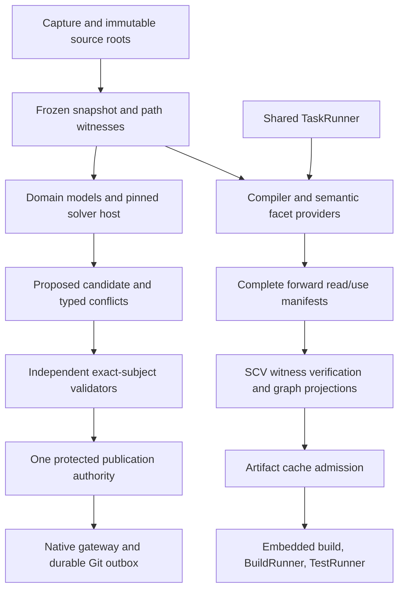

# Full SCV with phase 2 compiler integration

Date: 2026-10-27. Status: proposed integrated architecture; source inventory is evidence of implementation presence, not operational qualification.

This design extends the supplied [SCV master plan](../03_plan/app/tools/scv_sdn_solver_gateway_master_plan_2026-10-26.md) and [compiler plan](../03_plan/app/tools/simple_scv_compiler_tldr_build_cache_implementation_plan_2026-10-27.md). It preserves their requirements and adds an integration sequence, ownership boundaries and evidence crosswalk. It does not replace existing serial formats with their pseudocode sketches.

## Ownership and dependencies

| Owner | Public responsibility | Private implementation detail / forbidden dependency |
|---|---|---|
| SCV capture/snapshot | Exact bytes, inventories, stable identities, complete/unknown coverage | No semantic lowering or alternative worker scheduler |
| Parser/model/solver host | Pinned structure/model extraction and candidate proposals | No live mutation, authority self-grant, official alias allocation |
| Compiler | Semantic reads, facets, TLDR/AOP/macro/generic evaluation and IR | Must not reopen mutable source after snapshot admission |
| SCV witness/graph | Verify declared observations; atomically project forward/reverse uses | Must not invent pointcut semantics or treat file SHA as negative-lookup proof |
| Artifact cache | Artifact bytes, action lookup, stage/set packs and derived retention | No independent source freshness authority |
| TaskRunner | Scheduling, single flight, resources, cancellation and worker lifetime | SCV/cache do not introduce a second scheduling hierarchy |
| Publisher/gateway | Expected-state acceptance, durable outbox, reconciliation, settlement | No alias acknowledgement from an unaccepted topic branch |

Use narrow facades around existing modules. Pure merge/hash code must remain usable without importing compiler/network stacks. Sibling internals are accessed through owner contracts; immutable object handles cross process boundaries, never pointers. Proposed directory capsules in the supplied plans are responsibilities, not a mandatory repository move.

## Stable proposed interfaces

The shared names are `ParserProvider`, `DomainModelProvider`, `SolverProvider`, `ValidatorProvider`, `Publisher`, `SolveRequestV1` and `SolveResultV1`. Compiler-facing names are `ScvSnapshotV2`, `ScvChangeBatchV1`, `ReadManifestV2`, `VerificationReceiptV1`, `SemanticActionV2`, `DigestAliasV1` and `DirectoryWitnessV1`.

SCV facade operations are `freeze_for_build`, `open_frozen`, `resolve_path`, `diff_exact`, `changed_since`, `subscribe_changes`, `verify_read_set`, `publish_validation_receipt`, `pin_snapshot`, `unpin_snapshot` and `publish_consumer_generation`. Existing concrete signatures remain authoritative until a reviewed adapter implements this contract. One contract owner controls versioning; sidecars cannot create substitute formats.

## Source/DB/config separation

Routing uses accepted semantic roles before representation. SDN syntax does not choose DB versus configuration semantics. Resolve profiles/artifacts once per transaction, apply old accepted policy to policy changes, preserve exact raw inputs, compose nonoverlapping typed plans, validate the combined candidate and publish through one authority.

Source moves preserve identity only with verified effects/preconditions. Copies allocate new identity. DB columns/rows require stable UIDs and schema-bound addressing; scalar conflicts remain visible, while set/counter algebras apply only when declared. Schema/data/reference migrations form one candidate. Config security changes never merge through permissive union or self-edited policy.

The first full-SCV slice exercises both source move-plus-body-edit and concurrent DB column additions followed by rename/old-schema update. A generic text merge cannot satisfy the DB oracle.

## Snapshot and phase 2 bridge

Introduce a proposed `CompileSnapshotV1Adapter` boundary, not a silent V1 format change. It maps existing frozen compile input/root checks into the V2 logical view and explicitly identifies unsupported editor/generated/external/configuration coverage. Unsupported coverage is unknown, never an empty root or proof of no change. Preserve phase 2 parse-source SHA schema semantics and existing action-format versions.

Reuse has three separate identities: semantic artifact key, exact requested-snapshot validation receipt, and SCV provenance. Commit IDs remain provenance except in legacy keys whose meaning is retained. A new SemanticActionV2 path shadow-validates before cross-commit reuse is enabled.

A compiler registers versioned semantic facet verification. SCV can compare a consumed interface facet without invalidating on every provider-body edit, but cannot infer that facet from a raw file digest. Directory membership, query policy, positive/negative candidate domains, overlays and effective configuration all participate where read. Missing providers or incomplete manifests force revalidation/rebuild.

## Transaction and authority boundaries

Ordinary saves/private checkpoints preserve invalid bytes. Validation gates promotion, not local recovery. Build requests freeze an acknowledged generation; post-barrier changes belong to a later one. Captured operations include origin tags so generated artifacts, projections and indexes do not recursively trigger source builds.

Consumer publication atomically replaces one complete outgoing-use manifest, derives reverse users/demand, records directory changes and publishes an admitted root. Failed/cancelled/stale attempts cannot delete the last admitted manifest. Generic demand is a projection of unique uses, not racing increment/decrement authority.

Protected source and settlement scopes have explicit authorities. Git-authoritative deployment requires accepted-ref update/read-back before final aliases/landed acknowledgement; native-authoritative deployment is a separate future decision. Local durability, gateway draft durability, branch publication and accepted settlement remain distinct.

## Fast paths and hot paths

Startup loads approved effective SDN policy/provider lock and required root indexes once; optional workers and grammars are lazy, with no automatic capture-time downloads. Request paths reuse immutable parser sessions, exact scope deltas, facet/read-manifest indexes and single-flight derivations. Root equality skips subtree enumeration only within a verified canonical domain and complete overlay/path-policy coverage.

Bloom and XXH3/GXHash provide screening, never secure identity or a full snapshot proof. A fast miss/negative is usable only under proven construction/coverage and relevant directory witnesses. Cache hits still require requested-snapshot receipts and authorized artifact reads.

Keep compilation, matching, compression, hashing and network preparation outside the short acceptance critical section. Recheck expected authority generation before publication. Pin active mapped containers and source closure; evict rebuildable indexes before promised source history.

## Delivery and decision gates

1. Inventory current source/callers/flags/evidence and preserve existing working features.
2. Prove local source and DB slices; implement snapshot/witness contracts P1–P3.
3. Complete P4 exact read-set admission and P9 embedded/runner bridge; require zero compiler tasks on a valid unchanged OBJ and rejection after a relevant absent import becomes present.
4. Extend P5–P8 semantic propagation/set/container scale and P10 hardening without weakening those proofs.
5. Integrate real cross-host gateway/settlement, qualification, scoped rollout and recovery. Optional native authority remains last and separately approved.

See the [detail design](../05_design/scv_full_phase2_2026-10-27.md), [delivery crosswalk](../03_plan/agent_tasks/scv_full_phase2_2026-10-27.md) and [test plan](../03_plan/sys_test/scv_full_phase2_2026-10-27.md). Planning/design completion never marks any implementation or runtime acceptance scenario complete.
