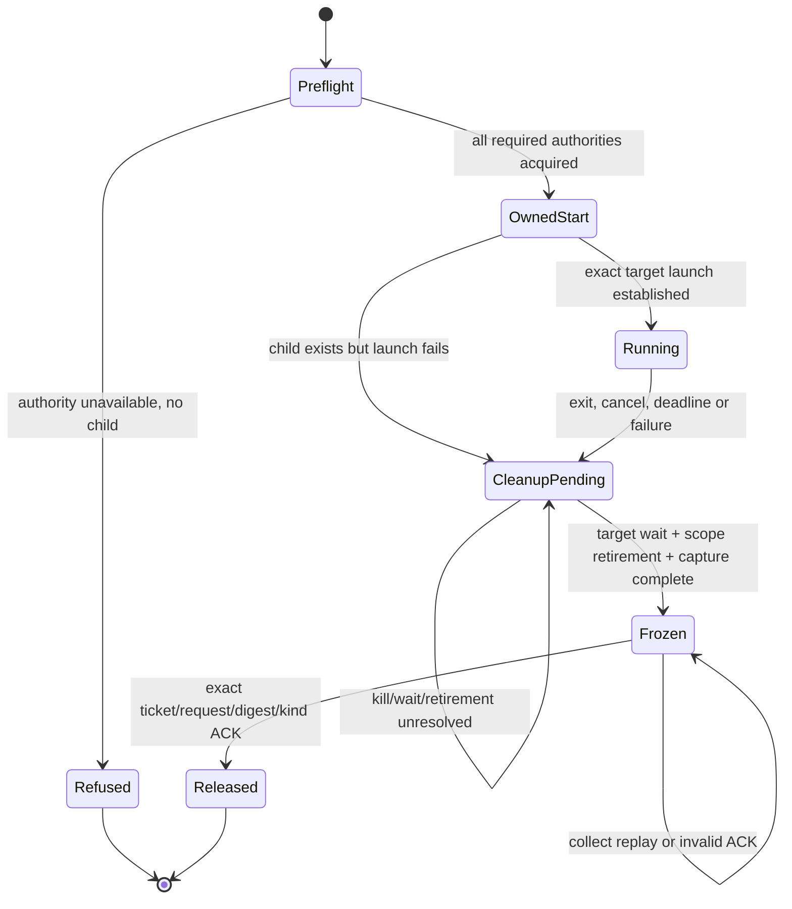

# Strict SOSIX V4 provider composition

Date: 2026-10-29. Source baseline: release/1.0.0 `17c632ff6a0`.
Status: architecture and implementation sequence; strict Darwin capability is
not installed. The existing user requirement is all-descendant ownership.
No Phase 2 rebuild is part of this architecture or its qualification plan.

## Decision and invariants

Keep one V4 lifecycle and receipt contract above host-specific authority
implementations. A host must supply every authority required by the requested
scope before V4 advertises that scope. Independent image, transport or process
group capabilities cannot be ORed into a strict capability flag.

The workload's exact executable/cwd identity, target leader exec/wait evidence,
descendant containment, output, memory policy and final ACK must belong to the
same request and owner generation. Keep the leader and broker identities
distinct. The supervisor's successful exit is never the compiler's exit.

No pathname, launchd label, peer PID, observed coalition number or copied
snapshot is authority by itself. No process-group signal, EOF, leader wait,
empty scan or successful kill request establishes all-descendant retirement.
An unavailable prerequisite must produce a typed no-child refusal; any failure
after a child exists must retain a cleanup-capable owner.

## Composition boundaries

| Layer | Owner and responsibility | What it cannot claim |
|---|---|---|
| BuildRunner | Task/source/runtime/tool identities, admission policy, state journal, publication, resource request and verified result | Cannot infer V4 capability from installed C symbols or fabricate process receipts from stdout. |
| Simple process facade | Canonical V4 requests, typed phases, immutable receipt validation, frozen digest and exact ACK | Cannot release a host ticket after a rejected/mismatched ACK or downgrade Tree to LeaderOnly. |
| Host V4 registry | Unforgeable request/generation/ticket, serialized transitions, deadlines, bounded output, retained cleanup and replay | Cannot return terminal merely because the target leader exited. |
| Image/cwd owner | Exact admitted executable representation and directory authority through launch | Image integrity alone does not prevent later exec, privilege changes or descendant escape. |
| Containment owner | Kernel-enforced workload membership, closed admission, owned cancellation, exact target wait and complete retirement evidence | Observation of an unowned coalition or same-UID writable cgroup is not containment. |
| Broker transport | Authenticated endpoints, incarnation identity, bounded framing/deadlines, non-transferable control channel policy | Peer authentication alone does not prove original job provenance or grant workload authority. |

Use existing common V4 DTO and freeze/ACK APIs; avoid a parallel protocol
whose apparent success bypasses their invariants. New host-private state is
necessary only where an existing owner cannot represent retained authority.

Normal and cleanup-failure frozen receipt kinds remain distinct under the
existing V4 contract. The graph does not authorize dropping cleanup ownership
on timeout: a bounded call can return pending/error while the owner persists.

## Darwin: existing pieces and remaining proof

1. **Executable identity exists.** The [bound image owner](darwin_bound_image_v1.md)
   starts from a trusted manifest SHA-256, provisions a constrained native
   Mach-O, and derives an AMFI-bound CDHash from those same authenticated bytes.
   It strips prior entitlements and restricts custom libraries. It is a narrow
   executable profile, not a general bundle/interpreter policy. The filesystem
   copy remains mutable; the kernel binding enforces identity or denial.
2. **Trusted direct-child bootstrap exists.** The [broker admission owner](sosix_darwin_broker_admission.md)
   supplies empty environment before dyld, closes inherited descriptors, keeps
   the child unreaped, checks kernel peer incarnation and CDHash, and owns
   bounded cleanup. Its canonical helper accepts ping/shutdown only; it never
   launches workloads and normally shares the controller's coalition.
3. **Launchd observation is deliberately insufficient.** The [transport owner](sosix_darwin_broker_transport.md)
   demonstrates pre-observation same-label replacement with injected
   environment. `GetJob`, observed code and a peer token do not authenticate
   the original launch configuration. Repeated observation cannot repair it.
4. **Retirement observations exist with preconditions.** Coalition primitives
   observe members and kernel identities. The UID BSD-process barrier includes
   records still present after coalition departure, conservatively blocks
   unrelated newer UID processes and requires a genuine root identity bound.
   Its preconditions include closed admission, zero live coalition tasks and
   immutable descendant UID; these are caller obligations, not facts it creates.
5. **The composition gap is workload authority.** No existing path combines a
   trusted bootstrap with an exclusively owned isolated job, immutable workload
   membership/identity policy, complete target execution and wait evidence,
   descendant retirement and V4 ticket/ACK handling. Consequently strict V4
   stays unavailable even while individual host fixtures pass.

Implement in this order:

| Slice | Concrete work | Gate before advancing |
|---|---|---|
| D1 — authority construction | Establish a kernel-owned isolated workload boundary from a trusted broker bootstrap, independent of replaceable job labels. Bind controller, broker, scope and source image identities. | Demonstrate an adversarial same-UID actor cannot substitute the admission configuration. Direct-child readiness alone fails this gate. |
| D2 — immutable workload scope | Enforce descendant membership and the policy needed by coalition/UID retirement, including privilege/UID changes, later exec, fork/spawn paths and delegation. Define permitted compiler/linker execution profiles. | Required compiler children still work; setsid/setpgid/double-fork and attempted scope escape never leave ownership. A no-fork sandbox cannot pass a compiler workload requiring children. |
| D3 — target execution owner | Start exact target argv/env/cwd under the boundary, preserve target exec/wait separately from broker state, capture bounded binary streams and resource enforcement. | Correct output plus deterministic rejected launch, saturation, deadline and cancellation controls. Custom runtime libraries must satisfy the chosen image policy. |
| D4 — retirement and crash recovery | Close admission, terminate owned scope, wait target, prove no live workload members and no remaining relevant BSD records; retain owner/journal across failed cleanup and broker/controller interruption. | Leader-first and zombie/transitional-record controls cannot produce a premature empty receipt; recovery cannot reuse a numeric PID as authority. |
| D5 — V4 integration | Map exact host phases/metrics into existing V4 packets, frozen digest/replay, cleanup kind and ACK; activate only qualified capabilities. | Host and native Simple twins agree across wrong-ticket/digest/kind, repeated collect, rejected ACK and successful one-time release. |

D1 is still a proof gap, not an established implementable fact. If the host
cannot provide the required isolated authority under the deployment privileges,
report it unavailable and continue other host work. Do not invent a launchd
provenance guarantee or silently select a weaker group contract. Any new
mechanism proposal must state its actual privilege/deployment prerequisites and
prove the same invariants before its capability can be enabled.

## Other host providers

- **Linux:** compose an exclusive cgroup-v2 delegation with atomic placement,
  migration prevention, exact executable/leader authority and existing retained
  cleanup handling. Fixing population parsing or retrying `cgroup.kill` is a
  prerequisite, not complete containment. Read-only population observations
  must remain bound to the owned delegation.
- **Windows:** compose exact image/cwd admission with the real suspended-child
  Job owner, restricted handle inheritance, non-breakaway descendant policy,
  synchronized capture, target wait, final Job membership and V4 freeze/ACK.
  Preserve native Job commit metric semantics. Existing V2/V3 APIs must not
  implicitly advertise sealed V4 or exact image pinning.
- **FreeBSD and SimpleOS:** implement equivalent authority under each real
  kernel or return typed unsupported capability. Host stubs, emulated process
  scans or successful cross-linking do not qualify a guest process owner.

## Evidence and rollout

The [end-to-end plan](../03_plan/sys_test/buildrunner_sosix_end_to_end_2026_10_29.md)
defines H01–H10 adversarial host cases, B01–B05 BuildRunner integration,
R01–R06 runner checks and P01–P02 bootstrap acceptance. Qualify each host
independently with fixed source/runtime/provider/producer identities. Native C
fixtures are component evidence; pure-Simple twins require an admitted existing
compiler. The missing pinned P2 blocks those twins until the artifact is
recovered or a separately admitted already-existing producer is available.

Keep all existing strict capability refusals during D1–D4. D5 enables only the
scope proven by complete host and Simple evidence. Then build the production
manager/writer/worker and run both-backend Hello matrices before using that
provider to continue P3/P4. No source-only review, generated manual, process
snapshot, transport handshake or partial coverage report closes this sequence.
