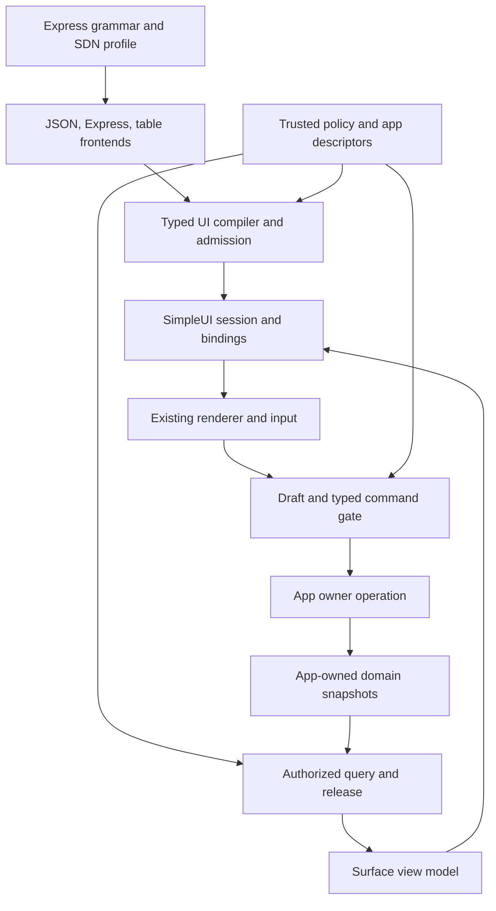
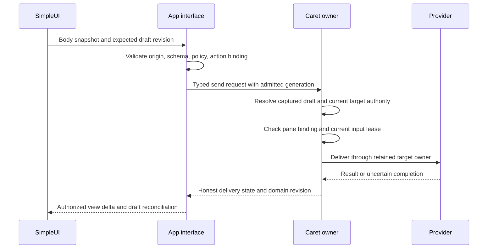

# A2UI and dynamic app interfaces for Simple

## Final design with Caret Suite as the implementation example

**Status:** Final consolidated design proposal; implementation and runtime qualification remain required.  
**Reviewed:** 2026-11-25, Asia/Seoul.  
**Simple baseline:** `ormastes/simple`, `release/1.0.0` at `e61e56a63f4f23bbf03c5e461beee2d7294f7f70`.  
**A2UI baseline:** `a2ui-project/a2ui` at `1dbe86a942579cc83a1d657213f0db3b881632ae`; wire version `"1.0"`.  
**Scope:** Shared support for all apps; Express grammar represented in SDN; one raw screen table; SPL-based queries; input/commands; separate regional authority; dynamic composition; Caret example; SimpleOS; performance; source audit and research.
The document distinguishes **observed source behavior**, **proposed design**, and **validation actually performed**. All implementation observations are limited to the pinned files; live branch names and upstream narrative examples may differ. Examples use the reviewed Basic catalog. New schemas/APIs below are design notation unless explicitly identified as existing.

### Reading map

- Sections 1–4: decision, compatibility, current infrastructure, and shared architecture.
- Sections 5–8: grammar conversion, raw SDN screen format, semantic state, and native SimpleUI integration.
- Sections 9–12: application interfaces, Simple-based queries, authority, and dynamic composition.
- Section 13: complete Caret example, including interface, screen, policy, and Send flow.
- Sections 14–17: stable MDSOC execution, SimpleOS, streaming, and performance.
- Sections 18–24: research, measurements, implementation sequence, acceptance criteria, and sources.
- Section 25: glossary of hot swap and A2UI query-glue terminology.

## 1. Decision and scope

Adopt **A2UI as an optional presentation protocol above SimpleUI**, backed by a **shared, typed application interface**. Keep application data behind app-owned query and command ports. Express and SDN describe screens; a restricted part of Simple language describes data transformations; separately trusted SDN defines authority. Caret Suite is the worked implementation example, and the infrastructure belongs below Caret so every app can use it.
The complete flow is:

**Application state → authorized query and transformation → surface view model → A2UI bindings → SimpleUI → draft input → typed command → application operation → updated view.**

This supports dynamic interfaces during ordinary operation. A screen may acquire a panel, change a query parameter, add a form for an admitted operation, or adapt to a terminal without replacing executable code. Existing hot swap remains available when an implementation module actually changes.

### 1.1 Direct answers to the design questions

| Question | Recommended answer |
| --- | --- |
| Is SimpleUI under A2UI? | For an A2UI-rendered region, yes: A2UI descriptions lower into SimpleUI semantics. SimpleUI also remains usable directly. A2UI does not replace layout, input, accessibility, rendering, or window management. |
| Should SDN depend on Express grammar? | Yes for Express-derived component expressions. Convert the pinned official grammar into a generated SDN grammar representation, then generate shared-parser tables. Keep the native table wrapper small and separately versioned. |
| Can one raw table express a screen? | Yes. Use one flat SDN component table with explicit identities, parent slots, ordering, requested regions, optional repetition, and quoted Express constructor expressions. The table lowers to the same typed operations as wire JSON. |
| How does app data appear? | A typed query obtains an authorized snapshot, transforms it into a presentation model, and releases permitted fields to `/view`. The screen binds to this view instead of inspecting app objects. |
| How does user input reach the app? | Inputs modify owner-scoped draft state. Submission resolves a registered typed command, checks current authority and preconditions, invokes the existing domain port, and records the result. |
| Is a query a link? | A binding links a named query result to a model path and defines parameters, lifetime, and refresh behavior. A query computes data; it neither grants access nor provides an automatic writeback path. |
| How are read/write/create and namespaces handled? | Register semantic resource and operation identities. Separate read, subscription, create, update, delete, invocation, discovery, composition, and delegation permissions. Map them to the existing authority service after its consuming path is hardened. |
| Where is regional authority defined? | In a separate trusted `authority.sdn` policy selected by the app/host. A screen's region string requests placement; only the host assigns region provenance and effective permissions. |
| Must the main module change on every UI update? | No. Wire the shared interface at the existing bootstrap/port boundary once. Keep the main loop and owners stable while screen descriptions, bindings, parameters, and admitted handler generations change. |
| Is this Caret-specific? | No. Caret supplies resource adapters and commands. Parsing, query admission, bindings, policy enforcement, session ownership, and rendering integration are shared. |

### 1.2 Artifacts and their authority

The examples below describe proposed contracts. Their `.sdn` extensions do not imply that the current repository implements the new profiles.

| Artifact | Role | Who may supply it |
| --- | --- | --- |
| `a2ui_express.grammar.sdn` | Generated representation of pinned `Express.g4` | Build tooling; pinned and reviewed |
| `express_sdn.profile.sdn` | Small native table/layout profile, referring to the Express grammar digest | Shared parser/UI maintainer |
| `caret.screen.sdn` | Exactly one flat screen table | App author; a model/user may propose changes within admitted capabilities |
| `caret.interface.sdn` | Resource, query, command, schema, and binding declarations | Trusted app package; host admits registrations |
| `caret_queries.spl` | Typed transformations over authorized sources | Trusted compiled module; dynamic query text is limited to the admitted subset |
| `caret_actions.spl` | Domain command adapters | Trusted compiled module using existing app ports |
| `caret.authority.sdn` | Region ceilings, grants, resource/field rules, release destinations | Trusted policy publisher; never granted by generated screen content |
| Existing app manifest/capsule | Selects these assets and stable ports | Existing app bootstrap/packaging owner |

These are logically distinct resources. They may be bundled in one installed app package, but a generated screen cannot replace its own policy or install arbitrary code by naming a file. The final deliverable here is this one document; example filenames denote implementation assets to create later.

### 1.3 Minimum useful implementation

Start with named, parameterized read queries; explicit commands; a bounded flat screen table; a small Basic-catalog mapping; complete-block parsing; and versioned view updates. Add dynamic query composition, maintained joins/aggregates, optional lenses, and streaming after those contracts work.

All-app support means shared availability and capability-tested adapters. Apps without UI need not link the renderer; a headless producer may emit standard A2UI JSON; a small target may load a precompiled bundle. Local updates need no LLM call and no JSON serialization.

The main implementation principles are to reuse the common parser and UI contracts, preserve typed values and qualified ownership, authorize both data releases and effects, and measure actual end-to-end costs. Proposed APIs and examples are specifications to implement, not claims that A2UI support has already landed.

## 2. Upstream contract and compatibility boundary

A2UI separates its JSON transport from the format used to generate UI. Express is an inference/authoring format compiled into wire messages; custom formats can target the same transport. This supports a Simple-native SDN frontend without requiring external renderers to understand SDN. [U1]

At the pinned revision, the agent-to-renderer schema has six alternatives: `createSurface`, `updateComponents`, `updateDataModel`, `deleteSurface`, `callRendererFunction` and `agentFunctionResponse`. The version literal is `"1.0"`. Renderer-to-agent traffic includes actions, function calls/responses and errors. The first four operations are a useful rendering milestone, not the whole protocol. [U2] [U3]

Use the pinned schemas, semantic specification, grammar and conformance fixtures together. Record disagreements instead of silently selecting whichever example is convenient. In particular, older proposal examples use `"v1.0"`, while the normative schema requires `"1.0"`. Current Python source implements incremental Express streaming; an older introduction describing whole-reply compilation is not the current implementation authority. [U2] [U4] [U5]

Separate strict-language conformance from optional SDK repair compatibility. The upstream compiler corpus includes tolerated malformed spellings and repair cases beyond the canonical grammar. Select and label a strict-core corpus, and track repair/healing cases separately; passing one is not a claim to implement the other. [U8]

### 2.1 Interoperability rules

The native adapter must preserve several distinctions:

| Distinction | Required behavior |
| --- | --- |
| Omitted argument versus explicit null | Keep separate representations through parsing and lowering. `_` is omission, not a null value. |
| Component reference versus text | Resolve references according to the catalog slot type; do not turn every bare/string value into a widget reference. |
| Native property delta versus wire component update | A wire `updateComponents` entry is a complete replacement definition. Clear properties/metadata absent from the replacement. |
| Data update versus object merge | Apply the specified path replacement/deletion semantics; do not substitute a generic recursive merge. |
| Component catalog override versus function catalog | Components use `@catalogId` on the wire; functions use `catalogId`. |
| Surface identity versus OS window | A surface is protocol-owned UI content. Window creation remains a separate host capability. |

These rules come from the wire types, protocol semantics and compiler fixtures. Schema validation alone does not establish all semantic invariants. [U6] [U7] [U8]

The official Express shorthand for paths has a narrower lexical range than arbitrary JSON Pointer strings. Therefore the implementation should promise equivalence for the supported Express/SDN semantic domain, not universal lossless JSON-to-Express conversion. The JSON frontend remains available for wire constructs outside that shorthand. [U9]

### 2.2 Versioned support

Maintain separate identities for:

- Wire protocol version.
- Upstream Express grammar and semantic-conformance revision.
- Optional SDN layout profile version.
- Negotiated catalog identity and content digest.
- Native component/property mapping version.
- Shared parser program and compiler/cache format version.

Catalog identity is an agreed identifier; it does not authorize fetching an arbitrary URL. Resolve catalogs from the host’s registered set or an explicitly configured acquisition path. [U7]

## 3. What the current Simple repository provides

The following are source observations at the pinned Simple commit. They are not claims that this new feature has been implemented or benchmarked.

### 3.1 Parser infrastructure audit

| Existing area | Observed implementation | Consequence for A2UI |
| --- | --- | --- |
| `common.structural.parse.parse_types` | Byte-owned source blobs, token arenas and parse contracts; dialect grammar/action fields include opaque IDs. [S1] | Reuse ownership and coordinates; descriptor fields alone do not establish a full grammar provider. |
| `program_v1.spl` | Validated V1/V2 grammar/action programs, V2 literal tables and resource limits. [S2] | Use as the target of generated Express rules. |
| `grammar_cpu_v1.spl` | Actual scalar grammar VM with calls, choices, rollback, actions and EOF acceptance. [S3] | Reuse this executor instead of implementing another generic VM. |
| `transaction_v1.spl` | Grammar-private checkpoints and semantic staging. [S4] | Speculative parse actions must not mutate live UI. |
| Default structural parse runtime | Current dispatch is a lexical CPU-reference route; accelerated modes have explicit fallback paths. [S5] | Do not assume integrated GPU/incremental grammar execution. |
| Strict SDN V1 | Complete bounded document parsing, including indentation, UTF-8, tables, duplicate-key checks and EOF. Broader qualification remains incomplete. [S6] | Suitable foundation for grammar/configuration SDN; constructor expressions require a distinct profile. |
| Shared-VM SDN inline candidate | Limited inline subset; explicitly not admitted. Its projection copies growing collections repeatedly. [S7] | Adapter example only; not a complete, qualified A2UI-SDN parser. |
| Common JSON parser | Strict duplicate-decoded-key rejection and EOF checks, but generic values and caller-supplied resource admission remain concerns. [S8] | Reuse decoding with a bounded typed A2UI boundary. |
| Compiler parser façade | Useful token/span/recovery services, but imports compiler lexer code. [S9] | Common app runtime must use common contracts/diagnostics directly. |
| Common diagnostics | Byte spans and source-position conversion, including a line-start table. [S10] | Preserve one source coordinate system through parsing, lowering and editor diagnostics. |

There are two especially important qualifications.

**There is no established G4-to-executable-SDN pipeline in the inspected paths.** The existing `compiler.frontend.Grammar.sdn` is generated inventory of handwritten productions and AST tags. The parser-unification research proposes normative grammar SDN and generated tables; targeted inspection did not establish an implemented importer. That build-time conversion is new work. [S11] [S12]

**The newer SDN candidate is not a substitute for full SDN.** Its documented subset excludes block indentation and several lexical/data features. Its own evidence report identifies quadratic collection projection and an admission failure. A2UI should reuse the common VM while supplying and qualifying its own dialect adapter. [S7]

### 3.2 UI and app infrastructure audit

| Existing area | Observed implementation | Consequence for A2UI |
| --- | --- | --- |
| Shared semantic contract | Reuses the existing access/tree representation. [S13] | A2UI IR is compilation/state-adapter data, not a second native rendering system. |
| `nogc_sync_mut.ui.session` | Owns UI state, surfaces, lifecycle, changes, observations and input context. [S14] | Integrate at session boundaries in the appropriate runtime family. |
| Widget storage | Process-global, text-ID-based registry and property lists. [S15] | Raw A2UI `root` IDs cannot safely become global widget IDs. |
| Surface manager | Existing generation-bearing handles and focus preservation. [S16] | Reuse lifetimes; add protocol creation semantics and owner scoping. |
| UI events and patches | Action names and many property/input values are text-oriented. [S17] [S18] | Add typed A2UI context/value projection without string round trips. |
| Patch stream | Warm path derives patches from access events; structural records can lack node payloads. [S19] | It is not a complete protocol replay journal. |
| Hosted UI diff | Repeated linear node matching and serialized equality; session transport isolation is distinct from widget isolation. [S20] | Use qualified identity and indexed/revisioned updates. |
| UI-local SDN loaders | Two independent colon-line flatteners; one wraps unchecked tree building in `Ok`. [S21] [S30] | Do not extend these parsers for A2UI. |
| Capabilities and scene routing | Existing unsupported results and generation-aware routing; some cross-producer linkage remains incomplete. [S22] [S23] | Advertise verified mappings and test nested ownership end to end. |

The parser work should improve shared infrastructure once, then make it available to every app. Existing `.ui.sdn` compatibility can migrate separately; enabling A2UI must not silently reinterpret ordinary SDN strings as executable expressions.

### 3.3 Query, authority, and Caret integration seams

| Existing area | Source observation | Reuse boundary |
| --- | --- | --- |
| API registry | Source API/call-site governance, not dynamic app authorization. [Q1] | Reuse contract conventions; add admitted descriptors through the app port owner. |
| SQL builder | Typed parameterized values, but also Raw paths; no general join/group planner established here. [Q2] | Compile only a supported safe QueryIR subset through registered schemas. |
| ECS query/change detection | Changed iteration scans slots; removal queue drains destructively. [Q8] [Q9] | Bounded snapshot projection first; independent subscription cursors/journals when needed. |
| Privilege broker/service/store | Useful records and seams with incomplete authenticity/attenuation/operation checks in inspected paths. [Q3] [Q4] [Q5] [Q6] | Harden the actual consuming authority boundary before untrusted private/effectful access. |
| Caret workbench | Existing target generation, draft/delivery, pane binding, execution/control metadata. [C5] [C6] [C7] | Reuse contracts, add authenticated owner adapters and the actual delivery path. |

Detailed findings and consequences appear in Sections 10, 11, and 13. An API or design document stating a target capability is not evidence that the entire path already enforces it.

## 4. Shared architecture for all applications



### 4.1 Responsibility split

**Common, backend-independent code**

- Protocol records and typed values.
- Catalog descriptors, signatures and validation plans.
- Express/SDN AST and frontend adapters using common parser infrastructure.
- Binding/path identities, ordered semantic operations and diagnostics.
- Pure mapping rules between catalog properties and native semantic properties.
- Typed app resources/queries/commands, QueryIR, effects, and authority-service interfaces.

**Runtime-family adapters**

- Session ownership, mutable builders and publication.
- Component/model stores and dependency indices.
- Event queues, transport integration and function-call completion.
- Native widget/session commits.
- Owner-scoped drafts, query bindings, release gates, subscriptions, and revisioned result publication.
- Loader interaction through an injected app-level lifetime port.

**Existing backends**

- Layout, styling, focus, accessibility and rendering.
- TUI, GUI, web or SimpleOS presentation.
- Capability-specific control behavior.

**Build/developer tooling**

- Pinned grammar import and table generation.
- Catalog descriptor and prompt-signature generation.
- Drift/conformance checks, editor support and benchmark fixtures.
- Static UI compilation and cache production.

Common code must not import application modules or compiler rich AST/loader implementations. The shared source/span/program contracts are the reuse boundary. A runtime or developer tool above that boundary may adapt compiler services.

### 4.2 Availability across application types

| App type | Integration | Initial limitation to make explicit |
| --- | --- | --- |
| Native desktop GUI | Mount a surface in an existing app session/container. | Only registered component/property mappings are supported. |
| TUI | Render the supported semantic catalog through the existing terminal backend. | Media or unsupported interactions require an advertised catalog fallback or an error. |
| Hosted web / embedded UI | Use the shared model and session adapter with the existing host transport/rendering path. | Hosted SimpleUI envelopes are distinct from A2UI wire messages. |
| Electron / Tauri | Reuse shared semantic/web artifacts through the existing adapter. | Native WebView end-to-end delivery still requires qualification. |
| SimpleOS apps/services | Userland capsule produces app-owned UI content for the existing WM/render pipeline. | Protocol content cannot take over window-manager policy. |
| Headless service or test | Validate/compile UI and emit JSON or inspect semantic state. | No pixel-rendering capability is implied. |
| Small embedded or baremetal target | Load a compatible precompiled UI bundle or a restricted frontend where supported. | Boot/kernel paths do not automatically acquire the full parser/runtime. |

The SimpleOS WM design already has common rendering contracts and ownership routes, but records outstanding backend integration work. Treat these rows as rollout targets, not a declaration of universal current support. [S24]

## 5. Express grammar represented in SDN

### 5.1 Build-time dependency

Use this dependency direction:

**Pinned `Express.g4` → imported grammar model → `a2ui_express.grammar.sdn` → generated lexer/grammar/action tables.**

The generated SDN should carry source revision/digest, importer version, schema version, entry rule, token/rule identities and source mappings. Generated parser tables should be checked in or included in build artifacts so application startup does not require ANTLR, Python, a network connection or grammar generation.

G4 supplies syntax. A versioned AST-action mapping, pinned Express semantic rules and catalog descriptors are separate inputs to generation and compilation. The grammar alone cannot derive scope behavior, component IDs, defaults, omission handling or catalog lowering.

A small importer supporting the pinned grammar’s actual constructs is sufficient initially. It must reject unsupported constructs with a source location. A future upstream addition must fail the generation/drift gate instead of silently changing the accepted language.

### 5.2 Example grammar-SDN shape

The following is a **proposed schema excerpt**, not an existing Simple parser API and not a complete grammar. It demonstrates the dependency and structural representation; the generated full artifact must contain every lexer and parser rule.

```sdn
grammar:
    name: a2ui_express
    schema_version: 1
    entry: program
    source:
        repository: "https://github.com/a2ui-project/a2ui"
        revision: "1dbe86a942579cc83a1d657213f0db3b881632ae"
        path: "specification/inference_formats/express/Express.g4"

rules:
    program:
        sequence:
            - repeat:
                rule: statement
            - token: EOF

    assignment:
        sequence:
            - choice:
                - rule: identifier
                - rule: path
            - literal: "="
            - rule: expression
```

Do not place repeated productions under duplicate mapping keys. Use unique rule keys or ordered rule records. This matters because strict SDN rejects duplicate decoded keys, while a generated inventory elsewhere in the repository is not necessarily ordinary strict-SDN input. [S6] [S11]

### 5.3 Import requirements

The pinned grammar includes Unicode identifiers, several string forms, comments/skipped tokens, calls with positional or named arguments, optional trailing commas, maps, paths and checks. Newlines are skipped in official Express; they are not its only statement boundary. [U9]

The importer therefore needs explicit treatment of:

| Grammar feature | Required importer behavior |
| --- | --- |
| Lexer precedence and longest match | Preserve the upstream token decision, including keywords versus identifiers. |
| Character classes and Unicode | Use a versioned classification policy and test multilingual identifiers. |
| Non-greedy string/comment patterns | Preserve termination and escape behavior across chunk boundaries. |
| Alternatives, groups and repetition | Translate with progress checks and bounded execution. |
| Literal tokens and skipped input | Preserve distinctions between significant punctuation and ignored material. |
| Semantic actions | Emit AST/arena records only; never execute UI or application effects. |

ANTLR alternatives cannot be converted blindly into arbitrary ordered-choice VM branches. Prefix factoring, lookahead or an explicitly tested mapping may be required. The shared VM provides execution machinery; it does not prove language equivalence.

### 5.4 One grammar authority, several executors

The normalized grammar and semantic rules should remain authoritative whether execution uses the existing scalar VM or a future generated scalar/SIMD implementation. Optimization may replace execution below that contract. It must not create a separately maintained handwritten A2UI grammar.

The first release should use the qualified scalar route. GPU parsing is a later workload-driven option, not a prerequisite for UI support.

## 6. The `express_sdn` screen profile: one raw table

### 6.1 Recommended representation

Use an **anonymous root SDN table** as the complete screen body. Keep surface identity/catalog selection, initial data, query/command bindings, and trusted policy references in the installed interface/package configuration. This lets the screen remain one raw table while preserving distinct authority boundaries.

| Column | Meaning |
| --- | --- |
| `id` | Stable template/component identity; the one nonrepeated root is literally `root` on A2UI wire |
| `parent` | Parent row ID, or null for root |
| `slot` | Catalog-resolved child/list slot, or null for root |
| `order` | Unique integer order within a parent/slot |
| `region` | Requested host mount region; not an authority grant |
| `repeat` | Null or path to an admitted keyed view collection |
| `key` | Null or the row key field required by the keyed collection contract |
| `expression` | Quoted Express component-constructor expression, parsed once |

Strict SDN already has a table container: a pipe-delimited comma-separated header followed by comma-separated rows. Anonymous root rows use root indentation; named-table rows would be deeper than their header. Quote expression cells and escape their embedded quotes. All cells are present, using explicit null where inapplicable. This container is existing syntax; **the screen schema and lowering are proposed work**. [S6] [S31]

### 6.2 Parsing and assembly

Read the outer document with the bounded strict SDN reader. Decode each `expression` cell as text, then parse it using the generated official Express **expression** rule followed by EOF, preserving a mapping from decoded spans to original source. Reject trailing tokens after a successful expression. The result must resolve to an admitted component constructor. Lifecycle calls, arbitrary SPL, query execution, and policy definitions are not permitted in the cell.

Build topology from `parent`, `slot`, and `order`. Synthesize `child`/`children` arguments before final catalog validation. Thus `Column()` and `Button(action=...)` are valid intermediate constructor ASTs; they are not complete valid Basic-catalog components until assembly supplies required children.

Reject duplicate row IDs, missing parents, cycles, multiple roots, ambiguous ownership, duplicate order values, invalid catalog slots, wrong singular/list cardinality, and conflicting explicit child arguments. The first profile uses a tree even if another frontend supports richer references. Cells cannot override their row ID/catalog ownership through conflicting reserved arguments.

The shared compiler then creates the same typed component/model operations as JSON or Express. Do not regenerate Express text from each table row and invoke a second compiler on every update.

### 6.3 Minimal equivalence example

Official Express:

```text
surface("settings")
$/status = "Ready"
root = Column(children=[status, refresh])
status = Text(text=$/status)
refresh = Button(child=refresh_label, action=Event("refresh"))
refresh_label = Text(text="Refresh")
```

Proposed `settings.screen.sdn`, with `surfaceId=settings`, the pinned Basic catalog, and initial model `{status: "Ready"}` supplied by its trusted interface:

```sdn
|id, parent, slot, order, region, repeat, key, expression|
root, null, null, 0, main, null, null, "Column()"
status, root, children, 0, main, null, null, "Text(text=$/status)"
refresh, root, children, 1, main, null, null, "Button(action=Event(\"refresh\"))"
refresh_label, refresh, child, 0, main, null, null, "Text(text=\"Refresh\")"
```

Both should produce the same component definitions, bindings, and action. The relevant wire fragment is:

```json
{
  "id": "refresh",
  "component": "Button",
  "child": "refresh_label",
  "action": {"event": {"name": "refresh"}}
}
```

The complete reference create/update/delete messages were checked against the pinned schemas. This document's table assembly has not been run through a Simple implementation.

### 6.4 Keyed repetition and stable data paths

The native profile's repeated collection has this logical shape:

```json
{
  "order": ["k001", "k002"],
  "by_key": {
    "k001": {"key": "k001", "label": "Agent A"},
    "k002": {"key": "k002", "label": "Agent B"}
  }
}
```

For `repeat="/view/roster"` and `key="key"`, visit `order`, resolve each record in `by_key`, and verify that its key agrees. Require `set(order) == set(by_key.keys)`; reject duplicate, missing, and unreferenced extra keys and bound the collection. Keys are host-issued opaque strings from a safe alphabet; their mapping to domain identity/generation stays with the owner. Reused domain identities receive a fresh key or explicitly include their generation.

The first implementation expands one level of repetition into explicit ordinary A2UI components. A relative binding such as `$label` in a repeated subtree resolves to `/view/roster/by_key/k001/label`. Stable keyed paths avoid row-index retargeting when order changes. Generated component identities include surface ownership/generation, template identity, and row key. Encode wire IDs with an admitted opaque identifier such as `c_` plus hexadecimal; do not concatenate raw domain or surface names. Keep the wire root as `root`; internal handles qualify it.

Only typed binding/call AST nodes undergo scope resolution. Text stays literal. Reject context-sensitive `@index()` in this first expansion profile; an optional displayed ordinal can be a query field. Catalog functions with embedded expression languages need their own admitted parser and scope semantics, or remain unsupported. Forbid repeated root and nested repetition initially; nested support would need the full ancestor key tuple.
On reorder, retain child IDs and change ordered references. On insertion, publish data and complete definitions before attaching new references. On removal, invalidate action provenance first, detach references, and clear inaccessible model data. A2UI has no per-component deletion envelope at this pin: detached definitions can remain in a remote registry. Bound retained definitions and rotate/reset a surface with a new authoritative snapshot when needed; do not promise remote memory reclamation from detachment. [U2] [U7]

`repeat`, `key`, `region`, and query declarations never appear as unrecognized fields in interoperable A2UI. Native stable-state reconciliation is an adapter feature, not a portable guarantee implied by a wire key property. Official ChildList templates remain a possible later lowering strategy after their identity behavior is qualified.

### 6.5 Optional indentation notation

A colon/indentation spelling such as `status: Text(text=$/status)` can remain an optional authoring frontend that produces the same ordered AST. It is not required for the flat table milestone. If added, version its layout rules, preserve repeated statement order, apply indentation only outside literals/comments/open delimiters, and reject ambiguous mixing with ordinary SDN data. Do not modify official Express or reinterpret arbitrary `.sdn` strings as executable expressions.

## 7. Shared semantic compiler and typed state

### 7.1 Compiler stages

1. **Frame and admit input.** Select format/version and enforce source limits.
2. **Lex and parse.** Produce snapshot-owned spans and an ordered AST.
3. **Resolve catalog signatures.** Resolve constructors, functions, trait fields and argument positions.
4. **Normalize.** Distinguish component declarations, values, references, bindings, actions, checks and lifecycle operations.
5. **Validate.** Check schemas, ownership, identifiers, types, references and permitted function calls.
6. **Stage a state transition.** Construct typed operations without mutating live widgets.
7. **Commit.** Publish an accepted transition into the owner session and schedule affected UI work.
8. **Encode if needed.** Produce standard JSON only for an external A2UI peer.

JSON does not need to be forced through the textual Express AST. It can enter at the typed protocol/semantic-operation boundary while sharing catalog and state validation.

### 7.2 Typed records

The following are conceptual categories, not claimed existing type names:

| Record | Essential information |
| --- | --- |
| Source reference | Snapshot identity and byte span |
| Catalog descriptor | Identity/digest, component/function signatures and validation plan |
| Value | Null, boolean, number, text, array or object |
| Expression | Literal, reference, path, call, check or child template |
| Component definition | Local ID, catalog/type, typed properties and metadata |
| Surface state | Owner, wire surface ID, generation, catalog set, data model and component definitions |
| Ordered operation | Creation, component replacement, data-path replacement, deletion, RPC or completion |
| Action envelope | Owner/session, surface/component, event name, timestamp, typed context and correlation |
| Compiled UI bundle | Typed immutable description plus grammar/catalog/compiler identities |

Omission is an AST/property-presence state, separate from the Value null case.

Avoid importing a second authoritative widget registry. The A2UI adapter needs protocol-level state sufficient to preserve declarations, bindings and the data model; native rendering remains derived from the existing SimpleUI session.

### 7.3 Bindings and reactive updates

Compile model paths and catalog functions into a dependency graph. Maintain a reverse index from changed paths to affected properties and template instances.

When a path changes:

1. Apply the protocol operation in order.
2. Invalidate dependent evaluations, including descendants when an ancestor is replaced.
3. Re-evaluate affected bindings and registered functions.
4. Generate typed native changes.
5. Recompute necessary layout ancestors and damaged render regions.
6. Preserve focus, selection, scroll and IME state where component identity remains valid.

This targets work proportional to affected dependencies; layout may still propagate widely. A template whose length/order changes may legitimately rebuild many children. Do not claim every single-field update is constant time.

Keep domain state and the UI projection distinct. An ECS World can be authoritative application state, while the A2UI data model is the permitted projection exposed to that surface. Two-way input binding must pass through a typed app command or an explicitly allowed UI-local model update, rather than silently mutating arbitrary domain components.

## 8. Native SimpleUI changes needed

### 8.1 Qualified identity

Introduce or adapt an internal qualified handle containing:

**App/session owner + wire surface identity + surface generation + component identity.**

Use a single translation layer while old APIs still accept text IDs. Do not scatter ad hoc concatenation across widgets and apps. If a text encoding is temporarily necessary, make it unambiguous and reversible.

Wire IDs must remain intact for protocol communication. The host can allocate distinct renderer contexts for separate apps; an aggregator sharing one wire namespace must enforce that namespace’s surface-uniqueness rules. Within a renderer, a duplicate `createSurface` is an error, even though the native SurfaceManager can replace a same-named entry. [U2] [S16]

Isolation is an early acceptance gate: two apps with `root` and `refresh` must never overwrite, observe or dispatch into one another.

### 8.2 Component mapping

Begin with a deliberately tested component set: text, row, column, container/card, button, text entry, boolean entry and lists. Exact exported names and properties must follow the catalog being registered. Static lists and bound templates deserve separate gates.

For each mapping define:

- Property types, defaults and replacement behavior.
- Child/reference slots and layout interpretation.
- Binding and input behavior.
- Focus, enabled state and accessibility projection.
- Event/context mapping.
- Backend capability and unavailable behavior.

A component appearing in a showcase does not prove all of these semantics work.

### 8.3 Typed patches and history

The existing native patch API has useful operations, but text-only property payloads cannot preserve all protocol data. Keep typed values through the model/adapter, then convert to display text only where the control requires it. Evolve public patch APIs through a versioned adapter where needed. [S18]

Keep four representations distinct:

1. A2UI wire messages.
2. Internal accepted model/UI operations.
3. Native widget/Draw IR changes.
4. Existing hosted SimpleUI transport messages.

An observation/access history is not automatically a reconstructible state log. For reconnect and replay, retain complete accepted protocol-state operations or send an authoritative snapshot containing catalogs, component definitions, bindings and data. Use the existing snapshot-on-history-gap behavior, but do not replay incomplete mount records as if they were sufficient. [S19]

### 8.4 Input and function dispatch

Adapt native events into a typed action envelope with ownership, component origin, context and correlation. Reuse existing session nonce/revision and stale-input checks. A bare global `Action(name)` is insufficient for multi-app A2UI dispatch. [S14] [S17]

The wire action encoder must include `name`, `surfaceId`, `sourceComponentId`, `timestamp` and `context`, emitting an empty context object when appropriate. Internal correlation fields do not replace required protocol fields. [U3]

Catalog functions resolve against registered implementations and declared caller rules. Pure functions may participate in bindings. Effectful operations dispatch through the appropriate app/renderer port and preserve correlation and completion semantics. Function calls must not become arbitrary SPL evaluation.

Propagate caller identity through nested function calls and embedded-expression evaluation, and enforce both `allowedCallers` and `requiresUserActivation` before invocation. For `callRendererFunction`, an explicit surface selects that surface's root model; without a surface, use an isolated empty model rather than the active window's data. Preserve the required catalog identity and echo `functionCallId` in the response. [U6] [U7]

If the first milestone omits RPC or a function family, advertise and document that limitation; do not equate a named button action with complete function-protocol support.

## 9. Shared application interface: resources, queries, commands, and bindings

### 9.1 Expose an app-owned contract

An app interface describes **what an application permits consumers to observe and request**. It is independent of A2UI: a CLI, accessible UI, test, automation, or admitted MCP/HTTP adapter can call the same typed operations through its own authenticated context.

Register these descriptors through the existing capsule/port owner:

| Descriptor | Required contract |
| --- | --- |
| Resource | Semantic namespace, schema/version, stable key, owner, provider, sensitivity, snapshot semantics, permitted operations |
| Query | Parameter/result types, resolved source and operator identities, effect set, dependencies, release audience, cost limits, supported execution backends |
| Command | Argument/result/error types, exact domain operation, authorization requirements, preconditions, concurrency rule, idempotency and completion semantics |
| Subscription | Query identity and parameters, authenticated consumer, policy revision, data cursor, backpressure, cancellation, snapshot-on-gap behavior |
| UI binding | Query output destination, parameter sources, draft schema, command action mapping, error/loading presentation, lifetime |

Registration itself is privileged app integration. A generated screen can select already admitted descriptors, and a permitted user can compose queries from exposed resources. Neither can publish a new native function pointer, module path, SQL connection, or authority issuer.

Use versioned identities with explicit owner boundaries. For example, `caret.roster`, `caret.pane_output`, and `caret.send` identify different semantic resources/operations under the Caret provider. An instance key identifies one resource instance; it is not appended to a path and automatically treated as permission. Resolve namespace segments and schema fields structurally, preserve exact identities, and reject ambiguous/unknown names.

The existing `api_registry.spl` governs source-level API families and allowed call sites. It is useful evidence of the repository's contract conventions, but it is not an implemented dynamic app discovery or authorization service. Extend the appropriate app port/descriptor owner rather than treating that registry as a runtime security boundary. [Q1]

### 9.2 Separate domain state, released view state, and drafts

| State | Owner | Permitted UI behavior |
| --- | --- | --- |
| Domain state | Application/service | Read through queries; change through registered commands |
| `/view` | Query/binding runtime | Renderer reads released projections; incoming renderer edits cannot overwrite authoritative values |
| `/draft` | Authenticated surface or app draft owner | Inputs edit only declared fields; draft validation produces local errors |
| `/local` | Renderer/surface | Focus, expansion, selection presentation, scroll, temporary interaction state |
| Command outcomes | Application command owner | Publish pending/success/conflict/rejection/unknown states with correlation |

These are proposed native binding conventions, not special namespaces defined by A2UI. Protocol data-model updates still obey A2UI rules. At an external renderer boundary, use directional ownership and reconciliation: accept only declared draft input, and regenerate authoritative view data from the provider. A client copying a value into `/view` cannot change the domain.

A binding is the connection requested by the user: **named query + typed parameters + destination path + refresh/subscription policy**. Its parameters may come from declared draft fields, such as a search string, or host-selected immutable context. A surface cannot parameterize an authenticated principal, tenant, or authority token from its model.

For example, a search field changes `/draft/search`. After the application receives that input through an explicit event or negotiated native synchronization, the binding validates its size, debounces it if configured, cancels the obsolete query generation, and publishes a new authorized roster. This changes the presentation. Pressing Send invokes a different, effectful command.

### 9.3 Snapshot and connector semantics

The first adapters should read an owner-confined or immutable app snapshot. Resource adapters may later expose ECS, SQL, SDN documents, or remote service ports through the same QueryIR, but each must declare its real semantics:

- Snapshot/revision token and whether several reads are mutually consistent.
- Stable keys and supported filter/order/page operators.
- Change events, deletions, cursors, and retention bounds.
- Field/row authorization and allowed release destinations.
- Transaction/precondition support for commands.
- Whether a remote operation is idempotent and how ambiguous completion is reported.

Do not disguise an effectful refresh, filesystem traversal, network call, or process probe as a pure expression. The owner acquires data and publishes a snapshot; pure query evaluation transforms it. A connector may execute an authorized read request, but that effect is declared, budgeted, and scheduled outside the expression evaluator.
Cross-provider joins require explicit permission on both inputs and the joined result, consistent snapshot rules or documented staleness, and bounded cardinality. They are a later feature. An app with a single roster does not need a distributed query engine to begin.

### 9.4 Native input synchronization and portable submission

A Basic `TextField` bound to a model path edits the renderer's local model. Standard A2UI does not promise a server-side update for every keystroke. Define the input route explicitly. [U3] [U7] [U10]

- **Native SimpleUI route:** the adapter may forward declared InputChange events to the draft owner, validate them, and acknowledge a new owner revision. It must sequence pending edits and submission so the submitted snapshot matches its acknowledged base.
- **Portable A2UI route:** the action context carries the current editable values and the last acknowledged base revision. The app owner validates and atomically accepts/submits that snapshot against its captured draft target. A Refresh/Apply event similarly carries search parameters; live search requires the native route or an explicitly negotiated transport capability.

For sensitive input, the receiving A2UI producer is the authenticated application endpoint. A model that proposed the screen is not automatically the recipient of input events or the entire model. Forward command payloads only to the admitted operation's destination.

Conditional draft clearing is also an adapter contract. Native reconciliation can clear only the submitted local edit sequence. For an ordinary external renderer without that capability, preserve the input after submission; an unconditional delayed `updateDataModel` clearing the body could erase newer edits. Full-model forwarding is not a substitute for a correctly scoped input protocol.

## 10. Query language based on Simple

### 10.1 Reuse syntax and types; constrain execution

Extend `express_sdn` with **typed query/binding declarations**, not a general evaluator hidden inside component properties. The UI constructor expression remains Express. The query body uses a deliberately restricted part of **SPL syntax and typing**, elaborated to a closed QueryIR. This is the distinction between reusing a language and allowing every feature of that language.

There are two admission routes:

1. **Named compiled query:** a trusted app package registers a typed projection/provider. This is the smallest first release.
2. **Dynamically composed query:** an authorized author supplies a query expression over admitted resource and operator identities. Parse, typecheck, authorize, normalize, and cost it before registration. Execute its bounded plan; never pass the text to unrestricted SPL evaluation.

Trusted general SPL helpers do not automatically become valid in dynamic queries. Each exposed helper needs an admitted identity, argument/result types, a declared effect, a cost bound or fuel contract, and semantics supported by the selected backend. Resolve an actual symbol, not a function whose name happens to be `filter` or `safe`.

### 10.2 Initial expression subset

| Allow initially | Rule |
| --- | --- |
| Typed literals and parameters | Explicit bounds and conversions; absent, null, and error remain distinct |
| Field selection and record construction | Resolve fields against a registered schema; reject reflective access |
| Boolean/comparison/arithmetic expressions | Deterministic semantics; bound overflow, non-finite numbers, division errors, and text work |
| List comprehension, filter, projection | Finite admitted input; no recursive traversal of arbitrary app objects |
| Approved formatting/normalization helpers | Pure, bounded implementations with stable identities |
| Order, take, page | Deterministic tie-break key; capped page size; opaque continuation bound to query/policy revision |
| Explicitly admitted aggregation | Counts/groups computed only over authorized inputs and released under an aggregate policy |

Initially exclude arbitrary imports, reflection, FFI, dynamic module loading, filesystem/process/network effects, unbounded recursion/loops, raw SQL, arbitrary callbacks, and user-defined regex execution without a bounded engine and limits. Purity by itself does not bound CPU or memory.

Language-integrated query research gives a useful model for typed composition and normalization before backend translation. It does not imply that arbitrary SPL is translatable or that its theorem covers this proposed QueryIR. [P1]

### 10.3 Example transformation in SPL notation

The following illustrates the **proposed query API**, using ordinary Simple-style `fn`, records, `val`, and comprehension syntax. `AuthorizedRoster`, `RosterFilter`, `RosterRow`, `stable_page`, and the formatting helpers are new typed interface contracts. This block has not been compiled by Simple.

```simple
fn roster_rows(source: AuthorizedRoster, args: RosterFilter) -> [RosterRow]:
    val rows = [for a in source.rows if label_matches(a.label, args.search):
        RosterRow(
            key: a.key,
            label: a.label,
            lifecycle: a.lifecycle,
            turn: a.turn,
            transport: a.transport,
            evidence: a.evidence,
            cpu_label: metric_label(a.cpu_pct),
            memory_label: memory_label(a.rss_mb),
            pinned: a.pinned)]
    stable_page(rows, source.order, args.cursor, args.limit)
```

`AuthorizedRoster` is an internal admitted snapshot handle. An untrusted caller cannot manufacture it by constructing a record with that name. The provider resolves current ownership and field permissions before exposing its data, and the release gate checks the resulting audience. `source.order` contains stable authorized keys; the page operator does not rely on display row numbers.

The equivalent conceptual plan is:

```text
ReadAuthorized(caret.roster, snapshot, principal, policyRevision)
  → Filter(label_matches(label, :search))
  → Project(key, label, independent state axes, formatted metrics, pinned)
  → OrderBy(admitted preference rank, stable key)
  → Page(:cursor, bounded :limit)
  → Release(human_surface, permitted schema)
```

This is an explanation of QueryIR, not a second user-facing query syntax. A grouped view can use an admitted `group_by`/`count` operator later. A UI can dynamically select that operator without changing the main loop, once its typing, authority, delta semantics, and cost are implemented.

### 10.4 Semantics the query contract must specify

Define relation/list/set semantics explicitly. For the first profile use finite ordered rows with unique stable keys. Specify duplicate handling, null/absence, optional fields, numeric range and comparison, string collation, timestamp units/timezone, stable tie breaking, and page-cursor invalidation. Database and in-memory executors must agree or reject an unsupported translation.

Parameters are values; identifiers are resolved schema objects. SQL execution must parameterize values and allowlist resolved identifiers. The existing SQL builder has parameterized operations but also `Raw` and a pattern-based `sql_raw_safe`; neither belongs in untrusted QueryIR. The inspected builder supports basic selection/filter/order/paging and write builders; it does not establish an implemented general join/group planner. [Q2]

Query errors have typed outcomes: invalid parameters, unavailable source, denied release, exhausted budget, stale cursor, and provider failure. Do not return a plausible empty list for all failures. Sensitive existence information may require a common denial/not-found response chosen by policy.

### 10.5 Parser infrastructure for the SPL subset

Reuse the existing Simple grammar/expression contracts where they can be extracted cleanly. Build tooling may use compiler services; common runtime must not acquire the compiler façade's rich imports simply to parse a search query. The runtime subset should use common source spans, diagnostics, typed symbol descriptors, and an admitted parser program. If a reusable SPL-expression frontend is missing, extracting it is explicit infrastructure work, with a parity corpus against the authoritative SPL parser. [S1] [S9]

Keep three grammar authorities clear:

- Official `Express.g4` defines A2UI constructor expressions.
- The small SDN profile defines table/declaration structure.
- Simple's grammar defines the admitted SPL query-expression syntax.

An extension node can embed or reference a typed SPL query AST; it must not silently reinterpret an Express function call as arbitrary SPL. Mark the profile and source language explicitly, preserve source spans through SDN string decoding, and parse each embedded body once during admission. No regex-based query parsing or repeated text conversion belongs in the update loop.

### 10.6 Read/write/create and editable views

Use queries for read transformations and typed commands for mutations. A command may create an object, update selected fields, delete an object, or invoke a domain operation, with distinct permission requirements. Updating a preference and terminating a process are different operations even if both change state.

Do not infer an inverse from a query. A grouped count, sorted page, joined row, redacted string, or formatted CPU label does not identify a unique valid domain update. When a field is editable, declare its draft schema, target key, allowed field mask, expected revision, and explicit commit operation. Apply domain invariants at the provider.

Relational lenses are a useful later option for suitable views. A lawful lens specifies both forward and backward mappings and obeys laws such as reading after a write returning the written view, and writing an unchanged view preserving the source. Incremental relational lenses also specify propagation of changes. These properties require restrictions and tests; an effectful Send operation is a command, not such a lens. [P5]

## 11. Authority in separate trusted SDN

### 11.1 Security boundary and existing implementation gaps

Treat generated screen descriptions, query text, event context, renderer data, and child-process output as untrusted inputs. The trusted boundary consists of the authenticated host/session, admitted parser and planner, authority service, app provider, renderer implementation, and operation owner. A field named `principal`, `region`, or `token` in a UI payload does not join that boundary.

The inspected repository already has privilege records and a service/broker seam, but the reviewed implementations need hardening before they can secure untrusted cross-process mutations:

| Inspected source | Concrete finding | Required consequence |
| --- | --- | --- |
| `authority_token.spl` | Root/test constructors form synthetic signature bytes. [Q3] | A token-shaped object is not proof of provenance. Restrict minting to a trusted owner and verify authenticity at consumption. |
| `approval_broker.spl` | `_mint_hmac` concatenates its secret and intent fields instead of using a cryptographic MAC; accepted-intent comparison omits requested level and principal. [Q4] | Replace this path or use an already verified capability service; bind approvals to full canonical intent, authenticated principal, target, nonce, expiry, and actual consumption. |
| `privilege/store.spl` | Minting does not establish child-scope/level attenuation; decoding stored fields can assign trusted status. [Q5] | Validate issuer provenance, storage integrity, attenuation, and revocation. Loading data must not mint authority merely because it says it is trusted. |
| `privilege_service.spl` | The inspected `check` path tests revocation/path prefix without verifying signature/store membership, authenticated caller binding, or operation-specific permission. [Q6] | Harden the consuming gate, not only the token constructor. Require exact operation and current target checks. |

This is a focused source finding at the pinned revision, not a claim that every transport or alternative capability path in Simple has the same weakness. No exploit or whole-system security qualification was performed. Reuse the existing service boundary and relevant runtime-issued handle model, but do not expose generated privileged UI on the strength of these stubs. The runtime object-capability design provides useful ownership/generation/revocation requirements; those design requirements also need implementation evidence at the chosen seam. [Q7]

Read-only support still needs authentic caller context and release checks. A trusted local demonstration over public fixture data can precede hardening; private multi-user reads and untrusted effectful commands cannot be declared secure without it.

### 11.2 Operations are independent dimensions

| Operation | Meaning |
| --- | --- |
| `discover` | Learn permitted schema/operation descriptors; this can itself reveal sensitive names |
| `read` | Obtain a permitted snapshot/projection |
| `subscribe` | Receive ongoing results; repeated disclosure and resource use need their own grant |
| `create` | Create a specific resource type with an allowed initial field set and host-assigned ownership |
| `update` | Change specific fields on existing instances subject to revisions/invariants |
| `delete` | Remove an instance or history under its own policy |
| `invoke` | Execute a named domain operation, such as Send or Resize |
| `compose` | Propose/admit layout or query composition within a capability ceiling |
| `delegate` | Grant a bounded subset of existing rights to another authenticated subject |

These dimensions can be represented through existing scoped capability identities plus operation descriptors. They must not collapse into a rule that any `Write` level authorizes every operation. A delegated grant can only narrow resource scope, operation set, fields, audience, and lifetime.

An effective decision is the intersection of **authenticated principal grants, provider constraints, trusted region ceiling, resource/row/field rules, command preconditions, release audience, and current revocation state**. A union of unrelated grants must not accidentally supply one check from one principal and another check from a different principal.

### 11.3 Region authority belongs to the host

Define regions in a separate policy file selected from the installed app's trusted configuration. Bind each admitted component instance to a host-issued region reference. A raw region string in the screen requests a mount; it cannot assign this reference, change the policy, or claim trusted chrome.

The admission rule must validate both the requested region and its mounting position. A child may inherit a narrower ceiling; it may not expand its authority by moving under a differently named parent. A move that changes security provenance is a new admission, cancels incompatible bindings/actions, and rechecks the consumer's grants. Keep source provenance with detached or reparented components.

For an embedded or generated region, the host must retain trusted ownership cues and any policy-required action summary. A model-controlled label cannot turn a destructive command into an apparent Refresh action. Use a trusted confirmation/approval surface only where the operation's policy requires it; normal authorized interactions should continue without repeated prompts.

### 11.4 Authorize computation and release

Checking output columns is insufficient. Filtering on a hidden secret can reveal it through row presence; sorting can reveal its order; counts and joins can reveal existence or relationships. Admission must authorize use of referenced fields in predicates, grouping, ordering, functions, and joins, and separately authorize the result's destination.

Start with a conservative rule: dynamic queries can use only fields already admitted for that consumer and purpose. A trusted, named declassification or aggregate provider can expose a restricted result from otherwise private data under an explicit policy. Renaming a field, formatting it, or counting it is not declassification.

Keep **human display, model input, export, clipboard, logs/telemetry, and cross-app release** separate. A user may be permitted to view a pane without permitting its full contents to be sent to an LLM. Private drafts must not leak through an automatic whole-data-model snapshot. Scope A2UI data-model synchronization to the intended peer and policy; use separate surfaces/models or disable whole-model forwarding where necessary. The human display model is not a general agent-memory API.

Cache keys and materializations must include the relevant provider/schema/query/parameter revision and authorization context. Share a result only when equivalence of its authorization domain is established. Never share a private cached view merely because query text is identical.

These requirements are consistent with research on integrated access control and information-flow policies. The initial proposal implements explicit runtime checks; it does not claim a static noninterference proof. [P8] [P9] [P10]

### 11.5 Commands, policy consistency, and revocation

At command admission, authenticate the transport/session, resolve the registered operation, validate arguments and origin, and acquire the exact provider/handler generation. At execution, the owning provider must check current authority against the exact resource generation and domain preconditions. Authorization must remain valid at the effect boundary, using owner serialization, a transaction, or an appropriately scoped consumable capability.

Use canonical, unambiguous encoding for signed/checked intent fields. Bind operation ID, target identity/generation, arguments or their digest, principal, audience, scope, relevant policy revision, nonce, and expiry. One-shot grants must be consumed atomically. For a shared process, opaque handles backed by an owner-controlled table may be preferable to serializable tokens; for a remote boundary, use a real authenticated protocol and verified cryptographic library.

Policy and data revisions are different. A previously checked grant must not authorize reading newly protected content, and a changed ACL must invalidate pending/cache/subscription releases. Choose a provider-specific consistency rule: same transaction snapshot, an authorization freshness token, or revalidation under the owner immediately before effect/release. If the provider cannot supply a valid consistency guarantee, refuse the affected operation rather than pretend a stale check is enough. Zanzibar is a useful precedent for this requirement, not a reason to deploy its distributed architecture inside each app. [P11]

On revocation, cancel affected queries/subscriptions, reject queued unauthorized commands, invalidate caches, remove protected view data, detach dependent UI, and suppress stale asynchronous completions. Revocation cannot retract bytes already delivered to a human or external renderer. A native frame may publish cleanup atomically; ordinary remote A2UI messages do not automatically form such a transaction.

### 11.6 Bound execution and interpret output as data

Set budgets for query work, expanded rows, join cardinality, text size, function work, subscriptions, update rate, retained components, pending requests, and history. Charge work before allocation where possible. A request that stays within parse limits can still be too expensive to execute.

Use catalog-approved text/media behavior. Sanitize captured terminal control sequences; never execute HTML, scripts, shell fragments, or terminal escape actions from Basic Text. Restrict media/URL retrieval through explicit host capabilities. Catalog IDs identify registered definitions, not automatic permission to fetch or execute arbitrary content.

## 12. Dynamic app interfaces during normal operation

### 12.1 What can change without replacing code

The following are ordinary runtime operations once the host admits their descriptors:

- Add/remove/reorder panels and controls in a surface.
- Bind an existing authorized resource to a new view or change its query parameters.
- Compose an admitted filter/projection/order/group operator into a bounded query.
- Generate an edit/create form from an operation's argument schema and declared field constraints.
- Change presentation for a TUI, desktop, or web capability set.
- Reveal an operation when the current user gains permission, or remove it when that permission is revoked.
- Register a new provider instance behind an existing trusted interface, subject to host admission.

The last item is not permission to load arbitrary implementation code. A genuinely new business operation requires a trusted provider implementation and its publication/deployment path. Type compatibility alone does not establish authority.

### 12.2 Admission and publication

Treat a proposed screen/query change as a versioned candidate:

1. Resolve the installed interface schema, catalogs, profile, and trusted policy.
2. Parse the table/expressions; resolve component slots, queries, and commands.
3. Typecheck, validate topology and ownership, and compute its capability/effect needs.
4. Compare needs with the authenticated composer grant and region ceilings; reject expansion.
5. Cost the plans and expansion; build new bindings and action provenance in staging.
6. Publish a composition revision, reconcile stable identities, and retire obsolete subscriptions/actions.

If admission fails, keep the last accepted composition and report located diagnostics. A new query result is accepted only if its query generation, parameters, composition revision, policy revision, and target surface still match. Cancellation is a request to stop work, not proof that an old callback cannot arrive.

Reuse existing draft state only when schema, field meaning, target identity, and ownership remain compatible. Layout edits must not silently retarget or erase an in-flight draft. A removed editable row needs an explicit retain/discard/submit policy; retaining a private draft must not make it visible in a newly authorized region.

### 12.3 Discovery and form generation

Discovery returns only permitted operation descriptors, including input/result schemas, supported interactions, and whether the operation needs a distinct user activation or approval flow. A default form can use primitive controls and an explicit submit command. Complex domain constraints remain validated by the provider.

This is how the app's interface becomes dynamic: the UI is a composition of admitted semantic operations and authorized views. SUPPLE provides a research example of choosing concrete interfaces under device and user constraints. Begin with predictable templates and declared fallbacks; an optimizing layout generator is optional later work. [P7]

## 13. Caret Suite: concrete implementation example

### 13.1 What exists at the reviewed commit

Caret is the implementation example because it already separates model, command reduction, effects, rendering, and workbench session contracts. The generic infrastructure must not live under `llm_caret`.

| Existing source/contract | Observed behavior | Integration decision |
| --- | --- | --- |
| `cs_dashboard_model.spl` | `CsDashboard` holds session, manager status, agents, selected index, input, log, screen, pins, and MRU. `CsAgent` includes ID/spec/status/PID/pane/CPU/RSS/detail. [C1] | Project an owner snapshot into safe UI records. Do not make the entire struct public. |
| `cs_dashboard.spl` | Pure `cs_handle_command` returns state plus text action; `cs_apply_action` performs effects; `cs_refresh` acquires/reconciles state. [C2] | Preserve the existing terminal route. Expose selected operation bodies through typed adapters, not the arbitrary action-string interpreter. |
| `cs_main.spl` | `_cs_step` reduces/applies/refreshes; live polling and painting have separate schedules. The GUI branches render a single frame and exit. [C3] | Reuse the stable owner loop. A live interactive A2UI frontend remains new integration work. |
| `cs_gui.spl` | Pure presentation over the dashboard through existing HTML/Engine2D paths. [C4] | Reuse model, graphics, and visual organization. Do not create another Caret-only rendering framework. |
| `SessionId` / `SessionView` | Session identity includes generation; lifecycle, agent turn, transport, and capability evidence are independent. [C5] | Preserve all axes and exact identity. A PID, row number, or label is not a session capability. |
| `ComposerDraft` / `Delivery` | Draft captures target, mode, body, delivery; states include Queued, Sent, Acknowledged, Rejected, Unknown. [C5] | Reuse these types and keep their meanings accurate. |
| Pane/execution/control contracts | Explicit pane generation, execution binding, input/geometry lease metadata. [C5] [C6] | Owner supplies current authoritative state; metadata validation is additional to authenticated grants. |
| `send_draft_guarded` | Checks captured target and pane binding, returning Queued or Rejected. It does not deliver. [C7] | Reuse as a precondition, then authorize and perform the actual owner operation. |

The current dashboard does not establish a general tasks relation, structured transcript relation, or relational query API. Its `screen` is captured selected-pane output. New resource adapters may add richer provider data later, with their own evidence and permissions.

`cpu_pct` and `rss_mb` use -1 as an unavailable sentinel. A real zero must remain zero. Raw `spec` can include launch arguments and environment options; `detail`, `log`, and `screen` can contain private or untrusted text. Select safe display fields and explicit read grants rather than serializing these fields wholesale. [C1] [C2]

### 13.2 Proposed Caret assets and module responsibilities

| Proposed asset | Responsibility |
| --- | --- |
| `cs_app_interface.spl` | Register Caret resources, typed commands, schemas, query providers, and policy hooks at the existing bootstrap/port seam |
| `cs_queries.spl` | Pure transformations of authorized snapshots; no polling/process effects |
| `cs_commands.spl` | Typed adapters to existing domain operations, preserving execution ownership and command outcomes |
| `caret.interface.sdn` | Declarative bindings and operation/schema identities |
| `caret.screen.sdn` | The single raw component table below |
| `caret.authority.sdn` | Trusted regional/resource/release policy below |

These are proposed additions. They reuse existing packaging, port registration, renderer, draft/session contracts, and loader lifetimes. The Caret requirements call for reuse of the existing app/runtime infrastructure and sosix boundary; those constraints remain applicable. [C8]

### 13.3 Trusted interface declaration

This is a **proposed SDN schema**, not an existing config file or an executable permission grant. Provider IDs resolve only through the trusted registration performed by `cs_app_interface.spl`.

```sdn
interface:
    id: caret.ui
    schema_version: 1
    provider: caret_owner
    screen_profile: express_sdn_table_v1
    screen: caret.screen.sdn
    authority: caret.authority.sdn
    catalog: "https://a2ui.org/specification/v1_0/catalogs/basic/catalog.json"

queries:
    roster:
        operation: caret.roster_view
        sources: [caret.roster]
        region: roster
        release_audience: human_surface
        parameters:
            search: "/draft/search"
            limit: 64
        destination: "/view/roster"
        refresh: subscribe
    status:
        operation: caret.status_view
        sources: [caret.status]
        region: workspace
        release_audience: human_surface
        destination: "/view/status"
        refresh: subscribe
    selected:
        operation: caret.selected_view
        sources: [caret.roster]
        optional_sources: [caret.pane_output]
        region: detail
        release_audience: human_surface
        parameters:
            target: host_selection
        destination: "/view/selected"
        refresh: subscribe
    outcome:
        operation: caret.outcome_view
        sources: [caret.outcome]
        region: composer
        release_audience: human_surface
        destination: "/view/outcome"
        refresh: subscribe

draft:
    owner: authenticated_surface
    contract: caret_composer_draft_v1
    writable_paths: ["/draft/search", "/draft/body"]
    protected_paths: ["/draft/id", "/draft/revision", "/draft/target_label"]

actions:
    caret.select:
        command: caret.select
        arguments: roster_key_v1
    caret.refresh:
        command: caret.refresh
        arguments: roster_refresh_v1
    caret.send:
        command: caret.send
        arguments: draft_submission_v1

limits:
    visible_roster_rows: 64
    search_utf8_bytes: 256
    draft_utf8_bytes: 32768
    pane_preview_utf8_bytes: 16384
    active_query_bindings: 4
```

The numeric limits are **initial configurable policy choices**, not performance measurements or repository defaults. Validate them with the target workloads. The contract includes typed argument schemas: `roster_key_v1` has an opaque key; `roster_refresh_v1` has a bounded search string; `draft_submission_v1` has a draft ID, nonnegative base revision, and bounded body text. Reject unknown fields, including a caller-selected input mode, to prevent argument smuggling.
`host_selection` is a resolver identity, not a client-supplied session string. The draft adapter wraps the existing `ComposerDraft` with owner-controlled ID/revision metadata; it does not invent a second target/delivery model. Typing edits local presentation state; native synchronization can acknowledge it through the owner. The portable example sends the current search/body in an explicit action, using `draftRevision` as the last acknowledged base revision.

The trusted provider registration establishes each query's source dependencies, optional-source behavior, schema, region, and audience. The SDN binding must match that descriptor. Neither a generated screen nor a `/view` destination can invent those facts. `caret.status` is a trusted authorized-roster aggregate; optional pane access can produce an unavailable preview without granting the roster query general pane-output access.

The Caret producer sets wire `createSurface.sendDataModel` to false. The Send action's explicit body goes to the authenticated Caret endpoint and then the selected provider under its payload-release policy; it does not authorize forwarding the entire view/draft model to a screen-generating LLM.

### 13.4 Authorized resources and transformed view

The adapter exposes these semantic resources:

| Resource | Initial projection and behavior |
| --- | --- |
| `caret.roster` | Authorized session keys, safe labels, independent state axes, nullable metrics, pin/order information |
| `caret.status` | Accurate backend/manager display and counts over authorized rows |
| `caret.pane_output` | Bounded plain-text preview for the exact selected execution, only with its read grant |
| `caret.draft` | Owner-private existing `ComposerDraft`, accessed through the draft adapter |
| `caret.outcome` | Command correlation and actual delivery/error state for this owner |

Build `caret.roster_view` as a trusted wrapper around the bounded `roster_rows` transformation in Section 10. It formats a `summary` from the independent state axes and metric labels, then packs the rows into the exact `order`/`by_key` collection contract. The list-returning helper alone is not the screen's complete result. Preserve structured axes in its typed internal records.

Use an identity index to join dashboard display data to the workbench session snapshot. If identity is uncertain, show an unavailable/unbound state and disallow control; do not turn the legacy positive-PID heuristic into proof of ownership. The current session source has a single-writer assumption, so multi-threaded consumers must receive an owner-confined or safely published snapshot. [C7]

A fixture result may look like this; the values are illustrative:

```json
{
  "view": {
    "status": {"summary": "2 visible sessions"},
    "roster": {
      "order": ["k001", "k002"],
      "by_key": {
        "k001": {"key": "k001", "label": "Agent A", "summary": "Running; turn unknown; CPU unavailable"},
        "k002": {"key": "k002", "label": "Agent B", "summary": "Running; waiting for approval; CPU 0%"}
      }
    },
    "selected": {"summary": "Agent A", "output": "No preview available"},
    "outcome": {"summary": "Draft"}
  },
  "draft": {
    "id": "d001",
    "revision": 7,
    "target_label": "Message to Agent A",
    "search": "",
    "body": ""
  }
}
```

The owner retains the mapping from `k001` to `SessionId(value,generation)` and current execution binding. It does not serialize authority tokens or native process handles into this model. The human-readable summary is derived; retain structured state axes in the internal typed result where needed. If pane output is denied, publish an appropriate unavailable presentation instead of stale content from the previous selection.

### 13.5 Complete `caret.screen.sdn`: one raw table

This uses only pinned Basic component names. `Column`/`Row`/`List` child arguments and `Button.child` are supplied from the table edges. Relative paths occur only within the repeated agent subtree. The screen contains no SQL, SPL execution, token minting, or domain-object access.

```sdn
|id, parent, slot, order, region, repeat, key, expression|
root, null, null, 0, workspace, null, null, "Column()"
title, root, children, 0, workspace, null, null, "Text(text=\"Caret Suite\")"
status, root, children, 1, workspace, null, null, "Text(text=$/view/status/summary)"
toolbar, root, children, 2, roster, null, null, "Row()"
search, toolbar, children, 0, roster, null, null, "TextField(label=\"Find agent\", value=$/draft/search)"
refresh, toolbar, children, 1, roster, null, null, "Button(action=Event(\"caret.refresh\", context={search: $/draft/search}))"
refresh_label, refresh, child, 0, roster, null, null, "Text(text=\"Refresh\")"
agents, root, children, 3, roster, null, null, "List()"
agent, agents, children, 0, roster, "/view/roster", key, "Column()"
agent_select, agent, children, 0, roster, null, null, "Button(action=Event(\"caret.select\", context={key: $key}))"
agent_label, agent_select, child, 0, roster, null, null, "Text(text=$label)"
agent_summary, agent, children, 1, roster, null, null, "Text(text=$summary, variant=\"caption\")"
selected, root, children, 4, detail, null, null, "Text(text=$/view/selected/summary)"
preview, root, children, 5, detail, null, null, "Text(text=$/view/selected/output)"
composer, root, children, 6, composer, null, null, "TextField(label=$/draft/target_label, value=$/draft/body, variant=\"longText\")"
send, root, children, 7, composer, null, null, "Button(action=Event(\"caret.send\", context={draftId: $/draft/id, draftRevision: $/draft/revision, body: $/draft/body}))"
send_label, send, child, 0, composer, null, null, "Text(text=\"Send\")"
outcome, root, children, 8, composer, null, null, "Text(text=$/view/outcome/summary)"
```

For the first roster row, lowering creates opaque instance IDs for `agent`, `agent_select`, `agent_label`, and `agent_summary`. The label binds to `/view/roster/by_key/k001/label`; the action context can lower the stable key to the literal `k001`. The parent List receives ordered instance references. No table-specific fields reach the standard wire.

This is a useful first UI even without a custom terminal widget. A richer terminal pane requires a negotiated catalog implementation and terminal-specific input, clipboard, output-control, and authority rules. Basic Text is plain display; it is not a terminal emulator. Do not invent Basic `Terminal`, `Form`, or `Table` components or use `Button(text=...)`.

### 13.6 Separate `caret.authority.sdn`

The following **proposed policy excerpt** illustrates the trusted file's responsibilities. Named predicates resolve to reviewed typed policy helpers. The file defines ceilings and rules; a rule is effective only when the authenticated principal also has the necessary grant. No secret or forgeable bearer token is stored in the screen.

```sdn
policy:
    id: caret_ui_policy
    schema_version: 1
    revision: 1
    default: deny
    publisher: installed_app_owner

regions:
    workspace:
        parent: null
        ceiling: [discover, read, subscribe, invoke, compose]
    roster:
        parent: workspace
        ceiling: [read, subscribe, invoke]
    detail:
        parent: workspace
        ceiling: [read, subscribe]
    composer:
        parent: workspace
        ceiling: [read, subscribe, invoke]

rules:
    - resource: caret.roster
      operations: [read, subscribe]
      regions: [roster, detail]
      when: "owns_surface(principal, host.surface)"
      row_policy: owned_sessions_v1
      named_query_use_fields: [key, label, lifecycle, turn, transport, evidence, cpu_pct, rss_mb, pinned, order]
      transform: caret_roster_projection_v1
      dynamic_query_fields: [key, label, summary, lifecycle, turn, transport, evidence, cpu_label, memory_label, pinned]
      release_fields: [key, label, summary, lifecycle, turn, transport, evidence, cpu_label, memory_label, pinned]
      release: [human_surface]
    - resource: caret.status
      operations: [read, subscribe]
      regions: [workspace]
      when: "owns_surface(principal, host.surface)"
      row_policy: authorized_roster_counts_v1
      fields: [summary]
      release: [human_surface]
    - resource: caret.pane_output
      operations: [read, subscribe]
      regions: [detail]
      when: "can_read_session(principal, host.selected_session)"
      fields: [summary, output]
      release: [human_surface]
    - resource: caret.outcome
      operations: [read, subscribe]
      regions: [composer]
      when: "owns_surface(principal, host.surface)"
      row_policy: owned_authorized_outcomes_v1
      fields: [summary, request_id, delivery]
      release: [human_surface]
    - operation: caret.select
      operations: [invoke]
      regions: [roster]
      when: "can_read_session(principal, host.resolved_target)"
      native_focus: false
    - operation: caret.refresh
      operations: [invoke]
      regions: [roster]
      when: "owns_surface(principal, host.surface)"
      budget: owner_refresh_budget_v1
    - operation: caret.send
      operations: [invoke]
      regions: [composer]
      when: "can_send_session(principal, host.draft_target)"
      requires: [current_execution_binding, current_input_lease, message_mode]
      input_mode: Message
      activation: trusted_user_input
      payload_release: selected_provider_only

drafts:
    owner: authenticated_surface
    input_fields:
        search:
            region: roster
        body:
            region: composer
    read_audience: [owning_human_surface]
    model_snapshot_release: deny

composition:
    author: authenticated_composer
    profile: express_sdn_table_v1
    mount_policy: caret_region_mounts_v1
    new_executable_code: deny
    policy_changes: deny
```

The example deliberately grants no launch/terminate/history-delete/delegation operation. `caret.send` is Message-only and checks the captured draft mode. ProviderCommand, WorkbenchCommand, and TerminalPaste need distinct admitted operation descriptors and mode-specific grants. Their absence means denied, not a request to show a global approval prompt. A later feature adds its exact typed descriptor and trusted policy through the normal app publication path. Domain operations that create/update/delete resources use the same explicit operation model.

`named_query_use_fields` admits internal computation only by the reviewed registered projection. `dynamic_query_fields` bounds generated query composition; `release_fields` bounds renderer output. A field usable by the trusted projection is not automatically available to a generated query. `owned_authorized_outcomes_v1` correlates results to the owner and rechecks current permission for target names/provider text; after revocation it releases only permitted generic status or a redacted result.

Region names in this file are host definitions; the same strings in the screen are only requests. `caret_region_mounts_v1` fixes the approved region topology and allowed ownership transitions. Workspace-level `compose` authorizes proposals through this mount policy; mounted regions retain their narrower data/action ceilings. Query bindings also carry a trusted region/audience, so a root-level model path cannot bypass the resource's release policy. Human-visible data for several regions shares one surface only when that renderer peer is authorized for their union; use separate surfaces/contexts when it is not.

### 13.7 Input-to-app sequence for Send



The exact contract is:

1. Typing updates only the renderer's declared draft body. A native adapter may synchronize and acknowledge edits; portable submission carries the current body plus the last acknowledged base revision. Neither route invokes the provider while typing. The owner has captured the draft target from a validated selection as `SessionId(value,generation)`.
2. The host attaches authenticated session/surface/component context and the admitted composition/action binding. The submitted JSON context is untrusted data, including draft ID/revision. A timestamp is not replay protection.
3. Resolve `caret.send`; validate the bounded submitted body, origin, draft ownership/base revision, policy, activation requirements, and request limits. The owner atomically accepts that body snapshot against the captured target and current draft revision. Acquire the provider/handler lifetime and a stable request identity. Deduplicate only the exact admitted operation/target/body payload: reuse of an accepted base revision with different text is a conflict. Returning a recorded result still passes the current release gate.
4. The Caret owner loads the exact draft and its captured target. It verifies the authenticated `session_input` grant and current execution/control state. Client-supplied PID, issuer, nonce, observed binding, or current lease revision cannot replace owner state.
5. Reuse `send_draft_guarded` for target/pane preconditions. Queued means accepted for delivery. It is not Sent or Acknowledged.
6. Under the owner's serialization or appropriately retained execution lease, perform Message mode on the exact target. Recheck or atomically consume authority at the effect. This command rejects other modes; separate descriptors govern ProviderCommand, WorkbenchCommand, and TerminalPaste. Message text beginning `/launch` or `/kill` must never enter `cs_handle_command` as a control command.
7. Record actual completion. The legacy `pane_send` sends literal/pasted text and then Enter; its Boolean does not prove provider acknowledgment or idempotency. `pane_send_raw` has no implied Enter. If the effect may have occurred but confirmation is lost, report Unknown and do not automatically resend. A provider protocol may supply stronger request-ID/acknowledgment semantics. [C9]
8. Publish the outcome and query deltas. With native conditional reconciliation, clear only the successfully submitted local edit sequence. With an ordinary external renderer, keep the body after sending unless a negotiated reconciliation capability can prove there are no newer edits; do not send a delayed unconditional clear. Preserve failures. A selection change cannot redirect an in-flight draft. A replaced session generation rejects stale input.

The process-binding lifetime must cover the final native operation. Merely comparing metadata and then calling an unprotected pane ID leaves a race if the pane is replaced between those steps. Implement an owner-held lease/serialization path or refuse control when that invariant cannot be established.

### 13.8 Dynamic Caret changes and all-app reuse

Once this vertical slice works, the user or an admitted assistant can add a status panel, switch roster ordering, filter by turn state, or choose a compact TUI layout by proposing new table rows and query bindings. The host admits the composition against the existing descriptors; the stable main and ordinary internal calls continue unchanged.

A later Cancel Turn button must bind the existing semantic cancel scope, distinct from process termination. A launch form must bind a typed launch descriptor with schema and actual process/container authority, rather than accepting a free-form dashboard command string. A task or transcript panel requires a real typed provider; it cannot query arbitrary Caret memory by namespace alone.
Keep pane draining and polling owned by Caret. UI throttling, a hidden window, a disconnected renderer, or a slow subscription must not stall child PTYs. The shared view runtime can coalesce presentation updates while the app's IO lifecycle continues. [C2] [C3]

The same integration pattern applies to a file manager, settings app, database browser, or SimpleOS service: app-owned resource snapshots and commands, one shared query/binding/runtime layer, one A2UI frontend, and the existing native renderer.

## 14. MDSOC+, stable main and dynamic replacement

### 14.1 Align with the existing architecture

The repository’s MDSOC+ policy places capsule/ports/capabilities outside and ECS domain state inside userland apps/services. Kernel and drivers remain MDSOC-only. Its current target also specifies immutable World snapshots, versioned publication and message/ownership transfer. The existing UISession is still mutable, so a design must distinguish that target from the current implementation seam. [S25] [S14]

Preserve separate lifetimes for:

- Main/session/resource owners.
- Domain World snapshots.
- UI surface generations.
- Compiled UI/catalog bundles.
- Handler code generations.
- Requests and asynchronous tasks.

Replacing code does not by itself reset an app’s windows, ECS entities, clipboard state, network handles or model state.

### 14.2 Reuse existing execution leases

The compatibility loader already provides bound facet references and V3 execution leases, including `begin_bound_execution_v3`, `complete_bound_execution_v3` and final-unpin checks against outstanding work. Reuse this lifetime mechanism for an admitted handler-generation route. Do not add an independent UI pin/refcount implementation. [S26]

This is not evidence that every reload entry point has equivalent behavior. The generic compatibility reload still unloads/reloads, and the separate lazy-loader replacement publishes symbols individually and unmaps old keys. Those paths require further integration proof or drained replacement. [S26] [S27]

### 14.3 Request-boundary execution

The stable dispatcher should:

1. Receive an event through the existing app/session owner.
2. Select the active handler binding once through its existing owner/admission mechanism.
3. Retain that exact binding and acquire its execution lease as a generation-consistent admission; refuse or retry before invocation if retirement/publication intervenes.
4. Invoke the typed handler; ordinary internal calls use that generation directly.
5. Keep the lease through asynchronous continuation and final callback.
6. Recheck owner, surface generation and relevant domain/model preconditions before the session owner accepts the returned transition. Apply the app's explicit conflict/refusal/retry policy to a stale result.
7. Complete the lease on every completion path, including refused or stale results, when that request is actually finished.

Returning a Future is not the end of the code lifetime. Background work either retains its own admitted lifetime or participates in cancellation/drain.

Selection and lease acquisition must not leave a window in which code can be reclaimed before invocation. Use the existing owner's admitted handles/gates; do not introduce another locking or refcount subsystem. A valid code lease establishes execution lifetime, not the freshness of an asynchronous UI result.
This follows the user’s request-boundary model: the stable dispatcher resembles a servlet/event host, while executing calls are not redirected halfway through their stack. No general per-function resolver is needed in the hot path.

### 14.4 Replacement sequence

Prepare a candidate outside the request path. Validate exports, port ABI, catalog/bundle compatibility and any explicit state-migration plan. Publish one new handler binding for subsequent requests through the owner’s admitted mechanism.

Old requests remain on their retained generation. Retire and reclaim old code only after its lifecycle allows it. When a loader path lacks that guarantee, stop admission to the affected capsule, drain its work, replace the module, then resume.

Draining resolves in-flight lifetime hazards; it does not enable an unsupported module format or native private-symbol replacement. Use a separately supported unload/load or replacement operation, and preserve the loader's refusal when no such route has been qualified.

State migration is a separate transaction with a versioned schema. If it cannot coexist with old requests, use the drained route. UI-description updates do not require code reload, and data-model updates require neither grammar recompilation nor module replacement.

## 15. SimpleOS integration

Place the A2UI adapter in userland, using the same shared compiler and SimpleUI mapping as other apps. The app produces content for an owned surface. Existing WmService, compositor policy, Draw IR and renderer paths retain their responsibilities. [S24] [S28]

Protocol parsing belongs before native semantic/rendering output. Neither the kernel nor a GPU draw backend needs to interpret JSON, Express or SDN to display the resulting UI.

Use a non-Caret app as an integration fixture. The current ClockApp already has an ECS World, named actions and UISession construction; its displayed values include static placeholders, so actual World-to-model binding remains work. A stopwatch/timer fixture can demonstrate that the shared implementation updates a normal SimpleOS app without changing its main module. [S29]

Verify:

- App content mounts only into its permitted region.
- Identical component IDs in another app remain isolated.
- Stale events after surface recreation are rejected.
- Parent/child ownership works through the actual assembled scene.
- Unsupported backend features return explicit capability results.
- Model updates and handler replacement preserve the app’s domain state.

Some scene owner-routing algorithms already exist, while real cross-producer parent linkage remains an integration gap. A fixture proving an algorithm is not a substitute for exercising a real app/window composition. [S23]

## 16. Streaming, transactions and failure behavior

### 16.1 First native milestone

Start with complete logical blocks/messages and scalar parsing. This bounds the initial implementation and permits full syntax/catalog/state validation before publication.

This is a Simple rollout decision, not a statement that current upstream Express cannot stream. Upstream now has a stateful streaming implementation and fixtures. [U5] [U11]

### 16.2 Incremental milestone

Add persistent state for:

- UTF-8 decoding and lexical mode.
- Strings, escapes, comments and delimiter depth.
- SDN indentation where the layout profile is selected.
- Completed tokens/statements and source spans.
- Scope/variable/reference resolution.
- Pending dependencies and current surface state.
- Resource accounting and cancellation.

Do not reparse every growing input prefix. Process new bytes and complete statements while retaining the necessary state. The current shared grammar VM’s complete-block interface does not by itself establish a resumable continuation API; that is an explicit shared-infrastructure extension.

Forward references can exist during progressive rendering. Keep them bounded and handle them according to the pinned protocol/compiler behavior. Validate completed operations before publication, and perform the required closure/topology checks at block completion.

### 16.3 Commit boundaries

A parse transaction and a UI transaction are different:

- Parser rollback discards speculative AST output.
- Semantic staging rejects an invalid proposed transition before mutation.
- A UI commit publishes an accepted transition in order.
- A render frame may coalesce visual work from several accepted transitions.

Once an earlier streaming operation is committed, a later invalid statement does not retroactively undo it unless an explicit transaction protocol says so. Report the failure and retain the last accepted state. Optional progressive string healing must be a separate, tested behavior rather than ordinary syntax-error recovery becoming successful execution.

### 16.4 Resource and error contracts

Enforce limits before large allocation for source bytes, token count, nesting, AST nodes, component/property count, data size, pending references, active surfaces, function calls and retained history. Validate finite numeric conversion and the chosen interoperability range.

For JSON, enforce byte/token/depth budgets before token allocation and recursive descent. The current strict entry point has no depth-budget parameter, so add a bounded entry point or a depth-aware parser/tokenizer adapter. Checking the completed generic value during typed projection is too late to bound parser stack or allocation. [S8]

Return typed diagnostics with original byte spans and source/profile/catalog identity. Editor recovery may support completion and diagnostics; runtime acceptance must reject malformed or recovered-only input.

These checks are concrete resource admission for parser/runtime work, not repeated expensive global linting on every data update. Static catalog/grammar validation should move to registration/load where the implementation can safely retain an admitted artifact.

## 17. Performance design

No benchmark in this document establishes that SDN is faster than Express or JSON. The useful optimization is to reduce repeated work and measure each stage separately.

### 17.1 Avoid text round trips

For local rendering use:

**Source frontend → typed semantic operations → SimpleUI.**

Do not implement the steady-state route as SDN text → Express text → JSON text → JSON parse → native widgets.

For static screens, compile once. For local dynamic logic, update typed paths/properties directly. For external peers, encode standard JSON from the same typed operations. A debug export or conformance oracle may intentionally serialize; it should not define the production hot path.

### 17.2 Address the actual parser costs

The inspected SDN candidate repeatedly copies prior collection contents when appending, producing quadratic projection. Use a request-owned builder or pre-counted arena ranges, then freeze once. Grammar instruction fuel alone does not meter that downstream copying. [S7]

The shared program validator copies descriptors, and public grammar execution rechecks program shape. Preserve those checks initially. If measurements justify moving validation to load time, add a private immutable admitted-program handle under the shared parser owner. A cached hash is not permission to skip checks on publicly reconstructible mutable data. [S2] [S3]

Use one owned source byte snapshot where possible. Tokens carry spans; defer decoding/copying strings until a semantic value needs them. Reuse common line-start tables for diagnostics instead of rescanning from the start for every position. [S1] [S10]

### 17.3 Catalog and binding costs

Compile catalog descriptors once per identity/digest:

- Constructor/function lookup.
- Positional and named parameter maps.
- Trait expansion and reserved-field handling.
- Property validation plans.
- Child/reference slots.
- Binding/function dependencies.
- Compact prompt signatures.

These descriptors must drive both prompt generation and compilation so a model is not taught signatures the runtime resolves differently.

Do not revalidate the whole static catalog on every model-path update. Validate changed values and affected contracts using the retained descriptor. Re-evaluate only invalidated dependencies, while preserving ancestor/descendant path semantics.

### 17.4 UI update costs

The inspected hosted diff performs repeated linear matching and JSON equality checks. A new A2UI path should use scoped ID indices, revisions and typed changes rather than introducing that pattern into every update. [S20]

Prefer:

- Indexed component and surface lookup.
- Stable component identity for retained native state.
- Complete replacement semantics lowered into correct property removals/changes.
- Dependency-indexed data updates.
- Layout/paint invalidation for affected regions.
- Bounded history and reclaimable compiled bundles.
- Frame-coalesced visual work.

Coalescing must not reorder actions, RPC or observable state transitions. A “latest value only” optimization is valid only when no intervening operation depends on a discarded value.

### 17.5 Complexity goals

These are goals to verify, not measurements of the current implementation:

| Stage | Desired scaling | Important qualification |
| --- | --- | --- |
| Lexing | Linear in examined bytes | Account for rescans and long token comparisons. |
| Parsing | Near linear for the imported grammar/workload | A bounded backtracking VM does not prove linear time. |
| Projection | Linear in emitted records/edges | Avoid copying every growing collection prefix. |
| Catalog lookup | Amortized constant-time indexed lookup | Preserve correct identity and collision handling. |
| Initial semantic validation | Proportional to components, properties and references | Some catalog checks have their own cost. |
| Incremental model update | Affected dependencies plus necessary layout | Broad templates/ancestor changes can affect much of the UI. |
| Replay | Retained operations or one complete snapshot | Never reconstruct from incomplete structural events. |
| Handler selection | One admitted selection/lease per request | Internal calls remain ordinary direct calls. |

Measure bytes examined, allocations and copied bytes in addition to wall time and VM instruction count.

### 17.6 Model/inference performance

Model output tokens, input prompt tokens, compiler time and rendering time are different metrics. A shorter-looking SDN document may not tokenize better. Named block fields can also be more verbose than positional Express calls.

Compare JSON, Express and the SDN profile using identical semantic tasks, catalogs, prompts, models and tokenizer versions. Record:

- Input/output tokens.
- First useful UI latency and complete-screen latency.
- Valid syntax and catalog-valid completion rate.
- Semantic correctness and required repair turns.
- Total end-to-end latency, including repair.
- CPU/memory cost of compilation and application.

Do not claim a token reduction from character count or transfer an upstream model benchmark directly to Simple’s parser.

### 17.7 Caching and optional features

Key compiled artifacts by source digest, grammar/profile version, catalog digest, semantic compiler version and relevant target capabilities. Machine-code artifacts additionally need target ABI/architecture identity. Bound cache size and invalidate affected entries on dependency change.

A non-A2UI build should avoid linking parser tables, transports, dynamic-loader hooks and catalog runtimes it does not use. A static-UI A2UI app can load a precompiled description without paying a source parser startup cost.

### 17.8 Query and subscription costs

Begin Caret with bounded snapshot recomputation over the authorized roster, then measure. Its present roster is not evidence that a general incremental query engine already exists. The ECS `for_each_changed` helper scans all store slots and calls the callback only for changed rows; detection remains O(N). The removal queue is destructively drained, so a shared subscription runtime cannot give every subscriber the same queue and expect complete delivery. [Q8] [Q9]

If measurements justify incremental views, add a shared bounded change journal with independent subscriber cursors, stable keys, source revisions, deletions/retractions, and gap detection. A slow consumer either catches up within retention or receives a newly authorized snapshot. It must not steal another consumer's removal events or hold unbounded history.

For supported operators, define actual delta semantics:

| Operator | State or change information needed | Limitation |
| --- | --- | --- |
| Filter/project | Changed row and relevant predicate/field dependencies | Predicate changes can invalidate the whole result |
| Count/sum/group | Membership key, old/new contribution, deletion/retraction | Group changes require subtracting old and adding new contributions |
| Join | Indexed keys and changes on both inputs | One changed key can match many rows and produce large output |
| Order/top-k/page | Ordered index and deterministic ties | Membership changes may affect many visible positions; cursors can expire |
| Authorization | Policy/relationship revision and affected subjects/resources | Revocation can require broad invalidation even without data changes |
| UI expansion | Stable row/component identities and ordered references | A large visible change still requires proportional output/layout work |

DBSP provides a principled research basis for deriving incremental computations. Adopting some delta operators does not transfer its proofs to this runtime or make every update O(K). [P6]

Use an identity index when merging Caret order/pin/MRU lists with agent rows; the inspected legacy render paths have nested identity scans. Even after that mapping becomes linear, filtering/sorting and label production have their own costs. [C2] [C4]

### 17.9 Admission, revisions, and scheduling

Distinguish compiled-plan caches from released-result caches. A plan may be reusable across consumers if it contains no captured secrets or authority decisions and its schemas/operators match. A result cache must additionally include the authorization domain, release mask/audience, parameters, source freshness, and policy revision.

Bind each asynchronous query to a composition/query generation. On a search change, cancel the prior generation and reject late completion. Debounce user search when helpful; do not delay commands or revocation behind a presentation debounce. Coalesce independent data changes within a frame while retaining command/result ordering and required intermediate semantics.

Do not clear dirty drafts when a query refreshes. Updating `/view` and owner-produced status is separate from acknowledged `/draft` reconciliation. Use data revision, draft revision, composition revision, policy revision, surface generation, and code generation for their distinct purposes rather than a single overloaded counter.

Budget retained component definitions as well as mounted components. Since standard A2UI lacks per-component deletion, a long-lived surface that continually receives new row IDs can grow at a remote renderer even if its visible row count stays small. Measure this churn and implement controlled snapshot/rotation. A whole-surface reset may lose native interaction state; preserve compatible drafts locally and make the behavior explicit.

### 17.10 Measurements that decide the design

Measure both a small Caret roster and larger synthetic app resources. Record cold/warm parsing, query admission, source acquisition, authorization, transformation, keyed diff, wire encoding, native commit, layout/paint, allocation, retained bytes, and p50/p95/p99 input-to-visible-result latency. Include policy changes, slow subscribers, repeated insert/remove churn, and stale-result rejection.

Compare bounded full recomputation against each proposed incremental operator on the same data. Incremental state and cache invalidation add memory and complexity; retain the simpler implementation when it meets measured requirements. Report source-to-view freshness separately from repaint latency and provider acknowledgment latency.

## 18. Research foundations and recommendations

The following primary research supports the architecture. The design choices in the last column are engineering recommendations; none of these papers establishes that the proposed Simple implementation already has its correctness, security, or performance guarantees.

| Primary work | Verified contribution | What to use here, and its boundary |
| --- | --- | --- |
| **A Practical Theory of Language-Integrated Query** — James Cheney, Sam Lindley, Philip Wadler; ICFP 2013. [P1] | Typed query quotation/composition and normalization, including dynamic query construction; characterizes when translation produces one SQL query. | Strongest direct basis for SPL expression → typed QueryIR → normalized backend plan. Its calculus does not cover arbitrary SPL or establish authorization. |
| **Links: Web Programming Without Tiers** — Ezra Cooper, Sam Lindley, Philip Wadler, Jeremy Yallop; FMCO 2006. [P2] | One language spanning browser/server/database, with typed messaging and compilation to target languages. | Share types among UI bindings, app operations, and data transformations. Keep Simple's existing port/lifecycle architecture; adopting the idea does not require Links's continuation model. |
| **Hilda: A High-Level Language for Data-Driven Web Applications** — Fan Yang, Jayavel Shanmugasundaram, Mirek Riedewald, Johannes Gehrke, Alan Demers; ICDE 2006. [P3] | Declarative queries/updates, application units and presentation separation, and conflict handling; a prototype compiles to Java Servlets. | Separate screen description from application transitions and recheck preconditions when submitting a stale form. The historical Servlet target is evidence of a compilation strategy, not a requirement to insert a new dispatcher inside Simple calls. |
| **Ur/Web: A Simple Model for Programming the Web** — Adam Chlipala; POPL 2015. [P4] | Typed, modular web state with an explicit transaction/cooperative-concurrency model. | Use typed command arguments/results and explicit state ownership. A UI/domain transaction does not make process IO or remote agent delivery exactly once. |
| **Incremental Relational Lenses** — Rudi Horn, Roly Perera, James Cheney; ICFP 2018. [P5] | Forward/backward relational view mappings with change-propagating semantics. | Add editable projections only when keys, update policy, dependencies, and laws are specified. Start with explicit commands; a prompt send is not an invertible read query. |
| **DBSP: Automatic Incremental View Maintenance for Rich Query Languages** — Mihai Budiu, Tej Chajed, Frank McSherry, Leonid Ryzhyk, Val Tannen; PVLDB 16(7), 2023. [P6] | A compositional stream/difference model for maintaining rich query results, including deletions. | Specify changes and retractions before optimizing subscriptions. Use operator-specific costs; do not infer O(changes) behavior from Simple's current scan-based tracker. |
| **SUPPLE: Automatically Generating User Interfaces** — Krzysztof Gajos, Daniel S. Weld; IUI 2004. [P7] | Chooses concrete interfaces by optimization under device constraints and estimated user effort. | Supports dynamic interface composition independent of hot swap. Begin with predictable capability-based templates; adaptation does not grant data or command rights. |
| **Declarative Access Control for WebDSL: Combining Language Integration and Separation of Concerns** — Danny Groenewegen, Eelco Visser; ICWE 2008. [P8] | Separately declared access policies integrated with the application's expression/data language and page/action semantics. | Closest research support for separate authority SDN using shared typed SPL predicates. Hidden/disabled navigation is useful presentation, while consuming operation checks remain authoritative. |
| **Static Checking of Dynamically-Varying Security Policies in Database-Backed Applications** — Adam Chlipala; OSDI 2010, UrFlow. [P9] | Checks access and information-flow policies that depend on database state; query results bound allowable release. | Model authorized projections and derived-data release explicitly. This proposal's runtime gates do not claim UrFlow's static proof or zero runtime overhead. |
| **SIF: Enforcing Confidentiality and Integrity in Web Applications** — Stephen Chong, K. Vikram, Andrew C. Myers; USENIX Security 2007. [P10] | Enforces confidentiality and integrity through language-based checks across server processing and client input/output. | Treat input provenance and output audience as first-class contracts. A screen schema alone provides neither guarantee. |
| **Zanzibar: Google's Consistent, Global Authorization System** — Ruoming Pang and colleagues; USENIX ATC 2019. [P11] | Uniform relation-based authorization with consistency mechanisms relating permission and content changes. | Carry authorization freshness through reads/commands/subscriptions. Use the local provider's simplest correct mechanism; Google's deployment scale and performance are not estimates for Simple. |

### 18.1 Recommended combination

Use **language-integrated read queries + explicit typed commands + separately trusted policy + bounded reactive views** as the initial architecture. This directly addresses data transformation, input, namespaces, authority, and dynamic interface composition while fitting the stable Simple owner/port model.

Keep three later features optional: lawful editable lenses, general incremental join/group planning, and optimized adaptive layout generation. Each can improve a mature implementation, but none is required to ship a useful Caret view or enable the next Simple app.

The single raw SDN screen table is this proposal's representation decision. It is not a format defined by these papers or by upstream A2UI. Its value is a flat, inspectable structure that can reuse strict SDN storage and Express constructor semantics while making identity, containment, and region requests explicit.

## 19. Benchmark and admission plan

Benchmark native execution, not only an interpreter or a successful process exit. Publish exact commit, build mode, machine, compiler/runtime version, catalog/profile and fixture identifiers.

| Workload | Sweep | Main question |
| --- | --- | --- |
| Initial screens | 10, 100, 1,000 and 10,000 components | Does time/allocation scale with source and output size? |
| Flat and nested values | Arrays/maps, long strings, depths up to limits | Are projection and backtracking bounded? |
| Model updates | One leaf, ancestor replacement, many dependencies | Does work follow invalidation rather than full reparse? |
| Templates | Row count, insert/remove/reorder | Are identity and update costs predictable? |
| Streaming | Whole block, line chunks, tiny/adversarial chunks | Does total work avoid repeated-prefix growth? |
| Invalid input | Truncation, malformed UTF-8, ambiguous prefixes | Do failure paths terminate before excessive allocation? |
| Multi-app sessions | Repeated local IDs across owners | Is isolation correct without global scanning? |
| Reload | In-flight sync/async requests and repeated candidates | Is code retained correctly and memory reclaimed? |
| Query | Bounded recomputation vs maintained projections; filter/sort/group and changing parameters | Which operators benefit, and at what retained-memory cost? |
| Authority | Principal/field/region changes, revocation, stale authorization, audience changes | Are checks complete and cache/subscription invalidation bounded? |
| Churn | Key insertion/removal/reordering, retained detached definitions, slow subscribers | Do identity and memory limits hold over long sessions? |
| Caret input | Selection changes, target replacement, queued/sent/unknown outcomes | Does end-to-end input preserve its exact target and report actual completion? |
| Backend | Headless, TUI, native, web, SimpleOS | What actually works on each supported target? |
| Disabled feature | Existing representative apps | Are startup, size, allocation and update latency unaffected? |

Separate cold initialization from warm parsing. Report p50/p95/p99 where the sample count supports them; include raw measurements and noise. Use repeated runs and appropriate baselines before setting numeric performance gates.

Suggested admission rules:

- Full pass of the selected upstream/derived correctness corpus.
- No silent success for unsupported grammar/catalog features.
- No sustained quadratic growth in the chosen initial-screen and streaming sweeps.
- Resource-limit failures occur before unbounded allocation.
- No meaningful disabled-feature regression beyond measured noise.
- No unexplained retained-state or old-generation growth after teardown/drain.
- Per-backend capability claims backed by representative integration fixtures.

Do not start with a universal millisecond target detached from hardware and workload. Establish baselines, then set budgets for actual app requirements.

## 20. Proposed module organization

The names below describe responsibilities and candidate locations. Reuse an existing equivalent owner discovered during implementation; do not introduce a competing registry, compositor, authority issuer, or module-lifetime system.

| Area | Ownership/location | Work |
| --- | --- | --- |
| Grammar import | Shared build/parser tooling | Pinned G4 importer, grammar-SDN representation, lexer/VM table generation, drift/parity corpus |
| Parse execution | `src/lib/common/structural/parse/` and existing executor tier | Bounded admission, spans, diagnostics, semantic staging, later streaming continuation |
| A2UI semantics | Proposed `src/lib/common/ui/a2ui/` | Typed protocol, catalogs, Express normalization, table AST assembly, validation |
| App-interface contracts | Proposed common app-interface owner beneath apps | Resource/query/command schemas, identities, effects, typed QueryIR and policy hook contracts |
| Runtime state | Appropriate `nogc_sync_mut`/other admitted runtime family | Owner-scoped bindings, queries, draft adapters, journals, cached plans and publication |
| Authorization | Existing trusted privilege/service or verified capability owner | Harden issuance/consumption; region, operation, target, release, revocation and consistency checks |
| Native UI integration | Existing UISession/semantic/Draw IR owners | Qualified IDs, typed changes, action origins, retained state and capability mapping |
| Transport | Existing host/A2UI transport owners | Framing, peer authentication, wire schemas, capabilities, snapshots/reconnect |
| Caret adapter | `src/app/llm_caret/` | Caret resources/transformations/commands and example assets; no generic parser/query engine |
| SimpleOS adapter | Existing userland app/WM/service seams | Authenticated content ownership, input routing, approved rendering path |
| Code lifecycle | Existing capsule/facet/loader owners | Request admission and execution leases; separate module deployment/replacement |

Common UI and query contracts receive authority through a narrow injected service interface. They must not import kernel-only code or Caret implementation modules. The same applies to parsing: build tools may use compiler infrastructure, while app runtime depends on common contracts.

## 21. Implementation sequence and exit criteria

### Phase 0 — Freeze contracts and source evidence

Pin upstream grammar, schemas, catalogs, semantic/conformance fixtures, and Simple revision. Define profile versions, typed values, namespace/operation IDs, authority context, composition/data/policy revisions, and error semantics. Keep unsupported features explicit.

**Exit:** Reviewers can identify each trusted owner and see exactly which existing implementation is reused, which is incomplete, and which API is proposed.

### Phase 1 — Shared parser and static rendering foundation

Implement the narrow G4-to-grammar-SDN importer; qualify generated lexical/grammar behavior on the existing scalar VM. Add bounded JSON admission, typed A2UI state, catalog descriptors, qualified native IDs, and a small shared SimpleUI mapping. Lower a static flat SDN table through strict SDN plus inherited Express expressions.

**Exit:** Create/update/delete and complete component replacement work in a headless fixture and one renderer; IDs from two independent apps cannot collide. Strict-core conformance is reported separately from SDK repair compatibility. Ordinary SDN behavior remains unchanged.

### Phase 2 — Typed app reads and authority gate

Register named read queries and parameter schemas. Implement view/draft ownership, authenticated release context, current policy checks, bounded snapshots, and source/query revision tracking. Harden or replace the incomplete privilege consuming path with a verified existing service before private multi-user or untrusted operation admission.

**Exit:** A consumer can read only its permitted projection; protected predicate/aggregate use and model release are controlled. Fabricated tokens, regions, principals, and stale policy snapshots fail. Public-fixture development does not become a claim of secure production authorization.

### Phase 3 — Caret read-only vertical slice

Adapt the actual dashboard/workbench snapshots; expose accurate status, metrics and optional pane preview. Use a read-only variant of the Caret table: omit unadmitted action/input/composer rows and attach retained labels directly to their valid containers. Add bounded keyed expansion and owner-specific query bindings. Keep IO draining/polling independent of presentation.

**Exit:** The shared A2UI view and existing Caret view agree on authorized identity/status; -1 metrics remain unavailable; private/raw launch arguments are absent; reordering never changes a row's target; template churn stays bounded.

### Phase 4 — Drafts and typed commands

Enable the complete Caret table with selection, refresh and Message-only Send using the existing `ComposerDraft`, session/pane/execution contracts. Bind action provenance and typed arguments; carry editable values in portable action contexts or negotiate native input synchronization. Enforce current grants and target lifetime through the effect. Record meaningful outcomes and deduplicate exact accepted payloads where supported.

**Exit:** Stale draft/session/surface/composition revisions cannot redirect input. Queued is not reported as sent; ambiguous delivery becomes Unknown without auto-resend. Message mode cannot invoke the slash-command interpreter. Dirty newer drafts survive completion of older submissions.

### Phase 5 — Dynamic composition and all-app qualification

Admit runtime screen edits and bounded query composition over registered operations. Reconcile compatible state and cancel obsolete work. Exercise a second non-Caret app, a hosted path, a terminal path, and a SimpleOS fixture using the same shared contracts. Begin with a small catalog and publish backend capability limits.

**Exit:** Layout/query/form changes work during ordinary operation without code replacement; moving a row or editing a policy-looking field cannot expand authority. No Caret-specific dependency appears in common code. An unsupported backend feature returns a deliberate fallback/error.

### Phase 6 — Measured optimization and optional advanced features

Use measured results to add incremental query operators, persistent parser continuation, richer RPC/catalog functions, template optimization, and admitted handler replacement. Lenses and automatic layout optimization remain separate feature gates.

**Exit:** Each added feature has semantic parity, resource limits, and measured benefit. Code replacement retains requests through asynchronous completion; surface/state continuity and refusal paths remain correct. Do not claim full protocol, catalog, parser acceleration, or all-platform support before qualification.

## 22. Required correctness and security cases

| Area | Required observable behavior |
| --- | --- |
| Grammar import | Preserve lexer priority, Unicode, literals/comments, optional separators; reject unsupported upstream grammar constructs |
| SDN table | Correct quoting/cell counts/source spans; one root; acyclic topology; exact slot cardinality; no duplicate IDs/orders/keys or conflicting child declarations |
| Semantic values | Omission/null differ; field/reference/path types survive; finite/range conversions are defined |
| Catalog/protocol | Pinned names/arguments; correct root and versions; complete replacement clears omitted properties; functions enforce caller/activation/correlation rules |
| Query admission | Resolved operator identities; no raw SQL/general SPL escape; bounded pure work; predictable error/null/order/page behavior |
| Query authorization | Protect predicate/order/join/aggregate fields and release audience; a composed query cannot widen source authority |
| Subscription | Two subscribers receive removals independently; gaps resnapshot; cancellation/stale results cannot republish old data |
| Keyed view | Reorder retains identity and keyed paths; replacement generation gets a new target; removed instances cannot invoke old actions |
| Draft ownership | Only declared input fields writable; `/view` cannot mutate domain; one surface cannot read/edit another's draft |
| Command execution | Validate exact command/target/fields/revision at owner; bind principal and current authority; reject replay and mass-assignment fields |
| Caret delivery | Captured target preserved; guard is not delivery; slash-prefixed Message is data; Unknown is not auto-replayed; pane lifetime covers effect |
| Regions | A requested region string or reparented row cannot grant rights or impersonate trusted approval chrome |
| Revocation | New reads/deltas/cached-result releases stop; queued commands recheck; inaccessible rendered data is removed; stale async results are suppressed |
| Publication consistency | Local staging is atomic where promised; remote message ordering exposes only documented intermediates; no assumed multi-message transaction |
| Replay/history | Complete authorized snapshots; bounded retained operations; no replay from incomplete mount records; detached definitions counted in limits |
| Lifecycle | Handler lease survives suspension; stale completion rejected; lease released on all finished paths; unsupported replacement remains a refusal |
| Native UI | Focus, keyboard, IME, selection/scroll/accessibility; separate app/surface ownership; honest backend capabilities |
| Rendering safety | Pane output remains inert text; no arbitrary catalog fetch, script, terminal-control, or command execution from display data |
| Performance | Bounded allocation/work; measured scan vs delta cost; component churn/revocation/slow subscribers; disabled-feature baseline |

Use existing SSpec and traceability mechanisms when implementing. Assertions should verify state/effects and refusal boundaries; a successful process exit alone is not evidence that the intended behavior was exercised.

## 23. Final recommendation, validation, and remaining work

The recommended implementation is a **shared app interface and binding layer paired with an A2UI frontend above SimpleUI**. Compile the pinned Express grammar into the shared parser infrastructure, use a raw SDN table for the screen, express bounded data transformations with Simple syntax, and keep authority in separately trusted SDN. Route input through existing app-owned drafts and typed operations. Preserve the MDSOC main/port/lifetime architecture.
Caret provides a concrete first integration with reusable models and contracts. Its read-only projection can be small; correct Send requires the actual owner/grant/target lifetime and honest delivery semantics. Dynamic interface composition should be supported before, and independently of, optional code replacement.

### 23.1 Validation performed for this document

- Reviewed relevant Simple parser, UI, app/OS, loader, query, privilege, and Caret source at the recorded commit.
- Reviewed official A2UI grammar, schemas, catalog, compiler/conformance and streaming material at the recorded revision.
- Verified the cited academic works against primary author, university, or venue sources.
- Checked reference create/update/delete JSON and a mechanically constructed Caret wire fixture against the pinned A2UI schemas/catalog.
- Checked the document's flat screen tables for cell decoding, identity/topology/slot consistency and referenced actions/regions, and checked document references and code-fence structure.
- Reviewed the architecture for query effects, authority provenance, release destinations, stable keyed identity, lifecycle, and measured-performance claims.

The table/fixture checks are document checks, not execution of the proposed SDN/QueryIR compiler. **Not performed:** compiling or running Simple, executing the proposed policy/query/profile APIs, native renderer integration, upstream SDK compilation of the complete Caret screen, cryptographic/capability qualification, live Caret delivery, hot-reload tests, or benchmarks.

### 23.2 Concrete work that remains

1. Implement and qualify the G4 import/generated parser adapter and typed A2UI semantic compiler.
2. Implement the raw-table profile, keyed expansion, complete component state, and native identity/patch adapter.
3. Register the shared app-interface/query/draft/command contracts, starting with named bounded queries.
4. Harden the real authority issuance/consumption path, including current principal/operation/target/release checks.
5. Integrate the Caret provider with its existing owner, draft, binding, lease, and delivery seams.
6. Qualify dynamic composition and another app/backend using the same infrastructure.
7. Optimize measured hotspots and add advanced streaming/incremental/lens/replacement features through separate gates.

No repository implementation has been changed as part of producing this document. All new profile fields, file names, APIs, policies, and snippets are proposed contracts until implemented and tested.

## 24. Sources

Links use immutable source revisions wherever available. Existing implementation observations and proposed design decisions are distinguished throughout.

### Upstream A2UI

[U1]: https://a2ui.org/concepts/inference-formats/
[U2]: https://github.com/a2ui-project/a2ui/blob/1dbe86a942579cc83a1d657213f0db3b881632ae/specification/v1_0/json/agent_to_renderer.json
[U3]: https://github.com/a2ui-project/a2ui/blob/1dbe86a942579cc83a1d657213f0db3b881632ae/specification/v1_0/json/renderer_to_agent.json
[U4]: https://github.com/a2ui-project/a2ui/blob/1dbe86a942579cc83a1d657213f0db3b881632ae/specification/proposals/express/a2ui_express.md
[U5]: https://github.com/a2ui-project/a2ui/blob/1dbe86a942579cc83a1d657213f0db3b881632ae/python/a2ui_agent/src/a2ui/inference_formats/express/response_stream.py
[U6]: https://github.com/a2ui-project/a2ui/blob/1dbe86a942579cc83a1d657213f0db3b881632ae/specification/v1_0/json/common_types.json
[U7]: https://github.com/a2ui-project/a2ui/blob/1dbe86a942579cc83a1d657213f0db3b881632ae/specification/v1_0/docs/a2ui_protocol.md
[U8]: https://github.com/a2ui-project/a2ui/blob/1dbe86a942579cc83a1d657213f0db3b881632ae/conformance/agent/express/compiler.yaml
[U9]: https://github.com/a2ui-project/a2ui/blob/1dbe86a942579cc83a1d657213f0db3b881632ae/specification/inference_formats/express/Express.g4
[U10]: https://github.com/a2ui-project/a2ui/blob/1dbe86a942579cc83a1d657213f0db3b881632ae/catalogs/basic/v1/catalog.json
[U11]: https://github.com/a2ui-project/a2ui/blob/1dbe86a942579cc83a1d657213f0db3b881632ae/conformance/agent/express/response_streaming.yaml

- [U1 — Inference formats][U1]
- [U2 — Agent-to-renderer schema][U2]
- [U3 — Renderer-to-agent schema][U3]
- [U4 — Express technical specification proposal][U4]
- [U5 — Current Express streaming implementation][U5]
- [U6 — Common wire types][U6]
- [U7 — Protocol semantic specification][U7]
- [U8 — Express compiler conformance][U8]
- [U9 — Canonical Express grammar][U9]
- [U10 — Basic catalog][U10]
- [U11 — Express streaming conformance][U11]

### Simple parser infrastructure

[S1]: https://github.com/ormastes/simple/blob/e61e56a63f4f23bbf03c5e461beee2d7294f7f70/src/lib/common/structural/parse/parse_types.spl
[S2]: https://github.com/ormastes/simple/blob/e61e56a63f4f23bbf03c5e461beee2d7294f7f70/src/lib/common/structural/parse/program_v1.spl
[S3]: https://github.com/ormastes/simple/blob/e61e56a63f4f23bbf03c5e461beee2d7294f7f70/src/lib/common/structural/parse/grammar_cpu_v1.spl
[S4]: https://github.com/ormastes/simple/blob/e61e56a63f4f23bbf03c5e461beee2d7294f7f70/src/lib/common/structural/parse/transaction_v1.spl
[S5]: https://github.com/ormastes/simple/blob/e61e56a63f4f23bbf03c5e461beee2d7294f7f70/src/lib/nogc_async_mut/structural/parse/runtime.spl
[S6]: https://github.com/ormastes/simple/blob/e61e56a63f4f23bbf03c5e461beee2d7294f7f70/doc/05_design/infra/sdn_strict_v1.md
[S7]: https://github.com/ormastes/simple/blob/e61e56a63f4f23bbf03c5e461beee2d7294f7f70/doc/09_report/sdn_inline_candidate_v2_20260928.md
[S8]: https://github.com/ormastes/simple/blob/e61e56a63f4f23bbf03c5e461beee2d7294f7f70/src/lib/common/json/parser.spl
[S9]: https://github.com/ormastes/simple/blob/e61e56a63f4f23bbf03c5e461beee2d7294f7f70/src/compiler/10.frontend/parser_infra_facade_v1.spl
[S10]: https://github.com/ormastes/simple/blob/e61e56a63f4f23bbf03c5e461beee2d7294f7f70/src/lib/common/diagnostics/source_position.spl
[S11]: https://github.com/ormastes/simple/blob/e61e56a63f4f23bbf03c5e461beee2d7294f7f70/spec/compiler_schema/registry/compiler.frontend.Grammar.sdn
[S12]: https://github.com/ormastes/simple/blob/e61e56a63f4f23bbf03c5e461beee2d7294f7f70/doc/01_research/compiler/parser/gpu_resident_frontend_cpu_work_table_parser_unification_2026-09-01.md

- [S1 — Shared source/token/parse contracts][S1]
- [S2 — Versioned grammar programs and validation][S2]
- [S3 — Transactional scalar grammar VM][S3]
- [S4 — Parser transaction state][S4]
- [S5 — Default structural parser runtime][S5]
- [S6 — Strict SDN implementation and qualification status][S6]
- [S7 — SDN inline candidate evidence and performance limits][S7]
- [S8 — Common JSON parser][S8]
- [S9 — Compiler parser infrastructure façade][S9]
- [S10 — Common source positions][S10]
- [S11 — Generated grammar inventory][S11]
- [S12 — Proposed parser/grammar unification][S12]

### Simple UI, applications and module lifecycle

[S13]: https://github.com/ormastes/simple/blob/e61e56a63f4f23bbf03c5e461beee2d7294f7f70/src/lib/common/ui/semantic_contract.spl
[S14]: https://github.com/ormastes/simple/blob/e61e56a63f4f23bbf03c5e461beee2d7294f7f70/src/lib/nogc_sync_mut/ui/session.spl
[S15]: https://github.com/ormastes/simple/blob/e61e56a63f4f23bbf03c5e461beee2d7294f7f70/src/lib/common/ui/widget_store_ops.spl
[S16]: https://github.com/ormastes/simple/blob/e61e56a63f4f23bbf03c5e461beee2d7294f7f70/src/lib/common/ui/surface.spl
[S17]: https://github.com/ormastes/simple/blob/e61e56a63f4f23bbf03c5e461beee2d7294f7f70/src/lib/common/ui/widget.spl
[S18]: https://github.com/ormastes/simple/blob/e61e56a63f4f23bbf03c5e461beee2d7294f7f70/src/lib/common/ui/patch.spl
[S19]: https://github.com/ormastes/simple/blob/e61e56a63f4f23bbf03c5e461beee2d7294f7f70/src/lib/common/ui/patch_stream.spl
[S20]: https://github.com/ormastes/simple/blob/e61e56a63f4f23bbf03c5e461beee2d7294f7f70/src/app/ui.web/ui_session.spl
[S21]: https://github.com/ormastes/simple/blob/e61e56a63f4f23bbf03c5e461beee2d7294f7f70/src/lib/common/ui/parse/sdn_tree.spl
[S22]: https://github.com/ormastes/simple/blob/e61e56a63f4f23bbf03c5e461beee2d7294f7f70/src/lib/common/ui/capability.spl
[S23]: https://github.com/ormastes/simple/blob/e61e56a63f4f23bbf03c5e461beee2d7294f7f70/src/lib/common/ui/ui_scene_event_route.spl
[S24]: https://github.com/ormastes/simple/blob/e61e56a63f4f23bbf03c5e461beee2d7294f7f70/doc/05_design/os/desktop/shared_wm_renderer_unification.md
[S25]: https://github.com/ormastes/simple/blob/e61e56a63f4f23bbf03c5e461beee2d7294f7f70/doc/04_architecture/compiler/mdsoc/mdsoc_architecture_tobe.md
[S26]: https://github.com/ormastes/simple/blob/e61e56a63f4f23bbf03c5e461beee2d7294f7f70/src/compiler/99.loader/module_loader_compat.spl
[S27]: https://github.com/ormastes/simple/blob/e61e56a63f4f23bbf03c5e461beee2d7294f7f70/src/compiler/99.loader/loader/module_loader.spl
[S28]: https://github.com/ormastes/simple/blob/e61e56a63f4f23bbf03c5e461beee2d7294f7f70/src/os/services/wm/wm_service.spl
[S29]: https://github.com/ormastes/simple/blob/e61e56a63f4f23bbf03c5e461beee2d7294f7f70/src/os/apps/clock/clock.spl
[S30]: https://github.com/ormastes/simple/blob/e61e56a63f4f23bbf03c5e461beee2d7294f7f70/src/lib/common/ui/parse/sdn.spl

- [S13 — Shared UI semantic contract][S13]
- [S14 — Runtime UISession][S14]
- [S15 — Widget storage and identity][S15]
- [S16 — Surface generations and focus][S16]
- [S17 — Native event model][S17]
- [S18 — Native patch model][S18]
- [S19 — Patch/history behavior][S19]
- [S20 — Hosted session and diff implementation][S20]
- [S21 — Existing UI SDN tree parser][S21]
- [S22 — UI capability model][S22]
- [S23 — Scene event/owner routing][S23]
- [S24 — Shared WM/rendering architecture and limits][S24]
- [S25 — MDSOC+ architecture and concurrency policy][S25]
- [S26 — Facet/execution leases and compatibility loader][S26]
- [S27 — Lazy loader replacement implementation][S27]
- [S28 — WmService ownership façade][S28]
- [S29 — SimpleOS ClockApp integration fixture][S29]
- [S30 — Existing UI SDN data parser][S30]

### Additional query and authority source

[Q1]: https://github.com/ormastes/simple/blob/e61e56a63f4f23bbf03c5e461beee2d7294f7f70/src/lib/common/api_registry.spl
[Q2]: https://github.com/ormastes/simple/blob/e61e56a63f4f23bbf03c5e461beee2d7294f7f70/src/lib/nogc_sync_mut/database/sql/query_builder.spl
[Q3]: https://github.com/ormastes/simple/blob/e61e56a63f4f23bbf03c5e461beee2d7294f7f70/src/lib/common/privilege/authority_token.spl
[Q4]: https://github.com/ormastes/simple/blob/e61e56a63f4f23bbf03c5e461beee2d7294f7f70/src/app/simple_process_manager/approval_broker.spl
[Q5]: https://github.com/ormastes/simple/blob/e61e56a63f4f23bbf03c5e461beee2d7294f7f70/src/lib/common/privilege/store.spl
[Q6]: https://github.com/ormastes/simple/blob/e61e56a63f4f23bbf03c5e461beee2d7294f7f70/src/app/simple_process_manager/privilege_service.spl
[Q7]: https://github.com/ormastes/simple/blob/e61e56a63f4f23bbf03c5e461beee2d7294f7f70/doc/04_architecture/runtime_object_handle_capability_authority.md
[Q8]: https://github.com/ormastes/simple/blob/e61e56a63f4f23bbf03c5e461beee2d7294f7f70/src/lib/nogc_sync_mut/ecs/query.spl
[Q9]: https://github.com/ormastes/simple/blob/e61e56a63f4f23bbf03c5e461beee2d7294f7f70/src/lib/nogc_sync_mut/ecs/change_detection.spl
[S31]: https://github.com/ormastes/simple/blob/e61e56a63f4f23bbf03c5e461beee2d7294f7f70/src/lib/common/sdn/strict_v1.spl

- [Q1 — API governance registry][Q1]
- [Q2 — SQL query builders and Raw paths][Q2]
- [Q3 — Authority token representation][Q3]
- [Q4 — Approval broker implementation][Q4]
- [Q5 — Privilege store mint/decode][Q5]
- [Q6 — Privilege consuming service][Q6]
- [Q7 — Runtime object-handle authority design][Q7]
- [Q8 — ECS query iteration][Q8]
- [Q9 — ECS change/removal tracking][Q9]
- [S31 — Strict SDN reader, including raw table syntax][S31]

### Caret Suite source

[C9]: https://github.com/ormastes/simple/blob/e61e56a63f4f23bbf03c5e461beee2d7294f7f70/src/app/llm_caret/pane_backend.spl
[C10]: https://github.com/ormastes/simple/blob/e61e56a63f4f23bbf03c5e461beee2d7294f7f70/doc/07_guide/quick_reference/syntax_quick_reference.md
[C11]: https://github.com/ormastes/simple/blob/e61e56a63f4f23bbf03c5e461beee2d7294f7f70/config/api/api_registry.sdn
[C1]: https://github.com/ormastes/simple/blob/e61e56a63f4f23bbf03c5e461beee2d7294f7f70/src/app/llm_caret/cs_dashboard_model.spl
[C2]: https://github.com/ormastes/simple/blob/e61e56a63f4f23bbf03c5e461beee2d7294f7f70/src/app/llm_caret/cs_dashboard.spl
[C3]: https://github.com/ormastes/simple/blob/e61e56a63f4f23bbf03c5e461beee2d7294f7f70/src/app/llm_caret/cs_main.spl
[C4]: https://github.com/ormastes/simple/blob/e61e56a63f4f23bbf03c5e461beee2d7294f7f70/src/app/llm_caret/cs_gui.spl
[C5]: https://github.com/ormastes/simple/blob/e61e56a63f4f23bbf03c5e461beee2d7294f7f70/src/app/llm_caret/workbench/session_contract.spl
[C6]: https://github.com/ormastes/simple/blob/e61e56a63f4f23bbf03c5e461beee2d7294f7f70/src/app/llm_caret/workbench/pane_binding.spl
[C7]: https://github.com/ormastes/simple/blob/e61e56a63f4f23bbf03c5e461beee2d7294f7f70/src/app/llm_caret/workbench/session_source.spl
[C8]: https://github.com/ormastes/simple/blob/e61e56a63f4f23bbf03c5e461beee2d7294f7f70/doc/02_requirements/nfr/cs_caret_suite.md

- [C1 — Dashboard data model][C1]
- [C2 — Pure command reducer and effect/refresh bodies][C2]
- [C3 — Stable main/live loop and single-frame GUI branch][C3]
- [C4 — Existing GUI/Engine2D presentation][C4]
- [C5 — Session, draft, delivery, execution/control contracts][C5]
- [C6 — Pane binding and generation checks][C6]
- [C7 — Session source and guarded-draft precondition][C7]
- [C8 — Caret Suite nonfunctional requirements][C8]
- [C9 — Pane send/raw-send effect implementation][C9]

### Primary research

[P1]: https://homepages.inf.ed.ac.uk/jcheney/publications/cheney13icfp.pdf
[P2]: https://www.research.ed.ac.uk/en/publications/links-web-programming-without-tiers/
[P3]: https://www.cs.cornell.edu/johannes/papers/2006/2006-icde-hilda.pdf
[P4]: https://adam.chlipala.net/papers/UrWebPOPL15/
[P5]: https://arxiv.org/abs/1807.01948
[P6]: https://www.vldb.org/pvldb/vol16/p1601-budiu.pdf
[P7]: https://www.eecs.harvard.edu/~kgajos/papers/2004/gajos04supple.shtml
[P8]: https://eelcovisser.org/publications/2008/GroenewegenV08.pdf
[P9]: https://adam.chlipala.net/papers/UrFlowOSDI10/
[P10]: https://www.cs.cornell.edu/andru/papers/usenix07-html/paper.html
[P11]: https://www.usenix.org/system/files/atc19-pang.pdf

- [P1 — Cheney, Lindley, Wadler. A Practical Theory of Language-Integrated Query. ICFP 2013. DOI 10.1145/2500365.2500586.][P1]
- [P2 — Cooper, Lindley, Wadler, Yallop. Links: Web Programming Without Tiers. FMCO 2006, LNCS 4709, 266–296. DOI 10.1007/978-3-540-74792-5_12.][P2]
- [P3 — Yang, Shanmugasundaram, Riedewald, Gehrke, Demers. Hilda: A High-Level Language for Data-Driven Web Applications. ICDE 2006.][P3]
- [P4 — Chlipala. Ur/Web: A Simple Model for Programming the Web. POPL 2015. DOI 10.1145/2676726.2677004.][P4]
- [P5 — Horn, Perera, Cheney. Incremental Relational Lenses. PACMPL 2, ICFP 2018. DOI 10.1145/3236769.][P5]
- [P6 — Budiu, Chajed, Frank McSherry, Leonid Ryzhyk, Val Tannen. DBSP: Automatic Incremental View Maintenance for Rich Query Languages. PVLDB 16(7), 1601–1614, 2023. DOI 10.14778/3587136.3587137.][P6]
- [P7 — Gajos, Weld. SUPPLE: Automatically Generating User Interfaces. IUI 2004, 93–100.][P7]
- [P8 — Groenewegen, Visser. Declarative Access Control for WebDSL: Combining Language Integration and Separation of Concerns. ICWE 2008, 175–188. DOI 10.1109/ICWE.2008.15.][P8]
- [P9 — Chlipala. Static Checking of Dynamically-Varying Security Policies in Database-Backed Applications. OSDI 2010.][P9]
- [P10 — Chong, Vikram, Myers. SIF: Enforcing Confidentiality and Integrity in Web Applications. USENIX Security 2007.][P10]
- [P11 — Pang et al. Zanzibar: Google's Consistent, Global Authorization System. USENIX ATC 2019, 33–46.][P11]

## 25. Glossary: Hot Swap and A2UI Query Glue

### 25.1 Hot swap and code lifecycle

| Term | Definition |
| --- | --- |
| **Dynamic UI composition** | Updating screens, panels, query bindings, parameters, or admitted operation forms during normal execution by admitting new versioned data/SDN descriptions. Requires **no** code reload or hot swap and cannot introduce new executable code or expand authority. |
| **Hot swap (code replacement)** | Replacing an application handler module or facet generation at runtime when executable business logic actually changes. Always separated from UI-description updates and data-model updates. |
| **Stable main / dispatcher** | The long-lived app/session/resource owner that holds windows, ECS domain state, network/PTY handles, and ports. It selects the active handler generation once per request boundary and does not need to change when UI descriptions or handler code generations update. |
| **Request-boundary execution** | The execution discipline in which a request acquires one handler generation at dispatch and executes all ordinary internal calls directly within that generation until completion; in-flight stacks are never redirected mid-call. |
| **Handler generation** | A versioned, admitted code binding produced by loading/preparing a candidate module outside the request hot path and publishing it atomically for subsequent requests. |
| **Bound execution lease** | A lifetime guard (`begin_bound_execution_v3` / `complete_bound_execution_v3` in the existing compatibility loader) acquired atomically with handler selection and held across synchronous execution and asynchronous continuations/callbacks until completion, preventing premature code reclamation. |
| **Drained replacement** | Fallback replacement path used when a loader backend lacks concurrent generation-lease reclamation or when state migration cannot coexist with old requests: stop new admission to the affected capsule, drain in-flight work, replace/migrate, then resume admission. |
| **Stale completion refusal** | Rechecking owner, surface generation, and domain/model preconditions before committing a handler result; a valid code execution lease guarantees code lifetime, not freshness of an asynchronous UI transition. |
| **State migration transaction** | An explicit, schema-versioned transition of persistent/domain state accompanying a code replacement. Code swap alone never implicitly resets windows, ECS entities, drafts, or handles. |

### 25.2 A2UI query glue and dynamic app interfaces

| Term | Definition |
| --- | --- |
| **App interface (`*.interface.sdn`)** | The trusted app-owned contract registering semantic resources, queries, commands, argument/result schemas, draft fields, and UI bindings independently of any specific renderer (A2UI, TUI, GUI, CLI, or test). |
| **Query glue** | The shared binding and execution layer connecting app-owned domain snapshots to A2UI surface models (`/view`) and routing user draft edits (`/draft`) back through typed commands—without exposing raw app memory, arbitrary SPL evaluation, or ad hoc text round trips. |
| **Query** | A pure, bounded, typed data transformation (compiled SPL provider or admitted restricted-SPL expression compiled to `QueryIR`) over an authorized snapshot. A query computes presentation data; it never grants authority or provides an implicit writeback path. |
| **QueryIR** | The closed, typed intermediate representation elaborated from the admitted SPL query subset (`ReadAuthorized`, `Filter`, `Project`, `OrderBy`, `Page`, `Aggregate`, `Release`), validated for types, operator identity, field-level authority, and cost budgets before execution. |
| **Query binding** | The declarative link connecting a named query + typed parameter sources + destination path under `/view` + refresh/subscription policy + lifetime and region/release audience. |
| **View model (`/view`)** | Read-only presentation state released to a surface by authorized queries. Renderer edits cannot overwrite authoritative `/view` data or mutate domain state. |
| **Draft state (`/draft`)** | Owner-scoped mutable input buffer for explicitly declared writable fields (e.g., `/draft/search`, `/draft/body`), separated from protected metadata (`/draft/id`, `/draft/revision`, `/draft/target_label`) and reconciled conditionally on command submission. |
| **Local UI state (`/local`)** | Ephemeral renderer-owned presentation state (focus, scroll, expansion, IME, temporary selection) that is not authoritative domain state. |
| **Keyed collection (`order` / `by_key`)** | The stable repetition contract (`{order: [k...], by_key: {k: row}}`) where host-issued opaque keys map deterministically to expanded A2UI component identities and relative paths (`$label` → `/view/roster/by_key/k001/label`), preventing row-index retargeting on reorder. |
| **Flat SDN screen table (`*.screen.sdn`)** | The single anonymous root SDN table (`id, parent, slot, order, region, repeat, key, expression`) whose `expression` cells are parsed once with the pinned Express expression grammar and assembled into typed A2UI operations. |
| **Typed command** | An explicitly registered, authorized domain mutation or effectful operation (`create`, `update`, `delete`, `invoke`) with strict argument schemas, preconditions, concurrency/idempotency rules, and honest completion states (`Queued`, `Sent`, `Acknowledged`, `Rejected`, `Unknown`). |
| **Separate trusted authority (`*.authority.sdn`)** | Host-selected policy defining default-deny rules, region capability ceilings, resource/row/field visibility (`named_query_use_fields`, `dynamic_query_fields`, `release_fields`), operation grants, and release audiences. Never supplied or widened by screen content. |
| **Region ceiling** | The host-assigned upper bound on operations (`discover`, `read`, `subscribe`, `create`, `update`, `delete`, `invoke`, `compose`, `delegate`) permitted within a mounted screen region; a screen's `region` column is only a mount request, not a grant. |
| **Release gate / audience** | The authorization boundary distinguishing where query outputs and drafts may flow (`human_surface`, `model_input`, `export`, `clipboard`, `logs`, `selected_provider_only`), preventing unintended leakage (e.g., disabling `sendDataModel` on sensitive surfaces). |
| **Qualified identity** | The composite internal SimpleUI handle (`owner + wire surfaceId + surface generation + component id`) that keeps wire IDs like `root` and `refresh` isolated across concurrent apps and surface recreations. |
| **Snapshot / subscription cursor** | An owner-confined consistent snapshot or independent bounded change-journal cursor carrying policy and data revisions so slow subscribers resnapshot on gaps without stealing removal events from other consumers. |
