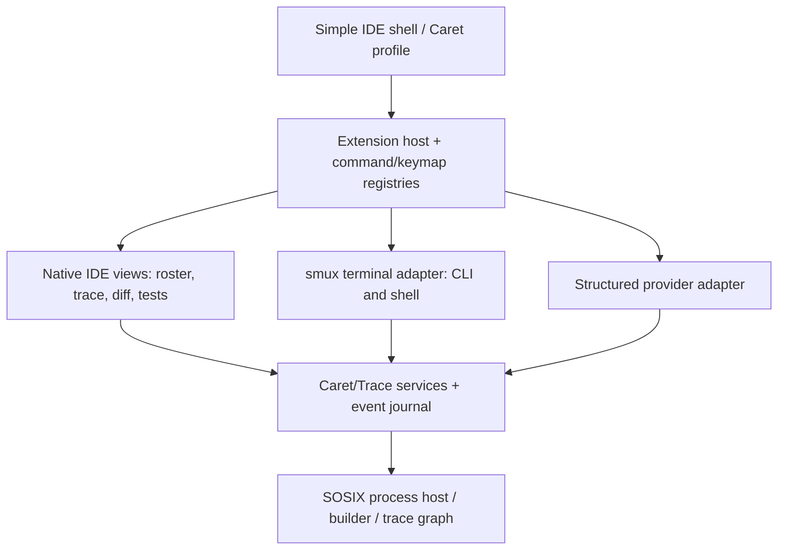
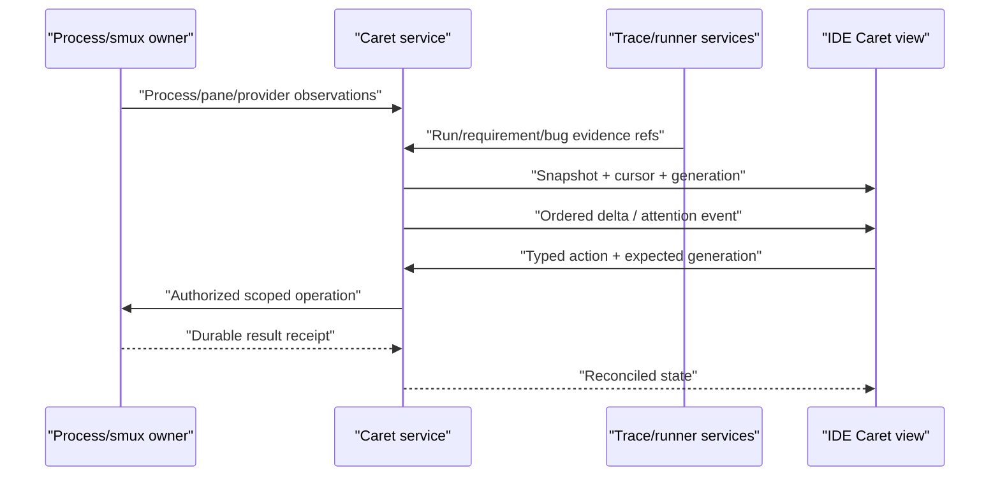

# Caret Workbench UI — Design (IA, mockups, extensions, keys, observation, traceability)

**Date:** 2026-11-14
**Target:** `ormastes/simple`, `release/1.0.0`
**Plan inspected at:** `52caab0725c0d975d8ce69c351780efe8db2210e`; evidence re-verified at `e3b68584142` in the research doc.
**Status:** Proposed design; not a release-readiness certificate. Mockups are design examples, not screenshots of a running Caret. Keys are proposed defaults.
**Supersedes UI recommendations:** Caret Herd/UI Agent Observability Plan (2026-11-14), while preserving compatible earlier Caret, smux, IDE and traceability design contracts.

Related docs:
- Research: [caret_workbench_ui_research_2026-11-14.md](../../../01_research/app/llm_caret/caret_workbench_ui_research_2026-11-14.md)
- Requirements: [caret_workbench_ui.md](../../../02_requirements/app/llm_caret/caret_workbench_ui.md)
- Plan: [caret_workbench_ui_plan.md](../../../03_plan/app/llm_caret/caret_workbench_ui_plan.md)
- TLDR: [caret_workbench_ui_tldr.md](caret_workbench_ui_tldr.md)

## Executive decisions

## Executive decisions

1. **Caret is a specialized profile of Simple IDE, not a new IDE.** Reuse its extension host, command palette, keybinding manager, native widget/session model, panels/docking, editor, LSP, diagnostics, source control, debug, Slop/traceability viewer and persistent settings. The IDE and standalone Caret must consume the same service state, commands and permission model.
2. **smux is the one terminal multiplexer.** Native interactive Claude/Codex/Gemini/Kimi/OpenCode/etc CLIs, shells, test TTYs and debuggers run as actual PTY/ConPTY children in smux. **Other Caret/IDE panels are native Simple TUI/GUI views**, not pretend PTYs: agent roster, traceability, diff, issues, docs, build/test results, graph, files, approvals, skills and resource inspectors.
3. **Preserve the requested default layout:** left = agent status/list, selected-agent details, fixed message/command input; center/right = selected native CLI conversation, optional inactive preview strip; a secondary right inspector is optional and collapsible. The left must become an **attention and task-control center**, not merely a PID list.
4. **Authoritative identity before cosmetics.** A session, provider child, smux pane, worktree, host and selected UI target must be explicitly bound by stable IDs + generations. Status, approvals, input, screenshots, diff and trace results are all scoped to that binding.
5. **Provider-aware observation instead of screen-only hang heuristics.** Prefer structured events; then process/tool/job observations; then smux terminal-cell state and provider-specific grammar, with confidence and provenance. No unchanged-screen auto-kill.
6. **Traceability is a first-class, snapshot-pinned IDE pane.** Reuse the existing `simple trace` graph/query/evidence model and native `Slop` viewer. Surface feature→requirement→research→architecture/design→SSPEC→unit/integration/system tests→code→bug→commit/PR, with visible gaps and execution qualification. Never conflate a link, a green structural check and a verified test run.
7. **One command/action vocabulary for GUI, TUI, CLI and MCP.** Contributions are typed; permission checks run at the service owner, not just in a UI callback. Users can inspect an action from a palette or invoke the same action by command and automation.

## 3. Product information architecture

### 3.1 One shared workbench, different specialized surfaces

| Surface kind | Rendering owner | Examples | Input contract |
|---|---|---|---|
| **TerminalSurface** | smux + VT/PTY/ConPTY state | Claude CLI, Codex CLI, Gemini CLI, Kimi CLI, OpenCode CLI, bash/sosh, debugging REPL | Raw bytes/keys through active smux input lease; native CLI remains native |
| **AgentConversationView** | Caret structured provider adapter (only when supported) | Event transcript, provider tool timeline, verified request approvals | Typed provider message/approval RPC; no terminal paste masquerading as message |
| **NativeToolView** | Simple IDE UI tree/layout | Agent roster, explorer, source diff, traceability graph/relations, tests, bugs, docs, changes, resource inspector, skills | Typed commands/events, not a PTY |
| **EditorView** | Existing Simple IDE buffer/LSP/editor | `.spl`, `.md`, `.sdn`, C/Rust/Python, test specs | Editor focus/selection/undo/diagnostics |
| **PreviewSurface** | Read-only smux snapshot or structured bounded summary | Other agent live previews, logs, browser/dev-server screenshot | No input forwarding until explicit activation |

Native tool and editor views are still rendered by the **Simple TUI backend** in terminal mode. `smux` owns only terminal sessions and their screen/bytes; the IDE shell owns the outer terminal window and panel composition. When a browser/GUI client is in use, smux still owns terminal state while the GUI renders a faithful VT adapter; no second process is spawned.

### 3.2 Object model (must not collapse identities)

`WorkspaceId` (repo/project) → `TaskId` (goal/issue/requirement) → `AgentSessionId + generation` → `ProviderSessionId?` and `ProcessHandle/attempt` → `SmuxPaneId + generation?`, with `HostId`, `WorktreeId`, `ContextId`, `TraceSnapshotId`, `BuildJobId`, `TestRunId`, `ParentAgentId?` and `AccountRef?` as typed references.

Relations have separate cardinality and lifetime: one task may own several agents; one agent may have child agents and multiple terminal panes; one worktree may host different sessions; a detached client must not destroy either the process or its worktree. The `PaneBinding` map must be generated/validated at process admission and reconciled after reconnect. If absent, UI says **“unbound terminal”**, not “A2's chat.”

### 3.3 Workbench modes

1. **Agents (default):** attention-first left roster, right active CLI, optional previews.
2. **Code:** file tree and editor in center; agent conversation pinned to secondary panel; diagnostics/changes below.
3. **Review:** selected agent diff, findings/SSPEC/test result, reviewer feedback and merge/close gates.
4. **Trace:** feature/requirement explorer, MDSOC feature×layer matrix, relationship list/graph, source and evidence inspector.
5. **Fleet:** host/account/session tree, quota/rate limits/resource and remote health; task queue and placements.
6. **Focus:** native CLI full-size, small unobtrusive attention indicator; one command returns.

Users can save profiles (Agent Focus, Debug, Trace Review, Multi-Agent Compare, Narrow SSH) as SDN. Profiles save *layout and view state*, not duplicated underlying sessions.

## 4. Screen mockups and geometric specification

All mockups are authored examples, **not screenshots of the current running Caret**. The real baseline capture is mandatory P0 acceptance work.

### 4.1 Current source-derived layout (not runtime capture)

```text
 Caret cs / release 1.0 (source-derived)
 ┌───────────────────────────┬───────────────────────────────────────────────────┐
 │ Agents                    │ Selected pane / terminal output                   │
 │ > A1  spec/status          │                                                   │
 │   A2  spec/status          │            smux capture of pane                   │
 │   A3  spec/status          │                                                   │
 ├───────────────────────────┤                                                   │
 │ Selected agent            │                                                   │
 │ Identity / state / usage  ├─────────────────────┬─────────────────────────────┤
 ├───────────────────────────┤ Preview A2          │ Preview A3                  │
 │ Command/chat input        │ read-only           │ read-only                   │
 │ >                         │                     │                             │
 └───────────────────────────┴─────────────────────┴─────────────────────────────┘
 ```

`workbench/gui_page.spl` currently renders metadata-only preview card bodies; `cs_dashboard.spl` separately has live pane polling/repaint. Unify those with one real view model. The `session_source` and `pane_source` binding gap prevents assuming that every visible pane is the selected managed agent.

### 4.2 Proposed default desktop (1440×900 baseline)

```text
 ┌────────────────────────────────────────────────────────────────────────────────────────────────────────────────────────────────┐
 │ CARET   simple [release/1.0.0]   Agents | Code | Review | Trace | Fleet   ⌕ Commands    2 need you   Host: Linux-A ●  ⚙  │
 ├──┬─────────────────────────────────┬────────────────────────────────────────────────────────────┬──────────────────────────────┤
 │A │ AGENTS [all ▾] [filter...] +   │ A2 Claude  Renderer repair  agent/renderer  Linux-A          │ Inspector [Changes|Tests|Trace] │
 │c │ NEEDS YOU 2                    │ [Terminal] [Events] [Compare] [Pin] [Detach] [More]          │ Changed: 4 files  +172 -58     │
 │t │ ⚠ A2 Claude  Approval  42s     ├────────────────────────────────────────────────────────────┤ Tests: 32/34 (2 failed)       │
 │i │ ⚠ A5 Codex   Question  3m      │                                                            │ Linked: REQ-UI-014            │
 │v │ WORKING 3                      │         REAL NATIVE CLAUDE CLI IN smux                       │ Unit: 6/6 observed           │
 │i │ ● A1 Codex   Compiler  1m      │                                                            │ Acceptance: not run          │
 │t │ ● A3 Kimi    GUI       22s     │         Context/ANSI/keyboard/screen fidelity               │ Bug: BUG-428 open            │
 │y │ ● A4 Gemini  Tests     6m      │                                                            │ [Open Diff] [Trace Impact]   │
 │  │ DONE UNREAD 1                   │         Exact process/pane/session binding                   │                              │
 │  │ ✓ A6 Claude  Parser   12m      │                                                            │ Children (2)                 │
 │  │                                │                                                            │ ├ A2.1 Coding (working)      │
 │  ├─────────────────────────────────┤                                                            │ └ A2.2 Review (waiting)      │
 │  │ SELECTED A2                     ├─────────────────────────────┬──────────────────────────────┤                              │
 │  │ Task: Renderer repair          │ A1 Codex Working · 2m      │ A3 Kimi Working · 20s        │                              │
 │  │ Stage: test failure review     │ read-only mini-screen      │ read-only mini-screen        │                              │
 │  │ Tool: build, stdout quiet      │ Snapshot 1s ago            │ Snapshot 1s ago             │                              │
 │  │ State: awaiting approval       ├─────────────────────────────┴──────────────────────────────┤                              │
 │  │ Confidence: structured event   │ Current event: Needs approval [Inspect] [Allow] [Deny]      │                              │
 │  ├─────────────────────────────────┴────────────────────────────────────────────────────────────┴──────────────────────────────┤
 │  │ To A2 [Message ▾]  draft saved | Attach file/trace ref | Shift+Enter newline                         [Ctrl+Enter Send] │
 ├──┴────────────────────────────────────────────────────────────────────────────────────────────────────────────────────────────┤
 │ Selected A2/G3 · Host ready · Pane bound · Snapshot HEAD@... · Pending 2 · Keymap: Caret · F1 Help · No unverified green   │
 └────────────────────────────────────────────────────────────────────────────────────────────────────────────────────────────────┘
 ```

**Geometry:** left 280–380px (default 336), optional right inspector 280–380px (default 320), center min comfortable 680px for native terminal; if width is insufficient, collapse inspector then previews before compressing the terminal. The composer is left/bottom by the user's original request; at narrow widths it becomes a bottom target-bound drawer. The main terminal is resizable by smux and receives debounced PTY size events.

**Information density:** left roster row two lines by default (name/provider/task; status/age/unread). Optional `compact` one-line mode shows 50+ agents. Expanded details use a selected-agent card, not every row. Order by *attention groups* with stable order within a group (avoid jumping under the pointer). Visible attributes depend on evidence; `unknown`/`not_reported` is not `0`.

### 4.3 TUI 120×40 standard

```text
 CARET simple | Agents  Host linux-a ready  need-you:2   (F1 Help, Ctrl+G workbench leader)
 ┌──────────────────────────────┬────────────────────────────────────────────────────────────────────────────────────────┐
 │ NEEDS YOU 2  WORKING 3       │ A2 Claude • renderer • approval required  [native smux pane: bound]              │
 │ >! A2 Claude Renderer 42s    ├────────────────────────────────────────────────────────────────────────────────────────┤
 │  ! A5 Codex Question 3m      │                                                                                        │
 │  * A1 Codex Compiler 1m      │                                                                                        │
 │  * A3 Kimi GUI 22s           │           ACTIVE NATIVE PROVIDER TERMINAL OUTPUT (ANSI/VT, real child)              │
 │  * A4 Gemini Tests 6m        │                                                                                        │
 │  ✓ A6 Claude Parser done     │                                                                                        │
 ├──────────────────────────────┤                                                                                        │
 │ A2 selected                  │                                                                                        │
 │ Task renderer, host linux-a  ├──────────────────────────────────────────┬─────────────────────────────────────────────┤
 │ Test 32/34, 2 fail           │ A1 working / quiet tool                │ A3 working / tests                         │
 │ Trace: 1 gap, 1 bug          │ read-only snapshot                     │ read-only snapshot                        │
 ├──────────────────────────────┴──────────────────────────────────────────┴─────────────────────────────────────────────┤
 │ To A2 | Message | draft 23 chars | [Ctrl+Enter send]  : detail/trace/actions through native TUI                               │
 └─────────────────────────────────────────────────────────────────────────────────────────────────────────────────────────────────┘
 FOCUS composer -> A2/G3 | terminal keys passthrough when focused | structural trace only | snapshot complete: no
 ```

At **80×24** use three tabs: `Agents`, `Session`, `Compose`, and optional `Trace`; expose the same actions with a palette and list view instead of squeezed charts. Status text always includes focus/target. The grid writer must handle CJK, full-width characters, combining marks and escape sequences as terminal **cells** rather than Unicode bytes.

### 4.4 Traceability mode in Caret / IDE

```text
 ┌────────────────────────────┬─────────────────────────────────────────────────────┬────────────────────────────────┐
 │ TRACE tree/search          │ Feature × MDSOC layer / lifecycle matrix             │ Selected entity + evidence     │
 │ Feature / Requirement      │ Feature       Research Req Spec Test Impl CI Bug     │ REQ-UI-014 · verified? NO      │
 │ > UI                      │ Caret status  ✓      ✓   ✓   △    ✓   △   !       │ Structural links 8/9          │
 │   > Agent status           │ Hang detect   ✓      ✓   △   –    △   –   !       │ Acceptance not_run            │
 │   > Agent switching        │ Trace UI      ✓      ✓   △   –    △   –   –       │ Unit 6/6, stale? no           │
 │ > Compiler                 │                                                     │ Missing: regression test      │
 │ > Runtime                  │ [Layer] [Requirement] [Feature] [Changed by agent]   │ Owner A2, worktree ...        │
 │ Unresolved (7)             │                                                     │ [Source] [Refs] [Bug] [Diff]  │
 ├────────────────────────────┴─────────────────────────────────────────────────────┴────────────────────────────────┤
 │ [Relation list] requires → verifies → implements → reproduced_by → fixed_by → introduced_in ; exact evidence links      │
 └────────────────────────────────────────────────────────────────────────────────────────────────────────────────────────────┘
 Snapshot: worktree / unverified structural view  |  Graph gen: 57 | Shown 200 / total 4300 | 7 unresolved | stale: no
 ```

The matrix is a **projection of typed edges/obligations**. A visually adjacent cell does not invent a dependency; click opens the exact relation list and original authored declaration/rule. Rows can group feature, component, MDSOC layer, requirement, bug or currently selected agent's changed files. Columns can switch between document/test lifecycle and architecture layers.

### 4.5 Attention/review mode

- Queue cards: agent / task / host, **reason** (permission, question, failing test, suspected stall, merge conflict, expired exception), age, priority, affected feature and impact.
- Action buttons exist only when the provider/session capability is verified; a terminal-detected permission prompt may show `Open native terminal` rather than a forged `Approve` action.
- Review opens staged diff with line comments, SSPEC/failing tests, related requirements/bugs, execution environment and provenance; `Request fix` writes a target-bound message; `Merge`, `Close bug` and `Mark verified` require appropriate evidence and host authorization.

## 5. Simple IDE plugin/extension design

### 5.1 Current extension kernel vs required additions

`src/lib/editor/extensions/manifest.spl` already declares commands, languages, debug adapters, themes, keybindings, custom editors, activation events, host placement and default-deny permissions. `extensions/host.spl` handles indexing, activation, lifecycle and registries. `extensions/builtin/agent_dashboard_ext.spl` is currently a command manifest, not a dockable agent view. Add **additive versioned contributions**, and reuse the same extension host instead of introducing Caret-only YAML/JSON/registry.

| Contribution point (proposed) | Descriptor minimum | Example `caret` use | Shared host responsibility |
|---|---|---|---|
| `contributes.view_containers` | id, title, icon, location, order | `caret.agents` in Activity Bar | register/unregister/dock, preserve layout |
| `contributes.views` | id, owner, kind, container, activation, capabilities | `caret.agent_roster`, `trace.explorer` | resolve typed provider, instantiate on demand |
| `contributes.panels` | id, kind, default_dock, min_size | terminal, trace evidence, tests | active panel/split/close ownership |
| `contributes.view_actions` | view ID, command ID, placement, when | next attention, open diff, trace impact | menu and context-key validation |
| `contributes.status_items` | id, text/icon source, priority, when | pending approvals, snapshot status | concise cached status projection |
| `contributes.timeline_providers` | id, subject kinds, query capability | task/agent/test/bug/commit events | cursor pagination and snapshot pinning |
| `contributes.tree_data_providers` | id, node kinds, paging | agent hierarchy, trace tree | bounded children, stable identity, selection |
| `contributes.inspectors` | id, subject kinds, tabs | selected agent, feature evidence | capability-gated data lookup |
| `contributes.notifications` | kind, priority, dedupe policy | permission, question, done, error | durable inbox; no arbitrary desktop spam |
| `contributes.keybindings` | existing key, command, `when`, priority | Caret-specific shortcuts | context precedence and conflict report |
| `contributes.commands` | existing stable command IDs | `caret.agent.next_attention`, `trace.refs_file` | shared typed service action registry |
| `contributes.custom_editors` | existing document kind | SSPEC and SDN rich editors | associated buffer/undo/diagnostics |

Implement a **manifest v2** (`simple.ide.extension/2`, proposed) only for new fields, retaining `simple.ide.extension/1` decode unchanged. Unknown fields/version should fail with a useful diagnostic; required capability permission is explicit. `ViewDescriptor` or provider identity cannot be inferred from a command name. Adopt reusable `UITree`/`UISession` and `EditorController` adapters for native views; the extension host owns registration and event dispatch but **not** domain state.

### 5.2 Proposed extension architecture



Key rules:

- **One active workbench service** publishes immutable snapshots/deltas. GUI/TUI widgets subscribe; activating a view never launches the agent again.
- Extension activation via `onView:caret.agent_roster`, `onCommand:caret.agent.quick_switch`, `onTask:*`, `onLanguage:sdn`, `onTraceSelection`, and existing `onCommand`/`onLanguage` events; only implemented events may be declared active.
- `Builtin` providers for trusted core editor/terminal/trace/agent views; `Worker` for external plugins with bounded RPC and explicit permissions. No unreviewed in-process FFI by default.
- A renderer must not acquire a process handle, read provider credentials or bypass the session host. An extension can request a **scoped capability** from the canonical service.
- On deactivation, dispose view providers, commands, subscriptions and keybindings; do not stop the associated agent/process or delete worktrees.
- The extension manager reports `declared`, `indexed`, `activated`, `rendered`, `interactive`, `verified` separately. Manifest metadata is not a test pass.

### 5.3 Manifest sketch (normative intent, not current Simple grammar)

```sdn
schema: simple.ide.extension/2
name: caret.workbench
version: 1.0.0
host: builtin
activation_events: [onView:caret.agents, onCommand:caret.agent.quick_switch]
permissions: [workspace_read, process_spawn]

[contributes.view_containers]
id, title, location
caret.agents, Agents, activitybar

[contributes.views]
id, kind, container, provider
caret.agent_roster, tree, caret.agents, caret.session_roster
caret.agent_details, inspector, caret.agents, caret.selected_details

[contributes.commands]
id, title, category
caret.agent.quick_switch, Switch Agent, Caret
caret.agent.next_attention, Next Agent Needing Attention, Caret
trace.refs_current_file, Trace References for Current File, Traceability
```

Use the repository's actual strict SDN encoding/section grammar during implementation. The example illustrates fields and contribution responsibility, not a committed schema.

### 5.4 Shared command API and view model

Proposed typed API groups:

- `WorkbenchCommand`: `open_view`, `focus_region`, `toggle_panel`, `select_agent`, `quick_switch`, `next_attention`, `pin_agent`, `compare_agents`, `save_layout`.
- `AgentCommand`: `launch`, `attach`, `detach_view`, `send_message`, `paste_terminal`, `interrupt`, `request_approval`, `answer_question`, `stop`, `resume`, `inspect_status`, `open_worktree`, `open_diff`.
- `TraceCommand`: `list`, `show`, `refs`, `refs_file`, `impact`, `gaps`, `changed_files`, `evidence`, `open_source`, `compare_snapshot`, `open_related_bug`.
- `DebugCommand`: `inspect_tool`, `capture_replay`, `show_errors`, `open_stack`, `explain_stall`, `open_xray_trace`.

Every mutation carries `principal`, `session_id`, `generation`, `host_id`, `capability`, `idempotency_key` and policy context; read commands carry exact snapshot ID/query budget. Host returns typed receipts, not optimistic UI success. UI state should be a lightweight projection such as:

```text
WorkbenchViewStateV1:
  active_profile, active_workspace, selected_task, selected_session+generation
  focused_view, focused_widget, composer_target+generation, composer_mode
  open_views[], pinned_views[], layout_preset, filters, sort, unread_cursor
  trace_snapshot_id, trace_generation, selected_trace_entity, trace_query_cursor
  session_ui_state{draft, scroll, native_terminal_follow, last_seen_event}[]
```

Persist user layout/preferences in a versioned user-local SDN file, keep ephemeral focus/draft state in an appropriately durable user session store, and never copy credentials or terminal scrollback into an unbounded UI preference document.

### 5.5 IDE/TUI/Caret interoperability

| Entry | Primary composition | Shared action |
|---|---|---|
| `simple ide --gui --profile caret` | Caret view containers, terminal and inspector in native IDE GUI | `caret.agent.select` and trace commands |
| `simple ide --tui --profile caret` (target; currently not wired equivalently) | Same logical view tree via Simple TUI; smux terminal region is embedded | same IDs and focus policy |
| `caret cs` (existing compatibility) | Lightweight terminal-centric dashboard | delegate to canonical session/view model as migration allows |
| Standalone `caret` | CLI/session control and optional workbench | attach existing sessions; do not spawn on open |
| `simple slop` / trace viewer | Shared graph and evidence views | deep-link selected trace ID/snapshot into Caret or IDE |
| Caret MCP/CLI | Machine-readable operations and hint/help capabilities | no hidden dependence on GUI event handlers |

All modes must agree on `selected session`, pane binding and attention status. Switching GUI↔TUI never destroys/recreates a provider process. `Caret` is a profile and plugin family; the plain editor remains quick to start.

## 6. Keybindings and focus / terminal passthrough

### 6.1 Global rules

1. **Scope:** modal dialog > focused native control/editor > explicit Caret workbench leader > user custom bindings > profile defaults > terminal raw passthrough. Terminal sends untouched bytes unless a clearly reserved workbench chord is invoked.
2. Keep `Ctrl+B` as the existing **smux** prefix inside a native terminal; do not bind it to global Caret navigation.
3. Preserve `Ctrl+W` editor-window mode and `F5`, `F12`, `Ctrl+.` and completion bindings in the editor. Conditional context keys resolve overlaps.
4. Use `Ctrl+Shift+P` (or `Cmd+Shift+P` macOS) for shared command palette in GUI; **F1** help in TUI; a configurable `Ctrl+G` **Caret leader** in TUI. The leader captures only in the focused Caret host; `Ctrl+G` twice sends the control byte to the underlying CLI. When configured off, TUI commands remain reachable from F1/palette and mouse.
5. Keys shown in menus are actual registered bindings for that OS/layout. Terminal-specific raw mode and SSH ESC/Alt ambiguity must be tested; offer an all-prefix alternative.
6. Every key command has a stable command ID and a discoverable item in `Keyboard Shortcuts`; the keys below are **proposed defaults**, not claims about current bindings.

### 6.2 GUI default bindings

| Shortcut Windows/Linux | macOS | Command ID | Action/context |
|---|---|---|---|
| `Ctrl+Shift+P` | `Cmd+Shift+P` | `workbench.palette` | all views, command palette |
| `Ctrl+K` when focus is not native terminal | `Cmd+K` | `caret.agent.quick_switch` | fuzzy agent/task/host search; in terminal use palette or explicit leader |
| `Ctrl+Shift+A` | `Cmd+Shift+A` | `caret.attention.open` | attention queue with oldest/urgent first |
| `Ctrl+Shift+T` | `Cmd+Shift+T` | `trace.open` | trace explorer; check conflict with editor reopen-tab and offer remapping |
| `Ctrl+Shift+R` | `Cmd+Shift+R` | `caret.review.open` | current agent review/diff/SSPEC |
| `Ctrl+Shift+F` | `Cmd+Shift+F` | `workbench.search` | IDE global source/doc search; never agent switch |
| `Ctrl+Tab` | `Ctrl+Tab` | `caret.agent.mru_next` | recently used agents when focus outside terminal; terminal passes it through |
| `Ctrl+Shift+Tab` | `Ctrl+Shift+Tab` | `caret.agent.mru_prev` | reverse MRU, same focus rule |
| `Alt+1..9` | `Option+1..9` | `caret.agent.pin_slot_1..9` | pinned agent slots when Caret chrome focused; configurable in terminal |
| `Ctrl+Alt+N` | `Cmd+Option+N` | `caret.agent.new` | task/provider/host/worktree creation wizard |
| `Ctrl+Alt+Enter` | `Cmd+Option+Enter` | `caret.agent.focus_terminal` | focus selected native pane; not a send |
| `Ctrl+Enter` | `Cmd+Enter` | `caret.composer.send` | only when composer focused; validation and target banner |
| `Shift+Enter` | `Shift+Enter` | `caret.composer.newline` | composer multiline, not terminal interception |
| `Esc` | `Esc` | `workbench.dismiss` | close overlay; in terminal Esc is raw unless overlay active |
| `F1` | `F1` | `workbench.help_context` | context-aware help/hints/shortcuts |
| `F5`, `F12`, `Ctrl+.` | native equivalents | IDE bindings | remain debugger/definition/quick-fix in editor focus |

Default `Ctrl+Shift+T` can collide with reopen-closed-tab; choose `Trace: Open` through the command palette if existing user/default bindings own it. The keybinding registry must flag collisions rather than silently take the first match. The system should assign **contextual** priorities and allow user override.

### 6.3 TUI leader commands — safe inside a native CLI

| Key sequence | Action |
|---|---|
| `Ctrl+G` then `a` | agent navigator (fuzzy, keyboard-only) |
| `Ctrl+G` then `n` / `p` | next/previous visible agent |
| `Ctrl+G` then `u` | next needs-attention agent |
| `Ctrl+G` then `1..9` | pinned agent slot |
| `Ctrl+G` then `m` | toggle focus between composer and terminal |
| `Ctrl+G` then `t` | traceability view for selected agent/current file |
| `Ctrl+G` then `r` | review/diff/testing view |
| `Ctrl+G` then `f` | focus mode/maximize active terminal |
| `Ctrl+G` then `s` | session status/evidence inspector |
| `Ctrl+G` then `c` | create agent/terminal selection |
| `Ctrl+G` then `?` | help palette and full keyboard map |
| `Ctrl+G` then `Ctrl+G` | send literal `Ctrl+G` to foreground CLI |
| `Ctrl+B` then `c/n/o/z/d/...` | existing smux bindings forwarded unchanged in TerminalSurface |

`Ctrl+G` is a **proposal**: test against provider CLI input expectations and allow remap to `F10`/an alternate prefix. The host input decoder must be byte-safe across chunk boundaries (as the smux decoder is), with a brief ambiguous-prefix timeout and explicit passthrough of unknown chords. In focused native views, Tab/Shift+Tab and arrows navigate widgets; in TerminalSurface, those are raw CLI keys unless an overlay or leader is active. Users should be able to inspect `Key event → resolver → action or PTY` in a debug view.

### 6.4 Switching behavior and guardrails

- **Selection ≠ focus ≠ input target.** Selecting another roster row changes inspection; a pending composer draft remains bound to its originating `SessionId+generation` until user retargets explicitly. Terminal input routes to the currently focused, active *bound* pane only.
- MRU navigation remembers pinned views and scroll state. Active terminal scroll, terminal selection/copy, composer text, text cursor and undo history are **per-session**.
- Auto-attention sorting moves a row only when the user is not dragging/selecting/typing in the roster. New urgent items can appear in a top inbox without shuffling the active selected row.
- Desktop split compare renders two real pane attachments (each with separate writer lease) or one active + one read-only; never two concurrent terminal writers by accidental attachment.
- `Close view`, `Detach`, `Stop provider`, `Archive task`, `Delete worktree`, `Revert workaround` are separate commands with different authorization, history and undo policies.

## 7. Agent status, progress and hang detection

### 7.1 State axes (never one misleading string)

`ProcessLifecycle` (starting/running/exited/crashed/lost), `Transport` (ready/stale/disconnected), `AgentTurn` (thinking/tool/waiting-approval/waiting-question/waiting-child/idle/done/unknown), `TaskProgress` (advancing/quiet/suspected-stall/confirmed-stall/unknown), `Attention` (none/question/approval/error/done-unread/review), `ResourceCondition` (healthy/pressured/quota-wait/unknown), and `EvidenceConfidence` (structured-owner/observed-process/heuristic/unknown).

Keep `last_output`, `last_semantic_event`, `last_tool_start/end`, `last_children`, `last_job_heartbeat`, `last_process_probe`, `last_user_action`, `last_observation_at` independent. Do not promote a heartbeat, spinner or token stream to "progress toward completion." A status detail popover always says *why* and *how recently* the state was determined.

### 7.2 Observer plugin interfaces

Propose `CaretAgentObserverV1` with capability advertisement and observations, not an unbounded string-parser extension:

```text
AgentObservationV1 {
  session_id, generation, host_id, provider_id, observer_id, observer_version,
  process_id?, pane_id?, operation_id?, child_task_id?, event_seq,
  observed_monotonic_ts, received_monotonic_ts, observation_kind,
  semantic_phase?, confidence, raw_evidence_ref?, redacted_summary,
  valid_until?, capability_flags
}
```

Collector priority:

1. **Provider-native structured events and hooks:** approved/Codex app-server or versioned provider event stream, Claude hooks/SDK when supported, Gemini/Kimi/OpenCode integration events. Validate installed version/schema, session correlation and capability. A native permission request is not inferred from painted terminal text.
2. **Caret session/process/job owner:** live process/PTY ownership, child process tree, tool/job IDs, builder/test-runner actual progress, exit/signal and resource data; through SOSIX and existing shared daemon.
3. **smux screen-cell observer:** terminal parser's sanitized cell grid and bounded semantic text regions; provider grammar packs for prompts, questions and phase indicators; track VT alternate-screen, redraw/spinner, bounded ANSI/control sequences and Unicode widths. No frequent bitmap OCR. Screen text is **untrusted evidence**, never an action directive.
4. **Generic fallback:** foreground process name, screen hash change, output age, CPU/I/O, network waits. Show `uncertain`, not fake approval/failed status.

Provider packs are versioned, individually enable/disable-able, and evaluated on recorded golden terminal streams including false positives. The plugin manifest grants at most read-only observation by default; it cannot approve a tool, inject input or terminate a session. Permission and control live in separate adapter capabilities.

### 7.3 Suspected hang algorithm

For each active `OperationId`, compare observed age against *operation-specific* budget (e.g., compiler build, remote SSH, model request, user approval). Long silent output is normal if the builder's job heartbeat/CPU/IO says it's active. Use rolling robust latency percentiles when enough samples exist; otherwise conservative policy defaults. Proposal:

| Evidence | UI classification | Intervention |
|---|---|---|
| Exact structured approval or question | Needs user, high confidence | Put in durable attention queue; scoped action |
| Tool/child/job heartbeat advances; screen static | Working (quiet output) | Show current tool and elapsed |
| Process alive, no output 2 minutes, no expected heartbeat | Quiet / observe | No auto interrupt |
| Past tool deadline or missed expected heartbeat for configurable 5 minutes | Suspected stall (with evidence) | Inspect/diagnose/ping if safe |
| Owner detects exited/crashed child or confirmed tool timeout | Failure | Preserve trace; recovery suggestions |
| Parent waiting on running children | Waiting on children | Child tree / open child |
| Known rate-limit/reset | Quota wait | Display reset; optional approved account switch |
| Remote transport disconnected | State unknown | Reconcile/reattach; never duplicate launch |

`Ping` may be implemented only when the provider supports an out-of-band liveness probe or harmless read. Never inject a newline/question into a native CLI as a speculative ping. Recovery must be staged: inspect → capture evidence → retry safe transport → operator-approved interrupt → resume with new generation/checkpoint. Auto-restart policies are opt-in per task and forbidden when the last tool's side effect is uncertain.

### 7.4 Notifications and child agents

One durable `AttentionInbox` event per unique `(session,generation,operation,kind)` with dedupe and unread/ack/snooze state. Show desktop/toast/phone notifications only for actionable events or opted-in completion; suppress duplicate notification when the selected session is in foreground. Child agents appear hierarchically with individual status and roll-up summary; parent `waiting_children` is not stalled. A parent cannot claim done merely because child panes exited; task/test/evidence gates determine completion.

## 8. Traceability in Caret and Simple IDE

### 8.1 Reuse existing graph and native Slop viewer

The repository already contains:

- `src/app/traceability/query_options_v1.spl`, `query_main.spl`, `query_render_v1.spl`, `snapshot/*`, `extract/*`: list/show/refs, snapshot selection, file references, spec root extraction and SDN/table projections.
- `std.common.traceability` schemas/typed codecs, graph/evaluation designs under `doc/05_design/infra/traceability_*`.
- `src/app/slop/*`: native `UITree`/`UISession`-based graph/tree/source/evidence viewer slice. `doc/05_design/app/slop_viewer.md` and `doc/05_design/simple_traceability_sdn_slop_gui.md` contain existing layout and native acceptance details.
- `doc/07_guide/infra/traceability.md`, `config/traceability.sdn`, `simple traceability-check`, feature/requirement/SSPEC metadata and tracking/bug DB.

**Do not create a Caret-only graph database, parser, inference engine, report generator or test verifier.** Add a `TraceabilityViewProvider` adapter from the shared `TraceProjection` query service to IDE views. It may wrap Slop's native view widgets, but Slop and Caret retain independent view state and the same canonical graph/snapshot identity. `TraceGraph` authority remains with traceability, execution evidence authority with runner/builder, and UI with IDE.

### 8.2 User journeys and exact commands

| User operation | UI entry | Existing or planned service operation |
|---|---|---|
| Show all features/requirements/bugs | `Trace` Activity view, query/filter | Existing `simple trace list features|requirements|bugs` |
| Inspect feature `F` | click row / `Trace: Show Feature` | Existing `simple trace show feature F` |
| Traverse incoming/outgoing relations | `Refs`, `Impact` tab | Existing `simple trace refs feature F` for refs; multi-hop impact is new plan |
| Show requirements/bugs on current file | Editor context `Trace: This File` | Existing `simple trace refs file path/to/file.spl` |
| Inspect exact revision | snapshot picker worktree/index/git:REV | Existing snapshot selector; query pinned until changed |
| See missing relation/coverage | `Gaps` filter, matrix missing cells | New obligation/evaluation projection; P0 query list alone not enough |
| Show agent's changed code impact | agent details `Trace Changes` | New overlay of worktree changed-file IDs on canonical graph; run trace once per immutable snapshot |
| Open associated SSPEC and test outcome | selected requirement evidence tab | shared graph links + runner receipt, when eligible/available |
| Show commit/PR introducing/fixing a bug | `History/Commits` tab | Git/SJ provenance joins; distinguish authored claim from verified attribution |
| Generate audit report | `Export` (MD/HTML/SDN) | same typed projection, provenance and qualification labels |
| Explain inability to close feature/bug | `Why blocked?` | rule evaluator produces missing obligations and exact repair links |

An editor hover/decoration may show `REQ-... (linked, verification pending)` alongside symbol references and recent bug IDs; `Go to Trace` opens the same pinned entity. Code action `Generate missing SSPEC skeleton` is a *draft suggestion*, not automatic proof of coverage. Existing `/trace`-style commands/CLI should be used for keyboard-only; no separate hard-coded parser in UI.

### 8.3 Relation model and evidence states

The matrix and graph must distinguish these canonical entities (some are currently planned schema extensions):

| Type | Typical ID/locator | Important outgoing/incoming links |
|---|---|---|
| Feature / feature group | stable `feature:<id>` | groups requirements, design, tests, implementation |
| Requirement / NFR / acceptance criterion | `req:<id>` or configured canonical ID | motivated_by research, specified_by design, verified_by SSPEC and eligible run |
| Research / architecture / design | repo-relative doc ID + section | source of rationale; requirements and solution ownership |
| SSPEC case | test module + stable case ID | verifies specific requirement, contains assertions and expected outcome |
| Unit/integration/system test definition | source + test ID | exercises implementation; separate from execution observation |
| Test run/attempt | candidate+toolchain+platform+run ID | outcome, validity, provenance, planned cases, resources |
| Implementation source/symbol | repo blob/line span/symbol | implements feature and requirement, called by/references |
| Bug / regression / prevention | stable bug ID | observed_in, reproduced_by, prevented_by, fixed_by, affects_feature |
| Workaround / exception | issue, expiry, owner, exact scope | suppresses/replaces eligible relations only under reviewed policy |
| Commit / PR / worktree | Git object/PR ID/worktree+snapshot | changed/fixed/introduced claims, review and CI receipts |
| Agent task/session | task ID, session ID+generation | assigned_to feature, changed code, authored docs/test, generated evidence |

Show exact edge relation and **origin** (authored, derived convention, imported historical, inferred/proposed), with rule/extractor version. No inferred relation becomes an authored/verified edge silently. Shared source code can implement several features; aliases appear in multiple locations while retaining one canonical identity.

**Evidence semantics:**

| Badge | Meaning | Allowed product claim |
|---|---|---|
| `LINKED` | structural edge resolves | Documentation/test mapping exists |
| `MISSING` | required edge or node absent | User needs to add/repair link |
| `AMBIGUOUS` | multiple unresolved candidates | No silent first-match selection |
| `NOT RUN` | definition exists, execution absent | No validation completion |
| `PASS (eligible)` | exact planned test ran and receipt verified for selected candidate | Specific obligation may be satisfied |
| `FAIL` | executed and failed | Blocks related acceptance |
| `STALE` | historical/other snapshot/toolchain | Reference only, not current proof |
| `INCOMPLETE` | skipped/cancelled/partial/unknown | Neither pass nor reliable fail |
| `WAIVED (reviewed)` | explicit limited exception applied to obligation | Explain scope/owner/expiry, never generic green |

The current `trace query` P0 explicitly says structural/unverified and groups require P1; the qualification v1 codec is a **data carrier**, not accepted execution evidence. Do not implement the UI as though a green `simple trace` table proves verified coverage. Until actual evaluator+receipt admission ships, render a conspicuous **“Structural only — verification not available”** banner.

### 8.4 MDSOC feature × layer dependency view

Provide two matrix presets, both driven by the same graph:

1. **Lifecycle coverage:** rows = feature/requirement; columns = research, requirements, architecture, design, acceptance, unit, integration, implementation, bugs, commit/PR, perf. Each cell shows `linked / qualified / missing / stale / unresolved` with clickable counts.
2. **MDSOC layers:** rows = feature or component; columns = UI/App, domain/feature logic, shared service, SOSIX/runtime, platform/HAL, test/CI, docs. Cells show owning modules and actual typed relations; color alone is insufficient. Toggle call/ref/dependency edges and direction. Click opens an impact slice, not the full giant graph.

Layer and feature grouping must respect existing mdsoc+ rules; apparent visual adjacency is not permission to call across layers. Use the graph's actual `depends_on`, calls and references when available. An unknown edge is shown as `unverified`/`unresolved`, not guessed from file names.

### 8.5 Bug closure, exceptions and workaround recovery

The UI must be a **front end to enforceable CI/service policy**, not a checkbox that changes truth:

- A bug with behavior-impacting code requires a **reproducible test** and at least one targeted regression/prevention test or a documented reviewed exception. `Close Bug` remains disabled when mandatory evidence is missing; `Why blocked?` lists cases/receipts and their exact identity. An accepted case must fail on the identified pre-fix scenario when practical and pass on the fixed candidate; otherwise explain why an equivalent prevention invariant is more appropriate.
- A temporary workaround is a tracked object with owner, bug, patch/commit ref, affected file spans, exact applicability, expiration/trigger and revert plan. On bug resolution, the UI creates a **revert candidate** (or flags the workaround as stale), runs impact/test checks and requests review. Never silently revert a live dirty worktree or close by a string match. Treat auto-revert as optional only for a proven isolated, reversible patch with policy authorization.
- The existing declarations-v2 `add/replace/suppress` and scoped exception design should be used; UI permissions cannot bypass resolver/CI validation. Every exception is traceable and expires/revalidates against the selected snapshot.
- `Feature Done` requires the configured acceptance, unit/integration, performance/NFR and documentation gates. A run from another branch or stale binary remains historical evidence. An agent may *report* done; Caret must show whether the requirement is actually qualified.

### 8.6 Query/read access and agent context integration

When Caret, Spipe or an agent uses `rg`, text-file reads, `simple trace refs`, LSP symbol navigation or test DB queries, provide an **optional lightweight source-access evidence broker**: record path/blob/snapshot identity, query, selected ranges, tool/agent/task ID and timestamp in a bounded journal; avoid storing confidential file contents by default. Reuse Simple's existing file/query/trace owners and source indexes; don't parse or copy whole text databases each time an agent asks for one relation. A tracked read is *context provenance*, not evidence that a model understood the file.

MCP tools such as `trace.refs`, `trace.impact`, `trace.gaps`, `trace.explain_gate`, `test.case_status`, `bug.reproducer`, `editor.open_source` should return typed bounded SDN/structured responses with cursors and relevant source spans. The same calls back UI actions and allow LLMs to query only the selected closure. One immutable snapshot or declared worktree preview per request prevents mixing generations.

### 8.7 Native Slop integration constraints

- Build an `IDE Traceability` extension around the existing Slop `projection/view/session/source/evidence` implementation, not around generated HTML. Keep source location and snapshot pinned; if the blob is unavailable, show a typed unavailable state, never read current worktree as substitute.
- Graph performance: start with bounded 200-node projections, lazy expansions, reverse index/cursor, node/edge virtualization, retained DrawIR/Engine2D context and cancellation of stale layout. The existing design notes an O(E×N) edge attachment and per-dirty-frame engine creation; profile/repair these before claiming 150ms response.
- Renderer parity: TUI shows a relation list/tree with keyboard navigation and the same evidence labels as GUI; GUI graph and relations list share selection. Screen reader access targets the typed tree/list; no mouse-only graph actions.
- User can pin a trace snapshot while the editor/worktree changes. Show `stale/outdated` banner; explicit refresh yields a new graph generation. Never let late async source/query responses overwrite a newer selection.

## 9. Main task skills, hints and agent assignment UI

The existing SPipe/Caret skill ecosystem can become a **Task Setup** view, but it must be optional and declarative:

- On new task, choose provider (Claude, Codex, Kimi, Gemini, OpenCode, local Slang etc.), task template (Research, Design, Implement, Debug, Verify, Release), worktree/host/toolchain and goal/requirement ID.
- Show a skills checklist from the project/global/domain skill registry, e.g. research→design→impl→verify, debug, setup, platform or NVMe domain skills. Indicate `available`, `selected`, `unsupported by provider`, `missing installation`, and `requires permission` distinctly. Do not assume every CLI interprets skill directories identically.
- A provider adapter translates selected skills to its **native configuration/instructions** where supported, or uses an explicit bounded task-context handoff. Record what was actually loaded vs merely requested. Credentials and policy remain provider-owned.
- On first use of a view/command, show a short contextual hint (e.g. `Ctrl+G a` switching, `Trace this file`, `Why stalled?`); subsequent hints shrink, then stop after seen/completed or frequency threshold. Per-feature hint version, last shown, ignore count and user preference stored in user-local SDN. Rehint only after feature changes, repeated relevant failure, or explicit F1 Help; no notification spam.
- Make the skill/help catalog accessible through `F1`, command palette, Caret MCP `capabilities/help` and LLM task context. Each tool advertises exact actions, examples, scope and required permissions. Agent-generated task plans link back to requirement/SSPEC/bug identities.

## 10. Ownership in mdsoc+ and proposed source placements

| Canonical owner | Extend/add | Explicitly must **not** own |
|---|---|---|
| `src/os/apps/smux` | pane metadata, byte-safe native capture, terminal attachment/lease/input, screen diff subscription, child/process identity | agent progress semantics, trace graph, bug closure |
| `std.sosix`, shared host daemon | PTY/ConPTY process, resource and heartbeat observations, auth, reconnection, bounded messages | UI layout or provider-specific terminal prompt grammar |
| `src/app/llm_caret/workbench` | canonical `SessionViewV2`, binding projection, view state, navigation/attention actions, adapter to provider/manager | separate agent execution owner, arbitrary debugger engines |
| `src/app/llm_caret/observer/*` (proposed) | provider event adapter/plugin, screen grammar packs, confidence classifier, stall state | raw terminal input and approval authority |
| `src/lib/editor/extensions` | v2 manifest, registry, view/panel/tree/timeline/status contributions, context keys | persistent agent or trace domain databases |
| `src/app/ide`, `src/app/editor` | launch profile parity, docked native GUI/TUI host, focus and key router | provider side effects and agent lifecycle |
| `src/app/traceability`, `std.common.traceability` | canonical graph/obligations/qualifications/query/receipts/projection | GUI-specific sorting/selection, agent provider control |
| `src/app/slop` | reusable trace graph/tree/evidence native widgets | duplicate graph indexing or candidate verifier |
| existing builder/test runner | verified run observations, environment snapshot, test case records, budgets | Caret's display logic |
| Spipe/LLM wiki | help/skills/provider pack discovery and optional context query cache | exact live process/session authority |
| IDE Caret and Trace extensions | typed views and command contributions | hidden direct reads of remote credentials |

Proposed event transport (internal typed/SDN when crossing a process):



Because existing `session_source.spl` currently stores global mutable live arrays and `pane_source.spl` publishes a separate captured pane, introduce a single `CaretSessionProjection` snapshot keyed by `(SessionId, generation)` and `PaneBinding`. Multiple UI clients can attach with independent UI focus and read cursors. Use atomic first-publisher/event order and monotonic sequence numbers; on gaps, fetch a bounded full snapshot. Do not add one hot polling loop per widget, per tab or per observer plugin.

## 11. Performance, memory, reliability, security and accessibility

### 11.1 Budgets and architecture

| Concern | Design | Qualification target (proposal) |
|---|---|---|
| UI switching | O(1) selected-ID lookup with indexed roster, only dirty widgets redraw | P95 100ms at 50 agents on declared target host; measure |
| 100–1000 agent roster | virtualization, stable groups, bounded search index and incremental updates | 50-agent common case no visible stall; stress 1,000 without unbounded memory |
| Terminal renderer | smux screen diff/cell regions, no screenshot polling, throttle invisible previews | preserve native CLI output and latency under concurrent output stress |
| Status observer | event/hook first, capped fallback polls, per-provider parse budget | idle agent count does not force O(N) full-screen repaints every tick |
| Trace graph | immutable snapshot graph, indexed reverse queries, 200-visible-node paging, retained renderer | warm interaction P95 150ms where feasible; record actual backend measurements |
| Diff/test | lazy per-selected-agent fetch, bounded snippets, seek/streaming | massive output never blocks roster or input |
| Process recovery | generation-checked leases, idempotency, explicit uncertain delivery | no duplicate spawn on reconnect; wrong-generation mutations refused |
| Data lifetime | bounded terminal scrollback, event journal/compaction, cache budget | no indefinitely growing resident UI arrays or sessions |

Budgets are *release targets to measure*, not performance claims for inspected source. Collect CPU, RSS, allocations, UI frame latency, terminal throughput, event backlog, trace query duration and retry count using existing performance/XRay/logging infrastructure where appropriate. Separate cold cache/build from warm runtime, and per-process from fleet totals. Use no blocking per-frame Git status, file scan or model request.

### 11.2 Security and correctness

- Session ID+generation, host, worktree and principal are checked **at the service** before input, approval, interrupt, stop, delete, merge or revert. UI selection is not authorization.
- Raw terminal content, docs, code and provider output are untrusted; escape GUI markup and strip/control VT correctly. Do not execute displayed instructions. Screen regex cannot authorize approvals.
- Worktree and trace source paths use canonical snapshot/blob identity with traversal/symlink/reparse-point policy. Read-only previews cannot become writers via click propagation.
- Hidden remote failure becomes **Unknown**; don't infer completed, idle or killed. Preserve drafts until acknowledged delivery, retain command receipts across reconnection.
- No default secrets exposure to extensions; use provider-native credentials. Account reset/usage values require verified capability, else display `Not reported`.
- User-local recent searches/usage and skill hints should not become committed repository data or unreviewed agent knowledge.

### 11.3 Keyboard, languages and accessibility

Test keyboard-only in all modes; full visible focus separate from selected agent, high-contrast colors with text labels, screen-reader tree/list equivalents, reduced motion, touch target sizing, small-width layouts, Unicode width/CJK (Korean/Japanese/Chinese), bidi/combining/emoji, IME in composer, clipboard, mouse wheel and copy/paste in terminal. The current TUI grid uses byte-sliced `_put_str`; migrate to a width-aware cell writer and verify it rather than relying on ASCII-only smoke tests.
## 15. Open decisions and recommended defaults

| Question | Recommendation | Reason |
|---|---|---|
| Is native CLI rendered through smux or re-implemented as a chat? | **smux by default**, structured chat only for capability-qualified adapters | Fidelity, auth, output and permission UX |
| Does every panel need a PTY? | **No** — only actual terminal children | Native TUI/GUI can offer graphs, editors and typed actions |
| Should agent switching change input target immediately? | Change selected agent, but **preserve draft's bound target**; explicit send uses visible target | Prevent wrong-agent text |
| Should the right inspector be always visible? | Optional; collapse before terminal gets too narrow | Protect native CLI readability |
| Should trace UI be another app/backend? | Reuse Slop/traceability and IDE views | Avoid diverging graph/evidence truth |
| Can a screenshot parser decide approval/hung? | No; diagnostic fallback only | False positives and security risks |
| Auto-sort all agents each status change? | No; stable groups with separate attention queue | Avoid focus/selection thrash |
| Auto-close a bug or auto-revert its workaround? | Only after service-gated proof; default review required | Protect user work and audit trail |
| Can old CLI P0 structural results drive green verification badges? | **No** | Contract explicitly says structural/unverified |
| Can every new provider use the same structured controls? | No; capability detection and native terminal fallback | Provider/version differences |

