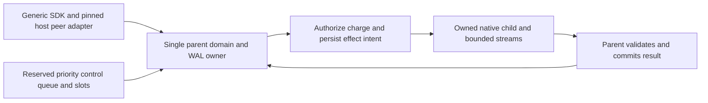

# Persistent host service domain V2

Source checkpoint only. SSpec, native, compiler, gateway and latency evidence:
**NOT_RUN**. This does not complete execute/wait/control or the full host daemon.

## Exact owner interface

`HostServiceDomainV2 {local: HostLocalRootV1}` is the single persistent host and
container coordinator. `HostServiceRequestV2 {action,operation_id,payload}` carries
untrusted bounded text. `HostServiceTurnV2 {owner,exit_code,response}` returns the
updated owner before the generic SDK attempts response publication. No host or
container owner, native handle, journal writer or cleanup capability is wire data.

The SDK callback remains generic and does not import host code. Host composition
must first bind actual kernel peer UID to installed immutable peer policy
(client UID, principal, project, service scope and allowed actions), comparing
actual signed/retained identity as appropriate. The three request fields cannot
assert a peer identity. This internal domain is not a substitute for that adapter.

Managed open uses `host_local_root_open_owned_v2` once, after a Linux host check;
the root factory preserves actual native-boot validation. The domain exhaustively
returns Ready, Rejected or CleanupRequired with the original canonical cleanup
capability. Only Ready may begin serving. Close/open-cleanup return the complete
canonical `DistributedOperationJournalCleanupTurnV2`: cleanup option, closed,
error and release state. Released, Retained, Unknown, ConsumedError and Stale must
remain observable, including consumed-error without a retry capability. No raw
FD retry, forced release or boolean flattening is introduced. Writer close never
stops or releases native work, reservations or helper charges.

## Immediate real routes

- `host-prepare`: decode/correlate the exact operation and local scope; use the
  actual signed prepare core and current protected authority context. Retain its
  returned capacity owner before returning the existing canonical reply.
- `host-parent-budget`: decode/correlate the exact parent, verify/store using the
  actual signed parent-budget owner, and return its real immutable digest.
- `host-status`: reuse the existing canonical retained status renderer.
- `host-validate`: reuse `host_local_validate_payload_v2` with expected operation
  ID, decoding once. No file-path request, root reopen, native launch or grant is
  inferred. The existing renderer explicitly reports executionAuthorized=false.

Status/projection exports are owned by immutable dependency `55f77ff3a11`; no
second renderer exists here. A live exact-writer/revision check precedes successful
routes. Post-commit core errors retain the writer and require reconciliation;
there is no guessed updated journal, implicit reopen or effect retry. The existing
prepare Result API may lack a new owner on ambiguous failure, so a stale snapshot
cannot serve a later successful status: the live journal check rejects it.

Bounds: action64 bytes, operation ID128 bytes, payload2MiB, response8MiB. Byte
counts use the common owner. Oversized error detail is explicitly omitted rather
than serialized without bound; no owner is dropped when a response is refused.
These limits do not prove a latency target or preempt a blocking callback. Current
metadata routines perform bounded codec/journal/file operations and remain
unqualified for native timing.

## Required effect dispatcher — root-selected architecture

The parent event loop retains BOTH Host and Container runtime coordination and
all WAL writes. Existing owned native processes are the effect substrate; no
thread_pool callback and no worker-owned Container/WAL copy is allowed. Workers
receive immutable qualified engine-command/effect envelopes from the canonical
provider planner and own only their native child/streams. This supersedes the
rejected idea of opening another runtime coordinator in a worker.

Before a create effect, the parent verifies fresh signed authority and commits
begin/intent. Before start, it must validate the actual create result and durably
retain exact native creation identity, then recheck authority and authorize a
separate start envelope. Native wait/log/inspect and signed control effects use
bounded jobs, never synchronous provider calls on the control callback. Reserve
control queue/worker slots so waits cannot occupy every execution lane.

Result commits verify immutable operation/request/provider/scope bindings and the
private per-operation intent generation. Base revision/access conflicts require
explicit validation; unrelated valid WAL progress is not permission to discard a
real result, nor reason to adopt a stale conflicting result. Partial output,
backpressure, cancellation, child loss or conflicting late observations remain
uncertain and charged. Launch expiry never kills a workload or releases capacity.

Actual begin/create-commit/start-commit/worker-envelope/commit APIs are still
required owner additions. This module refuses execute, inspect, wait and cleanup
with nonzero `host-service-effect-dispatch-required`; it accepts no job and emits
no queued-success receipt. These routes remain incomplete until the real bounded
dispatcher and canonical owner phases are integrated. Helper routes and stream
FD export remain separate required handoffs, not invented here.

## Source ownership and evidence

This lane owns only the new domain module and focused specs/docs. The daemon owns
transport/framing/peer metadata; host owns narrow existing render exports and
journal/root ownership migration; canonical provider/native owners own effect
planning and process capabilities. The old legacy container migration remains
untouched in its separate worktree.

Unit scenarios exercise byte bounds, status shape, bounded errors, real retained
journal/status/projection routes, correlation mismatch without another provider
command, explicit unqueued effects, stale/closed snapshots and recurrence guards.
They use existing legacy-journal/scripted-platform fixtures and do not qualify
managed startup/cleanup. Full service acceptance still requires real owned startup,
partial cleanup state tests, SDK response failure after owner update, pinned peer
policy, reserved control progress under a pending wait, and all actual signed
native effect phases. No successful runtime or coverage percentage is claimed.
