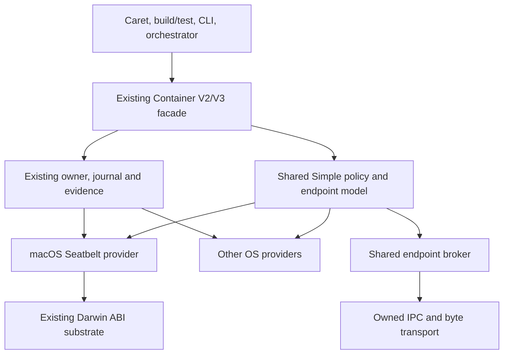
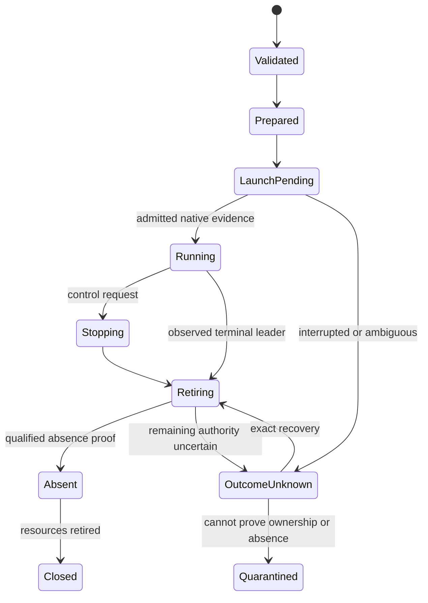
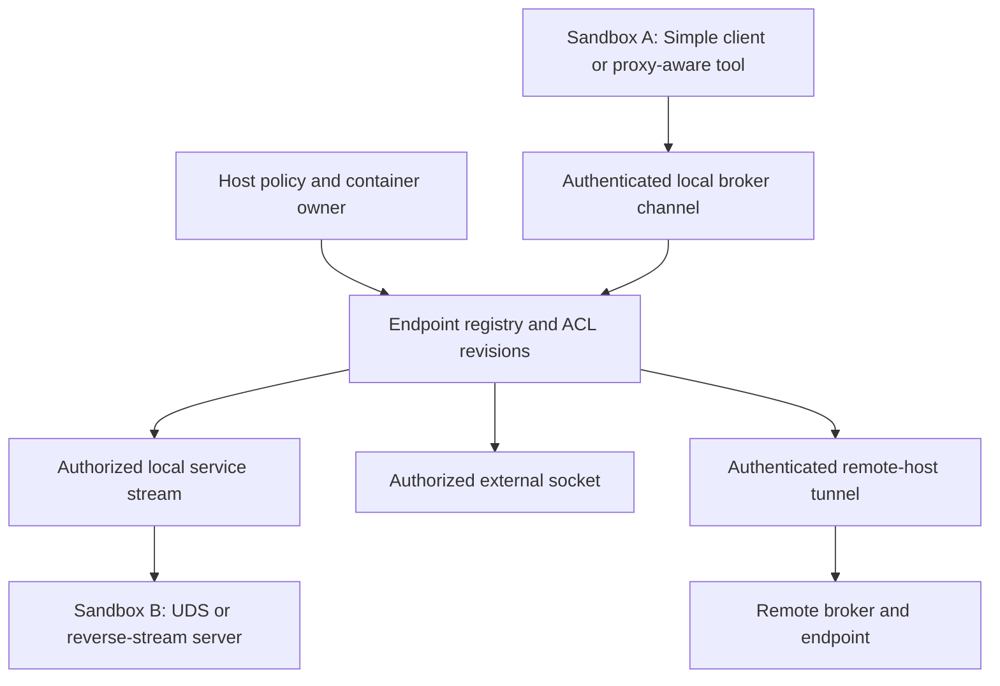
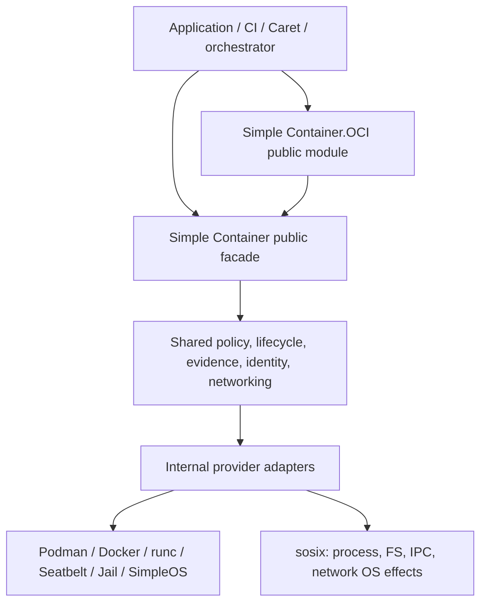
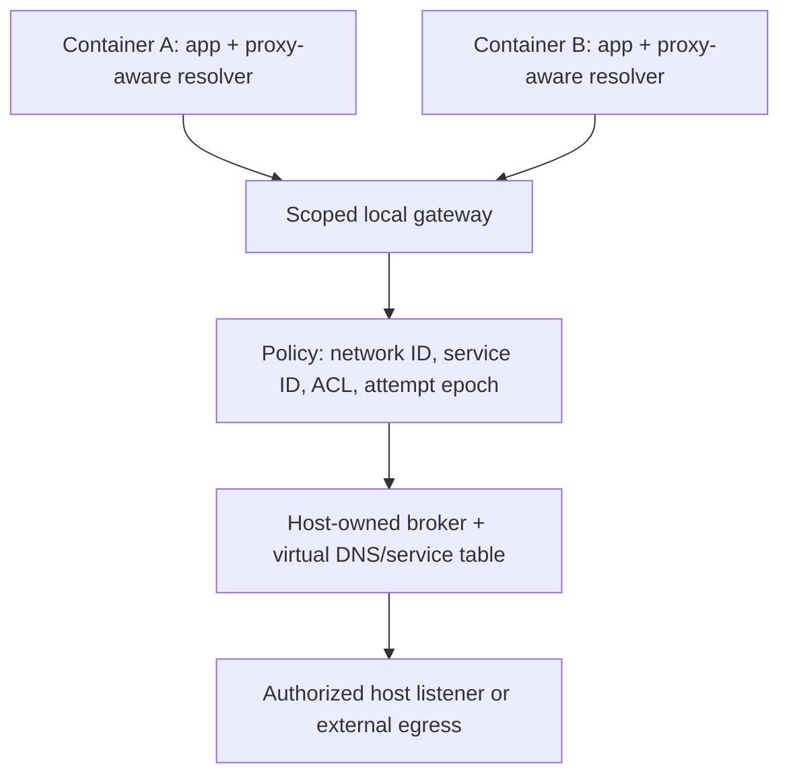
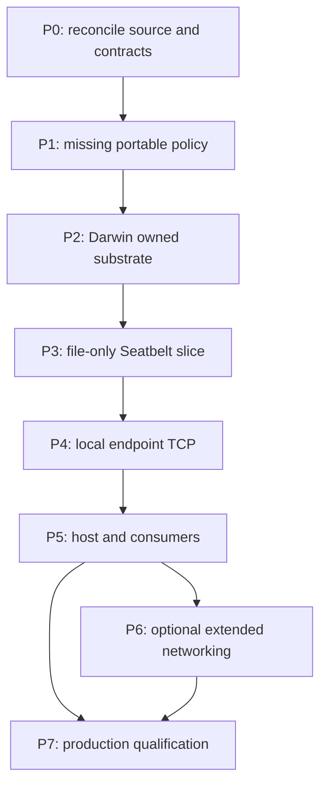

# Simple Container: VM-Free macOS Seatbelt Backend

## Shared-Core-First Design and Phased Implementation Plan

**Date:** 2026-11-12, Asia/Seoul  
**Repository:** `ormastes/simple`  
**Primary audited revision:** `release/1.0.0`, `9fe73db500a52efdd68ce4d61f6ef4449c75a9a8`  
**Secondary comparison:** `main`, `fd266fb3f0023da383b7decea0edec420058ed9a`  
**Deliverable status:** design and read-only source audit; not an implementation or macOS qualification report.

> Decision: extend the existing Simple Container facade, ownership contracts, process substrate, IPC and host-service mechanisms. Put missing portable policy and broker logic in pure Simple first. Add Seatbelt as a small, explicitly selected macOS enforcement provider. Do not build another container manager, daemon, journal, scheduler, terminal owner, or SDN parser.

The requested result is native macOS process execution, path-based filesystem isolation, and an authenticated **emulated private endpoint network**, without a VM. It is not Linux image execution, a private mount namespace, or a native Kubernetes pod network.

## Contents

1.  Decisions and scope
2.  What already exists: source audit
3.  Requirements and capability contract
4.  Shared architecture and ownership
5.  Module-by-module change map
6.  Public API evolution
7.  Portable policy and immutable identities
8.  Lifecycle, launch, recovery and cleanup
9.  Seatbelt provider and launcher
10. Filesystem isolation
11. Emulated private networking
12. Detailed network and filesystem APIs
13. SDN configuration and usage
14. CLI and library usage
15. Installation, dependencies and licensing
16. Integration with other Simple subsystems and OSes
17. Performance and resource accounting
18. Diagnostics and safe fixes
19. Tests, qualification and traceability
20. Phased implementation and acceptance gates
21. Migration and documentation consolidation
22. Risk register and explicit limitations
23. Completion checklist
24. Sources and audit method

## 1. Decisions and scope

### 1.1 Direct answers

- **Does a pure Simple container implementation already exist?** **Yes.** There is a shared hosted Container V2 facade, and a separate SimpleOS manager/runtime with a real scheduler launch bridge. Neither should be recreated.
- **Is the macOS container backend already operational?** **Not established.** The audited macOS provider deliberately returns blocked. Darwin process and helper-admission primitives exist, but they do not complete the container enforcement/ownership path.
- **Can Seatbelt implement file isolation without a VM?** Use it for kernel-enforced access policy over host paths, subject to actual macOS qualification. Do not describe this as a private filesystem namespace.
- **Can it mimic a private network?** **Yes, through a broker and participating applications/proxies.** Services, logical addresses, virtual ports, DNS-like names, policy and cross-host forwarding can be implemented. Arbitrary socket compatibility does not follow.
- **Can it provide ordinary Kubernetes pod IP behavior?** **No such guarantee in this design.** `endpoint-v1` is the selected contract. Reject a request requiring `pod-ip-v1`.
- **Must MXC or Anthropic sandbox-runtime be installed?** No. The default is a direct Simple provider. MXC is an optional reference/adapter; Anthropic's runtime is a useful comparison, not a mandatory dependency.
- **Is it merely slower than Apple Container?** That is the wrong distinction. The capabilities and workload OS differ. No performance ratio is claimed; benchmark equivalent native workloads and broker paths. Apple Container is outside the no-VM implementation scope.
- **Can everything be pure Simple?** Portable policy, lifecycle integration, protocol parsing and broker logic should be Simple. OS enforcement still calls macOS facilities through the existing native ABI substrate. "Pure Simple" does not mean reimplementing the macOS kernel sandbox.

### 1.2 Backend identities

Preserve the current signed-App-Sandbox route and introduce a distinct Seatbelt route:

| Identity | Meaning | Treatment |
|---|---|---|
| Existing `macos-native-sandbox-v1` engine | Signed App Sandbox/helper design in current macOS admission code | Keep its security contract and blocked status until independently qualified. |
| Proposed `macos-seatbelt-process` backend | Native macOS process sandbox with direct Seatbelt policy | Add to the common facade only when its advertised capabilities are proven. |
| Proposed `macos-seatbelt-process-v1` engine | Versioned enforcement/identity domain for that backend | Never alias it to `docker`, `podman`, or the signed-App-Sandbox engine. |
| Existing `native-sandbox` runtime class | Orchestrator selection category | Reuse. Select the exact provider through trusted host policy, not a silent fallback. |
| Existing `endpoint-v1` network profile | Endpoint-oriented connectivity | Define the broker subset and its optional features explicitly. |
| Existing `pod-ip-v1` network profile | Native pod-IP requirement | Unsupported for this provider; do not quietly translate it to a proxy. |

Names marked **proposed** are design contracts, not commands or APIs already available at the audited revision.

### 1.3 Non-goals

- No VM, Linux guest, Docker Desktop, Podman machine, or Apple Container dependency.
- No Linux OCI-image execution on the Darwin kernel; Mach-O workloads and compatible native tools only.
- No `chroot`, bind-mount, PID namespace, network namespace, or private kernel illusion.
- No automatic transparent support for arbitrary TCP/UDP socket code.
- No general hard memory cap, cgroup-equivalent resource containment, or complete descendant-retirement claim from Seatbelt alone.
- No replacement for the current signed App Sandbox design.
- No new language keyword, duplicate SDN grammar, duplicated build/test daemon, or ad hoc JSON-only configuration stack.
- No disabling SIP, bypassing signing requirements, or automatic privileged installation.

## 2. What already exists: source audit

### 2.1 Evidence terminology

- **Source present:** an implementation was inspected; this does not establish that it builds or works on a real host.
- **Model/contract present:** data structures, state transitions, protocols or tests exist, but the OS effect is absent or narrower.
- **Blocked/stub:** code explicitly refuses execution or contains a placeholder.
- **Proposed:** new work described here.
- **Qualified:** reserved for a recorded real-host test of a specific source revision, binary, OS build, architecture and policy profile.

No native macOS tests, container launches, repository mutations, or CI runs were performed for this report. Existing test filenames and historical reports are not treated as fresh passing evidence.

### 2.2 Container and orchestration audit

All paths are relative to the primary audited revision. Pinned links are in Section 24.

| Path | Verified role | Reuse/change decision |
|---|---|---|
| `src/lib/nogc_async_mut/container/api_v2.spl` | Shared Linux/Windows owner facade: observe, open, project, read, apply, control, intent, recover, absence and execution-user operations | **Extend**, not replace. Add a macOS variant and exhaustive backend handling. |
| `src/lib/common/contracts/container/execution_v2.spl` | Immutable scoped execution plan/request, host observation, resource and action projections; canonical SDN | Reuse scope/identity/digest contracts. Extend strict backend validation deliberately. |
| `bound_intent_v2.spl`, `execution_evidence_v2.spl` (same dir) | Durable request-bound intent and scoped execution/absence evidence | Reuse. New macOS evidence must carry actual process-incarnation and owner provenance. |
| `src/lib/nogc_async_mut/container/service_v2.spl` | Persistent Windows-container inventory/quarantine facade | Not a portable network Service registry or a working macOS service. Generalize only at its existing provider seam. |
| `src/lib/nogc_async_mut/container/exec_v3.spl`, `stream_v2.spl` | Existing execution and output ownership abstractions; current native paths are Linux-specific | Reuse contracts, sessions, admission and accounting; add macOS transport only after qualification. |
| `providers/macos/native_admission_v1.spl` | Validates host/execution OS, class, identity and executable format; valid requests remain blocked | Preserve admission. Do not convert format acceptance into execution success. |
| `providers/macos/native_sandbox_provider_v1.spl` | Signed-App-Sandbox controller/session scaffold; independent authenticated helper missing | Keep separate from the new Seatbelt adapter. Codec provisioning is not confinement. |
| `providers/macos/worker_protocol_v1.spl` | Bounded authenticated worker framing with nonce/sequence/attempt binding | Reuse primitives and patterns, with separate protocol domains. Do not reuse a worker-auth tag for network routing. |
| `src/os/services/container/container_manager.spl` | Pure Simple ECS container/pod state, capability and restart bookkeeping | Preserve SimpleOS implementation; extract only genuinely duplicated portable functions. |
| `src/os/services/container/container_runtime.spl` | `start_into_scheduler` launches compiled work through the SimpleOS scheduler and binds the task; reconciles terminal state | **Real source launch bridge**, not just a name registry. Keep kernel-specific ownership in SimpleOS. |
| `src/os/services/container/runtime_provider_v1.spl` | SimpleOS single-attempt runtime adapter | Reuse its contract lessons; do not claim durable recovery/log streaming it does not provide. |
| `src/os/services/container/container_storage.spl` | Layer-store bookkeeping | Not proof of disk COW, extraction security, quotas, or a macOS filesystem implementation. |
| `src/os/kernel/loader/container_namespace.spl` | SimpleOS root/capability/namespace metadata | Do not port textual prefix checks as macOS path security or describe its network IDs as a working dataplane. |
| `src/lib/common/contracts/orchestration/resource_v1.spl` | Strict SDN Pod/Deployment schema, source-position errors, runtime classes and `endpoint-v1`/`pod-ip-v1` | Extend typed schemas; keep one parser. No broker dataplane was found in the audited scopes. |

### 2.3 Reusable runtime infrastructure — and its exact limits

| Component | What exists at the release revision | What remains for this task |
|---|---|---|
| `io/process_ops.spl` and `runtime_process_owned.c` | Darwin Observation V4: exact environment/cwd, bounded capture, suspended-image snapshot check, deadline/wait/collect, leader/process-group retirement | Seatbelt activation, explicitly approved IPC descriptor handoff, and truthful stronger ownership capabilities. The snapshot trusts same-UID integrity; no hard memory cap or strict tree containment. |
| `io/darwin_bound_image_v1.spl` | Mach-O snapshot/signature/CDHash binding using private platform facilities | Optional hardened lane only after host probing. Do not make private SPI an assumed portable prerequisite. |
| `runtime_sosix_darwin_broker_admission_private.h` | Direct-child helper launch with controlled environment/FDs and audit-token/incarnation/CDHash checks | Reuse mechanisms. The admitted helper intentionally does not launch workloads or prove disjoint descendant containment. |
| `io/darwin_group_broker_launcher.spl` | Explicit `assert false` development placeholder | Must not be registered or advertised as a working grouped provider. |
| `io/group_process_owner.spl` | Durable owner, prepare/recover/confirm/cancel/collect and retained evidence | Current launcher gates Linux/Windows; some terminal receipts are Linux-specific. Add typed macOS cases, not a fake Linux receipt. |
| `io/local_ipc_v1.spl` | Owned connect/listen/accept/peer/nonblocking read/write/shutdown and descriptor-transfer surface | Reuse API. `runtime_local_unix_v1.h` implements Linux only and returns unsupported elsewhere. Add Darwin implementation beneath it. |
| `daemon_sdk/local_gateway_v1.spl`, `local_gateway_service_v2.spl` | Bounded control gateway, one-use dispatch, owner-preserving partial failures, distinct work/control connections | Port underlying IPC. Existing distinct service/client UID invariant must not be bypassed for same-UID developer sessions. |
| `orchestration/host_service_domain_v2.spl` | Host domain and identity/policy mapping | Current open is Linux-only. Darwin admission must be added with proven lower layers. |
| `host_service_runtime_v2.spl` | Finite parent-owned runtime with retained cleanup | Not an already-operational autonomous macOS job service. Reuse its owner-turn conventions. |
| `host_service_enrollment_v2.spl`, reconciliation, private-receipt modules | Windows-container service enrollment, inventory/quarantine and protected publication | Provider-hardcoded. Extend observations/private-root ownership rather than removing guards. |
| `distributed_operation_journal_v2.spl` | Owned journal/WAL, request fencing, write-before-effect, recovery to outcome-unknown | Reuse one writer. Its process-crash guarantee is not a power-loss guarantee. |
| smux terminal adoption/binding | Explicit stream/child ownership transfer and output-follow | Reuse. Existing binding does not promise input/resize/interactive support. No second PTY reader. |

### 2.4 The important backend-hardcoding audit

Adding an enum arm is not enough. Update and test all of these together:

1.  `api_v2.spl:85–108`: observe/open backend allowlists and native host/provider pinning.
2.  `api_v2.spl:271–279`: current Linux-versus-else-Docker engine mapping. Replace it with an exhaustive mapping before allowing macOS.
3.  `execution_v2.spl:171–233`: strict plan/request backend decoding.
4.  `bound_intent_v2.spl:21–31`: podman/docker engine restrictions.
5.  `execution_evidence_v2.spl:70–80,124–142`: backend/engine/native identity validation.
6.  Common and mutable `exec_v3.spl`: Linux-only paths and Linux/else-Docker mappings.
7.  Common and mutable `stream_v2.spl`: backend/engine pairs and actual Linux transport.
8.  Service enrollment, reconciliation, private receipts, host-domain OS guard, process-owner launcher registration and terminal receipts.

Unknown backends must be rejected. No default branch may reinterpret them as Docker, Podman, generic POSIX, or unrestricted native execution.

### 2.5 Branch and earlier-plan reconciliation

The release branch contains substantially more reusable V2/V3 code than the audited `main` branch. An implementation based only on the older main snapshot would duplicate work. If the implementation branch does not include these changes, integrate the existing shared changes first through normal review; do not copy selected files into a parallel tree.

Earlier orchestration/shared-daemon plans from November 4–6 are useful context, but their older implementation inventory is superseded by this source audit. Existing native-macOS requirements describe signed App Sandbox ownership; this document adds a separate Seatbelt path rather than silently rewriting that requirement.

## 3. Requirements and capability contract

### 3.1 Requirements

| ID | Requirement | Acceptance evidence |
|---|---|---|
| SC-MAC-001 | Execute native macOS workloads with no VM | Native launch trace and dependency/process inventory |
| SC-MAC-002 | Reuse the existing container facade and owner-bearing results | Compile/contract tests and no duplicate registry |
| SC-MAC-003 | Put missing portable policy/endpoint logic in Simple | Dependency/import review; pure tests on non-mac hosts |
| SC-MAC-004 | Never run a workload after failed sandbox activation | Child probe plus negative activation/exec tests |
| SC-MAC-005 | Explicit read/write/execute/IPC filesystem grants | Real allowed/denied operations, child inheritance tests |
| SC-MAC-006 | Protect daemon state, credentials and sibling attempts | Real file/socket denial and path-race tests |
| SC-MAC-007 | Default-deny direct networking | IPv4/IPv6/TCP/UDP/DNS/local-host bypass tests |
| SC-MAC-008 | Broker-mediated private endpoint identity | Spoof/replay/reuse/cross-network tests |
| SC-MAC-009 | Support duplicate virtual ports across isolated attempts | Two services on virtual port 8080 with distinct routes |
| SC-MAC-010 | Enforce ingress and egress policy at the broker | Allowed/denied real streams, route-revision tests |
| SC-MAC-011 | Describe proxy-aware compatibility honestly | Test matrix; unsupported raw socket requests rejected |
| SC-MAC-012 | Preserve immutable attempt/scope/provider identity | Fencing, stale-intent and wrong-provider tests |
| SC-MAC-013 | Preserve cleanup authority after partial failures | Fault injection at every resource-acquisition boundary |
| SC-MAC-014 | Never infer complete tree absence from leader exit | Escaping-child and restart/recovery tests |
| SC-MAC-015 | Keep control deadlines separate from effect/workload time | Deadline-expiry tests with still-running workload |
| SC-MAC-016 | Reuse canonical IPC and journal infrastructure | No parallel socket owner or journal writer |
| SC-MAC-017 | Reuse SDN and shared diagnostics | Duplicate/unknown/type/span tests and LSP rendering |
| SC-MAC-018 | Deny unsupported hard resource guarantees | Capability admission tests |
| SC-MAC-019 | Reuse stream/terminal ownership | Output-follow works without second launch/reader |
| SC-MAC-020 | Keep MXC optional and policy-independent | Direct provider works without MXC installation |
| SC-MAC-021 | Pin/probe OS-sensitive enforcement | OS-build qualification manifest and deny canaries |
| SC-MAC-022 | Do not confuse metadata/model success with OS success | Native receipts required for lifecycle completion |
| SC-MAC-023 | Publish exact remaining capabilities and limitations | Machine-readable capability query plus operator report |
| SC-MAC-024 | Reuse on other hosts without importing Darwin policy | Linux/Windows/SimpleOS contract compilation tests |

### 3.2 Target capability matrix

Target capabilities, not claims that the current repository implements them.

| Capability | Direct Seatbelt + shared broker target | Necessary qualification or limitation |
|---|---|---|
| Native macOS process, no VM | Yes | Host-compatible executable and qualified launcher |
| File read/write restrictions | Yes | Tested profile and protected path/import handling |
| Separate HOME/TMP/output | Yes | Private directories + environment + access policy; not mount remapping |
| Private root filesystem | No | Host path namespace remains |
| Direct internet denied | Yes | Sandbox plus broker policy, including inherited authority checks |
| Private service names | Yes | Broker resolver; not automatic system DNS rewriting |
| Logical private IP and virtual port | Yes | Address understood by broker/client, not assigned to process network stack |
| Same port in multiple workloads | Yes | Distinct logical endpoints, UDS/reverse-stream servers |
| Arbitrary binary using native `bind` on virtual IP | No | Must adapt server or use a separately qualified compatibility layer |
| TCP streams | Phase 4 | Bounded proxy or Simple-native channel |
| UDP datagrams | Optional later phase | Explicit custom datagram semantics, not generic UDP transparency |
| Cross-host private service routing | Optional later phase | Existing host trust + authenticated tunnel + policy |
| Native per-pod localhost/network namespace | No | Do not advertise `pod-ip-v1` |
| Raw sockets, multicast, ICMP, L2 | No initial support | Reject instead of bypassing proxy |
| Strict descendant stop/absence | Not from Seatbelt alone | Independent qualified ownership/containment/recovery proof |
| Hard memory limit | Not from current Darwin path | Reject required cap; monitored usage is not enforcement |
| Hard CPU shares | Not promised | Scheduling admission/priority differs from guaranteed kernel quota |
| Rootless file/network sandboxing | Design target | Distinct from service installation and strict owner qualification |
| Hostile same-UID unsandboxed peer resistance | Not baseline | Requires stronger protected service/account/identity design |

### 3.3 Threat model

Protect the host and other managed workloads from a sandboxed workload that can execute arbitrary native code, ignore proxy variables, manipulate its workspace, fork permitted children, and send malformed broker messages. Do not trust caller-provided workload IDs, IP addresses, receipts, PIDs, "sandbox enabled" flags or process-group counts.

The rootless baseline assumes the host OS, trusted supervisor/broker binaries, and unsandboxed processes of the supervising user are trusted. It does not defend against root, a compromised kernel, or a malicious unsandboxed process that can modify that user's supervisor state. A managed distinct-user service is a separate deployment profile, not an implicit upgrade.

Shared-kernel exhaustion and complete descendant retirement are separate capability questions. A sandbox can continue blocking files/network while an escaped descendant remains alive; that does not make successful `destroy` or resource release valid.

## 4. Shared architecture and ownership

### 4.1 Layering



Portable code must not import SimpleOS kernel types, Darwin headers, MXC schemas, or Windows-private receipt classes. Platform adapters translate portable requests into already-owned native effects.

### 4.2 One owner for each responsibility

| Responsibility | Authoritative owner | Explicitly not authoritative |
|---|---|---|
| Placement and desired replicas | Existing orchestrator | Local network broker |
| Host resource reservation/quarantine | Existing host domain/journal writer | Workload-reported status |
| Container attempt and native lifecycle | Existing container/provider owner | UI, shell wrapper, proxy process |
| Process incarnation and reaping | Qualified process owner | PID file or process name lookup |
| Sandbox policy compilation | Shared policy + macOS lowering | Workload-supplied SBPL |
| Logical endpoint and policy revision | Shared broker domain, scoped under attempt | Source IP or caller-supplied workload ID |
| Socket/FD lifetime | Existing owned IPC/byte endpoint layer | Independent log or proxy wrapper |
| Terminal rendering/output attachment | Existing smux adoption/binding | A second PTY consumer |
| Operation persistence | Existing owned journal | New container-specific SQLite/WAL |

"Share daemon code" means share mechanisms, typed protocols and ownership conventions. It does not mean merge unrelated application state or allow multiple writers to the same operation journal.

### 4.3 Pure-Simple-first work order

1.  Inventory and reuse the current public contracts and pure state logic.
2.  Add only missing portable filesystem-policy and endpoint-policy models.
3.  Add deterministic validation, canonicalization of logical values, capability matching and policy compilation plans in Simple.
4.  Extend existing owner/IPC/transport seams where OS assumptions are hardcoded.
5.  Add macOS enforcement lowering and real-host qualification.
6.  Let later providers implement the same semantic contracts, with truthful capability differences.

Do not transplant the entire SimpleOS `ContainerWorld` into the hosted facade. They own different native resources. Extract a shared function only when its input/output is platform-independent and parity tests prove both existing consumers retain their behavior.

## 5. Module-by-module change map

Paths labeled new are proposed destinations, not observed files. Final exports follow the repository's `__init__` and layer-visibility rules.

| Area | Existing owner/location | Proposed minimal change |
|---|---|---|
| Backend mapping | `common/contracts/container` and `container/api_v2.spl` | One exhaustive backend/engine capability mapping reused by execution/intent/evidence/exec/stream codecs; no else-Docker fallback |
| Simple Docker/OCI code extraction for Seatbelt | Existing Windows Docker process provider, Linux OCI/Podman provider and `container/api_v2.spl`; exact Docker leaf paths re-inventoried on implementation branch | Move portable request normalization, spec admission, policy digest, attempt state, journal/evidence, streams, recovery, workspace and endpoint intent into the existing shared container owner/helpers. Preserve Docker CLI/API invocation, Windows process-isolation setup and engine-specific inspect/kill as leaf adapter code. Make the new Seatbelt adapter consume those same shared helpers and conformance tests. |
| Portable filesystem policy | New `common/contracts/container/filesystem_policy_v1.spl` | Typed grants, deny roots, baseline references and required enforcement profile |
| Portable endpoint policy | New `common/contracts/container/endpoint_policy_v1.spl` | Network identity, endpoint/service/ACL/route types; no host sockets |
| Capability requirements | Existing kernel/output/execution contracts; small new sandbox capability contract if necessary | Required versus observed capabilities, evidence profile and unsupported reasons |
| Deterministic policy functions | New `common/container_policy/` only if no existing suitable policy module is found | Normalize logical inputs, reject conflicting grants, compile bounded provider-neutral plans |
| macOS provider | New `container/providers/macos/seatbelt_provider_v1.spl` | Implement the current owner API using shared contracts and qualified process mechanisms |
| SBPL lowering | New `container/providers/macos/seatbelt_profile_v1.spl` | Escaped, versioned profile emitter; no arbitrary user profile text |
| macOS qualification | New `container/providers/macos/seatbelt_capabilities_v1.spl` | OS/build/architecture/helper/policy-baseline probes and cached evidence |
| Worker entry | Small Simple executable in the existing macOS application/tool area | Reuse trusted helper admission and ABI hooks; apply policy before workload initialization |
| Darwin local IPC | `io/local_ipc_v1.spl` and `src/runtime/runtime_local_unix_*` | Add Darwin substrate; preserve public owned handles/turns |
| Data forwarding | New `container/network/endpoint_broker_v1.spl`, transport subordinate modules | Policy-owned routing using existing byte endpoints; not a second generic socket library |
| Data protocol | New common contract `endpoint_frame_v1.spl` | Bounded framing, identity/generation/channel domain, flow control |
| Service discovery | Existing DNS parsing/serialization utilities + broker module | Reuse codecs; add scoped service resolution, not a replacement global resolver |
| Protected workspace/publication | Existing workspace-preparation and private-root owner contracts | Darwin private-root implementation with retained cleanup; no chmod-only substitute for missing authority |
| Host integration | Existing `orchestration/host_service_*_v2.spl` | Explicit Mac cases, provider inventory and policy mapping after qualification |
| Terminal integration | Existing `primary_attach`, `stream_handoff`, smux adoption/binding | Output-follow first; separate qualified duplex/resize later |
| CLI | Existing app/orchestrator command registration | Add discover/check/run/network inspection verbs under established command ownership |

No `src/app/container` tree was found in the audited snapshot. Do not invent that as an existing entry point. Locate the actual command registration before choosing final source filenames or CLI spelling.

## 6. Public API evolution

### 6.1 Existing entry points to retain

```text
simple_container_observe_v2(backend, policy_bytes)
    -> Result<ContainerHostObservationV2, text>
simple_container_open_v2(backend, policy_bytes, state_root, scope,
                         expected_provider_identity_digest, timeout_ms)
    -> Result<SimpleContainerOwnerV2, text>
simple_container_project_v2(owner, request)
    -> Result<ContainerRequestProjectionV2, text>
simple_container_action_project_v2(owner, request)
    -> Result<ContainerActionProjectionV2, text>
simple_container_read_v2(owner, action, request) -> ContainerOperationTurnV2
simple_container_apply_v2(owner, action, request, effect_deadline) -> ContainerOperationTurnV2
simple_container_control_v2(owner, action, request, control_deadline) -> ContainerOperationTurnV2
simple_container_intent_v2(owner, request) -> Result<RuntimeIntentV1, text>
simple_container_recover_v2(owner, request, intent) -> ContainerOperationTurnV2
```

Also retain `simple_container_absence_v2` and `simple_container_execution_user_v2` and their owner-bearing receipt turns. An error result must not discard the last owner or the authority needed to close resources.

### 6.2 Add a provider, not a facade

Proposed enum evolution (API sketch, not a tested patch):

```simple
pub enum SimpleContainerOwnerV2:
    Linux(ContainerHostScopeV2, LinuxSimpleContainerAdapterV2)
    Windows(ContainerHostScopeV2, WindowsSimpleContainerAdapterV2)
    MacOsSeatbelt(ContainerHostScopeV2, MacOsSeatbeltAdapterV1)
```

Maintain public V2 signatures where semantics remain unchanged. Adding an enum alternative still requires downstream exhaustive-match updates and compatibility review. If a persisted/wire schema cannot evolve without ambiguity, add an explicitly versioned codec and migration; do not silently reinterpret old bytes.

The existing `open_v2` returns `Result<Owner, text>`, which cannot retain cleanup authority in an error. Therefore the initial macOS V2 factory must remain pre-effect: it validates and constructs the logical owner without acquiring any unresolved process/socket/directory ownership. Native acquisition occurs in owner-bearing `prepare`/action turns. If a required factory operation cannot meet that rule, first add a shared, explicitly versioned owner-bearing open result; do not hide retained handles behind a text error or invent a macOS-only parallel facade.

| Provider function | Required behavior |
|---|---|
| `observe(policy)` | Report real host, boot, architecture, helper/provider identity and qualified capabilities; no workload side effect |
| `open(policy, scope, pin, state_root)` | Validate observation/policy and construct a pre-effect owner; no unresolved cleanup obligation may be lost through its text error |
| `project(request)` | Validate semantic digest, requested limits, workspace, endpoint policy and capability requirements |
| `action_project(request)` | Return actual argv/cwd and truthful effects; do not claim fake guest mounts |
| `prepare/create/start` | Idempotent attempt-fenced transitions; write intent before external effects |
| `inspect/logs/wait` | Read actual owned evidence; avoid unbounded waits |
| `stop/destroy` | Separate control authority, retain unknown descendants/resources until proven absent |
| `recover(request, intent)` | Reattach only to exact native identity/provenance; never adopt by PID/name alone |
| `absence(...)` | Return existing scoped receipt only after the declared absence contract is satisfied |

### 6.3 Capability refusal must happen before effects

- `pod-ip-v1` required: reject `SCMAC-NET-001` before creating directories or launching.
- Hard memory enforcement required: reject unless the observed provider actually qualifies it.
- Complete descendant absence required with only process-group capability: reject production admission.
- Guest path remap requested: reject, or require explicit conversion to a host-path grant by the caller.
- Persistent recovery requested when only finite parent-owned mode is qualified: reject.
- Unsupported protocol/host OS/architecture: reject with the precise missing capability.

Capability discovery is not readiness. A successful `observe` must not turn a stubbed `open`, `start`, or `destroy` into a success.

### 6.4 Identity mapping

Retain existing scope fields: `physical_host_id`, `service_scope_id`, `boot_id`, `provider_generation`, `native_machine_id`, `continuity_mode`, `continuity_id`.

Retain the request's workload UID, attempt, operation ID and semantic request digest. A digest-shaped `native_id` is an encoding of validated native identity, not evidence by itself. For macOS it must bind the actual process birth/incarnation, boot identity, owning broker/helper generation and admitted image/policy identity as required by the selected evidence profile.

Do not substitute a user-assigned host alias for native-machine identity. Do not call the existing hashed scope fence an actual OS boot observation. The current facade's native-boot pin requirements must remain enforced unless a separately reviewed continuity profile is added.

## 7. Portable policy and immutable identities

### 7.1 Core data model

Use existing strong-type/unit conventions and validators; no new language syntax is required.

| Type | Contents and invariants |
|---|---|
| `SandboxPolicyV1` | Filesystem policy, endpoint policy, required capability profile, baseline revision and bounded limits |
| `FilesystemGrantV1` | Canonical grant reference, allowed operations, recursive scope, object constraints; read/write/execute/IPC are separate |
| `ProtectedRootV1` | Supervisor-owned directory identity and generation; not just a text path |
| `AttemptIdentityV1` | Reference to existing scoped execution identity, not a second identity scheme |
| `EndpointNetworkIdV1` | Tenant/namespace/network identity including revision; immutable within an attempt |
| `VirtualEndpointV1` | Network ID, logical IP/service ID, virtual port and protocol |
| `EndpointPrincipalV1` | Broker-assigned attempt principal bound to authenticated channel and policy revision |
| `RouteLeaseV1` | Endpoint-to-live-channel mapping with attempt generation and expiry/revocation state |
| `ResolvedRouteV1` | Actual authorized destination, address family/protocol, source principal and policy revision |
| `SandboxEvidenceProfileV1` | Precise file/network/process/cleanup guarantees; not a boolean "secure" flag |

Public security decisions use enums/results and validated identity types, not raw booleans or nullable strings. Interoperability with existing optional receipt fields must preserve their semantics; absence of a receipt is not a successful empty receipt.

### 7.2 Pure functions first

```text
validate_sandbox_policy(input, observed_capabilities) -> validated policy or diagnostics
normalize_endpoint_policy(input) -> canonical endpoint policy
compile_filesystem_plan(validated_policy, baseline) -> grant/deny plan
compile_endpoint_plan(validated_policy) -> routing/ACL plan
authorize_route(principal, destination, policy_revision) -> route decision
project_required_effects(request, policy) -> bounded effect plan
compute_policy_digest(canonical_plan, baseline, provider_abi) -> digest
```

Host path resolution is not a pure string-normalization function. Keep the effectful identity/canonical-path resolution in the existing filesystem/OS boundary, then pass validated facts into pure planning.

### 7.3 Cache and invalidation

Cache validated plans and emitted profile text, not unqualified security conclusions. A key includes the policy schema/revision, canonical request, filesystem baseline, resolved trusted path identities as appropriate, provider ABI, helper image identity, OS build and architecture. Changing any security-relevant input invalidates the cache.

Reuse existing immutable-cache/hash facilities. Use cryptographic authenticated identities where the current trust protocol requires them; a fast cache hash is not an authentication tag. No custom cryptographic scheme is introduced.

## 8. Lifecycle, launch, recovery and cleanup

### 8.1 State and owner preservation

Semantic transitions to map into existing runtime state, not a replacement state machine.



Every acquired resource — directory owner, process owner, broker route, listener, stream, journal lease — must be retained in a typed owner-bearing outcome even if a subsequent step fails. A text error alone cannot safely represent partial acquisition.

### 8.2 Launch protocol

1.  Validate schema, capability requirements, platform/executable compatibility and trusted policy selection.
2.  Resolve actual host/provider/boot scope and compare pinned observations.
3.  Acquire the protected attempt root and broker session/listener leases.
4.  Generate the bounded immutable plan and profile; write the canonical host execution request/operation to the existing journal before effects. Provider preparation establishes its retained runtime intent through its own existing ordering rules; the facade intent accessor retrieves that intent rather than creating the outer write-ahead plan.
5.  Admit a fresh trusted worker through the existing Darwin helper/process boundary, extended for this purpose.
6.  Transfer only the plan and explicitly allowed descriptors through an authenticated/owned channel.
7.  The worker verifies plan bounds and identity, applies filesystem/network confinement, and reports activation through the trusted launch protocol.
8.  Retire bootstrap control/receipt-signing authority before target execution, then execute with exact argv/env/cwd; no implicit shell interpolation. Only explicitly authorized workload data channels survive.
9.  Reconcile actual process/exec/exit observations with launch status. A close-on-exec pipe reaching EOF alone is not proof of successful target execution: worker death can also close it.
10. Mark running only after the evidence profile's admission rules are satisfied. If anything is ambiguous, retain ownership and transition to unknown/quarantine, not success or absence.

Do not reuse the existing Darwin helper unchanged: its current purpose stops at authenticated helper admission and it intentionally has no workload execution path.

### 8.3 Deadlines

- Effect deadline: last time a new launch/create side effect may begin.
- Workload deadline: policy for how long an admitted workload may run.
- Control deadline: bound on this stop/query/close attempt.
- Retirement/reconciliation policy: how retained ownership is retried and escalated.

Expiration of a launch deadline after a process starts is not proof that the process was canceled. Expiration of a stop RPC is not proof that it stopped. Unknown resource charges remain reserved until the authoritative owner confirms retirement.

### 8.4 Descendant containment is a separate release gate

Current Darwin process-group retirement is weaker than complete descendant containment. A child can change session/process group. Empty group observations, leader exit, `kill` success, or an MXC command returning are insufficient to prove all descendants are gone.

Reuse the repository's Darwin unique-ID/PID-version, audit-token, UID-barrier and coalition research primitives, but preserve their documented preconditions. A UID barrier needs closed admission and an exclusive, immutable identity domain; observing a launchd job or a coalition is not proof that the workload exclusively owns it. An empty live-task set is not by itself proof of zombie reaping.

Production admission requiring strict stop/destroy remains blocked until a provider can supply the required proof. A limited developer/test profile may report only leader/process-group retirement and unresolved descendants, but must not fabricate a common strong absence receipt or automatically reclaim quarantined capacity. It is not the default untrusted-agent production profile.

One narrower qualification candidate is a **single-process, no-descendant profile**: deny child creation and indirect launch services, prove that all relevant spawn paths are blocked, and use exact direct-child ownership/reaping. Test `fork`, `vfork`, `posix_spawn`, other creation paths, and Mach/XPC/launch-service or inherited-capability delegation. A rule named `process-fork` alone is not proof. Initial target execution and any allowed self-exec must preserve confinement and owner identity. This is a candidate to test, not an assertion that an untested SBPL rule covers every spawn path.

A later Simple-native child API could ask the trusted owner to create separately admitted, individually owned children while workloads retain no spawn authority. That requires a closed admission ledger and does not make unmodified shells/build tools compatible. Strict ownership remains unavailable until the stated properties are proven.

A dedicated-account/privileged ownership mode, if eventually required, is a separate opt-in installation and security design. Do not silently turn a promised rootless mode into a root daemon.

### 8.5 Shutdown order

1.  Fence new control effects and new broker routes for the attempt.
2.  Revoke network capability tokens and stop accepting new streams.
3.  Request process stop through the exact owner.
4.  Drain or terminate existing streams according to the recorded policy.
5.  Collect native terminal/absence evidence, or retain a quarantined owner.
6.  Retire listeners, endpoint leases, descriptor transfers and secret material only when their reuse cannot cross generations.
7.  Release resource charges only under the existing journal's evidence rules.
8.  Delete or retain workspace according to an explicit user/data-retention policy; `stop` does not imply deletion.

Never recycle a per-attempt proxy port while an old sandbox can still reach it. A stale Seatbelt port grant outlives the broker's logical registration. Listener/port quarantine must survive ambiguous cleanup, or all sessions must be protected by non-reusable credentials and a separately proven reuse policy.

## 9. Seatbelt provider and launcher

### 9.1 Enforcement interface

Use the installed macOS sandbox facility through a narrow ABI boundary. The basic API shape is `sandbox_init(profile, flags, error_buffer)` on the calling process, with `sandbox_free_error` for the returned error allocation. These interfaces are deprecated, and Apple does not document custom SBPL as a supported third-party policy API. This is a platform-compatibility risk, not a reason to fall back to unrestricted execution. [E1] [E2]

Do not require private profile-compilation or sandbox-extension APIs for the first supported profile. Optional existing private AMFI/image-binding mechanisms remain separately probed capabilities.

### 9.2 Minimal trusted worker

Implement the worker's control logic in Simple, reusing the existing ABI substrate. It must be small enough to audit before confinement. Heavy frameworks, plugins, workload libraries and user initialization must not run before policy activation. [E3]

- Fresh trusted helper image; no arbitrary Simple interpreter script loaded before confinement.
- Exact environment established by the parent before dynamic-loader initialization; no inherited `DYLD_*`, shell-startup, language import-path or agent credentials.
- Existing spawn/FD ownership APIs extended with an explicit descriptor allowlist; never disable close-on-exec-default globally to make a broker socket work.
- Bounded plan transfer; no secrets or profile payload in argv, logs or world-readable temporary files.
- Only required bootstrap allocation/runtime initialization before sandbox entry.
- Fail-closed on malformed plan, host pin mismatch, policy activation failure, descriptor mismatch or exec failure.
- Process-identity-aware acknowledgement; no trust in a workload-writable status file.

Before target exec, close helper-admission/control descriptors and remove receipt-signing authority not intended for the workload. Worker bootstrap and workload endpoint-data channels are separate. The target may inherit the helper's PID/incarnation, so a later message from that identity is not proof that trusted helper code produced it. Supervisor-side native observations and the trusted transition protocol must establish admission; the workload cannot attest its own confinement or retirement.

If the current Simple runtime cannot satisfy the minimal pre-confinement initialization requirement, that is an explicit prerequisite task. Do not solve it by adding a second C policy engine or silently executing a large runtime unconfined. Existing C/Objective-C OS ABI primitives may be extended narrowly where unavoidable, while orchestration and security decisions remain Simple.

### 9.3 Profile compiler

1.  Fixed versioned template/baseline under repository control.
2.  Deny-by-default for relevant resource classes, with reviewed minimum allowances.
3.  Separate file data, metadata, execution, network and IPC capabilities.
4.  Strict literal escaping and input byte limits. Reject NULs, invalid encodings and policy-language injection.
5.  No user-supplied arbitrary SBPL, regex, include path or executable code in policy.
6.  No blanket user-home, `/tmp`, localhost, Mach-service, device, or process-control allowance to fix compatibility.
7.  Stable diagnostic path from a rejected policy rule to SDN source span.
8.  Compiled/profile digest recorded in the admitted attempt evidence.

Do not ship an untested "universal secure SBPL" example. Exact operations, path resolution and baseline allowances must be validated against each supported OS/build/toolchain combination.

### 9.4 Probe and support policy

Probe callable behavior rather than checking that a `.dylib` file exists; macOS can provide system libraries through the shared cache. A useful probe launches a disposable worker and verifies an allowed operation and a deliberately denied operation. A function returning success without tested enforcement is insufficient.

Record the OS version/build, architecture, helper digest/signing identity, runtime ABI, profile revision and test results. An unqualified OS update defaults to unavailable for the strict profile until the required canaries pass. Never use an "ignore sandbox error" switch as an automatic migration mechanism.

## 10. Filesystem isolation

### 10.1 Contract: access isolation, not namespace virtualization

Each attempt receives private workspace/output/home/tmp directories and an access policy over actual host paths. Setting `HOME` or `TMPDIR` changes application behavior, not kernel authority. The policy is what denies access to sibling attempts and host secrets.

Do not claim that `/work` inside the sandbox is a remapped mount. Existing mount projections should be empty when no mounts are performed, while a versioned filesystem-effect projection describes the real grants. A consumer requiring remapped guest roots must reject this backend.

### 10.2 Directory plan

```text
<protected-state-root>/
    host-scope/                 supervisor state; workload denied
    attempts/<attempt-key>/
        private/               launch material and receipts; workload denied
        workspace/             explicitly allowed source/project view
        output/                allowed generated output
        home/                  minimal private home
        tmp/                   attempt-scoped temporary files
        ipc/                   only selected workload-facing endpoints
```

Creation must use existing owned filesystem operations with no-follow/identity checks. Parent roots must not be writable by the sandbox. Workspace policy must not accidentally grant its parent, private receipts, sibling directories or control sockets.

### 10.3 Grant semantics

| Grant | Intended use | Important restriction |
|---|---|---|
| Read data | Source/toolchain/runtime inputs | Not implicitly all of the real user's home |
| Read metadata | Required traversal/stat behavior | Describe unavoidable metadata visibility separately from data reads |
| Write/create/remove | Output, private temp, selected working tree | Deny trusted state and imported shared cache mutation |
| Execute | Declared workload and toolchain | Code-signing/image identity requirements remain separate |
| Unix-socket IPC | Specific broker/data endpoint | Do not derive broad IPC authority from a writable directory |
| Shared cache read | Immutable build/cache artifacts | No untrusted writes into artifacts later executed by other jobs |
| Export | Explicit final outputs | Validate destination and traversal; not a host-wide write grant |

### 10.4 Path hardening

At admission:

1.  Resolve trusted roots under stable owner-controlled directories.
2.  Resolve symlinks with actual filesystem semantics; lexical removal of `..` is not equivalent.
3.  Validate object identity, parent ownership and expected type.
4.  Reject ambiguous or untrusted remapping of a grant root.
5.  Check grant/deny overlap, case/Unicode alias behavior, executable locations and socket paths.
6.  Bind the resulting plan to the attempt and revalidate security-relevant changes before effects.

At brokered file operations, use descriptor-relative/no-follow primitives and identity checks where supported rather than concatenate untrusted strings. A one-time `realpath` does not eliminate time-of-check/time-of-use races if an attacker can rename parents or replace the root.

Special cases that require tests:

- Symlink to credentials, sibling workspace, protected daemon state or outside output root.
- Symlink followed by `..`; dangling links; replacement during launch/import/export.
- Hard links imported from outside the workspace; APFS clone/snapshot provenance versus permissions.
- Case-insensitive and Unicode-normalized aliases.
- Pre-opened writable FDs, inherited directory FDs and Mach/IPC authority.
- Unix sockets beneath granted writable trees.
- Device files, special files, setuid-like behavior, extended attributes and executable caches.
- Shared read-only inputs mutated by a trusted external actor while the workload runs.

### 10.5 Materialization and cleanup

Reuse existing workspace-preparation contracts. Start with ordinary copies or already-supported immutable cache materialization. APFS clone/copy optimization is optional after semantic parity tests; a clone is not a sandbox boundary or hard quota.

Never delete the source checkout as part of container cleanup. Delete only the exact validated attempt-owned target and only under explicit retention policy. Preserve output references and report incomplete cleanup. Workspace reuse requires absence/identity rules, not merely a matching directory name.

## 11. Emulated private networking

### 11.1 What is being emulated

Kubernetes' networking model includes pod addresses and native pod-network behavior. This design instead implements an application-visible endpoint fabric. It can reproduce useful service-discovery, address-allocation, routing and policy semantics without creating a per-process IP stack. [E6]

| Kubernetes concept | Simple endpoint equivalent | Not implied |
|---|---|---|
| Namespace | Logical authorization/tenant scope | Kernel network namespace |
| Pod identity | Existing immutable workload/attempt identity | Source IP as authentication |
| Pod private IP | Broker-assigned logical address | An interface address usable by native `bind` |
| Container port | Virtual endpoint port | Private native TCP port space |
| Service | Scoped name/VIP mapped to healthy endpoint leases | Existing Kubernetes Service API compatibility |
| Cluster DNS | Broker resolver and participating client library | Automatic `/etc/resolv.conf` or system resolver isolation |
| Network policy | Source/destination/service/protocol rules in broker | Enforcement on a bypass route that the sandbox accidentally permits |
| Ingress/port publication | Host listener owned by trusted broker | Workload permission to listen on arbitrary host interfaces |
| Overlay | Authenticated inter-host broker tunnel | A CNI plugin, raw L3 overlay, or native pod-IP conformance |

Example: workload A and workload B can both register virtual `10.73.0.2:8080` in different network IDs, or different IPs on virtual port 8080 in the same network. The broker keys routes by **network + endpoint identity + port + protocol + generation**, never IP/port alone. These addresses are logical examples, not host interface assignments.

### 11.2 Control plane versus data plane



Use the existing local gateway for lifecycle/policy control after Darwin qualification. Do not send bulk TCP data through its bounded metadata request framing. Use the existing owned byte endpoints/nonblocking I/O underneath a separate bounded data-plane protocol, with the same identity and ownership disciplines.

### 11.3 Three client/server compatibility levels

| Level | Client | Server | Recommended use |
|---|---|---|---|
| A: Simple-native | Explicit endpoint client context passed to the networking library | Simple service library accepts broker streams | Best identity control; no global proxy environment dependence |
| B: Proxy/UDS-aware native tools | HTTP CONNECT or SOCKS5 hostname mode | UDS-capable application or authenticated reverse-stream adapter | curl/Git/package tools and servers that explicitly support these transports |
| C: Arbitrary native socket application | Assumes native DNS/connect/bind/listen semantics | Binds virtual IP or expects private localhost | Not supported automatically; reject capability requirement or port the application |

A proxy environment variable is a compatibility hint, not an enforcement boundary. A tool ignoring it must be blocked by the kernel policy. It must not gain direct internet access.

### 11.4 Local authenticated channels

1.  Supervisor creates an owned socketpair or a protected per-attempt Unix endpoint through canonical IPC APIs.
2.  The channel is bound to the admitted process/attempt and a single allowed protocol purpose.
3.  Broker authenticates the OS peer/incarnation where the qualified API supports it and verifies the scoped admission token.
4.  The workload cannot supply a different principal or network membership in later frames.
5.  Per-channel monotonically increasing sequence numbers and generation binding reject replay/reuse.

UID alone cannot distinguish multiple same-user sandboxed attempts. Keep local gateway's existing distinct-UID policy intact. If adding same-UID developer mode, define an explicit alternative admission policy based on supervisor-created channels, exact peer/admission evidence and protected capability material. Do not add a boolean `skip_peer_check`.

Reuse existing HMAC/signature primitives and audit-token mechanisms. Domain-separate worker control, endpoint control, endpoint data and cross-host sessions. Keep bearer material out of logs and ordinary command arguments. Bound and erase expired capabilities through the existing secret-lifetime conventions.

### 11.5 HTTP/SOCKS compatibility

For proxy-aware tools, the broker may reserve a per-attempt loopback port and permit only that broker port in the sandbox profile. The listener must already be owned before the workload starts. The broker must enforce per-attempt authentication or equivalent proven channel binding; port number alone is not a principal.

Do not assume a policy token named `localhost` pins only one literal address. Validate IPv4/IPv6/local-interface behavior on each supported host. Do not enable broad local binding simply to make ingress work: Anthropic's `allowLocalBinding` option explicitly includes broad localhost connectivity, which is unsuitable as this design's private-endpoint boundary. [E5]

Compatibility configuration is generated per attempt:

```text
HTTP_PROXY / HTTPS_PROXY = that attempt's authenticated proxy endpoint
ALL_PROXY = that attempt's SOCKS endpoint when required by the tool
NO_PROXY = empty by default; explicit exceptions require enforceable policy
HOME / TMPDIR = attempt-private locations
```

Actual variable support is tool-specific. Keep credentials out of printed environment dumps. HTTPS CONNECT provides a byte tunnel; it does not authorize inspection or alteration of encrypted application content.

### 11.6 Server ingress without host-wide listening

1.  A Simple server registers a virtual endpoint and accepts broker streams over its existing authenticated channel.
2.  A compatible native server listens on a specific UDS path inside its protected attempt IPC area; the broker connects to it after validating the registration and ownership.
3.  A reverse-stream adapter forwards to an explicitly qualified application-local transport.

The trusted broker — not the workload — owns any published host TCP listener. Publishing requires an explicit interface/address/port and caller authority. Default publication is disabled. Loopback-only publication and LAN publication are different policies and need separate tests.

Do not implement ingress by granting unrestricted `(network-inbound)` to every workload. Do not call a server bound to a shared host port "pod-local". Do not expose the lifecycle-control socket as a workload data endpoint.

### 11.7 Address allocation and endpoint leases

The portable allocator works on logical addresses, with no host routing calls. Invariants:

- Network ID includes tenant/namespace and a persistent network generation.
- Allocation is journaled through the existing authoritative domain, not a new competing WAL.
- Attempt identity, policy revision and route lease generation bind the address.
- A stale registration cannot replace a newer attempt's endpoint.
- Address/port reuse follows retirement and token-revocation rules.
- Network overlap across distinct logical IDs is permitted; cross-network routing requires explicit policy.
- IPAM supports bounded ranges and exhaustion diagnostics; it must not scan the entire address space on each allocation.

Where the existing journal is not yet generalized to this domain, use a subordinate owner/event extension under one writer. Do not persist endpoint truth in both a broker database and a host journal without a defined authority/recovery protocol.

### 11.8 Service discovery and DNS

Use a scoped service key such as `compiler.tools.test` as a broker name, under a suffix explicitly reserved by the broker policy. Initial resolution is explicit: `endpoint_resolve_v1`, SOCKS hostname mode, or proxy processing of the target name. System DNS is not automatically changed. Failure to resolve a private service/logical address must not fall back to public DNS or external routing. Network scope remains part of both resolution and authorization.

Reuse existing DNS wire parsing/serialization helpers if a DNS-compatible front end is added. The broker must enforce message limits, labels/name limits, recursion policy, negative caching and TTL bounds. It must not become an unrestricted DNS forwarder available to every sandbox.

For external names:

1.  Authorize the requested destination identity/port/protocol.
2.  Resolve through the configured trusted resolver path.
3.  Validate every candidate actual address against policy, including IPv4/IPv6, loopback, host-local, link-local, metadata and protected ranges.
4.  Connect to the selected validated address without a second uncontrolled resolution step.
5.  Record target and policy revision; re-check redirected/new connections.

DNS aliases, rebinding, numeric-address encodings and IPv4-mapped IPv6 must not bypass rules. An allowed domain may itself offer a proxy or application-level forwarding service; network destination policy is not a universal data-loss-prevention guarantee.

### 11.9 Stream protocol and flow control

Proposed `endpoint-frame-v1` semantic messages:

| Message | Required contents | Rule |
|---|---|---|
| `HELLO` | Protocol version, admission reference, channel nonce | Only on a newly authenticated channel; no caller-selected principal |
| `OPEN` | Channel ID, target service/logical address, virtual port, protocol | Broker authorizes using bound principal and current policy |
| `OPENED` / `REJECTED` | Channel ID, route lease/reason | Only broker response to the matching request |
| `DATA` | Channel ID, bounded bytes | Respect receiver credit and total quotas |
| `WINDOW` | Channel ID, bounded credit increment | Overflow/replay/invalid-state rejection |
| `HALF_CLOSE` | Channel ID and direction | TCP half-close preserved; not full ownership release |
| `CLOSE` / `RESET` | Channel ID and structured reason | Idempotent retirement; retain native cleanup failures |
| `REGISTER` / `UNREGISTER` | Service endpoint and attempt-bound lease | Registration cannot impersonate another attempt |
| `PING` | Session liveness sequence | Does not renew revoked workload authority |

Use a bounded binary data framing codec or an existing suitable one; SDN remains configuration/control representation, not per-packet text parsing. Reserve control capacity so a saturated stream cannot block revocation/stop. Cap frames, concurrent channels, queued bytes, total process buffers and per-principal connection creation rates.

Do not pass an unrestricted external connected socket into a workload as a performance shortcut. Retaining broker ownership is necessary for route accounting, revocation and stream policy. Any zero-copy/FD-transfer optimization requires equivalent authority proof.

### 11.10 UDP and cross-host phases

UDP is optional and later. Define a datagram envelope with destination endpoint, maximum payload, fragmentation policy, queue/drop limits and expiry. The broker attaches the source principal from the authenticated session; workload-supplied source principal, source IP or network ID is rejected or ignored according to the strict schema, never used as authority. No silent TCP conversion for an application expecting UDP semantics. Raw DNS/QUIC support requires explicit compatibility and security tests.

Cross-host routing reuses established host identity/enrollment/transport security where implemented and qualified. Use authenticated encryption and mutually authenticated peers through existing libraries; do not write new crypto. The receiving broker validates the remote host and delegated attempt/network identity, not a source header supplied by the workload. Policy is evaluated on both sides, and stale host/attempt generations are rejected.

Do not make cross-host traffic a prerequisite for the first useful local backend. Do not claim that an SSH tunnel, VPN or Network Extension automatically provides private process network namespaces.

### 11.11 Network policy updates

- New opens use the latest committed policy revision.
- Revocation can close existing streams; record whether each rule is `new-connections-only` or `revoke-existing`.
- Conservative initial default: security-deny changes revoke matching existing streams.
- Removed service endpoints stop accepting new opens before their routes are retired.
- Workload stop revokes its network authority even if process cleanup is incomplete.
- Broker restart closes stale sessions unless exact authenticated recovery is explicitly supported.

## 12. Detailed network and filesystem APIs

All APIs in this section are **proposed additive contracts**. Implement them using the existing owner/Result/turn conventions and compile-check before publication as usable library documentation.

### 12.1 Portable policy API

```text
sandbox_policy_decode_v1(sdn_bytes, source_ref)
    -> Result<ValidatedSandboxPolicyV1, DiagnosticSet>
sandbox_requirements_match_v1(policy, observed_capabilities)
    -> Result<AdmittedSandboxPlanV1, DiagnosticSet>
filesystem_plan_v1(policy, resolved_roots, baseline)
    -> Result<FilesystemPlanV1, DiagnosticSet>
endpoint_plan_v1(policy, attempt_identity, network_basis)
    -> Result<EndpointPlanV1, DiagnosticSet>
```

`DiagnosticSet` refers to the shared diagnostic infrastructure or its agreed adapter, not a parallel error-rendering library. If the current boundary returns text codes, keep wire compatibility while enriching internal structured context.

### 12.2 Owned broker API

| API | Inputs | Output/ownership contract |
|---|---|---|
| `endpoint_broker_open_v1` | Protected state, qualified transport, policy, scope | Owner-bearing open turn; partial handles retained |
| `endpoint_session_admit_v1` | Broker owner, actual admitted peer/channel, attempt plan | Updated broker + scoped session lease or rejection |
| `endpoint_resolve_v1` | Session, service/logical target | Authorized resolution or explicit not-found/denied distinction policy |
| `endpoint_connect_v1` | Session, target, deadline | Updated session + owned duplex stream or cleanup-bearing failure |
| `endpoint_register_v1` | Session, virtual endpoint, server transport | Updated session + route lease; ownership validated |
| `endpoint_accept_v1` | Route/service owner, deadline | Owner-preserving accepted stream or no-ready/error |
| `endpoint_revoke_v1` | Broker, attempt/policy revision, reason | Updated broker + revocation progress; not process absence |
| `endpoint_poll_v1` | Broker, bounded work budget | Updated broker + events; no unbounded event loop |
| `endpoint_close_v1` | Owner, control deadline | Closed or retained cleanup owner |

Reuse existing byte-stream types for read/write/shutdown where practical. Do not add another raw-FD public interface. Separate "no data ready" from EOF, invalid ownership, unsupported OS and I/O failure.

### 12.3 macOS boundary API

| API | Existing foundation | Required result |
|---|---|---|
| `seatbelt_observe_v1` | Process/host observation and helper identity APIs | Exact observed capability/evidence profile |
| `seatbelt_compile_v1` | Pure policy plan | Bounded escaped profile + digest + baseline identity |
| `seatbelt_worker_admit_v1` | Existing closed Darwin helper spawn/admission | Retained native worker owner bound to intended image/attempt |
| `seatbelt_worker_activate_v1` | Minimal worker + sandbox ABI | Authenticated activation/exec transition evidence, not a self-reported boolean |
| `seatbelt_attempt_inspect_v1` | Existing process owner observations | Actual state with uncertainty preserved |
| `seatbelt_attempt_retire_v1` | Qualified process/descendant owner | Exact retirement result and retained resources if incomplete |

Prefer extending existing process-launch specification and provider hooks rather than proliferating generic `spawn_macos_*` APIs. Any new descriptor-transfer capability must be purpose-specific and reject foreign/stale owners.

### 12.4 Simple-native client usage sketch

Illustrative post-implementation flow; names from Section 12 are proposed and this snippet has not been compiled:

```simple
# Context arrives through an admitted runtime handle, not a user-supplied ID.
fn run_build_request(context: EndpointClientContextV1,
        target: ValidatedServiceEndpointV1) -> EndpointBuildTurnV1:
    var retained = context
    val turn = endpoint_connect_v1(retained.session, target, retained.deadline)
    retained.session = turn.session
    # Every branch returns updated context, never a text-only error.
    match turn.result:
        case EndpointConnectResultV1.Connected(stream):
            val exchange = build_protocol_exchange_owned(stream, retained.request)
            retained = retain_or_close_exchange_owned(retained, exchange.stream)
            EndpointBuildTurnV1(context: retained, result: exchange.result)
        case EndpointConnectResultV1.Rejected(reason):
            EndpointBuildTurnV1(context: retained,
                result: Err(BuildError.NetworkDenied(reason)))
        case EndpointConnectResultV1.CleanupRequired(cleanup):
            retained = retain_endpoint_cleanup(retained, cleanup)
            EndpointBuildTurnV1(context: retained,
                result: Err(BuildError.NetworkCleanupPending))
```

The concrete syntax/type names must be aligned with current Simple style and existing turn enums in the implementation PR. The essential API rule is ownership preservation, not this illustrative constructor spelling.

## 13. SDN configuration and usage

### 13.1 Schema strategy

Keep `orchestration.simple/v1alpha1` Pod/Deployment parsing as it is for existing fields. The current parser rejects unknown fields and unsupported kinds. Do not paste new policy keys into an old manifest and claim they already work.

Use the canonical SDN parser with source spans for new versioned provider-policy and endpoint-network documents. A trusted host policy associates a namespace/runtime class with a validated policy reference. If per-Pod policy selection is needed later, add it through a versioned typed schema extension and authorization check.

The following examples are design examples. Even the existing-shape Pod does not run today on the blocked macOS provider. New policy/network schemas require implementation and tests.

### 13.2 Existing-shape orchestration manifest

```sdn
apiVersion: "orchestration.simple/v1alpha1"
kind: "Pod"
metadata:
    name: "mac-build-worker"
    namespace: "dev"
    labels:
        role: "build"
spec:
    os:
        name: "macos"
    runtimeClassName: "native-sandbox"
    networkProfile: "endpoint-v1"
    containers:
        - name: "worker"
          command: ["/opt/simple/bin/build-worker"]
          args: ["--endpoint-context", "inherited"]
          ports:
              - name: "build-api"
                containerPort: 8080
          resources:
              requests:
                  cpu: "1000m"
                  memory: "512Mi"
```

No `image` is specified for this native-sandbox workload. Resource requests express scheduler accounting, not proof of enforced memory/CPU caps. The declared `containerPort` is a requested virtual service port after broker support, not permission to bind a shared host port. `/opt/simple` is an illustrative administrator-selected install path.

### 13.3 Proposed provider-policy document

```sdn
schema: "simple-container-seatbelt-policy-v1"
name: "mac-build-restricted"
backend: "macos-seatbelt-process"
execution:
    os: "macos"
    isolation: "native-sandbox"
    evidenceProfile: "strict-owned-attempt-v1"
    allowUnsandboxedFallback: false
filesystem:
    baseline: "darwin-build-tools-v1"
    workspace: "prepared-workspace"
    workspaceAccess: "read-write"
    privateHome: true
    privateTemp: true
    output: "prepared-output"
    denyCredentialRoots: true
    denySiblingAttempts: true
network:
    profile: "endpoint-v1"
    networkRef: "dev-build-net"
    clientMode: "simple-or-proxy"
    directIp: "deny"
    hostListen: "deny"
    publish: "none"
    udp: "deny"
limits:
    maxStreams: 64
    maxQueuedBytes: 8388608
    maxFrameBytes: 65536
    connectTimeoutMs: 10000
    idleTimeoutMs: 60000
cleanup:
    requireQualifiedAbsence: true
    onUnknown: "quarantine"
```

All limits are initial design values for test configuration, not measured optimal defaults. Strict-owned admission must fail until strict native ownership is qualified. Fields such as `denyCredentialRoots` select reviewed policy expansions; they are not magic substitutes for enumerating protected roots and testing enforcement. `allowUnsandboxedFallback` is fixed false in the accepted schema, not a user-switchable escape hatch.

### 13.4 Proposed logical network document

```sdn
schema: "simple-endpoint-network-v1"
name: "dev-build-net"
namespace: "dev"
generation: 1
addressing:
    mode: "logical-ipv4"
    cidr: "10.73.0.0/24"
discovery:
    suffix: "tools.test"
    mode: "broker"
policy:
    defaultIngress: "deny"
    defaultEgress: "deny"
    rules:
        - sourceRole: "build"
          destinationService: "compiler.tools.test"
          protocol: "tcp"
          port: 8080
          action: "allow"
        - sourceRole: "build"
          destinationHost: "packages.example.org"
          protocol: "tcp"
          port: 443
          action: "allow"
```

`packages.example.org` is a placeholder. Role membership comes from authorized host/orchestrator policy, not arbitrary workload labels. The CIDR allocates broker addresses only; it must not trigger `ifconfig`, route changes, PF rules, or a host VPN installation.

### 13.5 Schema validation details

- Reject unknown and duplicate fields, invalid types, unsupported protocols and noncanonical quantities.
- Report exact SDN field path and source line/column using existing parser spans.
- Reject a wildcard grant or route that conflicts with a required deny policy rather than depending on accidental ordering.
- Enforce byte/count limits before expensive path or network work.
- Validate network prefix/port/range arithmetic with overflow checks.
- Preserve deterministic canonical serialization for semantic request/policy digests.
- Version policy and capability semantics separately from formatting changes.
- Keep DI and orchestration schema meanings distinct even though both use the same SDN parser.

## 14. CLI and library usage

### 14.1 Proposed operator commands

Intended UX, **not a claim these commands currently exist**. Integrate into the existing command router; do not create a second daemon/CLI application.

```sh
simple container capabilities --backend macos-seatbelt-process
simple container doctor --backend macos-seatbelt-process --profile strict-owned-attempt-v1
simple container plan --file mac-build-worker.sdn --policy mac-build-restricted.sdn
simple container run --file mac-build-worker.sdn --policy mac-build-restricted.sdn
simple container inspect --attempt ATTEMPT_ID
simple container logs --attempt ATTEMPT_ID --follow
simple container stop --attempt ATTEMPT_ID
simple container cleanup --attempt ATTEMPT_ID --dry-run
simple container network inspect --network dev-build-net
simple container network routes --attempt ATTEMPT_ID
```

`doctor` is diagnostic and must not silently install software, modify security settings, add IP aliases or weaken policy. An explicit install/enroll command is a separate action. `cleanup` without a destructive confirmation/policy may report retained resources but must not delete a user's working tree.

Capability output distinguishes at least:

```text
backend identity and version
execution OS/architecture and observed host build
file policy: qualified / unqualified / unsupported
network: endpoint-v1, logical addresses, TCP proxy capabilities
pod-ip-v1: unsupported
process retirement: exact advertised profile
memory enforcement: unsupported unless independently qualified
recovery continuity and durability profile
stream support: output-follow, duplex, resize separately
required installation/permission gaps
```

### 14.2 Existing facade usage sequence

1.  Read and strictly decode policy/manifest.
2.  Call `simple_container_observe_v2` for the selected backend.
3.  Validate required capabilities and obtain trusted scope/pinning values.
4.  Call `simple_container_open_v2` and retain the owner.
5.  Build the canonical `ContainerExecutionRequestV2` using the existing scoped plan and backend request codec.
6.  Call `simple_container_project_v2` and action projection before reserving effects.
7.  Journal the canonical host execution request/operation before external effects, using the existing host write-ahead mechanism.
8.  Invoke the provider's required preparation/action sequence through `simple_container_apply_v2`; preparation establishes its retained intent under the provider's existing ordering rules.
9.  Replace the stored owner with `turn.owner` **before** responding externally, even if the operation reports failure.
10. Retrieve `simple_container_intent_v2` at the lifecycle point where retained provider intent exists; persist/recover it through the existing owner/journal protocol. It is an accessor, not the initial pre-effect intent constructor.
11. Use read/control/recovery/absence APIs with the same immutable identity and appropriate deadline.
12. Transfer output through existing stream/attach APIs; do not read the native pipe twice.

Do not generate a request digest by hashing arbitrary user text and assume it matches the provider's semantic digest. Use the current canonical builders/validators. Do not reuse a request under a different attempt or provider generation.

### 14.3 Application portability

An application using `EndpointClientContextV1` obtains transport through a runtime-injected capability, not macOS calls. The same application can later run with a Linux native endpoint, Windows process provider, FreeBSD jail provider or SimpleOS service transport.

Only the provider can claim a true native-IP implementation. On macOS, use broker addresses explicitly; on a future native provider, the same logical service API may lower to a direct socket without changing application policy semantics. Tests must cover both paths.

## 15. Installation, dependencies and licensing

### 15.1 What the user needs to install

No software was installed during this design task. The product packaging below is proposed.

| Component | Packaged direct Simple backend | Building from source | Notes |
|---|---|---|---|
| Supported macOS | Required | Required for native qualification/build lane | Choose an actually tested OS/architecture matrix |
| Simple runtime/host tools | Install the project's qualified build | Existing Simple bootstrap/build toolchain | Include exact provider/helper/broker build identity |
| Seatbelt | **No separate install** | OS/SDK facility | Probe behavior and handle deprecation risk |
| Apple system libraries | OS supplied | SDK/linker for required ABI calls | Runtime should not require Homebrew copies |
| Command Line Tools / SDK | Not generally needed for a packaged runtime; workload tools may require them | Required for native ABI/build/link/sign steps | `xcode-select --install` |
| Trusted worker | Included with Simple package | Build from the small Simple worker plus existing ABI substrate | Sign/package according to selected evidence profile; verify at runtime |
| Shared endpoint broker | Included with Simple host/runtime package | Build existing runtime plus new shared broker modules | Same host-service owner composition, not independent daemons |
| MXC | Not required | Optional only for reference/adapter tests | Pin a version/revision if selected |
| Rust | Not required for direct runtime | Only if independently needed by existing build or optional MXC source build | Not a Seatbelt policy dependency |
| Node/npm | Not required | Only for an explicitly selected SDK/tool | Not required because of Anthropic's TypeScript implementation |
| Docker/Podman/VM | Not required | Not required for native backend | Do not auto-install as fallback |
| Kernel/Network Extension | Not required initially | Optional future project with separate approval/entitlements | Not a prerequisite for broker emulation |
| Root/admin | Not inherently required for user-owned file/network sandboxing | May be needed for chosen package destination or distinct-user managed service | Strict lifecycle guarantees remain separately gated |

The audited MXC documentation declares macOS 15+ for its Seatbelt backend. That is MXC's floor, not proof of the floor for the direct Simple provider. Establish Simple's own tested matrix. [E4]

### 15.2 Platform ABI dependencies

Reuse the existing runtime's declared ABI boundary for:

- Sandbox activation/error disposal.
- Native spawn/exec, cwd/environment setup and descriptor actions.
- Existing process-incarnation/signature/admission observations where supported.
- Owned Unix sockets, peer identity, nonblocking reads/writes, shutdown and descriptor transfer.
- Secure directory/file operations, monotonic deadlines and wait/reap.

The intended minimal worker depends on system runtime/sandbox facilities such as `libSystem` and `libsandbox`. The exact binary link set must be measured from the built worker. Additional framework/SDK dependencies belong to qualified optional profiles and must not silently initialize before confinement.

For the Darwin IPC port, do not mechanically translate Linux `/proc`, NSFS, `SO_PEERCRED`, or `accept4` assumptions. Use actual Darwin peer/FD/path facilities; retain unsupported status where an equivalent guarantee has not been proven. UID/GID from `getpeereid` is weaker than an exact process-incarnation credential and must be reported as such.

### 15.3 Installation flow

1.  Install a signed/pinned Simple package into an approved location.
2.  Verify helper/provider identities and build provenance.
3.  Choose **user-owned developer** or **managed distinct-user service** deployment explicitly.
4.  Create protected state roots through the installation owner; do not use a permissive shared temp directory.
5.  Run read-only capability discovery and disposable enforcement canaries.
6.  Validate a policy and run a test-only workload with known allowed/denied accesses.
7.  Enable the backend for a named workload class only after its required evidence profile qualifies.
8.  Enroll the host in the orchestrator only with those measured capabilities.

If the strict profile is unavailable, report the missing property. Installation success does not mean production readiness. Do not ask users to disable SIP or accept unexplained global firewall/network changes.

### 15.4 Direct Seatbelt, MXC and Anthropic comparison

| Option | Role in this plan | License/dependency consideration | Why not the shared core |
|---|---|---|---|
| Direct Simple + installed Seatbelt | Default target | Own Simple implementation; use installed macOS facilities under applicable terms | Keeps public policy/lifecycle contracts under Simple control |
| Microsoft MXC Seatbelt backend | Optional adapter and differential reference | MIT; preserve notices if incorporating code | Its process/proxy contract is not Simple's durable container owner contract |
| Anthropic sandbox-runtime | Behavioral/security reference; optional compatibility experiment | Apache 2.0; review notice/modification/dependency obligations | Its configuration and runtime are not the shared Simple API |

MXC uses process-scoped Seatbelt execution with caller-managed proxy-only networking; it does not supply macOS network namespaces or prove complete descendant cleanup. Its filesystem baseline and socket allowances must be reviewed, not assumed to match a stricter Simple policy. Unsupported rules must be rejected by an adapter rather than silently omitted. [E4]

Keep an optional MXC adapter behind the same validated policy and evidence interfaces. Translate only semantics that can be preserved, pin the exact supported contract, and qualify the adapter separately.

### 15.5 Seatbelt licensing versus extension

Writing Simple code that invokes the installed sandbox APIs or generates policy is different from copying, modifying or redistributing Apple's sandbox implementation. No claim is made that Apple's implementation is open-source or freely redistributable. Review macOS/SDK/distribution terms for the intended delivery model. [E7] [E8]

The primary technical risk for custom SBPL is its unsupported/deprecated interface status. App Store/distribution compatibility and signing/entitlement requirements need a product-specific review. This is a technical design, not a legal opinion.

## 16. Integration with other Simple subsystems and OSes

### 16.1 Host daemon and orchestrator

- Orchestrator: desired state, placement, policy authorization and resource assignment.
- Host domain: principal/scope mapping, journal ownership, capacity reservation and reconciliation.
- Container provider: actual attempt/native process, filesystem and stream effects.
- Endpoint broker: route/session effects under the admitted attempt and host policy.

The current host domain's Linux-only guard, Windows service-enrollment assumptions and Windows-private publication owners must be generalized one seam at a time. A POSIX test branch is not a qualified Darwin private-root provider. Do not remove guards to make a demo appear successful.

Installed service readiness must state which operations are available. A metadata gateway that answers status is not proof that container start, strict cleanup or network forwarding works.

### 16.2 Build/test runners and Caret

Build/test runners use the existing Container V2 facade and task-runner execution-evidence union. They should not invoke `sandbox-exec` or MXC directly as a separate lifecycle owner. Caret requests capabilities/policies through the same host service and consumes existing stream handles.

**Required migration:** the inspected `src/app/ci/pipeline_runner.spl` imports and constructs `LinuxOciRuntimeProviderV1` directly. Move its prepare/create/start/observe/retire operations to the public Simple Container facade, preserving attempt identity, policy digests, receipts, cancellation and recovery. The Linux OCI provider must become an internal implementation detail, not an application dependency.

Implement a single request-to-policy adapter for common build/test workspace needs; do not duplicate path grant logic in each runner. Expose denied file/network activity as structured diagnostics with the exact policy rule. A failed command does not automatically justify widening its sandbox.

### 16.3 smux and terminals

Start with output-follow through existing stream/adoption bindings. Retain single-owner descriptor handoff, service epoch/revision, attempt identity and unique pane checks. Closing a UI pane does not prove process absence and must not release capacity.

Interactive stdin, PTY resize, terminal signals and reconnect are a later capability slice. A second process spawn to attach a terminal is forbidden.

### 16.4 SimpleOS and other backends

| Concern | macOS Seatbelt | Linux/Windows hosted providers | SimpleOS |
|---|---|---|---|
| Validated policy and endpoint types | Reuse | Reuse where semantics match | Reuse without hosted OS imports |
| Scoped workload/attempt identity | Existing facade extension | Existing facade | Bridge to kernel task/capability identity without faking host semantics |
| Pure ACL/service/address algorithms | Reuse | Reuse or lower to qualified native dataplane | Reuse with native OS service transport |
| Filesystem enforcement | Seatbelt path policy | Provider-specific namespace/ACL mechanisms | Kernel capability/root mechanisms |
| Process containment/absence | Independently qualified Darwin ownership | Existing provider-specific evidence | Scheduler/kernel authority |
| Network namespaces/private IPs | Not initial capability | Only when actual provider implements them | Only when real kernel dataplane exists |
| Journal/daemon control | Existing host owner after Darwin port | Existing host mechanisms | Reuse pure protocol/state as appropriate, not host ABI |

No shared interface should require Darwin SBPL, Linux cgroup paths, Windows HNS identifiers or SimpleOS kernel handles. Provider-local data stays behind typed adapter boundaries.

### 16.5 Consolidated public Simple Container and Simple OCI interfaces

**Design decision:** all applications access containers through **one Simple Container public library**. **Simple OCI must also be public to applications**, but as an interoperability module of that same library — not a second runtime owner, a separate application, or a direct dependency on Podman/Docker/runc. Keep `sosix` below the container layer as its operating-system effect API. This applies to CI, build/test runners, Caret, smux, orchestrator and ordinary applications.



#### 16.5.1 Existing code to consolidate, without duplication

- **Existing public owner:** `src/lib/nogc_async_mut/container/api_v2.spl` provides `SimpleContainerOwnerV2` for qualified Linux/Windows providers. Extend this facade; do not design a second container owner. Its Linux/Windows engine selection contains a two-way fallback that must become an exhaustive validated mapping before adding platforms.
- **Existing Linux OCI execution edge:** `src/lib/nogc_async_mut/container/providers/linux/oci_runtime_v1.spl` implements `LinuxOciRuntimeProviderV1` and handles Podman by default and explicit Linux engine variants. Retain this internal provider. `src/lib/nogc_async_mut/container/providers/linux/simple_container_adapter_v2.spl` already bridges it to the shared facade; broaden the adapter only where capability-qualified.
- **Existing SimpleOS OCI edge:** `src/os/services/container/oci_import.spl` translates a validated OCI-like config into SimpleOS `ContainerSpec`, with no registry pull or bundle-file IO. Extract *only* generic parsing, normalization, limits and portable policy validation to the shared OCI module. Leave SimpleOS-specific capability mapping and kernel `ContainerSpec` construction inside the SimpleOS adapter. Avoid maintaining two independent validators.
- **Existing application bypass:** `src/app/ci/pipeline_runner.spl` directly constructs the Linux OCI provider. Migrate to `SimpleContainerOwnerV2` and the public OCI import/projection API. Add a dependency-lint/architecture test disallowing imports of `container/providers/` from apps, runners and orchestrators.
- **Existing OCI package/registry paths:** `src/app/package/registry/oci.spl` contains an ORAS/GHCR stub, while `src/app/package.registry/oci.spl` contains a separate package-publishing CLI integration. They are not container lifecycle owners. Reuse generic OCI descriptor/digest/registry transport only when behavior has been audited; keep package publishing as a client of shared OCI artifact code.

#### 16.5.2 One public entry point; OCI open to applications

Proposed public module exports, subject to repository symbol/`__init__.spl` audit:

```text
std.container                  # create/open/observe/control/retire/recover
std.container.oci              # image/manifest/bundle/config import and export
std.container.policy           # qualified portable policy and capabilities
```

These names are **target public API names, not claims that such exports already compile**. Re-export the existing `std.nogc_async_mut.container.api_v2` implementation through the canonical public interface rather than duplicating the facade. Expose synchronous wrappers only over the same async owner and never create alternate state machines.

Illustrative application-level usage (pseudocode, **not verified Simple syntax**):

```text
image = container.oci.resolve_image(
    reference="registry.example/team/tool@sha256:...",
    platform=host.platform,
    verify_digest=true)
workload = container.oci.to_workload(image, entrypoint=["/bin/tool"], policy=policy)
handle = container.open(workload, backend="linux-podman")
outcome = container.wait(handle)
container.retire(handle)
```

The same `container.open(...)` handles a native application specification without OCI. A macOS Seatbelt request uses `backend="macos-seatbelt"` and a **macOS-native compatible** executable, not a Linux root filesystem. Application code may inspect supported providers, capability profiles and actual network model through `container.capabilities(...)`; it never invokes Podman CLI, `docker`, `sandbox-exec`, `jail(8)` or a raw `runc` directly. Those executables may still be **internal backend installation dependencies**.

#### 16.5.3 Public ABI and ownership contracts

| Public operation | Contract | Owner |
|---|---|---|
| `container.provider_capabilities_v1(host, provider)` | Real capabilities, explicit unsupported reasons and kernel/OS qualification | Container registry |
| `container.open_v2(workload, policy, provider)` | Validated idempotent request and owner-bearing handle | Existing Container V2 |
| `container.observe/control/retire/recover` | Exact attempt/epoch, receipts, evidence, deadlines and charge accounting | Existing Container V2 |
| `container.oci.resolve_image_v1(ref, platform)` | Digest-pinned OCI image/manifest selection and verified content | Shared OCI artifact service |
| `container.oci.import_bundle_v1(config, rootfs)` | Strict OCI bundle decode and host compatibility validation | Shared OCI codec/policy |
| `container.oci.to_workload_v1(artifact, policy)` | Explicit OCI-to-Container request projection; no implicit provider selection | Shared OCI translator |
| `container.oci.export_v1(handle_or_spec)` | Export only representable, qualified OCI data; report lost semantics | Shared OCI translator |

The new OCI service may own **content-cache leases and verified artifact handles**, but **never a second container attempt, PID tree, endpoint allocation, journal, broker or lifecycle**. `Container.open` takes the canonical workload spec whether it was built by OCI import or native Simple configuration. The shared daemon remains the only host-side lifecycle authority; callers never launch an unmanaged process as fallback.

#### 16.5.4 OCI portability is not OS/runtime interchangeability

OCI consists of separately versioned **image**, **distribution** and **runtime** specifications. Decode images/descriptors/layers independently of provider selection; validate digests, compressed/uncompressed sizes, paths, signatures when policy requires, whiteouts and target platform. A runtime-spec bundle's Linux namespaces, cgroups, seccomp, mount/device/hook requirements **must not** be treated as portable Seatbelt or Jail capabilities. Reject any unsupported field or require an explicit documented safe translation; never silently drop enforcement. No Linux ABI execution on macOS/FreeBSD native backends and **no hidden VM**.

| Provider selection | Runtime implementation | OCI image/bundle behavior | Private networking promise |
|---|---|---|---|
| `linux-podman` | Internal qualified Podman provider | Linux OCI image and supported runtime features | Only actual network backend capabilities |
| `linux-docker` | Internal qualified Docker provider | Linux OCI-compatible image subset | Provider-specific, policy-qualified |
| `linux-runc` | Internal Linux OCI runtime adapter when verified | Runtime bundle; image unpacking separate | Not assumed; needs real network setup |
| `macos-seatbelt` | Native Seatbelt process backend | Native macOS executable/artifact; Linux runtime settings rejected | Authenticated endpoint/proxy emulation, **not** per-pod IP |
| `freebsd-jail` | Native jail backend, after implementation | FreeBSD-compatible artifacts and explicitly mapped controls | Only actual VNET/IP capability, if qualified |
| `windows-docker-process` | Existing Windows process-isolation provider | Compatible Windows images | Windows provider-specific |
| `simpleos-native` | Existing SimpleOS kernel owner/adapter | Shared OCI decoder; kernel-specific `ContainerSpec` translation | Only supported SimpleOS dataplane |

OCI is **not Kubernetes CRI**. If a future CRI adapter is needed, expose it **outside** the app-facing API as an inbound protocol adapter to the same Simple Container owner. Keep IaC/SDN workload descriptions as the canonical Simple-side admission surface.

#### 16.5.5 Placement and dependency rules

- **`src/lib/common/contracts/container/`**: reuse existing workload, attempt, scope, capability, identity and error contracts; add minimal OCI descriptor/platform/spec contracts if absent. Avoid host-dependent types.
- **`src/lib/nogc_async_mut/container/oci/` (proposed)**: portable image/config codec, digest verification, resource limits, bundle import/export, platform and policy projection. Keep the API public via the established container `__init__` export route.
- **`src/lib/nogc_async_mut/container/providers/`**: Linux Podman/Docker/runc, Darwin Seatbelt, FreeBSD jail and Windows adapters implementing *one existing provider contract*. Qualified provider status is explicit; no automatic engine fallback.
- **`src/os/services/container/oci_import.spl`**: preserve SimpleOS kernel-specific lowering; delegate generic validated import to the shared core when dependency layering permits. If the kernel build cannot import hosted libraries, factor a no-IO pure common codec instead.
- **`sosix`**: process spawn/observation, identity, pipes/IPC, filesystem, sockets, kernel capabilities and resource primitives. No OCI registry/client, container state machine, public container API or network-control-plane duplication belongs in sosix.

**Migration acceptance tests:** existing Linux Podman CI jobs run unchanged through the public facade; forbidden application-to-provider imports fail architecture lint; OCI codec cross-platform golden vectors and malformed/oversized layers fail closed; Linux-only OCI namespaces rejected on Seatbelt; provider absence returns explicit unsupported result; one attempt means one journal/charge/absence lifecycle; existing Windows and SimpleOS regressions pass; app-level `container.oci` exports compile after `__init__` updates.

#### 16.5.6 Refactor the existing Simple Docker implementation first; Seatbelt consumes its shared logic

The current Simple Docker integrations are **not throwaway backends**. Treat them as the initial source of reusable container behavior. Audit both the Windows Docker process-isolation path and Linux Docker-through-OCI path before writing Seatbelt counterparts. Distinguish the shared behavior already inside Container V2 from remaining duplicate Docker provider code; extract only the latter. **Do not copy a Docker provider and replace shell commands with `sandbox-exec`.**

| Functional slice | Shared Simple Container owner/library | Docker-only adapter | Seatbelt-only adapter |
|---|---|---|---|
| Workload/OCI/native request admission | Schema, defaults, canonical digests, policy/effect validation | Docker/OCI field translation | Native executable and Seatbelt capability translation |
| Container identity and lifetime | Attempt ID, epoch, idempotence, state machine, control intent | Docker object/container ID mapping | Darwin process/group identity and child authority |
| Filesystem policy | Portable readonly/writable/deny grants, workspace ownership, cleanup | Bind-mount/image/Windows ACL lowering | SBPL grants, baseline path policy, protected worker startup |
| Network policy | Endpoint/service identity, ACL, virtual address allocation, broker routing and audit | Docker/Podman namespace/bridge/port mapping | Seatbelt direct-net deny plus authenticated proxy/broker; no fabricated private IP |
| Execute/stream/attach | Owned stdout/stderr/stdin/PTY contracts, backpressure, smux handoff | Docker exec/logs/attach protocol | Native Darwin FD/IPC and process start/attach |
| Observation/recovery | Owner-bearing evidence, deadlines, journal, reconciler, absence decisions | Engine inspect/events/kill evidence | Darwin pid/process-tree/identity evidence and cleanup |
| Resources/limits | Capability requirements and accounting, explicit unsupported errors | Docker cgroup/job semantics where applicable | Only independently proven Darwin resource mechanisms |
| Image/registry | OCI image descriptors/validation and cache leases when applicable | Engine image pull/create | Native artifacts only; Linux image never silently executable |

**Refactor sequence (mandatory before Seatbelt integration):**

1. Capture existing Docker and Podman behaviors as black-box/contract tests: prepare, create, start, exec, logs, stop, cancel, crash/restart, container absence, workspace/network authorization and charge release. Record provider-specific unsupported cases instead of normalizing them away.
2. Trace each path through `api_v2.spl`, Linux `simple_container_adapter_v2.spl`, Linux `oci_runtime_v1.spl`, the current Windows Docker process adapter, shared `exec_v3.spl`, host service and task runner. Create a function-level **reuse/keep/extract** inventory. Identify already-shared policies to avoid second extraction.
3. Refactor the existing Docker paths to delegate portable operations to shared pure helpers and the same Container V2 lifecycle. Leave engine commands, image/OCI runtime translation, credentials and native platform observation in engine-specific adapters. Maintain public API and external behavior during this extraction.
4. Add backend-neutral provider conformance fixtures and run them against **existing Docker first**, then Linux Podman, then the new Seatbelt adapter. A test that relies on a Docker-specific feature must be marked backend-specific and cannot establish a shared capability.
5. Implement Seatbelt by wiring existing shared request/identity/journal/stream/policy/network logic to Darwin-qualified FS, IPC and confinement effects. Prefer extending common policy functions over copying Docker mapping branches. Seatbelt-only SBPL generation and worker setup stay private to the adapter.
6. Consolidate OCI imports from the SimpleOS edge and the Linux OCI path into one public `container.oci` codec/projection layer; preserve local kernel/runtime lowering. Migrate direct CI Linux OCI calls to the unified facade only after tests prove equivalent lifecycle and recovery.
7. Delete old duplicated helpers **only after** callsite migration, architecture dependency tests, Docker/Podman/Windows regressions and real macOS tests pass. Avoid broad renames or deleting work owned by other branches.

**Non-negotiable invariants:** a single authoritative lifecycle journal, one policy-digest calculation, one resource-charge owner, one public error/capability model, one stream ownership model and one virtual-service address allocator. Shared does **not** mean forcing a common lowest-denominator safety guarantee: provider requirements are negotiated and unsupported enforcement fails closed.

#### 16.5.7 High-priority macOS virtual private-network emulation

**Promote network emulation to a first-class macOS deliverable**, not a final optional proxy feature. The goal is Kubernetes-like **service and private-address behavior for supported cooperating applications**, implemented with shared Simple Container virtual-network logic and a macOS Seatbelt-enforced broker. It is **not** a real kernel network namespace, transparent private IP, arbitrary socket API or unrestricted pod networking. The API must distinguish `endpoint-v1` (emulated) from `pod-ip-v1` (genuine per-pod private IP). A request for genuine `pod-ip-v1` fails closed on this backend.



Progressive compatibility profiles:

1. **P4a — Host-only, default-deny baseline:** Seatbelt-constrained process has no unrestricted direct network or unsolicited local listener permissions. Any allowed networking must go through a tightly scoped, authenticated existing `sosix` IPC/broker interface. Check preopened sockets and inherited FDs; prevent broker bypass. This is an enforcement gate, not a `HTTP_PROXY` environment-variable promise.
2. **P4b — Virtual overlay identity and service registry:** Shared core allocates stable *logical* network IDs and virtual address/port/service IDs within a network, with generation/epoch to stop stale reuse. Maintain service discovery and scoped access through the daemon's existing authority, not a second DNS daemon. Permit identical virtual ports for isolated service identities and network policies independent of host bind ports.
3. **P4c — Reliable TCP/HTTP/HTTPS-style proxy paths:** Add authenticated client-to-broker requests carrying destination service/port, policy intent and attempt identity; validate every route/flow against current ACL and owner epoch. Provide bounded streams, timeouts, backpressure, cancellation, resource ceilings, connection teardown and audit. Distinguish HTTP CONNECT proxy, SOCKS proxy, direct forwarded TCP, and the app's actual API support; a proxy does not automatically intercept arbitrary `connect(2)`.
4. **P4d — DNS/hostname and localhost compatibility:** Offer scoped `service.network` and virtual host resolution for cooperating clients using existing DNS codecs. Give CLI/SDK helper configuration for HTTP_PROXY/HTTPS_PROXY/NO_PROXY/SOCKS and explicitly qualified resolver hooks; avoid claiming all libc DNS, raw socket or loopback usages are transparent. Prevent DNS rebind, hostname spoofing, loopback-to-host escape and cross-network host port collision. Include server-side bind and inbound forwarding with ACL, not outbound-only proxying.
5. **P4e — Datagrams and external networking only after separate qualification:** UDP requires explicit framed datagram semantics, bounds and ordering/error contracts, not a fake TCP proxy. Multi-host private connectivity requires authenticated tunnels and trust/route admission; no implicit host bridge or kernel IP configuration. Implement actual private IP/VNET only if a future authorized native OS facility exists, never by rebranding the broker.

**Reuse from Docker and existing Simple core:** Docker bridge-network concepts (network attachment, endpoint identity, service records, port publishing, policy intent) become provider-neutral *declarative semantics*; the Docker adapter still owns bridge/NAT details. The Seatbelt adapter lowers the same semantics into host-owned broker endpoints, per-attempt authorization, bounded relay streams and virtual DNS. Reuse the existing container network contracts, host daemon and stream ownership — **do not implement a Docker bridge emulator or a second container networking subsystem on Darwin**.

**Required tests:** two Seatbelt containers with same virtual port remain isolated; within-network service discovery and allowed traffic succeed; cross-network, cross-epoch, stale identity and host-bypass attempts fail; inbound and outbound streams support backpressure/cancellation; proxy-aware HTTPS and non-proxy-aware applications report different capability outcomes; retries cannot resurrect an old route; no data crosses after revocation/retirement; unrelated Docker/Podman network behavior remains unchanged. Benchmark loopback and relay overhead separately.

## 17. Performance and resource accounting

### 17.1 Do not confuse cost with capability

Seatbelt removes a guest VM from this design, but that does not imply every workload or network path is faster. A broker adds parsing, authorization, copies, scheduling and wakeups. Apple Container has a different execution boundary and workload OS, so a blanket "only slower than Apple Container" claim is not meaningful. Measure native execution, launch overhead and broker traffic separately. This report contains no measured performance figures.

### 17.2 Low-overhead implementation choices

- Compile and validate policy once per immutable attempt/baseline, not per file access or packet.
- Keep path enforcement in the kernel profile; no user-space hook for every application file operation.
- Reuse immutable plans/cache infrastructure and bounded owned buffers.
- Use one poll/reactor ownership model per broker shard consistent with existing runtime facilities; avoid a process per stream.
- Use bounded frame parsing and shared stream transport rather than per-message shells, text SDN parsing or generic control RPCs.
- Cache service resolution by network and policy revision, with invalidation on endpoint/ACL changes.
- Separate control/revocation work budget from bulk stream traffic.
- Use static-off trace points for release, enabling existing logging/XRay-style instrumentation where available.

Do not create a generic network stack or container subsystem solely for an optimization that has not been measured.

### 17.3 Resource semantics

| Resource | Initial enforceable/observable mechanism | Claim to avoid |
|---|---|---|
| Workload count | Host scheduler reservations and exact owner state | Unknown attempt treated as absent/free |
| Broker memory | Bounded frames, channels, per-session/global queues | Bound broker memory implies bound workload memory |
| Workload memory | Observe/account where the native API provides it | Monitoring equals a hard memory cap |
| CPU | Scheduler admission and selected OS priority/limits where qualified | CPU request equals guaranteed CPU share |
| Process count | Restricted spawn profile or qualified owner-specific containment | Process-group membership equals full descendant set |
| Open streams/listeners | Per-attempt/session/global limits with owned leases | Endpoint deregistration immediately frees native listener authority |
| Workspace size | Accounting and brokered import/export limits; optional later quota | File sandbox equals disk quota |
| Log storage | Bounded stream retention, backpressure or explicit truncation | Unbounded logs cannot exhaust host disk |

### 17.4 Benchmark plan

| Benchmark | Compare | Record |
|---|---|---|
| Launch | Native direct; qualified Simple Seatbelt; optional pinned MXC | p50/p95/p99 launch-to-entry, CPU time, peak resident memory |
| Pure computation | Same native binary with/without policy | Throughput, latency, CPU and scheduler variation |
| Filesystem | Small-file read/build; write-heavy output; metadata scan | Elapsed time, syscalls, cache state, denied-operation cost |
| Local stream | Native TCP/UDS; Simple broker stream; CONNECT/SOCKS | Throughput, small-message RTT, p99, copies/wakeups |
| Concurrency | 1/8/32/64/128 configured sessions subject to host capacity | Broker RSS, queues, FD use, fairness, saturation behavior |
| Policy scale | Small/large rule sets and service maps | Compile/cache-hit time, open-authorization cost, memory |
| Failure | Stop, broker crash, daemon restart, network loss | Time to deny new traffic, cleanup progress, retained/quarantined resources |

Choose release budgets after baseline measurements. No speed claim may waive a fail-closed test, identity check or bounded-resource requirement.

## 18. Diagnostics and safe fixes

### 18.1 Shared error model

Route errors through the same reporting infrastructure used by compiler/interpreter/LSP and host tools where appropriate. A diagnostic includes:

- Stable code, severity and phase.
- Request/attempt/provider identity without secrets.
- SDN source file, schema path and span where applicable.
- Requested capability versus observed capability.
- Original OS/provider status retained as structured cause.
- Whether any resource/owner remains live or cleanup is required.
- Safe corrective actions, explicitly distinguishing automatic edits from permission/security changes.

### 18.2 Proposed diagnostic codes

| Code | Meaning | Safe guidance |
|---|---|---|
| `SCMAC-PLATFORM-001` | OS/build/architecture or ABI unqualified | Run supported qualification/check; do not disable enforcement |
| `SCMAC-ADMIT-001` | Backend/provider/boot pin mismatch | Refresh trusted observation through normal admission |
| `SCMAC-ADMIT-002` | Required lifecycle evidence unavailable | Select an explicitly supported workload class or keep blocked |
| `SCMAC-SANDBOX-001` | Policy activation failed | Show sanitized provider cause and profile revision; never run unrestricted |
| `SCMAC-FS-001` | Path/grant overlaps protected authority | Narrow grant or prepare a separate workspace |
| `SCMAC-FS-002` | Path identity changed or unsafe link import | Re-materialize/revalidate protected input; no string-only bypass |
| `SCMAC-NET-001` | `pod-ip-v1` requested | Explain endpoint emulation; change only with explicit semantic acceptance |
| `SCMAC-NET-002` | Direct IP/host-listen operation unavailable | Configure a supported proxy/UDS/Simple endpoint path |
| `SCMAC-NET-003` | Broker principal/token/sequence mismatch | Reject and audit; do not offer an authentication-disable fix |
| `SCMAC-NET-004` | Destination or resolved address denied | Show matched policy; authorized operator may review a narrow rule |
| `SCMAC-NET-005` | Endpoint/listener reuse unsafe | Retain lease/quarantine until old authority retires |
| `SCMAC-RESOURCE-001` | Required hard limit unsupported | Use a capable backend or reduce requirement explicitly |
| `SCMAC-OWNER-001` | Native identity/descendant state uncertain | Retain owner/charge and reconcile; do not report successful destroy |
| `SCMAC-IPC-001` | Darwin owned IPC capability unavailable | Report missing substrate/peer profile; no raw-socket fallback |
| `SCMAC-STREAM-001` | Requested interactive feature unsupported | Offer output-follow if the user accepts its different behavior |

These codes are proposed; reconcile naming with the existing registry before assignment.

### 18.3 Auto-fix policy

Safe automatic suggestions include canonicalizing a supported quantity, replacing a deprecated schema key with an equivalent one, pointing a workspace reference at an already approved prepared root, or configuring a known proxy-aware tool using the existing admitted endpoint.

Never auto-fix by allowing the entire user home, setting unrestricted network/listen, disabling sandboxing, dropping peer checks, changing a required hard limit to best-effort, switching to a VM, or replacing `pod-ip-v1` with endpoint emulation without explicit acceptance of the semantic difference.

## 19. Tests, qualification and traceability

### 19.1 Test structure

Use the repository's SSpec and established acceptance-to-unit-to-implementation traceability. New pure contracts receive unit tests in the matching `test/01_unit` hierarchy. Put real provider/lifecycle tests in the established system/integration hierarchy. Do not create a competing test runner. Keep `.spl` code out of documentation-only specification directories.

### 19.2 Pure tests

Run on any supported host without Seatbelt:

- Strict schema parsing, duplicate/unknown/type errors and source spans.
- Exhaustive backend/engine mapping; unknown backend rejection.
- Canonical scope, request, intent and policy digest behavior.
- Capability matching; no implicit weakening.
- Grant overlap/deny precedence and policy emitter escaping.
- Network ID scoping, logical address allocation/exhaustion and route generations.
- ACL source/destination/protocol matching, revision and revocation semantics.
- Frame bounds, length arithmetic, sequence overflow/replay and flow-control state.
- Owner preservation under every modeled failure and cancellation point.
- Migration compatibility for existing Linux/Windows/SimpleOS contracts.

### 19.3 Real macOS test matrix

The initial release matrix must state which Apple silicon and Intel hosts/OS builds are actually available. A missing Intel runner is **not run**, not an inferred pass. No VM is required in the product.

| Area | Required native action and assertion |
|---|---|
| File allow/deny | Actual open/read/write/create/remove/exec attempts inside and outside grants; assert syscall result and host file state |
| Credentials/state | Actual attempts against fixture secrets, sibling workspace, journal root and control sockets |
| Path attacks | Symlink/rename/replacement/hard-link cases with concurrent mutation; assert no protected object was accessed |
| Inheritance | Child/grandchild exec retains policy; inherited FD and IPC authority is restricted |
| Direct networking | Attempt real IPv4/IPv6 TCP, UDP, DNS, loopback and host-local access without proxy; assert deny |
| Broker compatibility | Real proxy-aware tool succeeds through allowed route and fails on denied target |
| Private services | Two simultaneous virtual port-8080 services; correct network scoping; no cross-tenant route |
| Identity | Wrong token, stale attempt, PID reuse/incarnation mismatch, wrong CDHash/peer, replayed frame |
| DNS/SSRF | Rebinding/redirect/mapped-address cases; actual destination remains policy-constrained |
| Port hijack/reuse | Broker death, stale sandbox, malicious listener attempt and generation reuse; no confused authority |
| Strict lifecycle | Leader exits early; child changes group/session; daemon/helper crash; exact recovery/absence or explicit quarantine |
| No-descendant candidate | Every available direct/indirect spawn path denied; no launch-service or inherited capability escape |
| Startup | Bad profile, wrong binary, failed sandbox activation, exec failure, malformed plan and closed status pipe |
| Resource bounds | Exhaust streams/frames/queues/output and confirm bounded broker memory and control responsiveness |
| UI/stream | Output-follow with one reader; close/reconnect does not relaunch or release process authority |

### 19.4 Reuse existing native fixtures

- `local_unix_*_selfcheck.c` for owned local IPC, listener, external-peer, fork-origin and descriptor-transfer behavior.
- `runtime_process_observation_v4_darwin_*_selfcheck.c` and related reserved/admission checks.
- `rt_sosix_darwin_broker_admission`, `broker_injection`, `broker_premain`, `broker_transport`, `process_signal_race`, `strict_tree`, and `uid_process` selfchecks.
- Existing macOS provider SSpec tests that currently prove blocked admission/frame behavior.

The existing blocked tests must remain until a deliberate qualified replacement is introduced. Do not turn `blocked` expectations into `success` assertions without a real effect path.

### 19.5 Assertion and skip discipline

A test must not say "if launch succeeded, assert output" and pass when launch never happened. Assert prerequisites first, then the effect and cleanup. Missing host prerequisites are reported as `BLOCKED` or `NOT_RUN` in qualification — not counted as successful isolation tests. Do not fabricate process evidence from command output or conventional exit codes.

### 19.6 Failure-injection checkpoints

Crash/abort/restart between each adjacent pair:

1.  Scope validation and protected-root creation.
2.  Root creation and journal intent commit.
3.  Listener/session reservation and worker spawn.
4.  Worker spawn and authenticated admission.
5.  Sandbox activation and exec confirmation.
6.  Running receipt and external response.
7.  Endpoint registration and first accepted stream.
8.  Policy revocation and stream close.
9.  Stop request and leader exit.
10. Leader exit and descendant/absence proof.
11. Absence receipt and capacity release.
12. Output publication and workspace cleanup.

For every checkpoint, verify retained owners, exact recovery, absence of duplicate launch, no premature address/port reuse, and no falsely freed resources. Include partial I/O, EINTR, short writes and failed close/publication operations.

### 19.7 Requirement-to-phase traceability

| Requirement group | Main implementation phase | Mandatory gate |
|---|---|---|
| 001–004, 012–015, 022 | P0–P3 | Native admitted launch and truthful lifecycle evidence |
| 005–006 | P1/P3 | Actual file/IPC isolation and path-race suite |
| 007–011 | P1/P4 | Default-deny networking and authenticated endpoint suite |
| 016–017, 024 | P0/P1/P2/P5 | Shared owner/parser contracts and other-host regressions |
| 018 | P1/P3/P7 | Unsupported hard guarantees rejected |
| 019 | P5 | Existing stream/terminal transfer without duplicate ownership |
| 020 | P7 optional adapter | Direct backend independent of MXC; semantic parity/rejection tests |
| 021, 023 | Every native phase/P7 | Qualified capability manifest for exact build/host profile |

Attach SSpec IDs, implementation symbols, source revision, issue/PR and evidence artifacts to each requirement using the existing traceability conventions. Do not create a parallel traceability database.

## 20. Phased implementation and acceptance gates

### 20.1 Dependency overview



Portable unit work and Darwin qualification investigations can run in parallel after P0 freezes the contracts. No phase may bypass an earlier security/ownership gate because later UI or networking code works.

### P0 — Reconcile existing implementation and freeze scope

**Work**

- Start from the audited release/shared changes or their reviewed successors; record the new exact commit.
- Re-run the narrow source inventory and backend-hardcode audit from Section 2.
- Inventory existing Simple Docker and Linux OCI functions by reuse/keep/extract, and record the CI runner's direct `LinuxOciRuntimeProviderV1` bypass.
- Freeze one public `container`/`container.oci` export and the `sosix` OS-primitive boundary; prohibit app-level provider imports.
- Read the current common SPipe and feature/layer instructions in the implementation checkout (initialize the `.spipe/spipe` submodule through the normal approved workflow).
- Define the separate Seatbelt backend/engine identity without changing signed-App-Sandbox requirements.
- Assign requirement IDs to existing traceability mechanisms and choose supported workload classes.
- Identify available real macOS ARM64/Intel runners and determine which evidence profiles are feasible.
- Decide policy schema/version and exact existing facade/CLI owners.

**Deliverables:** one implementation issue/plan under the existing feature owner, an updated capability/ownership matrix, backend mapping tests and an evidence-gate checklist. No second architecture tree.

**Exit gate:** every planned module has an existing owner or an explicitly justified new pure-policy role. No unresolved "unknown backend means Docker" path remains. Strict lifecycle feasibility is a tracked prerequisite, not assumed.

### P1 — Implement missing portable Simple logic first

**Work**

- Add validated filesystem and endpoint policy types and canonical SDN codecs.
- Add pure grant/deny, capability matching, address allocation, service routing, ACL and frame-state logic.
- Reuse existing scope/intent/evidence/digest contracts.
- Extract remaining portable admission, policy, identity, journal, stream, recovery and network policy code from Simple Docker paths into the existing Container V2 owner/helpers; **prove Docker regressions before Seatbelt use**.
- Build shared OCI image/config/bundle codecs and public `container.oci` exports by reusing the SimpleOS pure OCI importer where feasible; retain kernel-specific lowering.
- Replace backend fallthroughs with exhaustive mappings, initially keeping macOS effect admission disabled.
- Define owner-bearing broker/route/stream turns and error registry integration.
- Add schema and deterministic unit/fuzz tests on existing non-mac CI.

**Exit gate:** portable code has no macOS/MXC dependency; Linux/Windows/SimpleOS existing behavior remains covered. Unsupported macOS effects still fail closed.

### P2 — Port and qualify Darwin ownership/IPC foundations

**Work**

- Implement Darwin native operations beneath `local_ipc_v1`, preserving generation/peer/path/FD/close semantics.
- Reuse existing helper spawn/admission and process Observation V4 APIs; add explicit permitted FD handoff.
- Establish protected Darwin state-root/publication ownership under existing contracts.
- Keep distinct-UID host gateway and same-UID developer admission as separate typed policies.
- Implement the smallest trusted Simple worker startup path and verify pre-confinement initialization.
- Resolve which lifecycle profile can qualify: strict general descendant ownership, proved no-descendant scope, or test-only weak process-group profile.
- Keep `darwin_group_broker_launcher` unregistered until its declared contract is genuinely implemented.

**Exit gate:** actual macOS IPC/identity/FD tests pass for the advertised profile. Every partial failure retains authority. A production profile requiring strong absence cannot proceed on weak process-group evidence.

**Stop condition:** if general descendant ownership cannot be proven under the requested rootless deployment, record the limitation and narrow the supported workload class explicitly. Do not add root privileges or a VM without a separate user/product decision.

### P3 — Deliver the smallest file-isolated Seatbelt slice

**Work**

- Implement deterministic SBPL lowering and profile-baseline versioning.
- Connect worker activation to existing container owner lifecycle.
- Support private workspace/home/tmp/output and strict direct-network denial.
- Add actual allowed/denied filesystem, inheritance, startup and cleanup tests.
- Advertise only the qualified process/workload class and output capabilities.
- Preserve signed-App-Sandbox provider tests and behavior.

**Exit gate:** a native macOS workload runs with proven file isolation and no direct network, under a qualified ownership profile. Denied activation never executes the target. No Linux image, VM or unrestricted fallback appears.

**Useful limited release:** a qualified no-descendant Simple-native workload may be released earlier than general build/shell workloads if its contract is truly narrower and all requirements for that class pass.

### P4 — Add local emulated private networking

**Work**

- Implement endpoint registry/route leases and the TCP data plane using existing byte I/O owners.
- Add Simple-native client/server channel support, then HTTP CONNECT/SOCKS compatibility and UDS server support.
- Implement scoped names/logical IPs, default-deny ACLs and external resolution checks.
- Add controlled host publication with default off.
- Implement revocation, backpressure, bounded buffers, half-close, port reservation and crash/reuse rules.
- Validate proxy variables with specific supported tools.

**Exit gate:** two simultaneous sandboxed services use the same virtual port without host-port conflict; authorized clients connect, forbidden/cross-network clients fail, direct bypass fails, and stale identities/listeners cannot cross generations. `pod-ip-v1` remains rejected.

### P5 — Integrate host service, runners, Caret and smux

**Work**

- Add qualified Darwin provider cases to the existing host domain/gateway/effect dispatch.
- Generalize provider-hardcoded enrollment/inventory/private receipt paths without weakening Windows/Linux contracts.
- Wire build/test runner and Caret requests through the existing V2 facade/evidence.
- Migrate CI direct Linux OCI provider use to `SimpleContainerOwnerV2`; add architecture lint forbidding public callers from accessing provider internals.
- Reuse Docker-derived portable network identity/route/port policy for the Seatbelt virtual endpoint broker, preserving explicit `endpoint-v1` versus unavailable `pod-ip-v1`.
- Add capability reporting, `doctor`, plan inspection, diagnostics and endpoint inspection to existing CLI routing.
- Use existing output-follow/terminal adoption; keep unsupported duplex/resize flags false.
- Validate restart/reconciliation/quarantine with the one existing journal writer.

**Exit gate:** an end-to-end supported workload can be scheduled, observed and retired through shared host/runner interfaces. No direct wrapper bypass, duplicate launch, second terminal reader, synthetic receipt or prematurely released resource remains.

### P6 — Optional extended networking and interactive features

- Authenticated cross-host endpoint routing using existing host trust.
- Explicit datagram transport with bounded UDP semantics.
- More proxy-aware tools and UDS-capable servers.
- Interactive stdin/PTY resize/reconnect via existing session ownership.
- Policy hot-reload and service health/load balancing.
- A separate Network Extension compatibility investigation only if demanded by real workloads.

Each slice requires its own capability and qualification gates.

### P7 — Production hardening, release and maintenance

- Run the complete requirement matrix on each supported OS/architecture/profile.
- Fuzz policy/framing/SDN boundaries and stress adversarial resource use.
- Benchmark launch, native execution, file operations and broker paths separately.
- Publish a source/binary/OS/policy-qualified capability manifest and truthful unsupported list.
- Verify package signing/provenance, dependency notices and update/rollback behavior.
- Add OS-update canaries and an emergency disable policy that prevents new effects while retaining cleanup authority.
- Optionally qualify a pinned MXC adapter against the same contracts, rejecting any unrepresentable semantics.

**Exit gate:** no blocker is labeled pass; reproducible native evidence supports every advertised guarantee. Existing Linux, Windows and SimpleOS paths pass their regression gates.

### 20.2 Effort and sequencing guidance

| Work | Relative effort | Main uncertainty |
|---|---|---|
| Source reconciliation/backend mapping | Small–medium | Implementation branch drift |
| Shared policy/schema/pure tests | Medium | Reuse available outside audited scopes |
| SBPL lowering/minimal worker | Medium | Runtime pre-initialization and OS compatibility |
| Darwin owned IPC/private root | Medium–high | Equivalent peer/path/FD guarantees |
| General strict descendant lifecycle | High / feasibility gate | Whether required authority exists under the chosen deployment |
| Local TCP endpoint broker | Medium–high | Tool compatibility, revocation and bounded I/O |
| Shared host/runner/smux integration | Medium–high | Provider hardcodes and stream/evidence qualification |
| Cross-host/UDP/transparent compatibility | High, optional | Protocol/security/deployment expansion |
| Real-host hardening and maintenance | Ongoing | OS updates and adversarial edge cases |

Parallelize pure policy tests, Darwin qualification probes and supported-tool compatibility work after interfaces stabilize. Do not assign several agents to invent competing owner APIs; give each module one authoritative owner and shared contract tests.

## 21. Migration and documentation consolidation

### 21.1 Existing code stays authoritative

1.  Backend mapping/strict codec tests with no new admitted effects.
2.  Portable policy contracts and pure tests.
3.  Darwin native-substrate additions behind unsupported capability gates.
4.  New Seatbelt adapter and minimal worker.
5.  File-only qualification and enablement for the supported class.
6.  Local endpoint broker and compatibility.
7.  Shared host/consumer integration and release gating.

Never merge an "enable now, prove later" flag flip.

### 21.2 Existing documents to update

| Document | Update |
|---|---|
| `doc/05_design/simple_container_api_v2.md` | Add explicit Seatbelt backend extension, exhaustive mapping and capability admission; preserve existing owner contracts |
| `doc/04_architecture/native_macos_simple_container.md` | Explain signed-App-Sandbox versus custom-Seatbelt lanes and common ownership requirements |
| `doc/02_requirements/feature/native_macos_simple_container.md` | Keep signed-helper requirements; add separately identified Seatbelt requirements/profile |
| `doc/05_design/host_service_runtime_v2.md` | Add qualified Darwin composition and exact effect/readiness limits |
| Darwin broker/process/IPC architecture and qualification reports | Record implemented scope, unsupported guarantees and fresh evidence |
| Existing orchestration/container research and feature documentation | Clarify `endpoint-v1` emulation versus `pod-ip-v1` |
| Existing shared-daemon/Caret integration plan | Reference the actual reused owners and new provider; remove superseded implementation-gap claims |
| User/library/CLI guides | Installation matrix, proposed-to-implemented API promotion, supported tools and limitations |
| SSpec-generated docs and traceability | Requirement→acceptance→unit→implementation→evidence links |

Keep this single consolidated design as the working source; migrate sections into canonical repository documents as implementation lands.

### 21.3 State and wire compatibility

- Preserve existing journals and provider identities for current Linux/Windows workloads.
- New macOS attempts use the new backend/engine domain and versioned policy/receipt semantics.
- Never rewrite an existing signed-App-Sandbox attempt as a Seatbelt attempt.
- Reject unknown versions with a descriptive upgrade path; do not treat unknown fields as disabled security settings.
- Rollback must retain old cleanup/evidence readers while old attempts exist.
- Policy changes requiring a new sandbox must create a new immutable attempt.
- Disabling new starts must leave stop/reconcile/cleanup available through retained owners.

## 22. Risk register and explicit limitations

| Risk | Severity | Mitigation / release condition |
|---|---|---|
| Undocumented/deprecated Seatbelt policy interface changes | High | OS-build qualification, versioned baselines, fail-closed updates and explicit support matrix |
| General descendant ownership not available under rootless profile | Critical for strict lifecycle | Prove an ownership mechanism, qualify a narrower no-descendant class, or keep strict admission blocked; no synthetic absence |
| Same-UID host actor modifies supervisor state | High outside baseline threat model | Explicit trust assumption; separate managed distinct-user profile if required |
| Profile overly broad for tool compatibility | High | Minimum baseline, deny tests, reviewed changes; no blanket home/localhost grant |
| Path/link/rename race escapes grant intent | High | Protected roots, identity-aware operations, adversarial native tests |
| Leaked inherited FD/Mach/IPC authority | High | Minimal helper, exact FD/env controls, pre-main audit and denial probes |
| Broker principal spoof/replay/confused deputy | High | OS-authenticated/admitted channel, separate protocol domains and immutable attempt binding |
| Port/address reused while stale sandbox lives | High | Listener/lease retention, non-reusable session authority, generation checks and quarantine |
| DNS rebinding/host-local/metadata bypass | High | Resolve-and-connect validation against actual addresses/protocols |
| Unknown backend interpreted as Docker | High | Exhaustive shared mapping and negative codec tests |
| Model/metadata test mistaken for live implementation | High | Evidence labels, assert prerequisites, native test manifests |
| Host/stream integration drops cleanup owner | High | Owner-bearing turns, writeback-before-response and failure injection |
| Queue/log/stream resource exhaustion | Medium–high | Bounded buffers, quotas, control reserve and backpressure |
| Unsupported hard limits silently treated as requests | High | Required-vs-observed capability admission |
| Apple/MXC/SRT license/distribution obligations confused | Medium | Separate component notices and product-specific distribution review |
| Release branch drift invalidates audit | Medium | Re-pin source and repeat focused inventory before implementation |

### 22.1 Open decisions that must not be disguised as solved

1.  Which concrete macOS/architecture/build combinations qualify the direct provider?
2.  Can strict general descendant ownership be implemented under the selected rootless deployment, or must initial support be restricted?
3.  Can the current Simple runtime provide the required minimal trusted pre-confinement worker?
4.  Which Darwin peer/path primitives meet the existing canonical IPC guarantee without private unsupported assumptions?
5.  Which exact toolchain baseline is acceptable without broad filesystem or IPC grants?
6.  Which native tools are proxy/UDS-compatible enough for the first supported workload set?
7.  Is managed distinct-user installation required for the product's threat model, and who explicitly approves it?

## 23. Completion checklist

- [ ] Re-audit the implementation branch and reuse the existing V2/V3 changes.
- [ ] Preserve SimpleOS manager/scheduler behavior; extract only verified portable duplication.
- [ ] Make `Simple Container` the sole application-facing container API, with public `Simple Container.OCI` imports/exports.
- [ ] Refactor existing Simple Docker paths first into reusable portable logic and engine-specific leaves; run Docker conformance before Seatbelt.
- [ ] Remove the CI runner's direct Linux OCI provider dependency; enforce app-to-provider dependency rules.
- [ ] Keep OCI artifacts, Linux OCI runtime spec, Kubernetes CRI, Simple Container lifecycle and `sosix` roles separate.
- [ ] Qualify high-priority Seatbelt virtual-network emulation: authenticated broker, virtual service/DNS, ingress/egress, ACL, stale-epoch protection and honest capability labels.
- [ ] Add one explicit Seatbelt backend/engine domain.
- [ ] Remove all unsafe backend fallthroughs before admission.
- [ ] Implement missing policy/endpoint logic in shared Simple modules.
- [ ] Port canonical IPC below existing owned APIs, not beside them.
- [ ] Reuse trusted Darwin helper/process foundations; do not register the current placeholder.
- [ ] Prove minimal worker startup and actual sandbox activation before workload code.
- [ ] Qualify filesystem policy, path races and inherited-authority handling.
- [ ] Prove default-deny direct networking and authenticated broker routing.
- [ ] Support virtual address/port/service semantics honestly as `endpoint-v1`.
- [ ] Keep `pod-ip-v1`, arbitrary raw sockets and unsupported hard limits rejected.
- [ ] Preserve lifecycle owners/charges through uncertainty and crashes.
- [ ] Do not equate leader/group exit with complete descendant absence.
- [ ] Keep listener/address reuse safe across stale attempts.
- [ ] Integrate host/runners/Caret/smux through existing facades and streams.
- [ ] Publish installation, actual API usage, supported tools and exact capability profiles.
- [ ] Run real macOS qualification and existing other-OS regressions.
- [ ] Consolidate canonical docs/SSpec traceability; remove conflicting status claims.
- [ ] Review package provenance, signing, licenses, update and rollback behavior.

## 24. Sources and audit method

### 24.1 Repository evidence

All repository links are pinned to `9fe73db500a52efdd68ce4d61f6ef4449c75a9a8` (`https://github.com/ormastes/simple/blob/9fe73db500a52efdd68ce4d61f6ef4449c75a9a8/<path>`). They establish inspected source behavior, not successful runtime execution.

| Ref | Source | What it supports |
|---|---|---|
| R1 | `src/lib/nogc_async_mut/container/api_v2.spl` | Existing owner API, backend gates and engine-mapping issue |
| R2 | `src/lib/common/contracts/container/execution_v2.spl` | Scope, request, observation, projections and strict canonical codecs |
| R3 | `src/lib/common/contracts/container/bound_intent_v2.spl` | Durable semantic request binding and engine validation |
| R4 | `src/lib/common/contracts/container/execution_evidence_v2.spl` | Evidence shape and provider/identity restrictions |
| R5 | `src/lib/nogc_async_mut/container/exec_v3.spl`, `stream_v2.spl` | Existing sessions/streams and Linux-specific effects |
| R7 | `src/lib/nogc_async_mut/container/service_v2.spl` | Windows-specific inventory/quarantine, not network services |
| R8 | `providers/macos/native_admission_v1.spl`, `native_sandbox_provider_v1.spl` | Current macOS blocked behavior and signed-helper contract |
| R10 | `providers/macos/worker_protocol_v1.spl` | Existing authenticated bounded worker framing |
| R11 | `src/os/services/container/container_manager.spl`, `container_runtime.spl`, `runtime_provider_v1.spl` | Pure state and real scheduler launch bridge |
| R14 | `src/os/services/container/container_storage.spl`, `src/os/kernel/loader/container_namespace.spl` | Model/kernel metadata limits; not a hosted dataplane |
| R16 | `src/lib/common/contracts/orchestration/resource_v1.spl` | Native-sandbox shape and endpoint/pod-IP vocabulary |
| R17 | `src/lib/nogc_sync_mut/io/local_ipc_v1.spl`, `src/runtime/runtime_local_unix_v1.h` | Reusable API and Linux-only substrate gap |
| R19 | `src/lib/nogc_sync_mut/io/group_process_owner.spl`, `darwin_group_broker_launcher.spl` | Existing lifecycle ownership and unimplemented Darwin grouped launcher |
| R21 | `src/runtime/runtime_process_owned.c` | Darwin V4 support and weaker cleanup/resource semantics |
| R22 | `src/runtime/runtime_sosix_darwin_broker_admission_private.h`, `sosix_darwin_broker_helper.c` | Existing trusted launch/admission primitives; no workload execution |
| R24 | `src/runtime/runtime_sosix_darwin_broker_transport_private.h` | Existing audit-token/incarnation identity mechanisms |
| R25 | `src/lib/nogc_sync_mut/daemon_sdk/local_gateway_v1.spl`, `local_gateway_service_v2.spl` | Owned bounded control transport and peer-policy constraints |
| R27 | `src/lib/nogc_sync_mut/orchestration/host_service_domain_v2.spl`, `host_service_runtime_v2.spl` | Existing composition, platform guards and retained cleanup |
| R29 | `host_service_enrollment_v2.spl`, `host_service_reconciliation_v2.spl`, `host_service_private_receipt_v2.spl` | Provider-hardcoded persistence/publication seams |
| R32 | `src/lib/common/task_runner/distributed_operation_journal_v2.spl` | Existing owned journal/recovery and durability boundary |
| R33 | `src/os/apps/smux/terminal_adoption_service_v2.spl`, `runtime_binding_owner_v3.spl` | One-owner terminal/stream adoption and current output-follow scope |
| R35 | `doc/05_design/simple_container_api_v2.md`, `doc/04_architecture/native_macos_simple_container.md` | Existing design intent to preserve and extend |
| R37 | `doc/02_requirements/feature/native_macos_simple_container.md`, `doc/05_design/host_service_runtime_v2.md` | Separate signed-App-Sandbox requirements and current shared-service contract |

### 24.2 External primary sources

Accessed 2026-11-12. Pin exact dependency revisions when implementing.

| Ref | Primary source | Use in this document |
|---|---|---|
| E1 | [Apple DTS on custom SBPL support](https://developer.apple.com/forums/thread/793310) | Unsupported third-party policy-interface risk |
| E2 | [Chromium Seatbelt wrapper](https://chromium.googlesource.com/chromium/src/sandbox/+/refs/heads/main/mac/seatbelt.cc) | Actual API use and error-buffer/deprecation handling |
| E3 | [Chromium macOS Sandbox V2 design](https://chromium.googlesource.com/chromium/src/+/main/sandbox/mac/seatbelt_sandbox_design.md) | Minimal pre-confinement helper/startup principle |
| E4 | [Microsoft MXC Seatbelt backend guide](https://github.com/microsoft/mxc/blob/main/docs/backends/seatbelt/seatbelt-backend.md) | Current process/proxy scope, support floor and limitations |
| E5 | [Anthropic sandbox configuration source](https://github.com/anthropics/sandbox-runtime/blob/main/src/sandbox/sandbox-config.ts) | `allowLocalBinding` semantics and localhost exposure warning |
| E6 | [Kubernetes networking concepts](https://kubernetes.io/docs/concepts/services-networking/) | Distinction between native pod networking and endpoint emulation |
| E7 | [MXC license](https://github.com/microsoft/mxc/blob/main/LICENSE.md) | MIT licensing of MXC, distinct from Apple facilities |
| E8 | [Anthropic sandbox-runtime license](https://github.com/anthropics/sandbox-runtime/blob/main/LICENSE) | Apache 2.0 licensing of that runtime |

### 24.2a OCI and consolidation sources (added 2026-11-13)

- [OCI Runtime Specification: runtime operations and bundle lifecycle](https://github.com/opencontainers/runtime-spec/blob/main/runtime.md)
- [OCI Runtime Specification: filesystem bundle](https://github.com/opencontainers/runtime-spec/blob/main/bundle.md)
- [OCI Image Specification](https://specs.opencontainers.org/image-spec/)
- [OCI Distribution Specification](https://specs.opencontainers.org/distribution-spec/)
- [Kubernetes Container Runtime Interface (CRI)](https://kubernetes.io/docs/concepts/containers/cri/)
- Simple `release/1.0.0`: `src/lib/nogc_async_mut/container/providers/linux/oci_runtime_v1.spl`, `providers/linux/simple_container_adapter_v2.spl`, `src/app/ci/pipeline_runner.spl`, `src/os/services/container/oci_import.spl`, `src/lib/nogc_async_mut/container/api_v2.spl`

These identify **inspected integration seams**, not qualified behavior. `release/1.0.0` is a moving branch reference; pin the implementation commit when starting work. The exact current Windows Docker adapter code path requires a fresh target-branch function audit before the extraction in Section 16.5.6.

### 24.3 Prior design continuity

The earlier user documents `simple_caret_orchestrator_shared_daemon_full_plan_2026-11-06.md` and `simple_iac_orchestrator_unified_sdn_2026-11-04.md` informed the shared-owner, SDN and Caret/orchestrator boundaries. Their historical implementation inventories were not reused as current proof; source at the pinned release revision takes precedence.

### 24.4 What was and was not checked

Performed: read-only repository inspection across container contracts/providers, SimpleOS runtime, shared process/IPC/journal/host service and smux seams; focused main-versus-release comparison; primary-source research on Seatbelt/MXC/Anthropic and networking semantics; review of relevant existing plans.

Not performed: building Simple, compiling the illustrative new APIs/configuration, running SSpec/native selfchecks, launching macOS workloads, verifying real host confinement or descendant cleanup, installing packages, committing code or opening a PR.

Accordingly, **no proposed capability is labeled implemented or production-qualified by this report**.
