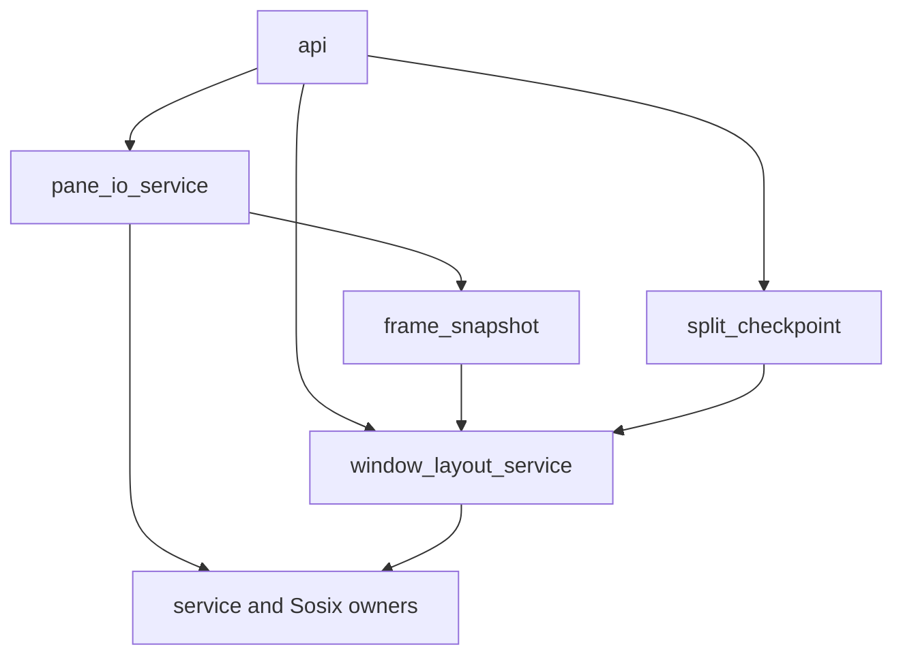

# smux API owner extraction

Mechanical source reorganization against `fbc97292aa1`; the later evidence-only
commit `2ebef3106aa` does not change that source baseline. No public operation or
test expectation is added. Runtime qualification remains NOT_RUN.

## Ownership and dependency boundary

`api.spl` retains all 53 public signatures, `_svc`, attachment leases, closing
session/window IDs, split checkpoints, and the only authoritative commits.
Native pane operations receive an explicit snapshot and return a concrete
update record: `state`, `commit`, and a typed `result`. A public wrapper writes
`_svc` at most once, only when `commit` is true, then returns the result. Helpers
never import or invoke the API, mutate module state, or call API callbacks.

The flag preserves the distinction between refusal and a failed operation
whose state must be retained. In particular, write failure preserves the
updated input queue/error, a provider pending-query failure preserves its input
error, and paste enqueue failure preserves the already-drained screen/replies.
Read-only queries and early refusal retain `commit=false`. The checked PTY
close update carries a plain bool, matching the existing public contract.

Single-pane operations receive the closing predicate as a value. Bulk polling
receives the bounded closing-ID arrays and evaluates the same session/window
membership rule per pane. Neither input flushing nor native draining resumes
for a closing owner. Read budgets, write chunk limits, metrics increments,
provider ordering and returned error text are retained.

`window_layout_service.spl` owns explicit-state split, resize and arrange
calculations plus their existing native resize calls. The API still allocates
the split ID, captures/filters the checkpoint and commits the complete result.
It never imports the checkpoint owner in the reverse direction. Final-window
and session teardown delegation are unchanged; no extracted helper commits a
snapshot after calling a public API operation.

Dependency direction:

## Function mapping

| Public/previous function | Explicit-state owner |
| --- | --- |
| `smux_poll_output` | `pane_poll_state` |
| `smux_pane_spawn`, `smux_pane_spawn_pty` | `pane_spawn_state`, `pane_spawn_pty_state` |
| `smux_pane_is_pty`, `smux_pane_alive`, `smux_pane_close_pty` | `pane_is_pty_state`, `pane_alive_state`, `pane_close_pty_state` |
| `smux_send_text`, `smux_send_command`, `smux_paste_text` | `pane_send_state`, `pane_command_state`, `pane_paste_state` |
| `smux_input_status`, `smux_pane_bracketed_paste` | `pane_input_status_state`, `pane_bracketed_paste_state` |
| `smux_capture`, `smux_capture_styled`, `smux_capture_cells`, `smux_capture_history`, `smux_capture_frame` | Corresponding `pane_capture*_state` helpers |
| `_release_child` | `pane_release_best_effort`, retaining its existing best-effort semantics |
| Private liveness, output cleaning, bounded drain and input-flush helpers | Private functions in `pane_io_service` |
| `smux_split_pane`, `smux_resize`, `_arrange_window` | `split_window_state`, `resize_pane_state`, `arrange_window_state` |

Pure/helper extraction does not qualify any preexisting best-effort cleanup
path: reset, pane removal and failed spawn still have their original behavior.
They are not changed or promoted to checked cleanup by this refactor. Checked
window/session teardown remains in the separate existing lifecycle owners.

## Source gate and remaining evidence

Total lines, including comments and blanks: API 751 (budget 780), pane I/O 461
(budget 600), window layout 271 (budget 600). Baseline API was 1,151 lines.
Static comparison found all 53 public API signatures identical. Source review
checked failure-side commit flags, unchanged native call order, imports and
checkpoint ownership. Static inspection is not a compiled test count or a
runtime PASS. Independent source review completed with no concrete P0/P1/P2
finding; its WARN report is `doc/09_report/smux_api_split_source_review_2026_10_25.md`.
All admitted-producer runtime gates remain separate and NOT_RUN.

Existing production-connected input-queue/protocol, capture/history/frame,
layout/split-rollback, session/window lifecycle and native ConPTY specifications
remain the regression suite. They were not rewritten to mirror the extraction,
and no test, docgen, compiler or product process was launched for this change.
Structured source fingerprints are in
`doc/09_report/smux_api_owner_extraction_2026-10-25.sdn`.

## Configured launch API composition, 2026-10-26

The next source candidate moves six existing read-only queries into
`service_queries.spl`, receiving an explicit ServiceState. Public list-session,
list-client, list-window, active-window, list-pane and focused-pane signatures,
ordering, filters and error text remain unchanged. These helpers hold no global
state and perform no host access. The earlier 53-signature evidence remains
historical; newly added operations are not covered by that old count.

`smux_pane_spawn_configured` adds structured PtyLaunchV1 admission through the
existing configured-launch owner. Revision and closing guards precede native
effects. A failed spawn retaining a concrete pane fd records closing intent and
publishes its returned state once. Provider-global pending cleanup without an
issued pane token must not create pane-close authority. The API forwards launch
fields unchanged; the typed adapter remains responsible for common request
validation before mapping, and the platform provider validates native launch
details. No shell reconstruction or pipe fallback is introduced.

API size after extraction and the new entrypoint is 783 lines. Existing query
regressions remain applicable; the real-child configured-launch spec is being
extended to observe this public API rather than only its explicit-state owner.
All execution, native cleanup and generated-manual gates remain NOT_RUN for
this candidate. Network dispatch and full persistent-server admission are
separate unfinished work.
